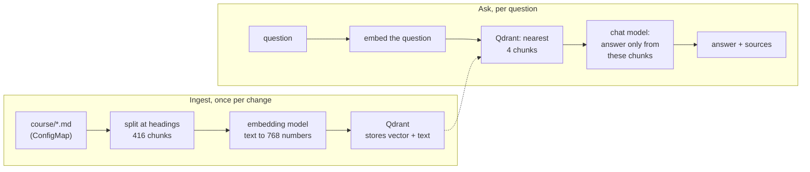
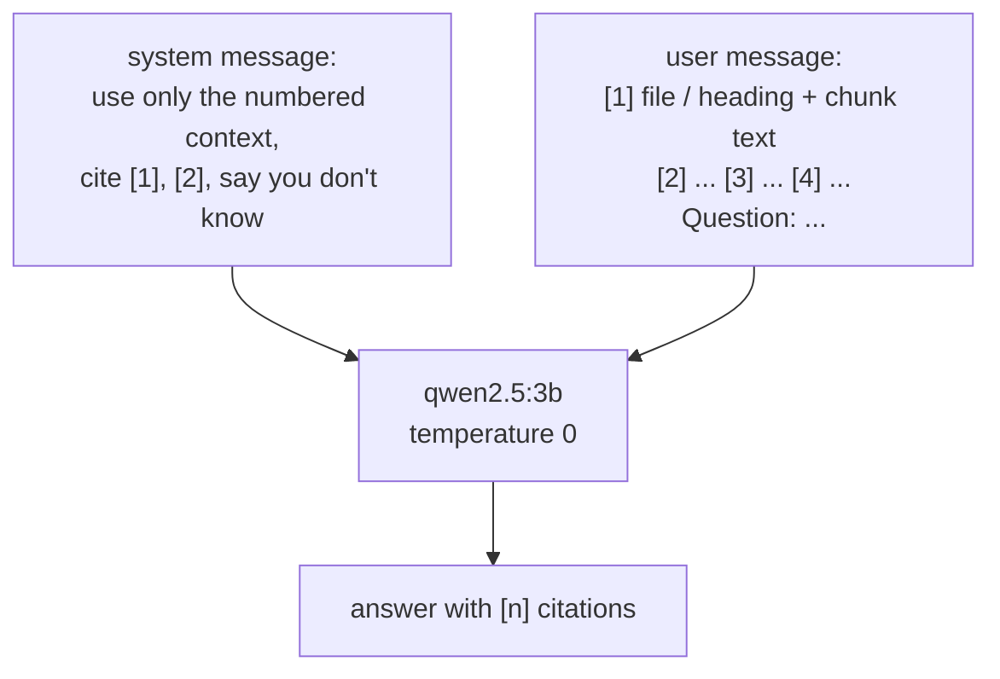

# Module 27: RAG on Kubernetes

> New to a term here, like embedding or vector database? The [glossary](glossary.md) explains every term in this course.

**Before this module:** module 0. Module 17 helps: it introduced RAG with a handful of orders. No Istio needed.

The most common AI system in companies today isn't a chatbot that knows everything. It's a model that answers from *your* documents: runbooks, policies, tickets, wikis. The pattern goes by the name **retrieval-augmented generation (RAG)**: find the passages that match the question, then give them to the model as the only thing it may answer from. This module builds one on Kubernetes, with this course as the documents. You install a vector database, build and ship the service, load the course into it, and then find out where RAG goes wrong.

Time: about 45 minutes. Adds about 200 MB to the cluster, plus the two models in Ollama on your Mac (2.2 GB on disk; the chat model takes about 2 GB of memory while it answers).

## What you need

- Ollama on your Mac, with two models:

  ```bash
  ollama pull nomic-embed-text     # 274 MB: turns text into vectors
  ollama pull qwen2.5:3b           # 1.9 GB: writes the answers
  ```

  The module uses a 3-billion-parameter chat model on purpose: it fits next to the lab on a 24 GB Mac. Bigger models answer better; step 6 shows why that matters less than you'd think.

## Concept: two phases



An **embedding** turns text into a list of numbers (here 768), placed so that texts with similar meaning land close together. "Roll back a bad release" and "git revert brings the app back" share almost no words, but their vectors sit near each other. A **vector database** stores millions of these and finds the nearest ones to a new vector in milliseconds. Qdrant measures closeness as **cosine similarity**: 1 means same direction, 0 unrelated.

## Concept: where RAG goes wrong

| Failure | What happens | Fix |
|---|---|---|
| Retrieval miss | The passage with the answer isn't among the top results, so the model never sees it | better chunking, more results (`TOP_K`), better embedding model, a reranker |
| Model ignores the context | The model answers from what it learned in training, or makes something up | strict prompt, `temperature: 0`, a better model, checking citations |
| Nothing relevant exists | The question is off-topic, and the model answers anyway | refuse below a similarity threshold, a prompt that allows "I don't know" |
| Stale index | The documents changed, the vectors didn't | re-ingest on every change, ideally from CI |

## The bigger picture: RAG in production

Every big AI platform sells RAG as a feature, and many teams build it themselves, because their data mustn't leave the company. On Kubernetes the pieces are ordinary workloads: a vector database (Qdrant, Weaviate, Milvus, or Postgres with pgvector) as a StatefulSet with a volume, an ingestion Job or pipeline, and a stateless query service. The model either runs in the cluster (module 18) or sits behind an API (module 17).

Teams also learn that the hard part isn't the vector database. It's the content: how to split it, how to keep it fresh, how to check that answers are right. Evaluation sets of questions with known answers, run on every change like unit tests, are becoming standard practice.

## Why this way

**Why split at headings?** A chunk should hold one idea. The course's `##` and `###` headings already mark ideas, so each step and concept becomes a chunk, capped at 1,500 characters. Fixed-size chunks cut sentences and tables in half.

**Why does the service talk plain HTTP to Qdrant and Ollama?** So every step is visible in about 150 lines of `apps/rag/main.py`. Frameworks like LangChain or LlamaIndex wrap the same calls.

**Why `temperature: 0`?** The model then always picks its most likely next word, so the same question gets the same answer. In the test run, the same question at the default temperature got a wrong answer once and a right one later. For answers from documents, you want repeatable, not creative.

**Why the docs in a ConfigMap?** It's the simplest way to put files into a pod, and the course is 465 KiB, below the 1 MiB limit. Real systems load documents from Git, object storage or a wiki API in an ingestion job.

**Why point ids from a hash of the text?** Ingesting the same chunk twice overwrites it instead of adding a duplicate, so re-running ingestion is safe.

## Do it

### 1. Install Qdrant

```bash
helm repo add qdrant https://qdrant.github.io/qdrant-helm && helm repo update qdrant
cat course/manifests/27-qdrant-values.yaml
helm install qdrant qdrant/qdrant --version 1.20.0 -n course-rag --create-namespace \
  -f course/manifests/27-qdrant-values.yaml --wait
kubectl -n course-rag get pods,pvc
```

**What you should see.** The install took 24 seconds in the test run. Qdrant runs as a StatefulSet, `qdrant-0`, with a `Bound` 1 GiB volume from k3s' `local-path` storage: the vectors survive a pod restart.

### 2. Build the service and give it to the cluster

```bash
less apps/rag/main.py
docker build -t k8s-lab/rag:1.0.0 apps/rag
k3d image import k8s-lab/rag:1.0.0 -c k8s-lab
```

**What you should see.** A 274 MB image built in about 10 seconds, then `Successfully imported 1 image(s)`. The lab has no registry: `k3d image import` copies the image straight into the node, like the shop's images. Read `main.py` top to bottom: `chunks_of`, `embed`, `search`, then the `/ingest`, `/search` and `/ask` endpoints.

### 3. Give it the documents, and start it

```bash
kubectl -n course-rag create configmap course-docs --from-file=course/
cat course/manifests/27-rag-app.yaml
kubectl apply -f course/manifests/27-rag-app.yaml
kubectl -n course-rag rollout status deploy/rag
kubectl -n course-rag port-forward svc/rag 8090:8000 >/dev/null 2>&1 &
```

**What you should see.** The ConfigMap holds 38 files, 465 KiB. The app reads only the `.md` files. It reaches Ollama on your Mac as `host.docker.internal:11434`, the same way module 17's assistant does.

### 4. Ingest the course

```bash
curl -s -X POST localhost:8090/ingest; echo
kubectl get --raw /api/v1/namespaces/course-rag/services/qdrant:6333/proxy/collections/course | python3 -m json.tool | grep -E "points_count|status"
```

**What you should see.** `"files":30,"chunks":416,"dimensions":768`, with the embedding done in about 7 seconds on the Mac's GPU. Qdrant reports `"points_count": 416` and `"status": "green"`.

### Concept: what a vector search does

Think of each embedding as an arrow from the origin in a space with 768 directions instead of two or three. Texts with similar meaning point in similar directions. A search runs in three moves:

1. The service embeds the question with the same model it used for the chunks. Vectors from another model would live in a different space, and the distances would mean nothing.
2. Qdrant compares the question's arrow with the stored ones by **cosine similarity**, the cosine of the angle between two arrows: 1 for the same direction, 0 for a right angle. The collection says `"distance": "Cosine"` for this reason.
3. Qdrant returns the `k` closest chunks with their scores and stored text.

With 416 chunks, comparing against every one is cheap. With millions, Qdrant uses an **HNSW** index, a graph that links each vector to its near neighbours, and walks it toward the question instead of checking everything. The result is approximate: now and then the walk misses a close chunk, in exchange for answers in milliseconds.

Read the score as a ranking, not a probability. 0.645 doesn't mean "64.5% right"; it means "closer than the chunks below it". What counts as a good score differs per embedding model, so you measure it on your own questions, as step 6 does.

### 5. Look at retrieval on its own

```bash
curl -s -G localhost:8090/search --data-urlencode "q=how do I roll back a bad release with ArgoCD" | python3 -m json.tool
curl -s -G localhost:8090/search --data-urlencode "q=Why does an ArgoCD app show Synced and Degraded at the same time?" --data-urlencode k=10 | python3 -m json.tool
```

**What you should see.** For the rollback question, the top result is `22-gitops-with-argocd.md`, section `5. A bad release, and git revert`, with a score of 0.645: exactly the right passage, although the question shares few words with it. For the second question, look where `Concept: the reconcile loop` lands, the section that explains Synced and Degraded best: in the test run, **7th**, behind module 22's guardrails step and three Investigate sections. With the default of 4 results, the model never sees it. That's a retrieval miss.

### Concept: what the chat model actually receives

The chat model never talks to Qdrant. The service builds one text and sends it to Ollama's `/api/chat`:



Everything the model knows about your documents is in that one message. If retrieval missed the right chunk, no prompt and no bigger model brings it back. The chunks also make up most of the input: every extra result in `TOP_K` adds its full text, and so its tokens, to every question. Step 7 measures that.

### 6. Ask

```bash
ask() { curl -s -X POST localhost:8090/ask -H 'content-type: application/json' -d "{\"question\":\"$1\"}" | python3 -m json.tool; }
ask "Why does an ArgoCD app show Synced and Degraded at the same time?"
ask "Which Kyverno chart version does module 26 install?"
ask "What is the capital of Denmark?"
```

**What you should see.** In the test run:

| Question | Answer | Notes |
|---|---|---|
| Synced and Degraded | "the app's Deployment in the cluster matches Git, but no new pod starts, causing the progress deadline to run out" | right, built from module 26's Investigate answer 4, not from module 22's concept section |
| Kyverno chart version | "3.8.2" | right, from module 26 |
| Capital of Denmark | "I don't know." | the best match scored 0.458, against about 0.7 for course questions |

Each answer took about 3.5 seconds, nearly all of it the chat model: retrieval took 0.04 seconds. The first question used 872 input tokens, mostly the four chunks.

Look at the sources of the first answer: retrieval found *related* text, and the model got lucky that one of the related passages contained the answer. In an earlier run at the default temperature, the same question got a confident wrong answer ("the resources don't match Git"), with no citations at all.

### 7. Trade tokens for recall

```bash
kubectl -n course-rag set env deploy/rag TOP_K=8
kubectl -n course-rag rollout status deploy/rag
kubectl -n course-rag port-forward svc/rag 8090:8000 >/dev/null 2>&1 &
ask "Why does an ArgoCD app show Synced and Degraded at the same time?"
```

**What you should see.** The sources now include `Concept: the reconcile loop`, and the input grows from 872 to about 2,200 tokens for the same question. More results means fewer misses and a higher bill per question; with a hosted model, input tokens cost money, and with a local one, time. Put it back with `kubectl -n course-rag set env deploy/rag TOP_K-`.

## Investigate

1. You edit module 22 and push. A colleague asks the RAG service about the change, and it answers with the old text. Why, and how would you fix it for good?
2. The off-topic question scored 0.458 and course questions about 0.7. How would you use that, and what's the risk?
3. Your company wants to swap `nomic-embed-text` for a better embedding model. What must happen to the data in Qdrant, and why?
4. Step 6 got a correct answer from an unexpected passage. How would you know, across 200 questions, whether a change to chunking or `TOP_K` made things better or worse?

<details>
<summary>Answers</summary>

1. The ConfigMap and the vectors are snapshots: `kubectl create configmap` copied the files once, and `/ingest` embedded them once. Changing Git changes neither. Re-create the ConfigMap and call `/ingest` again; for good, run ingestion from CI on every merge, or a CronJob that pulls from Git. The hashed point ids make repeated ingestion safe, but deleted sections stay in Qdrant unless ingestion also removes points that no longer exist, which this service does by recreating the collection.
2. Refuse to answer when the best score is below a threshold, say 0.55, and reply "I don't know" without calling the chat model: it's faster and cheaper, and the model gets no chance to invent something. The risk is that a badly phrased real question also scores low and gets refused. Pick the threshold from measured scores of real questions, not a guess, and log refusals so you see them.
3. Re-embed everything. Each model places texts in its own space, often with a different number of dimensions: vectors from two models aren't comparable, and the collection's vector size changes. The service recreates the collection on ingest, so a re-ingest after changing `EMBED_MODEL` does it. In production with millions of chunks, teams build the new collection next to the old one and switch when it's ready.
4. Build an evaluation set: questions with the expected source section and key facts of the answer. Measure retrieval (is the expected section in the top k, at which rank?) and answers (does the answer contain the facts?) before and after each change. Running it like a test suite turns "it feels better" into a number, and catches changes that fix one question and break ten.

</details>

## Clean up

```bash
kill %1 %2 2>/dev/null
./course/reset.sh
```

This uninstalls Qdrant and deletes `course-rag`, and the volume with it. The `k8s-lab/rag` image stays in Docker, and the two models stay in Ollama: remove them with `ollama rm nomic-embed-text qwen2.5:3b` if you need the disk space.
