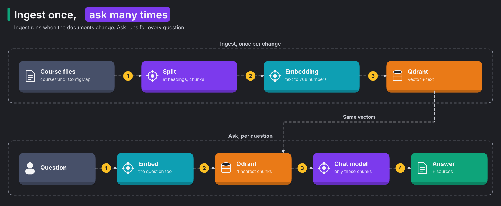
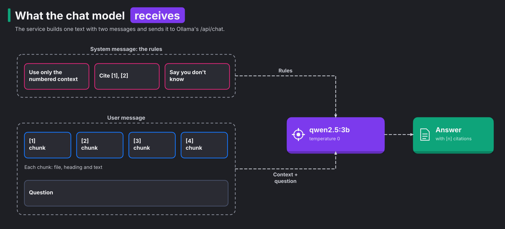

# Module 27: RAG on Kubernetes

> New to a term here, like embedding or vector database? The [glossary](glossary.md) explains every term in this course.

**Before this module:** module 0. Module 17 helps: it introduced RAG with a handful of orders. No Istio needed.

The most common AI system in companies today isn't a chatbot that knows everything. It's a model that answers from *your* documents, such as runbooks, policies, tickets and wikis. A plain chat model has never seen those documents. So the system answers in two moves:

1. The system finds the passages that match the question.
2. The system gives those passages to the model as the only thing it may answer from.

This pattern is called **retrieval-augmented generation (RAG)**. In this module you build one on Kubernetes, with this course as the documents. You install a vector database, build and ship the service, and load the course into it. Then you find out where RAG goes wrong.

Time: about 45 minutes. The module adds about 200 MB to the cluster. The two models in Ollama on your Mac take 2.2 GB on disk, and the chat model takes about 2 GB of memory while it answers.

## What you need

- Ollama on your Mac, with two models:

  ```bash
  ollama pull nomic-embed-text     # 274 MB: turns text into vectors
  ollama pull qwen2.5:3b           # 1.9 GB: writes the answers
  ```

  The module uses a 3-billion-parameter chat model on purpose, because it fits next to the lab on a 24 GB Mac. Bigger models answer better. Step 6 shows why that matters less than you'd think.

### On Linux and WSL (Ubuntu 24.04)

Pods reach Ollama under the name `host.docker.internal`. Plain Docker Engine on Linux doesn't answer that name. If you already did the Ollama setup for module 17 in [Running the lab on Linux and WSL2](../docs/linux-and-wsl.md#the-ai-modules-17-18-19-and-27), nothing more is needed. Otherwise do those two steps first.

## Concept: two phases

A RAG system works in two phases, and the diagram shows both.

Ingest runs once each time the documents change:

1. The service splits the course files at their headings, into chunks.
2. The embedding model turns each chunk into 768 numbers.
3. Qdrant stores each list of numbers together with its text.

Ask runs once for every question:

1. The embedding model turns the question into 768 numbers too.
2. Qdrant finds the 4 nearest chunks.
3. The chat model answers only from those chunks.
4. The service returns the answer with its sources.



An **embedding** is a list of numbers that stands for the meaning of a text. Here each list has 768 numbers, and people call such a list a vector. Think of an embedding as a position on a map of meanings: texts about the same thing sit close together. "Roll back a bad release" and "git revert brings the app back" share almost no words, but their vectors sit near each other.

A **vector database** is a database that stores millions of these vectors. It finds the nearest ones to a new vector in milliseconds. Qdrant, the vector database in this module, measures closeness as **cosine similarity**. A score of 1 means the same direction, and 0 means unrelated.

## Concept: where RAG goes wrong

A RAG answer goes wrong in one of four places. The table lists each failure and its usual fix.

| Failure | What happens | Fix |
|---|---|---|
| Retrieval miss | The passage with the answer isn't among the top results, so the model never sees it | better chunking, more results (`TOP_K`), better embedding model, a reranker |
| Model ignores the context | The model answers from what it learned in training, or makes something up | strict prompt, `temperature: 0`, a better model, checking citations |
| Nothing relevant exists | The question is off-topic, and the model answers anyway | refuse below a similarity threshold, a prompt that allows "I don't know" |
| Stale index | The documents changed, but the vectors didn't | re-ingest on every change, ideally from CI |

## The bigger picture: RAG in production

Every big AI platform sells RAG as a feature. Many teams still build it themselves, because their data mustn't leave the company. On Kubernetes, the pieces are ordinary workloads:

- a vector database, such as Qdrant, Weaviate, Milvus, or Postgres with pgvector, as a StatefulSet with a volume
- an ingestion Job or pipeline, which loads the documents
- a stateless query service, which answers the questions

The model either runs in the cluster (module 18) or sits behind an API (module 17).

Teams also learn that the hard part isn't the vector database. The hard part is the content. Teams must decide how to split it, how to keep it fresh, and how to check that the answers are right. An evaluation set is a list of questions with known answers. Running one on every change, like unit tests, is becoming standard practice.

## Why this way

**Why split at headings?** A chunk is one piece of a document that the service stores and finds on its own. A chunk should hold one idea. The course's `##` and `###` headings already mark ideas. So each step and concept becomes one chunk, capped at 1,500 characters. Fixed-size chunks would cut sentences and tables in half.

**Why does the service talk plain HTTP to Qdrant and Ollama?** To keep every step visible in about 150 lines of `apps/rag/main.py`. Frameworks like LangChain or LlamaIndex wrap the same calls.

**Why `temperature: 0`?** The model then always picks its most likely next word, so the same question gets the same answer. In the test run, the same question at the default temperature got a wrong answer once and a right one later. For answers from documents, you want repeatable answers, not creative ones.

**Why the docs in a ConfigMap?** It's the simplest way to put files into a pod, and the course is 465 KiB, below the 1 MiB limit. Real systems load documents from Git, object storage or a wiki API in an ingestion job.

**Why point ids from a hash of the text?** A point is one stored vector in Qdrant, with its text. Each point's id comes from a hash of the chunk's text. So ingesting the same chunk twice overwrites it instead of adding a duplicate. That makes it safe to re-run ingestion.

## Do it

### 1. Install Qdrant

```bash
helm repo add qdrant https://qdrant.github.io/qdrant-helm && helm repo update qdrant
cat course/manifests/27-qdrant-values.yaml
helm install qdrant qdrant/qdrant --version 1.20.0 -n course-rag --create-namespace \
  -f course/manifests/27-qdrant-values.yaml --wait
kubectl -n course-rag get pods,pvc
```

**What you should see.** In the test run, the install took 24 seconds. Qdrant runs as a StatefulSet pod, `qdrant-0`. It has a `Bound` 1 GiB volume from k3s' `local-path` storage, so the vectors survive a pod restart.

### 2. Build the service and give it to the cluster

```bash
less apps/rag/main.py
docker build -t k8s-lab/rag:1.1.0 apps/rag
k3d image import k8s-lab/rag:1.1.0 -c k8s-lab
```

**What you should see.** Docker built a 274 MB image in about 10 seconds, and then k3d printed `Successfully imported 1 image(s)`. The lab has no registry. Instead, `k3d image import` copies the image straight into the node, like the shop's images. Read `main.py` top to bottom. It defines the functions `chunks_of`, `embed` and `search`, and then the `/ingest`, `/search` and `/ask` endpoints.

### 3. Give it the documents, and start it

```bash
kubectl -n course-rag create configmap course-docs --from-file=course/
cat course/manifests/27-rag-app.yaml
kubectl apply -f course/manifests/27-rag-app.yaml
kubectl -n course-rag rollout status deploy/rag
kubectl -n course-rag port-forward svc/rag 8090:8000 >/dev/null 2>&1 &
```

**What you should see.** The ConfigMap holds 42 files, 637 KiB. A ConfigMap holds at most 1 MiB, so this course fits with room to spare. The app reads only the 33 `.md` files, and it leaves one of them out on purpose: this module itself. The manifest sets `EXCLUDE_FILES: 27-rag-on-kubernetes.md`.

There is a reason for that. This module quotes its own test questions and the answers they got. If the index held them, a question like "What is the capital of Denmark?" would find step 6's table, and the model would repeat what it read there. In other words, the test would leak into the data, like exam answers left inside the textbook. Teams keep evaluation questions out of the index for the same reason.

The app reaches Ollama on your Mac as `host.docker.internal:11434`, the same way module 17's assistant does.

### 4. Ingest the course

```bash
curl -s -X POST localhost:8090/ingest; echo
kubectl get --raw /api/v1/namespaces/course-rag/services/qdrant:6333/proxy/collections/course | python3 -m json.tool | grep -E "points_count|status"
```

**What you should see.** `"files":32,"chunks":543,"dimensions":768,"embed_prefixes":true`, with the embedding done in about 8 seconds on the Mac's GPU. Qdrant reports `"points_count": 543` and `"status": "green"`. Your counts drift a little whenever the course text changes.

### Concept: task prefixes

`nomic-embed-text` learned with a short label in front of every text. Stored passages start with `search_document: ` and questions start with `search_query: `. The label tells the model which side of a search the text is on, so a short question and a long passage that answer each other land closer together.

The app adds both labels for you. That's what `"embed_prefixes":true` means. To see their effect, the test run ingested the course twice, once with `EMBED_PREFIXES=off`:

| Question | Prefixes off | Prefixes on |
|---|---|---|
| What does ztunnel do? | first hit: a ztunnel upgrade step | first hit: module 29's "ztunnel's sockets" |
| Which Kyverno chart version does module 26 install? | first hit: the README's version table | first hit: module 26 itself |
| Synced and Degraded at the same time? | `Concept: the reconcile loop` first, 0.767 | `Concept: the reconcile loop` first, 0.784 |
| Capital of Denmark (off-topic) | best score 0.486 | best score 0.545 |

The prefixes put the more specific passage first. They also raise every score, including off-topic ones. So a score threshold tuned with prefixes off is wrong with prefixes on. Read the model's documentation before you embed anything: other models have their own conventions.

### Concept: what a vector search does

Think of each embedding as an arrow from the origin in a space with 768 directions instead of two or three. Texts with similar meaning point in similar directions. A search runs in three moves:

1. The service embeds the question with the same model it used for the chunks. Vectors from another model would live in a different space, and the distances would mean nothing.
2. Qdrant compares the question's arrow with the stored arrows by cosine similarity. Cosine similarity is the cosine of the angle between two arrows. It's 1 for the same direction and 0 for a right angle. The collection says `"distance": "Cosine"` for this reason.
3. Qdrant returns the `k` closest chunks with their scores and stored text.

With about 540 chunks, comparing the question against every chunk is cheap. With millions of chunks, that gets too slow. So Qdrant uses an **HNSW** index, short for Hierarchical Navigable Small World. HNSW is a graph that links each vector to its near neighbours. Qdrant walks the graph toward the question instead of checking everything. It's like asking for directions in a city: each neighbour points you a bit closer to the address. The result is approximate. Now and then the walk misses a close chunk, but answers come back in milliseconds.

Read the score as a ranking, not a probability. A score of 0.70 doesn't mean "70% right". It means "closer than the chunks below it". Each embedding model gives different scores. So you measure what counts as a good score on your own questions, as step 6 does.

### 5. Look at retrieval on its own

```bash
curl -s -G localhost:8090/search --data-urlencode "q=how do I roll back a bad release with ArgoCD" | python3 -m json.tool
curl -s -G localhost:8090/search --data-urlencode "q=Why is my pod stuck in Pending?" --data-urlencode k=10 | python3 -m json.tool
```

**What you should see.** For the rollback question, every result in the top five comes from the right place, mostly module 22. The step that does the rollback, `5. A bad release, and git revert`, came second in the test run (score 0.691), just behind module 22's Investigate section (0.703). The question shares few words with it, and the search still found it. That's the strength of embeddings.

The second question shows the weakness. The section that answers it best is module 29's `4. Make the scheduler say no`: it makes two pods stay Pending and reads the scheduler's reasons. In the test run, it came **8th**. Ahead of it were seven passages that mention pods and problems: a network failure in module 21, an alert in module 23, PodDisruptionBudgets in module 20. With the default of 4 results, the model never sees the right section. That's a retrieval miss.

### Concept: what the chat model actually receives

The chat model never talks to Qdrant. Instead, the service builds one text and sends it to Ollama's `/api/chat`. The text has two messages, as the diagram shows:

- The system message sets the rules. The model must use only the numbered context, cite sources as [1], [2], and say when it doesn't know.
- The user message holds the numbered chunks, each with its file and heading, and then the question.



Everything the model knows about your documents is in that one message. If retrieval missed the right chunk, no prompt and no bigger model brings it back.

The chunks also make up most of the input. A token is a piece of a word, and models count their input in tokens. Every extra result in `TOP_K` adds its full text, and so its tokens, to every question. Step 7 measures that.

### 6. Ask

```bash
ask() { curl -s -X POST localhost:8090/ask -H 'content-type: application/json' -d "{\"question\":\"$1\"}" | python3 -m json.tool; }
ask "Why is my pod stuck in Pending?"
ask "Which Kyverno chart version does module 26 install?"
ask "What is the capital of Denmark?"
```

**What you should see.** In the test run:

| Question | Answer | Notes |
|---|---|---|
| Pod stuck in Pending | "a PodDisruptionBudget (PDB) can cause a pod to be stuck in the Pending state" | wrong, and confident. A PDB never keeps a pod Pending. The model had only the four related passages from step 5 |
| Kyverno chart version | "3.8.2" | right, from module 26 |
| Capital of Denmark | "I don't know." | right. The best match scored 0.545, against about 0.70 to 0.78 for course questions |

Answers took 0.7 to 2.7 seconds, nearly all of it the chat model. Retrieval took 0.03 to 0.05 seconds. The first question used 1,024 input tokens, mostly the four chunks.

Look at the first answer's sources. Retrieval found *related* text, about pods and things that go wrong, and the model built a plausible answer from it. The model followed its rules: it used only the context and cited it. The context was simply the wrong context. That's the most common way RAG fails, and no better prompt fixes it.

### 7. Trade tokens for recall

```bash
kubectl -n course-rag set env deploy/rag TOP_K=8
kubectl -n course-rag rollout status deploy/rag
kubectl -n course-rag port-forward svc/rag 8090:8000 >/dev/null 2>&1 &
ask "Why is my pod stuck in Pending?"
```

**What you should see.** The sources now include `4. Make the scheduler say no`, in 8th place. The answer changes with it: it now names the scheduler, which finds no node with enough resources or with matching labels. Some of the earlier noise stays in, because the PDB passage is still among the eight. The input grows from 1,024 to 2,332 tokens for the same question.

More results means fewer misses and a higher bill per question. With a hosted model, input tokens cost money. With a local one, they cost time. Put it back with `kubectl -n course-rag set env deploy/rag TOP_K-`.

## Investigate

1. You edit module 22 and push. A colleague asks the RAG service about the change, and it answers with the old text. Why, and how would you fix it for good?
2. The off-topic question scored 0.545 and course questions 0.70 to 0.78. How would you use that, and what's the risk?
3. Your company wants to swap `nomic-embed-text` for a better embedding model. What must happen to the data in Qdrant, and why?
4. Step 7 fixed one question by raising `TOP_K`. How would you know, across 200 questions, whether a change to chunking or `TOP_K` made things better or worse?

<details>
<summary>Answers</summary>

1. The ConfigMap and the vectors are snapshots. `kubectl create configmap` copied the files once, and `/ingest` embedded them once. Changing Git changes neither. For a quick fix, re-create the ConfigMap and call `/ingest` again. To fix it for good, run ingestion from CI on every merge, or from a CronJob that pulls from Git. The hashed point ids make repeated ingestion safe. But deleted sections stay in Qdrant unless ingestion also removes points that no longer exist. This service handles that by recreating the collection.
2. Refuse to answer when the best score is below a threshold, say 0.62. Reply "I don't know" without calling the chat model. That's faster and cheaper, and the model gets no chance to invent something. The risk is that a badly phrased real question also scores low and gets refused. Pick the threshold from measured scores of real questions, not a guess. Log the refusals so you see them.
3. Re-embed everything. Each model places texts in its own space, often with a different number of dimensions. So vectors from two models aren't comparable, and the collection's vector size changes. The service recreates the collection on ingest, so a re-ingest after changing `EMBED_MODEL` does the job. In production with millions of chunks, teams build the new collection next to the old one. They switch when it's ready.
4. Build an evaluation set. Each entry holds a question, the expected source section and the key facts of the answer. Before and after each change, measure two things:
   - whether retrieval puts the expected section in the top k, and at which rank
   - whether the answer contains the expected facts

   Running the set like a test suite turns "it feels better" into a number. It also catches changes that fix one question and break ten.

</details>

## Clean up

```bash
kill %1 %2 2>/dev/null
./course/reset.sh
```

This uninstalls Qdrant and deletes `course-rag`, and the volume with it. The `k8s-lab/rag` image stays in Docker, and the two models stay in Ollama. Remove them with `ollama rm nomic-embed-text qwen2.5:3b` if you need the disk space.
