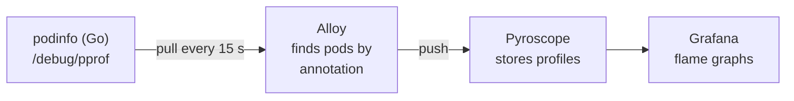
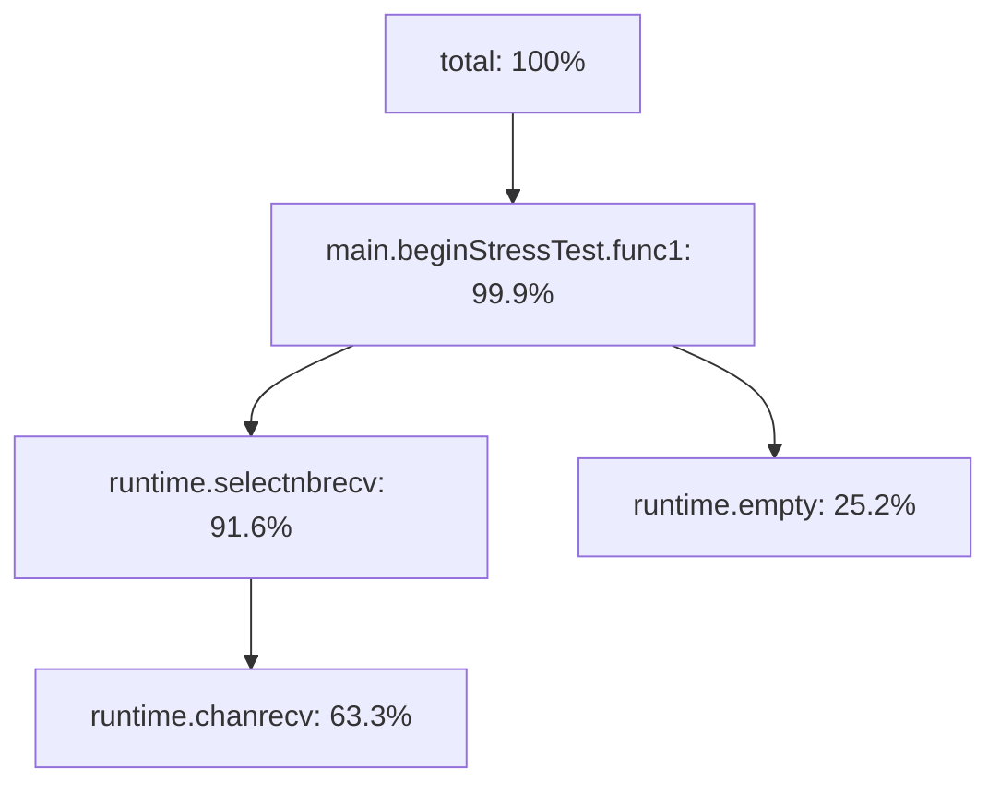

# Module 28: continuous profiling with Pyroscope

> New to a term here, like flame graph or pprof? The [glossary](glossary.md) explains every term in this course.

**Before this module:** module 0. Module 24 helps for Grafana. No Istio needed.

Metrics tell you a service uses a whole CPU core. Traces tell you which request was slow. Neither tells you *which line of code* burns the CPU or fills the memory. That's what a **profile** answers, and **continuous profiling** collects profiles from every service, all the time, so you look at last Tuesday's 3 a.m. spike after the fact instead of trying to reproduce it. People call profiles the fourth signal, next to metrics, logs and traces. This module installs **Grafana Pyroscope**, opts a Go app into profiling with two annotations, and reads the flame graphs.

Time: about 35 minutes. Adds about 350 MB of memory while it runs.

## Concept: how profiles get to Pyroscope



Go programs ship a profiler, **pprof**, in the standard library: an HTTP endpoint that answers "where did the CPU go in the last 15 seconds?" and "who allocated memory?". The **Alloy** agent that comes with the Pyroscope chart watches all pods, and pulls profiles from those that carry annotations such as `profiles.grafana.com/cpu.scrape: "true"`. For languages without a built-in endpoint, an SDK pushes profiles instead, or an eBPF profiler samples every process on the node from the kernel, with no change to the app at all.

## Concept: reading a flame graph



Each bar is a function, and its width is the share of samples where that function was on the call stack. Each function sits one level below the function that called it; Grafana draws the root at the top. Two numbers matter:

| Number | Means | Use it for |
|---|---|---|
| **Self** | Samples where the CPU was *inside* this function | the hottest code in the narrow sense |
| **Total** | Samples where this function was anywhere on the stack | the code that *caused* the work |

The diagram is this module's real result. By self time, the top three were Go runtime functions, which says nothing useful. By total time, one of podinfo's own functions owns 99.9%. Look for the widest bar that's *your* code.

## The bigger picture: why always on

Classic profiling is an incident tool: someone connects a profiler to a production process, captures 30 seconds, and hopes the problem shows up in that window. Continuous profilers sample at a low rate all the time, typically costing 1 to 2% of CPU, and keep the history. Teams use them to cut cloud bills (find the function that wastes a third of the fleet's CPU), to compare releases (diff two time ranges), and to explain spikes after the fact.

The space consolidated around open formats: Pyroscope, now part of Grafana, stores pprof data, and OpenTelemetry added profiles as a signal. Grafana links all four signals: from a slow span in Tempo to the profile of exactly that request, when the app sends span ids with its profiles.

## Why this way

**Why opt in with annotations?** Profiling adds work to each scrape: the app must collect and serialize the profile. The team that owns a service decides to opt in, in its own Deployment, and nobody edits central configuration. Step 5 shows the cost.

**Why podinfo with `--stress-cpu`?** A real app under real load spreads its CPU across many functions. podinfo's stress flag burns a core in one known function, so you check that the flame graph points at the right place before you trust it with an unknown problem.

**Why a CPU limit of 500m?** So you also see the limit in the numbers: podinfo wants a whole core and gets half.

## Do it

### 1. Install Pyroscope

```bash
helm repo add grafana https://grafana.github.io/helm-charts && helm repo update grafana
cat course/manifests/28-pyroscope-values.yaml
helm install pyroscope grafana/pyroscope --version 2.4.2 -n course-profiling --create-namespace \
  -f course/manifests/28-pyroscope-values.yaml --wait
kubectl -n course-profiling get pods
kubectl get clusterrole pyroscope-alloy
```

**What you should see.** The install took 81 seconds in the test run. Two pods: `pyroscope-0`, which stores and queries profiles, and `pyroscope-alloy-0`, the agent. Alloy got a **ClusterRole**, because it watches pods in every namespace.

### 2. Opt an app in

```bash
cat course/manifests/28-podinfo.yaml
kubectl apply -f course/manifests/28-podinfo.yaml
kubectl -n course-profiling rollout status deploy/podinfo
kubectl -n course-profiling exec deploy/podinfo -- wget -qO- localhost:9898/debug/pprof/ | head -5
```

**What you should see.** An HTML page titled `/debug/pprof/`, listing profiles such as `allocs`, `goroutine`, `heap` and `profile`: Go's built-in profiler. The Deployment's annotations tell Alloy which of them to fetch (`cpu`, `memory`, `goroutine`), from which port (`http`), and under which service name.

### Concept: how a sampling profiler counts

A profiler doesn't trace every function call: that would slow the program down badly. It samples. Go's CPU profiler sets a timer that fires 100 times per second of CPU time. On each tick, the runtime records the call stack of the code running at that moment. When Alloy calls `/debug/pprof/profile?seconds=N`, Go turns this on for N seconds and returns all the stacks it collected, with a count for each distinct stack.

That gives every sample a meaning you check by hand: one sample is 10 ms of CPU. A thread that waits on the network or sleeps uses no CPU, so it produces no CPU samples at all. Count the samples, multiply by 10 ms, and you get CPU-seconds, the number step 3 compares with `kubectl top`.

The flame graph then merges identical stacks. Two samples with the same chain `main → beginStressTest.func1 → selectnbrecv` add to the same bars. Two consequences:

| Looks like | Actually means |
|---|---|
| the x-axis is time | it isn't: left-to-right order says nothing about when code ran, only the width counts |
| a function missing from the graph never ran | it ran too briefly to land in a sample; rare work stays invisible at 100 samples per second |

Memory profiles sample too, but by bytes: Go records the stack of roughly one allocation per 512 KiB allocated, and scales the counts up. The shares in step 4 are estimates, which is why they move between test runs.

### 3. Find the hot code

```bash
kubectl apply -f course/manifests/28-pyroscope-datasource.yaml
```

Wait a minute, then open Grafana, Explore, data source **Pyroscope**. Pick the profile type `process_cpu - cpu`, the label `service_name = podinfo`, and run the query.

**What you should see.** A flame graph with one wide bar near the top: `main.beginStressTest.func1`, 99% to 100% of total CPU in the test runs. Switch the table next to it between **Self** and **Total**: by self time, `runtime.chanrecv`, `runtime.selectnbrecv` and `runtime.empty` lead, because the stress loop spends its time inside Go's channel code. The service list also shows `course-profiling/alloy` and `course-profiling/pyroscope`: both profile themselves.

Check it against `kubectl`:

```bash
kubectl top pod -n course-profiling -l app=podinfo
```

**What you should see.** About `500m`: podinfo runs at its CPU limit. In the test run, Pyroscope counted 132.5 CPU-seconds in five minutes, 0.44 of a core, which matches.

### 4. Who allocates memory

In the same Explore view, switch the profile type to `memory - alloc_space`.

**What you should see.** `main.beginStressTest` again, here through `os.ReadFile`: the `--stress-memory` flag reads a file over and over. Its share of all allocations was between 46% and 91% in the test runs, depending on the time window, because something else allocates too: next step.

### 5. The cost of watching

Still on `alloc_space`, find `net/http.(*conn).serve` in the table and click it to focus the graph on it.

**What you should see.** In one test run, 36% of podinfo's allocations came from serving HTTP requests, and podinfo gets almost no traffic. Most of those requests are Alloy fetching profiles every 15 seconds: the profiler's own cost, visible in the profile. On a busy service it's a small share, but it's never zero, and it's the reason profiling is opt-in.

## Investigate

1. Your Python service has no pprof endpoint. What are your two options for profiling it in this setup, and what does each need?
2. A new release raises a service's CPU use by 30%. How would you find the responsible code with Pyroscope?
3. The flame graph's widest self-time bar is `runtime.mallocgc` (Go's memory allocator). What does that tell you, and where do you look next?
4. Why does `alloc_space` show a different picture from the pod's memory use in `kubectl top`?

<details>
<summary>Answers</summary>

1. Add the Pyroscope SDK to the app, which pushes profiles to Pyroscope directly, with no annotations needed. Or run an eBPF profiler (Alloy's `pyroscope.ebpf` component) as a DaemonSet with privileged access to the node: it samples every process on the node from the kernel, with no code change, at the cost of less detail for interpreted languages.
2. Compare two time ranges: Grafana's Pyroscope view has a diff mode that colours functions by how much more or less CPU they used after the release. Label profiles with the version (an annotation or label that becomes a profile label), and compare `version=old` with `version=new` directly.
3. The program spends its CPU allocating memory, so the real cause sits in whatever allocates too much. Switch to `alloc_space` or `alloc_objects`: the widest bars there are the code that creates the garbage. Fewer allocations then also mean less garbage collection, so the fix helps twice.
4. `alloc_space` counts every byte ever allocated in the window, including memory that the garbage collector freed a millisecond later. `kubectl top` shows what the container holds right now. A function that allocates and frees a lot dominates `alloc_space` and barely moves `kubectl top`; for what's held, use `inuse_space`.

</details>

## Clean up

```bash
./course/reset.sh
```

This uninstalls Pyroscope first, because Alloy's ClusterRole outlives the namespace, then deletes `course-profiling` and removes the Pyroscope data source from Grafana with a `deleteDatasources` file, as module 25 does for Tempo.
