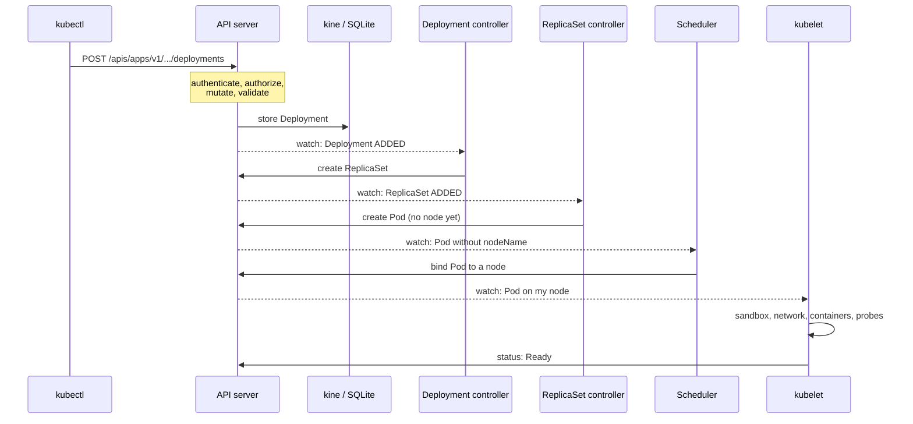

# Module 29: the life of a request

> New to a term here, like admission webhook, conntrack or HBONE? The [glossary](glossary.md) explains every term in this course.

**Before this module:** module 0. Parts 1 and 2 need no Istio; part 3 builds on modules 1 and 2 (ambient mode, ztunnel, mTLS identity) and refers to module 3's policies.

You type `curl localhost:8080/api/orders` and get JSON back about 20 milliseconds later. On the way, the bytes cross a Docker port mapping, an nginx, two network address translations (one DNAT, one SNAT), a gateway proxy, four encrypted tunnels with four different identities, a Layer 7 proxy that checks a policy, two applications and a database. And before any of that, a pod had to exist: an API call, authentication, authorization, admission, storage, three controllers, a scheduler, a kubelet, a container runtime and two network plugins.

This module follows all of it, on your lab, with a command for every hop. Part 1 brings a pod to life. Part 2 sends a request in plain Kubernetes, with no mesh. Part 3 sends one through the shop's ambient mesh. Compare parts 2 and 3, and you see exactly what a mesh adds.

Time: about 75 minutes. Adds almost nothing: one small nginx and a client.


For the long read, [docs/life-of-a-request.md](../docs/life-of-a-request.md) walks the same path with four detailed diagrams, packet captures, the Layer 2 and 3 plumbing, and the real output of every command. This module is the hands-on version.

The diagram is also in [Excalidraw format](../docs/diagrams/life-of-a-request.excalidraw): open it at [excalidraw.com](https://excalidraw.com) to zoom, move and annotate. `docs/diagrams/make-life-of-a-request.py` generates both files.

## Part 1: a pod comes to life

### Concept: one object, many independent workers



Nobody gives orders. Every component **watches** the API server for the objects it cares about, compares what exists with what should exist, and acts to close the gap: the **reconcile loop**. The Deployment controller never talks to the scheduler; it writes a ReplicaSet, and the next worker notices. That's why Kubernetes heals itself: delete a pod, and the ReplicaSet controller sees one too few and creates another, without anyone asking.

### Concept: inside the API server

Every request passes the same gates, in this order:

| Gate | Question | In this lab |
|---|---|---|
| Authentication | Who are you? | client certificates signed by the cluster's client CA; service accounts use signed tokens; `--anonymous-auth=false` |
| Authorization | May you do this? | `--authorization-mode=Node,RBAC`: the Node authorizer for kubelets, then RBAC |
| Mutating admission | Should the object change? | built-in plugins, then webhooks: Istio's sidecar injector, Kyverno (module 26) |
| Validation | Is the object well-formed? | the API schema, built-in rules |
| Validating admission | Is it allowed? | `NodeRestriction`, ValidatingAdmissionPolicy, webhooks such as Istio's config validation |
| Storage | Write it, give it a `resourceVersion` | `--etcd-servers=unix://kine.sock`: k3s' kine translates etcd calls to SQLite |

A refusal at any gate goes straight back to the client. Nothing gets stored, and no controller ever hears of it.

### 1. See what kubectl sends, and who you are

```bash
kubectl apply -f course/manifests/29-plain-app.yaml -v=6 2>&1 | grep -oE 'verb="[A-Z]+" url="[^"]*" status="[^"]*"' | grep -v openapi | head -6
kubectl auth whoami
kubectl auth can-i create deployments -n course-life
kubectl auth can-i create deployments -n course-life --as=system:serviceaccount:shop:frontend
```

**What you should see.** REST calls such as `verb="POST" url=".../apis/apps/v1/namespaces/course-life/deployments..."`: `kubectl apply` is an HTTP client. The URL names the API group (`apps`), version (`v1`), namespace and resource. `whoami` says `system:admin` in the groups `system:masters` and `system:authenticated`. You get `yes`, the frontend's service account `no`. Members of `system:masters` skip RBAC entirely, which is why that group belongs only in break-glass credentials.

### 2. Watch the controllers hand the work along

```bash
kubectl -n course-life get events --sort-by=.firstTimestamp \
  -o custom-columns=WHO:.source.component,KIND:.involvedObject.kind,REASON:.reason,MESSAGE:.message | grep -v client
P=$(kubectl -n course-life get pod -l app=hello -o jsonpath='{.items[0].metadata.name}')
kubectl -n course-life get pod $P -o jsonpath='{.metadata.ownerReferences[0].kind}/{.metadata.ownerReferences[0].name}{"\n"}'
kubectl -n course-life get pod $P -o jsonpath='{range .status.conditions[*]}{.type}={.lastTransitionTime}{"\n"}{end}'
```

**What you should see.** In the test run, all within two seconds:

| Who | Event |
|---|---|
| deployment-controller | `ScalingReplicaSet`: Scaled up replica set hello-76fb6c6b6f to 1 |
| replicaset-controller | `SuccessfulCreate`: Created pod hello-76fb6c6b6f-plkh6 |
| default-scheduler | `Scheduled`: assigned to k3d-k8s-lab-server-0 |
| kubelet | `Pulled` (already present on machine), `Created`, `Started` |

The pod's owner is `ReplicaSet/hello-76fb6c6b6f`, whose owner is `Deployment/hello`. These owner references let `kubectl delete deployment` remove everything below it, through the garbage collector. The pod's conditions run from `PodScheduled` to `Ready` in about a second, because the node already had the image.

### 3. See what a controller sees

```bash
kubectl get --raw "/api/v1/namespaces/course-life/pods?watch=1&timeoutSeconds=3&labelSelector=app%3Dhello"
```

**What you should see.** One JSON line, starting with `{"type":"ADDED","object":{"kind":"Pod"...`, with a `resourceVersion` (21586 in the test run). Controllers hold a watch like this open all the time; when something changes, `MODIFIED` or `DELETED` lines arrive. The `resourceVersion` lets a watcher resume where it stopped after a reconnect.

### 4. Make the scheduler say no

```bash
kubectl -n course-life run greedy --image=nginx:1.27-alpine \
  --overrides='{"spec":{"containers":[{"name":"greedy","image":"nginx:1.27-alpine","resources":{"requests":{"memory":"64Gi"}}}]}}'
kubectl -n course-life run picky --image=nginx:1.27-alpine --overrides='{"spec":{"nodeSelector":{"disktype":"ssd"}}}'
sleep 5; kubectl -n course-life get events --field-selector reason=FailedScheduling -o jsonpath='{range .items[*]}{.message}{"\n"}{end}'
kubectl describe node k3d-k8s-lab-server-0 | grep -A6 "Allocated resources"
kubectl -n course-life delete pod greedy picky
```

**What you should see.** `0/1 nodes are available: 1 Insufficient memory. preemption: 0/1 nodes are available: 1 No preemption victims found for incoming pod.` and `didn't match Pod's node affinity/selector`. The scheduler works in phases: **filter** removes nodes unfit for the pod (not enough free requests, wrong labels, taints, ports in use), **score** ranks the rest (spread, image already present, balance), and **bind** writes `spec.nodeName`. With no node left after filtering, it tries **preemption**: evicting lower-priority pods. Here there was nothing to evict, so both pods stay `Pending`.

Look at the node's allocations: in the test run, memory requests added up to 30%, limits to **106%**. The scheduler only counts requests, so limits overcommit the node. If every pod used its full limit at once, the kernel's OOM killer would pick victims.

### 5. Make admission say no

```bash
kubectl -n course-life create deployment bad --image=nginx:1.27-alpine --replicas=-1 --dry-run=client -o yaml | kubectl apply -f -
printf 'apiVersion: security.istio.io/v1\nkind: AuthorizationPolicy\nmetadata:\n  name: broken\n  namespace: course-life\nspec:\n  rules:\n  - when:\n    - key: request.colour\n      values: ["blue"]\n' | kubectl apply -f -
```

**What you should see.** `spec.replicas: Invalid value: -1: must be greater than or equal to 0`: the API server's own validation. Then `invalid policy broken.course-life: ... unknown attribute: request.colour`: Istio's validating webhook. Neither object exists afterwards. Admission is where tools like Istio and Kyverno plug into every write in the cluster.

### 6. The kubelet's side: sandbox, network, probes

The kubelet asked containerd (over CRI) for a **sandbox**, a `pause` container that owns the pod's network namespace. Then containerd ran the **CNI** chain: flannel gave the pod an IP from this node's range and plugged it into the `cni0` bridge with a veth pair. In ambient namespaces, the istio-cni plugin then adds iptables rules inside the pod (part 3). Then the image, the container, and the readiness probe. Once ready, the **EndpointSlice controller** adds the pod's IP to its Service, and three consumers react: kube-proxy writes iptables rules, CoreDNS answers for the name, and istiod pushes the endpoint to ztunnel and the waypoints.

```bash
docker exec k3d-k8s-lab-server-0 crictl pods --namespace course-life
docker exec k3d-k8s-lab-server-0 ip route
kubectl -n course-life get endpointslice -l kubernetes.io/service-name=hello -o jsonpath='{range .items[*].endpoints[*]}{.addresses[0]} ready={.conditions.ready}{"\n"}{end}'
```

**What you should see.** The pod's sandbox in `crictl pods`. The node's routes: `10.42.0.0/24 dev cni0`, the pods on this node, and a default route out of `eth0`. With more nodes, flannel adds a route per node through its VXLAN interface. The EndpointSlice lists `10.42.0.33 ready=true` (your IP differs).

## Part 2: scenario A, a request without a mesh

### Concept: a Service is a rewrite rule

A ClusterIP doesn't belong to any machine: nothing listens on it. kube-proxy turns each Service into iptables rules on every node, and the kernel rewrites the destination of each new connection to one pod (DNAT). **conntrack** remembers the rewrite, so replies get the original address back.

### 7. Follow one request

```bash
kubectl -n course-life exec deploy/client -- cat /etc/resolv.conf
kubectl -n course-life exec deploy/client -- curl -sv -o /dev/null http://hello 2>&1 | grep -E "Trying|Connected|< HTTP"
SVCIP=$(kubectl -n course-life get svc hello -o jsonpath='{.spec.clusterIP}')
docker exec k3d-k8s-lab-server-0 sh -c "iptables-save -t nat | grep course-life/hello"
docker exec k3d-k8s-lab-server-0 conntrack -L -d $SVCIP 2>/dev/null
```

**What you should see.** Step by step, from the test run:

1. **DNS.** `resolv.conf` says `nameserver 10.43.0.10` (CoreDNS), `search course-life.svc.cluster.local svc.cluster.local cluster.local`, `ndots:5`. `hello` has fewer than five dots, so the resolver tries `hello.course-life.svc.cluster.local` first, and CoreDNS answers with the ClusterIP.
2. **Connect.** `Trying 10.43.57.32:80... Connected to hello`. The packet leaves the client pod through its veth into the node.
3. **DNAT.** In the node's `nat` table: `KUBE-SERVICES` matches `-d 10.43.57.32/32 --dport 80` and jumps to `KUBE-SVC-KJCW...`, which picks an endpoint (with more pods, by random probability) and jumps to `KUBE-SEP-2DZN...`, which rewrites the destination: `DNAT --to-destination 10.42.0.33:80`.
4. **Deliver.** The kernel routes `10.42.0.33` through `cni0` to the nginx pod's veth. nginx sees a plain TCP connection from the client pod's IP.
5. **Return.** conntrack holds both directions: `src=10.42.0.35 dst=10.43.57.32 dport=80` going out, `src=10.42.0.33 dst=10.42.0.35 sport=80` coming back. It rewrites the reply's source back to `10.43.57.32`, so the client never learns the pod's IP.

What's missing is as important as what's there: **no identity** (nginx only knows an IP), **no encryption**, **no policy** unless a NetworkPolicy says otherwise, and **no per-request metrics or traces**. Any pod in the cluster may connect.

## Part 3: scenario B, a request through the ambient mesh

### Concept: the same Kubernetes plumbing, plus identity at every hop

The kernel still does the DNATs, but now each connection between pods runs inside an **HBONE** tunnel: HTTP CONNECT over mutual TLS, to port 15008. Each end proves its identity with a certificate for its service account (a SPIFFE ID), and every hop checks policy.

### 8. From your Mac to the gateway pod

```bash
docker port k3d-k8s-lab-serverlb
docker exec k3d-k8s-lab-serverlb grep -A3 "upstream 8080_tcp" /etc/nginx/nginx.conf
kubectl -n shop-ingress get svc shop-gateway-istio
docker exec k3d-k8s-lab-server-0 iptables -t nat -S PREROUTING
curl -s -o /dev/null localhost:8080/
docker exec k3d-k8s-lab-server-0 sh -c 'iptables -t nat -L -v -n | grep -E "shop-gateway-istio:http loadbalancer IP|DNAT .*dpt:8080 to:"'
docker exec k3d-k8s-lab-server-0 conntrack -L -p tcp -d 192.168.107.2 --dport 8080 2>/dev/null | head -1
kubectl -n shop-ingress get pod -l gateway.networking.k8s.io/gateway-name=shop-gateway -o wide
```

**What you should see.** Four hops before any Istio component:

1. Docker maps your Mac's `0.0.0.0:8080` to port 8080 of the `k3d-k8s-lab-serverlb` container.
2. That container runs **nginx in TCP stream mode**: `upstream 8080_tcp { server k3d-k8s-lab-server-0:8080; }`. It opens a new connection to the node from its own address (`192.168.107.3` in the test run).
3. On the node, the Service of type LoadBalancer has the node's own IP as its external IP (`192.168.107.2`). Two sets of rules want this packet. k3s's **ServiceLB** runs a `svclb-...` pod with a host port, and the CNI wrote a host port DNAT for it. kube-proxy wrote a rule for the load balancer IP. `PREROUTING` jumps to kube-proxy's `KUBE-SERVICES` **first**, so kube-proxy wins: its rule `-d 192.168.107.2/32 ... --dport 8080` jumps to `KUBE-EXT-EIP2...`, which marks the packet for masquerade, then `KUBE-SVC-EIP2...` → `KUBE-SEP-...` DNATs it to the gateway pod (`10.42.0.88:8080`). The packet counters prove it: in the test run, the load balancer IP rule had matched 33 connections and the host port DNAT none.
4. On the way out to the pod, `KUBE-POSTROUTING` sees the mark and applies `MASQUERADE --random-fully`: the source becomes `10.42.0.1`, the node's address on the pod network, with a new port. The conntrack entry shows both rewrites in one line: `src=192.168.107.3 dst=192.168.107.2 dport=8080` going in, `src=10.42.0.88 dst=10.42.0.1` coming back.

One DNAT and one SNAT, both remembered by conntrack, and the gateway pod sees a plain TCP connection from the node. That SNAT is why the gateway never learns your Mac's address: a Service with `externalTrafficPolicy: Cluster` (the default) always hides the client this way.

### 9. The gateway opens a tunnel to the frontend

```bash
GW=$(kubectl -n shop-ingress get pod -l gateway.networking.k8s.io/gateway-name=shop-gateway -o name)
istioctl proxy-config routes $GW -n shop-ingress | head -3
istioctl proxy-config endpoints $GW -n shop-ingress | grep frontend
kubectl get ns shop-ingress shop -L istio.io/dataplane-mode
```

**What you should see.** Route `http.8080` matches `/*` and sends it to `frontend.shop` (from the shop's HTTPRoute). The endpoint is `envoy://connect_originate/10.42.0.13:3000`: the gateway's Envoy **itself** opens the HBONE tunnel to the frontend pod, with its own certificate. The gateway's namespace `shop-ingress` isn't in ambient mode, and doesn't need to be: it's already an Envoy that speaks HBONE.

### 10. Inside the frontend pod: ztunnel's sockets

```bash
CID=$(docker exec k3d-k8s-lab-server-0 crictl ps --name frontend -q | head -1)
PID=$(docker exec k3d-k8s-lab-server-0 crictl inspect --output go-template --template '{{.info.pid}}' $CID)
docker exec k3d-k8s-lab-server-0 nsenter -t $PID -n iptables-save | grep -E "REDIRECT|15008"
docker exec k3d-k8s-lab-server-0 sh -c "cat /proc/$PID/net/tcp /proc/$PID/net/tcp6" \
  | python3 -c 'import sys; print(sorted({int(l.split()[1].split(":")[1],16) for l in sys.stdin if len(l.split())>3 and l.split()[3]=="0A"}))'
```

**What you should see.** The second command enters the frontend pod's network namespace through its process id. istio-cni wrote these rules there:

| Rule | Meaning |
|---|---|
| `REDIRECT --to-ports 15001` for outgoing TCP | every connection the app opens goes to ztunnel's outbound socket |
| `REDIRECT --to-ports 15006` for incoming TCP, except to 15008 | plain-text arrivals go to ztunnel's inbound socket |
| `REDIRECT --to-ports 15053` for DNS on port 53 | ztunnel answers DNS (the lab enables DNS capture) |
| packets marked `0x539` pass untouched | ztunnel's own traffic, so it doesn't loop |

The listening ports: `[3000, 15001, 15006, 15008, 15053]`. Port 3000 is the app; the other four are **ztunnel's sockets, inside the pod's own network namespace**, although ztunnel runs as a pod of its own. ztunnel created them there. So the gateway's tunnel ends at `10.42.0.13:15008` inside the frontend pod, ztunnel checks the gateway's identity and any L4 policy, decrypts, and hands the bytes to `:3000`. Plain text never leaves the pod.

### 11. The frontend calls the backend: four identities

The frontend app opens `http://backend.shop.svc.cluster.local:8000` like any app. Its DNS query goes to ztunnel (15053), its TCP connection to ztunnel's outbound socket (15001). ztunnel knows from istiod that the backend Service uses a waypoint, so it tunnels to the waypoint instead.

```bash
kubectl -n istio-system logs ds/ztunnel --since=60m | grep 'connection complete' \
  | grep -E 'src.workload="(shop-gateway|frontend|waypoint|backend)' \
  | grep -oE '(src\.identity|dst\.identity|dst\.hbone_addr)=[^ ]+' | paste - - - | sort -u | head -8
istioctl ztunnel-config certificates | grep -E "ns/shop/sa/(frontend|backend)" | head -4
```

ztunnel logs a connection when it **closes**. The shop's connections are pooled and stay open, so give the command a wide window, or wait a few minutes after sending requests. Tunnels to services from earlier modules, such as `sa/assistant` from module 17, may show up too.

**What you should see.** The chain, from the test run:

| Hop | From | To | Notes |
|---|---|---|---|
| 1 | `ns/shop-ingress/sa/shop-gateway-istio` | `ns/shop/sa/frontend` | step 9's tunnel |
| 2 | `ns/shop/sa/frontend` | `ns/shop/sa/waypoint` | addressed to `10.43.76.1:8000`, the backend **Service's** IP: the waypoint takes the Service's traffic |
| 3 | `ns/shop/sa/waypoint` | `ns/shop/sa/backend` | the waypoint picked a backend-v1 pod |
| 4 | `ns/shop/sa/backend` | `ns/shop/sa/redis` | ztunnel to ztunnel: Redis has no waypoint, so only L4 |

Every certificate is a SPIFFE identity. In the test run, each workload's leaf certificate was valid for 24 hours, signed by a root valid for 10 years. ztunnel renews them on its own.

### 12. The waypoint decides, at Layer 7

```bash
kubectl apply -f course/manifests/06-waypoint-access-logs.yaml
curl -s -o /dev/null localhost:8080/api/orders
kubectl -n shop logs deploy/waypoint --tail=1
kubectl -n shop get authorizationpolicy backend-allow-frontend -o yaml | grep -A12 "^spec"
```

**What you should see.** One access log line: `"GET /api/orders HTTP/1.1" 200 ... "envoy://connect_originate/10.42.0.56:8000" inbound-vip|8000|http|backend-v1.shop.svc.cluster.local`. Here the waypoint, an Envoy, did everything an L7 proxy does: it read the HTTP request, checked `backend-allow-frontend` (only the identity `cluster.local/ns/shop/sa/frontend`, only `GET` and `POST`, only paths under `/api/`), matched the HTTPRoute (which version of the backend), applied timeouts and retries, recorded metrics and a trace span, and opened a new HBONE tunnel to the chosen pod. A refused request ends here with `403 RBAC: access denied`, written by the waypoint itself.

### 13. Measure the whole trip

```bash
curl -s -o /dev/null -X POST localhost:8080/api/orders -H 'content-type: application/json' -d '{"item":"life","quantity":1}'
```

Find the trace in Jaeger (http://localhost:16686): service `backend`, operation `POST /api/orders`.

**What you should see.** From the test run:

| Span | Time |
|---|---|
| gateway: `frontend.shop.svc.cluster.local:3000/*`, the whole request as the gateway saw it | 18.5 ms |
| waypoint: `backend-v1.shop.svc.cluster.local:8000/*` | 7.4 ms |
| backend: `POST /api/orders` | 5.5 ms |
| backend: Redis `INCRBY`, then `HSET LPUSH LTRIM` | 0.5 ms and 0.3 ms |

The frontend (Node.js) doesn't trace itself, so its share hides in the gap: about 11 ms of the 18.5. The waypoint and the two ztunnels around it add about 2 ms. Your numbers vary with load; the first request after a quiet spell is slower.

### 14. The way back

The response retraces every hop. Each HBONE tunnel is a two-way stream, so replies travel back through the same tunnels and the same identities. On the outer part, conntrack undoes the SNAT and the DNAT from step 8, nginx and Docker pass the bytes back, and curl prints the JSON. No component makes a new decision on the way back: every check happened when the connection or request went in.

## Security checkpoints, end to end

| Where | Checks | Scenario A | Scenario B |
|---|---|---|---|
| API server | authentication, RBAC, admission | yes | yes |
| Kernel, at the pod | NetworkPolicy | if defined | if defined |
| ztunnel, at each pod | mTLS identity, L4 AuthorizationPolicy | no | every hop |
| Waypoint | L7 AuthorizationPolicy on method, path, identity | no | for Services with a waypoint |
| Application | its own logins and checks | yes | yes |

## Investigate

1. You delete the `hello` pod. List, in order, the components that act before a new pod serves traffic again, and what each does.
2. In scenario A, nginx logs the client pod's IP as the source. In scenario B, what does the backend app see as the source of a request, and how does the backend learn which service really called?
3. The frontend's connection to the backend goes to the Service IP `10.43.76.1`, yet kube-proxy has iptables rules for that IP too. Why doesn't kube-proxy's DNAT send it straight to a backend pod?
4. Your API server is down for five minutes. Which of today's paths keep working, and which stop?

<details>
<summary>Answers</summary>

1. The ReplicaSet controller sees one pod too few and creates a new Pod object; the scheduler binds it to a node; the kubelet asks containerd for a sandbox, the CNI chain gives it a network (and, in an ambient namespace, istio-cni and ztunnel set up redirection), the container starts, and the readiness probe passes; the EndpointSlice controller adds the new IP; kube-proxy rewrites its iptables rules, and istiod pushes the endpoint to ztunnel and waypoints. Only then does traffic reach the new pod.
2. The backend receives its connection from ztunnel inside its own pod, which delivered the bytes from the waypoint's tunnel, so a plain socket shows no useful client identity. The identity lives in the mTLS layer: ztunnel and the waypoint know the caller is `sa/waypoint`, and the waypoint knew the original caller was `sa/frontend`. Policies use that. An app that needs the caller's identity relies on the mesh's AuthorizationPolicy to admit only the right callers. In sidecar mode (module 7), the sidecar also passes it to the app in the `X-Forwarded-Client-Cert` header.
3. The redirection inside the frontend pod catches the connection first: istio-cni's `REDIRECT --to-ports 15001` rule runs in the pod's own network namespace, before the packet ever reaches the node's kube-proxy rules. ztunnel then opens its own tunnel to the waypoint. kube-proxy's rules still serve every pod outside the mesh.
4. Running traffic keeps flowing: iptables rules, conntrack, ztunnel's and the waypoint's last configuration all live on the node and in the proxies. What stops is change: no new pods, no scaling, no updated endpoints, no new configuration, and `kubectl` fails. If a pod crashes during the outage, the kubelet restarts its container locally, but a pod that needs rescheduling waits for the API server.

</details>

## Clean up

```bash
./course/reset.sh
```

This deletes the `course-life` namespace, and with it the nginx app and the client.
