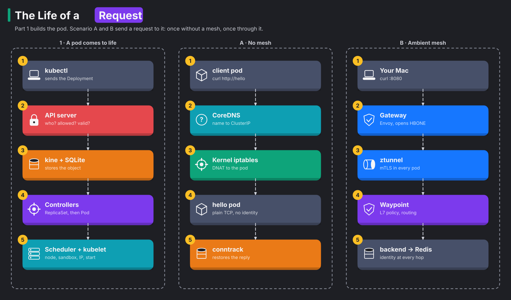
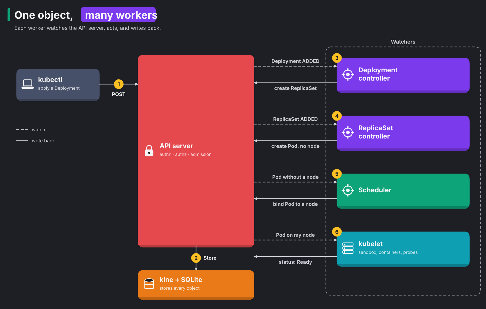

# Module 29: the life of a request

> New to a term here, like admission webhook, conntrack or HBONE? The [glossary](glossary.md) explains every term in this course.

**Before this module:** module 0. Parts 1 and 2 need no Istio. Part 3 builds on modules 1 and 2 (ambient mode, ztunnel, mTLS identity) and refers to module 3's policies.

You type `curl localhost:8080/api/orders` and get JSON back about 20 milliseconds later. A lot happens in those 20 milliseconds. Before the request even starts, a pod had to come to life. Then the request crosses the network, the mesh and the apps.

This module follows all of it on your lab, with a command for every hop. It has three parts:

1. Part 1 brings a pod to life, from `kubectl apply` to a pod that answers.
2. Part 2 sends a request in plain Kubernetes, with no mesh.
3. Part 3 sends a request through the shop's ambient mesh.

Compare parts 2 and 3, and you see exactly what a mesh adds.

Time: about 75 minutes. Adds almost nothing: one small nginx and a client.



For the long read, [docs/life-of-a-request.md](../docs/life-of-a-request.md) walks the same path in more depth. It has four detailed diagrams, packet captures, the Layer 2 and 3 plumbing, and the real output of every command. This module is the hands-on version.

The diagram is also in [Excalidraw format](../docs/diagrams/life-of-a-request.excalidraw). Open it at [excalidraw.com](https://excalidraw.com) to zoom, move and annotate. `docs/diagrams/make-life-of-a-request.py` generates both files.

**Your values will differ.** The IPs and pod names in this module come from one test run. Kubernetes gives pods and Services new addresses whenever it creates them, so yours change with every rebuild, restart or rollout. The commands look values up instead of hard-coding them, so they work on any run. To line up your numbers with the ones quoted here, run `./course/my-values.sh` after step 1: it prints each address under the same name the text uses.

## Part 1: a pod comes to life

You run `kubectl apply`, and about a second later a pod answers requests. The work happens in two stages.

First, the API server accepts and stores the request:

1. kubectl sends the request to the API server over HTTPS.
2. Authentication: the API server checks who you are.
3. Authorization: the API server checks what you may do, first with the Node authorizer and then with RBAC.
4. Admission: webhooks and built-in plugins may change the object or refuse it.
5. Storage: kine writes the object to SQLite. Other clusters use etcd here.
6. Watch: every interested component hears about the change.

A refusal at step 2, 3 or 4 goes straight back to kubectl as 401, 403, or 400/422.

Second, the cluster turns the stored Deployment into a running pod:

1. The Deployment controller creates a ReplicaSet.
2. The ReplicaSet controller creates a Pod.
3. The scheduler picks a node.
4. The kubelet asks containerd for a sandbox.
5. The CNI plugins give the pod an IP address. flannel does this everywhere, and istio-cni adds its rules in ambient namespaces.
6. The containers start, and the readiness probe passes.
7. The EndpointSlice controller adds the pod's IP to its Service. Then kube-proxy, CoreDNS and istiod update.

The long read draws each stage as its own diagram, with these step numbers.

### Concept: one object, many independent workers



Nobody gives orders in Kubernetes. Instead, each component looks after one kind of object. Think of an office where nobody talks, and everybody reads and writes the same notice board.

Every component **watches** the API server for the objects it cares about. A watch is an open connection that streams every change to those objects. The component repeats three steps, again and again:

1. It compares what exists with what should exist.
2. It acts to close the gap.
3. It writes the result back to the API server.

This cycle is the **reconcile loop**. The Deployment controller never talks to the scheduler. It writes a ReplicaSet, and the next worker notices.

This design is why Kubernetes heals itself. Delete a pod, and the ReplicaSet controller sees one pod too few. It creates another, without anyone asking.

### Concept: inside the API server

The API server is the cluster's front door, and it checks every request before storing anything. To keep bad or unauthorised changes out, every request passes the same gates, in this order:

| Gate | Question | In this lab |
|---|---|---|
| Authentication | Who are you? | client certificates signed by the cluster's client CA. Service accounts use signed tokens. `--anonymous-auth=false` |
| Authorization | May you do this? | `--authorization-mode=Node,RBAC`: the Node authorizer for kubelets, then RBAC |
| Mutating admission | Should the object change? | built-in plugins, then webhooks: Istio's sidecar injector, Kyverno (module 26) |
| Validation | Is the object well-formed? | the API schema, built-in rules |
| Validating admission | Is it allowed? | `NodeRestriction`, ValidatingAdmissionPolicy, webhooks such as Istio's config validation |
| Storage | Write it, give it a `resourceVersion` | `--etcd-servers=unix://kine.sock`: k3s' kine translates etcd calls to SQLite |

A few words in the table need a definition:

- Admission is the stage that may change or refuse an object after the caller is known and allowed.
- A webhook is a call from the API server to another program, such as Istio, that adds its own checks.
- kine is a small translator in k3s. It lets the API server store data in a SQLite file instead of etcd, the usual Kubernetes database.

A refusal at any gate goes straight back to the client. The API server stores nothing, and no controller ever hears of it.

### 1. See what kubectl sends, and who you are

```bash
kubectl apply -f course/manifests/29-plain-app.yaml -v=6 2>&1 | grep -oE 'verb="[A-Z]+" url="[^"]*" status="[^"]*"' | grep -v openapi | head -6
kubectl auth whoami
kubectl auth can-i create deployments -n course-life
kubectl auth can-i create deployments -n course-life --as=system:serviceaccount:shop:frontend
```

**What you should see.** The output answers three questions.

**What does kubectl send?** You see REST calls such as `verb="POST" url=".../apis/apps/v1/namespaces/course-life/deployments..."`. So `kubectl apply` is an ordinary HTTP client. The URL works like a postal address. It names the API group (`apps`), the version (`v1`), the namespace and the kind of resource.

**Who are you?** `whoami` says `system:admin`, in the groups `system:masters` and `system:authenticated`.

**What may you do?** You get `yes`. The frontend's service account gets `no`, because the shop's apps need no access to the Kubernetes API. Members of `system:masters` skip RBAC, the role-based permission check, entirely. For this reason, that group belongs only in emergency "break-glass" credentials.

### 2. Watch the controllers hand the work along

```bash
kubectl -n course-life get events --sort-by=.firstTimestamp \
  -o custom-columns=WHO:.source.component,KIND:.involvedObject.kind,REASON:.reason,MESSAGE:.message | grep -v client
P=$(kubectl -n course-life get pod -l app=hello -o jsonpath='{.items[0].metadata.name}')
kubectl -n course-life get pod $P -o jsonpath='{.metadata.ownerReferences[0].kind}/{.metadata.ownerReferences[0].name}{"\n"}'
kubectl -n course-life get pod $P -o jsonpath='{range .status.conditions[*]}{.type}={.lastTransitionTime}{"\n"}{end}'
```

**What you should see.** Each controller does one small job and hands over to the next, by writing an object. In the test run, all of it took under two seconds:

| Who | Event |
|---|---|
| deployment-controller | `ScalingReplicaSet`: Scaled up replica set hello-76fb6c6b6f to 1 |
| replicaset-controller | `SuccessfulCreate`: Created pod hello-76fb6c6b6f-plkh6 |
| default-scheduler | `Scheduled`: assigned to k3d-k8s-lab-server-0 |
| kubelet | `Pulled` (already present on machine), `Created`, `Started` |

Each object records who created it. The pod's owner is `ReplicaSet/hello-76fb6c6b6f`, and that ReplicaSet's owner is `Deployment/hello`. These links are called owner references. A background cleaner, the garbage collector, follows them. So `kubectl delete deployment` removes everything below the Deployment too.

The pod's conditions run from `PodScheduled` to `Ready` in about a second, because the node already had the image.

### 3. See what a controller sees

Controllers don't ask the API server "anything new?" every second. They open a watch and wait for changes. You open the same kind of watch here.

```bash
kubectl get --raw "/api/v1/namespaces/course-life/pods?watch=1&timeoutSeconds=3&labelSelector=app%3Dhello"
```

**What you should see.** One JSON line, starting with `{"type":"ADDED","object":{"kind":"Pod"...`. It carries a `resourceVersion`, 21586 in the test run. The `resourceVersion` is a counter that grows with every write in the cluster.

Controllers hold a watch like this open all the time. When something changes, `MODIFIED` or `DELETED` lines arrive. If the connection drops, the watcher reconnects with its last `resourceVersion`. The API server then sends only what it missed, like a bookmark in a news feed.

### 4. Make the scheduler say no

The scheduler's job is to find a node with room for each new pod. To see how it decides, you give it two pods that fit nowhere. One asks for far too much memory, and one asks for a node label that doesn't exist.

```bash
kubectl -n course-life run greedy --image=nginx:1.27-alpine \
  --overrides='{"spec":{"containers":[{"name":"greedy","image":"nginx:1.27-alpine","resources":{"requests":{"memory":"64Gi"}}}]}}'
kubectl -n course-life run picky --image=nginx:1.27-alpine --overrides='{"spec":{"nodeSelector":{"disktype":"ssd"}}}'
sleep 5; kubectl -n course-life get events --field-selector reason=FailedScheduling -o jsonpath='{range .items[*]}{.message}{"\n"}{end}'
kubectl describe node k3d-k8s-lab-server-0 | grep -A6 "Allocated resources"
kubectl -n course-life delete pod greedy picky
```

**What you should see.** Two refusals:

- `0/1 nodes are available: 1 Insufficient memory. preemption: 0/1 nodes are available: 1 No preemption victims found for incoming pod.`
- `didn't match Pod's node affinity/selector`

Each message reports how many nodes the scheduler examined and why each one failed. The scheduler works in phases:

1. **Filter.** The scheduler removes nodes where the pod doesn't fit. A node fails if it lacks free requested CPU or memory, has the wrong labels, has a taint (a "keep out" mark) or has a needed port in use.
2. **Score.** The scheduler ranks the remaining nodes. It prefers to spread replicas, to use nodes that already have the image, and to balance load.
3. **Bind.** The scheduler writes the winning node into `spec.nodeName`.

If no node survives the filter, the scheduler tries **preemption**. Preemption means evicting lower-priority pods to make room. Here there was nothing to evict, so both pods stay `Pending`.

Now look at the node's allocations. A pod states two amounts. Its *request* is what it reserves, and its *limit* is the most it may use. In the test run, memory requests added up to 30%, and limits to **106%**. The scheduler counts only requests, so the limits promise more memory than the node has. This is called overcommitting. If every pod used its full limit at once, the node would run out. The kernel's OOM ("out of memory") killer would then pick processes to kill.

### 5. Make admission say no

Admission is the API server's last check before storage. Here you send two broken objects and watch two different checkers refuse them.

```bash
kubectl -n course-life create deployment bad --image=nginx:1.27-alpine --replicas=-1 --dry-run=client -o yaml | kubectl apply -f -
printf 'apiVersion: security.istio.io/v1\nkind: AuthorizationPolicy\nmetadata:\n  name: broken\n  namespace: course-life\nspec:\n  rules:\n  - when:\n    - key: request.colour\n      values: ["blue"]\n' | kubectl apply -f -
```

**What you should see.** Two refusals, from two checkers:

1. `spec.replicas: Invalid value: -1: must be greater than or equal to 0` comes from the API server's own validation. A Deployment with fewer than zero replicas makes no sense.
2. `invalid policy broken.course-life: ... unknown attribute: request.colour` comes from Istio's validating webhook. The API server asked istiod to check the policy, and istiod found an attribute it doesn't know.

Neither object exists afterwards. Every write in the cluster passes through admission. For this reason, tools like Istio and Kyverno plug in there.

### 6. The kubelet's side: sandbox, network, probes

The scheduler has picked a node. Now the kubelet, the agent on that node, must turn the Pod object into a running container with a network address. Think of the pod as a new room in a building. The room needs walls, a network cable and a tenant, and the building directory must list it.

Here is what happens on the node, in order:

1. The kubelet asks the container runtime, containerd, to create a **sandbox** for the pod. The sandbox is a tiny `pause` container. Its only job is to hold the pod's network namespace. A network namespace is the pod's private copy of the network stack, the room's walls.
2. containerd runs the network plugins, called the Container Network Interface (**CNI**) chain. The first one, flannel, picks a free IP address from this node's range and gives it to the pod. It also connects the pod to the node's `cni0` bridge, a virtual switch, with a veth pair. A veth pair is a virtual cable with one end in the pod and the other on the node.
3. If the namespace uses ambient mode, a second plugin, istio-cni, adds iptables rules inside the pod. Part 3 shows what they do.
4. The kubelet pulls the image, starts the container and runs the readiness probe, a regular "are you ready?" check.
5. When the probe passes, the pod is Ready. The **EndpointSlice controller** adds the pod's IP to the list of addresses behind the Service. This list is the building directory.

Three components read that list, each for its own reason:

- kube-proxy: makes traffic for the Service IP reach the pod
- CoreDNS: answers name lookups for the Service
- istiod: keeps the mesh's proxies up to date

kube-proxy runs on every node. It writes iptables rules, so traffic for the Service IP reaches the new pod. Part 2 walks through those rules.

CoreDNS is the cluster's DNS server. It answers DNS lookups for the Service name.

istiod is Istio's control plane. It tells ztunnel and the waypoints, Istio's proxies, about the new address.

```bash
docker exec k3d-k8s-lab-server-0 crictl pods --namespace course-life
docker exec k3d-k8s-lab-server-0 ip route
kubectl -n course-life get endpointslice -l kubernetes.io/service-name=hello -o jsonpath='{range .items[*].endpoints[*]}{.addresses[0]} ready={.conditions.ready}{"\n"}{end}'
```

**What you should see.** Each command shows one part of the list above:

1. `crictl pods` lists the pod's sandbox.
2. `ip route` shows the node's routes. `10.42.0.0/24 dev cni0` covers the pods on this node, through the bridge. A default route sends everything else out of `eth0`. With more nodes, flannel adds a route per node through its VXLAN interface, a tunnel that carries pod traffic between nodes.
3. The EndpointSlice lists `10.42.0.33 ready=true`. Your IP differs.

## Part 2: scenario A, a request without a mesh

The client pod sends `curl http://hello`. A few milliseconds later, nginx answers. In between, four things happen:

1. The client asks DNS for the address of `hello`.
2. The client opens a TCP connection to that address.
3. The node's kernel changes the destination to a real nginx pod.
4. On the way back, the kernel changes the address back again.

No proxy and no extra software takes part. Everything happens in the Linux kernel of the node, using rules that Kubernetes wrote earlier.

### Concept: a Service is a forwarding address

A Service gives your pods one stable address, because pod IPs change every time a pod restarts. That address is the **ClusterIP**.

Here is the surprising part: no machine owns the ClusterIP. No process listens on it, and no network card has it. It works like a forwarding address at the post office. Mail to that address never arrives there. The post office reads the address and sends the letter on to where the person really lives.

Two pieces of the node do that forwarding:

- kube-proxy: writes the forwarding rules
- the kernel: follows them, packet by packet

**kube-proxy** is a small program on every node. It watches the API server for Services and their pods. For each Service, it writes iptables rules that say "a connection to this ClusterIP goes to one of these pod IPs". **iptables** is the kernel's built-in packet filter: a list of rules the kernel checks for every packet.

When the kernel follows such a rule, it rewrites the packet's destination address. This rewrite has a name: **DNAT** (destination network address translation).

There is one more problem to solve. The reply comes back from the pod's real IP, but the client sent its request to the ClusterIP. If the reply showed the pod's IP, the client would drop it as a stranger. To fix that, the kernel keeps **conntrack**, its notebook of connections. It writes down every rewrite it made, so it knows how to undo the change on the reply.

In other words: kube-proxy writes the forwarding rules once, and the kernel applies them and remembers them for every connection.

### 7. Follow one request

```bash
kubectl -n course-life exec deploy/client -- cat /etc/resolv.conf
kubectl -n course-life exec deploy/client -- curl -sv -o /dev/null http://hello 2>&1 | grep -E "Trying|Connected|< HTTP"
SVCIP=$(kubectl -n course-life get svc hello -o jsonpath='{.spec.clusterIP}')
docker exec k3d-k8s-lab-server-0 sh -c "iptables-save -t nat | grep course-life/hello"
docker exec k3d-k8s-lab-server-0 conntrack -L -d $SVCIP 2>/dev/null
```

**What you should see.** The output follows the four steps from the top of this part. The values below come from the test run. Yours will differ.

**Step 1: DNS finds the ClusterIP.**

The client only knows the name `hello`. It needs an address. `resolv.conf` tells it where to ask and how:

- `nameserver 10.43.0.10`: the address of CoreDNS, the cluster's DNS server
- `search course-life.svc.cluster.local svc.cluster.local cluster.local`: endings to try after a short name
- `ndots:5`: a name with fewer than five dots counts as short

`hello` has no dots, so the client tries the first ending and asks for `hello.course-life.svc.cluster.local`. CoreDNS answers with the Service's ClusterIP. That's why a short name works inside the same namespace.

**Step 2: the client connects.**

curl prints `Trying 10.43.57.32:80... Connected to hello`. As far as curl knows, it talks to `10.43.57.32`. The packet leaves the client pod through its network cable, the veth pair, and enters the node.

**Step 3: the kernel rewrites the destination.**

The kernel checks the packet against kube-proxy's rules in the `nat` table. The `grep` shows three rules. Read them as a chain, each one handing the packet to the next:

1. `KUBE-SERVICES` matches the destination `10.43.57.32` port 80 and jumps to the Service's own chain, `KUBE-SVC-KJCW...`.
2. `KUBE-SVC-KJCW...` picks one pod. With one pod, the choice is easy. With three, kube-proxy adds random odds, so each pod gets about a third of the connections.
3. `KUBE-SEP-2DZN...` rewrites the destination: `DNAT --to-destination 10.42.0.33:80`.

The packet now carries the nginx pod's real address. The kernel sends it through the node's bridge, `cni0`, to the nginx pod. nginx sees an ordinary TCP connection from the client pod's IP.

**Step 4: conntrack undoes the rewrite on the way back.**

conntrack shows one line with two halves:

- going out: `src=10.42.0.35 dst=10.43.57.32 dport=80` (what the client sent)
- coming back: `src=10.42.0.33 dst=10.42.0.35 sport=80` (what nginx sends)

When nginx replies from `10.42.0.33`, the kernel finds this entry and changes the source back to `10.43.57.32`. To the client, the Service answered. It never learns the pod's real IP.

Only the first packet of a connection walks through the iptables chain. Every later packet follows the conntrack entry, which is faster.

### What scenario A doesn't give you

The request worked, but look at what nobody checked:

| Missing | What it means |
|---|---|
| Identity | nginx knows the caller's IP, nothing more. Pod IPs change, so an IP says little about who called. |
| Encryption | The request crosses the node in plain text. Anyone who captures packets on the node reads it. |
| Policy | Any pod in the cluster may connect, unless a NetworkPolicy says otherwise. |
| Request metrics | The kernel counts packets. Nobody counts HTTP requests, status codes or response times. |

Part 3 sends a request through the shop's mesh, which adds all four, without any change to the apps.

## Part 3: scenario B, a request through the ambient mesh

This time the request starts on your Mac and goes through the shop: `curl localhost:8080/api/orders`. In short:

1. curl on your Mac reaches the node through Docker and the serverlb container.
2. kube-proxy's rules rewrite both addresses and send the request to the gateway pod.
3. The gateway opens an HBONE tunnel, an encrypted tunnel, to the frontend pod.
4. The frontend's ztunnel sends the frontend's call through a tunnel to the waypoint.
5. The waypoint checks the policy and opens a tunnel to a backend pod.
6. The backend's ztunnel opens a tunnel to Redis.
7. The response returns through the same tunnels.

Exercise 8 below covers steps 1 and 2 of this list. Exercises 9 to 12 cover steps 3 to 6, and exercise 14 covers step 7.

### Concept: the same Kubernetes plumbing, plus identity at every hop

Scenario A had no identity and no encryption. The mesh adds both, and it doesn't replace the Kubernetes plumbing to do it. The kernel still rewrites addresses, as in Part 2.

What changes is the connection between pods. Each one now runs inside an **HBONE** tunnel. HBONE is ambient mode's tunnel format, an HTTP CONNECT request over mutual TLS, sent to port 15008. Mutual TLS (mTLS) is encryption where both ends show a certificate. Think of a sealed pipe with an ID check at each end.

Each end's certificate names its service account in a standard form, a SPIFFE ID. With identities known, every hop checks policy before it passes the request on.

### 8. From your Mac to the gateway pod

Your Mac isn't part of the cluster, so the request first has to reach the gateway pod inside it. Two forwarders and two kernel rewrites do that, before any Istio component takes part.

```bash
docker port k3d-k8s-lab-serverlb
docker exec k3d-k8s-lab-serverlb grep -A3 "upstream 8080_tcp" /etc/nginx/nginx.conf
kubectl -n shop-ingress get svc shop-gateway-istio
docker exec k3d-k8s-lab-server-0 iptables -t nat -S PREROUTING
curl -s -o /dev/null localhost:8080/
docker exec k3d-k8s-lab-server-0 sh -c 'iptables -t nat -L -v -n | grep -E "shop-gateway-istio:http loadbalancer IP|DNAT .*dpt:8080 to:"'
docker exec k3d-k8s-lab-server-0 conntrack -L -p tcp -d 192.168.107.2 --dport 8080 2>/dev/null | head -1
kubectl -n shop-ingress get pod -l gateway.networking.k8s.io/gateway-name=shop-gateway -o wide
```

**What you should see.** The output follows four hops.

**Hop 1: Docker forwards the port.** Docker maps your Mac's `0.0.0.0:8080` to port 8080 of the `k3d-k8s-lab-serverlb` container.

**Hop 2: nginx relays the bytes.** That container runs **nginx in TCP stream mode**. In this mode, nginx doesn't read the HTTP. It only copies bytes, as `upstream 8080_tcp { server k3d-k8s-lab-server-0:8080; }` shows. It opens a new connection to the node from its own address, `192.168.107.3` in the test run.

**Hop 3: the kernel rewrites the destination.** The gateway's Service has type LoadBalancer. On k3s, that type gives the Service the node's own IP as its external IP, `192.168.107.2`.

Two sets of rules want this packet:

- ServiceLB: k3s's built-in load balancer runs a `svclb-...` pod with a host port, and the CNI wrote a host port DNAT for it.
- kube-proxy: it wrote its own rule for the load balancer IP.

The kernel checks rules in order, and the first match wins. `PREROUTING` jumps to kube-proxy's `KUBE-SERVICES` **first**, so kube-proxy wins. Its rules then work as a chain:

1. The rule `-d 192.168.107.2/32 ... --dport 8080` jumps to `KUBE-EXT-EIP2...`.
2. `KUBE-EXT-EIP2...` marks the packet for masquerade, a note that says "change the source on the way out".
3. `KUBE-SVC-EIP2...` then `KUBE-SEP-...` rewrite the destination to the gateway pod, `10.42.0.88:8080`. This is the DNAT.

The packet counters prove it. In the test run, the load balancer IP rule had matched 33 connections, and the host port DNAT none.

**Hop 4: the kernel rewrites the source.** On the way out to the pod, `KUBE-POSTROUTING` sees the mark. It applies `MASQUERADE --random-fully`, which changes the source to `10.42.0.1`, the node's address on the pod network, with a new port. This rewrite of the source is called SNAT.

conntrack, the kernel's notebook of rewrites, shows both changes in one line:

- going in: `src=192.168.107.3 dst=192.168.107.2 dport=8080`
- coming back: `src=10.42.0.88 dst=10.42.0.1`

So the gateway pod sees a plain TCP connection from the node. The SNAT makes the reply return through this node, so conntrack undoes both rewrites. The cost is that the gateway never learns your Mac's address. A Service with `externalTrafficPolicy: Cluster`, the default, always hides the client this way.

### 9. The gateway opens a tunnel to the frontend

The gateway is the shop's front door. It runs Envoy, a proxy that reads HTTP. It decides which app gets the request and opens an encrypted tunnel to that app.

```bash
GW=$(kubectl -n shop-ingress get pod -l gateway.networking.k8s.io/gateway-name=shop-gateway -o name)
istioctl proxy-config routes $GW -n shop-ingress | head -3
istioctl proxy-config endpoints $GW -n shop-ingress | grep frontend
kubectl get ns shop-ingress shop -L istio.io/dataplane-mode
```

**What you should see.** Three answers:

1. **Where does the request go?** Route `http.8080` matches `/*` and sends it to `frontend.shop`. istiod built this route from the shop's HTTPRoute.
2. **How does it get there?** The endpoint is `envoy://connect_originate/10.42.0.13:3000`. This means the gateway's Envoy **itself** opens the HBONE tunnel to the frontend pod, with its own certificate.
3. **Does the gateway need ambient mode?** No. The gateway's namespace `shop-ingress` isn't in ambient mode, and it doesn't need to be. The gateway is already an Envoy that speaks HBONE.

### 10. Inside the frontend pod: ztunnel's sockets

Somebody must decrypt the tunnel before the app sees the bytes. In ambient mode, that job belongs to ztunnel. ztunnel is a small proxy, one per node, that handles encryption and identity for every pod on its node. Surprisingly, the tunnel ends inside the frontend pod, not inside ztunnel's own pod. This step shows how.

```bash
CID=$(docker exec k3d-k8s-lab-server-0 crictl ps --name frontend -q | head -1)
PID=$(docker exec k3d-k8s-lab-server-0 crictl inspect --output go-template --template '{{.info.pid}}' $CID)
docker exec k3d-k8s-lab-server-0 nsenter -t $PID -n iptables-save | grep -E "REDIRECT|15008"
docker exec k3d-k8s-lab-server-0 sh -c "cat /proc/$PID/net/tcp /proc/$PID/net/tcp6" \
  | python3 -c 'import sys; print(sorted({int(l.split()[1].split(":")[1],16) for l in sys.stdin if len(l.split())>3 and l.split()[3]=="0A"}))'
```

**What you should see.** The third command enters the frontend pod's network namespace through its process ID. When the pod started, istio-cni wrote REDIRECT rules there. A REDIRECT rule works like a receptionist who sends every visitor to one desk, whatever room they asked for:

| Rule | Meaning |
|---|---|
| `REDIRECT --to-ports 15001` for outgoing TCP | every connection the app opens goes to ztunnel's outbound socket |
| `REDIRECT --to-ports 15006` for incoming TCP, except to 15008 | plain-text arrivals go to ztunnel's inbound socket |
| `REDIRECT --to-ports 15053` for DNS on port 53 | ztunnel answers DNS (the lab enables DNS capture) |
| packets marked `0x539` pass untouched | ztunnel's own traffic, so it doesn't loop |

The last command lists the listening ports: `[3000, 15001, 15006, 15008, 15053]`. Port 3000 is the app. The other four are **ztunnel's sockets, inside the pod's own network namespace**. ztunnel runs as a pod of its own, but it created these sockets here.

Now the arrival makes sense. The gateway's tunnel ends at `10.42.0.13:15008`, inside the frontend pod. Then ztunnel works through four steps:

1. It checks the gateway's identity.
2. It checks any L4 policy, a rule about who may connect.
3. It decrypts the stream.
4. It hands the bytes to the app on `:3000`.

So plain text never leaves the pod.

### 11. The frontend calls the backend: four identities

The frontend app knows nothing about the mesh. It opens `http://backend.shop.svc.cluster.local:8000` like any app. The redirect rules from step 10 hand the call to ztunnel:

1. The app's DNS query goes to ztunnel's DNS port, 15053.
2. The app's TCP connection goes to ztunnel's outbound socket, 15001.
3. ztunnel knows from istiod that the backend Service uses a waypoint. So it tunnels to the waypoint instead of to a backend pod.

Each hop has its own tunnel, and each tunnel shows two identities, the caller's and the receiver's. ztunnel's log records them.

```bash
kubectl -n istio-system logs ds/ztunnel --since=60m | grep 'connection complete' \
  | grep -E 'src.workload="(shop-gateway|frontend|waypoint|backend)' \
  | grep -oE '(src\.identity|dst\.identity|dst\.hbone_addr)=[^ ]+' | paste - - - | sort -u | head -8
istioctl ztunnel-config certificates | grep -E "ns/shop/sa/(frontend|backend)" | head -4
```

ztunnel logs a connection only when it **closes**. The shop reuses its connections, so they stay open for a long time. For this reason, give the command a wide time window, or wait a few minutes after sending requests. Tunnels to services from earlier modules, such as `sa/assistant` from module 17, may show up too.

**What you should see.** Four hops, each with a caller and a receiver. From the test run:

| Hop | From | To | Notes |
|---|---|---|---|
| 1 | `ns/shop-ingress/sa/shop-gateway-istio` | `ns/shop/sa/frontend` | step 9's tunnel |
| 2 | `ns/shop/sa/frontend` | `ns/shop/sa/waypoint` | addressed to `10.43.76.1:8000`, the backend **Service's** IP: the waypoint takes the Service's traffic |
| 3 | `ns/shop/sa/waypoint` | `ns/shop/sa/backend` | the waypoint picked a backend-v1 pod |
| 4 | `ns/shop/sa/backend` | `ns/shop/sa/redis` | ztunnel to ztunnel: Redis has no waypoint, so only L4 |

Every certificate carries a SPIFFE identity, a standard name made of namespace and service account. The second command lists the certificates. In the test run, each workload's leaf certificate was valid for 24 hours. A root certificate, valid for 10 years, signed them. ztunnel renews the short-lived ones on its own, so a stolen certificate stops working quickly.

### 12. The waypoint decides, at Layer 7

ztunnel sees connections and identities, but not HTTP. A rule like "only `GET` on `/api/`" needs a proxy that reads each request. In ambient mode, that proxy is the waypoint, an Envoy that serves the backend Services.

```bash
kubectl apply -f course/manifests/06-waypoint-access-logs.yaml
curl -s -o /dev/null localhost:8080/api/orders
kubectl -n shop logs deploy/waypoint --tail=1
kubectl -n shop get authorizationpolicy backend-allow-frontend -o yaml | grep -A12 "^spec"
```

**What you should see.** One access log line:

`"GET /api/orders HTTP/1.1" 200 ... "envoy://connect_originate/10.42.0.56:8000" inbound-vip|8000|http|backend-v1.shop.svc.cluster.local`

Behind that one line, the waypoint did everything an L7 proxy does, in this order:

1. It read the HTTP request.
2. It checked the policy `backend-allow-frontend`. The policy allows only the identity `cluster.local/ns/shop/sa/frontend`, only `GET` and `POST`, and only paths under `/api/`.
3. It matched the HTTPRoute, which chooses the version of the backend.
4. It applied timeouts and retries.
5. It recorded metrics and a trace span.
6. It opened a new HBONE tunnel to the chosen pod.

A refused request ends at step 2 with `403 RBAC: access denied`. The waypoint writes that answer itself, so the backend never sees the request.

### 13. Measure the whole trip

Each proxy records how long its part of the request took, as a timed block called a span. Jaeger, the lab's tracing tool, joins the spans of one request into a trace. The trace shows where the time goes.

```bash
curl -s -o /dev/null -X POST localhost:8080/api/orders -H 'content-type: application/json' -d '{"item":"life","quantity":1}'
```

Find the trace in Jaeger (http://localhost:16686). Choose service `backend` and operation `POST /api/orders`.

**What you should see.** From the test run:

| Span | Time |
|---|---|
| gateway: `frontend.shop.svc.cluster.local:3000/*`, the whole request as the gateway saw it | 18.5 ms |
| waypoint: `backend-v1.shop.svc.cluster.local:8000/*` | 7.4 ms |
| backend: `POST /api/orders` | 5.5 ms |
| backend: Redis `INCRBY`, then `HSET LPUSH LTRIM` | 0.5 ms and 0.3 ms |

Read the spans from the outside in:

1. The gateway's span covers the whole request, 18.5 ms.
2. The waypoint's span covers the backend plus one hop, 7.4 ms. The backend itself used 5.5 ms. So the waypoint and the two ztunnels around it add about 2 ms.
3. The frontend (Node.js) doesn't trace itself. Its share hides in the gap, about 11 ms of the 18.5.

Your numbers vary with load. The first request after a quiet spell is slower.

### 14. The way back

The response retraces every hop. Each HBONE tunnel is a two-way stream, so replies travel back through the same tunnels and the same identities. On the outer part, the steps run in this order:

1. conntrack undoes the SNAT and the DNAT from step 8.
2. nginx and Docker pass the bytes back.
3. curl prints the JSON.

No component makes a new decision on the way back. Every check happened when the connection or request went in.

## Security checkpoints, end to end

The request met several checks, and each one looks at something different. The table compares the two scenarios:

| Where | Checks | Scenario A | Scenario B |
|---|---|---|---|
| API server | authentication, RBAC, admission | yes | yes |
| Kernel, at the pod | NetworkPolicy | if defined | if defined |
| ztunnel, at each pod | mTLS identity, L4 AuthorizationPolicy | no | every hop |
| Waypoint | L7 AuthorizationPolicy on method, path, identity | no | for Services with a waypoint |
| Application | its own logins and checks | yes | yes |

## Investigate

1. You delete the `hello` pod. List, in order, the components that act before a new pod serves traffic again, and what each does.
2. In scenario A, nginx logs the client pod's IP as the source. In scenario B, what does the backend app see as the source of a request, and how does the backend learn which service really called?
3. The frontend's connection to the backend goes to the Service IP `10.43.76.1`, yet kube-proxy has iptables rules for that IP too. Why doesn't kube-proxy's DNAT send it straight to a backend pod?
4. Your API server is down for five minutes. Which of today's paths keep working, and which stop?

<details>
<summary>Answers</summary>

1. Seven components act, in this order:
   1. The ReplicaSet controller sees one pod too few and creates a new Pod object.
   2. The scheduler binds the Pod to a node.
   3. The kubelet asks containerd for a sandbox.
   4. The CNI chain gives the sandbox a network. In an ambient namespace, istio-cni and ztunnel also set up the redirect rules.
   5. The container starts, and the readiness probe passes.
   6. The EndpointSlice controller adds the new IP to the Service.
   7. kube-proxy rewrites its iptables rules, and istiod sends the new endpoint to ztunnel and the waypoints.

   Only then does traffic reach the new pod.
2. The backend receives its connection from ztunnel inside its own pod. ztunnel delivered the bytes from the waypoint's tunnel. So a plain socket shows no useful client identity. The identity lives in the mTLS layer instead. ztunnel and the waypoint know the caller is `sa/waypoint`, and the waypoint knew the original caller was `sa/frontend`. Policies use that identity. An app that needs the caller's identity relies on the mesh's AuthorizationPolicy to let in only the right callers. In sidecar mode (module 7), the sidecar also passes the identity to the app in the `X-Forwarded-Client-Cert` header.
3. The redirect inside the frontend pod catches the connection first. istio-cni's `REDIRECT --to-ports 15001` rule runs in the pod's own network namespace. So it acts before the packet ever reaches the node's kube-proxy rules. ztunnel then opens its own tunnel to the waypoint. kube-proxy's rules still serve every pod outside the mesh.
4. Running traffic keeps flowing. The iptables rules, conntrack, and the last configuration of ztunnel and the waypoint all live on the node and in the proxies. What stops is change. No new pods start, nothing scales, endpoints don't update, no new configuration arrives, and `kubectl` fails. If a pod crashes during the outage, the kubelet restarts its container locally. A pod that needs a new node waits for the API server.

</details>

## Clean up

```bash
./course/reset.sh
```

This deletes the `course-life` namespace, and with it the nginx app and the client.
