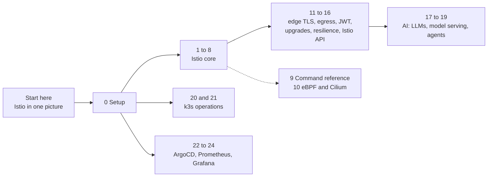

# Istio and platform course

A hands-on Istio course built on this lab. It assumes you know Kubernetes well (CKA or CKAD level) and have never used a service mesh. Every module explains what Istio does, why it is built that way and not another, and how to see it happening in Kiali, Grafana, Jaeger and Loki.

Each module takes 30 to 60 minutes. Do them in order, because each one builds on the last.

| Module | You learn | Tools you use |
|---|---|---|
| [0. Setup](00-setup.md) | Check the lab and install `istioctl` | `kubectl`, `istioctl` |
| [1. What a mesh adds](01-what-a-mesh-adds.md) | What Kubernetes networking leaves out, and the two Istio data plane designs | Kiali, `istioctl` |
| [2. Identity and mTLS](02-identity-and-mtls.md) | Where workload identity comes from and how the tunnel works | Kiali, ztunnel logs |
| [3. Authorization](03-authorization.md) | L4 and L7 policy, and why you need both | `curl`, Kiali, ztunnel logs |
| [4. Traffic routing](04-traffic-routing.md) | Weighted and content-based routing with the Gateway API | Kiali, Grafana |
| [5. Resilience](05-resilience.md) | Timeouts, faults, circuit breaking, rate limiting | Grafana, Jaeger, access logs |
| [6. Observability](06-observability.md) | What the mesh measures by itself, and how to follow one request | Grafana, Jaeger, Loki, Kiali |
| [7. Sidecar mode](07-sidecar-mode.md) | The classic design, side by side with ambient | `istioctl`, Kiali |
| [8. Incidents](08-incidents.md) | Find and fix four broken setups without being told the cause | everything |
| [9. Command reference](09-command-reference.md) | Troubleshooting commands for the cluster and for Istio | |
| [10. eBPF and Cilium](10-ebpf-and-cilium.md) | The other sidecarless design, compared with ambient. Theory, no install. | `docker exec`, `kubectl top` |
| [11. TLS at the edge](11-edge-tls.md) | HTTPS on the ingress gateway, cert-manager, redirects, renewal without downtime | `curl`, `openssl`, Grafana |
| [12. Egress](12-egress.md) | ServiceEntry, TLS origination, L7 rules on outbound calls, locking a pod in | `curl`, Kiali, Prometheus |
| [13. JWT](13-jwt.md) | End-user identity: RequestAuthentication, rules on token claims, 401 versus 403 | `curl`, Prometheus |
| [14. Upgrading Istio](14-upgrading-istio.md) | Canary upgrade from 1.24 to 1.25: revisions, tags, rollback, measured downtime. One-way: rebuild the lab afterwards | `helm`, `istioctl`, `kubectl` |
| [15. Outlier detection and retries](15-outlier-detection-and-retries.md) | One bad pod out of three: retries hide it, outlier detection removes it, zone failover in theory | `curl`, `kubectl logs` |
| [16. The Istio API](16-istio-api.md) | The same ingress and canary with Istio's Gateway, VirtualService and subsets; translating between the two APIs | `helm`, `curl`, `istioctl analyze` |
| [17. An LLM as a mesh service](17-llm-in-the-mesh.md) | AI: a shop assistant calling your local Ollama; identity, a locked-down model API, token metrics and GenAI traces, LLM timeouts | `curl`, Jaeger, Prometheus |
| [18. Serving models in the cluster](18-serving-models.md) | AI: two small models on llama.cpp; startup and readiness, why LLM load balancing is hard (measured), routing between models, the Inference Extension | `llm-load.sh`, Prometheus |
| [19. AI agents and their tools](19-ai-agents.md) | AI: kagent with your Ollama, MCP and A2A, an intruder calling tools directly, mesh policy and RBAC around agents, agents that misreport | `agent-ask.sh`, `kubectl auth can-i` |
| [20. Nodes, drains and cleanup](20-nodes-and-cleanup.md) | Ops: a second node, drains under traffic, PodDisruptionBudgets that protect and block, Jobs, ReplicaSets and images that pile up | `kubectl drain`, `crictl` |
| [21. k3s certificates, backups, upgrades](21-k3s-lifecycle.md) | Ops: certificate checks and rotation, a datastore backup and restore, a k3s patch upgrade that breaks the mesh. The upgrade is one-way | `k3s certificate`, system-upgrade-controller |
| [22. GitOps with ArgoCD](22-gitops-with-argocd.md) | Platform: your own Git server, drift and self-heal, `git revert` rollbacks, hooks and sync waves, an AppProject that fences a team in, the retry trap, ApplicationSets | `git`, ArgoCD |
| [23. Prometheus and alerting](23-prometheus-and-alerting.md) | Platform: PromQL from `rate()` to percentiles, recording rules, an SLO with a multi-window burn-rate alert, Alertmanager routing, cardinality | Prometheus, Alertmanager |
| [24. Grafana as code](24-grafana-as-code.md) | Platform: dashboards from ConfigMaps, variables and thresholds, why Grafana refuses edits, Grafana-managed alerts that reach nobody, trace-to-logs links | Grafana, Jaeger, Loki |

**New to Istio? Read [Start here: Istio in one picture](start-here.md) first.** It takes 15 minutes, needs no cluster, and shows every resource the course uses on one diagram. Every term also has a plain explanation in the [glossary](glossary.md). Keep it open in a tab.

## Three routes through the course



- **Istio:** modules 0 to 8, then 11 to 16. Module 9 is a reference, and 10 is theory you read any time after module 7.
- **AI on Kubernetes:** modules 17 to 19 build on the Istio route, mainly modules 3 to 6 and 12. Each module lists what it needs at the top.
- **Kubernetes operations:** modules 20 and 21 need only module 0. As a CKA, you might take them first.
- **Platform tools:** modules 22 to 24 need only module 0, though 23 builds on module 6 and 24 on 23. They cover what DevOps and platform job adverts ask for most: GitOps, alerting and dashboards.

## Recommended order

1. [Start here](start-here.md), then module 0.
2. Modules 1 to 7, then 8 to test yourself.
3. Modules 11, 12, 13, 15 and 16.
4. Modules 17 to 19, the AI track.
5. Modules 22 to 24, the platform tools.
6. Module 20.
7. Module 14, then rebuild the lab: `./scripts/teardown.sh --yes && ./scripts/provision.sh`.
8. Module 21, then rebuild again.

Module 9 is a reference to keep open, and module 10 is reading for any time after module 7. Modules 14 and 21 come last because they upgrade the lab and there's no way back except a rebuild.

## Versions

| | Course baseline | After module 14 | After module 21 |
|---|---|---|---|
| k3s (Kubernetes) | v1.31.5 | v1.31.5 | **v1.31.14** |
| Istio | 1.24.2 | **1.25.5** | 1.24.2 |

Every module except 14 and 21 runs on the baseline. Neither module downgrades anything: to get back, you rebuild. The test runs covered each upgrade on its own, never both on one lab, so rebuild between them.

## How the exercises work

Every module has the same parts:

- **Concept.** What problem the feature solves, with a diagram.
- **The bigger picture.** Where the idea comes from and how teams use it in real life, in modules 1 to 7.
- **Why this way.** The design choice and the alternatives Istio did not take.
- **Do it.** Commands to run, each followed by what you should see.
- **Investigate.** Questions you answer with the UIs, not with the manifests.
- **Clean up.** How to return the lab to its starting state.

Course files live in this folder:

| Path | What it is |
|---|---|
| `course/manifests/` | Every manifest the exercises apply, numbered by module |
| `course/reset.sh` | Returns routing, policies and experiment settings to the Git baseline |
| `course/load.sh` | Sends steady traffic so Grafana and Kiali have something to draw |
| `course/incident.sh` | Breaks the lab on purpose for module 8 |
| `course/verify.sh` | Replays every module's key exercise and checks the results |

## Before you start

The lab must be running (`./scripts/provision.sh`, or `./scripts/start.sh` after a reboot) and the UIs open (`./scripts/port-forward.sh` in a spare terminal).

| UI | URL | Login |
|---|---|---|
| Shop | http://localhost:8080 | none |
| Kiali | http://localhost:20001 | none |
| Headlamp | http://localhost:4466 | none |
| Grafana | http://localhost:3000 | `admin` / `k8s-lab-admin` |
| Jaeger | http://localhost:16686 | none |
| Prometheus | http://localhost:9090 | none |
| ArgoCD | http://localhost:8081 | `admin` / `k8s-lab-admin` |

## A note on ArgoCD

The course changes Istio resources by hand, with `kubectl apply`. ArgoCD manages the same resources from Git. The `istio-config` Application does not self-heal, so your changes stay until you run `./course/reset.sh`. ArgoCD shows that Application as `OutOfSync` while an exercise is active. That is expected. One catch: when a new commit lands on `main`, ArgoCD syncs `istio-config` once and wipes the exercise you're in the middle of. Re-apply the step's manifests if that happens. `./course/reset.sh` restores the Git baseline and asks ArgoCD to sync, so it ends `Synced` again.

## Check that the course works

```bash
./course/verify.sh        # every module, about 10 minutes
./course/verify.sh 4      # one module
./course/verify.sh 14     # the Istio upgrade, one-way, not part of the full run
./course/verify.sh 17 18 19  # the AI modules: 17 and 19 need Ollama on your machine, 18 downloads about 900 MB
./course/verify.sh 21     # the k3s upgrade, one-way, not part of the full run
```

The script applies each module's manifests, checks the results and restores the baseline. It was run against this lab before the course was published. The [last section of module 0](00-setup.md#what-the-verification-run-showed) has the results.
