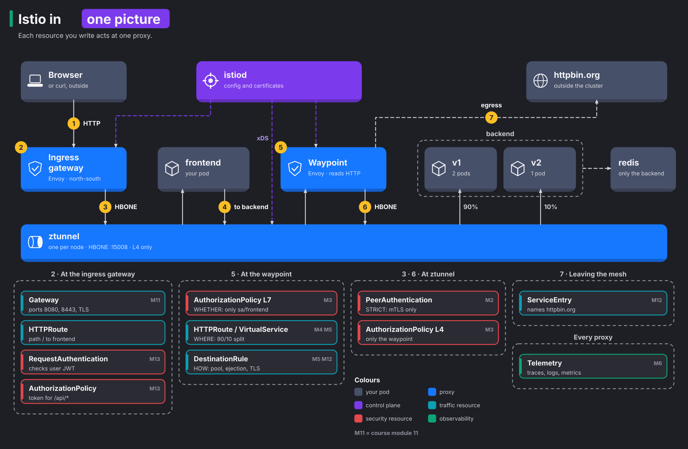

# Start here: Istio in one picture

Read this before module 0. It takes about 15 minutes and needs no cluster. By the end you'll know what each Istio resource is for. You'll also know which proxy acts on it, and that matters just as much. The modules then fill in the details one by one.

Want to move boxes around or add your own notes? Open [`docs/diagrams/istio-resources.excalidraw`](../docs/diagrams/istio-resources.excalidraw) at [excalidraw.com](https://excalidraw.com) (menu, Open). `docs/diagrams/make-istio-resources.py` generates both files.

## How to read the picture

Three kinds of things appear in it. If you keep them apart, most of the confusion around Istio goes away.

1. The grey boxes are **your pods**, the frontend, two backend versions and Redis. They run your code and know nothing about the mesh.
2. The blue boxes are **proxies**, the ingress gateway, the waypoint and ztunnel. A proxy is a program that sits in the path of every request and does the actual work. It encrypts, routes, checks and counts.
3. The coloured notes are **resources you write**. Each one is YAML that tells the proxies what to do. A resource does nothing by itself. It only counts once a proxy applies it.

Your resources and the proxies need something to connect them. That's istiod, at the top of the picture. It reads your resources and sends each proxy the configuration it needs. That's what "control plane" means. istiod gives orders but never touches a request.

## Follow one request

Walk through the picture with a single call, `GET http://localhost:8080/api/orders`.

1. **The browser reaches the ingress gateway.** The ingress gateway is the front door of the cluster. The **Gateway** resource opened that port. If you added TLS (module 11), the encryption behind HTTPS, the gateway also decrypts the session here. It uses the certificate that the Gateway resource points to.
2. **The gateway checks the caller and picks a route.** This is the first place where the mesh decides who gets in.
   - A **RequestAuthentication** checks the user's token, if one arrives (module 13).
   - An **AuthorizationPolicy** on the gateway decides whether the caller needs a token at all.
   - An **HTTPRoute** says that path `/` belongs to the frontend.
3. **ztunnel carries the request to the frontend.** Every hop between mesh pods travels through a tunnel that ztunnel builds. The tunnel uses mTLS: both ends prove who they are, and ztunnel encrypts the traffic. A **PeerAuthentication** set to `STRICT` refuses any traffic that arrives as plain text. Without it, a pod outside the mesh would still get through unencrypted.
4. **The frontend calls `backend:8000`.** The backend has a waypoint, so ztunnel delivers the call to the waypoint, not straight to a backend pod.
5. **The waypoint reads the HTTP request and applies three kinds of rules.**
   - An **AuthorizationPolicy** decides *whether* the frontend may call this path.
   - An **HTTPRoute** (or a **VirtualService**) decides *where* the request goes. For example, it sends 90% to v1 and 10% to v2, or it picks a version by header.
   - A **DestinationRule** decides *how* the waypoint talks to the chosen pods. It sets how many connections to open at once, which pods to skip because they keep failing, and whether to use TLS.
6. **ztunnel carries it again, from the waypoint to a backend pod.** A second **AuthorizationPolicy** works at L4, the connection level. It lets only the waypoint open that connection. That way, no other pod skips past the waypoint's HTTP (L7) rules.
7. **On the way out of the mesh**, a **ServiceEntry** gives an outside host like `httpbin.org` a name in the mesh. The same kinds of rules then apply to it (module 12).

All along the way, the proxies report metrics, traces and logs. The **Telemetry** resource sets where traces go and which logs to write (module 6).

## Where, how, and whether

Three resources show up at the waypoint, and people mix them up all the time. Each one answers a single question.

| Question | Resource | Example |
|---|---|---|
| **Whether** may this caller do this? | AuthorizationPolicy | only `sa/frontend` may call `GET /api/*` |
| **Where** does the request go? | HTTPRoute or VirtualService | 90% to v1, 10% to v2 |
| **How** do we talk to the destination? | DestinationRule | at most 1 pending request; eject a pod after 5 errors |

Inside the proxy, the *whether* check runs before the request goes anywhere. A refused request never reaches a pod. So *where* and *how* only matter for requests that pass.

## Two APIs for the same job

Istio grew its own routing API in 2017. Later, the Kubernetes project wrote a standard one, the Gateway API. Istio supports both. You'll meet both in real clusters, so learn to read both.

| Job | Gateway API (what this course uses first) | Istio API (older, still everywhere) |
|---|---|---|
| Open a port for outside traffic | `Gateway` (`gateway.networking.k8s.io`), Istio creates the proxy for you | `Gateway` (`networking.istio.io`) on gateway pods you deploy yourself |
| Route requests | `HTTPRoute` | `VirtualService` |
| Split traffic between versions | weights on `backendRefs`, one Service per version | weights on `route` entries, versions as `subsets` in a DestinationRule |
| Inject faults | not available | `VirtualService` with `fault` |
| Connection pool, outlier detection, TLS to a backend | not available | `DestinationRule` (works together with HTTPRoute too) |

Yes, two different resources both carry the name `Gateway`. Check the `apiVersion` line to see which one you're reading. Module 16 builds the same setup with both APIs side by side.

## Ambient mode and sidecar mode in one sentence each

- In **ambient** mode, one shared ztunnel per node encrypts traffic and handles L4, the connection level. A waypoint runs only for the services that need HTTP features. The picture shows ambient mode, and the lab's `shop` namespace runs it.
- In **sidecar** mode (module 7), an Envoy proxy inside every pod does both jobs.

The resources stay the same in both modes. Only the proxy that applies them changes.

## Next

- Keep the [glossary](glossary.md) open in a tab. It explains every resource and term in this course, with small examples.
- Then start with [module 0: setup](00-setup.md).
