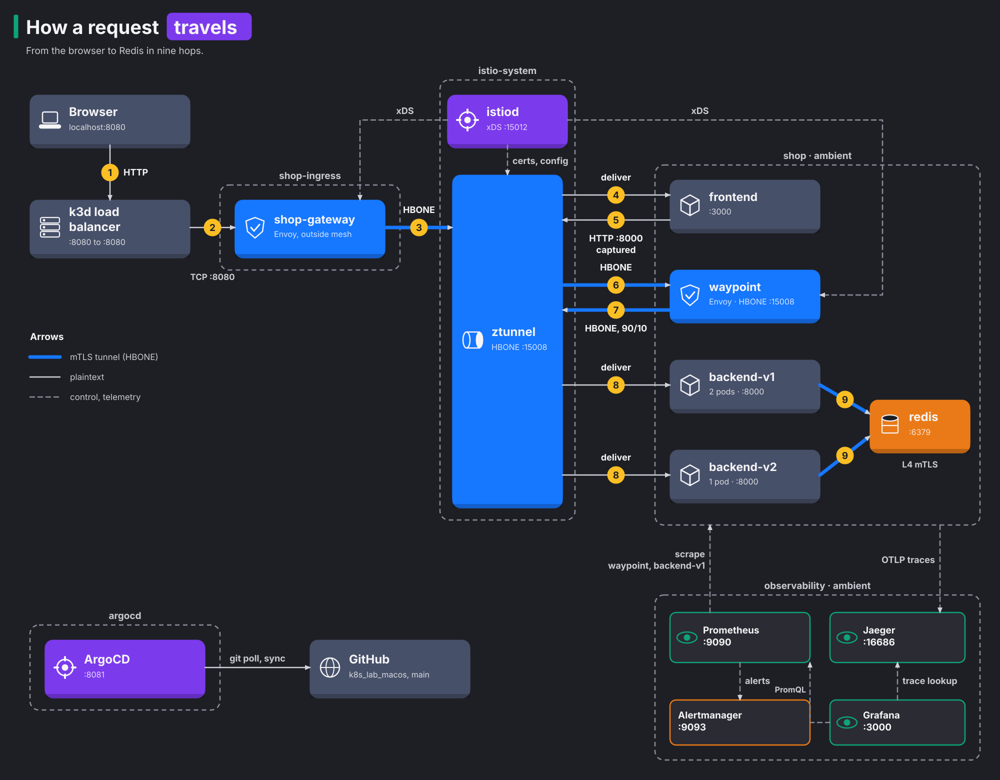
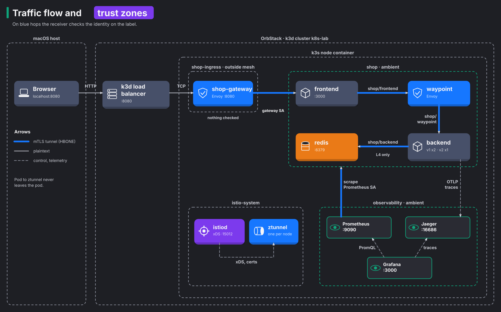
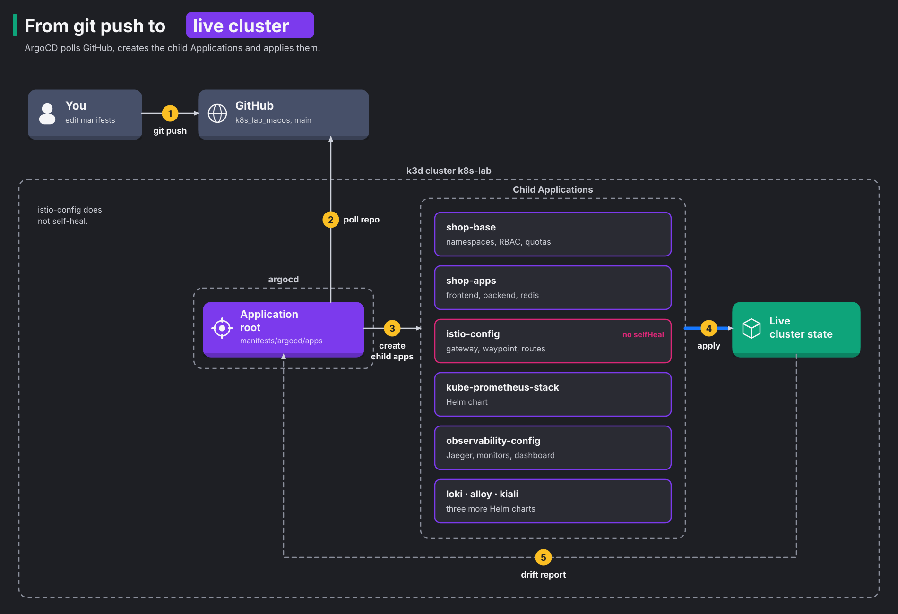

# Architecture

This page explains how the lab fits together: what runs where, how one request travels from your browser to Redis, and how Git changes reach the cluster. If you only want to run the lab, start with the [README](../README.md).

## The layers on your Mac

```text
macOS
└── OrbStack (Docker engine)
    └── k3d cluster "k8s-lab"
        ├── load balancer container   host port 8080 -> cluster port 8080
        └── k3s node container        runs every pod in the lab
```

OrbStack only provides Docker. k3d starts the cluster as containers, so deleting the cluster leaves no trace in OrbStack. Everything below the node container is ordinary Kubernetes.

## What runs in the cluster

| Namespace | What is there | Why |
|---|---|---|
| `shop-ingress` | The `shop-gateway` Envoy | Entry point from your Mac, outside the mesh |
| `shop` | frontend, backend-v1 (2 pods), backend-v2 (1 pod), redis, the waypoint | The application, enrolled in ambient mode |
| `istio-system` | istiod, ztunnel, istio-cni, Kiali | The mesh itself, and its console |
| `observability` | Prometheus, Alertmanager, Grafana, Jaeger, Loki, Alloy | Metrics, alerts, dashboards, traces and logs |
| `headlamp` | Headlamp | A web UI for every namespace |
| `cert-manager` | cert-manager controller, webhook, CA injector | Certificates for the edge |
| `argocd` | ArgoCD | Applies the manifests in this repo |

Both backend versions run the same image. The `APP_VERSION` environment variable sets which version a pod reports, so the canary experiments change routing and not code.

## How a request travels

Follow one request from the browser to Redis. Thick blue arrows are encrypted mesh tunnels, thin arrows are plaintext (outside the mesh, or inside a single pod), dashed arrows are control and telemetry traffic.



The same flow as a standalone image, with the trust zones drawn in:



In words:

1. The browser connects to `localhost:8080`. The k3d load balancer forwards the connection to the gateway pod in the cluster.
2. The gateway sits outside the mesh. Because the frontend is in the mesh, the gateway wraps the request in an HBONE tunnel (mTLS over HTTP/2 on port 15008). The ztunnel on the node unwraps it and hands it to the frontend pod.
3. The frontend calls the backend. Istio's CNI plugin redirects that connection to ztunnel before it leaves the pod.
4. The `backend` Service has the label `istio.io/use-waypoint: waypoint`, so ztunnel sends the request to the waypoint proxy and not straight to a backend pod.
5. The waypoint is the only place that reads HTTP. It checks the authorization policy, applies the route weights (90% v1, 10% v2 in scenario A), injects faults, enforces the connection pool, and picks a pod.
6. The backend talks to Redis. ztunnel encrypts that connection too and allows it only if the caller is the `backend` service account.

The frontend and Redis have no waypoint, so their traffic stays on the cheaper layer-4 path. Only the backend pays for layer-7 features.

### Where traffic is encrypted

| Connection | Encrypted | What the receiver checks |
|---|---|---|
| Browser to the gateway | No | Nothing |
| Gateway to frontend | Yes | The gateway's service account |
| Frontend to waypoint | Yes | `shop/frontend` |
| Waypoint to backend pod | Yes | `shop/waypoint` |
| Backend to Redis | Yes | `shop/backend` |
| Pod to the ztunnel on its own node | No | Stays inside the node |
| Prometheus to pods | Yes | `observability/kube-prometheus-stack-prometheus` |

The hop between a pod and ztunnel is plaintext, but it never leaves the pod. In ambient's in-pod mode, istio-cni places ztunnel's listening socket inside each pod's own network namespace, so the app's plain HTTP turns into HBONE mTLS before it touches any network. Every hop between pods, frontend to waypoint to backend, is mTLS. The diagram draws ztunnel as one box per node for readability; the labels "(in pod)" mark the hops that happen inside a pod.

## How Git changes reach the cluster



`provision.sh` installs Istio and ArgoCD with Helm, because ArgoCD cannot deploy things that need Istio before Istio exists. After that you change the cluster by pushing to `main`.

Eleven ArgoCD Applications deploy everything else (twelve with `root`):

| Application | Syncs | Self-heal |
|---|---|---|
| `shop-base` | Namespaces, RBAC, quotas | Yes |
| `shop-apps` | frontend, backend, redis | Yes |
| `istio-config` | Gateway, waypoint, routes, policies | No, on purpose |
| `kube-prometheus-stack` | The Prometheus, Alertmanager and Grafana Helm chart | Yes |
| `observability-config` | Jaeger, monitors, the two dashboards (Shop mesh, Shop logs) | Yes |
| `loki` | Loki, the log store (Helm chart) | Yes |
| `alloy` | Alloy, which ships pod logs to Loki (Helm chart) | Yes |
| `kiali` | Kiali, the Istio console (Helm chart) | Yes |
| `headlamp` | Headlamp, a web UI for the whole cluster (Helm chart, no login) | Yes |
| `cert-manager` | cert-manager, which issues and renews TLS certificates (Helm chart) | Yes |
| `cert-manager-config` | The lab certificate authority: a self-signed root and the `lab-ca` ClusterIssuer | Yes |

`istio-config` does not self-heal so you can apply a scenario by hand and watch ArgoCD report the drift without undoing your experiment. The files in `manifests/scenarios/` are not synced at all.

## The running system

This section describes the lab as it runs after `./scripts/provision.sh`, measured on 11 November 2026 on a clean rebuild. Your numbers will differ a little.

### Versions

| Component | Version |
|---|---|
| Kubernetes (k3s in k3d) | v1.31.5+k3s1 |
| Istio (istiod, ztunnel, istio-cni, proxies) | 1.24.2 |
| Gateway API CRDs | v1.2.1 |
| ArgoCD | v2.13.2 (chart 7.7.11) |
| Prometheus | v2.55.1 (kube-prometheus-stack 66.2.1) |
| Alertmanager | v0.27.0 (kube-prometheus-stack 66.2.1) |
| Grafana | 11.3.0 |
| Jaeger all-in-one | 1.62.0 |
| Loki | 3.6 (chart 6.55.0), single binary |
| Grafana Alloy | 1.21 (chart 1.14.4) |
| Kiali | 2.4.0 |
| Headlamp | 0.46.0 |
| cert-manager | 1.21.3 |
| Redis | 7.4 |
| Shop images | `k8s-lab/backend:1.0.2`, `k8s-lab/frontend:1.0.2` |

Istio 1.24 supports Kubernetes up to 1.31, which is why `provision.sh` pins the k3s image.

### What is running

Measured on 12 November 2026 with the course workloads deployed: 31 pods on one node and nine ArgoCD Applications, all Synced and Healthy.

| Namespace | Pods | Memory in use |
|---|---|---|
| `shop` | frontend, backend-v1 x2, backend-v2, redis, waypoint, course-client | 220 MiB |
| `shop-ingress` | shop-gateway | 32 MiB |
| `istio-system` | istiod, ztunnel, istio-cni, Kiali | 111 MiB |
| `observability` | Prometheus, Alertmanager, Grafana, Jaeger, Loki, Alloy, operator, kube-state-metrics | 1,362 MiB after a full course run on 12 November 2026; Prometheus alone 613 MiB, Alertmanager 32 MiB |
| `argocd` | controller, server, repo server, applicationset, redis | 499 MiB |
| `kube-system` | coredns, metrics-server, local-path, load balancer | 68 MiB |
| `course-sidecar` | httpbin and client, each with a sidecar (course module 7) | 67 MiB |

The node used 3.3 GiB in total, including k3s itself. Loki took 84 MiB, Alloy 57 MiB and Kiali 33 MiB. The mesh data plane stays small: ztunnel used 10 MiB and the waypoint 29 MiB, while each sidecar in `course-sidecar` used 35 to 38 MiB. Check your own numbers with `kubectl top pods -A` and `kubectl top node`.

### What was verified, and how to repeat it

| Claim | Evidence | Command |
|---|---|---|
| A rebuild from nothing works in one run | `provision.sh` exited 0 with all 13 health checks passing, in under 2 minutes with cached images. A second run on the same cluster also exited 0. | `./scripts/teardown.sh --yes && ./scripts/provision.sh` |
| Traffic enters through the gateway | 300 of 300 requests returned 200 | `./scripts/traffic-test.sh 300` |
| Gateway to frontend uses mTLS | ztunnel logged the connection on port 15008 with source identity `spiffe://cluster.local/ns/shop-ingress/sa/shop-gateway-istio` | `kubectl -n istio-system logs ds/ztunnel \| grep 'src.workload="shop-gateway'` |
| Backend calls go through the waypoint | ztunnel logged frontend to waypoint, then waypoint to backend, both on port 15008 | `kubectl -n istio-system logs ds/ztunnel \| grep waypoint` |
| Only the backend may reach Redis | A pod with the `default` service account got its Redis connection cut, and ztunnel logged the denial | see [the lab guide](lab-guide.md#5-debugging-mtls-drops), step 5 |
| Only the frontend may call the backend | The same pod got `403 Forbidden` from the waypoint | same |
| Scenario A splits 90/10 | 273 responses from v1, 27 from v2 | `kubectl apply -f manifests/scenarios/a-canary-httproute.yaml` |
| Scenario B injects faults | 15 of 200 returned 503, average latency 526 ms, `/api/version` unaffected at 23 ms | see `manifests/scenarios/b-fault-injection.yaml` |
| Scenario C breaks the circuit | 175 of 200 returned 503 with the policy, 0 of 200 without | see `manifests/scenarios/c-circuit-breaker.yaml` |
| The rate limiter works and survives ArgoCD | 304 of 400 returned 429, and `shop-apps` stayed Synced | `kubectl -n shop set env deploy/backend-v1 deploy/backend-v2 RATE_LIMIT_RPS=20` |
| Prometheus scrapes everything | 22 of 22 targets up on 12 November 2026, including ztunnel, the waypoint, the gateway and Alertmanager | http://localhost:9090/targets |
| The Grafana dashboard has data | All nine panel queries return series when run through Grafana | open the dashboard "Shop mesh and traffic experiments" |
| Logs reach Loki and link to traces | Loki held logs from all 7 namespaces. Searching Loki for a Jaeger trace id returned the backend's log line for that request. | Grafana, Explore, Loki: `{namespace="shop"} \|= "<trace id>"` |
| Kiali sees the mesh | Kiali 2.4 found Prometheus, Grafana and Jaeger, drew every edge with 100% mTLS, and reported 0 errors in `shop`'s 7 Istio objects | http://localhost:20001 |
| The course works | On a cluster built from nothing, `./platform-engineering/verify.sh` passed 54 of 54 checks | `./platform-engineering/verify.sh` |
| The lab runs on Linux | On Ubuntu 24.04.5 with Docker Engine 29.1.3 from Ubuntu's packages, a fresh clone ran `provision.sh` to exit 0 in 195 s with all 16 health checks passing, and the course verification passed every module. The Ubuntu machine ran in OrbStack, so it shared OrbStack's kernel (7.2), whose inotify limits are already high. | `./scripts/provision.sh` on Linux |
| Traces join across the mesh | 200 of 200 recent backend traces start at the gateway, most with 7 spans across gateway, waypoint and backend | http://localhost:16686, service `backend` |
| The default logins work | ArgoCD issued a session token, Grafana accepted the password and rejected a wrong one, Redis answered `PONG` | see the [README](../README.md#open-it) |

### What was not verified

- The panels were checked through Grafana's query API, not by looking at them in a browser.
- All 53 Excalidraw files in `docs/diagrams/` passed a structure check: valid JSON, the fields Excalidraw requires on every element, no duplicate ids. They were not opened in Excalidraw itself. Arrows are not bound to boxes, so they stay in place when you move a box.
- Linux was tested on one distribution (Ubuntu 24.04) on one kernel. The inotify check in `provision.sh` was not triggered, because that kernel's limits were already above it.

## Resource limits

The lab targets an OrbStack VM with 8 GiB of RAM. Every namespace has a quota, and a LimitRange gives containers default requests and limits (a quota rejects pods that declare none).

| Namespace | CPU requests | Memory requests | Memory limits |
|---|---|---|---|
| `shop` | 2 cores | 2 GiB | 4 GiB |
| `shop-ingress` | 0.5 cores | 512 MiB | 2 GiB |
| `observability` | 1.5 cores | 2.5 GiB | 6 GiB |

`istio-system` and `argocd` have no quota. Their limits are set in `helm/`. Run `kubectl top pods -A` to see what the cluster really uses.

## Secrets

The lab has three credentials, and all three are fixed defaults stored in Git:

- `shop/redis-auth` and `observability/grafana-admin` are Secrets in `manifests/base/03-lab-credentials.yaml`. ArgoCD manages them through `shop-base`.
- The ArgoCD admin password is a bcrypt hash in `helm/argocd-values.yaml`.

The [README](../README.md#open-it) lists the values. Committing them keeps the lab reproducible and is safe only because nothing listens outside your Mac. [the lab guide](lab-guide.md#secrets) covers what to use on a shared cluster.

## Editing the diagrams

Every diagram is drawn by a Python script in `docs/diagrams/`. `bbg.py` is the drawing kit, and the `make-*.py` and `chapters/make-*.py` scripts draw the diagrams. Each script writes an SVG, which GitHub shows, and an Excalidraw file, which you open at [excalidraw.com](https://excalidraw.com).

To change a diagram, edit its script and run it again:

```bash
python3 docs/diagrams/chapters/make-architecture.py
```

## What this setup does not cover

- There is one node, so traffic between nodes and ztunnel failover are never exercised.
- A waypoint does not accept `EnvoyFilter`. Global rate limiting would need a separate rate limit service, so the lab limits requests inside the backend instead.
- VirtualService support on waypoints and some metric labels change between Istio releases. Scenario B and the dashboard queries are verified on Istio 1.24.2 only. Re-run them after changing `ISTIO_VERSION`.
