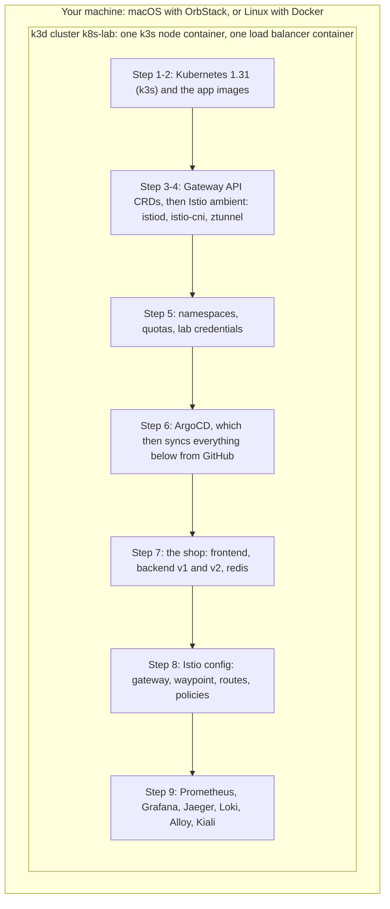

# Building the lab from scratch

This tutorial rebuilds the whole lab by hand, one layer at a time. `scripts/provision.sh` does the same steps in the same order, so reading this is also the best way to understand that script.

Every step has three parts:

- **Do it.** The commands, run from the repository root.
- **Why this way.** The decision behind the step and the alternatives that were rejected.
- **What went wrong here.** Problems hit at this step while the lab was built, with a link to the full diagnosis in [troubleshooting.md](troubleshooting.md).

Plan on 45 minutes if you type everything, or 10 if you run `./scripts/provision.sh` and read along.

## What you are building



Steps 1 to 6 are imperative: you run commands. From step 7 on, you only commit files and ArgoCD applies them. That split is the main design decision of the lab, explained in step 6.

## The decisions at a glance

| Decision | Chosen | Rejected | Main reason |
|---|---|---|---|
| Kubernetes distribution | k3d (k3s in Docker) | OrbStack's built-in Kubernetes, kind, minikube | Istio's CNI cannot install on OrbStack's cluster. k3s is a supported Istio platform and starts in seconds. |
| Kubernetes version | 1.31, pinned | k3d's default (1.35 at build time) | Istio 1.24 supports up to 1.31, and ArgoCD 2.13 does not know newer API fields. |
| Mesh data plane | Istio ambient | Istio sidecars, Linkerd, Cilium | Ambient uses a fraction of the memory on a laptop. Sidecar mode is still available per namespace (course module 7). |
| Istio install method | Helm, four charts | `istioctl install`, ArgoCD | Helm releases are upgradable and inspectable. ArgoCD cannot install the mesh it depends on. |
| Ingress | Gateway API `Gateway` | Istio `Gateway` + `VirtualService`, ingress-nginx | Gateway API is the Kubernetes standard and the same resource type configures waypoints. |
| GitOps | ArgoCD, app of apps | Flux, plain `kubectl apply` | Visual drift view, per-app self-heal settings, multi-source Helm apps. |
| Metrics | kube-prometheus-stack | Prometheus alone | Brings the operator, ServiceMonitor CRDs and Grafana in one chart. |
| Traces | Jaeger all-in-one, in memory | Tempo, Zipkin | One pod, native OTLP input, good UI. Traces are disposable in a lab. |
| Logs | Loki + Alloy reading via the API | Loki + Promtail DaemonSet, ELK | No hostPath needed (Pod Security baseline), Promtail reached end of life in 2026. |
| Mesh UI | Kiali 2.4 | none | Shows the mesh graph, mTLS and config errors, which no other tool here does. |
| Secrets | Lab defaults committed to Git | Generated per install, Sealed Secrets | Every clone behaves the same and the README can list the logins. Only acceptable because nothing is exposed. |

## Step 0: prerequisites

**Do it.** On macOS:

```bash
brew install kubectl helm k3d git istioctl
# install OrbStack from https://orbstack.dev and start it
```

On Linux (tested on Ubuntu 24.04), install Docker Engine and add yourself to the `docker` group, then:

```bash
# kubectl, helm and k3d have official install instructions:
#   https://kubernetes.io/docs/tasks/tools/   https://helm.sh/docs/intro/install/   https://k3d.io
sudo sysctl -w fs.inotify.max_user_instances=512 fs.inotify.max_user_watches=524288
curl --version | head -1     # must be 7.84 or newer
```

**Why this way.** The lab only needs a Docker engine. OrbStack is a fast, light Docker engine for macOS. On Linux, Docker Engine plays the same role. Nothing in the lab depends on OrbStack itself.

**What went wrong here.**

- Ubuntu 22.04 ships curl 7.81. The traffic scripts use `curl -w '%header{...}'`, added in 7.84. `provision.sh` now checks the version.
- On Linux, k3s plus Istio plus the monitoring stack open more inotify instances than the kernel default of 128, and pods fail with "too many open files". `provision.sh` checks the limit.

## Step 1: the cluster

**Do it.**

```bash
k3d cluster create k8s-lab \
  --image rancher/k3s:v1.31.5-k3s1 \
  --servers 1 --agents 0 \
  --port "8080:8080@loadbalancer" \
  --k3s-arg "--disable=traefik@server:0" \
  --wait
kubectl config use-context k3d-k8s-lab
kubectl get nodes
```

**Why this way.**

- **k3d, not OrbStack's Kubernetes.** The first build used OrbStack's cluster. Istio's CNI agent has to add itself to the node's CNI configuration, and that cluster has no CNI config file to chain onto, so the agent waited forever. k3s with flannel is a platform Istio documents and supports.
- **One node.** A second node would add cross-node traffic but double the memory. The trade-off is listed under known limits in [architecture.md](architecture.md#what-this-setup-does-not-cover).
- **k3s pinned to 1.31.** k3d's default image was Kubernetes 1.35. Istio 1.24 supports up to 1.31, and ArgoCD 2.13 failed to compare resources that had a newer status field. Pin the platform and upgrade it together with the components on top.
- **Traefik disabled.** k3s ships Traefik as its ingress controller. The Istio gateway takes that role, and two controllers would compete for port 8080.
- **`--port 8080:8080@loadbalancer`.** k3d runs a small load balancer container in front of the node. This maps your machine's port 8080 to it, so the gateway's LoadBalancer Service is reachable at `localhost:8080`. k3s's built-in service load balancer (klipper) binds the port on the node.

**What went wrong here.** [Problem 1](troubleshooting.md#1-istio-cni-never-becomes-ready-on-orbstacks-built-in-kubernetes) (OrbStack's cluster) and [problem 6](troubleshooting.md#6-argocd-cannot-compare-kube-prometheus-stack) (Kubernetes 1.35).

## Step 2: the application images

**Do it.**

```bash
docker build -t k8s-lab/backend:1.0.2 apps/backend
docker build -t k8s-lab/frontend:1.0.2 apps/frontend
k3d image import k8s-lab/backend:1.0.2 k8s-lab/frontend:1.0.2 -c k8s-lab
```

**Why this way.**

- **`k3d image import` instead of a registry.** It copies the images straight into the node's containerd. A local registry would be one more component to run. The manifests use `imagePullPolicy: IfNotPresent` so Kubernetes never tries to pull them.
- **A version tag, never `latest`.** With `latest`, a rebuilt image looks unchanged to Kubernetes and pods keep the old one. A new tag in the manifest triggers a rollout through Git like any other change.
- **One backend image for both versions.** `APP_VERSION` decides what a pod reports, so the canary exercises test routing, not code differences.
- **Hardened images.** Both run as a non-root user and work with a read-only root filesystem. The Python image is a two-stage build so compilers do not ship.

**What went wrong here.**

- The backend read `REDIS_PORT` and crashed on `tcp://10.43.x.x:6379`, a variable Kubernetes injects for every Service named `redis`. [Problem 5](troubleshooting.md#5-backend-in-crashloopbackoff).
- Request logs had no `trace_id` because the tracing middleware was registered in the wrong order. [Problem 14](troubleshooting.md#14-request-logs-have-no-trace_id).

## Step 3: Gateway API CRDs

**Do it.**

```bash
kubectl apply --server-side -f \
  https://github.com/kubernetes-sigs/gateway-api/releases/download/v1.2.1/standard-install.yaml
kubectl get crd | grep gateway.networking.k8s.io
```

**Why this way.** Istio ambient configures both ingress gateways and waypoints with Gateway API resources (`Gateway`, `HTTPRoute`). The CRDs are not part of Kubernetes, and istiod only watches them if they exist when it starts. Installing them first avoids restarting istiod later. `--server-side` is needed because the CRDs are larger than the annotation that client-side apply stores.

## Step 4: Istio in ambient mode

**Do it.** Four Helm charts, in this order:

```bash
helm repo add istio https://istio-release.storage.googleapis.com/charts
helm repo update

# Find the directory containerd loads CNI plugins from on this k3s version.
BIN_DIR=$(docker exec k3d-k8s-lab-server-0 \
  sed -n 's/^[[:space:]]*bin_dir = "\(.*\)"/\1/p' /var/lib/rancher/k3s/agent/etc/containerd/config.toml)
echo "$BIN_DIR"     # /bin on k3s 1.31

helm upgrade --install istio-base istio/base -n istio-system --create-namespace \
  --version 1.24.2 -f helm/istio-base-values.yaml --force-conflicts --wait
helm upgrade --install istiod istio/istiod -n istio-system \
  --version 1.24.2 -f helm/istiod-values.yaml --set global.platform=k3s --force-conflicts --wait
helm upgrade --install istio-cni istio/cni -n istio-system \
  --version 1.24.2 -f helm/istio-cni-values.yaml --set global.platform=k3s \
  --set cni.cniBinDir="$BIN_DIR" --force-conflicts --wait
helm upgrade --install ztunnel istio/ztunnel -n istio-system \
  --version 1.24.2 -f helm/ztunnel-values.yaml --force-conflicts --wait

kubectl -n istio-system get pods
```

**Why this way.**

- **Four charts, in this order.** `base` installs Istio's CRDs. `istiod` is the control plane: it issues certificates and sends configuration to every proxy. `istio-cni` is a DaemonSet that sets up traffic redirection inside each pod's network namespace. `ztunnel` is the per-node proxy. ztunnel needs both istiod (for certificates) and the CNI agent (for the redirection), so it goes last.
- **Helm, not `istioctl install`.** Both work. Helm leaves releases you can inspect with `helm get values` and upgrade one component at a time, which is how Istio recommends running ambient in production.
- **Not through ArgoCD.** ArgoCD could install Istio, but the Applications that follow need the Gateway API and Istio CRDs to exist. Installing the platform imperatively and everything above it through Git removes that ordering problem.
- **`global.platform=k3s`.** k3s keeps its CNI configuration in `/var/lib/rancher/k3s/agent/etc/cni/net.d`, not `/etc/cni/net.d`. The profile tells the CNI chart where to look.
- **`cni.cniBinDir` from the node.** The k3s profile also guesses the plugin binary directory, and the guess was wrong on both k3s versions tried. Reading `bin_dir` from containerd's config is always right.
- **`--force-conflicts`.** Helm 4 applies charts server-side, and istiod edits a field of its own webhook at runtime. Without the flag the second `helm upgrade` fails on that field. Helm 3 does not need it.
- **Tracing configured at install time.** `helm/istiod-values.yaml` registers Jaeger as an `extensionProvider`. Istio's `Telemetry` resource can only point at a provider that istiod already knows.

**What went wrong here.** This step caused the most trouble:

- ztunnel stuck in `ContainerCreating`: the CNI binary was in a directory containerd does not search. [Problem 2](troubleshooting.md#2-ztunnel-stuck-in-containercreating).
- Every failed attempt leaked an IP address until the node's /24 ran out. [Problem 4](troubleshooting.md#4-pods-fail-with-no-ip-addresses-available).
- The second run of Helm failed on a webhook field conflict. [Problem 3](troubleshooting.md#3-helm-upgrade-fails-with-a-webhook-conflict).

How to check this step worked:

```bash
kubectl -n istio-system get pods                      # istiod, istio-cni-node, ztunnel all Ready
istioctl version                                      # control plane 1.24.2
kubectl get mutatingwebhookconfiguration | grep istio # the sidecar injector exists too
```

## Step 5: namespaces, quotas and credentials

**Do it.**

```bash
kubectl apply -f manifests/base/00-namespaces.yaml -f manifests/base/03-lab-credentials.yaml
kubectl get ns shop --show-labels
```

**Why this way.**

- **Before ArgoCD.** ArgoCD manages these files later (Application `shop-base`). Applying them now means pods that need the Redis or Grafana Secret start on the first try instead of waiting in `CreateContainerConfigError`.
- **`istio.io/dataplane-mode: ambient` on the namespace.** This one label enrolls every pod in `shop` and `observability` into the mesh. No pod needs a restart.
- **`shop-ingress` is not in the mesh.** The ingress gateway is itself an Envoy proxy with its own identity, so it talks to the mesh over mTLS without being enrolled.
- **Quotas with LimitRanges.** Each namespace has a ResourceQuota sized for an 8 GiB machine. A quota rejects pods without requests and limits, so a LimitRange in each namespace fills in defaults for charts that do not set them.
- **Pod Security `baseline`.** Enforced on all three namespaces. It blocks privileged pods and `hostPath`, which shaped the choice of log collector in step 9.

**What went wrong here.** Istio creates gateway and waypoint pods with a default limit of 2 CPU and 1 GiB, which was above the LimitRange maximum. The ReplicaSets failed silently while ArgoCD showed Healthy. [Problem 7](troubleshooting.md#7-gateway-and-waypoint-pods-never-appear).

## Step 6: ArgoCD

**Do it.**

```bash
helm repo add argo https://argoproj.github.io/argo-helm
helm upgrade --install argocd argo/argo-cd -n argocd --create-namespace \
  --version 7.7.11 -f helm/argocd-values.yaml --wait

kubectl apply -f manifests/argocd/project.yaml
kubectl apply -f manifests/argocd/root-app.yaml
kubectl -n argocd get applications --watch
```

**Why this way.**

- **The handover point.** From here on the cluster follows the `main` branch on GitHub. You change the lab by pushing commits, and ArgoCD shows the difference between Git and the cluster.
- **App of apps.** `root-app.yaml` points at the folder `manifests/argocd/apps/`. Each file there is an Application for one area of the lab. Adding a file adds an Application, with no other command.
- **Sync waves.** Namespaces first (wave 0), workloads and charts next (wave 1), then config that needs CRDs from wave 1, such as ServiceMonitors (wave 2).
- **Self-heal on everything except `istio-config`.** Self-heal undoes manual changes. For the shop that is what you want. For Istio config it would undo every course exercise within seconds, so that one Application only reports drift.
- **`ignoreDifferences` for two variables.** `RATE_LIMIT_RPS` and `EXTRA_LATENCY_MS` are experiment knobs. Without the exception, self-heal reverted `kubectl set env` before the new pods even started.
- **Multi-source Applications for Helm charts.** The chart comes from its own repository, the values file from this one (`$values/helm/...`). Chart upgrades and value changes are both visible in Git.
- **Admin password as a bcrypt hash in the values.** ArgoCD needs its password at install time, before it can sync any Secret from Git.

**What went wrong here.**

- The application controller was OOM-killed at 512 MiB while comparing the kube-prometheus-stack chart. [Problem 10](troubleshooting.md#10-the-argocd-controller-restarts-during-the-first-sync).
- The rate-limit experiment did nothing until the `ignoreDifferences` rule existed. [Problem 8](troubleshooting.md#8-the-rate-limit-experiment-has-no-effect).

## Step 7: the shop

ArgoCD Application `shop-apps` applies `manifests/apps/`. Nothing to type. Watch it:

```bash
kubectl -n shop get pods --watch
```

**Why this way.**

- **Three probes per container.** The startup probe gives the app time to boot. The readiness probe checks Redis, so a Redis outage removes backends from the Service instead of serving errors. The liveness probe checks only the process, because restarting every backend during a Redis outage would make it worse.
- **`enableServiceLinks: false`.** Turns off the Docker-era environment variables Kubernetes injects for every Service. They caused the backend crash in step 2.
- **Three Services for the backend.** `backend` selects both versions. `backend-v1` and `backend-v2` select one each, so an HTTPRoute can weigh them against each other.
- **No service account tokens.** None of the apps call the Kubernetes API, so `automountServiceAccountToken: false`. The service account still matters: it is the workload's mesh identity.

## Step 8: Istio configuration

ArgoCD Application `istio-config` applies `manifests/istio/`.

```bash
kubectl -n shop-ingress get gateway shop-gateway     # PROGRAMMED True
kubectl -n shop get gateway waypoint                 # PROGRAMMED True
istioctl ztunnel-config services | grep backend      # WAYPOINT column shows waypoint
curl http://localhost:8080/healthz
```

**Why this way.**

- **A waypoint only for the backend.** The label `istio.io/use-waypoint: waypoint` is on the three backend Services, not on the namespace. The frontend and Redis need no HTTP features, so their traffic skips the extra hop.
- **Policies at both layers.** `backend-allow-frontend` is an L7 rule on the waypoint: only the frontend's identity may call `/api/*`. `backend-only-from-waypoint` is an L4 rule on the backend pods: only the waypoint (and Prometheus) may connect at all. Without the L4 rule, a client that dials a pod IP, or a sidecar client, skips the waypoint and its rules. Course module 3 demonstrates the bypass.
- **STRICT mTLS for `shop`.** Plaintext connections from outside the mesh are refused. Prometheus can still scrape because the `observability` namespace is in the mesh too.

## Step 9: observability

Five ArgoCD Applications: `kube-prometheus-stack`, `observability-config`, `loki`, `alloy` and `kiali`.

```bash
kubectl -n observability get pods
kubectl -n istio-system get pods -l app=kiali
./scripts/port-forward.sh
```

**Why this way.**

- **Metrics come from the proxies.** The waypoint, the gateway and ztunnel export request and TCP metrics in a standard format (`istio_requests_total` and friends). The application exports its own metrics too. PodMonitors and ServiceMonitors in `manifests/observability/monitors.yaml` tell Prometheus where to scrape.
- **Traces start at the gateway.** The gateway and waypoint create spans and pass the W3C `traceparent` header along. The backend's OpenTelemetry SDK continues the same trace. The frontend only forwards the header, which is all an app has to do to keep a trace connected.
- **Loki with Alloy reading logs through the API.** The usual log collector is a DaemonSet that mounts `/var/log/pods` from the node. Pod Security `baseline` forbids that mount. Alloy's `loki.source.kubernetes` reads logs through the API server, like `kubectl logs`, so it runs as an ordinary Deployment.
- **Linked data sources in Grafana.** The Jaeger data source has a "logs for this span" link that queries Loki by trace id. The Loki data source turns a `trace_id` in a log line into a link to Jaeger. That only works because the backend writes the trace id into every log line.
- **Kiali pinned to 2.4.** Each Kiali release supports a window of Istio versions. 2.4 matches Istio 1.24. A newer Kiali may misread the mesh.
- **Grafana's ServiceMonitor scrape timeout lowered to 10 s.** The chart default of 30 s is longer than the 15 s scrape interval, and Prometheus rejected the monitor.

**What went wrong here.** [Problem 9](troubleshooting.md#9-jaeger-fills-with-one-span-ping-traces) (probe noise in Jaeger) and [problem 13](troubleshooting.md#13-grafana-says-jaeger-plugin-unavailable) (a misleading health check).

## Step 10: check everything

```bash
kubectl -n argocd get applications                          # 9 Applications, Synced and Healthy
kubectl get pods -A | grep -vE "Running|Completed"          # no output
./scripts/traffic-test.sh 100                               # 100 x 200, all v1
./course/verify.sh                                          # replays the whole Istio course
```

## Day 2: after a reboot

When Docker restarts the k3d containers by itself, after a reboot or when OrbStack restarts, up to three things break:

- k3d did not get to re-add the `NodeHosts` key to the CoreDNS ConfigMap, so CoreDNS cannot start, cluster DNS stops, ztunnel cannot find istiod, and the mesh goes down. [Problem 11](troubleshooting.md#11-everything-breaks-after-a-reboot-or-docker-restart).
- OrbStack switches the current kubectl context to its own cluster. [Problem 12](troubleshooting.md#12-kubectl-talks-to-the-wrong-cluster).

- Pods whose network sandbox came back before the Istio CNI agent was ready get broken traffic redirection. Some never become Ready; others look Ready while all mesh traffic into them fails. [Problem 15](troubleshooting.md#15-mesh-pods-break-after-a-restart).

`./scripts/start.sh` repairs all three:

```bash
./scripts/start.sh
```

## Rebuilding

```bash
./scripts/teardown.sh --yes      # deletes the k3d cluster, keeps the images
./scripts/provision.sh           # under 2 minutes with cached images, about 10 on a fresh machine
```
