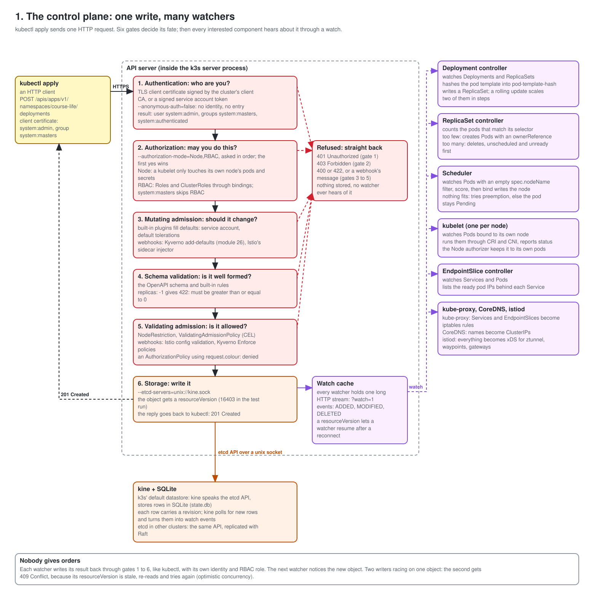
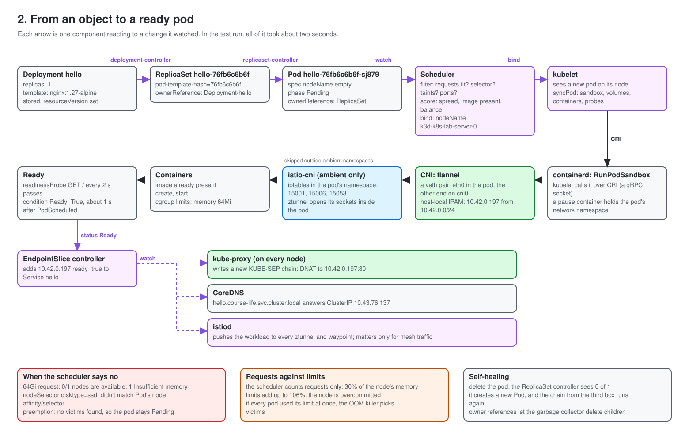
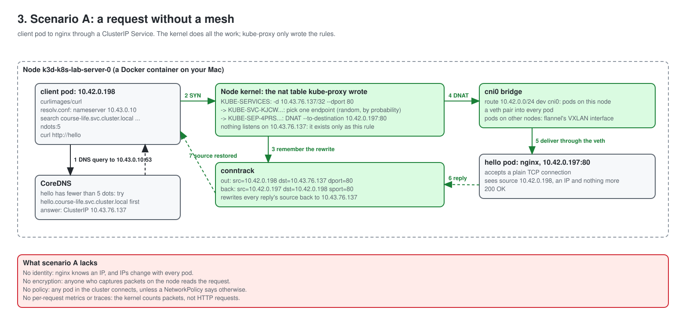
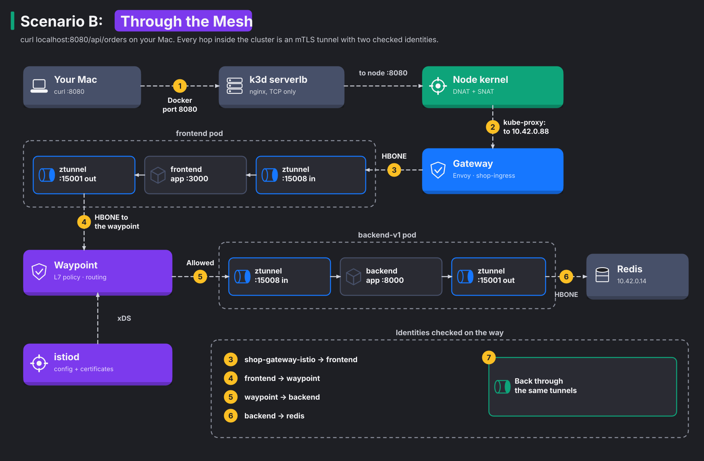

# The life of a request

You type `curl localhost:8080/api/orders` on your Mac, and JSON comes back in about 20 milliseconds. This document follows that request, and the pod that answers it, through every layer of the lab: the API server's gates, the controllers, the scheduler, the kubelet, the Linux network stack, kube-proxy's rules, ztunnel's tunnels, the waypoint's HTTP checks, and back.

Every step shows the command, the real output from one run of this lab, and what the output proves. Your IPs, names and timings will differ; the shape stays the same.

[Module 29](../course/29-life-of-a-request.md) is the hands-on version, with fewer explanations. Terms are in the [glossary](../course/glossary.md).

**Contents**

1. [The control plane: one write, many watchers](#part-1-the-control-plane-one-write-many-watchers)
2. [From an object to a ready pod](#part-2-from-an-object-to-a-ready-pod)
3. [Scenario A: a request without a mesh](#part-3-scenario-a-a-request-without-a-mesh)
4. [Scenario B: a request through the ambient mesh](#part-4-scenario-b-a-request-through-the-ambient-mesh)
5. [Security, layer by layer](#part-5-security-layer-by-layer)
6. [What breaks when a component is down](#part-6-what-breaks-when-a-component-is-down)

**The cast in this run**

| Thing | Value |
|---|---|
| Node | `k3d-k8s-lab-server-0`, a Docker container, IP `192.168.107.2` |
| Pod network, this node's range | `10.42.0.0/16`, `10.42.0.0/24` |
| Service network | `10.43.0.0/16` |
| Scenario A | client pod `10.42.0.198`, Service `hello` `10.43.76.137`, nginx pod `10.42.0.197` |
| Scenario B | serverlb container `192.168.107.3`, gateway pod `10.42.0.88`, frontend `10.42.0.13`, backend Service `10.43.239.201`, waypoint `10.42.0.81`, backend-v1 `10.42.0.58`, redis `10.42.0.14` |

---

## Part 1: The control plane: one write, many watchers



Before any packet flows, a pod must exist. It starts as one HTTP request to the API server. Everything else in Kubernetes reacts to what that request stores.

### 1.1 kubectl is an HTTP client

With `-v=6`, kubectl logs every REST call it makes. Here for a new Deployment (`v6demo`, created and deleted again):

```bash
kubectl -n course-life create deployment v6demo --image=nginx:1.27-alpine --dry-run=client -o yaml \
  | kubectl apply -f - -v=6 2>&1 | grep -oE 'verb="[A-Z]+" url="[^"]*" status="[^"]*"'
```

```text
verb="GET" url="/openapi/v3?timeout=32s" status="200 OK"
verb="GET" url="/openapi/v3/apis/apps/v1?hash=0258D876...&timeout=32s" status="200 OK"
verb="GET" url="/apis/apps/v1/namespaces/course-life/deployments/v6demo" status="404 Not Found"
verb="GET" url="/api/v1/namespaces/course-life" status="200 OK"
verb="POST" url="/apis/apps/v1/namespaces/course-life/deployments?fieldManager=kubectl-client-side-apply&fieldValidation=Strict" status="201 Created"
```

1. kubectl downloads the API's OpenAPI schema for the `apps/v1` group, so it knows every field a Deployment may have. The `hash` lets it cache the schema between runs.
2. It asks for the object. `404 Not Found` means "create"; a `200` would have meant "compute the difference and send a PATCH". That is all `apply` does on the client side.
3. It sends a `POST` to `/apis/apps/v1/namespaces/course-life/deployments`. The path spells out the API group (`apps`), the version (`v1`), the namespace and the resource. `fieldValidation=Strict` asks the API server to refuse unknown fields instead of dropping them silently; `fieldManager` records who owns which fields.
4. `201 Created` comes back only after the object went through every gate below and landed in storage.

There is nothing special about kubectl: any HTTP client with the right credentials does the same.

k3s runs the API server inside its own process. Its log shows the flags it started with:

```bash
docker logs k3d-k8s-lab-server-0 2>&1 | grep -m1 "Running kube-apiserver" | tr ' ' '\n' \
  | grep -E "authorization-mode|anonymous-auth|etcd-servers|enable-admission|client-ca-file|service-account-issuer|service-cluster-ip-range"
```

```text
--anonymous-auth=false
--authorization-mode=Node,RBAC
--client-ca-file=/var/lib/rancher/k3s/server/tls/client-ca.crt
--enable-admission-plugins=NodeRestriction
--etcd-servers=unix://kine.sock
--service-account-issuer=https://kubernetes.default.svc.cluster.local
--service-cluster-ip-range=10.43.0.0/16
```

Each flag sets one of the gates in the diagram. Read them top to bottom and you have the request's path.

### 1.2 Gate 1, authentication: who are you?

The API server accepts a request only when it proves an identity. Two methods matter here:

- Your kubeconfig holds a **client certificate** signed by `client-ca.crt`. The API server checks the signature and reads the user name from the certificate's subject (CN) and the groups from its organisation (O) fields.
- Every pod gets a **service account token**, a signed JWT mounted at `/var/run/secrets/kubernetes.io/serviceaccount/token`.

```bash
kubectl auth whoami
```

```text
ATTRIBUTE   VALUE
Username    system:admin
Groups      [system:masters system:authenticated]
```

Now the pod's side. This decodes the client pod's token without printing it:

```text
header {'alg': 'RS256'}
iss https://kubernetes.default.svc.cluster.local
aud ['https://kubernetes.default.svc.cluster.local', 'k3s']
sub system:serviceaccount:course-life:default
lifetime_s 31536000
bound to pod client-7695f5987b-7r8w7
```

What each claim means:

1. `iss` matches `--service-account-issuer`: the API server only trusts tokens it signed itself.
2. `aud` lists who the token is for. A token for another audience gets refused.
3. `sub` is the identity: service account `default` in namespace `course-life`.
4. The token is **bound to the pod**. Delete the pod, and the token stops working, even before it expires. The kubelet also replaces it on disk well before the end of its lifetime.

`--anonymous-auth=false` means a request with no identity at all never gets further. From the client pod, with and without the token:

```text
403 Forbidden pods is forbidden: User "system:serviceaccount:course-life:default" cannot list resource "pods" in API group "" in the namespace "course-life"
401 Unauthorized Unauthorized
```

Two different gates refused these. With the token, authentication worked (the message names the user), and authorization said no: **403**. Without it, authentication failed: **401**. The status code tells you which gate stopped you.

### 1.3 Gate 2, authorization: may you do this?

`--authorization-mode=Node,RBAC` asks two authorizers in order. The first one that says yes wins; if none does, the answer is 403.

- The **Node** authorizer serves kubelets only. A kubelet (user `system:node:<name>`) may read the pods, secrets and config maps for pods on its own node, and nothing else.
- **RBAC** checks Roles and ClusterRoles bound to the user, the user's groups, or the service account.

```bash
kubectl auth can-i create deployments -n course-life
kubectl auth can-i create deployments -n course-life --as=system:serviceaccount:shop:frontend
kubectl auth can-i --list --as=system:kube-scheduler | grep -E "pods/binding|bindings|^pods "
```

```text
yes
no
bindings        []   []   [create]
pods/binding    []   []   [create]
pods            []   []   [delete get list watch]
```

You get `yes` because `system:masters` is a special group: the API server lets it through before RBAC even runs. That's why only break-glass credentials should carry it. The frontend's service account gets `no`: the shop's apps have no Kubernetes API permissions at all.

The last command shows that the scheduler is just another API client with a narrow role. It may watch pods and create `pods/binding`, and that is exactly what "binding a pod to a node" means at the API level. It may not create pods or change their specs.

### 1.4 Gates 3 to 5, admission: should the object change, and is it allowed?

Admission runs after authorization and only for writes. Mutating admission goes first and may change the object; then the API server validates it against the schema; then validating admission may refuse it. Built-in plugins run first (`NodeRestriction`, enabled by the flag above, stops a kubelet from changing other nodes' objects), then webhooks: HTTPS calls from the API server to a service in the cluster.

```bash
kubectl get mutatingwebhookconfigurations,validatingwebhookconfigurations
```

```text
NAME                                                                               WEBHOOKS
mutatingwebhookconfiguration.admissionregistration.k8s.io/cert-manager-webhook     1
mutatingwebhookconfiguration.admissionregistration.k8s.io/istio-sidecar-injector   4

NAME                                                                                       WEBHOOKS
validatingwebhookconfiguration.admissionregistration.k8s.io/cert-manager-webhook           1
validatingwebhookconfiguration.admissionregistration.k8s.io/istio-validator-istio-system   1
validatingwebhookconfiguration.admissionregistration.k8s.io/istiod-default-validator       1
```

Istio's sidecar injector is a mutating webhook (it matters in [module 7](../course/07-sidecar-mode.md)); its validator checks every Istio resource you write. Two refusals, one from each kind of check:

```text
The Deployment "bad" is invalid: spec.replicas: Invalid value: -1: must be greater than or equal to 0
Error from server: error when creating "STDIN": admission webhook "validation.istio.io" denied the request: configuration is invalid: 2 errors occurred:
	* invalid policy broken.course-life: invalid `value` for `key` request.colour: unknown attribute: request.colour
	* invalid policy broken.course-life: invalid `notValue` for `key` request.colour: unknown attribute: request.colour
```

1. The first came from the API server's own schema validation: no webhook involved.
2. The second came from istiod. The API server sent it the AuthorizationPolicy, istiod found the unknown condition key `request.colour`, and the API server passed the refusal back word for word.

A refused write stops here. Nothing gets stored, no `resourceVersion` gets used, no controller ever hears about it. That is why admission is where policy tools such as Kyverno ([module 26](../course/26-kyverno-policy-as-code.md)) plug in: one choke point for every write in the cluster.

### 1.5 Gate 6, storage: kine instead of etcd

`--etcd-servers=unix://kine.sock` tells the API server to talk the etcd protocol to a Unix socket. On the other end sits **kine**, part of k3s, which turns those calls into SQL against a SQLite file:

```bash
docker exec k3d-k8s-lab-server-0 ls -la /var/lib/rancher/k3s/server/db/
```

```text
-rw-r--r-- 1 root root 75644928 Nov 13 13:11 state.db
-rw-r--r-- 1 root root    65536 Nov 13 13:11 state.db-shm
-rw-r--r-- 1 root root 32992992 Nov 13 13:11 state.db-wal
```

The whole cluster's state is that 75 MB file and its write-ahead log. Each write becomes a new row with an ever-growing revision number; that number becomes the object's `resourceVersion`. In a multi-node production cluster, etcd does the same job and replicates every write to a majority of its members with the Raft protocol before it confirms it.

`resourceVersion` also prevents lost updates. Every update carries the version the writer last read. If somebody else wrote in between, the API server answers **409 Conflict**, and the writer reads again and retries. Controllers rely on this all the time; it's called optimistic concurrency.

### 1.6 The watch: how everybody else finds out

Controllers never poll. Each one opens a **watch**: a long HTTP response that streams an event every time a matching object changes. Open one yourself:

```bash
kubectl get --raw "/api/v1/namespaces/course-life/pods?watch=1&timeoutSeconds=3&labelSelector=app%3Dhello" | cut -c1-120
```

```text
{"type":"ADDED","object":{"kind":"Pod","apiVersion":"v1","metadata":{"name":"hello-76fb6c6b6f-sj879",...,"resourceVersion":"16403",...
```

The API server keeps a **watch cache** in memory, so a thousand watchers don't mean a thousand database reads. kine itself polls its table for new rows and turns them into watch events for the API server. After a dropped connection, a watcher reconnects with its last `resourceVersion` and gets only what it missed.

Inside a controller, a client-side cache called an **informer** holds the watch and keeps a local copy of every object it cares about. The controller reads from that copy, not from the API server.

One more control-plane detail: in a cluster with several servers, the controller manager and the scheduler run on each of them, but only one copy acts. They decide who leads through **Lease** objects. This lab has a single server, so k3s starts the scheduler with `--leader-elect=false`; the leases you see belong to the API server itself and to cert-manager:

```text
NAME                                      HOLDER
apiserver-vflphtfe6p3awncxc7x4iejdh4      apiserver-vflphtfe6p3awncxc7x4iejdh4_11dc13d5-...
cert-manager-cainjector-leader-election   cert-manager-cainjector-7986dd69f7-74jnf_...
cert-manager-controller                   cert-manager-5db8fdc797-rhdbp-external-cert-manager-controller
```

---

## Part 2: From an object to a ready pod



### 2.1 The controllers hand the work along

```bash
kubectl -n course-life get events --sort-by=.firstTimestamp \
  -o custom-columns=TIME:.firstTimestamp,WHO:.source.component,KIND:.involvedObject.kind,REASON:.reason,MESSAGE:.message
```

```text
13:11:34Z    deployment-controller  Deployment ScalingReplicaSet  Scaled up replica set hello-76fb6c6b6f to 1
13:11:34Z    replicaset-controller  ReplicaSet SuccessfulCreate   Created pod: hello-76fb6c6b6f-sj879
13:11:34.046 default-scheduler      Pod        Scheduled          Successfully assigned course-life/hello-76fb6c6b6f-sj879 to k3d-k8s-lab-server-0
13:11:34Z    kubelet                Pod        Pulled             Container image "nginx:1.27-alpine" already present on machine
13:11:34Z    kubelet                Pod        Created            Created container web
13:11:34Z    kubelet                Pod        Started            Started container web
```

Four components, four writes, all inside one second. None of them called another:

1. The **Deployment controller** saw a new Deployment. It hashed the pod template (`pod-template-hash=76fb6c6b6f`) and created a ReplicaSet with that hash in its name. A change to the template gives a new hash and a new ReplicaSet; a rolling update is the Deployment controller scaling the new one up and the old one down in steps.
2. The **ReplicaSet controller** saw a ReplicaSet that wants one pod and has zero. It created a Pod with no node.
3. The **scheduler** saw a Pod with an empty `spec.nodeName`, picked a node and wrote a binding.
4. The **kubelet** on that node saw a Pod assigned to it and started it.

Each object points to its creator:

```text
pod=hello-76fb6c6b6f-sj879
ReplicaSet/hello-76fb6c6b6f
Deployment/hello  pod-template-hash=76fb6c6b6f
```

These **owner references** are how `kubectl delete deployment hello` removes the ReplicaSet and the pods: the garbage collector deletes every object whose owner is gone.

### 2.2 The scheduler decides: filter, score, bind

The scheduler works on one pod at a time, in phases:

1. **Filter.** Drop every node the pod doesn't fit: not enough free *requests* of CPU or memory, a `nodeSelector` or affinity that doesn't match, a taint the pod doesn't tolerate, a host port already in use.
2. **Score.** Rank the remaining nodes: spread replicas apart, prefer nodes that already have the image, balance resource use.
3. **Bind.** Write the winner into the pod through the `pods/binding` subresource you saw in 1.3.
4. **Preemption.** If filtering leaves no node, look for lower-priority pods to evict so this one fits. If none helps, the pod stays `Pending` and the scheduler retries later.

Two pods that fail on purpose, one too big, one too picky:

```text
greedy: 0/1 nodes are available: 1 Insufficient memory. preemption: 0/1 nodes are available: 1 No preemption victims found for incoming pod.
picky: 0/1 nodes are available: 1 node(s) didn't match Pod's node affinity/selector. preemption: 0/1 nodes are available: 1 Preemption is not helpful for scheduling.
```

Read the messages as the filter's report: one node examined, one reason it failed. For `picky`, the scheduler doesn't even try preemption: evicting pods won't add a label to a node.

The filter counts requests, never limits or real use:

```text
  Resource           Requests      Limits
  cpu                1785m (11%)   19850m (132%)
  memory             3620Mi (30%)  12842Mi (106%)
```

Requests fill 30% of the node's memory, so new pods keep fitting. Limits add up to 106%: if every pod used its full limit at once, the node would run out, and the kernel's OOM killer would pick victims. The `hello` pod sets a memory request (16Mi) lower than its limit (64Mi), so Kubernetes puts it in the **Burstable** QoS class (`qosClass=Burstable`). Under memory pressure, the kubelet evicts BestEffort pods first, then Burstable pods that use more than they requested, and Guaranteed pods last.

### 2.3 The kubelet: sandbox first, then network, then containers

The kubelet talks to containerd over the **CRI**, a gRPC API on a Unix socket. It starts every pod in the same order:

1. **RunPodSandbox.** containerd starts a tiny `pause` container. It does nothing except own the pod's Linux namespaces, above all the network namespace. App containers join that namespace later, which is why all containers in a pod share one IP and `localhost`.
2. **CNI.** containerd runs the CNI plugins listed in `/var/lib/rancher/k3s/agent/etc/cni/net.d/10-flannel.conflist` to wire that namespace to the node (2.4).
3. **Containers.** Pull the image (here: already present), create the container with its cgroup limits, start it.
4. **Probes.** The kubelet runs the readiness probe (`GET /` every 2 s). Only when it passes does the pod become `Ready`.

```bash
docker exec k3d-k8s-lab-server-0 crictl pods --namespace course-life
```

```text
POD ID              CREATED             STATE    NAME                      NAMESPACE
09787aa3406d6       5 seconds ago       Ready    client-7695f5987b-7r8w7   course-life
2f1f973ea4a59       5 seconds ago       Ready    hello-76fb6c6b6f-sj879    course-life
```

The pod's conditions record each stage:

```text
PodScheduled=2026-11-13T13:11:34Z
Initialized=2026-11-13T13:11:34Z
PodReadyToStartContainers=2026-11-13T13:11:35Z
ContainersReady=2026-11-13T13:11:35Z
Ready=2026-11-13T13:11:35Z
```

`PodReadyToStartContainers` is the sandbox and its network being ready. From binding to Ready took about one second, because the image was already on the node.

### 2.4 The pod's network, from Layer 2 up

The CNI plugin built this inside and outside the pod. Look from inside first:

```bash
kubectl -n course-life exec deploy/hello -- ip addr show eth0
kubectl -n course-life exec deploy/hello -- ip route
```

```text
2: eth0@if200: <BROADCAST,MULTICAST,UP,LOWER_UP,M-DOWN> mtu 1450 qdisc noqueue state UP qlen 1000
    link/ether ae:8e:15:12:a9:a6 brd ff:ff:ff:ff:ff:ff
    inet 10.42.0.197/24 brd 10.42.0.255 scope global eth0

default via 10.42.0.1 dev eth0
10.42.0.0/24 dev eth0 scope link  src 10.42.0.197
10.42.0.0/16 via 10.42.0.1 dev eth0
```

1. `eth0@if200` is one end of a **veth pair**: a virtual cable with two ends. `@if200` says the other end is interface number 200, in another namespace.
2. The pod has `10.42.0.197/24`, from this node's range. flannel's host-local IPAM hands out addresses from that range.
3. The routes say: pods on this node (`10.42.0.0/24`) are directly reachable on `eth0`; everything else goes to the gateway `10.42.0.1`.
4. The MTU is **1450**, not 1500. flannel reserves 50 bytes for its VXLAN header so that a pod packet still fits in one 1500-byte frame when it crosses to another node.

Now the node's side. Interface 200 is the other end of the cable:

```bash
docker exec k3d-k8s-lab-server-0 ip -o link | grep "^200:"
```

```text
200: vethcfa77a79@if2: <BROADCAST,MULTICAST,UP,LOWER_UP> mtu 1450 qdisc noqueue master cni0 state UP ...
```

`master cni0` means this end sits on the **cni0 bridge**, a virtual Layer 2 switch. Every pod on the node has a veth on it. The bridge itself has the gateway address:

```text
cni0             UP             10.42.0.1/24
```

And the node's routing table:

```text
default via 192.168.107.1 dev eth0
10.42.0.0/24 dev cni0 proto kernel scope link src 10.42.0.1
192.168.107.0/24 dev eth0 proto kernel scope link src 192.168.107.2
```

At Layer 2, pods find each other with ARP, like machines on a real switch. The node's neighbour table shows MAC addresses it learned on the bridge:

```text
10.42.0.31 lladdr ca:b2:a7:54:61:ad REACHABLE
10.42.0.29 lladdr 82:be:84:17:40:84 REACHABLE
```

This lab has one node, so every pod sits on the same bridge. With more nodes, flannel adds a route per node through its VXLAN device:

```text
3: flannel.1: <BROADCAST,MULTICAST,UP,LOWER_UP> mtu 1450 ...
    vxlan id 1 local 192.168.107.2 dev eth0 srcport 0 0 dstport 8472 ...
```

`flannel.1` wraps a pod packet bound for another node into a UDP packet to port 8472 on that node's IP. The other node unwraps it and drops it onto its own bridge. flannel writes its plan into `/run/flannel/subnet.env` (`FLANNEL_NETWORK=10.42.0.0/16`, `FLANNEL_SUBNET=10.42.0.1/24`, `FLANNEL_MTU=1450`) and adds a masquerade rule for traffic leaving the pod network:

```text
-A FLANNEL-POSTRTG -s 10.42.0.0/24 -d 10.42.0.0/16 -m comment --comment "flanneld masq" -j RETURN
```

Pod to pod stays un-NATed (`RETURN`); traffic from pods to the outside world gets the node's address, so replies find their way back.

### 2.5 Ready, then endpoints, then everybody updates

When the pod turns Ready, the **EndpointSlice controller** adds its IP to the `hello` Service's slice:

```text
10.42.0.197 ready=true node=k3d-k8s-lab-server-0
```

Three watchers react, each on its own:

1. **kube-proxy** rewrites its iptables rules on every node (3.2).
2. **CoreDNS** already answers `hello.course-life.svc.cluster.local` with the Service's ClusterIP; for a headless Service, it would now return the pod IP.
3. **istiod** pushes the new endpoint to every ztunnel and waypoint over xDS. It doesn't matter for this plain namespace, but in the shop, that push decides where the mesh sends traffic.

A pod that is running but not Ready stays out of the slice, so no new traffic reaches it. That is the whole point of a readiness probe.

---

## Part 3: Scenario A: a request without a mesh



The client pod runs `curl http://hello`. Follow the bytes.

### 3.1 DNS: from a short name to a ClusterIP

```bash
kubectl -n course-life exec deploy/client -- cat /etc/resolv.conf
kubectl -n course-life exec deploy/client -- nslookup hello
```

```text
search course-life.svc.cluster.local svc.cluster.local cluster.local
nameserver 10.43.0.10
options ndots:5

Server:		10.43.0.10
** server can't find hello.cluster.local: NXDOMAIN
Name:	hello.course-life.svc.cluster.local
Address: 10.43.76.137
```

1. The kubelet wrote this `resolv.conf` when it created the pod. `10.43.0.10` is the ClusterIP of CoreDNS's Service.
2. `ndots:5` says: a name with fewer than five dots is probably short, so try the search domains first. `hello` has none.
3. The resolver tries `hello.course-life.svc.cluster.local` (found: `10.43.76.137`) and other search domains such as `hello.cluster.local` (not found). BusyBox's `nslookup` prints the result for each name it tried, which is why the NXDOMAIN shows up.
4. The DNS query itself goes to a Service IP, so it takes the same kube-proxy path as the HTTP request below.

`ndots:5` makes short names work, but it costs extra queries for external names: `api.github.com` has two dots, so the resolver tries three cluster suffixes before the real name. A trailing dot (`api.github.com.`) skips the search.

### 3.2 The Service: a rule, not a server

```bash
kubectl -n course-life get svc hello
docker exec k3d-k8s-lab-server-0 sh -c "iptables-save -t nat | grep course-life/hello"
```

```text
NAME    TYPE        CLUSTER-IP     EXTERNAL-IP   PORT(S)   AGE
hello   ClusterIP   10.43.76.137   <none>        80/TCP    6s

-A KUBE-SERVICES -d 10.43.76.137/32 -p tcp -m comment --comment "course-life/hello:http cluster IP" -m tcp --dport 80 -j KUBE-SVC-KJCWZC573JCB7P23
-A KUBE-SVC-KJCWZC573JCB7P23 ! -s 10.42.0.0/16 -d 10.43.76.137/32 -p tcp ... --dport 80 -j KUBE-MARK-MASQ
-A KUBE-SVC-KJCWZC573JCB7P23 -m comment --comment "course-life/hello:http -> 10.42.0.197:80" -j KUBE-SEP-4PRSQEGJPQKGEHQE
-A KUBE-SEP-4PRSQEGJPQKGEHQE -s 10.42.0.197/32 ... -j KUBE-MARK-MASQ
-A KUBE-SEP-4PRSQEGJPQKGEHQE -p tcp ... -m tcp -j DNAT --to-destination 10.42.0.197:80
```

No process listens on `10.43.76.137`. No interface has that address. It exists only as a match in these rules, which kube-proxy wrote from the Service and its EndpointSlice. For the first packet of each new connection, the kernel walks them:

1. `KUBE-SERVICES` matches destination `10.43.76.137` port 80 and jumps to the Service's chain.
2. `KUBE-SVC-KJCW...` first marks traffic from *outside* the pod network (`! -s 10.42.0.0/16`) for masquerading, so replies come back through this node. Then it picks an endpoint. With one pod there is one jump; with three, kube-proxy writes `-m statistic --mode random --probability 0.333` and `0.5` before the last, which spreads connections evenly.
3. `KUBE-SEP-4PRS...` rewrites the destination: **DNAT** to `10.42.0.197:80`. The other line covers hairpin traffic, where a pod reaches itself through its own Service.

### 3.3 On the wire: a plain TCP conversation

A packet capture on the `cni0` bridge, filtered on the client's IP, while the client runs `curl http://hello`:

```text
14:01:47.689690 IP 10.42.0.198.58270 > 10.42.0.197.80: Flags [S], seq 2924985601, win 64860, options [mss 1410,...]
14:01:47.689752 IP 10.42.0.197.80 > 10.42.0.198.58270: Flags [S.], seq 2637156200, ack 2924985602, ...
14:01:47.689758 IP 10.42.0.198.58270 > 10.42.0.197.80: Flags [.], ack 1, ...
14:01:47.689791 IP 10.42.0.198.58270 > 10.42.0.197.80: Flags [P.], seq 1:70, ack 1, ...
GET / HTTP/1.1
Host: hello
User-Agent: curl/8.11.1
Accept: */*
14:01:47.689865 IP 10.42.0.197.80 > 10.42.0.198.58270: Flags [P.], seq 1:239, ack 70, ...
HTTP/1.1 200 OK
Server: nginx/1.27.5
Content-Type: text/html
Content-Length: 615
```

Line by line:

1. **SYN** (`[S]`): the client opens a TCP connection from a random port (58270). The destination is already the pod, `10.42.0.197`, not the Service IP: the DNAT happened when the packet entered the node from the client's veth, before the capture point. `mss 1410` is the MTU of 1450 minus 40 bytes of IP and TCP headers.
2. **SYN-ACK** (`[S.]`) from nginx, then the client's **ACK** (`[.]`): the three-way handshake took 68 microseconds.
3. **PSH** (`[P.]`) with 69 bytes of payload: the HTTP request, **in plain text**. Anyone able to capture on the node reads the method, the path and every header.
4. nginx answers with `HTTP/1.1 200 OK`, also in plain text.

The kubelet's readiness probes cross the same bridge, from `10.42.0.1` (the bridge's own address, since the kubelet runs on the node) with `User-Agent: kube-probe/1.31`.

### 3.4 conntrack: how the reply finds its way back

```bash
docker exec k3d-k8s-lab-server-0 conntrack -L -d 10.43.76.137
```

```text
tcp 6 119 TIME_WAIT src=10.42.0.198 dst=10.43.76.137 sport=34704 dport=80 src=10.42.0.197 dst=10.42.0.198 sport=80 dport=34704 [ASSURED] mark=0 use=1
```

One entry holds both directions of one connection:

1. The original direction, as the client sent it: `10.42.0.198:34704 → 10.43.76.137:80`.
2. The reply direction, as the pod sends it: `10.42.0.197:80 → 10.42.0.198:34704`.

When nginx replies, the kernel finds this entry and rewrites the source from `10.42.0.197` back to `10.43.76.137`. The client never learns the pod's IP; as far as curl knows, the Service answered. Only the first packet walks the iptables chains; every later packet of the connection follows the conntrack entry. `TIME_WAIT` and `119` mean the connection has closed and the entry expires in 119 seconds.

nginx's log shows who it thinks called:

```text
10.42.0.198 - - [13/Nov/2026:13:11:40 +0000] "GET / HTTP/1.1" 200 615 "-" "curl/8.11.1" "-"
10.42.0.1 - - [13/Nov/2026:13:11:40 +0000] "GET / HTTP/1.1" 200 615 "-" "kube-probe/1.31" "-"
```

The client pod's IP, and nothing more. nginx has no idea which workload or service account is behind `10.42.0.198`.

### 3.5 Layer 3 and 4 security: NetworkPolicy

Without a mesh, the only network control is NetworkPolicy. k3s enforces it with an embedded kube-router controller that writes more iptables rules. A default-deny for the namespace:

```bash
printf 'apiVersion: networking.k8s.io/v1\nkind: NetworkPolicy\nmetadata:\n  name: deny-all\n  namespace: course-life\nspec:\n  podSelector: {}\n  policyTypes: [Ingress]\n' | kubectl apply -f -
kubectl -n course-life exec deploy/client -- curl -s -m 3 -o /dev/null -w "%{http_code}\n" http://hello
```

```text
000
command terminated with exit code 7
```

Curl's exit code 7 means "failed to connect". The DNAT still happened, but kube-router's per-pod firewall chain rejected the SYN with an ICMP "port unreachable", so the client got an instant refusal rather than a timeout. The rules carry the policy's name:

```text
-A KUBE-NWPLCY-4TPEQJGT6QVQPPS5 ... -j NFLOG --nflog-prefix "DROP by policy course-life/deny-all" --nflog-group 100
-A KUBE-POD-FW-... -m comment --comment "rule to REJECT traffic destined for POD ..." -j REJECT --reject-with icmp-port-unreachable
```

Delete the policy, and the next curl gets `200` again. NetworkPolicy works on IPs, ports and labels: it decides *whether* two pods may talk, but it never sees an identity, a method or a path.

### 3.6 What scenario A lacks

| Missing | Consequence |
|---|---|
| Identity | nginx knows an IP. IPs get reused when pods restart. |
| Encryption | The capture in 3.3 shows the request in plain text. |
| Request-level policy | Nothing checks method, path or caller identity. |
| Request-level telemetry | The kernel counts packets; nobody counts HTTP requests, status codes or latency. |

Scenario B adds all four without changing the app.

---

## Part 4: Scenario B: a request through the ambient mesh



The request: `curl localhost:8080/api/orders` on your Mac. It crosses Docker, nginx, one DNAT and one SNAT before it reaches the gateway, then four encrypted tunnels before it reaches Redis.

### 4.1 From your Mac into the node

```bash
docker port k3d-k8s-lab-serverlb
docker exec k3d-k8s-lab-serverlb grep -A3 "upstream 8080_tcp" /etc/nginx/nginx.conf
```

```text
8080/tcp -> 0.0.0.0:8080
8443/tcp -> 0.0.0.0:8443
6443/tcp -> 0.0.0.0:63077

  upstream 8080_tcp {
    server k3d-k8s-lab-server-0:8080 max_fails=1 fail_timeout=10s;
  }
```

1. Docker (OrbStack here) forwards your Mac's port 8080 to port 8080 of the `k3d-k8s-lab-serverlb` container.
2. That container runs nginx in **TCP stream mode**: it doesn't parse HTTP, it copies bytes to port 8080 of the node container. k3d puts it there so that a cluster with several servers has one stable entry point. The API server's port 6443 reaches the node the same way.

### 4.2 One DNAT and one SNAT to the gateway pod

The gateway's Service has type LoadBalancer. On k3s, **ServiceLB** implements that type: it gives the Service the node's own IP as its external IP and runs a small `svclb-...` pod with a host port.

```bash
kubectl -n shop-ingress get svc shop-gateway-istio
kubectl -n kube-system get pods -l svccontroller.k3s.cattle.io/svcname=shop-gateway-istio -o wide
```

```text
NAME                 TYPE           CLUSTER-IP     EXTERNAL-IP     PORT(S)
shop-gateway-istio   LoadBalancer   10.43.62.182   192.168.107.2   15021:32050/TCP,8080:30297/TCP

NAME                                      READY   STATUS    IP           NODE
svclb-shop-gateway-istio-e733c05f-74kdg   2/2     Running   10.42.0.86   k3d-k8s-lab-server-0
```

So two sets of rules want a packet for `192.168.107.2:8080`. The CNI's portmap plugin wrote a host port DNAT to the svclb pod, and the svclb pod itself would DNAT on to the Service's ClusterIP (its environment says `DEST_IPS=10.43.62.182`). kube-proxy wrote a rule for the load balancer IP. Which one fires depends on the order of the `PREROUTING` chain:

```bash
docker exec k3d-k8s-lab-server-0 iptables -t nat -S PREROUTING
```

```text
-A PREROUTING -m comment --comment "kubernetes service portals" -j KUBE-SERVICES
-A PREROUTING -d 192.168.107.1/32 -j DOCKER_OUTPUT
-A PREROUTING -m addrtype --dst-type LOCAL -j CNI-HOSTPORT-DNAT
```

kube-proxy's `KUBE-SERVICES` comes first. Its rule for the load balancer IP matches, and after a DNAT the packet no longer goes to a local address, so the host port chain never sees it. The packet counters confirm it:

```bash
docker exec k3d-k8s-lab-server-0 sh -c 'iptables -t nat -L -v -n | grep -E "shop-gateway-istio:http loadbalancer IP|DNAT .*dpt:8080 to:"'
```

```text
   33  1980 KUBE-EXT-EIP2LX4U67RPLA5V  6    --  *      *       0.0.0.0/0            192.168.107.2        /* shop-ingress/shop-gateway-istio:http loadbalancer IP */ tcp dpt:8080
    0     0 DNAT       6    --  *      *       0.0.0.0/0            0.0.0.0/0            tcp dpt:8080 to:10.42.0.86:8080
```

33 connections took kube-proxy's path; none took the svclb path. The NAT table counts only the first packet of each connection, so these are connections, not packets. kube-proxy's chain:

```text
-A KUBE-SERVICES -d 192.168.107.2/32 -p tcp ... "shop-ingress/shop-gateway-istio:http loadbalancer IP" ... --dport 8080 -j KUBE-EXT-EIP2LX4U67RPLA5V
-A KUBE-EXT-EIP2LX4U67RPLA5V -m comment --comment "masquerade traffic for shop-ingress/shop-gateway-istio:http external destinations" -j KUBE-MARK-MASQ
-A KUBE-EXT-EIP2LX4U67RPLA5V -j KUBE-SVC-EIP2LX4U67RPLA5V
-A KUBE-SVC-EIP2LX4U67RPLA5V -m comment --comment "shop-ingress/shop-gateway-istio:http -> 10.42.0.88:8080" -j KUBE-SEP-XZ3I76FPEL7X3X6S
-A KUBE-SEP-XZ3I76FPEL7X3X6S -p tcp ... -j DNAT --to-destination 10.42.0.88:8080
```

1. `KUBE-EXT-...` handles traffic from outside the cluster. It sets a mark (`KUBE-MARK-MASQ`) that says "change the source on the way out", then jumps to the usual Service chain.
2. `KUBE-SVC-...` → `KUBE-SEP-...` picks the gateway pod and rewrites the destination: **DNAT** to `10.42.0.88:8080`.
3. After routing, `KUBE-POSTROUTING` sees the mark:

```text
-A KUBE-POSTROUTING -m mark ! --mark 0x4000/0x4000 -j RETURN
-A KUBE-POSTROUTING -j MARK --set-xmark 0x4000/0x0
-A KUBE-POSTROUTING -m comment --comment "kubernetes service traffic requiring SNAT" -j MASQUERADE --random-fully
```

The source changes to the node's address on the pod network, `10.42.0.1`, with a random new port: **SNAT**. conntrack shows both rewrites in one entry:

```bash
docker exec k3d-k8s-lab-server-0 conntrack -L -p tcp -d 192.168.107.2 --dport 8080
```

```text
tcp 6 110 TIME_WAIT src=192.168.107.3 dst=192.168.107.2 sport=47994 dport=8080 src=10.42.0.88 dst=10.42.0.1 sport=8080 dport=44558 [ASSURED] mark=0 use=1
```

Going in: from the serverlb container `192.168.107.3` to the node's `192.168.107.2:8080`. Coming back: from the gateway pod `10.42.0.88:8080` to `10.42.0.1:44558`. Both addresses changed. The gateway pod sees a plain TCP connection from the node; it never learns the serverlb's address, let alone your Mac's. That is the cost of `externalTrafficPolicy: Cluster`, the default: the SNAT makes sure replies come back through the node that did the DNAT, and it hides the client. A Service with `externalTrafficPolicy: Local` skips the SNAT and keeps the client's address, but then only nodes with a gateway pod accept the traffic.

The SNAT also keeps the reply on the right path. Without it, the gateway pod would answer `192.168.107.3` directly, and the serverlb would get a reply from an address it never talked to. With it, the reply goes to `10.42.0.1`, the node, where conntrack turns it back into `192.168.107.2:8080 → 192.168.107.3:47994`.

### 4.3 The gateway: an Envoy that speaks HBONE

```bash
GW=$(kubectl -n shop-ingress get pod -l gateway.networking.k8s.io/gateway-name=shop-gateway -o name)
istioctl proxy-config routes $GW -n shop-ingress
istioctl proxy-config endpoints $GW -n shop-ingress | grep frontend
kubectl get ns shop-ingress shop -L istio.io/dataplane-mode
```

```text
NAME          VHOST NAME     DOMAINS     MATCH                  VIRTUAL SERVICE
http.8080     *:8080         *           /*                     frontend-0-istio-autogenerated-k8s-gateway.shop

ENDPOINT                                     STATUS      OUTLIER CHECK     CLUSTER
envoy://connect_originate/10.42.0.13:3000    HEALTHY     OK                outbound|3000||frontend.shop.svc.cluster.local

NAME           STATUS   AGE   DATAPLANE-MODE
shop-ingress   Active   44m
shop           Active   44m   ambient
```

1. The gateway's Envoy parses the HTTP request (this is the first Layer 7 hop) and matches the route `/*` that istiod built from the shop's HTTPRoute `frontend`.
2. The endpoint `envoy://connect_originate/10.42.0.13:3000` means: open an **HBONE** tunnel to the frontend pod. Envoy picks the pod itself from istiod's endpoint list, so kube-proxy plays no part from here on.
3. `shop-ingress` isn't an ambient namespace and doesn't need to be. The gateway is already a full proxy with its own SPIFFE certificate; it starts the mTLS tunnel itself.

**HBONE** is HTTP/2 `CONNECT` inside mutual TLS, to port 15008. One TLS connection carries many tunnelled TCP streams, and both ends prove their identity with certificates.

### 4.4 Inside the frontend pod: ztunnel's sockets

ztunnel runs as a DaemonSet pod, one per node. Yet the tunnel ends *inside the frontend pod*. When the pod started, istio-cni added rules in the pod's network namespace, and ztunnel opened listening sockets there. Enter the namespace through the app's process ID:

```bash
CID=$(docker exec k3d-k8s-lab-server-0 crictl ps --name frontend -q | head -1)
PID=$(docker exec k3d-k8s-lab-server-0 crictl inspect --output go-template --template '{{.info.pid}}' $CID)
docker exec k3d-k8s-lab-server-0 nsenter -t $PID -n iptables-save | grep -E "REDIRECT|0x539"
```

```text
-A ISTIO_PRERT -m mark --mark 0x539/0xfff -j CONNMARK --set-xmark 0x111/0xfff
-A ISTIO_OUTPUT ! -o lo -p udp -m mark ! --mark 0x539/0xfff -m udp --dport 53 -j REDIRECT --to-ports 15053
-A ISTIO_OUTPUT ! -d 127.0.0.1/32 -p tcp -m tcp --dport 53 -m mark ! --mark 0x539/0xfff -j REDIRECT --to-ports 15053
-A ISTIO_OUTPUT ! -d 127.0.0.1/32 -p tcp -m mark ! --mark 0x539/0xfff -j REDIRECT --to-ports 15001
-A ISTIO_PRERT ! -d 127.0.0.1/32 -p tcp -m tcp ! --dport 15008 -m mark ! --mark 0x539/0xfff -j REDIRECT --to-ports 15006
```

| Rule | Effect |
|---|---|
| `ISTIO_OUTPUT ... REDIRECT --to-ports 15001` | every TCP connection the app opens goes to ztunnel's outbound socket |
| `ISTIO_PRERT ! --dport 15008 ... REDIRECT --to-ports 15006` | plain-text arrivals go to ztunnel's inbound socket; HBONE on 15008 passes straight through |
| `... --dport 53 ... REDIRECT --to-ports 15053` | DNS goes to ztunnel's DNS proxy |
| `mark 0x539` | ztunnel marks its own packets, and every rule skips them, so ztunnel's traffic never loops back into itself |

The pod's listening TCP ports, read from `/proc/<pid>/net/tcp`:

```text
[3000, 15001, 15006, 15008, 15053]
```

Port 3000 is the app. The other four belong to ztunnel, in the app's own network namespace. ztunnel knows every workload and Service from istiod:

```text
NAMESPACE  POD NAME                    ADDRESS      NODE                  WAYPOINT  PROTOCOL
shop       backend-v1-54c86bf9b-wrp75  10.42.0.58   k3d-k8s-lab-server-0  None      HBONE
shop       frontend-d8cfc88bd-wrvvn    10.42.0.13   k3d-k8s-lab-server-0  None      HBONE
shop       redis-7bbf49c9f8-bhpxx      10.42.0.14   k3d-k8s-lab-server-0  None      HBONE
shop       waypoint-b9b76876f-dgt7j    10.42.0.81   k3d-k8s-lab-server-0  None      TCP

NAMESPACE  SERVICE NAME  SERVICE VIP     WAYPOINT  ENDPOINTS
shop       backend       10.43.239.201   waypoint  3/3
shop       frontend      10.43.196.195   None      1/1
shop       redis         10.43.100.21    None      1/1
```

The `PROTOCOL` column says how to reach each pod: `HBONE` for ambient workloads. The waypoint shows `TCP` because it's an Envoy that terminates HBONE itself. The `WAYPOINT` column on the Services table drives the next step: traffic for `backend` goes to the waypoint, traffic for `redis` doesn't.

So the gateway's tunnel lands on `10.42.0.13:15008`. ztunnel checks the gateway's certificate and any Layer 4 policy, unwraps the stream, and connects to the app on port 3000 from inside the pod's network namespace. Plain text exists only inside the pod.

### 4.5 The frontend calls the backend: four tunnels, four identities

The frontend app does nothing special. It opens `http://backend.shop.svc.cluster.local:8000`:

1. The DNS query hits port 53, and the rule sends it to ztunnel's DNS proxy on 15053, which answers with the Service IP `10.43.239.201`.
2. The TCP `connect` to `10.43.239.201:8000` hits the `REDIRECT --to-ports 15001` rule. The packet never reaches kube-proxy's rules on the node.
3. ztunnel looks up `10.43.239.201`, sees the Service uses a waypoint, and opens HBONE to the waypoint, carrying the original destination.

ztunnel logs one line per connection when it closes. Filtered to the request's path:

```text
"inbound"  shop-gateway-istio-858774d7c -> frontend-d8cfc88bd-wrvvn     hbone=10.42.0.13:3000
          from "spiffe://cluster.local/ns/shop-ingress/sa/shop-gateway-istio"
          to   "spiffe://cluster.local/ns/shop/sa/frontend"
"outbound" frontend-d8cfc88bd-wrvvn     -> waypoint-b9b76876f-dgt7j     hbone=10.43.239.201:8000
          from "spiffe://cluster.local/ns/shop/sa/frontend"
          to   "spiffe://cluster.local/ns/shop/sa/waypoint"
"inbound"  waypoint-b9b76876f-dgt7j     -> backend-v1-54c86bf9b-wrp75   hbone=10.42.0.58:8000
          from "spiffe://cluster.local/ns/shop/sa/waypoint"
          to   "spiffe://cluster.local/ns/shop/sa/backend"
"inbound"  backend-v2-5fd94d9cf4-6wffw  -> redis-7bbf49c9f8-bhpxx       hbone=10.42.0.14:6379
          from "spiffe://cluster.local/ns/shop/sa/backend"
          to   "spiffe://cluster.local/ns/shop/sa/redis"
```

| Hop | From | To | Who checks |
|---|---|---|---|
| 1 | `sa/shop-gateway-istio` | `sa/frontend` | ztunnel in the frontend pod |
| 2 | `sa/frontend` | `sa/waypoint` | the waypoint (and it records `sa/frontend` as the caller) |
| 3 | `sa/waypoint` | `sa/backend` | ztunnel in the backend pod |
| 4 | `sa/backend` | `sa/redis` | ztunnel in the redis pod |

Hop 2's `hbone` address is the backend *Service* IP: the waypoint receives traffic meant for the Service and decides which pod gets it. Hop 4 is ztunnel to ztunnel, because `redis` has no waypoint: only Layer 4 checks apply there. (The redis line names a backend-v2 pod from an earlier run of the shop. ztunnel logs a connection only when it closes, and the backend keeps its Redis connection open for as long as it runs, so the most recent closed one is old. The identities are what matter, and those stay the same.)

Each identity is an X.509 certificate. The gateway's own, read with openssl:

```bash
istioctl proxy-config secret $GW -n shop-ingress -o json   # extract the certificate chain, then:
openssl x509 -in gw.pem -noout -subject -issuer -dates -ext subjectAltName,extendedKeyUsage
```

```text
subject=
issuer=O=cluster.local
notBefore=Nov 13 12:35:03 2026 GMT
notAfter=Nov 14 12:37:03 2026 GMT
X509v3 Extended Key Usage:
    TLS Web Server Authentication, TLS Web Client Authentication
X509v3 Subject Alternative Name: critical
    URI:spiffe://cluster.local/ns/shop-ingress/sa/shop-gateway-istio
```

1. The **subject is empty**. The identity lives only in the SAN, as a SPIFFE URI: trust domain `cluster.local`, namespace, service account. Nothing about IPs or pod names.
2. It works for both **server and client authentication**: every workload is a client on one hop and a server on the next.
3. It lives **24 hours**. Istio renews it automatically, so a stolen certificate expires quickly.
4. istiod signs it with the mesh's root CA. ztunnel holds one leaf certificate per service account on its node and a 10-year root:

```text
CERTIFICATE NAME                            TYPE   STATUS      NOT AFTER              NOT BEFORE
spiffe://cluster.local/ns/shop/sa/frontend  Leaf   Available   2026-11-14T12:27:38Z   2026-11-13T12:25:38Z
spiffe://cluster.local/ns/shop/sa/frontend  Root   Available   2036-11-10T12:26:51Z   2026-11-13T12:26:51Z
```

### 4.6 The waypoint: Layer 7 decisions

The waypoint is an Envoy that serves the `backend` Services. It terminates hop 2's tunnel, parses HTTP, decides, and opens hop 3. With access logging on, one request:

```text
[2026-11-13T14:02:22.311Z] "GET /api/orders HTTP/1.1" 200 - via_upstream - "-" 0 392 5 5 "-" "node" "3a34a7c0-49a0-9be9-9293-9409ac9baeb2" "backend.shop.svc.cluster.local:8000" "envoy://connect_origin...
```

The fields: method, path and protocol; status 200; `via_upstream` (the backend answered, not Envoy); 0 bytes in, 392 out; 5 ms in total and 5 ms upstream; user agent `node` (the frontend's runtime); a request ID that every hop passes on; the authority; and the upstream, an HBONE connection to the chosen pod.

Before routing, the waypoint checks this policy:

```yaml
spec:
  action: ALLOW
  rules:
  - from:
    - source:
        principals:
        - cluster.local/ns/shop/sa/frontend
    to:
    - operation:
        methods: [GET, POST]
        paths: [/api/*]
  targetRefs:
  - {kind: Service, name: backend}
  - {kind: Service, name: backend-v1}
  - {kind: Service, name: backend-v2}
```

The waypoint knows the caller's identity from hop 2's certificate, and it knows the method and path because it parsed the HTTP. Test all three from inside the frontend pod:

```text
GET /api/orders 200
GET /admin 403 RBAC: access denied
DELETE /api/orders 403 RBAC: access denied
```

Same caller, same Service, same TCP port. Only Layer 7 tells these apart, and the waypoint writes the 403 itself: the backend never sees the refused requests. Once allowed, the HTTPRoute `backend-route` chooses between `backend-v1` and `backend-v2`, and the waypoint applies the route's timeouts and retries, records metrics and a trace span, and picks a pod.

The response headers back at your Mac carry the proxies' marks:

```text
HTTP/1.1 200 OK
x-app-version: v1
x-served-by: backend-v1-54c86bf9b-wrp75
x-envoy-upstream-service-time: 6
server: istio-envoy
```

`server: istio-envoy` comes from the gateway, which rewrites the header. `x-envoy-upstream-service-time: 6` is the gateway's view of how long everything behind it took.

### 4.7 Layer 4 decisions: ztunnel at the backend

The backend pod's ztunnel enforces two policies of its own: the namespace's `PeerAuthentication` (mode `STRICT`) and an AuthorizationPolicy with a `selector`, which ztunnel enforces:

```text
NS     KIND                  NAME                         ACTION   SEL                MODE
shop   AuthorizationPolicy   backend-only-from-waypoint   ALLOW    map[app:backend]
shop   AuthorizationPolicy   redis-allow-backend          ALLOW    map[app:redis]
shop   PeerAuthentication    default                                                  STRICT
```

`backend-only-from-waypoint` allows `sa/waypoint` and Prometheus's service account. It names the waypoint, not the frontend, because hop 3 arrives with the waypoint's certificate. Bypass the waypoint from a pod outside the mesh, and STRICT mode stops you first:

```bash
kubectl -n course-life exec deploy/client -- curl -s -m 5 -o /dev/null -w "%{http_code}\n" http://backend.shop.svc.cluster.local:8000/api/orders
```

```text
000
command terminated with exit code 56
```

Exit code 56 is "failure receiving data": the TCP connection opened (kube-proxy DNATed it to a backend pod), then ztunnel in that pod saw plain text with no certificate and reset it. Compare with 3.5: NetworkPolicy refuses the SYN; the mesh accepts TCP and then refuses the unauthenticated stream.

### 4.8 On the wire: what an eavesdropper sees

A capture on the `cni0` bridge for every packet to or from the three backend pods, while five requests run through the shop:

```text
packets: 410
destination ports of packets sent TO a backend:
     41 15008
     93 8000
     ...    (ephemeral ports: replies to connections the backend opened)
plaintext 'GET /api' lines: 0
plaintext 'orders' lines: 0
```

1. Requests reach the backends on **port 15008**, HBONE, never on 8000 directly. The payload is TLS: the strings `GET /api` and `orders` appear **zero** times in 410 packets. Compare 3.3, where the whole request was readable.
2. The 93 packets to port 8000 all come from **`169.254.7.127`**, and they read `GET /readyz` and `GET /healthz` with `User-Agent: kube-probe/1.31`. These are the kubelet's probes. istio-cni rewrites probe traffic to this link-local source address, and ztunnel lets packets from it through in plain text, so health checks keep working under STRICT mode without certificates.

### 4.9 Timing the whole trip

One `POST /api/orders`, as Jaeger recorded it:

```text
     18.5 ms  shop-gateway-istio.shop-ingress     frontend.shop.svc.cluster.local:3000/*
      7.4 ms  waypoint.shop                       backend-v1.shop.svc.cluster.local:8000/*
      5.5 ms  backend                             POST /api/orders
      0.5 ms  backend                             INCRBY
      0.3 ms  backend                             HSET LPUSH LTRIM
```

1. The gateway's span covers everything behind it: 18.5 ms.
2. The waypoint's span covers the backend plus one hop: 7.4 ms, of which the backend app used 5.5 ms. The hop through the waypoint and two ztunnels costs about 2 ms.
3. The frontend doesn't trace itself, so its share hides in the gap: about 11 ms of the 18.5.
4. Redis answers in under a millisecond per command.

The spans join into one trace because each proxy forwards the trace context headers (`traceparent`), and the backend's OpenTelemetry library continues them.

### 4.10 The way back

The response retraces every hop in reverse. Each HBONE tunnel is a two-way stream, so the reply rides back through the same four tunnels and the same identities. Then conntrack undoes the SNAT and the DNAT from 4.2, the serverlb nginx copies the bytes out, Docker forwards them to your Mac, and curl prints the JSON.

Nothing decides anything on the way back. Every check, from TLS handshakes to the waypoint's policy, happened when the connection or the request went in.

---

## Part 5: Security, layer by layer

| Layer | Where | What it checks | Scenario A | Scenario B | Seen in |
|---|---|---|---|---|---|
| API | API server, gate 1 | who you are: certificate or token | yes | yes | 1.2: 401 |
| API | API server, gate 2 | what you may do: Node authorizer, RBAC | yes | yes | 1.2, 1.3: 403 |
| API | API server, gates 3 to 5 | whether the object is allowed: schema, webhooks | yes | yes | 1.4: two refusals |
| L2 | cni0 bridge | nothing: any pod on the bridge reaches any other | open | open | 2.4 |
| L3/L4 | kube-router, node iptables | NetworkPolicy: IPs, ports, labels | if defined | if defined | 3.5: exit 7 |
| L4 | ztunnel in each pod | mTLS identity, STRICT mode, selector policies | none | every hop | 4.7: exit 56 |
| L4 | the wire | encryption | plain text | TLS on 15008 | 3.3 against 4.8 |
| L7 | waypoint | caller identity, method, path | none | Services with a waypoint | 4.6: 403 |
| L7 | the app | its own logins and checks | yes | yes | |

Two rules of thumb fall out of this table. First, the API server protects the cluster's *configuration*, and the mesh and NetworkPolicy protect its *traffic*: they never overlap. Second, a Layer 7 rule needs a component that parses HTTP. In ambient mode that's the waypoint; ztunnel only sees TCP and identities.

---

## Part 6: What breaks when a component is down

Everything in Part 1 builds configuration; everything in Parts 3 and 4 runs on configuration that is already in place. So most outages stop change, not traffic.

| Down | Running traffic | What stops |
|---|---|---|
| API server | keeps flowing: iptables, conntrack, ztunnel and the waypoint keep their last configuration | kubectl, new pods, scaling, new endpoints, every controller |
| kine / SQLite | keeps flowing | the API server serves no writes and soon no reads |
| Scheduler | keeps flowing | new pods stay `Pending` |
| Controller manager | keeps flowing | Deployments don't roll, dead pods don't get replaced, endpoints don't update |
| kubelet | containers keep running | probes stop, so the node turns `NotReady`; crashed containers don't restart |
| CoreDNS | open connections keep flowing | new lookups fail, so new connections to Service names fail |
| kube-proxy | existing rules keep working | Service changes don't reach iptables |
| istiod | keeps flowing with the last xDS | no new configuration; certificates stop renewing, so mesh traffic fails once they expire (24 hours) |
| ztunnel on a node | mesh traffic for that node's pods fails | |
| waypoint | traffic to the `backend` Services fails | |

The last two rows are the price of a data plane: the proxies sit in the request path, so they need the same care as the apps. That's why the waypoint is a Deployment you scale, and why ztunnel upgrades need a plan ([module 14](../course/14-upgrading-istio.md)).

---

## Editing the diagrams

`docs/diagrams/make-life-of-a-request-detail.py` draws the four diagrams above, and `docs/diagrams/make-life-of-a-request.py` draws the single-page overview used in module 29. Each writes an SVG for GitHub and an Excalidraw file you may open at [excalidraw.com](https://excalidraw.com). Edit the script, not the SVG, then run it again.
