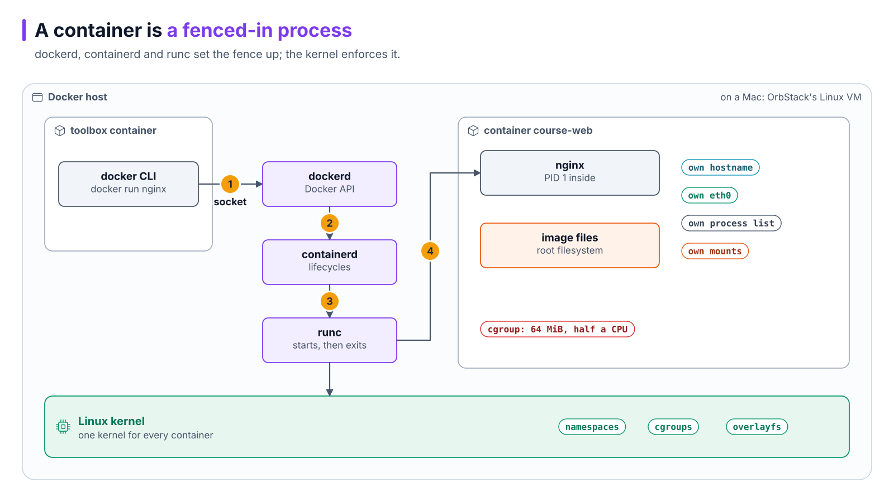
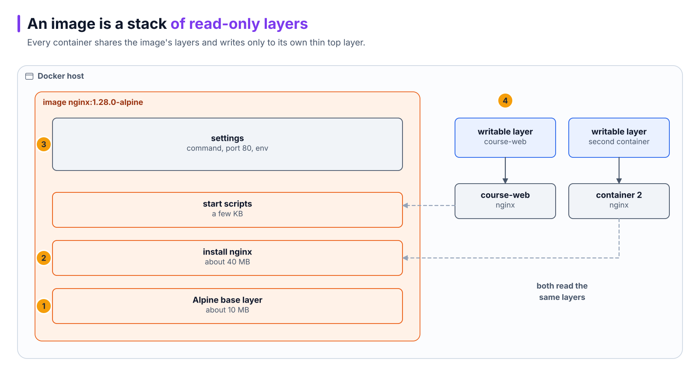

# Module 0.1: containers and images

> New to a term here, like namespace, cgroup or image layer? The [glossary](../glossary.md#docker-and-compose) explains every term in this course.

**Before this module:** the [quick start](../../README.md#quick-start) up to `./lab.sh shell`, which opens the toolbox. This track needs Docker and nothing else: no cluster, no Istio.

**You need:** the toolbox shell. Every command below runs there, from the repo folder, with the `docker` command the toolbox brings. Docker downloads `alpine:3.22.2` (about 4 MB) and `nginx:1.28.0-alpine` (about 21 MB) the first time.

Every platform in this course, from the k3d lab to a cloud cluster, runs your code as containers, and most mysteries in those platforms turn out to be container behaviour: a process that ignores the stop signal, a file that vanished after a restart, a limit that kills an app at the worst moment. This module takes the word "container" apart on your own machine. You start a container, find its process on the Docker host, read the kernel features that fence it in, and look inside the image it came from, so the later modules on building, networking and security all rest on the same picture.

Time: about 40 minutes. Adds two small containers, under 20 MiB together.

**Start clean.** Each module of this track starts with one command that removes whatever an earlier module or an earlier attempt left behind:

```console
$ ./lab.sh reset docker
Removing the Docker track's containers, networks, volumes and images
Done. No course containers, networks or volumes are left.
```

## Concept: a container is a fenced-in process

A program on a shared server sees everything: every other process, every network interface, every file, all the memory it manages to grab. That's a problem when one machine runs the shop's backend, someone else's database and a nightly batch job, because a bug in one of them reads the others' files or eats the memory they need. Virtual machines solve this with a whole second operating system per app, which costs a kernel, a boot and hundreds of megabytes each time.

A container solves it with two features of the one Linux kernel that's already running. Namespaces give a process its own private view of one kind of resource, so inside a new PID namespace the process sees itself as process 1 and no one else, and inside a new network namespace it sees only its own interfaces. Control groups, or cgroups, put a ceiling on what the process may use, such as 64 MiB of memory or half a CPU, and the kernel enforces that ceiling. A container is simply an ordinary process started with a set of these namespaces and one cgroup, much like a tenant in a flat: everyone shares the building, the plumbing and the electricity, but the tenant has a front door, a key and a meter.

Because nothing gets virtualised, a container starts in milliseconds and runs at full speed, and the kernel is the same for every container on the host. That last part matters on a Mac. macOS has no Linux kernel, so OrbStack runs a small Linux VM and Docker runs inside it; on a Linux machine such as the Proxmox VM, the machine itself is the Docker host. In both cases the toolbox talks to that Docker host through its socket, and everything you see in this track happens in the Docker host's kernel.



The diagram follows one `docker run`:

1. The `docker` command in the toolbox sends the request as an API call through the Docker socket to `dockerd` on the Docker host.
2. dockerd hands the container to containerd, which manages the containers' lifecycles.
3. containerd starts runc, which asks the kernel for new namespaces and a cgroup, and prepares the image's files as the new root filesystem.
4. runc starts the image's command inside that fence and exits, so the app is now an ordinary process of the Docker host, child of a small containerd shim.

That's why step 3 of the exercise finds the nginx process in the Docker host's process list with a normal process ID, next to every other process there.

## Concept: an image is a stack of read-only layers

A container needs files: a shell, libraries, the app itself. Copying a full filesystem for every container would waste disk and make starts slow, so Docker builds images from layers. Each layer is a set of file changes, like "unpack Alpine Linux" or "install nginx", stored once and identified by the SHA-256 hash of its content. An image is an ordered list of those layers plus settings, such as the command to run and the ports it uses.

When a container starts, the overlay filesystem stacks the image's layers read-only and puts one thin writable layer on top that belongs to that container alone. A file the container changes gets copied up into its writable layer first, a trick called copy-on-write, so the image underneath never changes and ten containers from the same image share one copy of its layers. The writable layer lives exactly as long as the container, which explains a classic surprise: data written inside a container disappears when you remove the container and start a fresh one, because the new one gets a new, empty writable layer. Module 0.4 shows where data belongs instead.



Read the diagram from the bottom up:

1. The Alpine base layer holds a minimal Linux userland, about 10 MB.
2. The next layers install nginx and its start scripts.
3. The image's settings record the command, `nginx -g daemon off;`, and the port, 80.
4. Each container adds a writable layer of its own, and `docker diff` lists exactly what changed there.

## The bigger picture: one standard under every platform

Docker made containers popular in 2013, and its image format became an open standard under the Open Container Initiative (OCI), which defines how to pack an image and how a runtime starts it. The pieces you meet in this module are the same ones underneath Kubernetes: the kubelet on every node talks to containerd, containerd calls runc, and runc creates namespaces and cgroups exactly as here. A pod is a group of containers that share a network namespace, so once you see a container as a fenced process, a pod stops being magic.

The direction of travel is towards stronger fences around the same process. Rootless containers run the whole engine as an ordinary user, gVisor and Kata Containers put an extra kernel or a tiny VM around a container for untrusted code, and user namespaces, now in Kubernetes as well, map root inside the container to an unprivileged user outside. Module 0.6 tries the parts of that list your Docker host supports.

## Why this way

**Why do containers share the host's kernel instead of booting their own?** Sharing makes them start in milliseconds and cost almost nothing beyond the app's own memory, so one host runs hundreds of them. The price is that a kernel bug affects every container on the host, which is why module 0.6 removes as many kernel privileges as possible.

**Why does a removed container lose its files?** The writable layer belongs to one container, and removing the container removes the layer. Treating containers as disposable is the point: you replace a container with a new one from the same image instead of repairing it, and anything worth keeping goes into a volume.

**Why does the toolbox reach a published port as `host.docker.internal` and not as `localhost`?** The toolbox is itself a container with its own network namespace, so `localhost` inside it means the toolbox. Your Mac's own terminal reaches the same port as `localhost:8880`.

## Do it

### 1. Run a container and compare it with the toolbox

```console
$ docker run --rm alpine:3.22.2 sh -c 'head -1 /etc/os-release; uname -r; hostname; ps'
NAME="Alpine Linux"
7.2.12-orbstack-00394-gbecdd6130068
cc8bb52b146d
PID   USER     TIME  COMMAND
    1 root      0:00 ps

$ head -1 /etc/os-release; uname -r
PRETTY_NAME="Debian GNU/Linux 13 (trixie)"
7.2.12-orbstack-00394-gbecdd6130068
```

**What you should see.** The container reports Alpine Linux while the toolbox reports Debian, because each brings its own files, yet both print the same kernel version, because there is only one kernel. On a Mac that's OrbStack's kernel, on Linux your machine's kernel. The container's hostname is a random 12-character ID, it has its own UTS namespace, and `ps` lists only one process, `ps` itself as PID 1, because the container lives in its own PID namespace. `--rm` removed the container when the command ended.

### 2. A container that keeps running

```console
$ docker run -d --name course-web -p 8880:80 nginx:1.28.0-alpine
ec37e0be88620b4747ccff96e5d199af3a1b0adcb55751fe0625d09dc52d0090

$ docker ps --filter name=course- --format 'table {{.Names}}\t{{.Image}}\t{{.Status}}\t{{.Ports}}'
NAMES        IMAGE                 STATUS                  PORTS
course-web   nginx:1.28.0-alpine   Up Less than a second   0.0.0.0:8880->80/tcp, :::8880->80/tcp

$ curl -s --retry 5 --retry-all-errors --retry-delay 1 http://host.docker.internal:8880/ | grep -o '<title>.*</title>'
<title>Welcome to nginx!</title>

$ docker logs course-web 2>&1 | tail -2
2026/11/21 15:30:22 [notice] 1#1: start worker process 43
192.168.215.1 - - [21/Nov/2026:15:30:22 +0000] "GET / HTTP/1.1" 200 615 "-" "curl/8.14.1" "-"
```

**What you should see.** `-d` runs the container in the background and prints its full ID. `-p 8880:80` publishes the container's port 80 on port 8880 of the Docker host, which `docker ps` shows as `0.0.0.0:8880->80/tcp`. The page title proves nginx answers, and the last log line is that very request, from the address of the Docker network's gateway, because Docker forwarded it. `docker logs` prints what the container's main process wrote to its standard output and error; nginx's image links its log files there for exactly this reason. Module 0.5 follows this forwarding hop by hop.

### 3. Find the container's process on the Docker host

Containers hide the host from you, so to look at the host you start one container that asks Docker to switch the fence off: `--pid=host` shares the Docker host's PID namespace and `--privileged` gives it the rights to read other processes. The same command works on a Mac and on Linux, because both send it to the Docker host.

```console
$ PID=$(docker inspect -f '{{.State.Pid}}' course-web); echo $PID
4080567

$ docker run --rm --privileged --pid=host alpine:3.22.2 sh -c "
    ps -o pid,user,args | grep -E '^ *$PID '
    echo 'namespaces of nginx, then of the host (process 1):'
    ls -l /proc/$PID/ns | awk '/ (net|pid|mnt|uts|user) /{print \$9, \$11}'
    ls -l /proc/1/ns | awk '/ (net|pid|mnt|uts|user) /{print \$9, \$11}'"
4080567 root     nginx: master process nginx -g daemon off;
namespaces of nginx, then of the host (process 1):
mnt mnt:[4026533320]
net net:[4026533325]
pid pid:[4026533323]
user user:[4026531837]
uts uts:[4026533321]
mnt mnt:[4026532288]
net net:[4026532293]
pid pid:[4026532291]
user user:[4026531837]
uts uts:[4026532289]
```

**What you should see.**

1. `docker inspect` reports nginx's process ID as the Docker host numbers it, a large number like `4080567` in the test run, while inside the container the same process is PID 1.
2. The host's process list shows that PID as `nginx: master process`, an ordinary process like any other.
3. Its `net`, `pid`, `mnt` and `uts` namespaces carry different numbers from the host's process 1, so it has its own network, process list, files and hostname.
4. The `user` namespace is the same number for both: Docker starts containers in the host's user namespace by default, so root inside the container is root on the host. Module 0.6 shows why that matters and how to limit it.

### 4. Put a container in a cgroup with limits

```console
$ docker run -d --name course-limited --memory 64m --cpus 0.5 --pids-limit 50 alpine:3.22.2 sleep 600
a50e39865371b5ffbd406d2a76c4371472e6f2fd366cce1a0c52335ee9210af2

$ docker exec course-limited sh -c 'cat /sys/fs/cgroup/memory.max /sys/fs/cgroup/cpu.max /sys/fs/cgroup/pids.max'
67108864
50000 100000
50

$ docker stats --no-stream --format 'table {{.Name}}\t{{.CPUPerc}}\t{{.MemUsage}}\t{{.PIDs}}' course-limited course-web
NAME             CPU %     MEM USAGE / LIMIT     PIDS
course-limited   0.00%     1.152MiB / 64MiB      1
course-web       0.00%     9.543MiB / 11.73GiB   16
```

**What you should see.** The three flags became three files in the container's cgroup: `67108864` bytes of memory (64 MiB), `50000 100000`, which means 50 ms of CPU time in every 100 ms period, half a CPU, and at most 50 processes. `docker stats` reads the same cgroup and shows `64MiB` as the limit for `course-limited`, while `course-web` has no limit and shows the whole memory of the Docker host. Without a limit a container may take everything, and module 0.6 shows what the kernel does to a container that hits its memory ceiling.

### 5. The writable layer and the image's layers

```console
$ docker exec course-web sh -c 'echo "hello from a container" > /usr/share/nginx/html/hello.txt'

$ docker diff course-web | grep -E 'html|nginx.pid'
A /run/nginx.pid
C /usr/share/nginx/html
A /usr/share/nginx/html/hello.txt

$ docker image history nginx:1.28.0-alpine --format '{{.Size}}\t{{.CreatedBy}}' | cut -c1-70 | grep -v '^0B'
40.5MB	RUN /bin/sh -c set -x     && apkArch="$(cat …
8.19kB	COPY 30-tune-worker-processes.sh /docker-ent…
4.1kB	COPY 20-envsubst-on-templates.sh /docker-ent…
4.1kB	COPY 15-local-resolvers.envsh /docker-entryp…
4.1kB	COPY 10-listen-on-ipv6-by-default.sh /docker…
4.1kB	COPY docker-entrypoint.sh / # buildkit
5.25MB	RUN /bin/sh -c set -x     && addgroup -g 101…
9.81MB	ADD alpine-minirootfs-3.21.5-aarch64.tar.gz …

$ docker rm -f course-web && docker run -d --name course-web -p 8880:80 nginx:1.28.0-alpine
course-web
138ae60e28332ac9abea38e10371584dffa284250e5816786c250a734cac2041

$ curl -s --retry 5 --retry-all-errors --retry-delay 1 -o /dev/null -w '%{http_code}\n' http://host.docker.internal:8880/hello.txt
404
```

**What you should see.**

1. `docker diff` lists the new file with `A` (added) and the folders above it with `C` (changed), all in the container's own writable layer. nginx's own PID file shows up too, because a running program writes files as well. Without the `grep`, a Mac also lists `orbstack-root.crt` files, because OrbStack adds its certificate authority to every container; a Linux Docker host doesn't.
2. `docker image history` shows the layers that hold files, newest first: the start scripts of a few KB, the nginx install of about 40 MB, and the Alpine base of about 10 MB at the bottom.
3. After removing the container and starting a new one from the same image, `hello.txt` answers `404`, because the new container got a fresh writable layer and the image never contained the file.

### 6. Stopping: signals and PID 1

`docker stop` sends the container's main process SIGTERM, waits 10 seconds, then sends SIGKILL. The kernel treats PID 1 of a namespace specially: a signal that the process has no handler for gets ignored instead of killing it.

```console
$ docker run -d --name course-sleeper alpine:3.22.2 sleep 300
4797b346298d75967c8b4805143091827da0fd22508e20e2e5257fb1f05cb22c

$ time docker stop course-sleeper
course-sleeper

real	0m10.154s
user	0m0.009s
sys	0m0.003s

$ docker inspect -f '{{.State.ExitCode}}' course-sleeper
137

$ docker run -d --init --name course-sleeper2 alpine:3.22.2 sleep 300
b8eb0d656215de280882039a9935b83c59f74ec28909c16d6326f201fa6350c5

$ docker exec course-sleeper2 ps
PID   USER     TIME  COMMAND
    1 root      0:00 /sbin/docker-init -- sleep 300
    6 root      0:00 sleep 300
    7 root      0:00 ps

$ time docker stop course-sleeper2
course-sleeper2

real	0m0.159s
user	0m0.006s
sys	0m0.002s

$ docker inspect -f '{{.State.ExitCode}}' course-sleeper2
143
```

**What you should see.** `sleep` as PID 1 has no SIGTERM handler, so the kernel ignores the signal, `docker stop` waits the full 10 seconds and then kills it: about 10.15 seconds in the test run and exit code `137`, which is 128 plus 9, the number of SIGKILL. With `--init`, Docker starts a tiny init process, `docker-init`, as PID 1, and `sleep` runs as its child, where SIGTERM works normally: the stop took 0.16 seconds and the exit code is `143`, 128 plus 15 for SIGTERM. Ten seconds per container add up on every deploy, which is why images either use an init process or a program that handles SIGTERM itself, like the app you build in module 0.2.

### 7. Read anything about a container with inspect

`docker inspect` prints the full record Docker keeps about a container as JSON, and `-f` picks fields from it with a Go template.

```console
$ docker inspect -f 'state={{.State.Status}} restarts={{.RestartCount}} ip={{.NetworkSettings.IPAddress}} memory={{.HostConfig.Memory}} cmd={{json .Config.Cmd}}' course-limited
state=running restarts=0 ip=192.168.215.3 memory=67108864 cmd=["sleep","600"]

$ docker inspect course-web | jq '.[0].NetworkSettings.Ports'
{
  "80/tcp": [
    {
      "HostIp": "0.0.0.0",
      "HostPort": "8880"
    },
    {
      "HostIp": "::",
      "HostPort": "8880"
    }
  ]
}
```

**What you should see.** The limited container runs with no restarts, an address on Docker's default network, `192.168.215.x` on a Mac with OrbStack and `172.17.0.x` on a Linux Docker host, its memory limit in bytes and its command. `jq` shows the published port as Docker stores it, bound on every IPv4 and IPv6 address of the Docker host. Whenever a module asks "what is this container really running with", `docker inspect` is the answer.

## Tasks

Each task gives you a goal without the commands. `./lab.sh task setup` prepares it, you solve it in the toolbox, and `./lab.sh task check` tells you what still fails. The solution sits under each task, and `./lab.sh task solve` runs it for you.

### Task 0.1.1: a web server with a limit, a restart policy and a label

<!-- norun -->
```console
$ ./lab.sh task setup 0.1.1
== setup task 0.1.1
No container course-task-web exists. Port 8890 is free for it.
```

> Run a container `course-task-web` from `nginx:1.28.0-alpine` that answers on port 8890 of the Docker host, may use at most 128 MiB of memory, starts again after a crash or a Docker restart unless you stopped it yourself, and carries the label `team=web`.

<details>
<summary>Solution</summary>

All four wishes are flags of `docker run`: `-p` publishes the port, `--memory` writes the cgroup limit, `--restart unless-stopped` sets the restart policy and `--label` attaches the label.

<!-- norun -->
```console
$ docker run -d --name course-task-web -p 8890:80 --memory 128m --restart unless-stopped --label team=web nginx:1.28.0-alpine
a337c81bfe50035cc010c9259e7b4a2fb289e44385fb03798cbfbcf3da0a8f03
$ docker inspect -f '{{.HostConfig.Memory}} {{.HostConfig.RestartPolicy.Name}} {{.Config.Labels.team}}' course-task-web
134217728 unless-stopped web
```

</details>

<!-- norun -->
```console
$ ./lab.sh task check 0.1.1
== check task 0.1.1
  PASS  course-task-web runs nginx:1.28.0-alpine
  PASS  port 8890 of the Docker host answers 200
  PASS  its memory limit is 128 MiB
  PASS  its restart policy is unless-stopped
  PASS  it carries the label team=web
== task 0.1.1: 5 passed, 0 failed
```

### Task 0.1.2: rescue a file from a running container

<!-- norun -->
```console
$ ./lab.sh task setup 0.1.2
== setup task 0.1.2
Container course-task-mystery wrote one file somewhere after it started.
Copy that file to platform-engineering/0-docker/work/task-0.1.2/result.txt.
```

> Find the one file `course-task-mystery` wrote after it started and copy it to `platform-engineering/0-docker/work/task-0.1.2/result.txt`, without stopping the container.

<details>
<summary>Solution</summary>

`docker diff` lists every change in the container's writable layer, so the new file stands out among the folders marked `C`. `docker cp` copies files out of a running container.

<!-- norun -->
```console
$ docker diff course-task-mystery | grep '^A /var'
A /var/lib/report
A /var/lib/report/1795275312
A /var/lib/report/1795275312/result.txt
$ docker cp course-task-mystery:/var/lib/report/1795275312/result.txt platform-engineering/0-docker/work/task-0.1.2/result.txt
$ cat platform-engineering/0-docker/work/task-0.1.2/result.txt
6c1lxtmtcebdenmr
```

The folder name and the content are random for every setup, so read yours from `docker diff`.

</details>

### Task 0.1.3: make a container stop quickly

<!-- norun -->
```console
$ ./lab.sh task setup 0.1.3
== setup task 0.1.3
course-task-slow runs: sh -c 'while true; do sleep 1; done'. docker stop takes 10 seconds.
```

> Replace `course-task-slow` with a container of the same name, image and command that stops within 3 seconds, through SIGTERM and not SIGKILL.

<details>
<summary>Solution</summary>

`sh` runs as PID 1 and has no handler for SIGTERM, so the kernel ignores the signal, exactly like `sleep` in step 6. `--init` puts `docker-init` in front as PID 1, which passes SIGTERM on to `sh`, where the default action ends it.

<!-- norun -->
```console
$ docker rm -f course-task-slow
course-task-slow
$ docker run -d --init --name course-task-slow alpine:3.22.2 sh -c 'while true; do sleep 1; done'
079ea63b79aa86a9f08214cc2c627670643417816bdf3871272a68a7df327fb0
$ docker exec course-task-slow ps
PID   USER     TIME  COMMAND
    1 root      0:00 /sbin/docker-init -- sh -c while true; do sleep 1; done
    6 root      0:00 sh -c while true; do sleep 1; done
    7 root      0:00 sleep 1
    8 root      0:00 ps
```

</details>

<!-- norun -->
```console
$ ./lab.sh task check 0.1.3
== check task 0.1.3
  PASS  course-task-slow runs
  PASS  it runs the same command as before
  PASS  docker stop takes under 3 seconds (it took 0)
  PASS  it stopped through SIGTERM, not SIGKILL
== task 0.1.3: 4 passed, 0 failed
```

## Investigate

1. `docker stats` showed `course-web` with 16 processes in the test run, while `course-limited` had 1. Where do the other 15 come from, and why does the number depend on the Docker host?
2. A colleague runs `docker exec course-web sh -c 'apt-get install vim'` in a running container to fix a config file. Name two reasons why this fix disappears or causes trouble later.
3. Step 3 showed that the nginx process sits in the host's user namespace. What does that mean for a process that breaks out of the container's other namespaces?
4. In step 6, what exit code would `docker stop` produce for a program that handles SIGTERM, cleans up and exits with status 0?

<details>
<summary>Answers</summary>

1. nginx starts one master process and one worker per CPU it sees, because the image sets `worker_processes auto`. The container sees every CPU of the Docker host, 15 in the test run, since `--cpus` limits CPU time, not the number of CPUs it sees. `docker exec course-web ps` lists them, and a Docker host with 4 CPUs would show 5 processes.
2. First, the change lives in the container's writable layer, so the next `docker rm` and `docker run`, or any redeploy, starts a fresh container from the image without it. Second, the running container now differs from its image, so the next person debugging it sees something that no Dockerfile describes. Also, this image is Alpine, which uses `apk`, not `apt-get`, so the command fails anyway. The fix belongs in the image (module 0.2) or in a mounted config file (module 0.4).
3. Root in the container is the same user as root on the host, uid 0, so a process that escapes the mount or PID namespace through a kernel bug or a careless mount acts as real root on the Docker host. A user namespace would map container root to an unprivileged uid on the host, so an escape lands as a nobody. Module 0.6 covers that.
4. Exit code `0`: the process exits by itself after SIGTERM, Docker never needs SIGKILL, and the stop takes as long as the clean-up, usually well under a second.

</details>

## Clean up

```console
$ ./lab.sh reset docker
Removing the Docker track's containers, networks, volumes and images
Done. No course containers, networks or volumes are left.
```

This removes `course-web`, `course-limited`, the two sleeper containers and the task containers. The `alpine:3.22.2` and `nginx:1.28.0-alpine` images stay, because the next modules use them; `docker image rm alpine:3.22.2 nginx:1.28.0-alpine` removes them once you finish the track.
