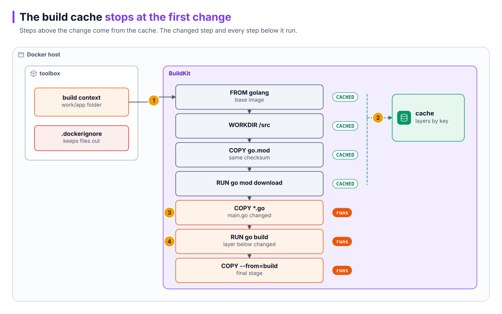
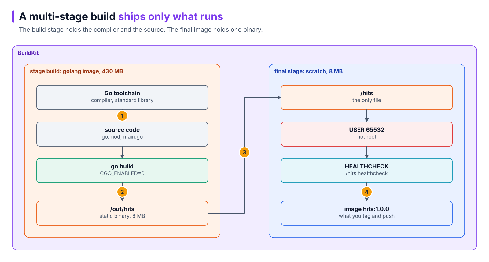

# Module 0.2: building images

> New to a term here, like build context, build cache or digest? The [glossary](../glossary.md#docker-and-compose) explains every term in this course.

**Before this module:** [module 0.1](01-containers-and-images.md), for images and layers. No cluster needed.

**You need:** the toolbox shell, in the repo folder. Docker downloads `golang:1.25.3-alpine3.22` (about 80 MB, 320 MB unpacked) and `registry:3.1.2` (about 20 MB) the first time.

Module 0.1 ran images other people built. Most teams build their own, and the way they write the Dockerfile decides three things that matter every day: how long a build takes after a one-line change, how big the image is that every node downloads, and whether a deploy six months from now runs exactly the bytes you tested. This module builds the track's small web app, `hits`, twice: once the naive way, which gives a 435 MB image that rebuilds more than it needs to, and once the way production teams do it, which gives an 8 MB image that runs without a shell. Then it pushes the image to a registry and pins it by digest.

Time: about 45 minutes. Adds a registry and two small containers, under 30 MiB together.

```console
$ ./lab.sh reset docker
Removing the Docker track's containers, networks, volumes and images
Done. No course containers, networks or volumes are left.
```

## Concept: the build cache reuses every step up to the first change

A Dockerfile is a list of steps, and each step that changes files produces one layer. Rebuilding everything after a one-line code change would waste minutes on every commit, so the builder, BuildKit, keeps a cache. Before it runs a step, it computes a key from the step's instruction, the layer below it and, for `COPY`, the checksums of the files it copies. When the key matches an earlier build, it reuses that layer and prints `CACHED`; when it doesn't, it runs the step, and every later step runs too, because their key includes the layer below, which just changed.

That chain rule decides how you order a Dockerfile. Steps that change rarely, such as installing system packages or downloading dependencies, go first, and the code you edit every day goes last, so a code change reruns only the last few steps. The app's Dockerfile copies `go.mod`, the list of dependencies, on its own and downloads them before it copies the code, much like a kitchen that keeps the stock simmering all day and only cooks the dish to order.



Follow one code change through the app's build:

1. The `docker` command sends the build context, the folder you name, to BuildKit, which skips what `.dockerignore` lists.
2. `FROM`, `WORKDIR`, `COPY go.mod` and `RUN go mod download` match their cache keys, so BuildKit reuses their layers.
3. `COPY *.go` sees a new checksum for `main.go`, so its key changes and the step runs.
4. `go build` runs again because the layer below it changed, and so does every step after it.

## Concept: multi-stage builds ship only what runs

To compile the app you need the Go compiler, its standard library and the source code, about 430 MB. To run it you need one static binary of about 8 MB. A one-stage Dockerfile ships all of it, so every node downloads 430 MB, and every security scanner reports the compiler's vulnerabilities for an image that never compiles anything in production.

A multi-stage Dockerfile has more than one `FROM`. The first stage, named `build`, compiles the binary in the full Go image. The last stage starts from `scratch`, an empty image with no files at all, and `COPY --from=build` takes just the binary across. Only the last stage becomes the image you tag, so the compiler, the source and the shell stay behind in the builder's cache, like the scaffolding that comes down once the building stands.



1. The build stage starts from the Go image and copies the module file and the code.
2. It compiles a static binary with `CGO_ENABLED=0`, so the binary needs no C library at run time.
3. The final stage starts from `scratch` and copies only `/out/hits`.
4. It sets a numeric non-root user, a health check and the entrypoint, and becomes the 8 MB image.

An image with no shell has one more effect: `docker exec ... sh` has nothing to run, which closes the most common door an attacker uses after breaking into an app. Module 0.7 shows how to debug such a container anyway.

## Concept: a tag is a name, a digest is the content

A tag such as `hits:1.0.0` is a movable label, like a sticky note on a box. Anyone with push rights moves the note to a different box by pushing a new image under the same tag, and a server that pulls `hits:1.0.0` tomorrow then gets different bytes from the ones you tested. A digest, `sha256:` followed by 64 hex characters, is the hash of the image's manifest, the file that lists its layers by their own hashes. Change one byte in any layer and the digest changes, so a reference by digest, `hits@sha256:...`, always means exactly one image. Teams use tags for people and digests for machines: humans read `1.0.0`, and the deploy file pins the digest.

## The bigger picture: images as a supply chain

Every image is a link in a supply chain that starts with a base image someone else built. The trends of the last years all shrink that chain or make it checkable: distroless and `scratch` images remove the operating system, reproducible builds make the same source produce the same digest, and signatures and SBOMs, software bills of materials, say who built an image and what's in it. Module 0.6 scans an image and signs it, which only works because the digest pins the exact bytes you sign. Kubernetes uses the same images unchanged, so a small, pinned image speeds up every pod start and every node scale-up in the platform tracks.

## Why this way

**Why copy `go.mod` before the code?** A dependency list changes a few times a month and the code many times a day. Copying it first keeps the download step cached across code changes. The app uses only Go's standard library, so the download is instant here, but in a real project it saves minutes per build.

**Why `scratch` and not Alpine for the final stage?** A static Go binary needs nothing from an operating system, and every file you leave out is one less thing to patch. Alpine adds a shell and a package manager, which help debugging but also help an attacker. Images that need certificates or time zone data copy those files across too, or start from a distroless base.

**Why a numeric user like `65532`?** `scratch` has no `/etc/passwd`, so a user name has nothing to resolve against, while a number always works. Kubernetes's `runAsNonRoot` check also needs a number to prove the user isn't root.

**Why run a registry in the lab?** Digests only appear once an image lives in a registry, and pinning by digest only makes sense against a registry. The registry runs next to the toolbox, so the toolbox reaches it as `localhost:5555` just as the Docker engine does.

## Do it

### 1. Copy the app and build it the naive way

The app sits in `platform-engineering/0-docker/lab/app`. You build a copy in the work folder, so your edits never touch the course files. `steps` is a small filter for BuildKit's plain output that prints one line per step: `CACHED` or how long it ran.

```console
$ mkdir -p platform-engineering/0-docker/work && cp -r platform-engineering/0-docker/lab/app platform-engineering/0-docker/work/app
$ APP=platform-engineering/0-docker/work/app; ls -A $APP
.dockerignore
Dockerfile
Dockerfile.single
go.mod
main.go
$ steps() { awk '/^#[0-9]+ \[/ && !/internal\]/ {id=$1; sub(/^#[0-9]+ /,""); if (!(id in name)) {name[id]=$0; order[++n]=id}} /^#[0-9]+ CACHED/ {st[$1]="CACHED"} /^#[0-9]+ DONE/ {if (!st[$1]) st[$1]="ran " $3} END {for (i=1;i<=n;i++) printf "%-10s %s\n", st[order[i]], substr(name[order[i]],1,72)}'; }
$ cat $APP/Dockerfile.single
# One stage: the Go toolchain and the source code ship with the app.
FROM golang:1.25.3-alpine3.22
LABEL lab.course="docker"
WORKDIR /src
COPY . .
RUN go build -o /usr/local/bin/hits .
EXPOSE 8000
CMD ["hits"]

$ docker build --no-cache --progress=plain -f $APP/Dockerfile.single -t course/hits:single $APP 2>&1 | steps
ran 0.0s   [1/4] FROM docker.io/library/golang:1.25.3-alpine3.22@sha256:aee43c3ccbf
CACHED     [2/4] WORKDIR /src
ran 0.0s   [3/4] COPY . .
ran 4.4s   [4/4] RUN go build -o /usr/local/bin/hits .

$ docker image ls course/hits
REPOSITORY    TAG       IMAGE ID       CREATED         SIZE
course/hits   single    99a0f551d5eb   3 seconds ago   435MB
```

**What you should see.** `--no-cache` forbids reuse, so `COPY . .` and the compile run, the compile for about 4 seconds in the test run. The image weighs about 435 MB, because it carries the whole Go toolchain, the Alpine userland and the source code next to a program of a few megabytes. The trailing `$APP` is the build context: BuildKit receives that folder and nothing else, so `COPY . .` reads from it.

### 2. Watch the cache

```console
$ docker build --progress=plain -f $APP/Dockerfile.single -t course/hits:single $APP 2>&1 | steps
ran 0.0s   [1/4] FROM docker.io/library/golang:1.25.3-alpine3.22@sha256:aee43c3ccbf
CACHED     [3/4] COPY . .
CACHED     [2/4] WORKDIR /src
CACHED     [4/4] RUN go build -o /usr/local/bin/hits .

$ echo "// changed at $(date)" >> $APP/main.go
$ docker build --progress=plain -f $APP/Dockerfile.single -t course/hits:single $APP 2>&1 | steps
ran 0.1s   [1/4] FROM docker.io/library/golang:1.25.3-alpine3.22@sha256:aee43c3ccbf
CACHED     [2/4] WORKDIR /src
ran 0.2s   [3/4] COPY . .
ran 4.8s   [4/4] RUN go build -o /usr/local/bin/hits .
```

**What you should see.** The same build again takes no work at all: every step is `CACHED`, and the build finishes in under a second. After one line changes in `main.go`, `WORKDIR` stays cached, but `COPY . .` runs, because the checksum of the copied files changed, and `go build` runs after it, because the layer below it changed. That's the chain rule from the first concept. The comment carries the current time on purpose: the cache key comes from the files' content, not from when you edited them, so appending a line you already appended in an earlier run produces a checksum BuildKit has seen, and the step comes back `CACHED`.

### 3. The multi-stage build

```console
$ cat $APP/Dockerfile
# Two stages: the first compiles, the second holds only the program.
FROM golang:1.25.3-alpine3.22 AS build
WORKDIR /src
# The module file first, so a change to the code reuses this layer.
COPY go.mod ./
RUN go mod download
COPY *.go ./
ARG VERSION=dev
# CGO_ENABLED=0 makes a static binary that needs no C library at run time.
RUN CGO_ENABLED=0 go build -trimpath -ldflags "-s -w -X main.version=${VERSION}" -o /out/hits .

FROM scratch
LABEL org.opencontainers.image.title="hits" lab.course="docker"
COPY --from=build /out/hits /hits
# A numeric user, because scratch has no /etc/passwd to look a name up in.
USER 65532:65532
EXPOSE 8000
HEALTHCHECK --interval=5s --timeout=3s --start-period=2s --retries=3 CMD ["/hits", "healthcheck"]
ENTRYPOINT ["/hits"]

$ docker build --progress=plain --build-arg VERSION=1.0.0 -t course/hits:1.0.0 $APP 2>&1 | steps
ran 0.0s   [build 1/6] FROM docker.io/library/golang:1.25.3-alpine3.22@sha256:aee43
CACHED     [build 2/6] WORKDIR /src
CACHED     [build 3/6] COPY go.mod ./
CACHED     [build 4/6] RUN go mod download
ran 0.2s   [build 5/6] COPY *.go ./
ran 4.0s   [build 6/6] RUN CGO_ENABLED=0 go build -trimpath -ldflags "-s -w -X main
ran 0.0s   [stage-1 1/1] COPY --from=build /out/hits /hits

$ echo "// changed again at $(date)" >> $APP/main.go
$ docker build --progress=plain --build-arg VERSION=1.0.0 -t course/hits:1.0.0 $APP 2>&1 | steps
ran 0.0s   [build 1/6] FROM docker.io/library/golang:1.25.3-alpine3.22@sha256:aee43
CACHED     [build 2/6] WORKDIR /src
CACHED     [build 3/6] COPY go.mod ./
CACHED     [build 4/6] RUN go mod download
ran 0.1s   [build 5/6] COPY *.go ./
ran 4.4s   [build 6/6] RUN CGO_ENABLED=0 go build -trimpath -ldflags "-s -w -X main
ran 0.0s   [stage-1 1/1] COPY --from=build /out/hits /hits

$ docker image ls course/hits
REPOSITORY    TAG       IMAGE ID       CREATED                  SIZE
course/hits   1.0.0     3bd2ad52dfd1   Less than a second ago   8.2MB
course/hits   single    f94020ff531b   12 seconds ago           435MB
```

**What you should see.** Seven steps in two stages, `build` and `stage-1`, the unnamed final stage. After the code change, `COPY go.mod` and `go mod download` stay `CACHED`, and only `COPY *.go`, `go build` and the final `COPY --from=build` run again. The new image weighs about 8 MB, roughly 50 times smaller than the naive one, and holds exactly one file.

### 4. Run the small image

<!-- fails-ok -->
```console
$ docker run -d --name course-hits -p 8881:8000 course/hits:1.0.0
c5dc97b1fd9bc4fe39388842f5be52fb85d940b893f65175790360109ca12be8

$ curl -s --retry 5 --retry-all-errors --retry-delay 1 http://host.docker.internal:8881/; curl -s http://host.docker.internal:8881/
hello from c5dc97b1fd9b, visit 1, version 1.0.0
hello from c5dc97b1fd9b, visit 2, version 1.0.0

$ docker exec course-hits sh -c 'echo hi'
OCI runtime exec failed: exec failed: unable to start container process: exec: "sh": executable file not found in $PATH

$ sleep 6; docker inspect -f 'user={{.Config.User}} health={{.State.Health.Status}}' course-hits
user=65532:65532 health=healthy

$ docker logs course-hits
2026/11/21 15:44:14 hits 1.0.0 listening on :8000, redis="", uid=65532
2026/11/21 15:44:14 GET / from 192.168.215.1:30920 in 7µs
2026/11/21 15:44:14 GET / from 192.168.215.1:29489 in 17µs
2026/11/21 15:44:16 GET /healthz from 127.0.0.1:39888 in 9µs
```

**What you should see.** The app answers with its hostname, the container's ID, a visit counter that counts per container because no Redis is set, and the version `1.0.0` that the build argument baked in. `docker exec ... sh` fails with `exec: "sh": executable file not found in $PATH`, because the image holds no shell. The container runs as user `65532:65532`, as the Dockerfile asked, and its health status reads `healthy` after a few seconds: the image's `HEALTHCHECK` runs `/hits healthcheck`, the same binary in a second mode, because there is no curl to call. The log lines come from the app itself and show its user ID and each request.

### 5. Keep the build context small with .dockerignore

Everything in the build context travels to the builder before the first step runs. A forgotten folder of logs or test data slows down every build and, with `COPY . .`, lands in the image.

```console
$ mkdir -p $APP/notes && dd if=/dev/zero of=$APP/notes/big.log bs=1M count=100 2>/dev/null; du -sh $APP
101M	platform-engineering/0-docker/work/app

$ docker build --progress=plain -f $APP/Dockerfile.single -t course/hits:single $APP 2>&1 | grep 'transferring context'
#3 transferring context: 257B done
#5 transferring context: 54B done

$ mv $APP/.dockerignore $APP/.dockerignore.off
$ docker build --progress=plain -f $APP/Dockerfile.single -t course/hits:fat $APP 2>&1 | grep 'transferring context'
#3 transferring context: 2B done
#4 transferring context: 104.88MB 0.3s done

$ docker run --rm course/hits:fat ls -la /src/notes
total 102400
drwxrwxrwx    1 root     root            14 Nov 21 15:44 .
drwxr-xr-x    1 root     root           124 Nov 21 15:44 ..
-rw-rw-rw-    1 root     root     104857600 Nov 21 15:44 big.log

$ mv $APP/.dockerignore.off $APP/.dockerignore
```

**What you should see.** With `.dockerignore` in place, the first `transferring context` line is the `.dockerignore` file itself and the second, the build context, holds 54 bytes, because the Dockerfile copies nothing the ignore list keeps out and BuildKit sends only changed files since the last build. Without it, BuildKit transfers the whole 100 MB `notes` folder, and the naive Dockerfile's `COPY . .` copies the log file into the image, where `ls` finds it. In a real project that folder holds `.git`, `node_modules` or a `.env` file with secrets, which is why `.dockerignore` belongs next to every Dockerfile.

### 6. Push to a registry and read the digest

The registry joins the toolbox's network, so the toolbox reaches it as `localhost:5555` through a small forwarder, and it publishes port 5555 on the Docker host's loopback address, so the Docker engine reaches it under the same name.

```console
$ docker run -d --name course-registry --network k8s-lab-toolbox_default -p 127.0.0.1:5555:5000 registry:3.1.2
03a9a898edbc2cfb8371386b3d4d3104bebdaa9ed882d49bd975175e7ef364ec

$ docker tag course/hits:1.0.0 localhost:5555/hits:1.0.0
$ docker push -q localhost:5555/hits:1.0.0
localhost:5555/hits:1.0.0

$ curl -s --retry 5 --retry-all-errors --retry-delay 1 http://localhost:5555/v2/hits/tags/list
{"name":"hits","tags":["1.0.0"]}

$ docker image inspect -f '{{range .RepoDigests}}{{println .}}{{end}}' localhost:5555/hits:1.0.0
course/hits@sha256:3bd2ad52dfd132f77f72ce07a0da6f0a893da305e60de1d3ec705cb05c98c5ae
localhost:5555/hits@sha256:3bd2ad52dfd132f77f72ce07a0da6f0a893da305e60de1d3ec705cb05c98c5ae

$ D=$(curl -s -I -H 'Accept: application/vnd.oci.image.index.v1+json' http://localhost:5555/v2/hits/manifests/1.0.0 | tr -d '\r' | awk '/Docker-Content-Digest/ {print $2}')
$ DIGEST=localhost:5555/hits@$D; echo $DIGEST
localhost:5555/hits@sha256:3bd2ad52dfd132f77f72ce07a0da6f0a893da305e60de1d3ec705cb05c98c5ae
```

**What you should see.** The registry lists the tag `1.0.0`, and the image now carries repo digests, one per name it has, both with the same `sha256` value. The registry reports that same hash in its `Docker-Content-Digest` header, because the digest is the hash of the manifest it stores, and `DIGEST` keeps it with the registry's name for step 7. With the containerd image store, which Docker 29 uses on OrbStack and on new Linux installs, the pushed manifest is an index that also carries build provenance, so the digest covers both.

### 7. Move a tag, and see the digest stay put

```console
$ docker build -q --build-arg VERSION=1.0.1 -t localhost:5555/hits:1.0.0 $APP
sha256:477d434859826f475cac10a8118ac2dfd774743e8d0ce228318dcf4f7f180ce3
$ docker push -q localhost:5555/hits:1.0.0
localhost:5555/hits:1.0.0

$ docker run --rm -d --name course-by-tag -p 8882:8000 localhost:5555/hits:1.0.0
a3ce8922807255c5a7c4de0487381c99003a81ad836ee0224b27aa4409b41e48
$ docker run --rm -d --name course-by-digest -p 8883:8000 $DIGEST
Unable to find image 'localhost:5555/hits@sha256:3bd2ad52dfd132f77f72ce07a0da6f0a893da305e60de1d3ec705cb05c98c5ae' locally
localhost:5555/hits@sha256:3bd2ad52dfd132f77f72ce07a0da6f0a893da305e60de1d3ec705cb05c98c5ae: Pulling from hits
Digest: sha256:3bd2ad52dfd132f77f72ce07a0da6f0a893da305e60de1d3ec705cb05c98c5ae
Status: Downloaded newer image for localhost:5555/hits@sha256:3bd2ad52dfd132f77f72ce07a0da6f0a893da305e60de1d3ec705cb05c98c5ae
60ab5c582a0e2d77326304a8f17ec55d5c07d93817ee418e322a552c0bd87c87

$ curl -s --retry 5 --retry-all-errors --retry-delay 1 http://host.docker.internal:8882/; curl -s --retry 5 --retry-all-errors --retry-delay 1 http://host.docker.internal:8883/
hello from a3ce89228072, visit 1, version 1.0.1
hello from 60ab5c582a0e, visit 1, version 1.0.0
```

**What you should see.** Someone pushed version `1.0.1` under the tag `1.0.0`, which a registry allows unless you turn on tag immutability. The container started by tag runs the new code and reports `version 1.0.1`, while the container started by the digest you saved runs exactly the image you pushed first and reports `version 1.0.0`. No local name pointed at that digest any more, so Docker pulled it from the registry, which still keeps the old manifest. That's the reason deploy files pin digests.

## Tasks

### Task 0.2.1: order a Dockerfile for the cache

```console
$ ./lab.sh task setup 0.2.1
== setup task 0.2.1
total 8
-rw-rw-rw- 1 lab dialout 112 Nov 21 15:44 Dockerfile
-rw-rw-rw- 1 lab dialout  82 Nov 21 15:44 report.sh
```

> The folder `platform-engineering/0-docker/work/task-0.2.1` holds a Dockerfile and a script. Every change to `report.sh` reinstalls `curl`, which takes seconds and needs the internet. Change the Dockerfile so that a change to `report.sh` leaves the `apk add` step cached, keep what the image does, and build it as `course/task-cache:1`.

<details>
<summary>Solution</summary>

`COPY . /app` comes before `RUN apk add`, so every change to any file in the folder changes the `COPY` layer and reruns the install below it. Move the install above the copy, so its cache key depends only on the base image.

```console
$ cat platform-engineering/0-docker/work/task-0.2.1/Dockerfile
FROM alpine:3.22.2
LABEL lab.course=docker
COPY . /app
RUN apk add --no-cache curl
CMD ["sh", "/app/report.sh"]
$ printf 'FROM alpine:3.22.2\nLABEL lab.course=docker\nRUN apk add --no-cache curl\nCOPY . /app\nCMD ["sh", "/app/report.sh"]\n' > platform-engineering/0-docker/work/task-0.2.1/Dockerfile
$ docker build -q -t course/task-cache:1 platform-engineering/0-docker/work/task-0.2.1
sha256:5355fdbeb1e34e4b69f9715e4e012b0c72f25c810db67ec9143c9f4f05d8f382
```

</details>

```console
$ ./lab.sh task check 0.2.1
== check task 0.2.1
  PASS  image course/task-cache:1 exists
  PASS  it runs report.sh with curl installed
  PASS  after a change to report.sh, the apk add step comes from the cache
== task 0.2.1: 3 passed, 0 failed
```

### Task 0.2.2: make an image small and non-root

```console
$ ./lab.sh task setup 0.2.2
== setup task 0.2.2
total 16
-rw-r--r-- 1 lab dialout  215 Nov 21 15:44 .dockerignore
-rw-r--r-- 1 lab dialout  210 Nov 21 15:44 Dockerfile
-rw-r--r-- 1 lab dialout   21 Nov 21 15:44 go.mod
-rw-r--r-- 1 lab dialout 3710 Nov 21 15:44 main.go
```

> The folder `platform-engineering/0-docker/work/task-0.2.2` holds the `hits` app with a one-stage Dockerfile that builds a 435 MB image running as root. Change the Dockerfile so the image `course/task-small:1` is under 20 MB, runs as a non-root user, and still serves the app: a container from it must answer `ok` on `/healthz`.

<details>
<summary>Solution</summary>

Compile in a build stage and copy the static binary into `scratch`, with a numeric user, the same shape as the app's own `Dockerfile`.

```console
$ cp platform-engineering/0-docker/lab/app/Dockerfile platform-engineering/0-docker/work/task-0.2.2/Dockerfile
$ docker build -q -t course/task-small:1 platform-engineering/0-docker/work/task-0.2.2
sha256:9690d2bd7379723ad31eb9827f60a624ee8877f4bdd7d083f7e5524b435e3382
$ docker image ls course/task-small
REPOSITORY          TAG       IMAGE ID       CREATED         SIZE
course/task-small   1         9690d2bd7379   5 minutes ago   8.2MB
```

</details>

```console
$ ./lab.sh task check 0.2.2
== check task 0.2.2
  PASS  image course/task-small:1 exists
  PASS  it is under 20 MB (8 MB)
  PASS  it runs as a non-root user (User is '65532:65532')
  PASS  a container from it answers ok on /healthz
== task 0.2.2: 4 passed, 0 failed
```

### Task 0.2.3: pin an image by digest

```console
$ ./lab.sh task setup 0.2.3
== setup task 0.2.3
The registry localhost:5555 holds task-app:stable. Write to platform-engineering/0-docker/work/task-0.2.3/digest.txt.
```

> The registry holds `localhost:5555/task-app:stable`. Write its digest, the `sha256:...` value alone, to `platform-engineering/0-docker/work/task-0.2.3/digest.txt`, and run a container `course-task-pinned` from the image by that digest, so a later push to `stable` never changes what it runs.

<details>
<summary>Solution</summary>

Pull the tag, read the repo digest, and start the container with `name@sha256:...`. The registry reports the same value in its `Docker-Content-Digest` header.

```console
$ docker pull -q localhost:5555/task-app:stable
localhost:5555/task-app:stable
$ D=$(docker image inspect -f '{{index .RepoDigests 0}}' localhost:5555/task-app:stable); echo $D
localhost:5555/task-app@sha256:3e7881df444a6782dabdf76b7162f2ef3bd740fa31288b3513ca462cf265f3cb
$ echo ${D#*@} > platform-engineering/0-docker/work/task-0.2.3/digest.txt
$ docker run -d --name course-task-pinned $D
2c73328909dfe068cd7dfc20ee3a187a856b972ca56d03ef9adbd34570122d80
```

</details>

```console
$ ./lab.sh task check 0.2.3
== check task 0.2.3
  PASS  digest.txt holds the digest of task-app:stable
  PASS  course-task-pinned runs
  PASS  course-task-pinned names its image by that digest (localhost:5555/task-app@sha256:3e7881df444a6782dabdf76b7162f2ef3bd740fa31288b3513ca462cf265f3cb)
== task 0.2.3: 3 passed, 0 failed
```

## Investigate

1. In step 2, `WORKDIR /src` stayed cached after the code changed, but in a Dockerfile that runs `RUN date > /built-at` as its second step, that step also stays cached forever. Why, and how do you force it to run?
2. The final stage of the app's Dockerfile has no `/etc/ssl/certs`. What breaks if the app starts calling an HTTPS API, and what do you add?
3. A teammate argues that `localhost:5555/hits:1.0.0` and `$DIGEST` pointed at the same image before step 7. Show it with one command, and say when that stops being true.
4. Your CI builds every commit with `docker build .` and the build takes four minutes even for a README change. Name two things to look at first.

<details>
<summary>Answers</summary>

1. BuildKit's cache key for a `RUN` step is the instruction text and the layer below, not the result of running it. The text `date > /built-at` never changes, so the key matches and BuildKit reuses the old layer with the old date. `docker build --no-cache` reruns everything, and `--no-cache-filter <stage>` reruns one stage; a build argument that changes, such as `--build-arg BUILD_TIME=...` used in that `RUN`, also changes the key.
2. Go's TLS client looks for the system's certificate authorities, finds none, and every HTTPS call fails with `x509: certificate signed by unknown authority`. Copy the bundle from the build stage, `COPY --from=build /etc/ssl/certs/ca-certificates.crt /etc/ssl/certs/`, or start the final stage from a distroless base that includes it.
3. `docker image inspect -f '{{.RepoDigests}}' localhost:5555/hits:1.0.0` printed the same `sha256` as `$DIGEST` right after the push in step 6, and the registry's `Docker-Content-Digest` header for the tag matched too. It stops being true the moment someone pushes another image under the tag, as step 7 did, while the digest keeps pointing at the old bytes.
4. First, the order of the Dockerfile: a `COPY . .` near the top makes any file change, a README included, rerun every later step, so copy the dependency files first and the code last. Second, the build context and `.dockerignore`: a large context, `.git` or `node_modules` for example, slows every build and changes the checksums of `COPY . .`. A CI runner without a persistent BuildKit cache also rebuilds everything, which `--cache-from` and `--cache-to` fix.

</details>

## Clean up

```console
$ ./lab.sh reset docker
Removing the Docker track's containers, networks, volumes and images
Done. No course containers, networks or volumes are left.
```

This removes the app containers, the registry with the images in it, every `course/` and `localhost:5555/` image, and the work folder. The `golang` and `registry` images stay for the later modules. BuildKit's cache stays as well, and the next build reuses it; `docker buildx du` shows its size.
