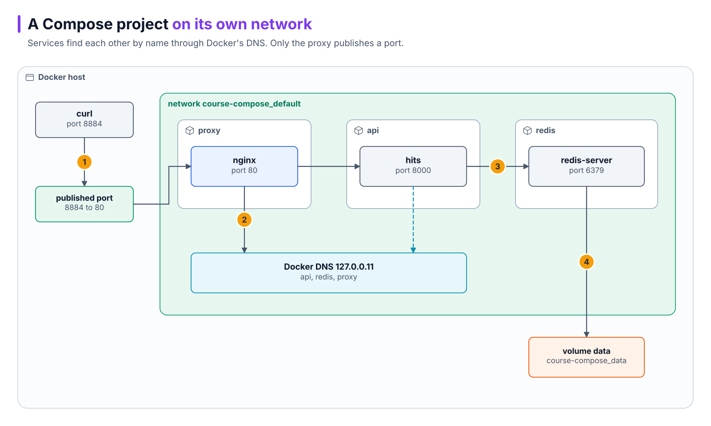
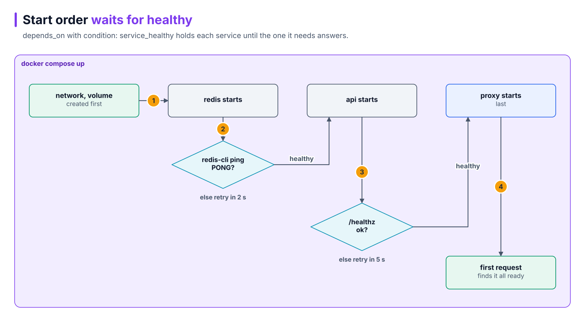

# Module 0.3: Docker Compose

> New to a term here, like service, project or healthcheck? The [glossary](../glossary.md#docker-and-compose) explains every term in this course.

**Before this module:** [module 0.2](02-building-images.md), which builds the `hits` app this module runs. No cluster needed.

**You need:** the toolbox shell, in the repo folder. Docker downloads `redis:8.2.2-alpine` (about 30 MB) the first time.

A real app is rarely one container. The `hits` app needs Redis for its shared counter, and it should sit behind a proxy that spreads requests over several copies. Starting those with a dozen `docker run` commands works once, but nobody remembers the flags a week later, and the order matters: an app that starts before its database fails its first requests. Docker Compose describes the whole set in one file, `compose.yaml`, and creates, starts, scales and removes it with one command each. This module runs the app, its Redis and an nginx proxy as one Compose project, and walks through the parts of the file that teams get wrong: healthchecks, start order, variables, profiles and scaling.

Time: about 45 minutes. Adds four containers, about 30 MiB together.

```console
$ ./lab.sh reset docker
Removing the Docker track's containers, networks, volumes and images
Done. No course containers, networks or volumes are left.
```

## Concept: a project is a set of services on its own network

Compose turns each entry under `services:` into one or more containers, all of them belonging to a project, here `course-compose`, which the file's `name:` sets. Compose also creates a network for the project, `course-compose_default`, and attaches every service's containers to it. On that network Docker runs a small DNS server that answers each service's name with the addresses of its containers, so the proxy reaches the app as `api` and the app reaches Redis as `redis`, without anyone writing down an IP address. Containers in another project, or the toolbox, sit on other networks and don't see these names at all.

Only the proxy publishes a port, `8884`, on the Docker host. The API and Redis have no published ports, so the only way in from outside is through the proxy, much like an office building with one reception desk and internal phone extensions for everyone behind it. Named volumes, here `data` for Redis, also belong to the project and survive the containers, which module 0.4 explores.



Follow one request:

1. curl calls port 8884 on the Docker host, and Docker forwards it to the proxy container's port 80.
2. nginx asks Docker's DNS server at `127.0.0.11` for `api` and gets the address of an API container.
3. The API asks the same DNS server for `redis` and sends it `INCR hits`.
4. Redis writes the counter to its append-only file in the `data` volume.

## Concept: start order needs healthchecks

Compose starts containers in the order `depends_on` sets, but a started container isn't a ready one: Redis takes a moment to load its data, and an app that connects in that moment gets an error. So a dependency names a condition. `condition: service_healthy` makes Compose wait until the dependency's healthcheck reports `healthy`, and a healthcheck is a command Docker runs inside the container every few seconds, here `redis-cli ping` for Redis and `/hits healthcheck` for the API, which the image's `HEALTHCHECK` already defines.



1. Compose creates the network, the volume and all three containers.
2. It starts Redis and runs `redis-cli ping` every 2 seconds until the answer is `PONG`.
3. Redis is healthy, so Compose starts the API, whose healthcheck calls `/healthz`, which itself pings Redis.
4. The API is healthy, so Compose starts the proxy last, and the first request already finds everything ready.

A healthcheck keeps working after the start, too. When Redis dies later, the API's `/healthz` fails, Docker marks the API `unhealthy` after three failed checks, and anyone watching `docker compose ps` sees which part broke.

## The bigger picture: Compose and Kubernetes

Compose is how most teams run an app on one machine: a developer's laptop, a CI job that needs a database for its tests, or a small server. The Compose Specification is an open standard now, and the same file drives Docker, Podman and several cloud services. On several machines, teams move to Kubernetes, and the ideas carry over almost one to one: a service becomes a Deployment, its name becomes a Kubernetes Service with a DNS name, a healthcheck becomes a readiness probe, and a named volume becomes a PersistentVolumeClaim. One difference matters: Kubernetes has no `depends_on`, so apps there must retry their connections, which is good practice in Compose too.

## Why this way

**Why let the image define the API's healthcheck?** The image knows best how to tell that its app works, and every place that runs the image, Compose, `docker run` or a script, gets the check for free. A `healthcheck:` in `compose.yaml` overrides it when one environment needs a different check.

**Why does nginx need `resolver 127.0.0.11` and a variable?** nginx resolves a host name in `proxy_pass` once, at start. With the variable and the resolver, it asks Docker's DNS server again every 5 seconds, so new copies of the API after scaling join the rotation. Without it, nginx keeps sending everything to the one address it learned at start.

**Why keep values in `.env`?** The same `compose.yaml` then runs in several places with different ports and versions, and nobody edits the file itself. A variable set in the shell wins over `.env`, which is how CI overrides one value for one run.

**Why a profile for the debug container?** Tools that you need only sometimes stay in the file, documented and versioned, but `docker compose up` leaves them out until you ask for the profile.

## Do it

### 1. Look at the project

The project lives in the work folder next to a copy of the app, because `build: context: ../app` points there. `COMPOSE_FILE` tells every `docker compose` command which file to use, so the commands stay short and run from the repo folder.

```console
$ mkdir -p platform-engineering/0-docker/work && cp -r platform-engineering/0-docker/lab/app platform-engineering/0-docker/lab/compose platform-engineering/0-docker/work/
$ export COMPOSE_FILE=platform-engineering/0-docker/work/compose/compose.yaml
$ cat $COMPOSE_FILE
# The hits app behind a proxy, with Redis for the shared counter (module 0.3).
name: course-compose

services:
  proxy:
    image: nginx:1.28.0-alpine
    ports:
      - "${PROXY_PORT:-8884}:80"
    volumes:
      - ./nginx.conf:/etc/nginx/conf.d/default.conf:ro
    depends_on:
      api:
        condition: service_healthy

  api:
    build:
      context: ../app
      args:
        VERSION: ${APP_VERSION:-dev}
    image: course/hits:${APP_VERSION:-dev}
    environment:
      REDIS_ADDR: redis:6379
    # No healthcheck here: the image's HEALTHCHECK (/hits healthcheck) applies.
    depends_on:
      redis:
        condition: service_healthy

  redis:
    image: redis:8.2.2-alpine
    command: ["redis-server", "--appendonly", "yes"]
    volumes:
      - data:/data
    healthcheck:
      test: ["CMD", "redis-cli", "ping"]
      interval: 2s
      timeout: 2s
      retries: 5

  # Started only with --profile debug: a small shell on the same network.
  debug:
    image: alpine:3.22.2
    profiles: [debug]
    command: ["sleep", "infinity"]

volumes:
  data:

$ cat platform-engineering/0-docker/work/compose/.env
# Compose reads this file from the project folder and fills ${...} in compose.yaml with it.
# A variable set in your shell wins over the value here.
APP_VERSION=2.0.0
PROXY_PORT=8884

$ docker compose config --services
redis
api
proxy

$ docker compose config | grep -E 'image: course|VERSION|published'
    image: course/hits:2.0.0
        VERSION: 2.0.0
        published: "8884"
```

**What you should see.** The file names four services, but `config --services` lists three, because `debug` belongs to a profile that isn't active. `docker compose config` prints the file the way Compose understands it, with every `${...}` filled in from `.env`: the API's image becomes `course/hits:2.0.0`, the build argument `VERSION` gets `2.0.0`, and the proxy's port `8884`.

### 2. Start it and watch the order

```console
$ docker compose up -d --build 2>&1 | grep -E 'Built|Started|Healthy|Waiting' | uniq
 Image course/hits:2.0.0 Built 
 Container course-compose-redis-1 Started 
 Container course-compose-redis-1 Waiting 
 Container course-compose-redis-1 Healthy 
 Container course-compose-api-1 Started 
 Container course-compose-api-1 Waiting 
 Container course-compose-api-1 Healthy 
 Container course-compose-proxy-1 Started 

$ docker compose ps --format 'table {{.Service}}\t{{.Status}}\t{{.Ports}}'
SERVICE   STATUS                   PORTS
api       Up 2 seconds (healthy)   8000/tcp
proxy     Up Less than a second    0.0.0.0:8884->80/tcp, [::]:8884->80/tcp
redis     Up 4 seconds (healthy)   6379/tcp

$ for i in 1 2 3; do curl -s --retry 5 --retry-all-errors --retry-delay 1 http://host.docker.internal:8884/; done
hello from d33603cc5391, visit 1, version 2.0.0
hello from d33603cc5391, visit 2, version 2.0.0
hello from d33603cc5391, visit 3, version 2.0.0
```

**What you should see.** Compose builds the API image first. Then the order follows the dependencies exactly: Redis starts, Compose waits until it's `Healthy`, starts the API, waits again, and starts the proxy last. `docker compose ps` shows the health next to each service that has a check; the proxy has none, so it shows only `Up`. The three requests reach the same API container, and the counter climbs from 1 to 3, because it lives in Redis.

### 3. Names on the project network

```console
$ docker network ls --filter name=course-compose --format '{{.Name}} {{.Driver}}'
course-compose_default bridge

$ docker compose exec proxy nslookup api 127.0.0.11 2>/dev/null | grep -A1 'Name:'
Name:	api
Address: 192.168.148.3

$ docker compose exec proxy cat /etc/resolv.conf | grep nameserver
nameserver 127.0.0.11

$ docker run --rm alpine:3.22.2 sh -c 'nslookup api >/dev/null 2>&1 && echo found || echo "api: no such name"'
api: no such name
```

**What you should see.** Compose made one bridge network, `course-compose_default`. Inside the proxy, the name `api` resolves to one address on that network, answered by `127.0.0.11`, which Docker writes into every container's `/etc/resolv.conf` on a network that Compose or `docker network create` made. A container started on Docker's default network finds no `api` at all, because service names exist only inside their project's network. Module 0.5 shows where that DNS server lives.

### 4. Break Redis and watch the healthchecks

```console
$ docker compose stop redis
 Container course-compose-redis-1 Stopping 
 Container course-compose-redis-1 Stopped 

$ sleep 20; docker compose ps -a --format 'table {{.Service}}\t{{.Status}}'
SERVICE   STATUS
api       Up 22 seconds (unhealthy)
proxy     Up 20 seconds
redis     Exited (0) 20 seconds ago

$ curl -s -w ' %{http_code}\n' http://host.docker.internal:8884/
redis unavailable: dial tcp: lookup redis on 127.0.0.11:53: no such host
 503

$ docker inspect -f '{{range .State.Health.Log}}{{.ExitCode}} {{.Output}}{{end}}' course-compose-api-1 | tail -2
1 unhealthy

$ docker compose start redis && sleep 6 && curl -s http://host.docker.internal:8884/
 Container course-compose-redis-1 Starting 
 Container course-compose-redis-1 Started 
hello from d33603cc5391, visit 4, version 2.0.0
```

**What you should see.** With Redis stopped, the API fails its healthcheck three times in a row, 5 seconds apart, and Docker marks it `unhealthy` about 15 to 20 seconds later. The proxy still forwards requests, and the API answers each with `503` and the reason, which holds a surprise: `lookup redis on 127.0.0.11:53: no such host`. Docker's DNS server answers only for running containers, so a stopped service vanishes from DNS instead of refusing connections, and the error reads like a typo in the name. The health log keeps the last checks with their exit code `1` and output `unhealthy`. After `start redis`, the API recovers and the counter continues at 4, because Redis wrote every increment to its append-only file in the `data` volume. Compose doesn't restart an unhealthy container by itself; a restart policy or an orchestrator does that.

### 5. Variables: .env and the shell

```console
$ APP_VERSION=2.1.0 docker compose config | grep -E 'image: course|VERSION'
    image: course/hits:2.1.0
        VERSION: 2.1.0

$ APP_VERSION=2.1.0 docker compose up -d --build api 2>&1 | grep -E 'Built|Recreated|Started' | uniq
 Image course/hits:2.1.0 Built 
 Container course-compose-api-1 Recreated 
 Container course-compose-api-1 Started 

$ curl -s --retry 5 --retry-all-errors --retry-delay 1 http://host.docker.internal:8884/
hello from e61e2027d8ab, visit 5, version 2.1.0
```

**What you should see.** The shell's `APP_VERSION=2.1.0` wins over the `2.0.0` from `.env`, so Compose builds `course/hits:2.1.0` and recreates only the API container, because only its definition changed. Redis and the proxy keep running. The counter keeps counting across the new version, and the proxy finds the new API container under the same name.

### 6. Scale the API

```console
$ APP_VERSION=2.1.0 docker compose up -d --scale api=3 2>&1 | grep -E 'api-[0-9]+ +Started' | uniq
 Container course-compose-api-2 Started 
 Container course-compose-api-3 Started 

$ docker compose exec proxy nslookup api 127.0.0.11 2>/dev/null | grep -c '^Address: '
3

$ sleep 6; for i in $(seq 1 9); do curl -s http://host.docker.internal:8884/; done | awk '{print $3}' | sort | uniq -c
      5 444c124aab68,
      1 af6bb1a87e26,
      3 e61e2027d8ab,
```

**What you should see.** Compose starts `api-2` and `api-3` next to the existing one, and Docker's DNS server now answers `api` with three addresses. nginx asks again after its 5-second cache runs out and spreads the nine requests over the three containers, because nginx takes the addresses in turn; the split is rarely exactly even, since the first requests may still use the old single address. The counter stays one shared count, because every copy talks to the same Redis.

### 7. A profile for the tools you need sometimes

```console
$ docker compose --profile debug up -d debug 2>&1 | grep -E 'debug-1 +Started' | uniq
 Container course-compose-debug-1 Started 

$ docker compose exec debug wget -qO- http://api:8000/healthz
ok

$ docker compose exec debug wget -qO- http://proxy/ | cut -d, -f2,3
 visit 15, version 2.1.0
```

**What you should see.** The `debug` container joins the same project network, so it reaches the API directly by name, past the proxy, which is handy to tell whether a problem sits in the proxy or in the app. It stays out of every plain `docker compose up`.

### 8. Stop, start again, and remove

```console
$ docker compose --profile debug down 2>&1 | grep -E 'Removed' | uniq | sort
 Container course-compose-api-1 Removed 
 Container course-compose-api-2 Removed 
 Container course-compose-api-3 Removed 
 Container course-compose-debug-1 Removed 
 Container course-compose-proxy-1 Removed 
 Container course-compose-redis-1 Removed 
 Network course-compose_default Removed 

$ docker volume ls --filter name=course-compose --format '{{.Name}}'
course-compose_data

$ APP_VERSION=2.1.0 docker compose up -d 2>&1 | grep -c Started; curl -s --retry 5 --retry-all-errors --retry-delay 1 http://host.docker.internal:8884/
3
hello from 1a94bad49852, visit 16, version 2.1.0

$ docker compose down -v 2>&1 | grep -E 'Volume|Network' | uniq
 Volume course-compose_data Removing 
 Network course-compose_default Removing 
 Volume course-compose_data Removed 
 Network course-compose_default Removed 
```

**What you should see.** `down` removes the containers and the network, but the `course-compose_data` volume stays, so after `up` the counter carries on from where it was. `down -v` also removes the volume, and with it the counter. Use `down -v` deliberately: it's the one Compose command that deletes data.

## Tasks

### Task 0.3.1: wait for a healthy database

```console
$ ./lab.sh task setup 0.3.1
== setup task 0.3.1
Edit platform-engineering/0-docker/work/task-0.3.1/compose.yaml, then start it with docker compose -f platform-engineering/0-docker/work/task-0.3.1/compose.yaml up -d
```

> The folder `platform-engineering/0-docker/work/task-0.3.1` holds a `compose.yaml` for the project `course-task-compose` with the `hits` app and Redis. The app starts before Redis is ready. Give Redis a healthcheck with `redis-cli ping`, make the app wait until Redis is healthy, publish the app's port 8000 on port 8893 of the Docker host, and start the project.

<details>
<summary>Solution</summary>

A `healthcheck` on `redis`, `depends_on` with `condition: service_healthy` on `app`, and a `ports` entry.

```console
$ cp platform-engineering/0-docker/work/task-0.3.1/solution.yaml platform-engineering/0-docker/work/task-0.3.1/compose.yaml
$ cat platform-engineering/0-docker/work/task-0.3.1/compose.yaml
name: course-task-compose

services:
  app:
    image: course/hits:task
    environment:
      REDIS_ADDR: redis:6379
    ports:
      - "8893:8000"
    depends_on:
      redis:
        condition: service_healthy

  redis:
    image: redis:8.2.2-alpine
    healthcheck:
      test: ["CMD", "redis-cli", "ping"]
      interval: 2s
      timeout: 2s
      retries: 5
$ docker compose -f platform-engineering/0-docker/work/task-0.3.1/compose.yaml up -d --wait 2>&1 | tail -3
 Container course-task-compose-app-1 Waiting 
 Container course-task-compose-redis-1 Healthy 
 Container course-task-compose-app-1 Healthy 
```

`setup` leaves a `solution.yaml` next to the task file only so that `task solve` has something to copy; try it yourself first.

</details>

```console
$ ./lab.sh task check 0.3.1
== check task 0.3.1
  PASS  redis of course-task-compose runs and is healthy
  PASS  its healthcheck runs redis-cli ping
  PASS  app waits for redis to be healthy
  PASS  port 8893 answers with the shared counter
== task 0.3.1: 4 passed, 0 failed
```

### Task 0.3.2: three copies behind the proxy

```console
$ ./lab.sh task setup 0.3.2
== setup task 0.3.2
course-compose-api-1 Up 2 seconds (healthy)
course-compose-proxy-1 Up Less than a second
course-compose-redis-1 Up 5 seconds (healthy)
```

> The project `course-compose` from this module runs again from `platform-engineering/0-docker/work/compose`, with one API container. Run three copies of the API, without changing `compose.yaml`, so that the proxy on port 8884 spreads requests over all three.

<details>
<summary>Solution</summary>

`--scale` sets the number of containers for a service, and the proxy finds them through Docker's DNS server.

```console
$ docker compose -f platform-engineering/0-docker/work/compose/compose.yaml up -d --scale api=3 --wait 2>&1 | tail -1
 Container course-compose-api-1 Healthy 
$ sleep 6; for i in $(seq 1 9); do curl -s http://host.docker.internal:8884/; done | awk '{print $3}' | sort | uniq -c
      3 0f9a48cb4209,
      2 9f060c730430,
      4 a827c0b53af8,
```

</details>

```console
$ ./lab.sh task check 0.3.2
== check task 0.3.2
  PASS  three api containers of course-compose run
  PASS  compose.yaml still names one api service with no replicas setting
  PASS  requests through the proxy reach all three (3 different hostnames)
== task 0.3.2: 3 passed, 0 failed
```

### Task 0.3.3: keep a tool out of the default start

```console
$ ./lab.sh task setup 0.3.3
== setup task 0.3.3
Edit platform-engineering/0-docker/work/task-0.3.3/compose.yaml and add platform-engineering/0-docker/work/task-0.3.3/.env, then start the project.
```

> The folder `platform-engineering/0-docker/work/task-0.3.3` holds a `compose.yaml` with a service `web` and a service `tools`. Change it so that `docker compose up` starts only `web`, and `tools` starts only with the profile `debug`. Also make the published port of `web` come from the variable `WEB_PORT`, with the value `8894` in the project's `.env` file, and start the project.

<details>
<summary>Solution</summary>

`profiles: [debug]` on `tools`, `${WEB_PORT}` in the port mapping, and an `.env` file next to `compose.yaml`.

```console
$ cp platform-engineering/0-docker/work/task-0.3.3/solution.yaml platform-engineering/0-docker/work/task-0.3.3/compose.yaml
$ echo WEB_PORT=8894 > platform-engineering/0-docker/work/task-0.3.3/.env
$ docker compose -f platform-engineering/0-docker/work/task-0.3.3/compose.yaml up -d --wait 2>&1 | tail -1
 Container course-task-profiles-web-1 Healthy 
$ docker compose -f platform-engineering/0-docker/work/task-0.3.3/compose.yaml config --services
web
```

</details>

```console
$ ./lab.sh task check 0.3.3
== check task 0.3.3
  PASS  without a profile, the project lists only web
  PASS  with --profile debug, it lists tools too
  PASS  .env sets WEB_PORT=8894
  PASS  compose.yaml reads the port from WEB_PORT
  PASS  web runs and answers on port 8894
  PASS  no tools container runs
== task 0.3.3: 6 passed, 0 failed
```

## Investigate

1. In step 4 the API turned `unhealthy`, yet the proxy kept sending it requests. Why, and what in Kubernetes behaves differently?
2. A teammate removes `condition: service_healthy` from the API's `depends_on` and keeps only `depends_on: [redis]`. What changes at start, and why does it often seem to work anyway?
3. Step 6 scaled the API to three. Why does scaling the proxy the same way fail?
4. After `docker compose down` in step 8 you ran `up` and the counter continued. Name the one object that made that possible and the command that would have lost the count.

<details>
<summary>Answers</summary>

1. Docker's health status is information only: Docker records it and Compose uses it at start, but nothing removes an unhealthy container from DNS or from nginx's rotation. In Kubernetes a failing readiness probe removes the pod from its Service's endpoints, so traffic stops reaching it, and a failing liveness probe restarts it.
2. Compose then waits only until the Redis container has started, not until Redis answers. Redis starts in milliseconds on an empty volume, so the API usually wins no race and it seems to work; with a large data file or a slow disk, the API's first requests fail with `redis unavailable`. The app's own retries are the robust fix, the health condition the convenient one.
3. All copies would try to publish the same host port, `8884`, and only one process may listen on a port, so Docker refuses the second container with `port is already allocated`. Services you scale shouldn't publish fixed ports; put one proxy or load balancer in front of them, as here.
4. The named volume `course-compose_data`, which `down` keeps. `docker compose down -v`, or `docker volume rm course-compose_data`, deletes it with the count.

</details>

## Clean up

```console
$ unset COMPOSE_FILE
$ ./lab.sh reset docker
Removing the Docker track's containers, networks, volumes and images
Done. No course containers, networks or volumes are left.
```

This removes the projects, their networks and volumes, the `course/hits` images and the work folder. The `redis:8.2.2-alpine` image stays for the later modules.
