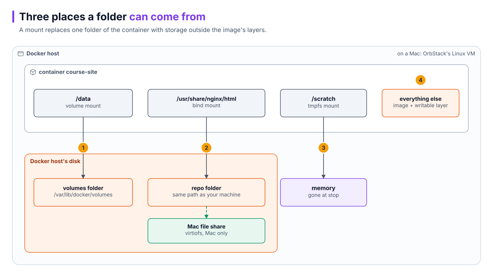

# Module 0.4: storage

> New to a term here, like volume, bind mount or tmpfs? The [glossary](../glossary.md#docker-and-compose) explains every term in this course.

**Before this module:** [module 0.1](01-containers-and-images.md) for the writable layer, and [module 0.3](03-docker-compose.md), whose Redis kept its counter in a volume. No cluster needed.

**You need:** the toolbox shell, in the repo folder.

Module 0.1 showed that a container's writable layer dies with the container. That's the right default for code, and the wrong one for a database, an upload folder or a cache you paid for. Docker offers three ways to put a folder into a container from outside its layers: a named volume that Docker manages, a bind mount of a folder from the Docker host, and a tmpfs mount in memory. Each one survives different events, behaves differently with file ownership, and fails in its own surprising way, and those surprises cause most of the "my data is gone" and "permission denied" tickets that teams file about containers. This module tries all three and ends with a backup of a volume.

Time: about 35 minutes. Adds a few small containers and volumes, under 10 MiB.

```console
$ ./lab.sh reset docker
Removing the Docker track's containers, networks, volumes and images
Done. No course containers, networks or volumes are left.
```

## Concept: three places a container's folder comes from

A mount replaces one folder of the container's filesystem with something from outside the image's layers, the way a library hands you a book on loan: you read and write in it as if it were yours, but it lives on someone else's shelf. What changes between the three kinds is which shelf.

A named volume lives on the Docker host's disk under `/var/lib/docker/volumes/<name>/_data`, and Docker creates, lists and deletes it. It outlives every container that uses it, so it's the right home for a database's files. A bind mount takes a path on the Docker host and shows it inside the container, both ways, so it fits config files and source code you edit while the container runs. A tmpfs mount lives only in memory, never touches a disk and disappears when the container stops, which suits scratch files and secrets that must never land on disk.



Follow the three mounts of one container from the steps below:

1. `/data` comes from the named volume `course-data`, a folder Docker made under `/var/lib/docker/volumes`.
2. `/usr/share/nginx/html` comes from a folder in the repo, which on a Mac reaches OrbStack's VM through its file share and on Linux is a plain folder of the host.
3. `/scratch` is tmpfs, memory of the Docker host with a size limit.
4. Everything else, such as `/etc`, still comes from the image's layers plus the container's writable layer.

## Concept: what survives what

The table answers the question teams ask after an outage. A tick means the data is still there after the event.

| Event | Writable layer | Named volume | Bind mount | tmpfs |
|---|---|---|---|---|
| `docker restart`, or a crash with a restart policy | ✓ | ✓ | ✓ | ✗ |
| `docker rm` and a new container from the same image | ✗ | ✓ | ✓ | ✗ |
| `docker compose down` | ✗ | ✓ | ✓ | ✗ |
| `docker compose down -v` | ✗ | ✗ | ✓ | ✗ |
| `docker volume rm` | ✗ | ✗ | ✓ | ✗ |
| Docker host reboot | ✓ (if the container stays) | ✓ | ✓ | ✗ |

A volume has one more feature that a bind mount lacks. When you mount an empty volume over a folder that the image already fills, Docker first copies the image's files and their owners into the volume, so the app finds its defaults. A bind mount never copies; it hides the image's folder behind whatever the host folder holds, even if that's nothing. Step 3 shows both, and step 5 shows why the copied owner matters for apps that don't run as root.

## The bigger picture: storage in Kubernetes

Kubernetes keeps the same three ideas under other names. A PersistentVolumeClaim is the named volume, provided by a storage driver instead of a local folder, and it outlives pods the way a volume outlives containers. `hostPath` is the bind mount, which platform teams forbid for ordinary apps because it gives a pod a view of the node's disk. An `emptyDir` with `medium: Memory` is tmpfs. The questions from this module carry over unchanged: who owns the files, what deletes the data, and how you back it up.

## Why this way

**Why does a volume live under `/var/lib/docker` and not in your project folder?** Docker manages it as an object with a name, a driver and labels, so it works the same on every host and survives when someone moves or deletes a project folder. The price is that you reach its files only through a container, which step 7 uses for a backup.

**Why does a bind mount path refer to the Docker host and not to the toolbox?** The Docker engine creates the mount, and it only knows its own filesystem. That's why `compose.yaml` mounts the repo into the toolbox at the same path as on your machine: a path you type in the toolbox then also exists for the engine.

**Why tmpfs for scratch data?** It's fast, it never fills the host's disk, and it leaves nothing behind for a later container or an attacker to find. Its size limit also caps a runaway temporary file.

## Do it

### 1. A named volume outlives its containers

```console
$ docker volume create course-data
course-data

$ docker run --rm -v course-data:/data alpine:3.22.2 sh -c 'echo "saved at $(date +%T)" > /data/note.txt'
$ docker run --rm -v course-data:/data alpine:3.22.2 cat /data/note.txt
saved at 15:57:21

$ docker volume inspect -f '{{.Mountpoint}}' course-data
/var/lib/docker/volumes/course-data/_data

$ docker run --rm --privileged --pid=host alpine:3.22.2 cat /proc/1/root/var/lib/docker/volumes/course-data/_data/note.txt
saved at 15:57:21
```

**What you should see.** The first container wrote the note and ended, `--rm` removed it, and a second, brand-new container still reads the note, because the volume lives outside both. `docker volume inspect` names the folder on the Docker host, and the privileged debug container from module 0.1 reads the same file there: with `--pid=host` it sees the host's process 1, and `/proc/1/root` is that process's view of the host's filesystem. On a Mac that folder sits inside OrbStack's VM, not on your Mac's disk.

### 2. A bind mount shows a host folder, both ways

<!-- fails-ok -->
```console
$ mkdir -p platform-engineering/0-docker/work/site && echo '<h1>from the repo</h1>' > platform-engineering/0-docker/work/site/index.html
$ SITE="$PWD/platform-engineering/0-docker/work/site"

$ docker run -d --name course-site -p 8885:80 -v "$SITE":/usr/share/nginx/html:ro nginx:1.28.0-alpine
fc39d0c16f6123ab51dd5e8dde2a061dcf2e74622bf8860157337c97d478bd07
$ curl -s --retry 5 --retry-all-errors --retry-delay 1 http://host.docker.internal:8885/
<h1>from the repo</h1>

$ echo '<h1>changed in the toolbox</h1>' > "$SITE/index.html"; curl -s http://host.docker.internal:8885/
<h1>changed in the toolbox</h1>

$ docker exec course-site touch /usr/share/nginx/html/new.txt
touch: /usr/share/nginx/html/new.txt: Read-only file system

$ docker run --rm -v "$SITE":/site alpine:3.22.2 sh -c 'echo from-a-container > /site/c.txt; ls -ln /site'
total 8
-rw-r--r--    1 0        0               17 Nov 21 15:57 c.txt
-rw-rw-rw-    1 0        0               32 Nov 21 15:57 index.html
$ ls -ln "$SITE"
total 8
-rw-r--r-- 1 501 20 17 Nov 21 15:57 c.txt
-rw-rw-rw- 1 501 20 32 Nov 21 15:57 index.html

$ docker run --rm --mount type=bind,src=/home/lab/not-on-the-host,dst=/x alpine:3.22.2 true
docker: Error response from daemon: invalid mount config for type "bind": bind source path does not exist: /home/lab/not-on-the-host.
See 'docker run --help'.
```

**What you should see.**

1. nginx serves the file from the repo, and an edit in the toolbox shows up at once, with no rebuild and no restart, which is why developers bind-mount source code.
2. `:ro` makes the mount read-only for the container, so `touch` fails with `Read-only file system`, while the toolbox still writes to the folder.
3. A file written by root in a container shows up in the folder. On a Mac, `ls -ln` in the container shows owner `0` while the toolbox shows your own user ID, `501` in the test run, because OrbStack's file share maps owners between macOS and the VM. On a Linux Docker host there's no mapping, so the file belongs to root on the host too, and your own user then needs `sudo` to edit or delete it, a classic annoyance on Linux build servers.
4. The last command fails with `bind source path does not exist`, because `/home/lab` exists only inside the toolbox. The engine looks the path up on the Docker host, which is why the steps use `$PWD`, the repo path that both sides share.

### 3. A volume copies the image's files, a bind mount hides them

```console
$ docker run --rm -v course-html:/usr/share/nginx/html nginx:1.28.0-alpine ls /usr/share/nginx/html
50x.html
index.html

$ mkdir -p platform-engineering/0-docker/work/empty
$ docker run --rm -v "$PWD/platform-engineering/0-docker/work/empty":/usr/share/nginx/html nginx:1.28.0-alpine ls -A /usr/share/nginx/html | wc -l
0
```

**What you should see.** The new, empty volume `course-html` shows nginx's two default pages, because Docker copied the image's files into it on the first mount. The empty bind mount shows zero files: it hides the image's folder completely. Docker created `course-html` on first use, without `docker volume create`, which is easy to do by accident with a typo in a volume name.

### 4. tmpfs: in memory, with a size limit

```console
$ docker run --rm --tmpfs /scratch:size=16m alpine:3.22.2 sh -c 'df -h /scratch | tail -1; dd if=/dev/zero of=/scratch/f bs=1M count=20 2>&1 | head -1'
tmpfs                    16.0M         0     16.0M   0% /scratch
dd: error writing '/scratch/f': No space left on device

$ docker run -d --name course-tmp --tmpfs /scratch alpine:3.22.2 sleep 600
3b7908068ed41d1100e66aea14c5e5813bd123a58b6bfa804cdad9cebd2f7c36
$ docker exec course-tmp sh -c 'echo temp > /scratch/t.txt; echo kept > /kept.txt'
$ docker restart course-tmp
course-tmp
$ docker exec course-tmp sh -c 'ls /scratch; cat /kept.txt'
kept
```

**What you should see.** The tmpfs reports a size of 16 MB, and writing 20 MB stops with `No space left on device`, so a runaway temporary file never fills the host's disk. After a restart, the tmpfs is empty while the file in the writable layer survives: tmpfs lasts only as long as the container runs, the writable layer as long as the container exists.

### 5. A non-root app and the owner of a volume

Module 0.2 built an image that runs as user 65532. A fresh volume belongs to root, which bites every app that dropped root, as it should.

<!-- fails-ok -->
```console
$ docker run --rm --user 1000 -v course-data:/data alpine:3.22.2 touch /data/x
touch: /data/x: Permission denied

$ printf 'FROM alpine:3.22.2\nLABEL lab.course=docker\nRUN mkdir /data && chown 1000:1000 /data\nUSER 1000\n' | docker build -q -t course/owner:1 -
sha256:92fd9aca69190855175cbe06f8f62f227d1d43ddc0a47774f22ffa1a85b2253d

$ docker run --rm -v course-owned:/data course/owner:1 sh -c 'touch /data/x && ls -ln /data'
total 0
-rw-r--r--    1 1000     0                0 Nov 21 15:57 x
```

**What you should see.** As user 1000, writing into `course-data` fails with `Permission denied`, because the volume's folder belongs to root. The image `course/owner:1` creates `/data` and gives it to user 1000, and when a new, empty volume mounts there, Docker copies that owner along with the folder, so the app writes without any `chmod` at run time. That's the standard fix: prepare the mount point in the image, owned by the user the app runs as.

### 6. Compose: volumes in a project

Module 0.3 used the volume `data`, which Compose named `course-compose_data` after the project. Compose labels the volumes it creates, so you find them again by project:

```console
$ docker volume create --label com.docker.compose.project=course-demo course-demo_data
course-demo_data
$ docker volume ls --filter label=com.docker.compose.project=course-demo --format '{{.Name}}'
course-demo_data
```

**What you should see.** The volume appears under its project. `docker compose down -v` removes exactly the volumes with its project's label and nothing else, which is why removing a project never touches another project's data.

### 7. Back up a volume and restore it

A volume has no "export" command, so a throwaway container mounts it next to a bind mount and archives it.

```console
$ BK="$PWD/platform-engineering/0-docker/work/backup"; mkdir -p "$BK"
$ docker run --rm -v course-data:/data:ro -v "$BK":/backup alpine:3.22.2 tar czf /backup/course-data.tgz -C /data .
$ tar tzf "$BK/course-data.tgz"
./
./note.txt

$ docker volume create course-restored
course-restored
$ docker run --rm -v course-restored:/data -v "$BK":/backup:ro alpine:3.22.2 tar xzf /backup/course-data.tgz -C /data
$ docker run --rm -v course-restored:/data alpine:3.22.2 cat /data/note.txt
saved at 15:57:21
```

**What you should see.** The archive holds `note.txt`, and the new volume `course-restored` gives back the same note from step 1. Mount the source volume read-only, as here, and stop the app first for databases, because a copy of files that a database is writing may be inconsistent; databases offer their own dump commands for live backups.

## Tasks

### Task 0.4.1: keep Redis's data across a new container

```console
$ ./lab.sh task setup 0.4.1
== setup task 0.4.1
No container course-task-redis and no volume course-task-redisdata exist.
```

> Run a container `course-task-redis` from `redis:8.2.2-alpine` whose data folder `/data` lives in a named volume `course-task-redisdata`, so a new container with the same volume finds the data again. Store the key `course` with the value `docker` in it.

<details>
<summary>Solution</summary>

```console
$ docker run -d --name course-task-redis -v course-task-redisdata:/data redis:8.2.2-alpine
77e572a0d7d8feb9a6ab33f990707bd46cfe81716019113f5786ceebdf758b01
$ sleep 2; docker exec course-task-redis redis-cli set course docker
OK
$ docker exec course-task-redis redis-cli save
OK
```

`save` writes the data to `/data/dump.rdb` at once; Redis also saves on its own on a schedule and when it stops cleanly.

</details>

```console
$ ./lab.sh task check 0.4.1
== check task 0.4.1
  PASS  course-task-redis runs redis:8.2.2-alpine
  PASS  /data is the named volume course-task-redisdata
  PASS  the key course holds docker
  PASS  a new container on the same volume finds the key
== task 0.4.1: 4 passed, 0 failed
```

### Task 0.4.2: let a non-root app write to a fresh volume

```console
$ ./lab.sh task setup 0.4.2
== setup task 0.4.2
With a fresh volume, course/task-writer:1 fails:
sh: can't create /data/out.txt: Permission denied
```

> The folder `platform-engineering/0-docker/work/task-0.4.2` holds a Dockerfile for an app that runs as user 1000 and writes `/data/out.txt`. With a fresh volume it fails with `Permission denied`. Change the Dockerfile so it works with a fresh volume and without running as root, build it as `course/task-writer:2`, and run it once as `course-task-writer` with the volume `course-task-out` at `/data`.

<details>
<summary>Solution</summary>

Create `/data` in the image and give it to user 1000 before `USER`; a new volume copies that owner.

```console
$ cat platform-engineering/0-docker/work/task-0.4.2/Dockerfile
FROM alpine:3.22.2
LABEL lab.course=docker
USER 1000
CMD ["sh", "-c", "date > /data/out.txt && echo wrote /data/out.txt"]
$ printf 'FROM alpine:3.22.2\nLABEL lab.course=docker\nRUN mkdir -p /data && chown 1000:1000 /data\nUSER 1000\nCMD ["sh", "-c", "date > /data/out.txt && echo wrote /data/out.txt"]\n' > platform-engineering/0-docker/work/task-0.4.2/Dockerfile
$ docker build -q -t course/task-writer:2 platform-engineering/0-docker/work/task-0.4.2
sha256:c3e4a944b03b3c3a7494220f742768f64b8caa4479fe65a4d6defcad1d44d068
$ docker run --name course-task-writer -v course-task-out:/data course/task-writer:2
wrote /data/out.txt
```

</details>

```console
$ ./lab.sh task check 0.4.2
== check task 0.4.2
  PASS  image course/task-writer:2 runs as user 1000
  PASS  course-task-writer ran course/task-writer:2 and exited 0
  PASS  the volume course-task-out holds out.txt, owned by 1000
  PASS  a brand-new volume works too
== task 0.4.2: 4 passed, 0 failed
```

### Task 0.4.3: back up a volume and restore it into another

```console
$ ./lab.sh task setup 0.4.3
== setup task 0.4.3
The volume course-task-src holds:
/data/reports/r1.txt
/data/reports/r2.txt
/data/reports/r3.txt
/data/app.conf
```

> The volume `course-task-src` holds some files. Write a gzip-compressed tar archive of its content to `platform-engineering/0-docker/work/task-0.4.3/src.tgz`, then restore the archive into a new volume `course-task-copy`, so both volumes hold the same files.

<details>
<summary>Solution</summary>

```console
$ T="$PWD/platform-engineering/0-docker/work/task-0.4.3"
$ docker run --rm -v course-task-src:/data:ro -v "$T":/backup alpine:3.22.2 tar czf /backup/src.tgz -C /data .
$ docker run --rm -v course-task-copy:/data -v "$T":/backup:ro alpine:3.22.2 tar xzf /backup/src.tgz -C /data
```

</details>

```console
$ ./lab.sh task check 0.4.3
== check task 0.4.3
  PASS  src.tgz is a gzip tar archive with app.conf
  PASS  the volume course-task-copy exists
  PASS  course-task-copy holds the same files as course-task-src
== task 0.4.3: 3 passed, 0 failed
```

## Investigate

1. A teammate runs `docker compose down -v` to "restart cleanly" and the test database is empty afterwards. Which table row explains it, and which command did they want?
2. Why did nginx in step 3 show its default pages with a new volume, while the same volume mounted at the same path in a second, different image shows nginx's files, not the new image's?
3. On a Linux build server, a CI job runs `docker run -v "$PWD":/src golang go build` and the next job fails to delete `/src/bin`. Explain, and name two fixes.
4. Why does a tmpfs mount suit a container's secrets better than a file in a named volume?

<details>
<summary>Answers</summary>

1. The row `docker compose down -v`: `-v` removes the project's named volumes, and the database's files lived in one. `docker compose down` followed by `up`, or simply `docker compose restart`, keeps the volume.
2. Docker copies an image's files into a volume only when the volume is empty, the first time it's mounted. After that the volume holds nginx's files, and any later image sees those, whatever its own folder holds. Volumes belong to the data, not to the image.
3. The container runs as root, and on Linux a bind mount shows the host's real owners, so the build output in `bin` belongs to root and the CI user has no right to delete it. Run the build as the CI user, `--user "$(id -u):$(id -g)"`, or copy the output out with `docker cp` instead of writing into a bind mount. On a Mac with OrbStack the file share maps owners, so the same command seems fine there.
4. A tmpfs never touches a disk, so the secret never lands in `/var/lib/docker`, in a backup of the volume or on a disk that someone images later, and it disappears when the container stops. Module 0.6 shows how Compose secrets use the same idea.

</details>

## Clean up

```console
$ ./lab.sh reset docker
Removing the Docker track's containers, networks, volumes and images
Done. No course containers, networks or volumes are left.
```

This removes the containers, every `course-` volume, the `course/owner` image and the work folder with the backup.
