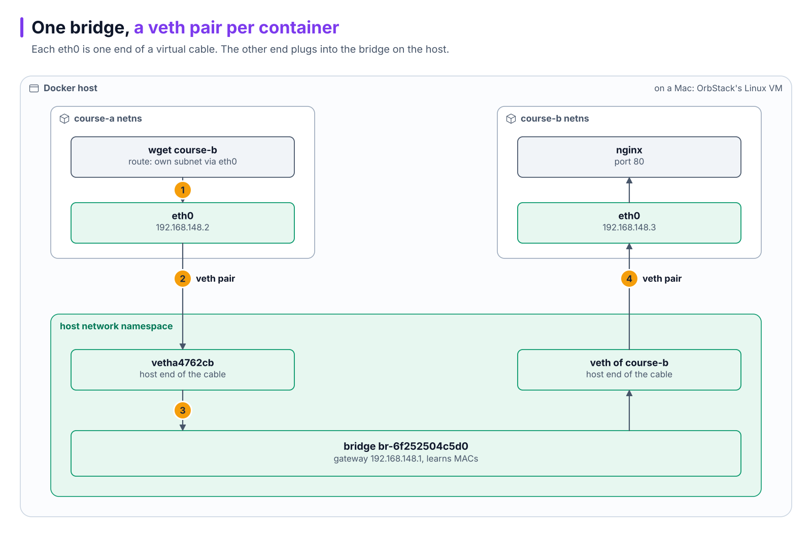
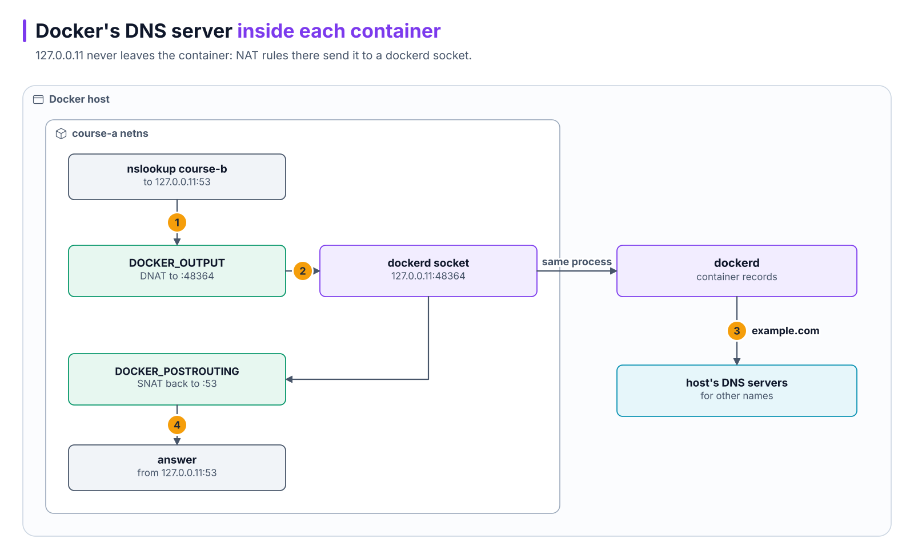
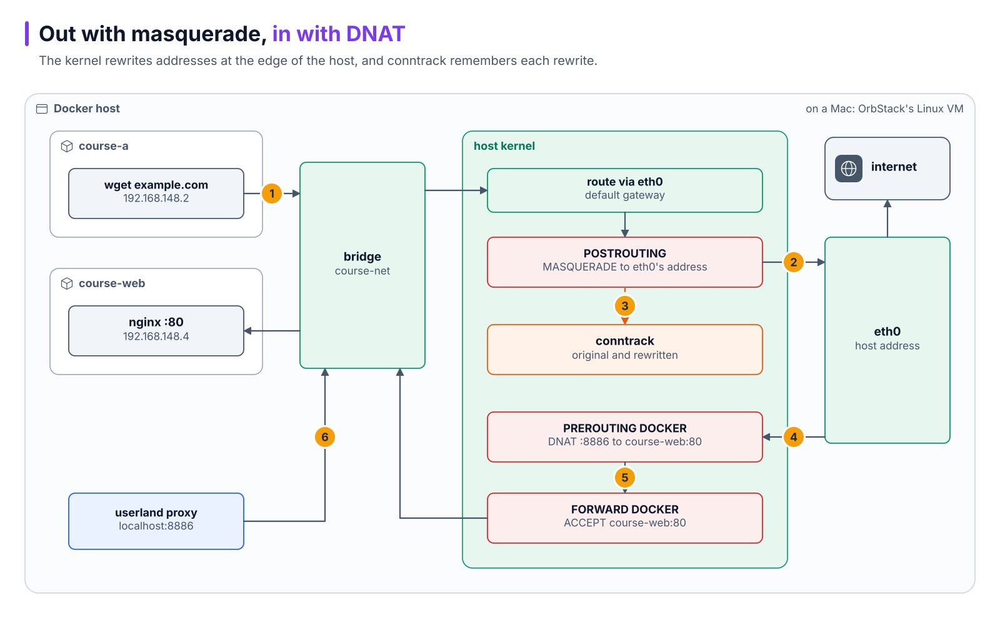
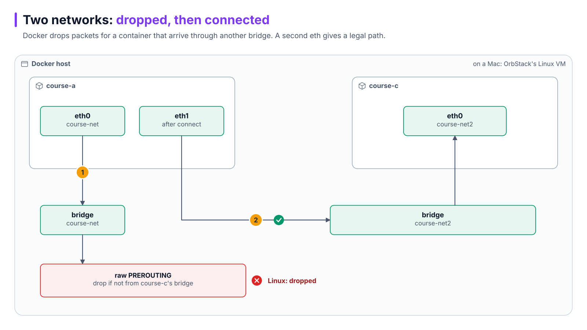

# Module 0.5: networking in depth

> New to a term here, like veth pair, bridge, masquerade or conntrack? The [glossary](../glossary.md#docker-and-compose) explains every term in this course.

**Before this module:** [module 0.1](01-containers-and-images.md) for namespaces and the privileged debug container, and [module 0.3](03-docker-compose.md) for networks and service names. No cluster needed.

**You need:** the toolbox shell, in the repo folder, and internet access. You build a small debug image with the Linux network tools, about 15 MB.

Containers talk to each other, to the internet and to clients outside, and all three work so well out of the box that nobody looks underneath until something breaks: a container that reaches the database on one machine and times out on another, a published port that answers from your laptop but not from the next server, a firewall rule that seems to do nothing. Every one of those is a question about the Docker host's kernel: which interface a packet crossed, which rule rewrote it, and which table remembers the rewrite. This module follows real packets through that kernel. You find each container's virtual cable, the bridge it plugs into and Docker's DNS server, then trace a packet between two containers, between two networks, out to the internet and in through a published port, with captures and rule counters at every hop.

Time: about 75 minutes. Adds a handful of small containers, under 50 MiB together.

```console
$ ./lab.sh reset docker
Removing the Docker track's containers, networks, volumes and images
Done. No course containers, networks or volumes are left.
```

## Concept: a bridge, a veth pair per container, and a network namespace each

Module 0.1 showed that each container has its own network namespace: its own interfaces, addresses, routes and firewall rules, separate from the Docker host's. A namespace on its own is an island with no way out, so Docker connects it with a veth pair, a virtual network cable with two ends. One end goes into the container and becomes its `eth0`. The other end stays in the Docker host's namespace with a name like `vetha4762cb`, and Docker plugs it into a bridge, a virtual network switch in the host's kernel.

Every Docker network of the default kind is one such bridge. The default network uses the bridge `docker0`, and each network you create gets its own, named `br-` plus the first 12 characters of the network's ID. The bridge also holds an address, the network's gateway, `192.168.148.1` in the test run, so to the containers the Docker host looks like a router at the end of the cable, much like the switch and the router in a small office. A packet between two containers on the same bridge stays inside the switch, and a packet to anywhere else goes up to the host, which routes it and, for the internet, rewrites it.



Follow a request from `course-a` to the nginx in `course-b` on the same network:

1. course-a asks Docker's DNS server for `course-b` and gets `192.168.148.3`; that address is on its own subnet, so its route table says to send the packet straight out of `eth0`.
2. The packet leaves `eth0` and comes out of the other end of the veth pair, `vetha4762cb`, in the host's namespace.
3. The bridge looks up the destination's MAC address, learned through ARP, and forwards the frame to the port where course-b's veth sits.
4. The frame comes out of course-b's `eth0`, nginx answers, and the reply takes the same path back. No address changes on the way.

## Concept: Docker's DNS server lives inside each container

On a network you create, containers find each other by name, and the default `docker0` network has no such names. The names come from a DNS server built into `dockerd`. Docker writes `nameserver 127.0.0.11` into the container's `/etc/resolv.conf`, which is odd at first sight, because `127.0.0.11` is a loopback address that never leaves the container. The trick is a pair of NAT rules that Docker adds inside the container's own network namespace: they redirect port 53 on `127.0.0.11` to a random port where `dockerd` listens, in that same namespace. dockerd answers container and service names from its own records and forwards every other name to the DNS servers the Docker host uses.



1. A program in course-a asks `127.0.0.11:53` for `course-b`.
2. The `DOCKER_OUTPUT` chain in course-a's own namespace rewrites the destination port to dockerd's socket, `48364` for UDP in the test run.
3. dockerd answers from its records with course-b's address, or forwards a name it doesn't know, such as `example.com`, to the host's DNS servers.
4. The `DOCKER_POSTROUTING` chain rewrites the reply's source port back to 53, so the program sees an ordinary answer from `127.0.0.11:53`.

## Concept: leaving the host with masquerade, entering with DNAT

A container's address, `192.168.148.2`, means something only on the Docker host; your router has never heard of it and has no route back. So when a packet leaves the host for the internet, the kernel rewrites its source to the host's own address, a rewrite called masquerade, by a rule Docker adds to the `POSTROUTING` chain for each network. The kernel remembers every rewrite in its connection tracking table, conntrack, and undoes it on the reply, much like a company mailroom that sends every letter with the company's return address and keeps a log of which desk sent what.

Traffic in the other direction needs the opposite rewrite. `-p 8886:80` asks Docker to add a DNAT rule, destination NAT, to its `DOCKER` chain: a packet for port 8886 on any address of the Docker host gets its destination rewritten to the container's address and port 80, and a filter rule lets it through. Traffic from the host itself to `localhost:8886` never passes those chains in the usual way, so Docker also starts a small userland proxy that listens on the port and opens a new connection to the container, `docker-proxy` on Linux and OrbStack's own agent on a Mac.



Outbound, course-a calls `example.com`:

1. The packet crosses the veth pair to the bridge, and the host's route table sends it towards the default gateway through `eth0`.
2. In `POSTROUTING`, Docker's `MASQUERADE` rule for the network's subnet rewrites the source to the address of `eth0`.
3. conntrack records the original and the rewritten addresses, and the reply gets its destination swapped back to course-a.

Inbound, a client calls port 8886 of the Docker host:

4. In `PREROUTING`, the `DOCKER` chain's DNAT rule rewrites the destination to the container's address and port 80.
5. The `FORWARD` chain's `DOCKER` rule accepts the packet for that container and port, and the bridge delivers it.
6. A client on the host itself reaches the port through the userland proxy instead, which shows up in the container's logs as a different source address.

## The bigger picture: the same plumbing under Kubernetes

Everything here reappears one layer down in Kubernetes. A CNI plugin such as flannel creates a veth pair per pod and plugs it into a bridge such as `cni0`, kube-proxy writes DNAT rules for Services in the same `nat` table, and the node masquerades pod traffic that leaves the cluster. Module [3.16](../3-istio/16-life-of-an-outbound-request.md) follows one request through exactly those layers on the lab. The direction of travel is away from long iptables chains: Docker 29 already stores its rules in nftables through `iptables-nft`, and offers a native nftables backend, while Kubernetes CNIs such as Cilium replace the chains with eBPF programs. The questions stay the same: which interface, which rewrite, which table remembers it.

## Why this way

**Why a bridge and veth pairs instead of giving containers real network cards?** A host has one or two network cards and hundreds of containers. Virtual cables and a virtual switch cost nothing, need no configuration on the real network, and keep each container's addresses private to the host.

**Why does the default `docker0` network have no names?** It predates Docker's DNS server, and Docker keeps its behaviour for compatibility, including the old `--link` option. Every network you create, and every Compose project, gets names, which is why the advice is to never use the default network for apps.

**Why masquerade and not plain routing?** Routing would need every router between the host and the internet to know the containers' subnets. Masquerade hides them behind the host's address, which works on any network without changing anything outside the host.

**Why does Docker drop traffic between its networks?** A network is Docker's unit of isolation: a Compose project's database should be reachable from its own app and not from an unrelated project on the same host. Docker 29 enforces that with a rule per container in the `raw` table, which drops packets for a container that arrive through any interface other than its own bridge.

## Do it

### 1. A debug container on the Docker host

The Docker host's network lives in its kernel, which the toolbox doesn't see. The same privileged container from module 0.1, now with `--net=host` as well, joins the host's network namespace and process list. It works the same on a Mac, where it lands in OrbStack's Linux VM, and on a Linux Docker host. `onhost` saves typing it each time.

```console
$ docker build -q -t course/nettools:1.0 platform-engineering/0-docker/lab/nettools
sha256:b0c2dc2f099f7cec3ca25c971af4d20a4a47f7a28f4f28003fefbc2329d4fe84
$ onhost() { docker run --rm --privileged --net=host --pid=host course/nettools:1.0 "$@"; }

$ onhost iptables -V
iptables v1.8.11 (nf_tables)

$ docker network ls --filter driver=bridge --format '{{.Name}}'
bridge
infra_default
k3d-k8s-lab
k8s-lab-toolbox_default
kind

$ docker network inspect bridge -f '{{range .IPAM.Config}}{{.Subnet}} gateway {{.Gateway}}{{end}}'
192.168.215.0/24 gateway 192.168.215.1

$ onhost ip -br addr show docker0
docker0          DOWN           192.168.215.1/24 fe80::9804:c3ff:fed5:176/64 
```

**What you should see.** `iptables` reports the `nf_tables` backend, the one Docker uses, so the rules you list below are the real ones. The default network `bridge` owns the subnet `192.168.215.0/24` on a Mac with OrbStack and `172.17.0.0/16` on a Linux Docker host, and its gateway address sits on the host's interface `docker0`. The other bridge networks in the list belong to the lab's clusters and the toolbox.

### 2. Find a container's veth pair

<!-- fails-ok -->
```console
$ docker run -d --name course-a alpine:3.22.2 sleep 3600
9923b401e52927cc3f03e7f24039288bf52d1b5fa34c1da3a050df043c746f6e
$ docker run -d --name course-b nginx:1.28.0-alpine
7b6319bfb7864c700572045cce97959d8e516e266584c1a17b1485df958f42eb

$ docker exec course-a ip -4 -o addr show eth0 | awk '{print $2, $4}'
eth0 192.168.215.2/24

$ docker exec course-a ip route
default via 192.168.215.1 dev eth0 
192.168.215.0/24 dev eth0 scope link  src 192.168.215.2 

$ IDX=$(docker exec course-a cat /sys/class/net/eth0/iflink); echo $IDX
1414
$ onhost ip -o link | awk -F': ' -v i="$IDX" '$1==i {print $2}'
vetha49114f@if3

$ onhost bridge link show master docker0 | awk '{print $2}' | cut -d@ -f1
vetha49114f
veth95faf76

$ docker exec course-a ping -c1 -W1 course-b
ping: bad address 'course-b'
```

**What you should see.**

1. course-a's `eth0` holds an address from the default network, and its route table has just two entries: its own subnet directly on `eth0`, and a default route to the gateway, the address on `docker0`.
2. `/sys/class/net/eth0/iflink` holds the interface number of the other end of the cable. The host's interface with that number is a `veth` with a random name.
3. `bridge link` lists the veth ends plugged into `docker0`, one per container on the default network.
4. `ping course-b` fails with `bad address`: the default network has no names, and course-a asks the DNS server from the host's configuration, which has never heard of course-b.

### 3. A network of your own, and Docker's DNS server

```console
$ docker rm -f course-a course-b
course-a
course-b
$ docker network create course-net
a378543de3114a94a7c5ed6317321c7602acee9db5fc82a5136f7f2b07e35f8e
$ BR=br-$(docker network inspect -f '{{slice .Id 0 12}}' course-net); echo $BR
br-a378543de311
$ onhost ip -br addr show $BR
br-a378543de311  DOWN           192.168.148.1/24 

$ docker run -d --name course-a --network course-net alpine:3.22.2 sleep 3600
498f875b7876d018248f6b23a05a5dd7b03a846dbd4a71b3010d4f8d8cdc7b56
$ docker run -d --name course-b --network course-net nginx:1.28.0-alpine
63aaaedbb3c51cc54c143d929f313070e35492a69298d45261143fe56e3036fc

$ docker exec course-a grep -v '^#' /etc/resolv.conf

nameserver 127.0.0.11
options ndots:0

$ docker exec course-a getent hosts course-b
192.168.148.3     course-b  course-b

$ PIDA=$(docker inspect -f '{{.State.Pid}}' course-a)
$ onhost nsenter -t $PIDA -n iptables -t nat -S | grep -E 'DNAT|SNAT'
-A DOCKER_OUTPUT -d 127.0.0.11/32 -p tcp -m tcp --dport 53 -j DNAT --to-destination 127.0.0.11:43949
-A DOCKER_OUTPUT -d 127.0.0.11/32 -p udp -m udp --dport 53 -j DNAT --to-destination 127.0.0.11:45090
-A DOCKER_POSTROUTING -s 127.0.0.11/32 -p tcp -m tcp --sport 43949 -j SNAT --to-source :53
-A DOCKER_POSTROUTING -s 127.0.0.11/32 -p udp -m udp --sport 45090 -j SNAT --to-source :53

$ onhost nsenter -t $PIDA -n ss -lntup | awk '{print $1, $5, $7}'
Netid Local Peer
udp 127.0.0.11:45090 users:(("dockerd",pid=13,fd=99))
tcp 127.0.0.11:43949 users:(("dockerd",pid=13,fd=103))
```

**What you should see.**

1. The new network got its own bridge, named after its ID, with its own subnet and the gateway address on it, `192.168.148.1/24` in the test run.
2. Inside course-a, `/etc/resolv.conf` names `127.0.0.11`, and `getent hosts course-b`, which resolves a name the way programs do, returns course-b's address from that server. Busybox's `nslookup course-b` fails on a host whose own DNS settings add a search domain, because it asks for `course-b.<domain>` and stops at the first error; `nslookup course-b.` with a final dot asks for the exact name.
3. `nsenter -t $PIDA -n` runs `iptables` inside course-a's network namespace, where the `DOCKER_OUTPUT` chain sends DNS on `127.0.0.11:53` to two random ports, one for TCP and one for UDP, and `DOCKER_POSTROUTING` turns the source port back into 53.
4. `ss` in the same namespace shows who listens on those ports: `dockerd`, the Docker daemon itself, with a socket opened inside the container's namespace.

### 4. Trace a request on one bridge

Start the capture in the background, make one request, and wait for the capture to finish. `-i any` captures on every interface of the host, so each packet appears once per interface it crosses.

```console
$ IPB=$(docker inspect -f '{{(index .NetworkSettings.Networks "course-net").IPAddress}}' course-b); echo $IPB
192.168.148.3
$ onhost sh -c "timeout 8 tcpdump -lnni any -c 4 'host $IPB and tcp port 80' 2>/dev/null | cut -c17-110" &
$ sleep 3; docker exec course-a wget -qO /dev/null http://course-b/; wait
veth86a735c P   IP 192.168.148.2.46446 > 192.168.148.3.80: Flags [S], seq 2546513211, win 6424
veth21f79b3 Out IP 192.168.148.2.46446 > 192.168.148.3.80: Flags [S], seq 2546513211, win 6424
veth21f79b3 P   IP 192.168.148.3.80 > 192.168.148.2.46446: Flags [S.], seq 4085885947, ack 254
veth86a735c Out IP 192.168.148.3.80 > 192.168.148.2.46446: Flags [S.], seq 4085885947, ack 254

$ docker exec course-a ip neigh
192.168.148.3 dev eth0 lladdr 8a:d9:18:3e:81:f0 ref 1 used 0/0/0 probes 4 REACHABLE
```

**What you should see.** The SYN appears twice: arriving from course-a's veth (`P`, a packet the host received) and leaving through course-b's veth (`Out`), and the SYN-ACK takes the reverse path. Both directions carry the containers' own addresses, `192.168.148.2` and `192.168.148.3`, because nothing gets rewritten inside one bridge. The capture shows no line for the bridge itself, since a bridge that only switches a frame from one port to another hands it on below the IP layer. `ip neigh` shows the MAC address course-a learned for course-b through ARP, which the bridge used to pick the port.

### 5. Two networks: isolated, then connected



1. course-a sends to course-c's address through its own `eth0` and `course-net`'s bridge, and the host routes the packet towards `course-net2`, where a `raw` rule for course-c drops it because it came in through the wrong bridge.
2. After `docker network connect`, course-a has an `eth1` on `course-net2` and reaches course-c through that network's own bridge, the path Docker allows.

<!-- fails-ok -->
```console
$ docker network create course-net2
1625d3a065586d472412c2c1f7429fffcf20e3f02641e19d7a43f1e41b867eaf
$ docker run -d --name course-c --network course-net2 nginx:1.28.0-alpine
6cee6cfb60355152406374b132d09b3a30b4e4ff4c72e3deb777ff20e8a8ff59
$ IPC=$(docker inspect -f '{{(index .NetworkSettings.Networks "course-net2").IPAddress}}' course-c); echo $IPC
192.168.155.2

$ docker exec course-a wget -qO /dev/null -T 3 http://$IPC/; echo "exit code $?"
exit code 0

$ onhost iptables -t raw -S PREROUTING | grep "$IPC"
```

**What you should see.** This step depends on the Docker host. On a Linux Docker host, course-a's request times out, `exit code 1`, and the `raw` table holds a rule that drops every packet for course-c that doesn't arrive through course-c's own bridge, which is how Docker 29 keeps networks apart. On a Mac with OrbStack the request succeeds and that rule is missing, because OrbStack starts `dockerd` with direct routing allowed, so that your Mac reaches container addresses directly, and adds an `ACCEPT` rule to the `DOCKER-USER` chain, which also lets traffic flow between Docker networks. Don't rely on network isolation when you test on a Mac. The Linux Docker host of the test run printed:

<!-- norun -->
```console
$ docker exec course-a wget -qO /dev/null -T 3 http://$IPC/; echo "exit code $?"
wget: download timed out
exit code 1
$ onhost iptables -t raw -L PREROUTING -v -n | grep "$IPC"
    3   180 DROP       all  --  !br-83b4213cc85f *       0.0.0.0/0            172.20.0.2
```

The counter shows the three SYNs that `wget` sent before it gave up. The supported way between networks, on both kinds of host, is to connect the container to the second network as well:

```console
$ docker network connect course-net2 course-a

$ docker exec course-a ip -4 -o addr | awk '{print $2, $4}'
lo 127.0.0.1/8
eth0 192.168.148.2/24
eth1 192.168.155.3/24

$ docker exec course-a ip route
default via 192.168.148.1 dev eth0 
192.168.148.0/24 dev eth0 scope link  src 192.168.148.2 
192.168.155.0/24 dev eth1 scope link  src 192.168.155.3 

$ docker exec course-a wget -qO /dev/null -T 3 http://course-c/; echo "exit code $?"
exit code 0
```

**What you should see.** course-a now has a second interface, `eth1`, with an address on `course-net2`, and a second veth pair plugged into the second bridge. Its route table sends `course-net2`'s subnet out of `eth1` and keeps the default route on `eth0`, and the name `course-c` resolves, so the request works on every Docker host. This is how a Compose service joins a front-end and a back-end network at once.

### 6. Out to the internet: masquerade and conntrack

```console
$ SUB=$(docker network inspect -f '{{range .IPAM.Config}}{{.Subnet}}{{end}}' course-net); echo $SUB
192.168.148.0/24
$ onhost iptables -t nat -S POSTROUTING | grep -- "-s $SUB"
-A POSTROUTING -s 192.168.148.0/24 ! -o br-a378543de311 -j MASQUERADE

$ onhost ip route get 1.1.1.1 | head -1
1.1.1.1 via 192.168.139.1 dev eth0 src 192.168.139.2 uid 0 

$ IPA=$(docker inspect -f '{{(index .NetworkSettings.Networks "course-net").IPAddress}}' course-a)
$ EX=$(docker exec course-a nslookup example.com | awk '/^Address: / && !/:.*:/ {print $2; exit}'); echo $EX
104.20.23.154
$ onhost sh -c "timeout 10 tcpdump -lnni any -c 4 'host $EX and tcp[tcpflags] & tcp-syn != 0' 2>/dev/null | cut -c17-110" &
$ sleep 3; docker exec course-a wget -qO /dev/null -T 5 --header 'Host: example.com' http://$EX/; wait
veth86a735c P   IP 192.168.148.2.44478 > 104.20.23.154.80: Flags [S], seq 3991177474, win 6424
br-a378543de311 In  IP 192.168.148.2.44478 > 104.20.23.154.80: Flags [S], seq 3991177474, win 
eth0  Out IP 192.168.139.2.44478 > 104.20.23.154.80: Flags [S], seq 3991177474, win 64240, opt
eth0  In  IP 104.20.23.154.80 > 192.168.139.2.44478: Flags [S.], seq 2553793017, ack 399117747

$ docker exec -d course-a sh -c "sleep 20 | nc $EX 80"
$ sleep 2; onhost conntrack -L -p tcp -d $EX 2>/dev/null | grep "src=$IPA"
tcp      6 src=192.168.148.2 dst=104.20.23.154 sport=44478 dport=80 src=104.20.23.154 dst=192.168.139.2 sport=80 dport=44478 [OFFLOAD] mark=0 use=2
tcp      6 src=192.168.148.2 dst=104.20.23.154 sport=37167 dport=80 src=104.20.23.154 dst=192.168.139.2 sport=80 dport=37167 [OFFLOAD] mark=0 use=2
```

**What you should see.**

1. Docker's rule masquerades every packet from `course-net`'s subnet that leaves through any interface other than the network's own bridge.
2. The host sends internet traffic out of `eth0`, through its default gateway.
3. The SYN leaves course-a's veth and crosses the bridge with course-a's address as its source, then leaves `eth0` with the host's address, `192.168.139.2` in OrbStack's VM on a Mac and the server's own LAN address on Linux, while the port stays the same. The SYN-ACK arrives at `eth0` for the host's address.
4. conntrack holds the connection with two halves: the original direction from course-a's address, and the reply direction addressed to the host's address. That second half is how the kernel knows to send the reply to course-a. On a Mac the entry says `[OFFLOAD]`, because OrbStack speeds established connections up with a flow table; a Linux host shows the state, such as `ESTABLISHED`, and `[ASSURED]`. On a Mac, OrbStack's app then carries the connection on to your Mac's network, the extra hop that module [3.16](../3-istio/16-life-of-an-outbound-request.md) follows.

### 7. In through a published port: DNAT and the userland proxy

```console
$ docker run -d --name course-web --network course-net -p 8886:80 nginx:1.28.0-alpine
8f9ad6599bbb4d2932ca2847fefcf7110a6064eab2afad2164f188b5b7829fe0
$ IPW=$(docker inspect -f '{{(index .NetworkSettings.Networks "course-net").IPAddress}}' course-web); echo $IPW
192.168.148.4

$ onhost iptables -t nat -S DOCKER | grep 8886
-A DOCKER ! -i br-a378543de311 -p tcp -m tcp --dport 8886 -j DNAT --to-destination 192.168.148.4:80

$ onhost iptables -S DOCKER | grep "$IPW"
-A DOCKER -d 192.168.148.4/32 ! -i br-a378543de311 -o br-a378543de311 -p tcp -m tcp --dport 80 -j ACCEPT

$ onhost ss -ltnp | grep ':8886 ' | awk '{print $4, $6}'
0.0.0.0:8886 users:(("orbstack-agent:",pid=18,fd=26))
[::]:8886 users:(("orbstack-agent:",pid=18,fd=28))

$ GW=$(docker network inspect -f '{{range .IPAM.Config}}{{.Gateway}}{{end}}' bridge); echo $GW
192.168.215.1
$ onhost iptables -t nat -L DOCKER -v -n | grep 8886 | awk '{print $1, $3, $NF}'
0 DNAT to:192.168.148.4:80
$ docker run --rm alpine:3.22.2 wget -qO /dev/null -T 3 http://$GW:8886/; echo "exit code $?"
exit code 0
$ onhost iptables -t nat -L DOCKER -v -n | grep 8886 | awk '{print $1, $3, $NF}'
1 DNAT to:192.168.148.4:80

$ curl -s -o /dev/null -w '%{http_code}\n' http://host.docker.internal:8886/
200
$ docker logs course-web 2>&1 | grep GET | awk '{print $1, $7, $12}'
192.168.148.1 / "Wget"
192.168.148.1 / "curl/8.14.1"
```

**What you should see.**

1. `-p 8886:80` became a DNAT rule in the `nat` table's `DOCKER` chain, which rewrites port 8886 on any address of the host to course-web's address and port 80, and an `ACCEPT` rule in the `filter` table's `DOCKER` chain for exactly that address and port.
2. `ss` shows the userland proxy listening on port 8886: `orbstack-agent` on a Mac, `docker-proxy` on a Linux Docker host.
3. A container on the default network calls the Docker host's address on `docker0`, and the DNAT rule's packet counter goes from 0 to 1: that request took the kernel path.
4. The request from the toolbox to `host.docker.internal` reaches course-web too, through the userland proxy. nginx's log shows the source of each request, and both come from course-net's gateway address, `192.168.148.1` in the test run, on a Mac and on Linux alike. The proxy opens its connection from the bridge's address, and the kernel path meets step 6's masquerade rule for the default network, which rewrites any packet from `docker0`'s subnet that leaves through another interface. So a container behind a published port rarely sees its client's real address, which is why proxies pass it on in a header such as `X-Forwarded-For`.

### 8. Host networking and no networking

```console
$ docker run --rm --network host alpine:3.22.2 ip -o link | awk -F': ' '{print $2}' | grep -E '^(eth0|docker0|br-)' | head -4
eth0@if7
br-0b94905845af
docker0
br-3daa69f8963f

$ docker run --rm --network none alpine:3.22.2 ip -o link | awk -F': ' '{print $2}'
lo
tunl0@NONE
```

**What you should see.** With `--network host`, the container skips its own network namespace and sees the host's interfaces, `eth0`, `docker0` and every bridge, exactly as the debug container does; a server in it listens directly on the host's ports, with no NAT and no proxy, which is fast and gives up all isolation. With `--network none`, the container gets a namespace with only the loopback interface `lo`, plus a `tunl0` stub on kernels that load the IPIP tunnel module, as OrbStack's does, the right choice for a batch job that must never talk to anyone.

## Tasks

### Task 0.5.1: a front-end and a back-end network

```console
$ ./lab.sh task setup 0.5.1
== setup task 0.5.1
No task containers or networks exist yet.
```

> Create two networks, `course-task-front` and `course-task-back`. Run `course-task-db` from `redis:8.2.2-alpine` on the back network only, `course-task-app` from `alpine:3.22.2` with the command `sleep 3600` on both networks, and `course-task-edge` from `alpine:3.22.2` with `sleep 3600` on the front network only. The app must reach the database by its name, and the edge container must not resolve the name `course-task-db`.

<details>
<summary>Solution</summary>

```console
$ docker network create course-task-front
91fd345c2b27f59d8c91a42f42595dcc14a778892be9193785ee0923cea404d3
$ docker network create course-task-back
c1941086a13417f80262d7383d3b3937eb6750958cc7e2a15b9ed5b4086bc5e9
$ docker run -d --name course-task-db --network course-task-back redis:8.2.2-alpine
8f4cb74ecf101d6f0b5812528788899eec0fc1de4cb7a2dccfe3ab3981dd1dfa
$ docker run -d --name course-task-app --network course-task-back alpine:3.22.2 sleep 3600
c7344a9d5f7d87c23f5f6eed83e731c3f6fe2ea5104422452dbb60deaeae974e
$ docker network connect course-task-front course-task-app
$ docker run -d --name course-task-edge --network course-task-front alpine:3.22.2 sleep 3600
b533d78bb6afb62b1792ec567e021951506b3837c4355673fad094e02202d7c4
$ docker exec course-task-app getent hosts course-task-db
192.168.158.2     course-task-db  course-task-db
```

</details>

```console
$ ./lab.sh task check 0.5.1
== check task 0.5.1
  PASS  course-task-db runs redis on course-task-back only
  PASS  course-task-app is on both networks
  PASS  course-task-edge is on course-task-front only
  PASS  the app resolves course-task-db and reaches its port 6379
  PASS  the edge container does not resolve course-task-db
== task 0.5.1: 5 passed, 0 failed
```

### Task 0.5.2: find a container's veth and its traffic

```console
$ ./lab.sh task setup 0.5.2
== setup task 0.5.2
course-task-talker runs. Write to platform-engineering/0-docker/work/task-0.5.2/veth.txt and target.txt.
```

> Container `course-task-talker` sends a request to a web server every second. Write the name of the host side of its veth pair, such as `veth1a2b3c4`, to `platform-engineering/0-docker/work/task-0.5.2/veth.txt`, and the IPv4 address it sends its requests to, to `target.txt` in the same folder.

<details>
<summary>Solution</summary>

`iflink` inside the container gives the interface number of the host end, and a short capture on that veth shows the destination.

```console
$ onhost() { docker run --rm --privileged --net=host --pid=host course/nettools:1.0 "$@"; }
$ IDX=$(docker exec course-task-talker cat /sys/class/net/eth0/iflink)
$ V=$(onhost ip -o link | awk -F': ' -v i="$IDX" '$1==i {print $2}' | cut -d@ -f1); echo $V
veth2966f8d
$ echo $V > platform-engineering/0-docker/work/task-0.5.2/veth.txt
$ onhost timeout 5 tcpdump -lnni $V -c 1 'tcp[tcpflags] & tcp-syn != 0' 2>/dev/null
16:13:07.081628 IP 10.231.0.2.36654 > 10.231.0.103.80: Flags [S], seq 2274899417, win 64240, options [mss 1460,sackOK,TS val 527306273 ecr 0,nop,wscale 10], length 0
$ onhost timeout 5 tcpdump -lnni $V -c 1 'tcp[tcpflags] & tcp-syn != 0' 2>/dev/null | awk '{print $5}' | cut -d. -f1-4 > platform-engineering/0-docker/work/task-0.5.2/target.txt
```

</details>

```console
$ ./lab.sh task check 0.5.2
== check task 0.5.2
  PASS  veth.txt names the host end of the talker's veth pair (veth2966f8d)
  PASS  target.txt holds the address it calls
== task 0.5.2: 2 passed, 0 failed
```

### Task 0.5.3: publish a port on the loopback address only

```console
$ ./lab.sh task setup 0.5.3
== setup task 0.5.3
No container course-task-admin exists. Port 8896 is free for it.
```

> Run `course-task-admin` from `nginx:1.28.0-alpine` so that Docker publishes its port 80 on port 8896 of the Docker host's loopback address `127.0.0.1` only, not on every address. Then write the destination that Docker's DNAT rule for that port rewrites to, in the form `address:port`, to `platform-engineering/0-docker/work/task-0.5.3/dnat.txt`.

<details>
<summary>Solution</summary>

`-p 127.0.0.1:8896:80` binds the port to one address, and the DNAT rule then matches only that destination.

```console
$ onhost() { docker run --rm --privileged --net=host --pid=host course/nettools:1.0 "$@"; }
$ docker run -d --name course-task-admin -p 127.0.0.1:8896:80 nginx:1.28.0-alpine
65504da683b9e9a3a576c4879d58962f89181ba07e1ff9aa9d0cea1539df455f
$ onhost iptables -t nat -S DOCKER | grep 8896
-A DOCKER -d 127.0.0.1/32 ! -i docker0 -p tcp -m tcp --dport 8896 -j DNAT --to-destination 192.168.215.2:80
$ onhost iptables -t nat -S DOCKER | grep 8896 | sed 's/.*--to-destination //' > platform-engineering/0-docker/work/task-0.5.3/dnat.txt
```

</details>

```console
$ ./lab.sh task check 0.5.3
== check task 0.5.3
  PASS  course-task-admin publishes 80 on 127.0.0.1:8896 only
  PASS  the DNAT rule matches only 127.0.0.1
  PASS  dnat.txt holds the rule's destination (192.168.215.2:80)
== task 0.5.3: 3 passed, 0 failed
```

## Investigate

1. In step 4, the capture showed no packet on the bridge itself, yet in step 6 the outgoing SYN appeared on the bridge. What's the difference between the two packets?
2. A teammate runs a database with `-p 5432:5432` on a Linux server whose host firewall, `ufw`, blocks port 5432, and the database is still reachable from the internet. Using step 7, explain why.
3. Two Compose projects on one Linux host both use a service named `db`. Why does the app of each project reach its own `db`, and what would a container connected to both networks get?
4. A container's request to `example.com` hangs, while `docker exec` into the container and `nslookup example.com` works. Name two places from this module to look at first.

<details>
<summary>Answers</summary>

1. In step 4 both containers sat on the same bridge, so the bridge switched the frame from one port to the other at layer 2, and the packet never went up to the host's IP layer, where `-i any` would see it on the bridge. In step 6 the destination was outside the subnet, so the bridge handed the packet up to the host as the gateway, where the host routed it out of `eth0`; that's the moment the capture shows it on the bridge with `In`.
2. Docker's DNAT rule in `PREROUTING` rewrites the destination to the container before the packet reaches the host's `INPUT` chain, where `ufw` keeps its rules for the host's own ports. The packet then goes through `FORWARD`, where Docker's `ACCEPT` rule lets it through. Publish on `127.0.0.1` only, as in task 0.5.3, or add rules to the `DOCKER-USER` chain, which Docker keeps for exactly this.
3. Each project has its own network and its own DNS records, and dockerd answers a name with the containers of the networks the asking container belongs to. A container on both networks gets two answers for `db`, one from each network, and which one it uses depends on the order of the answers, which is why such a container should use names that differ between the networks, or network aliases.
4. First, the egress path from step 6: the masquerade rule's counter and `conntrack -L` for the container's address, to see whether the SYN leaves and whether a reply comes back. Second, the host's route and firewall: `ip route get` and the `FORWARD` chain, including `DOCKER-USER`, where a company rule may drop the traffic. DNS working only proves that dockerd, which runs on the host, reaches the DNS server, not that the container's own packets get out.

</details>

## Clean up

```console
$ ./lab.sh reset docker
Removing the Docker track's containers, networks, volumes and images
Done. No course containers, networks or volumes are left.
```

This removes the containers, the networks `course-net` and `course-net2`, the task's networks and the `course/nettools` image; Docker removes each network's bridge, veth pairs and rules with it.
