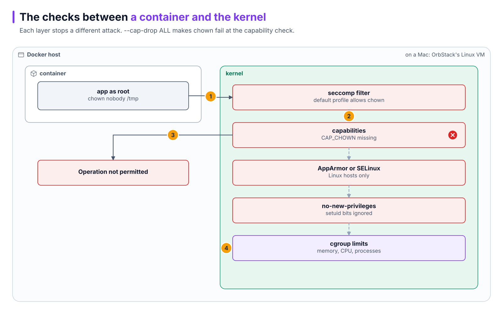
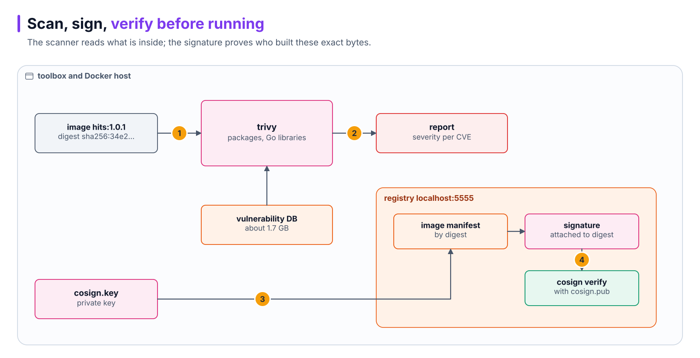

# Module 0.6: security

> New to a term here, like capability, seccomp or no-new-privileges? The [glossary](../glossary.md#docker-and-compose) explains every term in this course.

**Before this module:** [module 0.1](01-containers-and-images.md) for namespaces and the shared user namespace, [module 0.2](02-building-images.md) for the app image and the registry, and [module 0.3](03-docker-compose.md) for Compose. No cluster needed.

**You need:** the toolbox shell, in the repo folder. The first `trivy` scan downloads its vulnerability database, about 1.7 GB on disk in the test run, into the toolbox's home volume, where later scans reuse it. Docker downloads `python:3.13.9-alpine3.22` (about 20 MB) and `golang:1.27.3-alpine3.24` (about 80 MB).

Module 0.1 ended with an uncomfortable fact: by default, root in a container is root on the Docker host, with the same user ID, fenced in only by namespaces, a cgroup and a few kernel filters. Most of the time that fence holds, but a kernel bug, a careless mount or a vulnerable library in the image turns a compromised app into a compromised host. Container security comes in layers: run as a normal user, take away the kernel privileges the app never uses, make the filesystem read-only, cap the resources, and only run images you scanned and signed. This module adds each layer to a container and watches what it stops, then scans the course's images, signs one, and moves a password out of an environment variable.

Time: about 60 minutes. Adds a few small containers and a registry, under 50 MiB.

```console
$ ./lab.sh reset docker
Removing the Docker track's containers, networks, volumes and images
Done. No course containers, networks or volumes are left.
```

## Concept: the layers between a process and the kernel

A process in a container talks to the shared kernel through system calls, such as `open`, `chown` or `mount`, and the kernel decides each time whether to allow it. Docker sets several independent checks on that path, and each one stops a different kind of attack, much like a bank that has a door guard, an ID check at the counter and a time lock on the vault.

The user ID decides ordinary file permissions. Capabilities split root's powers into about 40 pieces, such as `CAP_CHOWN` to change file owners or `CAP_NET_RAW` to craft raw packets, and Docker gives a container only 14 of them by default; a root process without a capability has no way to use that power. Seccomp, short for secure computing, filters the system calls themselves: Docker's default profile blocks about 50 calls that containers rarely need and attackers love, such as creating user namespaces or loading kernel modules. On a Linux host, AppArmor or SELinux adds a further profile on top. `no-new-privileges` stops a process from gaining rights through a setuid program, and a read-only root filesystem leaves an intruder nowhere to drop tools.



Follow one `chown` from a container started with `--cap-drop ALL`:

1. The app calls `chown` on a file, as user root in the container.
2. Seccomp's default profile allows `chown`, so the call reaches the kernel's checks.
3. The kernel checks the capabilities: `CAP_CHOWN` is missing, so it refuses with `Operation not permitted`.
4. The cgroup still caps memory and processes for everything the container does, whatever the user.

## Concept: trust in an image comes from a scan and a signature

The kernel checks stop a running container from doing too much, and none of them helps if the image itself carries a vulnerable library or came from someone other than you. Two more steps happen before a container ever starts. A scanner, here Trivy, reads the image's package list and the libraries inside its binaries, and compares their versions with a database of known vulnerabilities. A signature, here made with cosign, ties the image's digest to a key you control, so a deploy step verifies that the exact bytes it's about to run came from your build. Because the signature covers the digest, it stays valid only as long as nobody changes a single byte, which is why module 0.2's digests matter here.



1. Trivy reads the image from the Docker engine and lists its packages and Go libraries.
2. It compares their versions with its database and reports each known vulnerability with a severity.
3. cosign signs the image's digest with your private key and stores the signature in the registry next to the image.
4. Before a deploy, `cosign verify` checks the signature with your public key, and refuses an image whose digest has no valid signature.

## The bigger picture: secure defaults are coming, slowly

Docker's defaults favour compatibility: root, 14 capabilities and a writable filesystem keep almost every old image working. The direction of the industry is the opposite default. Kubernetes's restricted Pod Security Standard requires a non-root user, all capabilities dropped and no privilege escalation, rootless container engines such as rootless Docker and Podman run the whole engine as an ordinary user, and user namespaces map root inside to an unprivileged user outside. On the supply-chain side, registries and admission controllers increasingly refuse unsigned images, and SBOMs travel with images as attestations. Track [4](../4-security/04-hardening-workloads.md) applies the same ideas to a Kubernetes cluster.

## Why this way

**Why drop all capabilities and add back the few you need?** A list of what's allowed stays short and stable, while a list of what's forbidden grows with every new kernel feature. Most apps need no capability at all, so `--cap-drop ALL` costs nothing and removes 14 powers an attacker would otherwise inherit.

**Why does a non-root container still ping and bind port 80?** Docker sets two kernel settings in every container: `net.ipv4.ping_group_range` lets any user send pings through a special ICMP socket, and `net.ipv4.ip_unprivileged_port_start=0` lets any user listen on ports below 1024. That removes the two usual reasons for keeping `CAP_NET_RAW` and `CAP_NET_BIND_SERVICE`.

**Why not rootless Docker everywhere?** It's the strongest option on a Linux host and worth it for build servers and shared machines, but it changes networking, storage drivers and port publishing, and OrbStack and Docker Desktop don't offer it, because they already run Docker inside a VM of their own. On a Mac the VM is the outer fence.

**Why secrets as files and not environment variables?** Environment variables show up in `docker inspect`, in `/proc/<pid>/environ`, in crash reports and in every child process. A secret file sits on a tmpfs or a read-only mount, only the app reads it, and nothing records its content in the container's configuration.

## Do it

### 1. Who you are in a container

```console
$ docker run --rm alpine:3.22.2 id
uid=0(root) gid=0(root) groups=0(root),0(root),1(bin),2(daemon),3(sys),4(adm),6(disk),10(wheel),11(floppy),20(dialout),26(tape),27(video)

$ docker run --rm --user 1000:1000 alpine:3.22.2 id
uid=1000 gid=1000 groups=1000

$ docker run -d --name course-root alpine:3.22.2 sleep 600
100d4e39ef7d4e6db6da6e498dd771db16c2397909c3cfa563c06b74db779703
$ P=$(docker inspect -f '{{.State.Pid}}' course-root)
$ docker run --rm --privileged --pid=host alpine:3.22.2 sh -c "cat /proc/$P/uid_map; ps -o user,pid,args | grep -E '^root +$P '"
         0          0 4294967295
root     559180 sleep 600

$ docker run --rm alpine:3.22.2 sh -c 'cat /proc/self/attr/current 2>/dev/null || echo "no LSM profile"'
no LSM profile
```

**What you should see.** Without `--user`, the container runs as `uid=0(root)`, and `--user 1000:1000` runs it as a plain user with no name, because Alpine's `/etc/passwd` has no entry for 1000. The `uid_map` of the container's process reads `0 0 4294967295`, the identity map: user 0 inside is user 0 outside, and the host's process list shows the `sleep` as `root`. The last command prints the container's Linux security module profile: `docker-default (enforce)` on a Linux host with AppArmor, such as Ubuntu, and `no LSM profile` on a Mac, whose OrbStack kernel runs without one.

### 2. Capabilities: drop all, add back one

<!-- fails-ok -->
```console
$ docker build -q -t course/nettools:1.0 platform-engineering/0-docker/lab/nettools
sha256:8938e4f17c07c3d60737f586a367e6aa8661dfcf3b058d742801ff7afe01b932

$ docker run --rm alpine:3.22.2 grep CapEff /proc/self/status
CapEff:	00000000a80425fb
$ docker run --rm course/nettools:1.0 capsh --decode=00000000a80425fb
0x00000000a80425fb=cap_chown,cap_dac_override,cap_fowner,cap_fsetid,cap_kill,cap_setgid,cap_setuid,cap_setpcap,cap_net_bind_service,cap_net_raw,cap_sys_chroot,cap_mknod,cap_audit_write,cap_setfcap

$ docker run --rm --cap-drop ALL alpine:3.22.2 sh -c 'grep CapEff /proc/self/status; chown nobody /tmp'
CapEff:	0000000000000000
chown: /tmp: Operation not permitted

$ docker run --rm --cap-drop ALL --cap-add CHOWN alpine:3.22.2 sh -c 'chown nobody /tmp && echo chown worked'
chown worked

$ docker run --rm --cap-drop ALL --user 1000 alpine:3.22.2 sh -c 'cat /proc/sys/net/ipv4/ping_group_range /proc/sys/net/ipv4/ip_unprivileged_port_start; ping -c1 -W1 127.0.0.1 | tail -1'
0	2147483647
0
round-trip min/avg/max = 0.039/0.039/0.039 ms
```

**What you should see.** The default set is `00000000a80425fb`, which `capsh` decodes into Docker's 14 capabilities, from `cap_chown` to `cap_setfcap`. With `--cap-drop ALL` the set is all zeros, and even root's `chown` fails with `Operation not permitted`. Adding back `CHOWN` alone makes the same command work, which is the pattern for any app: drop everything, add back what an error message proves you need. The last command runs as user 1000 with no capability at all and still pings, because of the two kernel settings from **Why this way**: `0 2147483647` allows every group to ping, and `0` opens every port.

### 3. Seccomp: the system call filter

<!-- fails-ok -->
```console
$ docker info -f '{{.SecurityOptions}}'
[name=seccomp,profile=builtin name=cgroupns]

$ docker run --rm --user 1000 alpine:3.22.2 unshare -U -r id
unshare: unshare(0x10000000): Operation not permitted

$ docker run --rm --user 1000 --security-opt seccomp=unconfined alpine:3.22.2 unshare -U -r sh -c 'id; cat /proc/self/uid_map'
uid=0(root) gid=0(root) groups=0(root)
         0       1000          1

$ cat platform-engineering/0-docker/lab/security/no-chmod.json
{
  "defaultAction": "SCMP_ACT_ALLOW",
  "syscalls": [
    {
      "names": ["chmod", "fchmod", "fchmodat", "fchmodat2"],
      "action": "SCMP_ACT_ERRNO"
    }
  ]
}
$ docker run --rm --security-opt seccomp=platform-engineering/0-docker/lab/security/no-chmod.json alpine:3.22.2 sh -c 'touch /tmp/f && chmod 600 /tmp/f'
chmod: /tmp/f: Operation not permitted
```

**What you should see.**

1. `docker info` lists the seccomp profile `builtin`, Docker's default, which applies to every container unless you say otherwise; a Linux host with AppArmor lists `name=apparmor` too.
2. `unshare -U -r` asks the kernel for a new user namespace. The default profile blocks that system call for a process without `CAP_SYS_ADMIN`, so it fails with `Operation not permitted`.
3. With `seccomp=unconfined` the same command works, and it shows what a user namespace does: inside, the process is `uid=0(root)`, while `uid_map` reads `0 1000 1`, so that root maps to user 1000 outside. That's the idea behind rootless containers and Docker's `userns-remap` setting, which give a container's root an unprivileged ID on the host.
4. A profile of your own blocks exactly the calls you list. `no-chmod.json` allows everything except the four `chmod` calls, so `touch` works and `chmod` fails with `Operation not permitted`. The `docker` command reads the profile file and sends its content to the engine, so a path in the toolbox works.

### 4. A read-only root filesystem and no new privileges

<!-- fails-ok -->
```console
$ docker run --rm --read-only alpine:3.22.2 touch /x
touch: /x: Read-only file system

$ docker run --rm --read-only --tmpfs /tmp alpine:3.22.2 sh -c 'touch /tmp/x && echo /tmp is writable'
/tmp is writable

$ docker build -q -t course/setuid:1 -f platform-engineering/0-docker/lab/security/Dockerfile.setuid platform-engineering/0-docker/lab/security
sha256:06fee83a7b5aac4d4518df673a48efa5cac4b35c465bf0587b4cc17c23c358d6
$ docker run --rm course/setuid:1 suid-python -c 'import os; print("uid", os.getuid(), "euid", os.geteuid())'
uid 1000 euid 0

$ docker run --rm --security-opt no-new-privileges course/setuid:1 suid-python -c 'import os; print("uid", os.getuid(), "euid", os.geteuid())'
uid 1000 euid 1000
```

**What you should see.** `--read-only` turns the container's writable layer off, so `touch /x` fails with `Read-only file system`, and a tmpfs at `/tmp` gives the app the one writable place it needs. The image `course/setuid:1` holds a copy of Python with the setuid bit, the kind of file that some base images carry by accident. User 1000 runs it and gets an effective user ID of `0`, root. With `no-new-privileges`, the kernel ignores the setuid bit for every process in the container, and the effective ID stays `1000`.

### 5. Resource limits stop a container from starving the host

<!-- fails-ok -->
```console
$ docker run --name course-oom --memory 32m alpine:3.22.2 sh -c 'head -c 100m /dev/zero | tail'
Killed
$ docker inspect -f 'OOMKilled={{.State.OOMKilled}} exit={{.State.ExitCode}}' course-oom
OOMKilled=true exit=137

$ docker run --rm --pids-limit 20 alpine:3.22.2 sh -c 'for i in $(seq 1 40); do sleep 5 & done 2>&1 | tail -1'
sh: can't fork: Resource temporarily unavailable
```

**What you should see.** `tail` holds 100 MB of input in memory, the cgroup's 32 MiB limit stops it, and the kernel's out-of-memory killer ends the process: Docker records `OOMKilled=true` and exit code `137`. With `--pids-limit 20`, the shell fails to start more than about 20 processes with `can't fork`, which is what stops a fork bomb from taking the whole host down.

### 6. Scan images with Trivy

```console
$ trivy image --quiet --scanners vuln --format json nginx:1.28.0-alpine | jq -r '[.Results[].Vulnerabilities[]?.Severity] | group_by(.) | map("\(.[0]) \(length)") | .[]'
CRITICAL 3
HIGH 64
LOW 40
MEDIUM 91

$ trivy image --quiet --scanners vuln --severity CRITICAL nginx:1.28.0-alpine 2>/dev/null | grep -E '^│ [a-z]' | cut -c1-80 | head -5
│ nginx:1.28.0-alpine (alpine 3.21.5) │ alpine │        3        │
│ brotli-libs │ CVE-2026-111497 │ CRITICAL │ fixed  │ 1.1.0-r2        
│ libcrypto3  │ CVE-2026-31789  │          │        │ 3.3.5-r0        
│ libssl3     │                 │          │        │                 

$ docker build -q --build-arg VERSION=1.0.0 -t course/hits:1.0.0 platform-engineering/0-docker/lab/app
sha256:66fcc0e5ff380411fcbeaebba6e04e7216bfba35c22e21a6e98be562473db6c9
$ trivy image --quiet --scanners vuln --format json course/hits:1.0.0 | jq -r '.Results[] | "\(.Target) \(.Type) \((.Vulnerabilities // []) | length) vulnerabilities"'
hits gobinary 50 vulnerabilities

$ docker build -q --build-arg VERSION=1.0.1 --build-arg GO_IMAGE=golang:1.27.3-alpine3.24 -t course/hits:1.0.1 platform-engineering/0-docker/lab/app
sha256:955caa33bfc1d735aca9bfcff6c3239b5bd8a4914b6ae083654bafb3348f3047
$ trivy image --quiet --scanners vuln --format json course/hits:1.0.1 | jq -r '.Results[] | "\(.Target) \(.Type) \((.Vulnerabilities // []) | length) vulnerabilities"'
hits gobinary 1 vulnerabilities

$ trivy image --quiet --scanners vuln --severity CRITICAL --exit-code 1 course/hits:1.0.1 >/dev/null; echo "exit code $?"
exit code 0
```

**What you should see.** The nginx image from nine months ago carries vulnerabilities at every severity, a few of them critical, almost all in Alpine packages that a newer base image fixes. The app image has no operating system packages at all, yet Trivy still finds vulnerabilities in it: they sit in Go's standard library, which the compiler built into the binary, so a `scratch` image is only as fresh as the toolchain that built it. In the test run the binary built with Go 1.25.3 had 50, and the same code built with Go 1.27.3 had 1, and `--exit-code 1` turns the scan into a gate for a CI pipeline: it exits with 1 when it finds anything at the given severity, 0 when it doesn't. The numbers change every day as the database learns of new vulnerabilities, so yours will differ.

### 7. Sign an image and verify it

The registry from module 0.2 holds the image, and cosign signs its digest with a key pair you create. `COSIGN_PASSWORD=` leaves the private key without a password, which is fine for a lab and wrong anywhere else. The two flags switch off the public transparency log, so the signature stays in your registry; cosign 3 prints a warning that these flags will change.

```console
$ docker run -d --name course-registry --network k8s-lab-toolbox_default -p 127.0.0.1:5555:5000 registry:3.1.2
eb4ad14fdf4bbc16c8bf0c0725c9c59e526bd1c519280a98681919baba0c39b9
$ docker tag course/hits:1.0.1 localhost:5555/hits:1.0.1 && docker push -q localhost:5555/hits:1.0.1
localhost:5555/hits:1.0.1

$ K=platform-engineering/0-docker/work/keys; mkdir -p $K
$ COSIGN_PASSWORD= cosign generate-key-pair --output-key-prefix $K/cosign 2>&1 | tail -2
Private key written to platform-engineering/0-docker/work/keys/cosign.key
Public key written to platform-engineering/0-docker/work/keys/cosign.pub

$ D=$(curl -s -I -H 'Accept: application/vnd.oci.image.index.v1+json' http://localhost:5555/v2/hits/manifests/1.0.1 | tr -d '\r' | awk '/Docker-Content-Digest/ {print $2}'); echo $D
sha256:955caa33bfc1d735aca9bfcff6c3239b5bd8a4914b6ae083654bafb3348f3047
$ COSIGN_PASSWORD= cosign sign --yes --key $K/cosign.key --use-signing-config=false --tlog-upload=false localhost:5555/hits@$D 2>&1 | grep -v deprecated
Pushing signature to: localhost:5555/hits
Signing artifact...

$ cosign verify --key $K/cosign.pub --insecure-ignore-tlog localhost:5555/hits@$D 2>/dev/null | jq -r '.[0].critical.image."docker-manifest-digest"'
sha256:955caa33bfc1d735aca9bfcff6c3239b5bd8a4914b6ae083654bafb3348f3047

$ docker build -q --build-arg VERSION=6.6.6 -t localhost:5555/hits:1.0.1 platform-engineering/0-docker/lab/app && docker push -q localhost:5555/hits:1.0.1
sha256:125d986d7322059f846c2d3609a5c60d27556cfb1f37752d18871b20a5330ed1
localhost:5555/hits:1.0.1
$ cosign verify --key $K/cosign.pub --insecure-ignore-tlog localhost:5555/hits:1.0.1 2>&1 | tail -1
error during command execution: no signatures found
```

**What you should see.** cosign writes `cosign.key`, the private key that signs, and `cosign.pub`, the public key that verifies. Signing pushes the signature to the registry as an artifact attached to the digest. `cosign verify` checks it and prints the signed claims, whose `docker-manifest-digest` is exactly `$D`. Then someone pushes a different image under the same tag, and verifying the tag fails with `no signatures found`, because the tag now points at a digest nobody signed. A deploy step that verifies before it runs never runs the swapped image.

### 8. Secrets in Compose

<!-- fails-ok -->
```console
$ cp -r platform-engineering/0-docker/lab/security platform-engineering/0-docker/work/secrets
$ echo 's3cret-from-file' > platform-engineering/0-docker/work/secrets/db_password.txt
$ docker compose -f platform-engineering/0-docker/work/secrets/compose.yaml up -d 2>&1 | grep -c Started
2

$ docker inspect -f '{{range .Config.Env}}{{println .}}{{end}}' course-secrets-env-way-1 | grep PASSWORD
DB_PASSWORD=s3cret-from-env

$ docker inspect -f '{{range .Config.Env}}{{println .}}{{end}}' course-secrets-secret-way-1 | grep -c PASSWORD
0

$ docker compose -f platform-engineering/0-docker/work/secrets/compose.yaml exec secret-way sh -c 'ls -l /run/secrets; cat /run/secrets/db_password'
total 4
-rw-rw-rw-    1 root     root            17 Nov 21 19:22 db_password
s3cret-from-file

$ docker compose -f platform-engineering/0-docker/work/secrets/compose.yaml down 2>&1 | grep -c Removed
3
```

**What you should see.** The password given as an environment variable sits in plain text in `docker inspect`, so anyone with access to the Docker socket, every log collector that records container metadata, and every child process of the app sees it. The service with a secret has no password in its configuration at all; the password appears only as the read-only file `/run/secrets/db_password` inside the container, which Compose bind-mounts from the file you name. Production setups keep that file out of Git and out of the image, and a secret manager writes it at deploy time.

## Tasks

### Task 0.6.1: harden a running container

```console
$ ./lab.sh task setup 0.6.1
== setup task 0.6.1
Image course/hits:1.0.0 is ready. No container course-task-hard exists.
```

> Run `course-task-hard` from `course/hits:1.0.0`, built by setup, with: a read-only root filesystem, all capabilities dropped, `no-new-privileges`, a memory limit of 64 MiB, a limit of 50 processes, and its port 8000 published on port 8897. The app must still answer on `/healthz`.

<details>
<summary>Solution</summary>

The app writes nothing and needs no capability, so every flag applies without a tmpfs.

```console
$ docker run -d --name course-task-hard --read-only --cap-drop ALL --security-opt no-new-privileges --memory 64m --pids-limit 50 -p 8897:8000 course/hits:1.0.0
31cb01e8a17a32d5bdcb3380d4ed4bab7b9bb210f085c9c8da4a9af2e26dcc53
$ curl -s --retry 5 --retry-all-errors --retry-delay 1 http://host.docker.internal:8897/healthz
ok
```

</details>

```console
$ ./lab.sh task check 0.6.1
== check task 0.6.1
  PASS  course-task-hard runs course/hits:1.0.0
  PASS  its root filesystem is read-only
  PASS  it drops all capabilities
  PASS  it sets no-new-privileges
  PASS  its memory limit is 64 MiB
  PASS  its process limit is 50
  PASS  port 8897 answers ok on /healthz
== task 0.6.1: 7 passed, 0 failed
```

### Task 0.6.2: fail a build on critical vulnerabilities

```console
$ ./lab.sh task setup 0.6.2
== setup task 0.6.2
Write platform-engineering/0-docker/work/task-0.6.2/gate.sh. Run this task in the toolbox, which has trivy.
```

> Write a script `platform-engineering/0-docker/work/task-0.6.2/gate.sh` that takes an image name as its only argument, scans it with Trivy, and exits with code 1 when the image has at least one CRITICAL vulnerability, and with 0 otherwise. Check it against `nginx:1.28.0-alpine` and `course/hits:1.0.1`.

<details>
<summary>Solution</summary>

Trivy's `--exit-code` and `--severity` do the work.

```console
$ printf '#!/bin/sh\nexec trivy image --quiet --scanners vuln --severity CRITICAL --exit-code 1 "$1"\n' > platform-engineering/0-docker/work/task-0.6.2/gate.sh
$ chmod +x platform-engineering/0-docker/work/task-0.6.2/gate.sh
$ platform-engineering/0-docker/work/task-0.6.2/gate.sh nginx:1.28.0-alpine >/dev/null; echo "exit code $?"
exit code 1
$ platform-engineering/0-docker/work/task-0.6.2/gate.sh course/hits:1.0.1 >/dev/null; echo "exit code $?"
exit code 0
```

</details>

```console
$ ./lab.sh task check 0.6.2
== check task 0.6.2
  PASS  gate.sh exists and is executable
  PASS  gate.sh nginx:1.28.0-alpine exits 1 (it has CRITICAL vulnerabilities)
  PASS  gate.sh course/hits:1.0.1 exits 0
  PASS  gate.sh calls trivy
== task 0.6.2: 4 passed, 0 failed
```

### Task 0.6.3: a password as a Compose secret

```console
$ ./lab.sh task setup 0.6.3
== setup task 0.6.3
Project course-task-secret runs from platform-engineering/0-docker/work/task-0.6.3 with the token in its environment.
```

> The project in `platform-engineering/0-docker/work/task-0.6.3` passes `API_TOKEN` to its service `app` as an environment variable. Change it so the token reaches the container only as the file `/run/secrets/api_token`, read from `token.txt` next to `compose.yaml`, with nothing about the token in the container's configuration, and start the project.

<details>
<summary>Solution</summary>

A top-level `secrets:` entry with `file: ./token.txt`, and `secrets: [api_token]` on the service instead of the environment variable.

```console
$ cp platform-engineering/0-docker/work/task-0.6.3/solution.yaml platform-engineering/0-docker/work/task-0.6.3/compose.yaml
$ docker compose -f platform-engineering/0-docker/work/task-0.6.3/compose.yaml up -d 2>&1 | tail -1
 Container course-task-secret-app-1 Started 
```

</details>

```console
$ ./lab.sh task check 0.6.3
== check task 0.6.3
  PASS  course-task-secret's app runs
  PASS  the container's configuration holds no API_TOKEN
  PASS  /run/secrets/api_token holds the token
== task 0.6.3: 3 passed, 0 failed
```

## Investigate

1. Step 2 showed that root without `CAP_CHOWN` fails to change a file's owner. Which capability does an app that binds port 443 need inside a Docker container, and why?
2. A teammate wants to run `docker run --privileged` "to make a monitoring agent work". Name three of the layers from this module that `--privileged` switches off.
3. Trivy reported vulnerabilities in a `scratch` image in step 6. Where did they come from, and what fixed most of them?
4. Why does step 7 verify `localhost:5555/hits@$D` successfully while `localhost:5555/hits:1.0.1` fails, although both named the same image when you signed it?

<details>
<summary>Answers</summary>

1. None. Docker sets `net.ipv4.ip_unprivileged_port_start=0` in every container, so any user may listen on any port, and `CAP_NET_BIND_SERVICE` only matters on a host or a runtime that keeps the old limit of 1024.
2. `--privileged` gives the container every capability, turns seccomp and the AppArmor or SELinux profile off, and gives it access to the host's devices. It's the flag the debug container in module 0.5 uses on purpose, and a regular workload almost never needs it; a monitoring agent usually needs one or two capabilities, such as `CAP_SYS_PTRACE`, and read-only mounts.
3. From Go's standard library, which the compiler links into the binary. Trivy reads the module and version information Go stores in every binary. Building with a newer Go toolchain, 1.27.3 instead of 1.25.3, fixed most of them, without one line of the app's code changing.
4. The signature covers a digest, not a tag. `@$D` still names the signed digest. The tag `1.0.1` moved to the new image when someone pushed under it, and the new digest has no signature. Deploy files that pin digests and verify them close that gap.

</details>

## Clean up

```console
$ ./lab.sh reset docker
Removing the Docker track's containers, networks, volumes and images
Done. No course containers, networks or volumes are left.
```

This removes the containers, the registry, the `course/` and `localhost:5555/` images, the work folder with the key pair, and the secrets project. Trivy's database stays in the toolbox's home volume at `~/.cache/trivy`; `rm -rf ~/.cache/trivy` in the toolbox frees its 1.7 GB.
