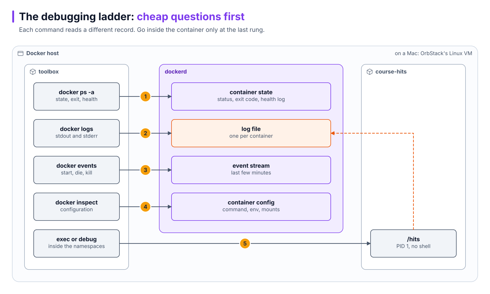
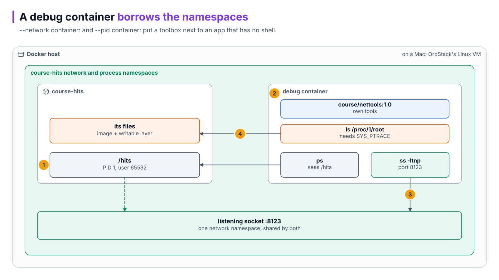

# Module 0.7: debugging containers

> New to a term here, like exit code, health log or docker events? The [glossary](../glossary.md#docker-and-compose) explains every term in this course.

**Before this module:** [module 0.3](03-docker-compose.md) for Compose and healthchecks, and [module 0.5](05-networking-in-depth.md) for the debug image and namespaces. No cluster needed.

**You need:** the toolbox shell, in the repo folder.

Something will break: a container that exits a second after it starts, one that restarts in a loop, an app that runs but answers `502`, an image without a shell that you need to look inside. Under pressure, people guess, restart things and change two settings at once, and the fault moves instead of disappearing. A fixed order of questions works better, from the cheapest to the most expensive: is it running, what did it say, what happened to it, what is it configured with, and what does it see from the inside. This module builds that ladder with Docker's own commands, then uses it on a Compose project with three faults hidden in it.

Time: about 45 minutes. Adds a few small containers, under 40 MiB.

```console
$ ./lab.sh reset docker
Removing the Docker track's containers, networks, volumes and images
Done. No course containers, networks or volumes are left.
```

## Concept: a ladder from cheap to deep

Each rung answers one question and points at the next, much like a doctor who takes your temperature before ordering a scan. `docker ps -a` answers whether the container runs, and for one that stopped, its exit code: `0` means it finished, `137` that something killed it, often the out-of-memory killer from module 0.6, `143` that it stopped on SIGTERM, and anything else is the app's own error. `docker logs` shows what the main process wrote, which usually names the problem in plain words. `docker events` shows what happened to the container from Docker's side, every start, die, kill and health change with a time. `docker inspect` shows what the container really runs with, its command, environment, mounts, networks and limits, which is where typos hide. Only then do you go inside: `docker exec` for a shell, or a debug container that joins the target's namespaces when the image has no shell at all.



1. `docker ps -a`: running, restarting, exited, and with which code and health.
2. `docker logs`: the app's own explanation, on its standard output and error.
3. `docker events`: Docker's record of starts, deaths, kills and health changes.
4. `docker inspect`: the configuration as Docker holds it.
5. Inside: `docker exec`, or a debug container in the target's network and process namespaces.

## Concept: a debug container borrows the target's namespaces

Module 0.2's image has one file and no shell, so `docker exec` has nothing to run. The container's namespaces still exist, though, and Docker starts a new container inside them on request: `--network container:<name>` puts the debug container in the target's network namespace, so it sees the same interfaces, ports and connections, and `--pid container:<name>` puts it in the target's process namespace, so it sees the target's processes and, through `/proc/1/root`, its files. The debug image brings the tools, the target stays untouched, and the debug container disappears afterwards, like a mechanic who brings their own toolbox instead of using the car's. Kubernetes offers the same idea as `kubectl debug` with ephemeral containers.



1. The target, `course-hits`, runs one process in its own namespaces and has no shell.
2. The debug container starts from `course/nettools:1.0` with the target's network namespace and process namespace.
3. Its `ss` sees the target's listening port, and its `ps` sees the target's process.
4. `/proc/1/root` opens the target's filesystem through that process.

## The bigger picture: from one host to many

On one host, this ladder is all you need. With many hosts, the same questions move into tools: logs flow into a central store such as Loki (module [2.3](../2-observability/03-logs-with-loki.md)), container events and health become metrics and alerts (module [2.1](../2-observability/01-prometheus-and-alerting.md)), and `kubectl describe`, `kubectl logs --previous` and `kubectl debug` replace the Docker commands one for one. Images without shells are spreading, because they're smaller and safer, so the debug-container technique stops being a trick and becomes the normal way in.

## Why this way

**Why logs before inspect?** The app knows best why it failed, and it says so in one line more often than not. Inspect answers a different question, what Docker gave the app, and helps once the log names a host, a file or a variable.

**Why does `docker logs` show nothing for some apps?** Docker only captures what the main process writes to standard output and standard error. An app that writes to a file inside the container keeps its log there, which is why images such as nginx link their log files to `/dev/stdout`.

**Why not just add a shell to every image?** A shell helps an attacker as much as it helps you, and it adds packages to patch. A debug container gives you every tool you want, only while you need it, without changing the image.

## Do it

### 1. A container that exits at once

```console
$ docker run -d --name course-crash alpine:3.22.2 sh -c 'echo "reading /etc/app.conf"; cat /etc/app.conf; echo "config missing, giving up" >&2; exit 3'
918c9b1ed755127112d4250fc4b91be44da819a22e8eb0d0f0c6445123e9d98b

$ sleep 1; docker ps -a --filter name=course-crash --format 'table {{.Names}}\t{{.Status}}'
NAMES          STATUS
course-crash   Exited (3) 1 second ago

$ docker logs course-crash
reading /etc/app.conf
cat: can't open '/etc/app.conf': No such file or directory
config missing, giving up

$ docker inspect -f 'exit={{.State.ExitCode}} oom={{.State.OOMKilled}} started={{.State.StartedAt}} finished={{.State.FinishedAt}}' course-crash
exit=3 oom=false started=2026-11-21T19:47:14.468463088Z finished=2026-11-21T19:47:14.526693988Z
```

**What you should see.** `docker ps` hides stopped containers, so `-a` matters: the container shows `Exited (3)`. The log holds both streams, the normal output and the error, and names the missing file. `docker inspect` confirms the code was the app's own `3`, not an out-of-memory kill, and the two times show it lived for a few milliseconds.

### 2. A restart loop and Docker's events

```console
$ docker run -d --name course-loop --restart on-failure:3 alpine:3.22.2 sh -c 'echo "attempt at $(date +%T)"; exit 1'
4cdc12b0c29feeadd3b6f8d8dee13aecf2d78f18b8acda6ad3b2f7e21e4e88a2

$ sleep 8; docker inspect -f 'status={{.State.Status}} restarts={{.RestartCount}} exit={{.State.ExitCode}}' course-loop
status=exited restarts=3 exit=1

$ docker logs course-loop
attempt at 19:47:15
attempt at 19:47:15
attempt at 19:47:16
attempt at 19:47:16

$ docker events --since "$(docker inspect -f '{{.Created}}' course-loop)" --until 0s --filter container=course-loop --format '{{.Action}}' | sort | uniq -c
      1 create
      4 die
      4 start
```

**What you should see.** The restart policy `on-failure:3` starts the container again after each failure, three times, then gives up, so it ends as `exited` with `restarts=3`. The log keeps the lines of all four runs, one after the other, because the restarts reuse the same container. `docker events` counts the actions Docker took: four `start` and four `die`, plus the `create` at the beginning. `--since` takes the container's creation time, so earlier containers of the same name stay out of the count; in a real incident, the times of these actions tell you when a loop began.

### 3. A container that runs but is unhealthy

```console
$ docker build -q -t course/hits:1.0.0 platform-engineering/0-docker/lab/app
sha256:196c27bae262f84c95da17276568e9e28f83fcbac58338db29894325d3ec7889
$ docker run -d --name course-sick -e REDIS_ADDR=nowhere:6379 course/hits:1.0.0
9c1bdb170247c2f08255388995117bb537c8306f8f93fed90d7a79decf41f6be

$ sleep 20; docker ps --filter name=course-sick --format '{{.Names}} {{.Status}}'
course-sick Up 20 seconds (unhealthy)

$ docker inspect -f '{{range .State.Health.Log}}{{.ExitCode}} {{.Output}}{{end}}' course-sick | tail -2
1 unhealthy

$ docker inspect -f '{{range .Config.Env}}{{println .}}{{end}}' course-sick | grep REDIS
REDIS_ADDR=nowhere:6379
```

**What you should see.** The process runs, so a plain `docker ps` shows the container as up, but its health is `unhealthy`: the image's health check calls `/healthz`, which fails because Redis is unreachable, and the health log holds the last checks with exit code `1`. `docker inspect` shows the configuration behind it, `REDIS_ADDR=nowhere:6379`, a name that exists nowhere.

### 4. Inside a container that has no shell

```console
$ docker run -d --name course-hits -e PORT=8123 course/hits:1.0.0
a00df53468653b6278e4f357b5a80cddb018d4a474ea5206d0607274c24db694
$ docker exec course-hits sh -c 'echo hi'
OCI runtime exec failed: exec failed: unable to start container process: exec: "sh": executable file not found in $PATH

$ docker build -q -t course/nettools:1.0 platform-engineering/0-docker/lab/nettools
sha256:e8f1ce09ba19792be02de1f932cc09e65d77f675343b4475a262204f9eec1e4e
$ docker run --rm --network container:course-hits --pid container:course-hits --cap-add SYS_PTRACE course/nettools:1.0 sh -c 'ps -o pid,user,args; ss -ltnp; ls -l /proc/1/root/'
PID   USER     COMMAND
    1 65532    /hits
   17 root     sh -c ps -o pid,user,args; ss -ltnp; ls -l /proc/1/root/
   22 root     ps -o pid,user,args
State  Recv-Q Send-Q Local Address:Port Peer Address:PortProcess                     
LISTEN 0      4096               *:8123            *:*    users:(("hits",pid=1,fd=4))
total 5636
drwxr-xr-x    5 root     root           320 Nov 21 19:47 dev
drwxr-xr-x    1 root     root            56 Nov 21 19:47 etc
-rwxr-xr-x    1 root     root       5767352 Nov 21 15:39 hits
dr-xr-xr-x  524 root     root             0 Nov 21 19:47 proc
dr-xr-xr-x   11 root     root             0 Nov 21 19:47 sys

$ docker top course-hits
PID                 USER                TIME                COMMAND
636621              65532               0:00                /hits

$ docker stats --no-stream --format 'table {{.Name}}\t{{.CPUPerc}}\t{{.MemUsage}}\t{{.PIDs}}' course-hits
NAME          CPU %     MEM USAGE / LIMIT     PIDS
course-hits   1.32%     2.344MiB / 11.73GiB   7
```

**What you should see.** `docker exec` fails, because there is no `sh` to run. The debug container, sharing the target's network and process namespaces, lists the app as PID 1 running as user `65532`, shows it listening on port `8123`, and lists its filesystem through `/proc/1/root`: the one file `hits`, next to the folders Docker adds to every container, such as `dev`, `etc`, `proc` and `sys`. That last part needs `--cap-add SYS_PTRACE`: the app runs as another user, and the kernel lets one process look into another user's process only with that capability, which Docker leaves out of its default set. `docker top` and `docker stats` need nothing inside the container at all, because Docker reads them from the host's process table and the container's cgroup.

### 5. A Compose project with three faults

The project in `platform-engineering/0-docker/lab/broken` is module 0.3's app with three mistakes in it. Run it, and climb the ladder for each symptom before you look at the fix.

<!-- fails-ok -->
```console
$ mkdir -p platform-engineering/0-docker/work && cp -r platform-engineering/0-docker/lab/app platform-engineering/0-docker/lab/broken platform-engineering/0-docker/work/
$ export COMPOSE_FILE=platform-engineering/0-docker/work/broken/compose.yaml
$ docker compose up -d --build 2>&1 | grep -c Started
3

$ sleep 15; docker compose ps -a --format 'table {{.Service}}\t{{.Status}}'
SERVICE   STATUS
api       Up 15 seconds (unhealthy)
proxy     Up 15 seconds
redis     Up 15 seconds

$ curl -s -o /dev/null -w '%{http_code}\n' http://host.docker.internal:8887/
502

$ docker compose logs proxy 2>&1 | grep -o 'connect() failed.*upstream: "[^"]*"'
connect() failed (111: Connection refused) while connecting to upstream, client: 192.168.148.1, server: , request: "GET / HTTP/1.1", upstream: "http://192.168.148.2:8080/"
```

**What you should see.** Everything started, and the API is `unhealthy`. The proxy answers `502 Bad Gateway`, and its log names the reason: nothing listens on the upstream `http://<api address>:8080/`, so the connection fails with `Connection refused`. The API listens on 8000, so the first fault sits in `nginx.conf`. Fix it and restart the proxy:

<!-- fails-ok -->
```console
$ sed -i 's/api:8080/api:8000/' platform-engineering/0-docker/work/broken/nginx.conf
$ docker compose restart proxy 2>&1 | grep -c Started
1

$ sleep 3; curl -s -w ' %{http_code}\n' http://host.docker.internal:8887/
redis unavailable: dial tcp: lookup redsi on 127.0.0.11:53: no such host
 503

$ docker compose logs api 2>&1 | grep redsi | tail -1 | cut -d' ' -f3-
| 2026/11/21 19:48:06 redis redsi:6379: dial tcp: lookup redsi on 127.0.0.11:53: no such host

$ docker inspect -f '{{range .Config.Env}}{{println .}}{{end}}' course-broken-api-1 | grep REDIS
REDIS_ADDR=redsi:6379
```

**What you should see.** Now the API answers itself, with `503` and `lookup redsi ... no such host`, and its configuration shows the typo `redsi`. Fix the name and recreate only the API, because a changed environment needs a new container:

<!-- fails-ok -->
```console
$ sed -i 's/redsi:6379/redis:6379/' $COMPOSE_FILE
$ docker compose up -d api 2>&1 | grep -E 'Recreated' | uniq
 Container course-broken-api-1 Recreated 

$ sleep 3; curl -s -w ' %{http_code}\n' http://host.docker.internal:8887/
redis unavailable: unexpected reply "-NOAUTH Authentication required."
 503

$ docker compose exec redis redis-cli INCR hits
NOAUTH Authentication required.

$ docker inspect -f '{{json .Config.Cmd}}' course-broken-redis-1
["redis-server","--requirepass","change-me"]
```

**What you should see.** The third fault answers `503` with `NOAUTH Authentication required`: Redis wants a password, which `redis-cli` without `-a` also hits, and `docker inspect` shows why, the command line `--requirepass change-me`. The app has no password setting, so the fix is to drop the option, which also needs a new container:

```console
$ sed -i 's/    command: \["redis-server", "--requirepass", "change-me"\]//' $COMPOSE_FILE
$ docker compose up -d redis 2>&1 | grep -E 'Recreated' | uniq
 Container course-broken-redis-1 Recreated 

$ sleep 3; curl -s --retry 5 --retry-all-errors --retry-delay 1 -w ' %{http_code}\n' http://host.docker.internal:8887/
hello from f60c769a1256, visit 1, version 3.0.0
 200

$ docker compose down 2>&1 | grep -c Removed; unset COMPOSE_FILE
4
```

**What you should see.** `200` and the first visit. Three faults, three different rungs: the proxy's log found the wrong port, the API's log and `inspect` found the typo, and `inspect` of Redis found the password. Each fix touched one thing, and each check showed the next symptom, which is the habit that keeps an incident short.

## Tasks

### Task 0.7.1: repair a project that never comes up

```console
$ ./lab.sh task setup 0.7.1
== setup task 0.7.1
Project course-task-broken started from platform-engineering/0-docker/work/task-0.7.1. Port 8898 doesn't answer.
```

> The project `course-task-broken` in `platform-engineering/0-docker/work/task-0.7.1` should serve the `hits` app through nginx on port 8898, with Redis behind it. It never works. Find and fix its faults, edit only that folder's files, and start the project so port 8898 answers with a visit counter.

<details>
<summary>Solution</summary>

`docker compose ps -a` shows Redis `unhealthy` and the API never started, because it waits for a healthy Redis. Redis's health log says `ERR unknown command 'pong'`: the check runs `redis-cli pong` instead of `ping`. The proxy restarts in a loop, and its log says nginx found a directory where it expected a file, because the mount names `./site.conf`, which doesn't exist, so Docker created an empty directory for it; the file is `nginx.conf`.

```console
$ docker compose -f platform-engineering/0-docker/work/task-0.7.1/compose.yaml ps -a --format '{{.Service}} {{.Status}}'
api Up 2 seconds (healthy)
proxy Created
redis Up 4 seconds (healthy)
$ perl -pi -e 's/"redis-cli", "pong"/"redis-cli", "ping"/; s#\./site\.conf:#./nginx.conf:#' platform-engineering/0-docker/work/task-0.7.1/compose.yaml
$ rm -rf platform-engineering/0-docker/work/task-0.7.1/site.conf
$ docker compose -f platform-engineering/0-docker/work/task-0.7.1/compose.yaml up -d --wait 2>&1 | tail -1
 Container course-task-broken-proxy-1 Healthy 
```

</details>

```console
$ ./lab.sh task check 0.7.1
== check task 0.7.1
  PASS  redis of course-task-broken is healthy
  PASS  the api runs and is healthy
  PASS  the proxy runs without restarts since its last start
  PASS  port 8898 answers with a visit counter
== task 0.7.1: 4 passed, 0 failed
```

### Task 0.7.2: find why a container keeps dying

```console
$ ./lab.sh task setup 0.7.2
== setup task 0.7.2
course-task-crashy started with --restart on-failure:5.
```

> `course-task-crashy` restarts and dies. Write its exit code to `platform-engineering/0-docker/work/task-0.7.2/exitcode.txt`, then run it again under the same name, image and command so that it stays up.

<details>
<summary>Solution</summary>

The log names the missing variable, and inspect shows the command to keep.

```console
$ docker inspect -f '{{.State.ExitCode}}' course-task-crashy > platform-engineering/0-docker/work/task-0.7.2/exitcode.txt
$ docker logs course-task-crashy 2>&1 | tail -1
CONFIG_URL is not set
$ docker rm -f course-task-crashy
course-task-crashy
$ docker run -d --name course-task-crashy -e CONFIG_URL=http://config.local/app course/task-crashy:1
a42cda14030204133a14ff0678f51a7a5224e06ce98778ea9c01a37781d3e83c
```

</details>

```console
$ ./lab.sh task check 0.7.2
== check task 0.7.2
  PASS  exitcode.txt holds the exit code (4)
  PASS  course-task-crashy runs course/task-crashy:1
  PASS  it stays up
== task 0.7.2: 3 passed, 0 failed
```

### Task 0.7.3: look inside a container without a shell

```console
$ ./lab.sh task setup 0.7.3
== setup task 0.7.3
course-task-quiet runs. Write its port to platform-engineering/0-docker/work/task-0.7.3/port.txt.
```

> `course-task-quiet` runs the `hits` image, which has no shell, and listens on a port nobody wrote down. Without restarting it, write the TCP port it listens on to `platform-engineering/0-docker/work/task-0.7.3/port.txt`.

<details>
<summary>Solution</summary>

A debug container in the target's network namespace sees its listening sockets.

```console
$ docker run --rm --network container:course-task-quiet course/nettools:1.0 ss -ltn
State  Recv-Q Send-Q Local Address:Port Peer Address:Port
LISTEN 0      4096               *:9466            *:*   
$ docker run --rm --network container:course-task-quiet course/nettools:1.0 ss -ltnH | awk '{print $4}' | sed 's/.*://' > platform-engineering/0-docker/work/task-0.7.3/port.txt
```

</details>

```console
$ ./lab.sh task check 0.7.3
== check task 0.7.3
  PASS  course-task-quiet still runs its first start
  PASS  port.txt holds the port it listens on
== task 0.7.3: 2 passed, 0 failed
```

## Investigate

1. A container shows `Exited (137)` and `OOMKilled=false`. What killed it, if not the memory limit?
2. Why did fixing the environment in step 5 need `docker compose up -d api`, while fixing `nginx.conf` needed only `restart`?
3. In step 2 the log of `course-loop` showed four lines. What would `docker logs` show after `docker rm course-loop` and a new `docker run` with the same name?
4. The debug container in step 4 saw the app's files through `/proc/1/root`. Why didn't it use `--volumes-from` or a mount instead?

<details>
<summary>Answers</summary>

1. Exit code 137 means SIGKILL, and something other than the out-of-memory killer sent it: `docker kill`, `docker stop` after its 10-second timeout, as in module 0.1, or a host-level OOM kill of a process without a container limit. `docker events` shows a `kill` action with the signal when Docker sent it.
2. Environment variables, the command and mounts belong to a container's configuration, which Docker fixes when it creates the container, so a change needs a new container, which `up` creates because the definition changed. `nginx.conf` is a file in a bind mount, so the running container already saw the new content, and nginx only had to read it again, which a restart does.
3. Only the new container's output. Logs belong to a container, and `docker rm` deleted them with it, which is why central logging matters: once a container is gone, so is its local log.
4. The image has no volumes to borrow, and the files sit in the container's image layers and writable layer, not in a mount. `/proc/1/root` opens the root filesystem as the target process sees it, whatever its source, which works for any container whose process namespace you share.

</details>

## Clean up

```console
$ ./lab.sh reset docker
Removing the Docker track's containers, networks, volumes and images
Done. No course containers, networks or volumes are left.
```

This removes the containers, the broken projects, the images built here and the work folder.
