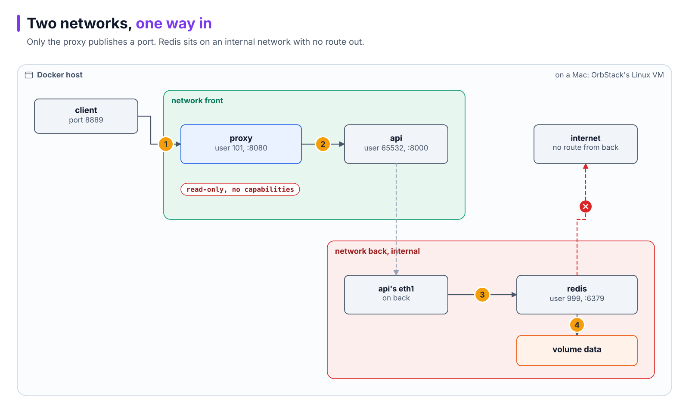
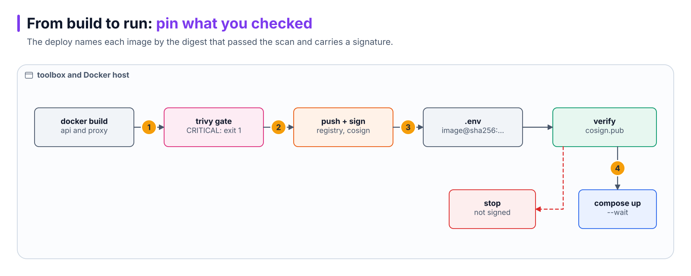

# Module 0.8: capstone, a hardened app in Compose

> New to a term here, like internal network, YAML anchor or digest pinning? The [glossary](../glossary.md#docker-and-compose) explains every term in this course.

**Before this module:** modules [0.2](02-building-images.md) to [0.7](07-debugging.md) of this track. No cluster needed.

**You need:** the toolbox shell, in the repo folder. Docker downloads `nginxinc/nginx-unprivileged:1.31.7-alpine3.24` and `redis:8.10.2-alpine3.23`, about 30 MB together, and the Go image from module 0.6 if it's missing.

The modules of this track each fixed one thing in isolation: a small image, a start order, a volume, a network, a capability. A real service needs all of them at once, and the gaps between them are where incidents start: a hardened API next to a database that anyone on the host reaches, a scanned image that the deploy file names by a tag someone moved, a proxy that runs as root because its base image did. This capstone puts the `hits` app, an nginx reverse proxy and Redis together the way a careful team would ship them on one host. You scan and sign every image, the deploy names each image by its signed digest, Redis lives on a network with no way out, and every container runs as a normal user, read-only, without capabilities and within limits. Then you prove each of those claims from the outside.

Time: about 45 minutes. Adds three containers, under 30 MiB, and a registry.

```console
$ ./lab.sh reset docker
Removing the Docker track's containers, networks, volumes and images
Done. No course containers, networks or volumes are left.
```

## Concept: two networks, one way in

The design starts from one question: who needs to talk to whom? A client needs the proxy, the proxy needs the API, and the API needs Redis. Nobody else needs Redis, so Redis gets a network of its own, `back`, marked `internal`. Docker gives an internal network a bridge like any other, but no masquerade rule and no published ports, so containers on it reach each other and nothing else, much like a back office with no outside door. The API joins both networks, the proxy only `front`, and only the proxy publishes a port. A compromised proxy then finds no route and not even a DNS name for Redis.



1. A client calls port 8889 on the Docker host, which Docker forwards to the proxy's port 8080 on `front`.
2. The proxy, user 101, resolves `api` through Docker's DNS server and forwards the request.
3. The API, user 65532, reaches `redis` on `back`, the internal network.
4. Redis, user 999, writes to its volume; it has no route out and no published port.

## Concept: a deploy pins what the pipeline checked

Each image passes the same gate before it runs: build, scan with a CRITICAL gate, push to the registry, sign the digest. The deploy file then names each image by that digest, not by a tag, and a verify step before `docker compose up` checks the signature. So the bytes that run are exactly the bytes that passed the scan, and a tag moved later changes nothing. Compose reads the digests from `.env`, which keeps `compose.yaml` the same for every release, like a recipe that stays fixed while the shopping list changes.



1. Build the API with the current Go toolchain and the proxy with its packages upgraded.
2. Scan each image; the CRITICAL gate passes.
3. Push both to the registry and sign their digests with cosign.
4. Write the digests into `.env`, verify the signatures, and start the project.

## The bigger picture: the same checklist in Kubernetes

Every line of this capstone has a Kubernetes twin. The internal network becomes a NetworkPolicy that denies all traffic but the API's, the hardening flags become a pod's `securityContext` with `runAsNonRoot`, `readOnlyRootFilesystem`, `capabilities: drop: [ALL]` and `allowPrivilegeEscalation: false`, the limits become resource limits, and the verify step becomes an admission policy such as Kyverno's image verification (module [2.7](../2-observability/07-kyverno-policy-as-code.md)) that refuses unsigned images. Track [4](../4-security/04-hardening-workloads.md) enforces the same checklist on a cluster. Teams who learn it on one Docker host carry it over unchanged.

## Why this way

**Why a YAML anchor for the hardening?** `x-hardened: &hardened` holds the shared settings once, and `<<: *hardened` merges them into each service. A fourth service gets the same protection with one line, and nobody forgets `no-new-privileges` on the one service added at night.

**Why upgrade packages in the proxy's Dockerfile?** The scan in module 0.6 showed that even a recent base image carries vulnerabilities that Alpine already fixed. `apk upgrade` at build time takes the fixes, at the price that two builds on different days give different images, which is why you scan and sign the result, not the recipe.

**Why does Redis run as `999:1000` explicitly?** The official image starts as root and switches to the `redis` user itself, which needs `CAP_SETUID` and `CAP_SETGID`. With `cap_drop: [ALL]`, starting directly as the `redis` user keeps that switch from ever being necessary.

**Why `restart: unless-stopped` everywhere?** A crashed process comes back by itself, while a container you stopped on purpose stays stopped through a Docker restart.

## Do it

### 1. Build, scan and gate

```console
$ C=platform-engineering/0-docker/work/capstone
$ mkdir -p platform-engineering/0-docker/work && cp -r platform-engineering/0-docker/lab/capstone $C
$ cat $C/compose.yaml | sed -n '/^x-hardened/,/^services/p'
x-hardened: &hardened
  read_only: true
  cap_drop: [ALL]
  security_opt: [no-new-privileges:true]
  restart: unless-stopped

services:

$ docker build -q --build-arg VERSION=2.0.0 --build-arg GO_IMAGE=golang:1.27.3-alpine3.24 -t localhost:5555/hits:2.0.0 platform-engineering/0-docker/lab/app
sha256:20ca420258a76f51f1b0a76210fa4859aaa0df40eb63f8d28df6f91468d1bf1b
$ docker build -q -t localhost:5555/proxy:1.0.0 $C/proxy
sha256:a23fa5d71731f904cd736d03c9c415f79ac8a4279a6413c8bc0f90de834568e1

$ trivy image --quiet --scanners vuln --severity CRITICAL --exit-code 1 nginxinc/nginx-unprivileged:1.31.7-alpine3.24 >/dev/null; echo "base proxy image: exit code $?"
base proxy image: exit code 1

$ for i in localhost:5555/hits:2.0.0 localhost:5555/proxy:1.0.0 redis:8.10.2-alpine3.23; do trivy image --quiet --scanners vuln --severity CRITICAL --exit-code 1 $i >/dev/null; echo "$i: exit code $?"; done
localhost:5555/hits:2.0.0: exit code 0
localhost:5555/proxy:1.0.0: exit code 0
redis:8.10.2-alpine3.23: exit code 0
```

**What you should see.** The base nginx image fails the gate, exit code `1`, because the test run found one critical vulnerability in an Alpine package with a fix available. The proxy image built from it with `apk upgrade` passes, and so do the API, built with Go 1.27.3, and Redis. Your counts depend on the day you scan; if a gate fails for you, the scan's table names the package and the fixed version, and a rebuild usually clears it.

### 2. Push, sign and pin the digests

```console
$ docker run -d --name course-registry --network k8s-lab-toolbox_default -p 127.0.0.1:5555:5000 registry:3.1.2
21c2cc21c98f4bb4f658aafbbfeabbea25e593ecc14a5bb20bdc8e0d6e3fc39f
$ sleep 2; docker push -q localhost:5555/hits:2.0.0 && docker push -q localhost:5555/proxy:1.0.0
localhost:5555/hits:2.0.0
localhost:5555/proxy:1.0.0

$ digest() { curl -s -I -H 'Accept: application/vnd.oci.image.index.v1+json' http://localhost:5555/v2/$1/manifests/$2 | tr -d '\r' | awk '/Docker-Content-Digest/ {print $2}'; }
$ printf 'API_IMAGE=localhost:5555/hits@%s\nPROXY_IMAGE=localhost:5555/proxy@%s\n' $(digest hits 2.0.0) $(digest proxy 1.0.0) > $C/.env; cat $C/.env
API_IMAGE=localhost:5555/hits@sha256:20ca420258a76f51f1b0a76210fa4859aaa0df40eb63f8d28df6f91468d1bf1b
PROXY_IMAGE=localhost:5555/proxy@sha256:a23fa5d71731f904cd736d03c9c415f79ac8a4279a6413c8bc0f90de834568e1

$ COSIGN_PASSWORD= cosign generate-key-pair --output-key-prefix $C/cosign 2>&1 | tail -1
Public key written to platform-engineering/0-docker/work/capstone/cosign.pub
$ for i in $(cut -d= -f2 $C/.env); do COSIGN_PASSWORD= cosign sign --yes --key $C/cosign.key --use-signing-config=false --tlog-upload=false $i 2>&1 | grep -c Pushing; done
1
1
```

**What you should see.** Both images sit in the registry, `.env` names each by its digest, and cosign pushes one signature per digest. From here on, the tags `2.0.0` and `1.0.0` no longer matter to the deploy.

### 3. Verify, then start

```console
$ verify() { for i in $(cut -d= -f2 $C/.env); do cosign verify --key $C/cosign.pub --insecure-ignore-tlog $i >/dev/null 2>&1 || { echo "NOT SIGNED: $i"; return 1; }; done; echo "all images signed"; }
$ verify && docker compose -f $C/compose.yaml up -d --wait 2>&1 | grep Healthy
all images signed
 Container course-capstone-redis-1 Healthy 
 Container course-capstone-api-1 Healthy 
 Container course-capstone-api-1 Healthy 
 Container course-capstone-redis-1 Healthy 
 Container course-capstone-proxy-1 Healthy 

$ docker compose -f $C/compose.yaml ps --format 'table {{.Service}}\t{{.Image}}\t{{.Status}}' | cut -c1-110
SERVICE   IMAGE                                                                                          STATU
api       localhost:5555/hits@sha256:20ca420258a76f51f1b0a76210fa4859aaa0df40eb63f8d28df6f91468d1bf1b    Up 7 
proxy     localhost:5555/proxy@sha256:a23fa5d71731f904cd736d03c9c415f79ac8a4279a6413c8bc0f90de834568e1   Up 5 
redis     redis:8.10.2-alpine3.23                                                                        Up 10

$ for i in 1 2 3; do curl -s http://host.docker.internal:8889/; done
hello from b92adf0cf660, visit 1, version 2.0.0
hello from b92adf0cf660, visit 2, version 2.0.0
hello from b92adf0cf660, visit 3, version 2.0.0
```

**What you should see.** `verify` checks every image in `.env` and lets the start go ahead only when all carry a valid signature. Compose starts Redis, waits until it's healthy, starts the API, waits again, and starts the proxy, and `--wait` returns once all three report `healthy`. The images show as digests, and the requests come back through the proxy with a shared counter.

### 4. Prove the hardening from the outside

<!-- fails-ok -->
```console
$ for c in proxy api redis; do docker inspect -f "$c user={{.Config.User}} read_only={{.HostConfig.ReadonlyRootfs}} cap_drop={{.HostConfig.CapDrop}} {{.HostConfig.SecurityOpt}} memory={{.HostConfig.Memory}} pids={{.HostConfig.PidsLimit}}" course-capstone-$c-1; done
proxy user=101 read_only=true cap_drop=[ALL] [no-new-privileges:true] memory=67108864 pids=100
api user=65532:65532 read_only=true cap_drop=[ALL] [no-new-privileges:true] memory=67108864 pids=50
redis user=999:1000 read_only=true cap_drop=[ALL] [no-new-privileges:true] memory=134217728 pids=50

$ docker compose -f $C/compose.yaml exec api /hits healthcheck
healthy

$ docker compose -f $C/compose.yaml exec proxy sh -c 'id; touch /etc/x'
uid=101(nginx) gid=101(nginx) groups=101(nginx)
touch: /etc/x: Read-only file system
```

**What you should see.** All three containers run as a non-root user, `101`, `65532` and `999:1000`, with a read-only root filesystem, every capability dropped, `no-new-privileges:true`, and limits on memory and processes. Inside the proxy, the shell confirms user `nginx` and fails to write to `/etc`, while nginx keeps its temporary files on the tmpfs at `/tmp`.

### 5. Prove the network design

<!-- fails-ok -->
```console
$ docker network inspect course-capstone_back -f 'internal={{.Internal}}'
internal=true

$ docker compose -f $C/compose.yaml exec redis sh -c 'wget -q -T 3 -O /dev/null http://example.com; echo "exit code $?"'
wget: bad address 'example.com'
exit code 1

$ docker compose -f $C/compose.yaml exec proxy sh -c 'getent hosts redis || echo "redis: no such name"'
redis: no such name

$ docker compose -f $C/compose.yaml exec api /hits healthcheck
healthy

$ docker compose -f $C/compose.yaml ps --format '{{.Service}} {{.Ports}}'
api 8000/tcp
proxy 0.0.0.0:8889->8080/tcp, [::]:8889->8080/tcp
redis 6379/tcp
```

**What you should see.** The `back` network reports `internal=true`. From Redis, even the name `example.com` fails to resolve, because Docker's DNS server forwards no outside names for an internal network, and a connection would find no route anyway. From the proxy, the name `redis` doesn't exist, because the proxy isn't on `back`. The API, on both networks, still reaches Redis, as its healthy check shows. Only the proxy publishes a port.

### 6. Survive a crash and keep the data

```console
$ docker compose -f $C/compose.yaml kill api 2>&1 | grep -c Killed
1

$ sleep 1; docker compose -f $C/compose.yaml ps -a --format '{{.Service}} {{.Status}}' | grep api
api Exited (137) 1 second ago

$ docker compose -f $C/compose.yaml up -d --wait 2>&1 | grep -c Healthy; curl -s http://host.docker.internal:8889/
5
hello from b92adf0cf660, visit 4, version 2.0.0

$ docker compose -f $C/compose.yaml down 2>&1 | grep -c Removed
5
```

**What you should see.** `kill` sends SIGKILL, and a container killed through Docker counts as stopped on purpose, so `unless-stopped` leaves it down: the API shows `Exited (137)`. The proxy keeps answering health checks itself, but forwards nothing. `up --wait` starts the API again, and the counter continues where it was, because Redis kept it in its volume. A crash inside the app, which Docker didn't cause, restarts by itself.

## Tasks

### Task 0.8.1: add a hardened worker

```console
$ ./lab.sh task setup 0.8.1
== setup task 0.8.1
api Up 7 seconds (healthy)
proxy Up 5 seconds (healthy)
redis Up 10 seconds (healthy)
```

> The capstone runs from `platform-engineering/0-docker/work/capstone`. Add a service `worker` from `alpine:3.22.2` with the command `sleep 3600`, on the `back` network only, running as user `1000:1000`, with every hardening setting the other services share and a memory limit of 32 MiB, and start it.

<details>
<summary>Solution</summary>

The anchor brings the shared settings, so the service needs only its own lines.

```console
$ cat platform-engineering/0-docker/work/capstone/worker.yaml
services:
  worker:
    image: alpine:3.22.2
    user: "1000:1000"
    command: ["sleep", "3600"]
    read_only: true
    cap_drop: [ALL]
    security_opt: [no-new-privileges:true]
    restart: unless-stopped
    networks: [back]
    mem_limit: 32m
$ docker compose -f platform-engineering/0-docker/work/capstone/compose.yaml -f platform-engineering/0-docker/work/capstone/worker.yaml up -d worker 2>&1 | tail -1
 Container course-capstone-worker-1 Started 
```

Setup leaves the service in `worker.yaml`, an override file that Compose merges into `compose.yaml`, so that `task solve` has something to apply. An anchor from `compose.yaml` doesn't reach into another file, so the override spells the hardening out; written into `compose.yaml` itself, `<<: *hardened` covers it.

</details>

```console
$ ./lab.sh task check 0.8.1
== check task 0.8.1
  PASS  the worker runs alpine:3.22.2 sleep 3600
  PASS  it runs as 1000:1000
  PASS  it is hardened like the others
  PASS  it sits on the back network only
  PASS  its memory limit is 32 MiB
== task 0.8.1: 5 passed, 0 failed
```

### Task 0.8.2: find the gap

```console
$ ./lab.sh task setup 0.8.2
== setup task 0.8.2
api Up 2 seconds (healthy)
proxy Up 11 seconds (healthy)
redis Up 5 seconds (healthy)
```

> Someone changed the capstone in `platform-engineering/0-docker/work/capstone` "to fix a bug", and now it runs with less protection than before. Find what weakened, restore the hardening on every service, and start the project again so that it still answers on port 8889.

<details>
<summary>Solution</summary>

`docker inspect` of each container shows the API without `read_only`, with `NET_RAW` added back and running as root, and Redis on `front` as well as `back`. The copy of the original file restores everything.

```console
$ for c in proxy api redis; do docker inspect -f "$c user={{.Config.User}} ro={{.HostConfig.ReadonlyRootfs}} add={{.HostConfig.CapAdd}} nets={{len .NetworkSettings.Networks}}" course-capstone-$c-1; done
proxy user=101 ro=true add=[] nets=1
api user=0 ro=false add=[CAP_NET_RAW] nets=2
redis user=999:1000 ro=true add=[] nets=2
$ cp platform-engineering/0-docker/lab/capstone/compose.yaml platform-engineering/0-docker/work/capstone/compose.yaml
$ docker compose -f platform-engineering/0-docker/work/capstone/compose.yaml up -d --wait 2>&1 | tail -1
 Container course-capstone-api-1 Healthy 
```

</details>

```console
$ ./lab.sh task check 0.8.2
== check task 0.8.2
  PASS  proxy is hardened
  PASS  api is hardened
  PASS  redis is hardened
  PASS  redis sits on the back network only
  PASS  port 8889 answers with a visit counter
== task 0.8.2: 5 passed, 0 failed
```

### Task 0.8.3: release a new API version the safe way

```console
$ ./lab.sh task setup 0.8.3
== setup task 0.8.3
The capstone runs version 2.0.0. Its key pair is /Users/test/Documents/Claude Projects/k8s_lab_macos/.claude/worktrees/agent-ac684da5c5550b56f/platform-engineering/0-docker/work/capstone/cosign.key and cosign.pub.
```

> Release API version `2.0.1`: build it from `platform-engineering/0-docker/lab/app` with Go 1.27.3, pass the CRITICAL scan, push it as `localhost:5555/hits:2.0.1`, sign its digest with the capstone's key `platform-engineering/0-docker/work/capstone/cosign.key`, pin that digest in the capstone's `.env`, and redeploy, so the running API reports version 2.0.1.

<details>
<summary>Solution</summary>

The same four steps as the module, for one image.

```console
$ C=platform-engineering/0-docker/work/capstone
$ docker build -q --build-arg VERSION=2.0.1 --build-arg GO_IMAGE=golang:1.27.3-alpine3.24 -t localhost:5555/hits:2.0.1 platform-engineering/0-docker/lab/app
sha256:7de261b3810001355a72ff47a91080e6771449df341917388df4b923e6e02813
$ trivy image --quiet --scanners vuln --severity CRITICAL --exit-code 1 localhost:5555/hits:2.0.1 >/dev/null && docker push -q localhost:5555/hits:2.0.1
localhost:5555/hits:2.0.1
$ D=$(curl -s -I -H 'Accept: application/vnd.oci.image.index.v1+json' http://localhost:5555/v2/hits/manifests/2.0.1 | tr -d '\r' | awk '/Docker-Content-Digest/ {print $2}')
$ COSIGN_PASSWORD= cosign sign --yes --key $C/cosign.key --use-signing-config=false --tlog-upload=false localhost:5555/hits@$D 2>&1 | grep Pushing
Pushing signature to: localhost:5555/hits
$ perl -pi -e "s#^API_IMAGE=.*#API_IMAGE=localhost:5555/hits\@$D#" $C/.env
$ docker compose -f $C/compose.yaml up -d --wait 2>&1 | tail -1
 Container course-capstone-redis-1 Healthy 
$ curl -s http://host.docker.internal:8889/
hello from 566cc32565b6, visit 1, version 2.0.1
```

</details>

```console
$ ./lab.sh task check 0.8.3
== check task 0.8.3
  PASS  the registry holds hits:2.0.1
  PASS  .env pins hits@ that digest
  PASS  the digest carries a signature from the capstone's key
  PASS  the running api uses that digest
  PASS  the proxy answers with version 2.0.1
== task 0.8.3: 5 passed, 0 failed
```

## Investigate

1. A teammate wants Redis reachable from their laptop for debugging and adds `ports: ["6379:6379"]` to it. What does that do on an internal network, and what's the safer way to look at the data?
2. Why does the proxy's health check call nginx's own `/healthz` instead of the API's?
3. The registry loses the signature of the API's digest. What happens at the next deploy, and what does the running project do meanwhile?
4. Which single setting of this capstone would you drop first if an app broke under it, and how would you find out which one broke it?

<details>
<summary>Answers</summary>

1. Docker publishes no ports for a container that sits only on an internal network, so the line has no effect there, and attaching Redis to `front` to make it work would undo the design. Use `docker compose exec redis redis-cli` instead, which runs inside the container and needs no port at all.
2. The proxy's check should say whether nginx itself works. If it called the API, a slow API would mark the proxy unhealthy too, and anything that restarts unhealthy containers would restart the healthy part. Each service checks only itself, and `depends_on` with `service_healthy` handles the order.
3. `verify` fails with `NOT SIGNED` and stops before `docker compose up`, so nothing changes; the running containers keep running, because Docker checks no signatures at run time. The fix is to sign the digest again from the build that produced it, not to skip the check.
4. None blindly: read the app's error first, as in module 0.7. `Read-only file system` points at `read_only` and calls for a tmpfs or a volume at that path, `Operation not permitted` on a privileged action points at a capability to add back by name, and an OOM kill points at the memory limit. Change one setting at a time and keep the rest.

</details>

## Clean up

```console
$ ./lab.sh reset docker
Removing the Docker track's containers, networks, volumes and images
Done. No course containers, networks or volumes are left.
```

This removes the project with its volume and networks, the registry with the signed images, the key pair in the work folder and the images built here. The base images stay; `docker image rm` with their names removes them once you finish the track.
