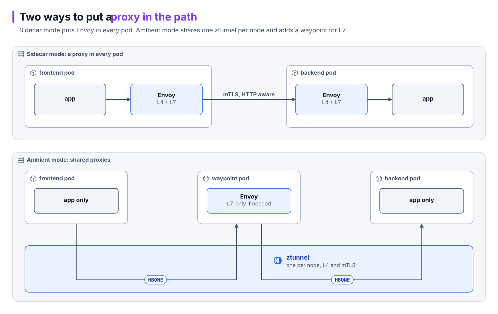
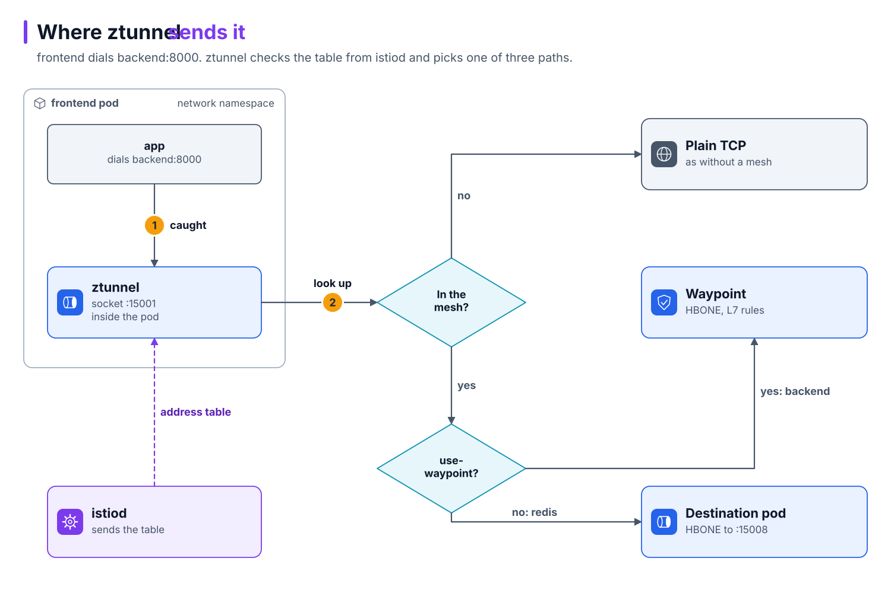

# Module 1: what a mesh adds

> New to a term here, like VirtualService or waypoint? The [glossary](glossary.md) explains every Istio resource and term in this course.

**Before this module:** module 0.

**You need:** the lab running (`./scripts/start.sh` starts or repairs it), `istioctl`, and `./scripts/port-forward.sh` running in a spare terminal for Kiali (http://localhost:20001).

You already know how Kubernetes moves a packet from one pod to another. This module shows what that path leaves out, such as who is calling and whether anyone encrypted the bytes, and the two ways Istio fills the gap.

## Concept: what Kubernetes networking does not do

When the frontend calls `http://backend:8000`, Kubernetes does three things:

1. CoreDNS, the cluster's DNS server, turns the name `backend` into the Service's ClusterIP. The ClusterIP works like a forwarding address, because no machine actually owns it.
2. kube-proxy rewrites the ClusterIP to the IP of one backend pod, chosen at random, using iptables or IPVS rules on the node.
3. The Container Network Interface (CNI) plugin, flannel in this lab, delivers the packet to that pod.

That's the whole job. Kubernetes networking works at layer 3 and 4, which means it sees addresses and ports and nothing about the request inside. So it has no answer to these questions:

| Question | Why Kubernetes has no answer |
|---|---|
| Who is calling? | A source IP is not an identity. A recreated pod comes back with a new IP, and when traffic leaves a node, source NAT (SNAT) often rewrites many pods' addresses to the node's single IP. |
| Is the traffic encrypted? | The CNI moves packets and leaves encryption to the application. |
| May this caller come in? | NetworkPolicy matches IPs, namespaces and labels, so it has no way to say "only the frontend's GET /api/orders". |
| Send 10% to v2 | A Service picks pods at random, so the only way to get 10% is to run 1 v2 pod for every 9 v1 pods. |
| Retry, time out, break the circuit | Every application has to implement it, in every language. |
| How many requests failed, how slow were they? | kube-proxy counts nothing per request. |

A service mesh answers these questions without any change to your code, because it puts a proxy in the traffic path. That proxy knows who is calling and understands HTTP, so it does all of this work on the application's behalf.

## Concept: two ways to put a proxy in the path

A mesh needs a proxy in the path of every request, and Istio offers two ways to put it there. The diagram shows both, with sidecar mode on top and ambient mode below.



**Sidecar mode** adds an extra container, an Envoy proxy, to every pod, and that one Envoy handles both layers. At layer 4, the connection level, it encrypts connections with mutual TLS (mTLS), in which both sides show a certificate. At layer 7, the HTTP level, it handles features such as routing and retries.

**Ambient mode** splits the two layers between two kinds of proxy:

- **ztunnel** is a small proxy written in Rust, and one copy runs on each node as a DaemonSet. It gives every pod on its node an identity, encrypts its traffic and enforces layer 4 rules, but it never reads HTTP.
- **A waypoint** is an Envoy proxy you deploy only for the Services that need HTTP features. In this lab only the backend has one.

The split matters because most of the mesh's value comes from layer 4 alone, so ambient mode charges the price of HTTP parsing only where you ask for it.

## Concept: how a request finds ztunnel and the waypoint

Your app doesn't know the mesh exists, so it never sends anything to ztunnel on purpose. The mesh therefore has to catch each connection on its way out of the pod and hand it to ztunnel.

In plain Kubernetes, kube-proxy is the first thing that touches a request, because its iptables rules on the node rewrite the ClusterIP to a pod IP. Ambient mode catches the request earlier, while it's still inside the pod. Two steps set this up:

1. The `istio-cni` agent enters the network namespace of each mesh pod, which is the pod's private copy of the network stack. There it adds redirect rules that send the pod's traffic to ztunnel.
2. ztunnel opens listening sockets inside that same namespace, one per job:
   - port 15001 takes traffic the pod sends
   - port 15006 takes plain traffic coming in
   - port 15008 takes HBONE traffic coming in. HBONE is the mTLS tunnel that ztunnel and waypoints use between each other (module 2 goes deeper).

The app sees none of this and still dials `backend:8000`.

Once ztunnel holds the outgoing connection, it looks up the destination address in a table that istiod sends it, and then makes one of three choices. The chart walks through them, with the frontend's call to `backend:8000` as the example:



The `istio.io/use-waypoint` label sits on the destination Service, not on the caller, so in ambient mode a waypoint belongs to the receiving side. It handles traffic *to* the Services that point at it, from any caller. That's why the backend's calls to Redis never touch the waypoint: the backend's own Service uses a waypoint, but the Redis Service doesn't.

Many people assume ambient traffic leaves the pod as plain text, because no proxy sits in the pod. It doesn't. The only plain hop runs from the app to a ztunnel socket inside the pod's own network namespace, and ztunnel wraps the traffic in HBONE mTLS before it reaches any network interface. The steps below show each of these pieces on the live lab.

## Why this way

**Why split L4 and L7?** Most teams adopt a mesh for encryption and identity, and that job needs no HTTP parsing, so a TCP proxy written for that one job stays small and fast. Reading HTTP costs a lot of memory and CPU, and few services need it. Sidecar mode pays the full Envoy cost in every pod, while ambient mode pays it once per waypoint. In this lab ztunnel uses 12 to 16 MiB for the whole node and the waypoint about 30 to 40 MiB, and module 7 measures a sidecar for comparison.

**Why not do L7 in ztunnel too?** Then every node would run a full HTTP proxy for every pod on it, and one tenant's heavy traffic would slow down every other pod on that node. A waypoint serves one namespace or one Service, so you size and scale it like any other Deployment.

**Why do pods not need a restart to join?** In sidecar mode, a mutating admission webhook adds the sidecar by editing the pod spec, and it runs only when the API server creates a pod, so an existing pod needs a restart to get its sidecar. Ambient mode never changes the pod spec. Instead the `istio-cni` agent watches for the namespace label, and when the label appears it puts the redirect rules into the network namespaces of pods that already run. Module 2 shows this live.

**Why does ambient still use Envoy at all?** Envoy already has the HTTP features Istio needs, such as routing, retries, faults, outlier detection and telemetry, so the waypoint reuses it rather than starting again.

## The bigger picture: why meshes exist

Picture a company around 2012 that breaks one big application into fifty small services. Suddenly every service talks to ten others over the network, and the network fails in ways a function call never did. Calls hang, servers die halfway through a response, and one slow service drags down everything that depends on it.

The first answer came as libraries, such as Twitter's Finagle and Netflix's Hystrix and Ribbon, which handled retries, timeouts and load balancing inside the application. They worked well, but each one served a single language. A Python team got nothing from a Java library, and every fix meant rebuilding and redeploying every service.

So people moved that logic out of the application and into a proxy next to it. Lyft open-sourced Envoy in 2016 for exactly this job, and in 2017 Google, IBM and Lyft launched Istio to manage whole fleets of those proxies. The app stays ignorant of the network while the proxy speaks for it, and that idea is the service mesh.

Every mesh has two halves, and the split matters for everything that follows:

- The **data plane** touches your traffic: ztunnel, waypoints and sidecars. If it stops, requests stop.
- The **control plane** only gives orders. In Istio that's istiod, which watches the Kubernetes API, turns your YAML into proxy configuration and pushes it out over xDS, Envoy's configuration protocol. istiod also signs certificates.

If istiod dies for a minute, traffic keeps flowing, because the proxies keep using the last configuration they received. Nothing new reaches them until istiod returns. You know this pattern already from the API server and the kubelet, where one side decides and the other side does the work.

Ambient mode arrived much later, after years of complaints about the cost of sidecars. Istio announced it in September 2022 and declared it stable in Istio 1.24, in November 2024, which is the version this lab runs. Older blog posts show sidecars everywhere, and most of their ideas still apply, because only the plumbing differs.

## Do it: see the data plane

**1. Count the containers in a shop pod.**

```console
$ kubectl -n shop get pods -l app=backend -o jsonpath='{.items[0].spec.containers[*].name}{"\n"}'
backend
```

**What you should see.** One word: `backend`. The pod runs your app and nothing else, because ambient mode adds no sidecar container, so the pod spec looks exactly like the Deployment you wrote.

**2. See which pods ztunnel has taken over.**

```console
$ istioctl ztunnel-config workloads | grep -E "NAMESPACE|shop"
NAMESPACE     POD NAME                                                  ADDRESS       NODE                 WAYPOINT PROTOCOL
kube-system   svclb-shop-gateway-istio-e733c05f-4zvvs                   10.42.0.103   k3d-k8s-lab-server-0 None     TCP
shop-ingress  shop-gateway-istio-858774d7cd-n4n4b                       10.42.0.124   k3d-k8s-lab-server-0 None     TCP
shop          backend-v1-54c86bf9b-jqnzh                                10.42.0.75    k3d-k8s-lab-server-0 None     HBONE
shop          backend-v1-54c86bf9b-vssp2                                10.42.0.73    k3d-k8s-lab-server-0 None     HBONE
shop          backend-v2-5fd94d9cf4-r8j9f                               10.42.0.93    k3d-k8s-lab-server-0 None     HBONE
shop          frontend-d8cfc88bd-c5lpv                                  10.42.0.42    k3d-k8s-lab-server-0 None     HBONE
shop          redis-7bbf49c9f8-fj62f                                    10.42.0.46    k3d-k8s-lab-server-0 None     HBONE
shop          waypoint-b9b76876f-rjx7m                                  10.42.0.125   k3d-k8s-lab-server-0 None     TCP
```

**What you should see.** One row per pod, with names and IPs that differ from yours.

`HBONE` means ztunnel handles this pod's traffic, and all five app pods in `shop` show it. A pod outside the mesh shows `TCP`. The waypoint and the ingress gateway show `TCP` too, even though they belong to the mesh, because both are Envoy proxies that speak HBONE themselves, so ztunnel leaves their traffic alone.

The `svclb` pod comes from the load balancer built into k3s, which passes the node's port 8080 on to the gateway. The `grep` catches it only because its name contains `shop`.

**3. See which Services use the waypoint.**

```console
$ istioctl ztunnel-config services | grep -E "NAMESPACE|shop"
NAMESPACE     SERVICE NAME                             SERVICE VIP   WAYPOINT ENDPOINTS
shop          backend                                  10.43.239.201 waypoint 3/3
shop          backend-v1                               10.43.22.204  waypoint 2/2
shop          backend-v2                               10.43.198.219 waypoint 1/1
shop          frontend                                 10.43.196.195 None     1/1
shop          redis                                    10.43.100.21  None     1/1
shop          waypoint                                 10.43.106.27  None     1/1
shop-ingress  shop-gateway-istio                       10.43.62.182  None     1/1
```

**What you should see.** `backend`, `backend-v1` and `backend-v2` show `waypoint` in the WAYPOINT column, while `frontend`, `redis` and the `waypoint` Service itself show `None`. Only the backend needs HTTP features, so only its Services send traffic through the waypoint. The ENDPOINTS column counts ready pods, and `backend` shows `3/3` because it selects the pods of both versions.

The label that does it:

```console
$ kubectl -n shop get svc backend --show-labels
NAME      TYPE        CLUSTER-IP      EXTERNAL-IP   PORT(S)    AGE   LABELS
backend   ClusterIP   10.43.239.201   <none>        8000/TCP   34h   app=backend,argocd.argoproj.io/instance=shop-apps,istio.io/use-waypoint=waypoint,metrics=scrape
```

**What you should see.** Among the labels you find `istio.io/use-waypoint=waypoint`, which sends this Service's traffic through the Gateway named `waypoint`. The label names a Gateway because Istio defines the waypoint as a Gateway resource. If you remove the label, ztunnel delivers straight to the pods again.

**4. See the proxy in the response.**

```console
$ curl -sD - -o /dev/null http://localhost:8080/api/version | grep -iE "server|x-envoy"
x-envoy-upstream-service-time: 5
server: istio-envoy
```

**What you should see.** Both headers come from the ingress gateway's Envoy, not from the app, and the number changes with every request.

- `server: istio-envoy` names the proxy.
- `x-envoy-upstream-service-time` says how many milliseconds Envoy waited for the frontend.

**5. Count the proxies istiod manages.**

```console
$ istioctl proxy-status
NAME                                                 CLUSTER        ISTIOD                    VERSION     SUBSCRIBED TYPES
shop-gateway-istio-858774d7cd-n4n4b.shop-ingress     Kubernetes     istiod-5c5bf76f-gtmzl     1.24.2      4 (CDS,LDS,EDS,RDS)
waypoint-b9b76876f-rjx7m.shop                        Kubernetes     istiod-5c5bf76f-gtmzl     1.24.2      4 (CDS,LDS,EDS,WDS)
ztunnel-htqw5.istio-system                           Kubernetes     istiod-5c5bf76f-gtmzl     1.24.2      2 (WADS,WDS)
```

**What you should see.** Three rows: the gateway, the waypoint and ztunnel. The shop's five pods don't appear, because in ambient mode they have no proxy of their own. The last column lists the xDS feeds each proxy takes from istiod, where each feed carries one kind of configuration. The two Envoys get listeners, clusters and endpoints, while ztunnel gets only workloads and addresses, which is a much smaller feed.

## Investigate

Run `./platform-engineering/load.sh 300` and open Kiali at http://localhost:20001.

1. In **Traffic Graph**, select the `shop` and `shop-ingress` namespaces, and in the Display menu turn on **Waypoint Proxies**. Follow a request from `frontend` to `backend`. Which nodes does it pass? Why does no waypoint sit between `backend` and `redis`?
2. In the same Display menu, turn on **Security**. Which edges show a padlock, and which edges don't?
3. Open **Workloads**, then `backend-v1`, then the **Logs** tab. Which containers does it offer, and what is the extra `ztunnel` checkbox for? Compare with a pod in module 7.

<details>
<summary>Answers</summary>

1. The request leaves `frontend`, reaches the `backend` service node and lands on the `backend` v1 app node. The HTTP edges carry request rates, because the waypoint read the requests and reported them. The `waypoint` workload also shows up as its own node, joined by TCP edges, because the `backend` service sends its bytes to the waypoint and the waypoint sends them on to the backend pods. Redis gets no waypoint because its Service has no `istio.io/use-waypoint` label, as step 3 showed with `None`. Its edges carry only TCP bytes from ztunnel, with no request counts.
2. Almost every edge carries a padlock, for example gateway to frontend, frontend to backend over HTTP, and backend to redis. Two TCP edges have none:
   - `frontend` to the `backend` service
   - the `backend` service to `waypoint`

   The gap sits in the metrics, not in the encryption. ztunnel doesn't capture the waypoint's side of that hop, so Prometheus holds only the sending side's report, with `reporter="source"` and `connection_security_policy="mutual_tls"`, and Kiali draws no padlock from that one report. The traffic still runs over mTLS, and module 2 explains what the padlock proves.
3. Kiali offers one container, `backend`, and no `istio-proxy`, because the pod has none. The `ztunnel` checkbox mixes in the lines from the node's ztunnel log that concern this pod, with fields such as `src.identity` and `dst.hbone_addr` for each connection. That's where an ambient pod's mesh logs live. A sidecar pod in module 7 lists `istio-proxy` as a second container instead.

</details>

## Clean up

Nothing to clean up, because this module only reads.
