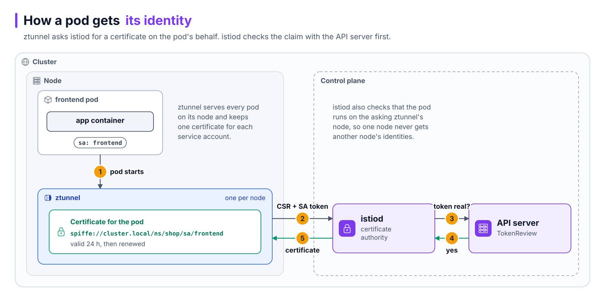
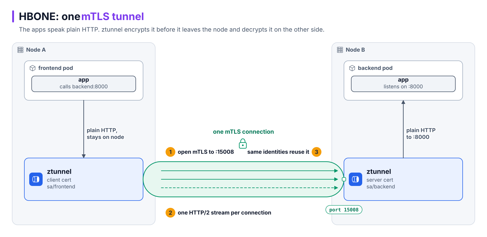

# Module 2: identity and mTLS

> New to a term here, like VirtualService or waypoint? The [glossary](glossary.md) explains every Istio resource and term in this course.

**Before this module:** module 1.

**You need:** the lab running (`./scripts/start.sh` starts or repairs it), `istioctl`, and `./scripts/port-forward.sh` running in a spare terminal for Kiali (http://localhost:20001).

Every pod in the mesh gets an identity that it proves with a certificate, and every connection between mesh pods uses that certificate for two jobs: it encrypts the traffic, and it proves who sent it. This module shows three things:

- where the identity comes from
- what travels on the wire
- how a pod joins or leaves the mesh without a restart

## Concept: an identity per service account

Before the backend serves an order, it should check which workload sent the request. Allowing every caller that reaches port 8000 is too loose for a service that holds customer orders. The pod's IP address is no good as proof of who is calling. Pods restart and get new addresses all the time, so the IP the frontend used a minute ago may belong to a different pod now. What's needed is a name tied to the workload itself, not to its address.

Kubernetes already has such a name: the ServiceAccount every pod runs as. Pods use it to prove who they are to the API server, so Istio reuses it to prove who they are to each other. The frontend runs as the `frontend` service account in the `shop` namespace, and that becomes its identity in the mesh.

A name only helps if nobody else claims it, so something trusted has to vouch for it. That job falls to istiod, which acts as a certificate authority (CA): an issuer whose signature every part of the mesh trusts. istiod gives each service account a certificate that states its name and carries istiod's signature, much like a passport carries the issuing country's stamp. The certificate expires after a day, which means a stolen one stops working quickly. The name inside follows a standard format called a SPIFFE ID:

```text
spiffe://cluster.local/ns/shop/sa/frontend
          trust domain  namespace  service account
```



So when the frontend calls the backend, the backend no longer sees just an address. It sees a certificate that says "this is frontend from shop", signed by a CA it trusts. Every authorization rule in module 3 builds on exactly that.

## Concept: HBONE, the tunnel between nodes

A TLS handshake takes time, because both sides exchange certificates and agree on keys before any data moves. If ztunnel ran one for every TCP connection the app opens, each new connection would pay that cost again. So ztunnel builds one encrypted tunnel and sends many connections through it:

1. ztunnel opens an mTLS connection to port 15008 on the other side.
2. For each TCP connection the app opens, ztunnel sends an HTTP/2 CONNECT request inside that mTLS connection, and each one becomes a separate stream.
3. When the same two identities talk again, ztunnel reuses the open mTLS connection for the new stream.

It works like a moving van that carries boxes for one customer only: many boxes share the trip, but never boxes from two senders. A connection from `sa/frontend` never carries another service account's streams, because the client certificate names exactly one identity. Istio calls this design HBONE (HTTP-Based Overlay Network Environment).



The application still speaks plain HTTP, while ztunnel captures it on the way out, encrypts it, and decrypts it on the other side.

The diagram draws two nodes to show the idea, but this lab has one node, so the same ztunnel process plays both roles. It still builds the tunnel, dialling the destination pod's IP on port 15008, where ztunnel listens inside that pod's network namespace as module 1 showed. Step 2 shows exactly this in the log.

## Concept: who accepts plain text

During a migration, some callers already belong to the mesh and some don't, so the receiving side has to decide whether to accept the second kind. PeerAuthentication answers that one question: "do I accept a connection that arrives without mTLS?"

The destination's ztunnel enforces the answer, and it tells the two kinds apart by the port a connection arrives on. Inside the receiving pod, a plain connection lands on port 15006 and an HBONE connection lands on port 15008.

| Mode | HBONE (mTLS) from a mesh pod | Plain TCP from outside the mesh |
|---|---|---|
| `PERMISSIVE` (Istio's default) | accepted | accepted |
| `STRICT` (the lab's `shop`) | accepted | closed at once |

PeerAuthentication says nothing about *which* identity may connect, so any mesh pod with a valid certificate passes STRICT. Choosing callers belongs to authorization, the topic of module 3.

People also make the opposite mistake and read PERMISSIVE as "unencrypted". Between two mesh pods ztunnel always uses mTLS, whatever the mode, so PERMISSIVE only keeps the door open for callers that have no mesh at all.

## Why this way

**Why service accounts, not IPs or labels?** IPs change every time Kubernetes recreates a pod, and labels prove nothing either, because anyone who edits a Deployment sets its labels. A service account is an identity that Kubernetes already checks, and Istio ties the certificate to it. So a policy that says "allow `sa/frontend`" stays true however many frontend pods run and wherever they run.

**Why short-lived certificates?** A long-lived certificate needs a revocation list, a list of stolen certificates that every checker must read. A 24 hour certificate that renews itself needs no such list, because a leaked key stops working within a day without anyone doing anything.

**Why does ztunnel request certificates on behalf of pods?** In sidecar mode each sidecar requests its own certificate, but in ambient mode the pod has no proxy, so the node's ztunnel holds the certificates for every pod on its node. That creates a risk that a ztunnel asks for a certificate it shouldn't have. To stop it, istiod asks the API server whether the pod really runs on that node, so one ztunnel never gets a certificate for a pod on another node.

**Why streams inside a tunnel, not one handshake per connection?** Streams mean fewer TLS handshakes and fewer connections, and HTTP/2 already knows how to carry many streams on one connection, so Istio needed no new protocol.

**Why STRICT in `shop`?** Istio's default, PERMISSIVE, accepts both mTLS and plaintext, so you enroll workloads one at a time without breaking their callers. Once every workload has joined, STRICT closes the plaintext door. The lab sets STRICT in `shop` with a `PeerAuthentication` in `manifests/istio/security.yaml`.

## The bigger picture: what mTLS actually proves

You use TLS every day. When your browser opens your bank's website, the server sends a certificate, and the browser checks two things:

1. A trusted authority signed the certificate.
2. The name inside the certificate matches the site.

Then both sides agree on keys and encrypt everything after that. The bank learns nothing about you from TLS, though, because you prove who you are later, with a password.

Mutual TLS runs the same check in both directions, so the caller shows a certificate too. When the backend's ztunnel accepts a connection, it therefore knows two facts for certain:

- Nobody read or changed the bytes on the way.
- The caller holds the private key for `sa/frontend`.

The app needs no password and no API key in an environment variable, so it has nothing to manage.

Encryption inside your own cluster matters because of how attacks spread. Old-style network security drew a line around the data centre, treated everything outside as dangerous and trusted everything inside. That model breaks the moment an attacker takes over one pod, because the attacker now sits inside the trusted zone and talks to everything. The newer approach, called zero trust, drops the idea of a safe inside, so every connection proves where it comes from every time, and policy decides on that proof rather than on the packet's source address.

Every certificate traces back to a root certificate, the one all others depend on. In this lab istiod owns that root: it generated a self-signed root CA at install time and keeps it in the `istio-ca-secret` Secret in `istio-system`. Whoever steals that key mints any identity they like, so production teams plug in their own root, or an intermediate certificate from the company CA, and guard it like a database password. For a laptop lab, the self-signed root does the job.

## Do it

**1. See the certificates ztunnel holds.**

```console
$ istioctl ztunnel-config certificates | grep -E "CERTIFICATE|ns/shop"
CERTIFICATE NAME                                                                        TYPE     STATUS        VALID CERT     SERIAL NUMBER                        NOT AFTER                NOT BEFORE
spiffe://cluster.local/ns/shop/sa/backend                                               Leaf     Available     true           cdd0650411d48f45b45f756066cd3e7f     2026-11-15T16:02:52Z     2026-11-14T16:00:52Z
spiffe://cluster.local/ns/shop/sa/backend                                               Root     Available     true           b1d9074685f90f0b29a27c6e0edc1a1a     2036-11-10T12:26:51Z     2026-11-13T12:26:51Z
spiffe://cluster.local/ns/shop/sa/frontend                                              Leaf     Available     true           2a7a3d079d91bf699aadb658ee9a5316     2026-11-15T16:02:51Z     2026-11-14T16:00:51Z
spiffe://cluster.local/ns/shop/sa/frontend                                              Root     Available     true           b1d9074685f90f0b29a27c6e0edc1a1a     2036-11-10T12:26:51Z     2026-11-13T12:26:51Z
spiffe://cluster.local/ns/shop/sa/redis                                                 Leaf     Available     true           b45d9858960c08cd8bb231794d863cad     2026-11-15T16:02:52Z     2026-11-14T16:00:52Z
spiffe://cluster.local/ns/shop/sa/redis                                                 Root     Available     true           b1d9074685f90f0b29a27c6e0edc1a1a     2036-11-10T12:26:51Z     2026-11-13T12:26:51Z
```

**What you should see.** Three identities, one per service account in `shop`, and each one has its own leaf certificate plus the CA's root certificate.

The leaf certificate lives 24 hours plus two minutes. istiod adds those two minutes on purpose by setting NOT BEFORE a little in the past, so a node with a slightly slow clock still accepts the certificate. The root, istiod's own CA, lives 10 years, and every root row shows the same serial number. Three backend pods, two v1 and one v2, share one certificate because they all run as `sa/backend`, which shows that the identity belongs to the service account rather than to the pod.

**2. See the identities on a real connection.** Send a request, then read ztunnel's access log:

```console
$ curl -s -o /dev/null http://localhost:8080/api/orders
$ kubectl -n istio-system logs ds/ztunnel --tail=50 | grep 'src.workload="shop-gateway' | tail -1
2026-11-14T22:43:06.059532Z	info	access	connection complete	src.addr=10.42.0.124:46262 src.workload="shop-gateway-istio-858774d7cd-n4n4b" src.namespace="shop-ingress" src.identity="spiffe://cluster.local/ns/shop-ingress/sa/shop-gateway-istio" dst.addr=10.42.0.42:15008 dst.hbone_addr=10.42.0.42:3000 dst.service="frontend.shop.svc.cluster.local" dst.workload="frontend-d8cfc88bd-c5lpv" dst.namespace="shop" dst.identity="spiffe://cluster.local/ns/shop/sa/frontend" direction="inbound" bytes_sent=560 bytes_recv=1022 duration="6008ms"
```

**What you should see.** One long `connection complete` line. Look for these fields:

```text
src.identity="spiffe://cluster.local/ns/shop-ingress/sa/shop-gateway-istio"
dst.addr=10.42.0.13:15008             <- the HBONE port, not the app port
dst.hbone_addr=10.42.0.13:3000        <- the app port, carried inside the tunnel
dst.identity="spiffe://cluster.local/ns/shop/sa/frontend"
direction="inbound"
```

Both identities sit in one line: the gateway proved `sa/shop-gateway-istio`, and the frontend's side proved `sa/frontend`. The line may show a `duration` of many seconds, because the gateway keeps the connection open and sends many requests through it, and ztunnel logs the connection only once, when it closes.

**3. Try to get in from outside the mesh.**

```console
$ kubectl apply -f platform-engineering/manifests/02-outside-client.yaml
namespace/course-outside created
deployment.apps/client created

$ kubectl -n course-outside rollout status deploy/client
Waiting for deployment "client" rollout to finish: 0 of 1 updated replicas are available...
deployment "client" successfully rolled out

$ kubectl -n course-outside exec deploy/client -- curl -s -m 5 -o /dev/null -w "%{http_code}\n" http://frontend.shop:3000/healthz
000
command terminated with exit code 56
```

**What you should see.** `000`, then `command terminated with exit code 56`, which is curl's "connection reset by peer". Now and then the exit code reads `52` instead, meaning "empty reply from server". Either way the connection died before any HTTP answer came back, because the client sends plaintext while the frontend requires mTLS, so the destination ztunnel closes the connection.

ztunnel's log names the rule that did it:

```console
$ kubectl -n istio-system logs ds/ztunnel --since=1m | grep course-outside | tail -1
2026-11-14T22:43:08.896080Z	error	access	connection complete	src.addr=10.42.0.132:59156 src.workload="client-5fc599697f-w5gbz" src.namespace="course-outside" dst.addr=10.42.0.42:3000 dst.service="frontend.shop.svc.cluster.local" dst.workload="frontend-d8cfc88bd-c5lpv" dst.namespace="shop" direction="inbound" bytes_sent=0 bytes_recv=0 duration="0ms" error="connection closed due to policy rejection: explicitly denied by: istio-system/istio_converted_static_strict"
```

**What you should see.** A line with `error="connection closed due to policy rejection: explicitly denied by: istio-system/istio_converted_static_strict"`. istiod turned the STRICT `PeerAuthentication` in `shop` into an internal rule that denies plaintext, and ztunnel applied it. The line has no `src.identity`, because a plaintext client has no identity to show.

**4. Enroll the namespace, without restarting the pod.**

```console
$ kubectl label namespace course-outside istio.io/dataplane-mode=ambient
namespace/course-outside labeled

$ sleep 5
$ kubectl -n course-outside exec deploy/client -- curl -s -m 5 -o /dev/null -w "%{http_code}\n" http://frontend.shop:3000/healthz
200

$ kubectl -n course-outside get pods     # same pod, RESTARTS 0
NAME                      READY   STATUS    RESTARTS   AGE
client-5fc599697f-w5gbz   1/1     Running   0          8s
```

**What you should see.** `200`, and the same pod as before, with `RESTARTS 0` and its old AGE, so the pod joined the mesh while it kept running. Three things happened in order:

1. The `istio-cni` agent saw the label.
2. It entered the running pod's network namespace and added the redirect rules.
3. ztunnel requested a certificate for `ns/course-outside/sa/default`.

To check the certificate, run `istioctl ztunnel-config certificates | grep course-outside`, and you find it valid for 24 hours like the others.

**5. Leave the mesh again.**

```console
$ kubectl label namespace course-outside istio.io/dataplane-mode-
namespace/course-outside unlabeled

$ sleep 5
$ kubectl -n course-outside exec deploy/client -- curl -s -m 5 -o /dev/null -w "%{http_code}\n" http://frontend.shop:3000/healthz
000
command terminated with exit code 52
```

**What you should see.** Back to `000` with exit code 56 or 52, still with the same pod. istio-cni removed the redirect rules, so the client's traffic leaves as plaintext again and the frontend's ztunnel refuses it, as in step 3.

## Investigate

1. With the namespace enrolled (step 4), run `istioctl ztunnel-config workloads | grep course-outside`. What does the PROTOCOL column say, and what does it say after step 5?
2. In Kiali, open **Traffic Graph** for `shop`, `observability` and `istio-system`, with Display, Security on. Find the edge from `kiali` to Prometheus. Does it carry a padlock? Why does the mesh not cover it?
3. In Kiali, open **Workloads**, `frontend`, tab **Logs**. Is there an `istio-proxy` container to choose? Where are the frontend's mesh logs instead?
4. Kiali's **Overview** shows an mTLS badge per namespace. What does it show for `shop`, and why is it different for `course-outside`?

<details>
<summary>Answers</summary>

1. While the namespace carries the label, the column says `HBONE`, which means ztunnel handles the pod's traffic. After step 5 it says `TCP`, because ztunnel still knows the pod but no longer captures its traffic. The pod name stays the same in both rows, which proves again that nothing restarted.
2. The edge has no padlock, because the mesh encrypts only traffic that it captures at the sender, and here the sender sits outside the mesh.
   - Kiali runs in `istio-system`, which has no `istio.io/dataplane-mode` label, so Kiali sends plain TCP.
   - Prometheus runs in `observability`, which runs in ambient mode but has no STRICT `PeerAuthentication`, so its ztunnel accepts plaintext.

   Prometheus records that connection with `reporter="destination"` and `connection_security_policy="unknown"`, so Kiali draws no padlock. Check it in Prometheus with `sum by (destination_workload, connection_security_policy) (istio_tcp_connections_opened_total{source_workload="kiali"})`. If you leave a namespace out of the mesh, its traffic stays plain.
3. No, because the pod has one container, `frontend`. For an ambient pod the Logs tab adds a `ztunnel` checkbox instead, which mixes in the lines from the node's ztunnel log that belong to this pod: one line per connection, with `src.identity`, `dst.identity` and `dst.hbone_addr`. Those are the frontend's mesh logs.
4. `shop` shows a full lock, "mTLS is enabled for this namespace", while `course-outside` shows none, and Kiali's API reports `MTLS_NOT_ENABLED` for it, which you see with `curl -s http://localhost:20001/api/namespaces/course-outside/tls`. The badge reads configuration, not traffic: `shop` has a STRICT `PeerAuthentication` and `course-outside` has none. `observability` also reports `MTLS_NOT_ENABLED`, even though its pods talk mTLS through ztunnel, so a missing badge means "plaintext still allowed" rather than "nothing encrypted".

</details>

## Clean up

```console
$ kubectl label namespace course-outside istio.io/dataplane-mode- 2>/dev/null
label "istio.io/dataplane-mode" not found.
namespace/course-outside not labeled
```

Keep the `course-outside` namespace, because module 7 uses it again. `./platform-engineering/reset.sh --all` removes it.
