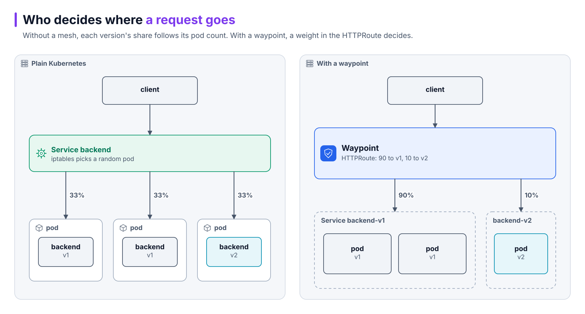

# Module 4: traffic routing

> New to a term here, like VirtualService or waypoint? The [glossary](glossary.md) explains every Istio resource and term in this course.

**Before this module:** modules 1 to 3.

**You need:** the lab running (`./scripts/start.sh` starts or repairs it) and `istioctl`.

A Kubernetes Service spreads requests evenly over its pods, which becomes a problem when you release a new version, because you want to choose who gets it. In this module the waypoint makes that choice instead, either by sending a fixed percentage to the new version or by routing on what the request contains.

## Concept: who decides where a request goes



On the left, without a mesh, each version gets the same share of traffic as its share of pods. The lab runs 2 v1 pods and 1 v2 pod, so v2 gets about 33%, and sending 10% to v2 would take 9 v1 pods for every v2 pod.

On the right, with a waypoint, the share becomes a number in a manifest that pod counts don't change. You write that number in an `HTTPRoute`, the Gateway API resource for HTTP routing, and two fields do the work:

- `parentRefs` points at the `backend` Service, which means "this route applies to traffic addressed to `backend`".
- `backendRefs` lists where that traffic actually goes, and how much of it.

```yaml
spec:
  parentRefs:
    - group: ""
      kind: Service
      name: backend          # traffic sent to backend:8000...
      port: 8000
  rules:
    - backendRefs:
        - name: backend-v1   # ...goes 90% here
          port: 8000
          weight: 90
        - name: backend-v2   # ...and 10% here
          port: 8000
          weight: 10
```

Two facts make this route work, and both surprise people.

First, only a waypoint reads an HTTPRoute whose parent is a Service. ztunnel never reads HTTP, so it ignores the route, which means that if you remove the `istio.io/use-waypoint` label from `backend`, the route stays in the cluster while traffic goes straight to the pods again, spread by pod count.

Second, the waypoint picks the pod itself, by looking up the pod IPs behind `backend-v1` and opening HBONE connections to them. Neither kube-proxy's ClusterIP rules nor the Service's own random choice plays any part in this hop, so the weights you write are the weights you get.

## Why this way

**Why Gateway API and not Istio's VirtualService?** Istio has had its own routing API, VirtualService and DestinationRule, since 2017, while Gateway API is the Kubernetes project's standard for the same job. Istio, Cilium, Envoy Gateway and others support it, so a route you write for Gateway API also works with those tools. Istio still needs VirtualService for a few features that Gateway API lacks, such as fault injection (module 5).

**Why one Service per version?** `backendRefs` points at Services rather than label selectors, so the lab gives each version its own Service, with `backend-v1` and `backend-v2` each selecting one version. Istio's VirtualService instead uses "subsets", groups of pods that a DestinationRule defines by label, and both approaches end at the same pods.

**Why weights in a route and not replica counts?** Replica count is a capacity decision, while traffic share is a release decision. If you mix them, the canary percentage moves every time you scale v1 for load.

**Why does the route attach to a Service and not to a Gateway?** In the mesh the "gateway" is the waypoint, which serves many Services, so attaching the route to the Service makes the rule follow the destination, whoever the caller is.

## The bigger picture: deploy is not release

Teams used to treat "deploy" and "release" as one step, so new code reached every user at once, and if it broke, everybody saw it break. A mesh pulls the two apart: first you deploy v2 so it runs next to v1, and then, as a separate decision, you choose who sees it.

Three common patterns use the tools you're about to try:

| Pattern | What you do | What you gain |
|---|---|---|
| Canary | Send a small share, say 10%, to v2. Watch its error rate and latency, then raise the share step by step. | A bad release hurts 10% of users for a few minutes instead of everyone. |
| Blue-green | Run two full copies. Move all traffic at once, with one weight change from 100/0 to 0/100. | Rolling back takes one more change. |
| Header routing, or dark launch | Send only requests with a header like `x-version: v2` to the new version. | Your testers use v2 in production while real users notice nothing. |

A weighted route picks a backend for every request on its own, so with a 90/10 split one user might hit v1, then v2, then v1 again within a single page load. An API rarely minds, but if v2 changed a website's layout, the site suddenly feels broken. To keep each user on one version, teams route on something stable, like a cookie or a user id header.

Keep the two directions of traffic apart, too. North-south traffic enters the cluster from outside, through the ingress gateway on port 8080 in this lab, while east-west traffic moves between services inside the cluster, through the waypoint. The canary route in this module sits on the east-west path, so it splits the frontend's calls to the backend no matter who started the request.

## Do it

Start steady traffic in a second terminal and leave it running during the module:

```console
$ ./platform-engineering/load.sh 900 /api/version 5
Sending about 5 requests per second to http://localhost:8080/api/version for 900s. Press Ctrl-C to stop.
```

**What you should see.** `Sending about 5 requests per second to http://localhost:8080/api/version for 900s. Press Ctrl-C to stop.`, and then nothing until the script ends and prints the status codes and backend versions it counted. It runs in the background while you work, so Prometheus and Kiali always have fresh numbers.

Open Kiali's **Traffic Graph** for namespace `shop`, set the graph type to "Versioned app", and in the Display menu turn on "Traffic Distribution" and "Traffic Animation". At first all traffic goes to `backend v1`.

**1. Canary: 90% to v1, 10% to v2.**

```console
$ kubectl apply -f manifests/scenarios/a-canary-httproute.yaml
httproute.gateway.networking.k8s.io/backend-route configured

$ ./scripts/traffic-test.sh 300 10 /api/version
Sending 300 requests to http://localhost:8080/api/version with concurrency 10

Status codes
  200  300  (100%)

Backend versions
  v1  267  (89%)
  v2  33  (11%)

Average latency 38 ms, slowest 179 ms
```

**What you should see.** `httproute.gateway.networking.k8s.io/backend-route configured`, then about 90% v1 and 10% v2.

Your numbers wobble around 270 and 30, because the waypoint rolls the dice for each request. The route already existed with 100% to v1, so `kubectl apply` changed it in place and the waypoint uses the new weights within a few seconds. In Kiali the `v2` edge starts to carry traffic after about a minute, because Kiali shows a rate over a one minute window and the edge appears once that window has data.

**2. Half and half.**

```console
$ kubectl apply -f platform-engineering/manifests/04-route-50-50.yaml
httproute.gateway.networking.k8s.io/backend-route configured

$ ./scripts/traffic-test.sh 300 10 /api/version
Sending 300 requests to http://localhost:8080/api/version with concurrency 10

Status codes
  200  300  (100%)

Backend versions
  v1  153  (51%)
  v2  147  (49%)

Average latency 36 ms, slowest 185 ms
```

**What you should see.** About 150 each: the lab got `v1 151` and `v2 149` in one run, and `v1 153` and `v2 147` in another. A minute later Kiali's two edges from the `backend` service node carry about the same rate, close to 2.5 requests per second each from the load script. In a real release, this is where you would watch v2's error rate and latency before going further.

### Concept: how the waypoint picks a rule

A route with several rules works like an `if ... else if ... else`: the waypoint takes the first rule whose `matches` fit the request and ignores the rest. A rule with no `matches` fits every request, so it acts as the `else`.

Gateway API fixes that order, and it doesn't always follow the order you wrote, because more specific matches win:

- An exact path beats a path prefix.
- A longer prefix beats a shorter one.
- Matches with more header conditions come before those with fewer.

So a catch-all rule written first doesn't swallow `/api/version`, and step 4 shows the order the waypoint really uses. Inside one rule the `weight` values from steps 1 and 2 still apply, which means matching picks the rule and then the weights pick the backend.

**3. Route by path, not by chance.**

```console
$ cat platform-engineering/manifests/04-route-by-path.yaml
# Route by request content, not by chance: /api/version always goes to v2,
# everything else stays on v1. Rules are matched most-specific first.
apiVersion: gateway.networking.k8s.io/v1
kind: HTTPRoute
metadata:
  name: backend-route
  namespace: shop
spec:
  parentRefs:
    - group: ""
      kind: Service
      name: backend
      port: 8000
  rules:
    - matches:
        - path:
            type: PathPrefix
            value: /api/version
      backendRefs:
        - name: backend-v2
          port: 8000
    - backendRefs:
        - name: backend-v1
          port: 8000

$ kubectl apply -f platform-engineering/manifests/04-route-by-path.yaml
httproute.gateway.networking.k8s.io/backend-route configured

$ ./scripts/traffic-test.sh 50 5 /api/version     # 50 of 50 to v2
Sending 50 requests to http://localhost:8080/api/version with concurrency 5

Status codes
  200  50  (100%)

Backend versions
  v2  50  (100%)

Average latency 72 ms, slowest 386 ms

$ ./scripts/traffic-test.sh 50 5 /api/orders      # 50 of 50 to v1
Sending 50 requests to http://localhost:8080/api/orders with concurrency 5

Status codes
  200  50  (100%)

Backend versions
  v1  50  (100%)

Average latency 29 ms, slowest 87 ms
```

**What you should see.** The first test reports `v2  50  (100%)` and the second reports `v1  50  (100%)`, because this time the path decides and the waypoint rolls no dice.

The route has two rules. The first matches the path prefix `/api/version` and sends it to v2, while the second has no match, so it catches everything else. A route also matches on a header, for example `matches: - headers: - name: x-canary, value: "true"`, which lets testers opt in to v2.

**4. See what the waypoint received.**

```console
$ istioctl proxy-config routes deploy/waypoint -n shop | grep -E "MATCH|backend.shop"
NAME                                                        VHOST NAME            DOMAINS     MATCH                       VIRTUAL SERVICE
inbound-vip|8000|http|backend.shop.svc.cluster.local        inbound|http|8000     *           /*                          backend-route-0-istio-autogenerated-k8s-gateway.shop
inbound-vip|8000|http|backend.shop.svc.cluster.local        inbound|http|8000     *           /*                          backend-route-0-istio-autogenerated-k8s-gateway.shop
inbound-vip|8000|http|backend.shop.svc.cluster.local        inbound|http|8000     *           PathPrefix:/api/version     backend-route-0-istio-autogenerated-k8s-gateway.shop
inbound-vip|8000|http|backend.shop.svc.cluster.local        inbound|http|8000     *           /*                          backend-route-0-istio-autogenerated-k8s-gateway.shop
inbound-vip|8000|http|backend.shop.svc.cluster.local        inbound|http|8000     *           /*                          backend-route-0-istio-autogenerated-k8s-gateway.shop
```

**What you should see.** One `PathPrefix:/api/version` row and several `/*` rows, and two things stand out.

First, `PathPrefix:/api/version` followed by `/*` are your two rules, in the order Envoy tries them: the path match first, then the catch-all.

Second, the VIRTUAL SERVICE column says `backend-route-0-istio-autogenerated-k8s-gateway`, because istiod translates every HTTPRoute into its own internal VirtualService form before it builds Envoy config. Gateway API is the interface, and Istio's older API is still the engine.

The extra rows, often lone `/*` lines, come from older versions of the route. A listener is the part of Envoy that accepts connections and holds the routes, and when istiod sends a new listener, Envoy keeps the previous one in a draining state until its open connections finish, so istioctl prints the routes of both. The waypoint's config dump confirms it: the listener `main_internal` has an `active_state` with the rules `/api/version` and `/`, and a `draining_state` with the old `/` only. Only the MATCH and VIRTUAL SERVICE columns matter here.

## Investigate

1. In Grafana, open the dashboard **Shop mesh and traffic experiments**, panel "Backend request rate by workload". Watch it while you move from step 1 to step 3. How long after `kubectl apply` does the graph change, and why does it take that long?
2. Break the route on purpose and find it two ways:

   ```console
   $ sed 's/name: backend-v2/name: backend-v3/' platform-engineering/manifests/04-route-by-path.yaml | kubectl apply -f -
   httproute.gateway.networking.k8s.io/backend-route configured
   ```

   In Kiali **Istio Config**, `backend-route` gets a red icon with `KIA1402 Reference doesn't have a valid service`. Without Kiali, the route's own status says the same:

   ```console
   $ kubectl -n shop get httproute backend-route -o jsonpath='{range .status.parents[0].conditions[*]}{.type}={.status} {.reason}{"\n"}{end}'
   Accepted=True Accepted
   ResolvedRefs=False BackendNotFound
   ```

   The status shows `Accepted=True`, which means the YAML is valid. But it also shows `ResolvedRefs=False BackendNotFound`. What happens to requests for `/api/version` meanwhile, and to `/api/orders`? Try it, then run `./platform-engineering/reset.sh`.
3. Why does `/api/orders` in step 3 still create orders correctly when v2 serves `/api/version`? What would go wrong if v1 and v2 used different Redis schemas?

<details>
<summary>Answers</summary>

1. The panel moves in steps of 15 seconds and settles about one minute after the apply. The lab tested this by switching from step 3, with all `/api/version` traffic on v2, to 50/50 while polling the panel's query:
   - The lines moved in jumps every 15 seconds.
   - They made their first clear move after about 40 seconds.
   - They met at the same rate after about 55 seconds.

   The waypoint switched at once, so the delay comes from the measuring side: Prometheus scrapes every 15 seconds, and the `rate(...[1m])` window still averages in old samples for a full minute.
2. `/api/version` fails with `500 Internal Server Error` on every request, while `/api/orders` keeps answering `200` from v1, because its rule still points at a real Service. With access logs on, the waypoint explains it with `"GET /api/version HTTP/1.1" 500 NC cluster_not_found`, where the `NC` flag means Envoy has no cluster, its name for an upstream service, for the route's target. A broken reference fails only the rule that uses it, so the damage stays hidden until someone calls that path.
3. Both versions read and write the same Redis, because their Deployments set the same `REDIS_HOST=redis.shop.svc.cluster.local`, so an order created through v1 shows up in v2 right away. The lab checked this with the 50/50 route: v1 handled one `POST`, and then every `GET /api/orders`, from v1 and from v2, returned `count` 1 with the same order.

   If v2 changed the data format, say with a new field type or a different key name, data written by one version would break or confuse the other. Before you split traffic for a schema change, you therefore need a format both versions understand, or a migration done in steps.

</details>

## Clean up

```console
$ ./platform-engineering/reset.sh
Removing course rules from the shop namespace
Applying the baseline Istio config from manifests/istio
Turning off the backend experiment settings
Asking ArgoCD to sync istio-config from Git
Done. Baseline: 100% of backend traffic to v1, no faults, no extra rules.
```
