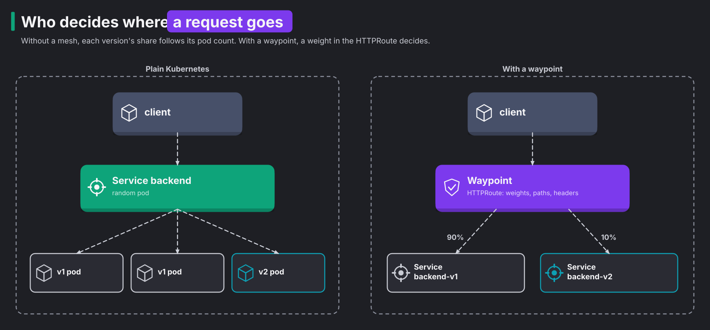

# Module 4: traffic routing

> New to a term here, like VirtualService or waypoint? The [glossary](glossary.md) explains every Istio resource and term in this course.

**Before this module:** modules 1 to 3.

**You need:** the lab running (`./scripts/start.sh` starts or repairs it) and `istioctl`.

A Kubernetes Service spreads requests evenly over its pods. That's a problem when you release a new version, because you want to choose who gets it. In this module the waypoint makes that choice instead. It sends a fixed percentage to the new version, or it routes by what the request contains.

## Concept: who decides where a request goes



The diagram shows both cases. On the left, without a mesh, each version gets the same share of traffic as its share of pods. The lab runs 2 v1 pods and 1 v2 pod, so v2 gets about 33%. To send 10% to v2, you would need 9 v1 pods for every v2 pod.

On the right, with a waypoint, the share is a number in a manifest. Pod counts don't change it. You write that number in an `HTTPRoute`, the Gateway API resource for HTTP routing. Two fields do the work:

- `parentRefs` points at the `backend` Service. In other words, "this route applies to traffic addressed to `backend`".
- `backendRefs` lists where that traffic actually goes, and how much of it.

```yaml
spec:
  parentRefs:
    - group: ""
      kind: Service
      name: backend          # traffic sent to backend:8000...
      port: 8000
  rules:
    - backendRefs:
        - name: backend-v1   # ...goes 90% here
          port: 8000
          weight: 90
        - name: backend-v2   # ...and 10% here
          port: 8000
          weight: 10
```

Two facts make this route work, and both surprise people.

First, only a waypoint reads an HTTPRoute whose parent is a Service. ztunnel never reads HTTP, so it ignores the route. If you remove the `istio.io/use-waypoint` label from `backend`, the route stays in the cluster. But traffic goes straight to the pods again, spread by pod count.

Second, the waypoint picks the pod itself. It looks up the pod IPs behind `backend-v1` and opens HBONE connections to them. kube-proxy's ClusterIP rules play no part in this hop. The Service's own random choice plays no part either.

## Why this way

**Why Gateway API and not Istio's VirtualService?** Istio has had its own routing API since 2017, made of VirtualService and DestinationRule. Gateway API is the Kubernetes project's standard for the same job. Istio, Cilium, Envoy Gateway and others support it. So a route you write for Gateway API also works with those other tools. Istio still needs VirtualService for a few features that Gateway API lacks, such as fault injection (module 5).

**Why one Service per version?** `backendRefs` points at Services, not at label selectors. So the lab gives each version its own Service. `backend-v1` and `backend-v2` each select one version. Istio's VirtualService works differently. It uses "subsets", groups of pods that a DestinationRule defines by label. Both approaches end at the same pods.

**Why weights in a route and not replica counts?** Replica count is a capacity decision. Traffic share is a release decision. If you mix them, the canary percentage moves every time you scale v1 for load.

**Why does the route attach to a Service and not to a Gateway?** In the mesh, the "gateway" is the waypoint, and the waypoint serves many Services. The route attaches to the Service, so the rule follows the destination, whoever the caller is.

## The bigger picture: deploy is not release

Teams used to treat "deploy" and "release" as one step. New code went out, and every user got it at once. If it broke, everybody saw it break. A mesh pulls those two steps apart. First you deploy v2, so it runs next to v1. Then, as a separate decision, you choose who sees it.

Three common patterns use the tools you're about to try:

| Pattern | What you do | What you gain |
|---|---|---|
| Canary | Send a small share, say 10%, to v2. Watch its error rate and latency, then raise the share step by step. | A bad release hurts 10% of users for a few minutes instead of everyone. |
| Blue-green | Run two full copies. Move all traffic at once, with one weight change from 100/0 to 0/100. | Rolling back takes one more change. |
| Header routing, or dark launch | Send only requests with a header like `x-version: v2` to the new version. | Your testers use v2 in production while real users notice nothing. |

One detail surprises people. A weighted route picks a backend for every request on its own. With a 90/10 split, one user might hit v1, then v2, then v1 again within a single page load. An API rarely minds. But if v2 changed a website's layout, the site suddenly feels broken. To keep each user on one version, teams route on something stable, like a cookie or a user id header.

Also keep the two directions of traffic apart in your head:

- North-south traffic enters the cluster from outside. In this lab it comes through the ingress gateway on port 8080.
- East-west traffic moves between services inside the cluster. In this lab it goes through the waypoint.

The canary route in this module sits on the east-west path. It splits the frontend's calls to the backend, no matter who started the request.

## Do it

Start steady traffic in a second terminal and leave it running during the module:

```bash
./platform-engineering/load.sh 900 /api/version 5
```

**What you should see.** You see `Sending about 5 requests per second to http://localhost:8080/api/version for 900s. Press Ctrl-C to stop.` Then the script prints nothing until it ends. At the end, it prints the status codes and backend versions it counted. It runs in the background while you work, so Prometheus and Kiali always have fresh numbers.

Open Kiali's **Traffic Graph** for namespace `shop`. Set the graph type to "Versioned app". In the Display menu, turn on "Traffic Distribution" and "Traffic Animation". At first, all traffic goes to `backend v1`.

**1. Canary: 90% to v1, 10% to v2.**

```bash
kubectl apply -f manifests/scenarios/a-canary-httproute.yaml
./scripts/traffic-test.sh 300 10 /api/version
```

**What you should see.** You see `httproute.gateway.networking.k8s.io/backend-route configured`, then:

```text
Status codes
  200  300  (100%)

Backend versions
  v1  271  (90%)
  v2  29  (10%)
```

Your numbers wobble around 270 and 30, because the waypoint rolls the dice for each request. The route already existed with 100% to v1. So `kubectl apply` changed it in place, and the waypoint uses the new weights within a few seconds. In Kiali, the `v2` edge starts to carry traffic after about a minute. Kiali shows a rate over a one minute window, so the edge appears once that window has data.

**2. Half and half.**

```bash
kubectl apply -f platform-engineering/manifests/04-route-50-50.yaml
./scripts/traffic-test.sh 300 10 /api/version
```

**What you should see.** You see about 150 each. The lab got `v1 151` and `v2 149`. A minute later, Kiali's two edges from the `backend` service node carry about the same rate. Each carries close to 2.5 requests per second from the load script. In a real release, this is where you would watch v2's error rate and latency before going further.

### Concept: how the waypoint picks a rule

A route with several rules works like an `if ... else if ... else`. The waypoint takes the first rule whose `matches` fit the request and ignores the rest. A rule with no `matches` fits every request, so it acts as the `else`.

Gateway API fixes the order, and it is not always the order you wrote. More specific matches win:

- An exact path beats a path prefix.
- A longer prefix beats a shorter one.
- Matches with more header conditions come before those with fewer.

So a catch-all rule written first does not swallow `/api/version`. Step 4 shows the order the waypoint really uses.

Inside one rule, the `weight` values from steps 1 and 2 still apply. Matching picks the rule, and then the weights pick the backend.

**3. Route by path, not by chance.**

```bash
cat platform-engineering/manifests/04-route-by-path.yaml
kubectl apply -f platform-engineering/manifests/04-route-by-path.yaml
./scripts/traffic-test.sh 50 5 /api/version     # 50 of 50 to v2
./scripts/traffic-test.sh 50 5 /api/orders      # 50 of 50 to v1
```

**What you should see.** The first test reports `v2  50  (100%)`, and the second reports `v1  50  (100%)`. The waypoint rolls no dice this time. The path decides.

The route has two rules. The first matches the path prefix `/api/version` and sends it to v2. The second has no match, so it catches everything else. A route also matches on a header, for example `matches: - headers: - name: x-canary, value: "true"`. That lets testers opt in to v2.

**4. See what the waypoint received.**

```bash
istioctl proxy-config routes deploy/waypoint -n shop | grep -E "MATCH|backend.shop"
```

**What you should see.** You see rows like these, and probably a few more:

```text
NAME                                                  VHOST NAME          DOMAINS  MATCH                    VIRTUAL SERVICE
inbound-vip|8000|http|backend.shop.svc.cluster.local  inbound|http|8000   *        PathPrefix:/api/version  backend-route-0-istio-autogenerated-k8s-gateway.shop
inbound-vip|8000|http|backend.shop.svc.cluster.local  inbound|http|8000   *        /*                       backend-route-0-istio-autogenerated-k8s-gateway.shop
```

Notice two things.

First, `PathPrefix:/api/version` followed by `/*` are your two rules. They appear in the order Envoy tries them, the path match first and then the catch-all.

Second, the VIRTUAL SERVICE column says `backend-route-0-istio-autogenerated-k8s-gateway`. istiod translates every HTTPRoute into its own internal VirtualService form. Only then does it build Envoy config. In other words, Gateway API is the interface, and Istio's older API is still the engine.

The extra rows, often lone `/*` lines, come from older versions of the route. A listener is the part of Envoy that accepts connections and holds the routes. When istiod sends a new listener, Envoy keeps the previous one for a while. The old one stays in a draining state until its open connections finish. istioctl prints the routes of both.

The waypoint's config dump shows this. The listener `main_internal` has an `active_state` with the rules `/api/version` and `/`. It also has a `draining_state` with the old `/` only. Only the MATCH and VIRTUAL SERVICE columns matter here.

## Investigate

1. In Grafana, open the dashboard **Shop mesh and traffic experiments**, panel "Backend request rate by workload". Watch it while you move from step 1 to step 3. How long after `kubectl apply` does the graph change, and why does it take that long?
2. Break the route on purpose and find it two ways:

   ```bash
   sed 's/name: backend-v2/name: backend-v3/' platform-engineering/manifests/04-route-by-path.yaml | kubectl apply -f -
   ```

   In Kiali **Istio Config**, `backend-route` gets a red icon with `KIA1402 Reference doesn't have a valid service`. Without Kiali, the route's own status says the same:

   ```bash
   kubectl -n shop get httproute backend-route -o jsonpath='{range .status.parents[0].conditions[*]}{.type}={.status} {.reason}{"\n"}{end}'
   ```

   The status shows `Accepted=True`, which means the YAML is valid. But it also shows `ResolvedRefs=False BackendNotFound`. What happens to requests for `/api/version` meanwhile, and to `/api/orders`? Try it, then run `./platform-engineering/reset.sh`.
3. Why does `/api/orders` in step 3 still create orders correctly when v2 serves `/api/version`? What would go wrong if v1 and v2 used different Redis schemas?

<details>
<summary>Answers</summary>

1. The panel moves in steps of 15 seconds and settles about one minute after the apply. The lab tested this. It switched from step 3, with all `/api/version` traffic on v2, to 50/50, and it polled the panel's query. Here is what it saw:
   - The lines moved in jumps every 15 seconds.
   - They made their first clear move after about 40 seconds.
   - They met at the same rate after about 55 seconds.

   The waypoint switched at once. The delay has two causes. Prometheus scrapes every 15 seconds. And the `rate(...[1m])` window still averages in old samples for a full minute.
2. `/api/version` fails with `500 Internal Server Error` on every request. `/api/orders` keeps answering `200` from v1, because its rule still points at a real Service. With access logs on, the waypoint explains it with `"GET /api/version HTTP/1.1" 500 NC cluster_not_found`. The `NC` flag means Envoy has no cluster for the route's target. A cluster is Envoy's name for an upstream service. A broken reference fails only the rule that uses it, not the whole route. So the damage stays hidden until someone calls that path.
3. Both versions read and write the same Redis. Their Deployments set the same `REDIS_HOST=redis.shop.svc.cluster.local`. If you create an order through v1, v2 lists it right away. The lab checked this with the 50/50 route. v1 handled one `POST`. Then every `GET /api/orders`, from v1 and from v2, returned `count` 1 with the same order.

   Now suppose v2 changed the data format, say with a new field type or a different key name. Then data written by one version would break or confuse the other. Before you split traffic for a schema change, you need a format both versions understand, or a migration done in steps.

</details>

## Clean up

```bash
./platform-engineering/reset.sh
```
