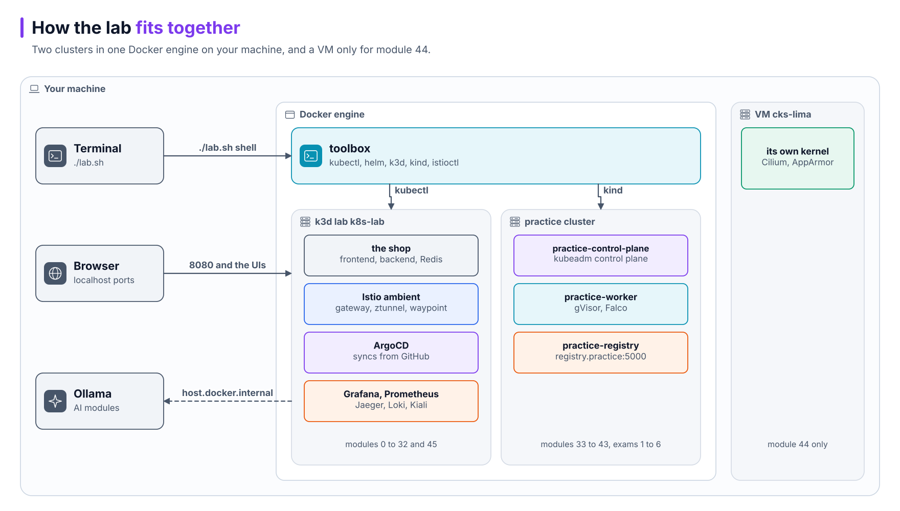

# Module 1.1: setup

> New to a term? The [glossary](../glossary.md) explains every term in this course.

**Before this module:** the [quick start](../../README.md#quick-start), which builds the lab and opens a shell in the toolbox.

**You need:** Docker, git and a browser. The toolbox brings kubectl, helm, k3d, kind and istioctl, so nothing else needs installing on your machine.

The course runs on two clusters in one Docker engine, and every track uses one of them, so this module checks the lab, opens its web UIs and builds the practice cluster next to it. You end with both clusters healthy and know which one each track needs. It takes about 15 minutes.



The picture shows the two clusters side by side. The lab, `k8s-lab`, holds the shop and every platform tool, and tracks 2, 3 and 5 run there. The practice cluster holds nothing but two kubeadm nodes, because tracks 1 and 4 hand you timed tasks that need a cluster built the way teams build one by hand.

## 1. Check the lab

```console
$ ./lab.sh start               # safe to run any time, repairs the cluster after a reboot
Cluster k8s-lab is running and CoreDNS is healthy.
kubectl context is k3d-k8s-lab
Waiting for istio-cni and ztunnel
Waiting for every pod to become Ready (up to 3 minutes)
All pods are Ready. The shop is at http://localhost:8080. Run ./lab.sh ui for the other UIs.

$ kubectl -n argocd get applications
NAME                    SYNC STATUS   HEALTH STATUS
alloy                   Synced        Healthy
cert-manager            Synced        Healthy
cert-manager-config     Synced        Healthy
headlamp                Synced        Healthy
istio-config            Synced        Healthy
kiali                   Synced        Healthy
kube-prometheus-stack   Synced        Healthy
loki                    Synced        Healthy
observability-config    Synced        Healthy
root                    Synced        Healthy
shop-apps               Synced        Healthy
shop-base               Synced        Healthy
```

**What you should see.** All twelve Applications show `Synced` and `Healthy`. ArgoCD installs every part of the lab from Git and reports any drift on this list, so one line in another state tells you which part to look at first.

## 2. Open the web UIs

Start the UIs in a spare terminal and leave it running, because Ctrl-C closes them:

```console
$ ./lab.sh ui
ArgoCD      http://localhost:8081
Grafana     http://localhost:3000
Prometheus  http://localhost:9090
Alertmanager http://localhost:9093
Jaeger      http://localhost:16686
Kiali       http://localhost:20001
Headlamp    http://localhost:4466

Port-forwards are running. Press Ctrl-C to stop.
```

**What you should see.** Seven addresses, and each one opens in your browser. The [guide](../../README.md#logins-and-addresses) lists the logins. Keep Headlamp open in a tab, because it shows every pod with its logs and events in one place and needs no login.

## 3. Build the practice cluster

Tracks 1 and 4 run on the practice cluster. It takes about 3 minutes the first time, and running it again only checks that it is healthy:

```console
$ ./lab.sh practice up
...
practice-control-plane   Ready    control-plane   101m   v1.37.1   ...
practice-worker          Ready    <none>          101m   v1.37.1   ...

Work on the control plane the way the exam does, from a shell on the node:
  ./lab.sh practice shell            # then: kubectl get nodes
  ./lab.sh practice shell worker     # for node tasks on the worker
```

The application modules of track 1 also build images and install charts, so add the application extras: podman and helm on the nodes, a local image registry, and metrics-server.

```console
$ ./platform-engineering/practice/app-extras/extras.sh
=== 1/2 tools in the node image, and the registry container
helm v4.3.1+gc0d08d0, podman version 5.4.2, kubectl-convert present
{"repositories":[]}

=== 2/2 metrics-server 0.9.1
NAME                     CPU(cores)   CPU(%)   MEMORY(bytes)   MEMORY(%)
practice-control-plane   179m         1%       842Mi           7%
practice-worker          142m         0%       461Mi           3%

=== ready
```

**What you should see.** Two nodes at `Ready` on v1.37.1, then a `kubectl top` table with both nodes. That table proves metrics-server works, and the empty `repositories` list proves the registry answers. In the test run the extras took 26 seconds.

## 4. Run one task

Every module of tracks 1 and 4 hands you timed tasks with an id of three numbers, track, module and task, so `1.2.3` is task 3 of module 1.2. A short dry run shows the loop you repeat for each one:

```console
$ ./lab.sh task setup 1.2.3
$ ./lab.sh practice shell      # solve it on the node, then exit
$ ./lab.sh task check 1.2.3
$ ./lab.sh task solve 1.2.3
```

`setup` prepares the starting state, `check` prints PASS or FAIL for each thing the task asks, and `solve` applies the reference solution, so you always end on a working state. [Timed tasks and exam preparation](../timed-tasks.md) has the terminal habits that save the most time.

## Where to go next

Each track starts from here and needs no other track, so pick the one that matches what you want to learn. Track 1 continues with [module 1.2](02-building-and-running-applications.md). The [guide's course tables](../../README.md#the-course) list every track with the cluster it runs on.

## Clean up

Nothing to clean. Both clusters keep running in Docker after you close the shell, and `./lab.sh stop` frees the lab's memory until `./lab.sh start` brings it back.
