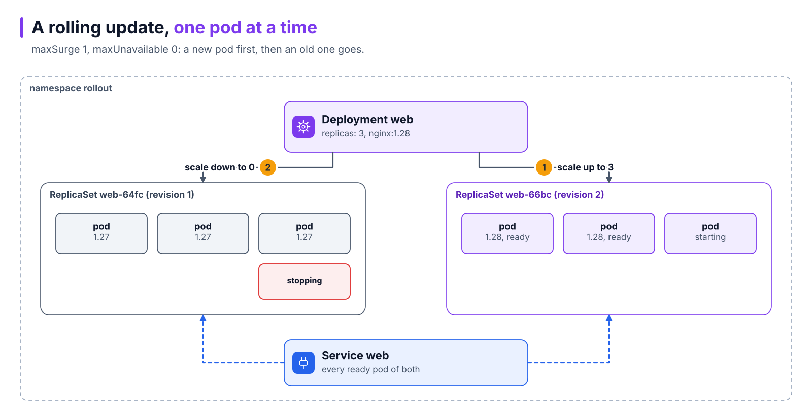
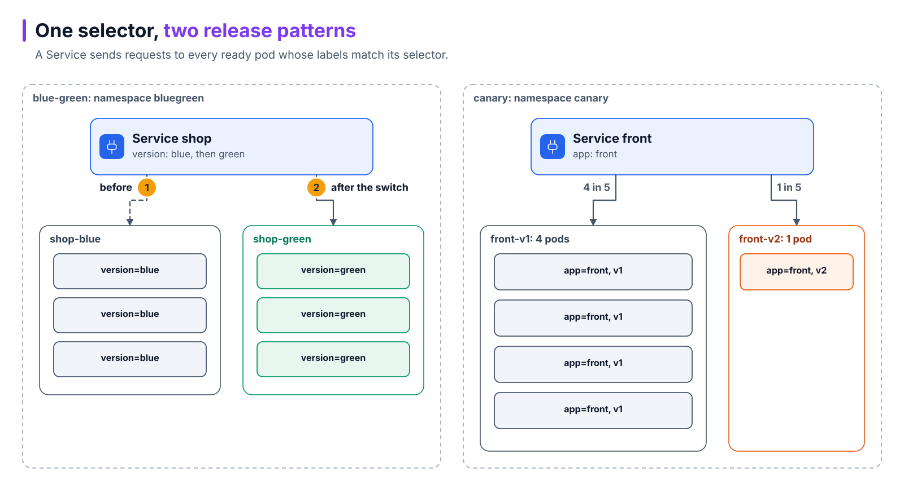

# Module 1.3: Deploying and updating applications

> New to a term here, like ReplicaSet or Helm release? The [glossary](../glossary.md#applications-on-kubernetes) explains every term these modules use.

**Before this module:** [module 1.2](02-building-and-running-applications.md), for pods and Deployments, and the [practice cluster](../practice-cluster.md#the-application-extras) with the application extras, because tasks 5 to 7 install Helm charts from the local registry.

Getting version 1 of an application running is the easy part, because every later version has to replace a running one while users keep sending requests. This module is about that replacement: how a Deployment swaps old pods for new ones and takes a bad version back, how two versions run side by side for a blue-green switch or a canary, and how Helm and Kustomize turn one set of manifests into many installations. It has ten tasks and takes about 1 hour 30 minutes.

## The module in one table

| Question | Tool | Task |
|---|---|---|
| How does a new version replace the old one, and how do I undo it? | a Deployment's rolling update, `rollout undo` | 1, 2, 10 |
| How do I switch all users to a new version at once? | blue-green with two Deployments and one Service | 3 |
| How do I send a few users to a new version first? | a canary: two Deployments behind one Service | 4 |
| How do I install someone else's application? | a Helm chart | 5, 6, 7 |
| How do I keep one set of manifests for several environments? | a Kustomize base with overlays | 8, 9 |

## Concept: a Deployment changes versions through ReplicaSets

Take Deployment `web` from task 1, three nginx pods at version 1.27. You want version 1.28 without a moment where no pod answers, and if 1.28 breaks you want 1.27 back within seconds. Deleting the three pods and creating three new ones would leave a gap, and keeping no record of the old version would leave nothing to go back to.

A Deployment solves both problems with one extra layer. It never manages pods itself: it creates a [ReplicaSet](../glossary.md#replicaset) for each version of its pod template, and the ReplicaSet keeps a number of identical pods alive. A change to the template, such as a new image, makes the Deployment create a second ReplicaSet and then shift the pod count from the old one to the new one in small steps, which is a [rolling update](../glossary.md#rolling-update).



Two numbers set the size of each step, and both count against the desired replica count of 3:

1. `maxSurge` says how many pods may exist above 3 during the update, so `maxSurge: 1` lets a fourth pod start before an old one stops.
2. `maxUnavailable` says how many of the 3 may be missing, so `maxUnavailable: 0` keeps three ready pods at all times.
3. With `1` and `0`, the update starts one new pod, waits until it is ready, stops one old pod, and repeats until the old ReplicaSet reaches zero.

The default of 25% for both rounds to one surge pod and zero unavailable pods for three replicas. The old ReplicaSet stays behind with zero pods, and that empty ReplicaSet is the record of the old version. `kubectl rollout undo` scales it up again, which is why a rollback finishes in seconds: the template is still there, and so are the images on the node. `revisionHistoryLimit`, 10 by default, sets how many old ReplicaSets the Deployment keeps.

Each ReplicaSet carries a revision number in an annotation, and `kubectl rollout history` lists them. A rollback doesn't add a copy of the old template: it moves the old ReplicaSet to the top with a new number. In task 1, an undo to revision 2 made it revision 4, and revision 2 vanished from the list, which surprises people who expect the numbers to stay put.

The pod readiness check from [module 1.4](04-observing-and-debugging-applications.md#concept-three-probes-three-questions) decides when a new pod counts as ready, so a pod that never becomes ready stops the update half way, with the old pods still serving. That makes a broken image a safe failure: task 1 starts with one pod in `ImagePullBackOff` and three old pods still running. `minReadySeconds` adds a waiting time on top, so a pod must stay ready for that long before the update moves on, which catches an app that starts and then crashes after a few seconds.

Every change to the template starts a new rollout at once, so three `kubectl set` commands in a row would create three ReplicaSets. `kubectl rollout pause` stops the Deployment from acting on template changes, and `kubectl rollout resume` then rolls all of them out as one revision, which task 10 measures.

The `Recreate` strategy is the other choice: it stops all old pods first and then starts the new ones. That leaves a gap, but some applications need it, for example one that holds a lock on a file or a database schema that two versions must never share. Task 2 switches to it.

## Concept: two versions side by side

A rolling update mixes the old and the new version for a while, and it gives you no say over who gets which. Two release patterns take that control back, and both use nothing more than labels, because a Service sends requests to every ready pod whose labels match its selector, whatever Deployment created the pod.



In a [blue-green](../glossary.md#blue-green-deployment) release, version blue serves all users while version green starts next to it as a second Deployment with its own label, `version: green`. Nobody reaches green yet, because the Service's selector names `version: blue`. Once green is ready and tested, one change to the selector moves every request to green at once, and switching back is the same change in reverse. Task 3 does this with Service `shop`, which is like moving a train to a second track by throwing one switch rather than rebuilding the rails under it.

A [canary](../glossary.md#canary-release) release sends only a small share of the requests to the new version. The Service selects a label that both versions carry, `app: front`, so its endpoints hold the pods of both Deployments, and kube-proxy spreads connections roughly evenly over all endpoints. The share follows the pod counts: four v1 pods and one v2 pod give v2 about a fifth of the requests, which task 4 measured as 4 of 20. A mesh like Istio sets the share by weight instead of pod count, which the course's [module 3.14](../3-istio/14-istio-api.md) shows, but the exam asks for the plain Kubernetes version.

A Deployment's own selector must stay distinct in both patterns, because two Deployments whose selectors match the same pods would each count the other's pods as their own. So each Deployment selects its version label too, `app: shop, version: green`, while the Service selects only what the release pattern needs.

## Concept: Helm installs packaged applications

An application from someone else, such as a database or a monitoring stack, comes as dozens of manifests with values that differ per installation: the image tag, the replica count, the Service type. Editing the vendor's YAML by hand for every installation breaks the next time the vendor ships an update, so the YAML needs placeholders and a tool that fills them in.

[Helm](../glossary.md#helm) is that tool. A [chart](../glossary.md#helm-chart) is a folder of manifest templates plus a `values.yaml` file with the defaults, and `helm install` renders the templates with the defaults, merges in what you set with `--set` or `-f my-values.yaml`, and applies the result. The installation gets a name, the [release](../glossary.md#helm-release), and every install, upgrade or rollback adds a numbered revision to it.

Helm stores each revision as a Secret in the release's namespace, named like `sh.helm.release.v1.blog.v4`, which holds the rendered manifests and the values. That storage gives Helm its two most useful commands. `helm history` lists the revisions with their status, chart version and description, and `helm rollback blog 1` applies the manifests of revision 1 again as a new revision. Task 6 does both on a release whose last upgrade set a wrong image tag.

Charts come from a [chart repository](../glossary.md#chart-repository), which you add with `helm repo add NAME URL`, or from an OCI registry, the same kind of registry that stores images. The practice cluster keeps its chart `webapp` at `oci://registry.practice:5000/charts/webapp`, so a full reference names the chart and its version, and `--plain-http` allows the registry's plain HTTP:

```bash
helm show values oci://registry.practice:5000/charts/webapp --version 0.1.0 --plain-http
helm -n helm-shop install shop oci://registry.practice:5000/charts/webapp --version 0.1.0 --plain-http --set replicaCount=2
```

With a repository, the same install reads `helm install shop myrepo/webapp --version 0.1.0`. The commands the exam asks for are few:

| Command | What it does |
|---|---|
| `helm list -A` | every release in every namespace, with status and chart version |
| `helm show values CHART` | the chart's defaults, which tell you the names to set |
| `helm install NAME CHART -n NS --set k=v -f file.yaml` | a new release |
| `helm upgrade NAME CHART --version X --reuse-values --set k=v` | a new revision of an existing release |
| `helm get values NAME --revision N` | what the user set for one revision |
| `helm history NAME`, `helm rollback NAME N` | the revisions, and a return to one of them |
| `helm uninstall NAME` | deletes the release and everything it created |
| `helm repo add`, `helm repo update`, `helm search repo` | manage and search chart repositories |

`helm upgrade` without `--reuse-values` starts from the chart's defaults again and drops what earlier revisions set, which is the most common surprise in an upgrade task. The practice cluster runs Helm 4.3.1, where `helm list` shows releases of every status and the `-a` flag of Helm 3 no longer exists; on an exam host with Helm 3, `helm list -a` shows the failed and pending releases that plain `helm list` hides.

## Concept: Kustomize patches one base for many environments

Kustomize solves the same problem as Helm from the other side. Helm puts placeholders into the YAML, and Kustomize keeps the YAML plain and describes changes to it. A [base](../glossary.md#kustomize-base) folder holds ordinary manifests and a `kustomization.yaml` that lists them, and an [overlay](../glossary.md#kustomize-overlay) folder points at the base and lists what to change for one environment.

Take the `web` Deployment and Service of task 8. Production wants them in namespace `kust-prod`, with names that start with `prod-`, three replicas, nginx 1.28, and the label `env=prod` on everything. The overlay says exactly that:

```yaml
resources:
- ../../base
namespace: kust-prod
namePrefix: prod-
labels:
- pairs:
    env: prod
  includeTemplates: true
replicas:
- name: web
  count: 3
images:
- name: nginx
  newTag: 1.28-alpine
```

Kustomize is built into `kubectl`, so `kubectl kustomize DIR` prints the result and `kubectl apply -k DIR` applies it. The base never changes, and a staging overlay next to production changes the same base in other ways. For changes that the built-in fields don't cover, a `patches` entry merges a partial manifest into the object with the same kind and name, like a transparent sheet laid over a printed page. A `configMapGenerator` creates a ConfigMap whose name ends with a hash of its content, and Kustomize rewrites every reference to it, so a new value means a new name and the Deployment rolls out new pods by itself.

Both fixes of task 9 come from these two mechanisms. A patch whose `metadata.name` matches no object in the base stops the build, and a generator in the overlay with the same name as one in the base needs `behavior: merge` or `behavior: replace`.

## The bigger picture: releases as data

Every tool in this module turns a release into data that the cluster keeps: ReplicaSets for Deployments, Secrets for Helm revisions, and folders of plain YAML for Kustomize. Keeping the history as data is what makes a rollback cheap, because going back means pointing at something that still exists rather than rebuilding it.

GitOps tools such as Argo CD, which the course's [module 2.6](../2-observability/06-gitops-with-argocd.md) installs, push the same idea one step further. They render Helm charts and Kustomize overlays from a Git repository and apply the result, so Git holds the history and a rollback is a `git revert`. Progressive delivery tools such as Argo Rollouts and Flagger automate the canary of task 4: they shift the share in steps and roll back when the error rate rises.

## Why this way

A Deployment works through ReplicaSets because the two jobs differ. Keeping N pods alive is a simple loop, and moving from one version to another is a plan over time, so each object does one of them.

Blue-green and canary use labels rather than a special object because a Service already selects pods by label, so the release pattern needs no new machinery and works on every cluster.

Helm and Kustomize both exist because they suit different owners. A vendor ships a Helm chart with documented values, and a team that owns its YAML keeps it plain and patches it with Kustomize, and many teams render a vendor's chart and then patch it with Kustomize.

## Task 1: Roll back a broken update

**Time budget:** 6 minutes. **Host:** `practice-control-plane`.

```console
$ ./lab.sh task setup 1.3.1
== setup task 1.3.1
NAME                   READY   STATUS         RESTARTS   AGE
web-64fc786fb9-2z4bf   1/1     Running        0          13s
web-64fc786fb9-dpmmn   1/1     Running        0          9s
web-64fc786fb9-ztshs   1/1     Running        0          9s
web-66bcf8cdf5-tgch9   0/1     ErrImagePull   0          8s
```

> Deployment `web` in namespace `rollout` got an update that doesn't start.
> 1. Roll it back to the last revision that worked, nginx `1.28-alpine`.
> 2. Make future updates start at most one extra pod and never take a pod away before its replacement is ready.
> 3. Record the change cause `rollback to 1.28-alpine` on the Deployment.

<details>
<summary>Solution</summary>

The history shows three revisions without causes, and `--revision=2` shows the template of one revision, so you find the working one without guessing:

```console
root@practice-control-plane:~# k -n rollout rollout history deploy web
deployment.apps/web 
REVISION  CHANGE-CAUSE
1         <none>
2         <none>
3         <none>

root@practice-control-plane:~# k -n rollout rollout history deploy web --revision=2 | grep Image
    Image:	nginx:1.28-alpine
root@practice-control-plane:~# k -n rollout rollout undo deploy web --to-revision=2
deployment.apps/web rolled back
root@practice-control-plane:~# k -n rollout patch deploy web -p '{"spec":{"strategy":{"rollingUpdate":{"maxSurge":1,"maxUnavailable":0}}}}'
deployment.apps/web patched
root@practice-control-plane:~# k -n rollout annotate deploy web kubernetes.io/change-cause='rollback to 1.28-alpine'
deployment.apps/web annotated
root@practice-control-plane:~# k -n rollout rollout status deploy web
deployment "web" successfully rolled out
root@practice-control-plane:~# k -n rollout rollout history deploy web
deployment.apps/web 
REVISION  CHANGE-CAUSE
1         <none>
3         <none>
4         rollback to 1.28-alpine

```

The three old pods ran 1.28 the whole time, because the broken pod never became ready, so the undo only deleted the broken pod. Revision 2 became revision 4, as the concept section explains. A plain `rollout undo` without `--to-revision` goes back exactly one revision, which here means revision 2 as well, but naming the revision is safer when you read the history first. The patch and the annotation change only the Deployment, not its pod template, so neither starts another rollout.

</details>

```console
$ ./lab.sh task check 1.3.1
== check task 1.3.1
  PASS  Deployment web runs nginx:1.28-alpine again
  PASS  all 3 replicas are ready and up to date
  PASS  the strategy is maxSurge 1, maxUnavailable 0
  PASS  the change-cause says 'rollback to 1.28-alpine'
== task 1.3.1: 4 passed, 0 failed
```

## Task 2: Recreate instead of a rolling update

**Time budget:** 5 minutes. **Host:** `practice-control-plane`.

> Deployment `worker` in namespace `strategy` must never run two versions at once. Change its strategy to `Recreate`, run 4 replicas, keep only 2 old ReplicaSets, and count a new pod as available only after it has been ready for 5 seconds. Then roll out a new version by setting the environment variable `VERSION=2`.

<details>
<summary>Solution</summary>

One merge patch sets all four fields. The `rollingUpdate` block must go when the type becomes `Recreate`, and `null` in a merge patch deletes it, because the API server refuses a `Recreate` Deployment that still has one:

```console
root@practice-control-plane:~# k -n strategy patch deploy worker -p '{"spec":{"strategy":{"type":"Recreate","rollingUpdate":null},"replicas":4,"revisionHistoryLimit":2,"minReadySeconds":5}}'
deployment.apps/worker patched
root@practice-control-plane:~# k -n strategy set env deploy/worker VERSION=2
deployment.apps/worker env updated
root@practice-control-plane:~# k -n strategy get pods
NAME                      READY   STATUS        RESTARTS   AGE
worker-84fb7df9d5-9bvhb   0/1     Terminating   0          0s
worker-84fb7df9d5-frv4t   0/1     Terminating   0          0s
worker-84fb7df9d5-h5njt   1/1     Terminating   0          1s
worker-84fb7df9d5-nmndc   1/1     Terminating   0          1s
root@practice-control-plane:~# k -n strategy rollout status deploy worker
Waiting for deployment "worker" rollout to finish: 0 out of 4 new replicas have been updated...
...
Waiting for deployment "worker" rollout to finish: 0 of 4 updated replicas are available...
deployment "worker" successfully rolled out
```

All four old pods terminate before any new pod exists, which is the gap `Recreate` accepts. The gap lasted about 30 seconds in the test run, because the `sleep` process ignores SIGTERM and the kubelet waits for the grace period, and `minReadySeconds` then added 5 more before the rollout counted the pods as available.

</details>

```console
$ ./lab.sh task check 1.3.2
== check task 1.3.2
  PASS  Deployment worker uses the Recreate strategy
  PASS  4 replicas, 2 old ReplicaSets kept, a pod counts as available after 5 seconds
  PASS  the container has the variable VERSION=2
  PASS  4 pods are available
== task 1.3.2: 4 passed, 0 failed
```

## Task 3: Blue-green

**Time budget:** 8 minutes. **Host:** `practice-control-plane`.

```console
$ ./lab.sh task setup 1.3.3
== setup task 1.3.3
NAME                        READY   UP-TO-DATE   AVAILABLE   AGE
deployment.apps/shop-blue   3/3     3            3           1s

NAME           TYPE        CLUSTER-IP      EXTERNAL-IP   PORT(S)   AGE
service/shop   ClusterIP   10.104.27.246   <none>        80/TCP    1s
```

> In namespace `bluegreen`, Service `shop` sends traffic to Deployment `shop-blue`, whose pods answer `blue`.
> 1. Create Deployment `shop-green`, a copy of `shop-blue` with 3 pods labelled `version=green` that answer `green`.
> 2. When it is ready, switch Service `shop` to it in one step.
> 3. Scale `shop-blue` to 0 but keep it, so a switch back stays possible.

<details>
<summary>Solution</summary>

Copy the blue Deployment with `k -n bluegreen get deploy shop-blue -o yaml > /opt/apps/2.3/green.yaml`, delete the `status` block and the server fields `uid`, `resourceVersion`, `creationTimestamp` and the revision annotation, and change four places: the name, the label in the selector, the label in the template, and the word in the command:

```console
root@practice-control-plane:~# grep -n -E 'name: shop|version|echo' /opt/apps/2.3/green.yaml
4:  name: shop-green
13:      version: green
23:        version: green
29:        - mkdir -p /www && echo green > /www/index.html && exec httpd -f -p 8080 -h
root@practice-control-plane:~# k apply -f /opt/apps/2.3/green.yaml
deployment.apps/shop-green created
root@practice-control-plane:~# k -n bluegreen rollout status deploy shop-green
Waiting for deployment "shop-green" rollout to finish: 0 of 3 updated replicas are available...
Waiting for deployment "shop-green" rollout to finish: 1 of 3 updated replicas are available...
Waiting for deployment "shop-green" rollout to finish: 2 of 3 updated replicas are available...
deployment "shop-green" successfully rolled out
root@practice-control-plane:~# k -n bluegreen patch svc shop -p '{"spec":{"selector":{"version":"green"}}}'
service/shop patched
root@practice-control-plane:~# k -n bluegreen exec client -- wget -qO- http://shop
green
root@practice-control-plane:~# k -n bluegreen scale deploy shop-blue --replicas=0
deployment.apps/shop-blue scaled
root@practice-control-plane:~# k -n bluegreen get deploy
NAME         READY   UP-TO-DATE   AVAILABLE   AGE
shop-blue    0/0     0            0           4s
shop-green   3/3     3            3           1s
```

The merge patch changes only the `version` key of the selector and keeps `app: shop`. A selector that kept `version: blue` and added nothing would still match only blue pods, so always read the selector back with `k get svc shop -o jsonpath='{.spec.selector}'` after the switch.

</details>

```console
$ ./lab.sh task check 1.3.3
== check task 1.3.3
  PASS  Service shop answers 'green' on every call
  PASS  Deployment shop-green has 3 ready pods labelled version=green
  PASS  Deployment shop-blue still exists, scaled to 0
== task 1.3.3: 3 passed, 0 failed
```

## Task 4: A canary with a fifth of the traffic

**Time budget:** 7 minutes. **Host:** `practice-control-plane`.

```console
$ ./lab.sh task setup 1.3.4
== setup task 1.3.4
NAME                       READY   UP-TO-DATE   AVAILABLE   AGE   CONTAINERS   IMAGES         SELECTOR
deployment.apps/front-v1   4/4     4            4           1s    web          busybox:1.36   app=front,track=stable

NAME            TYPE        CLUSTER-IP     EXTERNAL-IP   PORT(S)   AGE   SELECTOR
service/front   ClusterIP   10.96.46.198   <none>        80/TCP    1s    app=front
```

> In namespace `canary`, Service `front` sends traffic to Deployment `front-v1` (4 pods, answer `v1`). Add Deployment `front-v2`, whose pods answer `v2` and carry the labels `app=front` and `track=canary`, so that it gets about 20% of the requests to `front` while `front-v1` keeps its 4 pods.

<details>
<summary>Solution</summary>

The Service selects only `app=front`, so a fifth pod with that label joins its endpoints. Copy `front-v1` as in task 3, set `replicas: 1`, change `track` to `canary` in the selector and the template, and change the answer:

```console
root@practice-control-plane:~# k -n canary get svc front -o jsonpath='{.spec.selector}{"\n"}'
{"app":"front"}
root@practice-control-plane:~# grep -n -E 'name: front|replicas|track|echo' /opt/apps/2.4/canary.yaml
4:  name: front-v2
8:  replicas: 1
13:      track: canary
23:        track: canary
29:        - mkdir -p /www && echo v2 > /www/index.html && exec httpd -f -p 8080 -h /www
root@practice-control-plane:~# k apply -f /opt/apps/2.4/canary.yaml
deployment.apps/front-v2 created
root@practice-control-plane:~# k -n canary rollout status deploy front-v2
Waiting for deployment "front-v2" rollout to finish: 0 of 1 updated replicas are available...
deployment "front-v2" successfully rolled out
root@practice-control-plane:~# k -n canary get pods -l app=front -L track
NAME                        READY   STATUS    RESTARTS   AGE   TRACK
front-v1-7947b7697b-68d26   1/1     Running   0          5s    stable
front-v1-7947b7697b-mmz9f   1/1     Running   0          5s    stable
front-v1-7947b7697b-wsdwf   1/1     Running   0          5s    stable
front-v1-7947b7697b-zptth   1/1     Running   0          5s    stable
front-v2-5979d6fffb-jc79k   1/1     Running   0          1s    canary
root@practice-control-plane:~# for i in $(seq 1 20); do k -n canary exec client -- wget -qO- http://front; done | sort | uniq -c
     16 v1
      4 v2
```

Four of 20 requests reached v2 in the test run, exactly the fifth that the pod counts promise; another run gives a slightly different split, because kube-proxy picks an endpoint at random for each connection. The selector `track=canary` keeps the two Deployments apart, so neither counts the other's pods.

</details>

```console
$ ./lab.sh task check 1.3.4
== check task 1.3.4
  PASS  Deployment front-v2 has 1 ready pod labelled app=front, track=canary
  PASS  front-v1 keeps 4 ready pods
  PASS  Service front sends traffic to all 5 pods
  PASS  40 calls to front get answers from both v1 and v2
== task 1.3.4: 4 passed, 0 failed
```

## Task 5: Install a Helm chart from a registry

**Time budget:** 5 minutes. **Host:** `practice-control-plane`.

```console
$ ./lab.sh task setup 1.3.5
== setup task 1.3.5
Pulled: registry.practice:5000/charts/webapp:0.1.0
Digest: sha256:c3e28adbe840a3d0a19966f3ca79ada291977947ad625d5e7886c4cc4bd8e984
apiVersion: v2
appVersion: 1.27-alpine
description: A Helm chart for Kubernetes
name: webapp
type: application
version: 0.1.0
```

> Install the chart `oci://registry.practice:5000/charts/webapp`, version 0.1.0, as release `shop` in namespace `helm-shop`, with 2 replicas and a Service of type NodePort. The registry speaks plain HTTP.

<details>
<summary>Solution</summary>

Read the chart's defaults first, because the names to set come from its `values.yaml`, and every chart names them differently:

```console
root@practice-control-plane:~# helm show values oci://registry.practice:5000/charts/webapp --version 0.1.0 --plain-http 2>/dev/null | grep -E '^replicaCount|^  type:|^  port:'
replicaCount: 1
  type: ClusterIP
  port: 80
root@practice-control-plane:~# helm -n helm-shop install shop oci://registry.practice:5000/charts/webapp --version 0.1.0 --plain-http --set replicaCount=2 --set service.type=NodePort
Pulled: registry.practice:5000/charts/webapp:0.1.0
Digest: sha256:c3e28adbe840a3d0a19966f3ca79ada291977947ad625d5e7886c4cc4bd8e984
NAME: shop
LAST DEPLOYED: Fri Nov 20 10:56:07 2026
NAMESPACE: helm-shop
STATUS: deployed
REVISION: 1
DESCRIPTION: Install complete
...
root@practice-control-plane:~# helm -n helm-shop list
NAME	NAMESPACE	REVISION	UPDATED                                	STATUS  	CHART       	APP VERSION
shop	helm-shop	1       	2026-11-20 10:56:07.101458693 +0000 UTC	deployed	webapp-0.1.0	1.27-alpine
root@practice-control-plane:~# k -n helm-shop get deploy,svc
NAME                          READY   UP-TO-DATE   AVAILABLE   AGE
deployment.apps/shop-webapp   2/2     2            2           1s

NAME                  TYPE       CLUSTER-IP       EXTERNAL-IP   PORT(S)        AGE
service/shop-webapp   NodePort   10.105.191.104   <none>        80:32532/TCP   1s
```

`type` sits under `service:` in the values, so the path to set is `service.type`, with a dot for each level. The chart names its objects `RELEASE-CHART`, here `shop-webapp`. `-n helm-shop` matters as much as for `kubectl`, because a release lives in one namespace, and `helm list` without `-n` or `-A` shows only the current one.

</details>

```console
$ ./lab.sh task check 1.3.5
== check task 1.3.5
  PASS  release shop in helm-shop is deployed from chart webapp 0.1.0
  PASS  its Deployment has 2 ready replicas
  PASS  its Service is a NodePort
== task 1.3.5: 3 passed, 0 failed
```

## Task 6: Roll a release back, then upgrade it

**Time budget:** 7 minutes. **Host:** `practice-control-plane`.

```console
$ ./lab.sh task setup 1.3.6
== setup task 1.3.6
NAME                           READY   STATUS         RESTARTS   AGE
blog-webapp-5b77b696fc-fpllj   1/1     Running        0          6s
blog-webapp-777cbcdb9d-rkhg4   0/1     ErrImagePull   0          5s
```

> The last upgrade of release `blog` in namespace `helm-blog` broke its pods. Roll the release back to the revision that worked, then upgrade it to chart version 0.2.0 with 3 replicas, keeping the values of the working revision.

<details>
<summary>Solution</summary>

`helm get values` shows what an upgrade set, which tells you what went wrong:

```console
root@practice-control-plane:~# helm -n helm-blog history blog
REVISION	UPDATED                 	STATUS    	CHART       	APP VERSION	DESCRIPTION
1       	Fri Nov 20 10:45:31 2026	superseded	webapp-0.1.0	1.27-alpine	Install complete
2       	Fri Nov 20 10:45:32 2026	deployed  	webapp-0.1.0	1.27-alpine	Upgrade complete
root@practice-control-plane:~# helm -n helm-blog get values blog --revision 2
USER-SUPPLIED VALUES:
image:
  tag: 1.27-alpne
root@practice-control-plane:~# helm -n helm-blog rollback blog 1
Rollback was a success! Happy Helming!
root@practice-control-plane:~# helm -n helm-blog upgrade blog oci://registry.practice:5000/charts/webapp --version 0.2.0 --plain-http --reuse-values --set replicaCount=3
Pulled: registry.practice:5000/charts/webapp:0.2.0
Digest: sha256:e429001804a82b1c104e38c12e0cf294e94dc110037ff63fec6d5c56285b3e6c
Release "blog" has been upgraded. Happy Helming!
NAME: blog
LAST DEPLOYED: Fri Nov 20 10:47:08 2026
NAMESPACE: helm-blog
STATUS: deployed
REVISION: 4
DESCRIPTION: Upgrade complete
...
root@practice-control-plane:~# k -n helm-blog rollout status deploy blog-webapp
...
deployment "blog-webapp" successfully rolled out
root@practice-control-plane:~# helm -n helm-blog history blog
REVISION	UPDATED                 	STATUS    	CHART       	APP VERSION	DESCRIPTION
1       	Fri Nov 20 10:45:31 2026	superseded	webapp-0.1.0	1.27-alpine	Install complete
2       	Fri Nov 20 10:45:32 2026	superseded	webapp-0.1.0	1.27-alpine	Upgrade complete
3       	Fri Nov 20 10:47:08 2026	superseded	webapp-0.1.0	1.27-alpine	Rollback to 1
4       	Fri Nov 20 10:47:08 2026	deployed  	webapp-0.2.0	1.28-alpine	Upgrade complete
```

Helm reported revision 2 as `deployed` although its pods never started, because without `--wait` Helm only checks that the API server accepted the manifests. The rollback became revision 3 with the description `Rollback to 1`. `--reuse-values` took revision 3's values, which are revision 1's empty set, so the broken tag stayed gone; a chart's new default for the image tag, `1.28-alpine` from its `appVersion`, then took effect.

</details>

```console
$ ./lab.sh task check 1.3.6
== check task 1.3.6
  PASS  the latest revision of blog is deployed from chart webapp 0.2.0
  PASS  Deployment blog-webapp has 3 ready replicas
  PASS  no image tag 1.27-alpne is left
  PASS  the history shows a rollback to revision 1
== task 1.3.6: 4 passed, 0 failed
```

## Task 7: Helm housekeeping

**Time budget:** 6 minutes. **Host:** `practice-control-plane`.

```console
$ ./lab.sh task setup 1.3.7
== setup task 1.3.7
NAME   	NAMESPACE	REVISION	UPDATED                                	STATUS  	CHART       	APP VERSION
cache  	helm-ops 	1       	2026-11-20 10:52:26.363165592 +0000 UTC	failed  	webapp-0.1.0	1.27-alpine
old-api	helm-ops 	1       	2026-11-20 10:52:26.06449185 +0000 UTC 	deployed	webapp-0.1.0	1.27-alpine
reports	helm-ops 	1       	2026-11-20 10:52:26.217139703 +0000 UTC	deployed	webapp-0.1.0	1.27-alpine
```

> In namespace `helm-ops`:
> 1. Uninstall release `old-api`.
> 2. Find the release in the `failed` state and uninstall it.
> 3. Install chart `webapp` version 0.2.0 from `oci://registry.practice:5000/charts` as release `metrics-ui`, with the values in `/opt/apps/2.7/values.yaml`.
>
> Leave release `reports` alone.

<details>
<summary>Solution</summary>

```console
root@practice-control-plane:~# helm -n helm-ops uninstall old-api
release "old-api" uninstalled
root@practice-control-plane:~# helm -n helm-ops list --failed
NAME 	NAMESPACE	REVISION	UPDATED                                	STATUS	CHART       	APP VERSION
cache	helm-ops 	1       	2026-11-20 10:52:26.363165592 +0000 UTC	failed	webapp-0.1.0	1.27-alpine
root@practice-control-plane:~# helm -n helm-ops uninstall cache
release "cache" uninstalled
root@practice-control-plane:~# helm -n helm-ops install metrics-ui oci://registry.practice:5000/charts/webapp --version 0.2.0 --plain-http -f /opt/apps/2.7/values.yaml
Pulled: registry.practice:5000/charts/webapp:0.2.0
Digest: sha256:e429001804a82b1c104e38c12e0cf294e94dc110037ff63fec6d5c56285b3e6c
NAME: metrics-ui
LAST DEPLOYED: Fri Nov 20 10:52:42 2026
NAMESPACE: helm-ops
STATUS: deployed
REVISION: 1
DESCRIPTION: Install complete
...
root@practice-control-plane:~# k -n helm-ops rollout status deploy metrics-ui-webapp
...
deployment "metrics-ui-webapp" successfully rolled out
root@practice-control-plane:~# helm -n helm-ops list
NAME      	NAMESPACE	REVISION	UPDATED                                	STATUS  	CHART       	APP VERSION
metrics-ui	helm-ops 	1       	2026-11-20 10:52:42.168351479 +0000 UTC	deployed	webapp-0.2.0	1.28-alpine
reports   	helm-ops 	1       	2026-11-20 10:52:26.217139703 +0000 UTC	deployed	webapp-0.1.0	1.27-alpine
```

The release `cache` failed because its install used `--wait` with an image tag that doesn't exist, so Helm waited 15 seconds for ready pods and then marked the release `failed`. `helm uninstall` removes the release's objects and its history Secrets; `--keep-history` would keep the history for a later `helm rollback`. In Helm 3, plain `helm list` hides failed and pending releases, so use `helm list -a` there, while Helm 4 lists every status by default.

</details>

```console
$ ./lab.sh task check 1.3.7
== check task 1.3.7
  PASS  release old-api is gone
  PASS  no release in helm-ops is in the failed state
  PASS  release metrics-ui is deployed from chart webapp 0.2.0
  PASS  metrics-ui runs 2 pods labelled team=observability that request 20m CPU
  PASS  release reports still runs
== task 1.3.7: 5 passed, 0 failed
```

## Task 8: A Kustomize overlay for production

**Time budget:** 8 minutes. **Host:** `practice-control-plane`.

```console
$ ./lab.sh task setup 1.3.8
== setup task 1.3.8
/opt/apps/2.8/base/deployment.yaml
/opt/apps/2.8/base/service.yaml
/opt/apps/2.8/base/kustomization.yaml
```

> `/opt/apps/2.8/base` holds a Deployment and a Service named `web` with nginx `1.27-alpine` and one replica. Without changing the base, create an overlay in `/opt/apps/2.8/overlays/prod` that deploys them into namespace `kust-prod` with the name prefix `prod-`, 3 replicas, nginx `1.28-alpine`, and the label `env=prod` on the objects and on the pods. Apply it.

<details>
<summary>Solution</summary>

The overlay is the `kustomization.yaml` from the concept section. `includeTemplates: true` puts the label into the pod template as well, while plain `labels` without it touch only the objects' own metadata. Render it first and read the result, then apply:

```console
root@practice-control-plane:~# cd /opt/apps/2.8/overlays/prod
root@practice-control-plane:~# k kustomize . | grep -E 'name:|namespace:|env:|replicas:|image:'
    env: prod
  name: prod-web
  namespace: kust-prod
    env: prod
  name: prod-web
  namespace: kust-prod
  replicas: 3
        env: prod
      - image: nginx:1.28-alpine
        name: nginx
root@practice-control-plane:~# k apply -k .
service/prod-web created
deployment.apps/prod-web created
root@practice-control-plane:~# k -n kust-prod rollout status deploy prod-web
...
deployment "prod-web" successfully rolled out
root@practice-control-plane:~# k -n kust-prod get deploy,svc --show-labels
NAME                       READY   UP-TO-DATE   AVAILABLE   AGE   LABELS
deployment.apps/prod-web   3/3     3            3           1s    env=prod

NAME               TYPE        CLUSTER-IP       EXTERNAL-IP   PORT(S)   AGE   LABELS
service/prod-web   ClusterIP   10.101.162.227   <none>        80/TCP    1s    env=prod
```

`replicas` and `images` refer to the base's names, `web` and `nginx`, not to the prefixed ones, because Kustomize applies the prefix last. The older field `commonLabels` still works but also rewrites selectors, which breaks a Deployment that already exists, so `labels` is the safer choice.

</details>

```console
$ ./lab.sh task check 1.3.8
== check task 1.3.8
  PASS  Deployment prod-web runs in kust-prod with 3 ready replicas
  PASS  it runs nginx:1.28-alpine
  PASS  the Deployment, its pods and Service prod-web carry env=prod
  PASS  the overlay lives in /opt/apps/2.8/overlays/prod and the base is unchanged
== task 1.3.8: 4 passed, 0 failed
```

## Task 9: Repair a Kustomize overlay

**Time budget:** 8 minutes. **Host:** `practice-control-plane`.

```console
$ ./lab.sh task setup 1.3.9
== setup task 1.3.9
error: merging from generator &{0x318ba94db790 <nil>}: id resid.ResId{Gvk:resid.Gvk{Group:"", Version:"v1", Kind:"ConfigMap", isClusterScoped:false}, Name:"api-config", Namespace:""} exists; can not use behavior: 'unspecified', behavior must be merge or replace
```

> The overlay `/opt/apps/2.9/overlays/staging` fails to build. Repair it so that Deployment `staging-api` in namespace `kust-staging` gets a memory limit of 64Mi from the overlay's patch and runs with `MODE=staging` from the generated ConfigMap. Save the rendered overlay to `/opt/apps/2.9/staging.yaml` and apply it.

<details>
<summary>Solution</summary>

The build stops at the first error, so expect two rounds. The first error names the generator: the base already generates `api-config`, so the overlay's generator must say how to combine the two. The second, which appears after that fix, would be the patch: its `metadata.name` is `api-server`, and the base has only `api`:

```console
root@practice-control-plane:~# cd /opt/apps/2.9/overlays/staging
root@practice-control-plane:~# sed -i 's/name: api-server/name: api/' limits.yaml
root@practice-control-plane:~# sed -i '/^configMapGenerator:/,/MODE=staging/s/  literals:/  behavior: merge\n  literals:/' kustomization.yaml
root@practice-control-plane:~# cat kustomization.yaml
resources:
- ../../base
namespace: kust-staging
namePrefix: staging-
configMapGenerator:
- name: api-config
  behavior: merge
  literals:
  - MODE=staging
patches:
- path: limits.yaml
root@practice-control-plane:~# k kustomize . > /opt/apps/2.9/staging.yaml
root@practice-control-plane:~# grep -E 'MODE|name: staging|memory' /opt/apps/2.9/staging.yaml
  MODE: staging
  name: staging-api-config-7t6ch9d7dd
  name: staging-api
        - echo mode=$MODE; sleep 1d
            name: staging-api-config-7t6ch9d7dd
            memory: 64Mi
root@practice-control-plane:~# k apply -k .
configmap/staging-api-config-7t6ch9d7dd created
deployment.apps/staging-api created
root@practice-control-plane:~# k -n kust-staging logs deploy/staging-api
mode=staging
```

The ConfigMap's name ends with a hash of its content, `7t6ch9d7dd`, and Kustomize wrote the same name into the Deployment's `envFrom`. `vim` is the faster tool for both fixes in the exam; the `sed` lines only keep the transcript short.

</details>

```console
$ ./lab.sh task check 1.3.9
== check task 1.3.9
  PASS  Deployment staging-api in kust-staging has a limit of 64Mi memory
  PASS  its pod logs mode=staging
  PASS  /opt/apps/2.9/staging.yaml holds the rendered overlay
== task 1.3.9: 3 passed, 0 failed
```

## Task 10: Three changes, one new revision

**Time budget:** 5 minutes. **Host:** `practice-control-plane`.

```console
$ ./lab.sh task setup 1.3.10
== setup task 1.3.10
NAME             DESIRED   CURRENT   READY   AGE
api-776fc4695b   2         2         2       1s
```

> Deployment `api` in namespace `paused` needs three changes: image `nginx:1.28-alpine`, the variable `TIER=backend`, and a memory limit of 128Mi. Make them with `kubectl set` so that the Deployment rolls out exactly one new ReplicaSet, and record the change cause `nginx 1.28, tier and limit`.

<details>
<summary>Solution</summary>

Pause first, then change, then resume. While the Deployment stays paused, the template changes and no ReplicaSet appears:

```console
root@practice-control-plane:~# k -n paused rollout pause deploy api
deployment.apps/api paused
root@practice-control-plane:~# k -n paused set image deploy/api nginx=nginx:1.28-alpine
deployment.apps/api image updated
root@practice-control-plane:~# k -n paused set env deploy/api TIER=backend
deployment.apps/api env updated
root@practice-control-plane:~# k -n paused set resources deploy/api --limits=memory=128Mi
deployment.apps/api resource requirements updated
root@practice-control-plane:~# k -n paused annotate deploy api kubernetes.io/change-cause='nginx 1.28, tier and limit'
deployment.apps/api annotated
root@practice-control-plane:~# k -n paused get rs
NAME             DESIRED   CURRENT   READY   AGE
api-776fc4695b   2         2         2       1s
root@practice-control-plane:~# k -n paused rollout resume deploy api
deployment.apps/api resumed
root@practice-control-plane:~# k -n paused rollout status deploy api
...
deployment "api" successfully rolled out
root@practice-control-plane:~# k -n paused rollout history deploy api
deployment.apps/api 
REVISION  CHANGE-CAUSE
1         <none>
2         nginx 1.28, tier and limit

root@practice-control-plane:~# k -n paused get rs
NAME             DESIRED   CURRENT   READY   AGE
api-776fc4695b   0         0         0       3s
api-c95d5bd89    2         2         2       2s
```

The history copies the Deployment's `change-cause` annotation into the new ReplicaSet when it creates it, so annotate before the resume, or the new revision shows `<none>`. Without the pause, the same three commands would have created three ReplicaSets and three rollouts one after the other.

</details>

```console
$ ./lab.sh task check 1.3.10
== check task 1.3.10
  PASS  Deployment api: nginx:1.28-alpine, TIER=backend, memory limit 128Mi
  PASS  the three changes made exactly one new ReplicaSet (revision 2)
  PASS  the rollout is resumed and both pods are ready
  PASS  the change-cause of revision 2 is 'nginx 1.28, tier and limit'
== task 1.3.10: 4 passed, 0 failed
```

## Clean up

`./platform-engineering/practice/app-extras/reset.sh` deletes the namespaces with their Helm releases, because Helm keeps each release's history as Secrets inside the namespace, and empties the chart store in the local registry.
