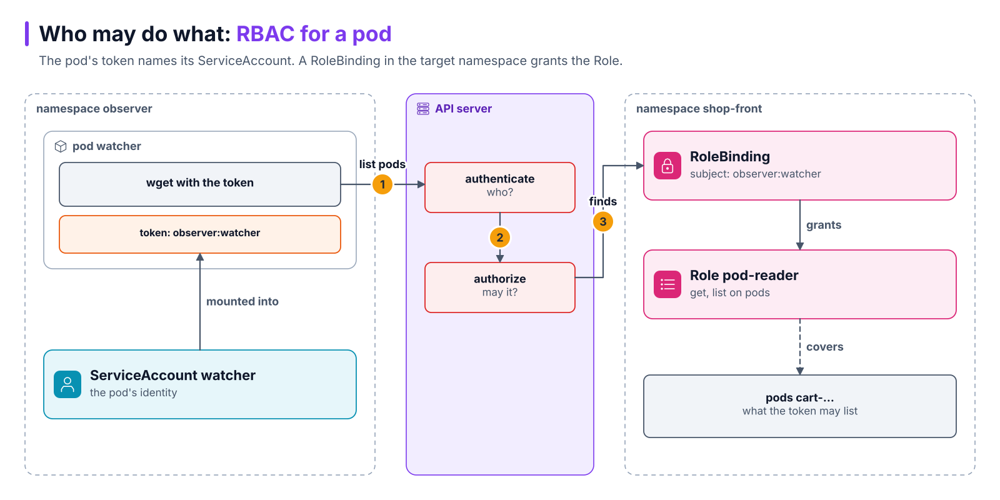

# Module 1.5: Configuration and secrets

> New to a term here, like ResourceQuota or RoleBinding? The [glossary](../glossary.md#applications-on-kubernetes) explains every term these modules use.

**Before this module:** [module 1.2](02-building-and-running-applications.md) for pods and Deployments, and the [practice cluster](../practice-cluster.md#the-application-extras). [Module 4.4](../4-security/04-hardening-workloads.md) goes deeper into security contexts and Pod Security, and [module 4.2](../4-security/02-hardening-access-to-the-api.md) into RBAC.

The same image runs in testing and in production, which means everything that differs between the two has to come from outside the image: settings, passwords, how much CPU the app gets, and which API calls it may make. This module is about that outside layer. It covers ConfigMaps and Secrets, requests and limits with the namespace rules that enforce them, ServiceAccounts and RBAC for the app's own API calls, the security context, and resources that extend Kubernetes itself. It is the largest of the five application modules, has twelve tasks, and takes about 1 hour 45 minutes.

## The module in one table

| Question | Tool | Task |
|---|---|---|
| Where do settings live, outside the image? | a ConfigMap, as variables or files | 1, 3 |
| Where do passwords live? | a Secret | 2 |
| How much CPU and memory does a container get? | requests and limits | 4 |
| What happens to a container that names none? | a LimitRange fills in defaults | 5 |
| How much may a whole team use? | a ResourceQuota | 4, 6 |
| Who is the app when it calls the API? | a ServiceAccount and its token | 7, 9 |
| What may that identity do? | a Role and a RoleBinding | 8, 9 |
| How much power does the container's process have? | the security context, Pod Security | 10, 12 |
| How do I use a resource type that Kubernetes didn't ship? | a CustomResourceDefinition | 11 |

## Concept: configuration outside the image

Take the shop app of task 1, which reads its currency and page size from `app.properties` and its log level from a variable. Baking those values into the image means one image per environment, and a new build for every changed setting. So the values travel separately, in a [ConfigMap](../glossary.md#configmap): an object that holds keys and values, either short strings or whole files, which the API server stores like any other object.

A pod reads a ConfigMap in one of two ways, and the choice decides what happens when the ConfigMap changes later:

| Way | In the pod spec | A change to the ConfigMap |
|---|---|---|
| one variable | `env[].valueFrom.configMapKeyRef` | reaches the container only after a restart |
| every key as a variable | `envFrom[].configMapRef` | reaches the container only after a restart |
| every key as a file | a `configMap` volume and a `volumeMount` | appears in the file within about a minute |
| one key as one file | a volume with `items`, or a mount with `subPath` | `subPath` never updates; `items` does |

Variables never change after the process starts, because the kernel copies them into the process once, at start. Files in a ConfigMap volume do change, because the kubelet rewrites them in place, but the app must read the file again to notice. Task 3 takes the route that most teams settle on: it never changes a ConfigMap in place. A new ConfigMap with a new name, marked `immutable: true`, goes into the Deployment's template, and the template change rolls out new pods by itself, while the old ConfigMap stays as the way back. An immutable ConfigMap also spares the kubelet from watching it for changes, which matters in clusters with thousands of them.

A [Secret](../glossary.md#secret) works exactly like a ConfigMap, with the same variables, volumes and `items`, but it holds passwords, tokens and keys. Its values sit in the object as [base64](../glossary.md#base64), an encoding that only keeps binary data safe in YAML and that anyone reverses with `base64 -d`. So a Secret is not encrypted by default, and the protection comes from elsewhere: RBAC keeps most users from reading Secrets, and encryption at rest in etcd, which the [CKS track](../4-security/04-hardening-workloads.md#concept-secrets-at-rest) sets up, protects the stored copy.

A Secret mounted as a file is safer than one in a variable, because variables leak easily: a crash report, a debug endpoint or `kubectl describe` on the process shows the whole environment. A file with `defaultMode: 0400` is readable only by the file's owner, and it updates in place when the Secret changes. Task 2 uses a variable for the user name, which is no secret, and a file for the password.

## Concept: requests, limits and the namespace's rules

Every container shares a node with other containers, so two numbers per resource say how much of the node it gets, and different parts of the cluster act on each:

1. The **request** is what the container is sure to get. The scheduler adds up the requests of the pods on each node and places a new pod only on a node whose free capacity covers its requests.
2. The **limit** is the most the container may use. The kernel enforces it on the node through cgroups: a container at its CPU limit waits for the next time slice, and a container above its memory limit gets killed, with `OOMKilled` as the reason.
3. A container without numbers uses whatever is free and gets evicted first when the node runs short.

The kubelet sorts pods into three [QoS classes](../glossary.md#qos-class) from these numbers, which decide who goes first when a node runs out of memory. A pod whose every container has requests equal to its limits is `Guaranteed` and goes last, a pod with some numbers is `Burstable`, and a pod with none is `BestEffort` and goes first. CPU counts in cores, so `100m` means a tenth of one core, and memory counts in bytes with suffixes, where `Mi` means mebibytes and `M` megabytes.


Two namespace objects turn these numbers into rules, and both act at admission, before the pod exists:

1. A [LimitRange](../glossary.md#limitrange) sets defaults for containers that name no numbers, and minimum and maximum values for those that do. A pod without resources in a namespace with a LimitRange gets the defaults written into its spec, which task 5 shows.
2. A [ResourceQuota](../glossary.md#resourcequota) caps the totals of a namespace: the sum of all requests and limits, and the number of pods, Services, ConfigMaps and other objects. Each new pod adds to the totals, and a pod that would push one past its `hard` value gets refused with `exceeded quota`.

The quota has a side effect that task 4 starts from. Once a quota caps `requests.cpu` or `limits.memory`, every new pod in the namespace must name that resource, because the API server has no number to add to the total for a field that is missing. A Deployment without resources in such a namespace then shows `0/3` ready, no pods at all, and the reason appears only as an event on its ReplicaSet. A LimitRange next to the quota avoids that, because its defaults fill the gap before the quota counts.

## Concept: who the app is, and what it may do

A pod that calls the Kubernetes API, such as a CI runner that deploys or a dashboard that lists pods, has to prove who it is, and the API server must decide what that identity may do. Both steps happen on every request, in the order the API server's chain runs them.

The identity is a [ServiceAccount](../glossary.md#serviceaccount), an account for a program rather than a person, and every namespace has one called `default`. The kubelet mounts a short-lived token for the pod's ServiceAccount at `/var/run/secrets/kubernetes.io/serviceaccount/token`, and renews it before it expires. The token is a signed JWT whose subject names the account, `system:serviceaccount:NAMESPACE:NAME`, so the API server knows who calls without any password. `automountServiceAccountToken: false` on the pod or the ServiceAccount leaves the token out, which suits every pod that never calls the API, and `kubectl create token NAME --duration=2h` issues a token for use outside a pod.

The permissions come from [RBAC](../glossary.md#rbac), role-based access control, in two objects that work like a job description and a hiring contract:

1. A [Role](../glossary.md#role) lists rules, each a set of verbs (`get`, `list`, `watch`, `create`, `update`, `patch`, `delete`) on a set of resources in one API group, inside one namespace.
2. A [RoleBinding](../glossary.md#rolebinding) in the same namespace gives a Role to subjects: users, groups or ServiceAccounts, and the ServiceAccounts may come from any namespace.
3. A ClusterRole and a ClusterRoleBinding do the same for the whole cluster, and a RoleBinding may also grant a ClusterRole inside its one namespace, which lets you reuse one rule set in many namespaces.



RBAC only adds permissions and never takes them away, so everything that no rule allows stays forbidden, and the API server answers `403 Forbidden`. Task 9 starts from exactly that error in a pod's log. The figure shows the fix: the RoleBinding lives in the namespace whose pods the watcher lists, `shop-front`, not in the watcher's own namespace, because a RoleBinding grants rights only where it sits. `kubectl auth can-i list pods -n shop-front --as=system:serviceaccount:observer:watcher` asks the API server the same question without running the pod, and answers `yes` or `no`.

[Admission control](../glossary.md#admission-controller) is the third step, after authentication and authorization. Admission plugins inspect, and sometimes change, an object that the user may create, before the API server stores it. LimitRange and ResourceQuota are admission plugins, and so is [Pod Security Admission](../glossary.md#pod-security-admission), which refuses pods that break a namespace's Pod Security level. Task 12 meets the `restricted` level, whose refusal again appears only as a ReplicaSet event.

## Concept: the security context

A container's process runs as some user, with some Linux capabilities, on some file system, and the defaults are generous: an image without a `USER` line runs as root, keeps a dozen capabilities, and may write anywhere in its own file system. The [security context](../glossary.md#security-context) is the part of the pod spec that narrows those defaults, with fields at two levels:

| Field | Level | Effect |
|---|---|---|
| `runAsUser`, `runAsGroup` | pod or container | the user and group IDs of the process |
| `runAsNonRoot: true` | pod or container | the kubelet refuses to start a container that would run as user 0 |
| `fsGroup` | pod | volumes get this group, and the process gets it as an extra group |
| `allowPrivilegeEscalation: false` | container | no child process ever gains more rights, for example through `sudo` |
| `capabilities.drop: [ALL]`, `add: [...]` | container | removes Linux capabilities, the slices of root's power |
| `readOnlyRootFilesystem: true` | container | the image's file system becomes read-only; write to volumes instead |
| `seccompProfile.type: RuntimeDefault` | pod or container | blocks rarely needed system calls |

A container-level field overrides the same field at pod level, so the pod sets the common values and one container may differ. Task 10 sets most of the table on one Deployment and then reads the result with `id`, which prints `uid=1000 gid=3000 groups=2000,3000`: the user, the group, and the `fsGroup` as an extra group. A read-only root needs a writable `emptyDir` wherever the app writes, `/tmp` in task 10.

## Concept: resources that extend Kubernetes

Kubernetes knows pods, Services and Deployments out of the box, but a team that runs databases wants objects like `Backup` or `PostgresCluster`, with fields that make sense for them. A [CustomResourceDefinition](../glossary.md#customresourcedefinition), or CRD, adds such a type to the API server: it names the type, its group and version, and an OpenAPI schema that every object of the type must match. After that, `kubectl get backups`, `kubectl explain backup.spec` and `kubectl apply` work on the new type like on any built-in one, and the API server stores [custom resources](../glossary.md#custom-resource) in etcd.

A custom resource on its own does nothing, because no controller acts on it. An [operator](../glossary.md#operator) is a controller that does: a program in a pod that watches the custom resources of its type and makes the world match them, for example by running a backup Job every night for each `Backup`. The course already runs several, such as Istio's control plane and Kyverno, which the [topic map](../timed-tasks.md#appendix-where-the-lab-modules-explain-each-topic) points to. The exam asks you to use them, not to write them, so the skills are discovery and use: `kubectl get crd`, `kubectl api-resources --api-group=GROUP`, `kubectl explain`, and a manifest that passes the schema. Task 11 follows that order.

## The bigger picture: the platform owns the outside of the box

Everything in this module lets a platform team set rules once and lets app teams live inside them. A namespace for a team comes with a quota and a LimitRange, a Pod Security level, a ServiceAccount per app with exactly the RBAC it needs, and ConfigMaps and Secrets that a GitOps tool writes from a repository or a secret manager. The image stays the same everywhere, and the outside layer turns it into a test or a production deployment.

The direction of travel is toward less trust by default. Short-lived, automatically rotated tokens replaced the long-lived token Secrets of older versions, Pod Security replaced the old PodSecurityPolicy, and secret managers such as Vault or a cloud's key service increasingly hand Secrets to pods directly, so that no copy sits in etcd at all.

## Why this way

ConfigMaps and Secrets are separate types even though they work alike because the cluster treats them differently: RBAC rules usually let many people read ConfigMaps and few read Secrets, and encryption at rest usually covers only Secrets.

Requests and limits are two numbers instead of one because they serve two parties. The scheduler needs a promise to plan with, and the kernel needs a ceiling to enforce, and an app that idles at 50m but bursts to 400m needs both to be different.

RBAC has no deny rules because a list of grants is easy to audit: reading the bindings of one subject shows everything it may do, with no rule elsewhere that quietly takes something away.

## Task 1: A ConfigMap from a file and a literal

**Time budget:** 5 minutes. **Host:** `practice-control-plane`.

```console
$ ./lab.sh task setup 1.5.1
== setup task 1.5.1
shop.currency=EUR
shop.page-size=20
shop.cache=on
```

> In namespace `config`:
> 1. Create a ConfigMap `app-config` with the file `/opt/apps/4.1/app.properties` as the key `app.properties`, and the key `LOG_LEVEL` with the value `debug`.
> 2. Create a pod `app` (image `busybox:1.36`, command `sleep 1d`) that gets `LOG_LEVEL` as an environment variable from the ConfigMap and sees the whole ConfigMap as files in `/etc/app`.

<details>
<summary>Solution</summary>

`--from-file` names the key after the file, and `--from-literal` adds the second key in the same command. The pod uses both ways of reading a ConfigMap:

```yaml
spec:
  containers:
  - name: app
    image: busybox:1.36
    command: ["sleep", "1d"]
    env:
    - name: LOG_LEVEL
      valueFrom:
        configMapKeyRef:
          name: app-config
          key: LOG_LEVEL
    volumeMounts:
    - name: config
      mountPath: /etc/app
  volumes:
  - name: config
    configMap:
      name: app-config
```

```console
root@practice-control-plane:~# k -n config create cm app-config --from-file=/opt/apps/4.1/app.properties --from-literal=LOG_LEVEL=debug
configmap/app-config created
root@practice-control-plane:~# k apply -f /opt/apps/4.1/pod.yaml
pod/app created
root@practice-control-plane:~# k -n config wait pod app --for=condition=Ready
pod/app condition met
root@practice-control-plane:~# k -n config exec app -- printenv LOG_LEVEL
debug
root@practice-control-plane:~# k -n config exec app -- ls /etc/app
LOG_LEVEL
app.properties
```

The volume shows every key as a file, `LOG_LEVEL` included. `items` in the volume would limit it to `app.properties`.

</details>

```console
$ ./lab.sh task check 1.5.1
== check task 1.5.1
  PASS  ConfigMap app-config has the keys app.properties and LOG_LEVEL=debug
  PASS  pod app has LOG_LEVEL=debug in its environment
  PASS  pod app reads /etc/app/app.properties
== task 1.5.1: 3 passed, 0 failed
```

## Task 2: A Secret as an environment variable and as a file

**Time budget:** 6 minutes. **Host:** `practice-control-plane`.

> In namespace `secrets`:
> 1. Create a Secret `db-credentials` with `user=admin` and `password=S3cr3t-pw`.
> 2. Create a pod `db-client` (image `busybox:1.36`, command `sleep 1d`) that gets `DB_USER` from the Secret's `user` as an environment variable, and the password only as the file `/etc/db/password`, readable by its owner only (mode 0400). The password must not appear in the environment.

<details>
<summary>Solution</summary>

`items` picks the one key for the volume, so the user name doesn't land in `/etc/db` too:

```yaml
spec:
  containers:
  - name: client
    image: busybox:1.36
    command: ["sleep", "1d"]
    env:
    - name: DB_USER
      valueFrom:
        secretKeyRef:
          name: db-credentials
          key: user
    volumeMounts:
    - name: creds
      mountPath: /etc/db
      readOnly: true
  volumes:
  - name: creds
    secret:
      secretName: db-credentials
      defaultMode: 0400
      items:
      - key: password
        path: password
```

```console
root@practice-control-plane:~# k -n secrets create secret generic db-credentials --from-literal=user=admin --from-literal=password=S3cr3t-pw
secret/db-credentials created
root@practice-control-plane:~# k apply -f /opt/apps/4.2/pod.yaml
pod/db-client created
root@practice-control-plane:~# k -n secrets wait pod db-client --for=condition=Ready
pod/db-client condition met
root@practice-control-plane:~# k -n secrets exec db-client -- printenv DB_USER
admin
root@practice-control-plane:~# k -n secrets exec db-client -- ls -lL /etc/db
total 4
-r--------    1 root     root             9 Nov 20 10:47 password
```

`ls -lL` follows the symbolic link that the kubelet puts in the volume, so it shows the mode of the real file, `-r--------`. YAML reads `0400` with the leading zero as an octal number, which is what file modes are; `400` without the zero would mean decimal 400 and a wrong mode.

</details>

```console
$ ./lab.sh task check 1.5.2
== check task 1.5.2
  PASS  Secret db-credentials holds user=admin and password=S3cr3t-pw
  PASS  pod db-client has DB_USER=admin from the Secret
  PASS  the password is a file /etc/db/password, mode 400
  PASS  the password is not in the environment
== task 1.5.2: 4 passed, 0 failed
```

## Task 3: New configuration in an immutable ConfigMap

**Time budget:** 6 minutes. **Host:** `practice-control-plane`.

```console
$ ./lab.sh task setup 1.5.3
== setup task 1.5.3
NAME                         DATA   AGE
configmap/kube-root-ca.crt   1      1s
configmap/web-config         1      1s

NAME                  READY   UP-TO-DATE   AVAILABLE   AGE
deployment.apps/web   2/2     2            2           1s
```

> Deployment `web` in namespace `config-roll` reads `COLOR=red` from ConfigMap `web-config` as a variable. Create an immutable ConfigMap `web-config-v2` with `COLOR=green`, and make every pod of `web` use it. Leave `web-config` unchanged.

<details>
<summary>Solution</summary>

`kubectl create cm` has no flag for `immutable`, so generate the YAML and add the field at the top level. `kubectl set env --from` then points the variable at the new ConfigMap, which changes the template and rolls out new pods:

```console
root@practice-control-plane:~# k -n config-roll create cm web-config-v2 --from-literal=COLOR=green $do > /opt/apps/4.3-cm.yaml
root@practice-control-plane:~# echo 'immutable: true' >> /opt/apps/4.3-cm.yaml
root@practice-control-plane:~# k apply -f /opt/apps/4.3-cm.yaml
configmap/web-config-v2 created
root@practice-control-plane:~# k -n config-roll set env deploy/web --keys=COLOR --from=configmap/web-config-v2
deployment.apps/web env updated
root@practice-control-plane:~# k -n config-roll rollout status deploy web
...
deployment "web" successfully rolled out
root@practice-control-plane:~# k -n config-roll logs -l app=web --tail=1
color=green
color=green
root@practice-control-plane:~# k -n config-roll patch cm web-config-v2 -p '{"data":{"COLOR":"blue"}}'
The ConfigMap "web-config-v2" is invalid: data: Forbidden: field is immutable when `immutable` is set
```

The last command proves the ConfigMap is immutable. Changing `web-config` in place to green would have done nothing for the running pods, because a variable only changes when the container starts again, and `kubectl rollout restart deploy web` would then have to follow.

</details>

```console
$ ./lab.sh task check 1.5.3
== check task 1.5.3
  PASS  ConfigMap web-config-v2 holds COLOR=green and is immutable
  PASS  Deployment web reads COLOR from web-config-v2
  PASS  every pod of web logs color=green
  PASS  web-config still holds COLOR=red
== task 1.5.3: 4 passed, 0 failed
```

## Task 4: A Deployment that a quota keeps from starting

**Time budget:** 5 minutes. **Host:** `practice-control-plane`.

```console
$ ./lab.sh task setup 1.5.4
== setup task 1.5.4
NAME     READY   UP-TO-DATE   AVAILABLE   AGE
worker   0/3     0            0           3s
```

> Deployment `worker` in namespace `quota-team` should run 3 pods but runs none. Give its container requests of 100m CPU and 64Mi memory and limits of 200m CPU and 128Mi memory, so that all 3 pods run. Don't change the namespace's ResourceQuota.

<details>
<summary>Solution</summary>

No pod exists, so the reason sits in the events of the ReplicaSet that tried to create them:

```console
root@practice-control-plane:~# k -n quota-team events --types=Warning | tail -1
11s (x6 over 91s)   Warning   FailedCreate   ReplicaSet/worker-84fb7df9d5   (combined from similar events): Error creating: pods "worker-84fb7df9d5-2kx5g" is forbidden: failed quota: compute: must specify limits.cpu for: busybox; limits.memory for: busybox; requests.cpu for: busybox; requests.memory for: busybox
root@practice-control-plane:~# k -n quota-team describe quota compute
Name:            compute
Namespace:       quota-team
Resource         Used  Hard
--------         ----  ----
limits.cpu       0     1
limits.memory    0     1Gi
requests.cpu     0     500m
requests.memory  0     512Mi
root@practice-control-plane:~# k -n quota-team set resources deploy worker --requests=cpu=100m,memory=64Mi --limits=cpu=200m,memory=128Mi
deployment.apps/worker resource requirements updated
root@practice-control-plane:~# k -n quota-team rollout status deploy worker
...
deployment "worker" successfully rolled out
root@practice-control-plane:~# k -n quota-team describe quota compute | tail -5
--------         ----   ----
limits.cpu       600m   1
limits.memory    384Mi  1Gi
requests.cpu     300m   500m
requests.memory  192Mi  512Mi
```

The quota names all four numbers, so the pod must name all four too. Three pods use 300m of the 500m CPU request budget, so a fourth and a fifth pod would still fit, and a sixth would get refused with `exceeded quota`.

</details>

```console
$ ./lab.sh task check 1.5.4
== check task 1.5.4
  PASS  worker's container requests 100m CPU and 64Mi, limited to 200m and 128Mi
  PASS  all 3 replicas are ready
  PASS  the quota is unchanged
== task 1.5.4: 3 passed, 0 failed
```

## Task 5: Defaults for every container with a LimitRange

**Time budget:** 5 minutes. **Host:** `practice-control-plane`.

> In namespace `limits`, create a LimitRange `container-defaults` that gives every container a default limit of 200m CPU and 128Mi memory, a default request of 50m CPU and 64Mi memory, and allows at most 256Mi memory. Then create a pod `plain` (image `busybox:1.36`, command `sleep 1d`) without any resources and show that it got the defaults.

<details>
<summary>Solution</summary>

```yaml
apiVersion: v1
kind: LimitRange
metadata:
  name: container-defaults
  namespace: limits
spec:
  limits:
  - type: Container
    default:
      cpu: 200m
      memory: 128Mi
    defaultRequest:
      cpu: 50m
      memory: 64Mi
    max:
      memory: 256Mi
```

```console
root@practice-control-plane:~# k apply -f /opt/apps/4.5/limitrange.yaml
limitrange/container-defaults created
root@practice-control-plane:~# k -n limits run plain --image=busybox:1.36 -- sleep 1d
pod/plain created
root@practice-control-plane:~# k -n limits get pod plain -o jsonpath='{.spec.containers[0].resources}{"\n"}'
{"limits":{"cpu":"200m","memory":"128Mi"},"requests":{"cpu":"50m","memory":"64Mi"}}
root@practice-control-plane:~# k -n limits describe limitrange container-defaults
Name:       container-defaults
Namespace:  limits
Type        Resource  Min  Max    Default Request  Default Limit  Max Limit/Request Ratio
----        --------  ---  ---    ---------------  -------------  -----------------------
Container   memory    -    256Mi  64Mi             128Mi          -
Container   cpu       -    -      50m              200m           -
```

`default` means the default limit and `defaultRequest` the default request, a naming that trips many people. A LimitRange changes only pods created after it, so pods that already ran keep their old resources.

</details>

```console
$ ./lab.sh task check 1.5.5
== check task 1.5.5
  PASS  LimitRange container-defaults: default 200m/128Mi, default request 50m/64Mi, max memory 256Mi
  PASS  pod plain got the defaults although its spec names none
  PASS  a pod that asks for 512Mi is refused
== task 1.5.5: 3 passed, 0 failed
```

## Task 6: A ResourceQuota for a team

**Time budget:** 6 minutes. **Host:** `practice-control-plane`.

> In namespace `team-a`:
> 1. Create a ResourceQuota `team-a-quota` that allows at most 5 pods, 1 CPU and 1Gi memory of requests, 2 CPUs and 2Gi memory of limits, and 4 Services.
> 2. Scale Deployment `filler` to 6 replicas, and write the event that explains why only 5 run into `/opt/apps/4.6/reason.txt`.

<details>
<summary>Solution</summary>

`kubectl create quota` takes every limit in one `--hard` list:

```console
root@practice-control-plane:~# k -n team-a create quota team-a-quota --hard=pods=5,requests.cpu=1,requests.memory=1Gi,limits.cpu=2,limits.memory=2Gi,services=4
resourcequota/team-a-quota created
root@practice-control-plane:~# k -n team-a scale deploy filler --replicas=6
deployment.apps/filler scaled
root@practice-control-plane:~# k -n team-a events --types=Warning | grep 'exceeded quota' | tail -1 > /opt/apps/4.6/reason.txt
root@practice-control-plane:~# cat /opt/apps/4.6/reason.txt
0s          Warning   FailedCreate   ReplicaSet/filler-7c76885b6b   Error creating: pods "filler-7c76885b6b-4q9jj" is forbidden: exceeded quota: team-a-quota, requested: pods=1, used: pods=5, limited: pods=5
root@practice-control-plane:~# k -n team-a describe quota team-a-quota
Name:            team-a-quota
Namespace:       team-a
Resource         Used   Hard
--------         ----   ----
limits.cpu       500m   2
limits.memory    320Mi  2Gi
pods             5      5
requests.cpu     250m   1
requests.memory  160Mi  1Gi
services         0      4
```

The pod count ran out first, while CPU and memory had room left: 5 pods of 50m each use only 250m of the 1 CPU. A quota counts pods that are still terminating as well, so right after a rollout, fewer new pods fit than the numbers suggest, which delayed the fifth pod in the test run by about 30 seconds.

</details>

```console
$ ./lab.sh task check 1.5.6
== check task 1.5.6
  PASS  ResourceQuota team-a-quota: 5 pods, 1 CPU and 1Gi requested, 2 CPU and 2Gi limits, 4 Services
  PASS  Deployment filler asks for 6 replicas and runs 5
  PASS  /opt/apps/4.6/reason.txt holds the quota's refusal
== task 1.5.6: 3 passed, 0 failed
```

## Task 7: ServiceAccounts and their tokens

**Time budget:** 7 minutes. **Host:** `practice-control-plane`.

```console
$ ./lab.sh task setup 1.5.7
== setup task 1.5.7
NAME                          READY   UP-TO-DATE   AVAILABLE   AGE
deployment.apps/reporter      1/1     1            1           4s
deployment.apps/static-site   1/1     1            1           4s

NAME                     AGE
serviceaccount/default   5s
```

> In namespace `sa-apps`:
> 1. Create a ServiceAccount `reporter` and make Deployment `reporter` run as it.
> 2. Deployment `static-site` never calls the API; make sure its pods mount no token at all.
> 3. Create a token for `reporter`, valid for 2 hours, in `/opt/apps/4.7/token.txt`, and add it to root's kubeconfig as the user `ckad-reporter`.

<details>
<summary>Solution</summary>

```console
root@practice-control-plane:~# k -n sa-apps create sa reporter
serviceaccount/reporter created
root@practice-control-plane:~# k -n sa-apps set serviceaccount deploy reporter reporter
deployment.apps/reporter serviceaccount updated
root@practice-control-plane:~# k -n sa-apps patch deploy static-site -p '{"spec":{"template":{"spec":{"automountServiceAccountToken":false}}}}'
deployment.apps/static-site patched
root@practice-control-plane:~# k -n sa-apps create token reporter --duration=2h > /opt/apps/4.7/token.txt
root@practice-control-plane:~# k config set-credentials ckad-reporter --token=$(cat /opt/apps/4.7/token.txt)
User "ckad-reporter" set.
root@practice-control-plane:~# k --user=ckad-reporter auth whoami
ATTRIBUTE                                           VALUE
Username                                            system:serviceaccount:sa-apps:reporter
UID                                                 3767b2a5-00d8-4ef3-9ce0-1180047f37d8
Groups                                              [system:serviceaccounts system:serviceaccounts:sa-apps system:authenticated]
Extra: authentication.kubernetes.io/credential-id   [JTI=b8f60952-db4a-443b-8117-b163971a0cb0]
root@practice-control-plane:~# k --user=ckad-reporter -n sa-apps get pods
Error from server (Forbidden): pods is forbidden: User "system:serviceaccount:sa-apps:reporter" cannot list resource "pods" in API group "" in the namespace "sa-apps"
root@practice-control-plane:~# k -n sa-apps exec deploy/static-site -- ls /var/run/secrets/kubernetes.io/serviceaccount
ls: /var/run/secrets/kubernetes.io/serviceaccount: No such file or directory
command terminated with exit code 1
```

`auth whoami` proves who the token belongs to, and the `Forbidden` that follows shows that authentication and authorization are separate steps: the token works, and the ServiceAccount has no rights yet. `--user` switches only the credentials and keeps the cluster of the current context. `kubectl --token=... auth whoami` would have shown `kubernetes-admin` in the test run, because root's kubeconfig also holds a client certificate and the API server accepted that first.

</details>

```console
$ ./lab.sh task check 1.5.7
== check task 1.5.7
  PASS  Deployment reporter runs as ServiceAccount reporter
  PASS  the reporter pod's token names system:serviceaccount:sa-apps:reporter
  PASS  static-site's pods mount no token
  PASS  /opt/apps/4.7/token.txt authenticates as reporter
  PASS  the kubeconfig has a user ckad-reporter with that token
== task 1.5.7: 5 passed, 0 failed
```

## Task 8: A Role for a CI pipeline

**Time budget:** 6 minutes. **Host:** `practice-control-plane`.

> In namespace `ci`, create a ServiceAccount `deployer` that may get, list, watch, create, update and patch Deployments, and get and list pods and their logs, in `ci` only. It must not delete Deployments or read Secrets.

<details>
<summary>Solution</summary>

`kubectl create role` writes one rule per command, so create the role for Deployments, then add a second rule for pods with `k -n ci edit role deployer`:

```console
root@practice-control-plane:~# k -n ci create sa deployer
serviceaccount/deployer created
root@practice-control-plane:~# k -n ci create role deployer --verb=get,list,watch,create,update,patch --resource=deployments
role.rbac.authorization.k8s.io/deployer created
```

```yaml
rules:
- apiGroups: ["apps"]
  resources: ["deployments"]
  verbs: ["get", "list", "watch", "create", "update", "patch"]
- apiGroups: [""]
  resources: ["pods", "pods/log"]
  verbs: ["get", "list"]
```

```console
root@practice-control-plane:~# k -n ci create rolebinding deployer --role=deployer --serviceaccount=ci:deployer
rolebinding.rbac.authorization.k8s.io/deployer created
root@practice-control-plane:~# k auth can-i patch deployments -n ci --as=system:serviceaccount:ci:deployer
yes
root@practice-control-plane:~# k auth can-i get pods/log -n ci --as=system:serviceaccount:ci:deployer
yes
root@practice-control-plane:~# k auth can-i delete deployments -n ci --as=system:serviceaccount:ci:deployer
no
```

Pods live in the core API group, written `""`, and Deployments in `apps`; `kubectl api-resources` shows the group of every resource. Pod logs are a subresource, `pods/log`, which a rule on `pods` alone doesn't cover. `--serviceaccount` takes `NAMESPACE:NAME`, and a bare name there fails.

</details>

```console
$ ./lab.sh task check 1.5.8
== check task 1.5.8
  PASS  deployer may create, update and patch deployments in ci
  PASS  deployer may get and list pods and read pod logs in ci
  PASS  deployer may not delete deployments or read Secrets
  PASS  deployer has no rights in default
== task 1.5.8: 4 passed, 0 failed
```

## Task 9: The logs say 403

**Time budget:** 6 minutes. **Host:** `practice-control-plane`.

```console
$ ./lab.sh task setup 1.5.9
== setup task 1.5.9
11:02:27 wget: server returned error: HTTP/1.1 403 Forbidden
```

> Pod `watcher` in namespace `observer` runs as ServiceAccount `watcher` and lists the pods of namespace `shop-front` through the API every 5 seconds, but its log shows errors. Give it exactly the rights it needs: listing pods in `shop-front`, nothing in other namespaces, and no write access.

<details>
<summary>Solution</summary>

A 403 means the API server knows who calls and refuses the request, so the fix is RBAC, in the namespace whose pods the watcher reads:

```console
root@practice-control-plane:~# k -n observer logs watcher --tail=2
11:02:42 wget: server returned error: HTTP/1.1 403 Forbidden
11:02:47 wget: server returned error: HTTP/1.1 403 Forbidden
root@practice-control-plane:~# k -n shop-front create role pod-reader --verb=get,list --resource=pods
role.rbac.authorization.k8s.io/pod-reader created
root@practice-control-plane:~# k -n shop-front create rolebinding watcher-reads-pods --role=pod-reader --serviceaccount=observer:watcher
rolebinding.rbac.authorization.k8s.io/watcher-reads-pods created
root@practice-control-plane:~# k -n observer logs watcher --tail=1
11:02:52 listed 2 running pods in shop-front
```

The RoleBinding sits in `shop-front` and names a ServiceAccount from `observer`, which RBAC permits, and grants rights only in `shop-front`. A ClusterRoleBinding would have worked as well, but it would let the watcher list pods in every namespace, which the task forbids. A 401 instead of a 403 would mean the token itself is bad, which no RBAC rule fixes.

</details>

```console
$ ./lab.sh task check 1.5.9
== check task 1.5.9
  PASS  watcher may list pods in shop-front
  PASS  watcher may not list pods in other namespaces, or delete them
  PASS  the watcher's log shows 2 running pods
== task 1.5.9: 3 passed, 0 failed
```

## Task 10: A security context, field by field

**Time budget:** 7 minutes. **Host:** `practice-control-plane`.

```console
$ ./lab.sh task setup 1.5.10
== setup task 1.5.10
uid=0(root) gid=0(root) groups=0(root),10(wheel)
```

> Deployment `api` in namespace `secure` writes a heartbeat file to `/tmp` and runs as root. Make its pods run as user 1000 and group 3000 with the extra group 2000 for volumes, forbid privilege escalation, drop every capability, and make the container's root file system read-only. The heartbeat must keep working.

<details>
<summary>Solution</summary>

The user, group and `fsGroup` belong to the pod, the other three fields to the container, and a read-only root needs a writable volume at `/tmp`:

```yaml
spec:
  template:
    spec:
      securityContext:
        runAsUser: 1000
        runAsGroup: 3000
        fsGroup: 2000
      containers:
      - name: busybox
        securityContext:
          allowPrivilegeEscalation: false
          readOnlyRootFilesystem: true
          capabilities:
            drop: ["ALL"]
        volumeMounts:
        - name: tmp
          mountPath: /tmp
      volumes:
      - name: tmp
        emptyDir: {}
```

```console
root@practice-control-plane:~# k -n secure patch deploy api --patch-file /opt/apps/4.10/patch.yaml
deployment.apps/api patched
root@practice-control-plane:~# k -n secure rollout status deploy api
...
deployment "api" successfully rolled out
root@practice-control-plane:~# k -n secure exec deploy/api -- id
uid=1000 gid=3000 groups=2000,3000
root@practice-control-plane:~# k -n secure exec deploy/api -- touch /etc/x
touch: /etc/x: Read-only file system
command terminated with exit code 1
root@practice-control-plane:~# k -n secure exec deploy/api -- ls -ln /tmp
total 4
-rw-r--r--    1 1000     2000            29 Nov 20 10:52 heartbeat
```

The heartbeat file belongs to user 1000 and group 2000, because the kubelet gives an `emptyDir` the `fsGroup` and marks it so that new files inherit that group. `kubectl exec` runs with the same security context as the container, so it is also user 1000 with no capabilities.

</details>

```console
$ ./lab.sh task check 1.5.10
== check task 1.5.10
  PASS  the process runs as uid 1000, gid 3000, with group 2000
  PASS  no privilege escalation, every capability dropped, root file system read-only
  PASS  the app still writes /tmp/heartbeat, and nothing else is writable
== task 1.5.10: 3 passed, 0 failed
```

## Task 11: Use a CustomResourceDefinition

**Time budget:** 6 minutes. **Host:** `practice-control-plane`.

```console
$ ./lab.sh task setup 1.5.11
== setup task 1.5.11
backups.ckad.io                                         Namespaced   v1(storage)         2026-11-20T10:53:02Z
```

> The cluster has a CRD for `Backup` objects in the group `ckad.io`.
> 1. Find the highest `retentionDays` its schema allows and write the number into `/opt/apps/4.11/max-retention.txt`.
> 2. In namespace `crd-demo`, create a Backup `nightly` that runs at `0 2 * * *`, copies the database `postgres`, and keeps backups for 7 days.
> 3. Write the list of Backups in every namespace into `/opt/apps/4.11/backups.txt`.

<details>
<summary>Solution</summary>

Discover the type first: its name, short name and version, then its fields:

```console
root@practice-control-plane:~# k api-resources --api-group=ckad.io
NAME      SHORTNAMES   APIVERSION   NAMESPACED   KIND
backups   bk           ckad.io/v1   true         Backup
root@practice-control-plane:~# k explain backup.spec
GROUP:      ckad.io
KIND:       Backup
VERSION:    v1

FIELD: spec <Object>
...
FIELDS:
  retentionDays	<integer>
    How many days a backup is kept.

  schedule	<string> -required-
    When the backup runs, in cron syntax.

  target	<string> -required-
    The database the backup copies.

root@practice-control-plane:~# k get crd backups.ckad.io -o jsonpath='{.spec.versions[0].schema.openAPIV3Schema.properties.spec.properties.retentionDays}{"\n"}'
{"description":"How many days a backup is kept.","maximum":30,"minimum":1,"type":"integer"}
root@practice-control-plane:~# echo 30 > /opt/apps/4.11/max-retention.txt
```

`kubectl explain` shows the descriptions but not the limits, so the schema itself in the CRD answers part 1. Then write the object with the field names that `explain` listed:

```yaml
apiVersion: ckad.io/v1
kind: Backup
metadata:
  name: nightly
  namespace: crd-demo
spec:
  schedule: "0 2 * * *"
  target: postgres
  retentionDays: 7
```

```console
root@practice-control-plane:~# k apply -f /opt/apps/4.11/nightly.yaml
backup.ckad.io/nightly created
root@practice-control-plane:~# k get backups -A > /opt/apps/4.11/backups.txt
root@practice-control-plane:~# cat /opt/apps/4.11/backups.txt
NAMESPACE   NAME      SCHEDULE    TARGET      KEEP
crd-demo    nightly   0 2 * * *   postgres    7
crd-other   weekly    0 3 * * 0   orders-db   30
```

The columns `SCHEDULE`, `TARGET` and `KEEP` come from the CRD's `additionalPrinterColumns`. A Backup with `retentionDays: 90` would get refused by the API server with a message that names the maximum, which is the schema at work.

</details>

```console
$ ./lab.sh task check 1.5.11
== check task 1.5.11
  PASS  Backup nightly in crd-demo: 0 2 * * *, target postgres, kept 7 days
  PASS  /opt/apps/4.11/backups.txt lists the Backups of every namespace
  PASS  /opt/apps/4.11/max-retention.txt holds the largest retentionDays allowed
== task 1.5.11: 3 passed, 0 failed
```

## Task 12: A namespace that enforces the restricted standard

**Time budget:** 7 minutes. **Host:** `practice-control-plane`.

```console
$ ./lab.sh task setup 1.5.12
== setup task 1.5.12
Warning: would violate PodSecurity "restricted:latest": allowPrivilegeEscalation != false (container "busybox" must set securityContext.allowPrivilegeEscalation=false), unrestricted capabilities (container "busybox" must set securityContext.capabilities.drop=["ALL"]), runAsNonRoot != true (pod or container "busybox" must set securityContext.runAsNonRoot=true), seccompProfile (pod or container "busybox" must set securityContext.seccompProfile.type to "RuntimeDefault" or "Localhost")
NAME   READY   UP-TO-DATE   AVAILABLE   AGE
web    0/1     0            0           3s
```

> Deployment `web` in namespace `restricted-apps` has no running pod. Find out why and fix the Deployment, without changing the namespace's labels. Its pod must answer on port 8080.

<details>
<summary>Solution</summary>

The Deployment exists, so the API server accepted it, but its ReplicaSet fails to create pods, and the reason sits in the ReplicaSet's events:

```console
root@practice-control-plane:~# k -n restricted-apps describe rs -l app=web | grep FailedCreate | tail -1
  Warning  FailedCreate  71s (x6 over 2m31s)  replicaset-controller  (combined from similar events): Error creating: pods "web-774b4f4598-7j8th" is forbidden: violates PodSecurity "restricted:latest": allowPrivilegeEscalation != false (container "busybox" must set securityContext.allowPrivilegeEscalation=false), unrestricted capabilities (container "busybox" must set securityContext.capabilities.drop=["ALL"]), runAsNonRoot != true (pod or container "busybox" must set securityContext.runAsNonRoot=true), seccompProfile (pod or container "busybox" must set securityContext.seccompProfile.type to "RuntimeDefault" or "Localhost")
```

The message lists the four fields that the `restricted` level wants, and `runAsUser` comes on top, because busybox runs as root unless told otherwise and `runAsNonRoot` would then stop the container:

```yaml
spec:
  template:
    spec:
      securityContext:
        runAsNonRoot: true
        runAsUser: 1000
        seccompProfile:
          type: RuntimeDefault
      containers:
      - name: busybox
        securityContext:
          allowPrivilegeEscalation: false
          capabilities:
            drop: ["ALL"]
```

```console
root@practice-control-plane:~# k -n restricted-apps patch deploy web --patch-file /opt/apps/4.12/patch.yaml
deployment.apps/web patched
root@practice-control-plane:~# k -n restricted-apps rollout status deploy web
Waiting for deployment "web" rollout to finish: 0 of 1 updated replicas are available...
deployment "web" successfully rolled out
root@practice-control-plane:~# k -n restricted-apps exec deploy/web -- wget -qO- http://localhost:8080
hello
```

Port 8080 works for user 1000 because only ports below 1024 need the capability `NET_BIND_SERVICE`, which `drop: ["ALL"]` removed. The app writes its page to `/tmp/www`, which user 1000 may write, while the image's `/www` belongs to root.

</details>

```console
$ ./lab.sh task check 1.5.12
== check task 1.5.12
  PASS  Deployment web has a ready pod
  PASS  the namespace still enforces restricted
  PASS  the pod answers on port 8080
== task 1.5.12: 3 passed, 0 failed
```

## Clean up

`./platform-engineering/practice/app-extras/reset.sh` deletes the task namespaces, the CRD `backups.ckad.io` with every Backup, and the `ckad-reporter` user that task 7 added to root's kubeconfig.
