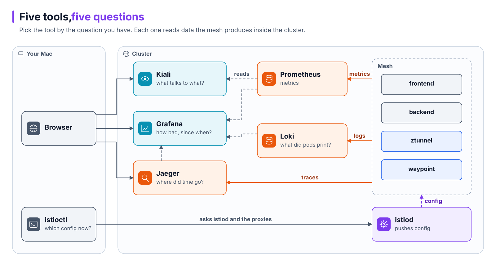

# Module 0: setup

> Haven't read [Start here: Istio in one picture](../start-here.md) yet? Do that first. New to a term, like VirtualService or waypoint? The [glossary](../glossary.md) explains every Istio resource and term in this course.

**Before this module:** none. Read [Istio in one picture](../start-here.md) first.

**You need:** the lab from `./lab.sh up`, a shell in the toolbox from `./lab.sh shell`, and a browser. The toolbox brings `istioctl`, so nothing needs installing on your machine.

Every later module assumes a healthy lab and a working `istioctl`, so this module checks both. It also shows which tool answers which question, so that you know where to look when something breaks. It takes 15 minutes.

## Check the lab

```console
$ ./lab.sh start               # safe to run any time, repairs the cluster after a reboot
Cluster k8s-lab is running and CoreDNS is healthy.
kubectl context is k3d-k8s-lab
Waiting for istio-cni and ztunnel
Waiting for every pod to become Ready (up to 3 minutes)
All pods are Ready. The shop is at http://localhost:8080. Run ./lab.sh ui for the other UIs.

$ kubectl config current-context   # k3d-k8s-lab
k3d-k8s-lab

$ kubectl -n argocd get applications
NAME                    SYNC STATUS   HEALTH STATUS
alloy                   Synced        Healthy
cert-manager            Synced        Healthy
cert-manager-config     Synced        Healthy
headlamp                Synced        Healthy
istio-config            Synced        Healthy
kiali                   Synced        Healthy
kube-prometheus-stack   Synced        Healthy
loki                    Synced        Healthy
observability-config    Synced        Healthy
root                    Synced        Healthy
shop-apps               Synced        Healthy
shop-base               Synced        Healthy
```

All twelve Applications should show `Synced` and `Healthy`, because ArgoCD reports any drift from Git on this list. Then open the UIs in a spare terminal and leave it running:

```console
$ ./lab.sh ui
ArgoCD      http://localhost:8081
Grafana     http://localhost:3000
Prometheus  http://localhost:9090
Alertmanager http://localhost:9093
Jaeger      http://localhost:16686
Kiali       http://localhost:20001
Headlamp    http://localhost:4466

Port-forwards are running. Press Ctrl-C to stop.
```

The [guide](../../README.md#logins-and-addresses) lists every UI. Keep Headlamp (http://localhost:4466) open in a tab, because it shows every pod with its logs and events in one place and needs no login.

## Check istioctl

`istioctl` does for Istio what `kubectl` does for Kubernetes: it reads the mesh's state and explains it in plain terms. The toolbox installs the client the course was tested with, 1.32.0, so run it from your `./lab.sh shell`:

```console
$ istioctl version
client version: 1.32.0
control plane version: 1.24.2
data plane version: 1.24.2 (3 proxies)
```

Module 31 needs a client this new, because `istioctl proxy-status -o json` and the analyzer it uses don't exist in 1.24. If you prefer to work outside the toolbox, install the same client on your machine, with `brew install istioctl` on macOS or with the download in [Install the tools without the toolbox](../../README.md#linux) on Linux.

**What you should see.** The three `istioctl version` lines above. A client newer than the control plane works fine, and every command in this course ran with client 1.32 against control plane 1.24. If a command fails with an unknown field error, check that the client line says 1.32.0, because an older `istioctl` on your machine may run instead of the toolbox's.

The "3 proxies" line counts the proxies that take their configuration from istiod, the Istio control plane:

- the ingress gateway, which is an Envoy proxy
- the waypoint, which is also an Envoy proxy
- ztunnel, which is a separate program written in Rust, not Envoy

The shop's own pods don't appear in the count, and module 1 explains why.

A count above 3 means something from a later module is still running. Module 7's two sidecar pods, for example, add 2 more, so you'd see 5. To get back to the starting point, run:

```console
$ ./platform-engineering/reset.sh --all
Removing course rules from the shop namespace
Applying the baseline Istio config from manifests/istio
Turning off the backend experiment settings
Removing the course namespaces and the course client
Asking ArgoCD to sync istio-config from Git
Done. Baseline: 100% of backend traffic to v1, no faults, no extra rules.
```

Plain `./platform-engineering/reset.sh` keeps the module 7 namespaces so that you may return to that module later, while `--all` removes them too.

The three version lines come from three places:

1. `istioctl` prints its own version.
2. It asks istiod for the control plane version.
3. It asks istiod which proxies it sends configuration to right now.

The third line earns its place when something breaks. A proxy that loses its connection to istiod drops out of the count, so a number lower than you expect is a first clue that some proxy no longer receives its configuration.

## The tools and what each one answers



Kiali and Grafana read the same Prometheus data but show it in different shapes. Kiali draws a live map of the mesh, while Grafana draws graphs over time. So you use Kiali to find which edge, the arrow between two services, is broken, and then Grafana to see since when and how badly.

## Learn Kiali in five minutes

Start some traffic, then open http://localhost:20001:

```console
$ ./platform-engineering/load.sh 300
Sending about 5 requests per second to http://localhost:8080/api/orders for 300s. Press Ctrl-C to stop.

Status codes:
  200  1480
Backend versions:
  v1  1480
```

1. **Overview** lists namespaces with a health badge. Click `shop`.
2. **Traffic Graph** draws the services and the calls between them. Choose namespace `shop` and `shop-ingress`, then set Display to show "Traffic Animation" and "Security". A padlock on an edge means mTLS.
3. **Applications**, **Workloads** and **Services** list the same pods from three angles, and each view has tabs for metrics, traces and logs.
4. **Istio Config** lists every Istio resource and flags invalid ones with a red icon.

The course uses Kiali only to look. You make every change with `kubectl`, so that each change stays in your shell history.

## What the verification run showed

`./platform-engineering/verify.sh`, or `./lab.sh test all`, replays every module that is safe to repeat against the lab, so run it whenever you change the lab and again after the course to check your own work. On 21 November 2026 it passed 322 of 322 checks for its 25 default modules in 49 minutes on the Mac itself. Run through the toolbox from a fresh clone, it passed 321 of 321 in 47 minutes, because the check that the OrbStack app holds module 45's outside connection needs a shell on the Mac and the toolbox skips it. [Check a module](../../README.md#check-a-module) in the guide lists the modules it leaves out.
