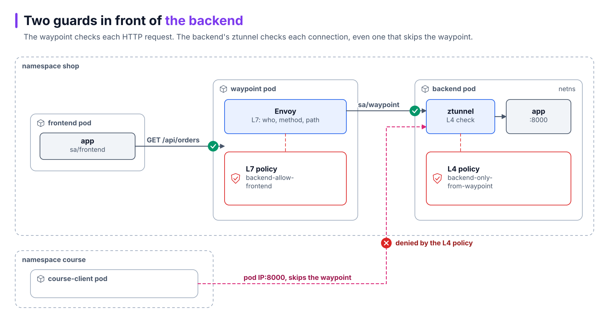

# Module 3: authorization

> New to a term here, like VirtualService or waypoint? The [glossary](../glossary.md) explains every Istio resource and term in this course.

**Before this module:** module 2.

**You need:** the lab running (`./lab.sh start` starts or repairs it).

mTLS tells the receiver who is calling, but something still has to decide whether that caller may come in. In this module you write rules at both layers of the mesh, and you see the gap that opens when you write only one of them.

## Concept: AuthorizationPolicy compared with NetworkPolicy

You know NetworkPolicy, which allows or blocks connections by pod labels, namespaces and IP ranges, with the CNI plugin enforcing it. AuthorizationPolicy plays the same role in Istio, but it decides on the caller's certificate instead of its address:

| | NetworkPolicy | Istio AuthorizationPolicy |
|---|---|---|
| Who is the caller | Pod labels, namespace, IP | Cryptographic identity from mTLS (service account) |
| What it matches | Ports | Ports, and at L7 also HTTP methods, paths, headers |
| Who enforces it | The CNI plugin | ztunnel (L4 rules) or a waypoint (L7 rules) |
| Spoofing | A pod with the right labels or IP passes | Only a pod running as that service account holds the certificate |

Both work side by side, but this lab uses only AuthorizationPolicy.

## Concept: two enforcement points



Two guards stand in front of the backend: the waypoint checks HTTP requests, and the backend's ztunnel checks connections. The dashed pink line shows `course-client` dialling a pod IP and skipping the waypoint. Each policy goes to one of the two guards, and the field you use to attach it picks which one:

- A policy with a `selector` names pod labels, so it attaches to the pods and ztunnel enforces it. ztunnel sees only L4 facts: the caller's identity, its namespace and the port.
- A policy with `targetRefs` names a Service, so it attaches to that Service's waypoint, which understands HTTP and therefore also matches methods and paths.

The lab has one of each for the backend:

```yaml
# L7, on the waypoint: only the frontend may call GET or POST /api/*
name: backend-allow-frontend
targetRefs: [{kind: Service, name: backend}, ...]
rules:
  - from: [{source: {principals: ["cluster.local/ns/shop/sa/frontend"]}}]
    to:   [{operation: {methods: ["GET", "POST"], paths: ["/api/*"]}}]
---
# L4, on the backend pods: only the waypoint and Prometheus may connect at all
name: backend-only-from-waypoint
selector: {matchLabels: {app: backend}}
rules:
  - from: [{source: {principals: ["cluster.local/ns/shop/sa/waypoint",
                                  "cluster.local/ns/observability/sa/kube-prometheus-stack-prometheus"]}}]
```

## Concept: which caller each check sees

A waypoint never pretends to be the client. It ends the frontend's connection, reads the request, and opens a new connection to a backend pod with its own certificate, `sa/waypoint`. So the two checks see different callers for the same request:

| Check | Runs in | Caller it sees for a frontend request |
|---|---|---|
| `backend-allow-frontend` (L7) | waypoint | `sa/frontend` |
| `backend-only-from-waypoint` (L4) | ztunnel at the backend pod | `sa/waypoint` |

That's why the L4 rule names the waypoint and not the frontend. A common mistake writes the pod-level rule with `sa/frontend`, and then every request through the waypoint fails at the backend's ztunnel, even though the frontend is the "right" caller.

A second trap follows from the same split. If you put HTTP fields such as `methods` or `paths` in a policy with a `selector`, ztunnel enforces it, but ztunnel never reads HTTP. Istio plays it safe by turning the ALLOW rule into a DENY, so ztunnel closes every matching connection. Any rule that mentions methods or paths therefore belongs on `targetRefs`, where a waypoint enforces it.

## Concept: how ALLOW rules combine

1. If any `DENY` policy matches the request, the proxy denies it.
2. If no `ALLOW` policy exists for the target, the proxy lets it through.
3. If `ALLOW` policies exist, the request must match at least one of them.

So a single ALLOW policy turns a workload into "deny unless allowed", and ALLOW policies add up. To give a new client access, you add a policy and leave the existing one alone, which is exactly what step 3 does.

## Why this way

**Why do you need the L4 rule if the L7 rule is stricter?** The L7 rule sees only traffic that goes through the waypoint, and some clients skip it. A client that connects straight to a backend pod's IP never reaches the waypoint, and sidecar clients skip it too because they pick a backend pod themselves. The L4 rule on the pods closes that path by allowing only the waypoint's identity, and you open and close this hole in the exercise.

**Why does Prometheus appear in the L4 rule?** Prometheus collects `/metrics` from each pod by its IP rather than through the Service, so it also skips the waypoint and the L4 rule has to let it in.

**Why identities and not namespaces?** A rule like "allow namespace `shop`" lets in every workload in `shop`, including a hacked one or a test pod like `course-client`, while a rule that names the service account allows exactly one workload.

**Why does Redis need only an L4 rule?** Redis speaks its own protocol rather than HTTP, so a waypoint has nothing to inspect, and "only the backend may connect" is the whole rule.

## The bigger picture: two questions, not one

Security people keep two questions apart, and Istio does the same. Authentication asks "who are you?", and authorization asks "now that I know who you are, may you do this?" Module 2 answered the first question with certificates, so this module deals with the second.

What each rule checks depends on which layer enforces it. ztunnel works at layer 4, so it sees a connection, the caller's identity from the certificate and the destination port, and it never looks inside the bytes. The waypoint works at layer 7 and reads the HTTP request, so it knows the method, the path and the headers. A rule like "only GET on /api/*" therefore makes sense only where something reads HTTP.

Istio checks policies in a fixed order:

1. CUSTOM policies, which ask an outside service for a decision. This lab skips them.
2. DENY policies.
3. ALLOW policies.

A matching DENY always wins, whatever the ALLOW rules say, which gives you a handy emergency brake: you block one misbehaving caller with a small DENY policy and leave your ALLOW rules alone.

The habit that pays off most is "deny by default", where you start with nothing allowed and add one rule for each caller that really needs access. It feels slow at first, but six months later, when someone asks "who talks to Redis?", you answer by reading one file instead of tracing traffic for a week. And an attacker who takes over the `course-client` pod finds closed doors instead of an open network.

## Do it

**1. Deploy a client with its own identity.**

```console
$ cat platform-engineering/manifests/03-course-client.yaml
# A curl pod inside the mesh, in the "shop" namespace, with its own identity.
# It is not the frontend, so the lab's policies refuse it until you write a rule for it.
apiVersion: v1
kind: ServiceAccount
metadata:
  name: course-client
  namespace: shop
---
apiVersion: apps/v1
kind: Deployment
metadata:
  name: course-client
  namespace: shop
  labels:
    app: course-client
spec:
  replicas: 1
  selector:
    matchLabels:
      app: course-client
  template:
    metadata:
      labels:
        app: course-client
    spec:
      serviceAccountName: course-client
      securityContext:
        runAsNonRoot: true
        runAsUser: 100
        seccompProfile:
          type: RuntimeDefault
      containers:
        - name: curl
          image: curlimages/curl:8.11.1
          command: ["sleep", "infinity"]
          resources:
            requests:
              cpu: 5m
              memory: 16Mi
            limits:
              cpu: 100m
              memory: 64Mi
          securityContext:
            allowPrivilegeEscalation: false
            capabilities:
              drop: ["ALL"]

$ kubectl apply -f platform-engineering/manifests/03-course-client.yaml
serviceaccount/course-client created
deployment.apps/course-client created

$ kubectl -n shop rollout status deploy/course-client
Waiting for deployment "course-client" rollout to finish: 0 of 1 updated replicas are available...
deployment "course-client" successfully rolled out
```

**What you should see.** The manifest, then `serviceaccount/course-client created`, `deployment.apps/course-client created` and `successfully rolled out`. The pod runs in `shop` as service account `course-client`, and because the namespace runs in ambient mode, ztunnel gives it the identity `spiffe://cluster.local/ns/shop/sa/course-client` with no extra step.

**2. The waypoint refuses it at L7.**

```console
$ kubectl -n shop exec deploy/course-client -- curl -s -w " [%{http_code}]\n" http://backend:8000/api/version
RBAC: access denied [403]

$ kubectl -n shop exec deploy/course-client -- curl -s -o /dev/null -w "frontend [%{http_code}]\n" http://frontend:3000/healthz
frontend [200]
```

**What you should see.** The waypoint refused the call with HTTP 403 and wrote the body `RBAC: access denied` itself, so the backend never saw the request. The frontend has no policy, so it answers.

**3. Allow exactly one call.**

```console
$ cat platform-engineering/manifests/03-allow-course-client.yaml
# L7 rule enforced by the waypoint: the course-client identity may call
# GET /api/version on the backend, and nothing else.
# ALLOW policies add up, so this works next to the lab's backend-allow-frontend policy.
apiVersion: security.istio.io/v1
kind: AuthorizationPolicy
metadata:
  name: backend-allow-course-client
  namespace: shop
spec:
  targetRefs:
    - group: ""
      kind: Service
      name: backend
  action: ALLOW
  rules:
    - from:
        - source:
            principals:
              - cluster.local/ns/shop/sa/course-client
      to:
        - operation:
            methods: ["GET"]
            paths: ["/api/version"]

$ kubectl apply -f platform-engineering/manifests/03-allow-course-client.yaml
authorizationpolicy.security.istio.io/backend-allow-course-client created

$ sleep 5
$ kubectl -n shop exec deploy/course-client -- curl -s -w " [%{http_code}]\n" http://backend:8000/api/version
{"version":"v1","pod":"backend-v1-54c86bf9b-vssp2"} [200]

$ kubectl -n shop exec deploy/course-client -- curl -s -w " [%{http_code}]\n" http://backend:8000/api/orders
RBAC: access denied [403]
```

**What you should see.** `/api/version` now returns `200`, while `/api/orders` still returns `403` because the new rule names only `GET /api/version`. The shop on http://localhost:8080 keeps working too, because ALLOW policies add up and the frontend's rule still matches the frontend's calls.

**4. Find the bypass.**

```console
$ BACKEND_IP=$(kubectl -n shop get pod -l app=backend,version=v1 -o jsonpath='{.items[0].status.podIP}')
$ kubectl -n shop exec deploy/course-client -- curl -s -m 5 -o /dev/null -w "%{http_code}\n" http://$BACKEND_IP:8000/api/orders
000
command terminated with exit code 56
```

**What you should see.** `000`, then `command terminated with exit code 56`, which means the backend side reset the connection. The client dialled a pod IP, so no waypoint took part, and the backend's ztunnel checked the L4 policy instead. That policy admits only the waypoint, so ztunnel closed the connection. Now remove that policy:

```console
$ kubectl -n shop delete authorizationpolicy backend-only-from-waypoint
authorizationpolicy.security.istio.io "backend-only-from-waypoint" deleted

$ sleep 10
$ kubectl -n shop exec deploy/course-client -- curl -s -m 5 -o /dev/null -w "%{http_code}\n" http://$BACKEND_IP:8000/api/orders
200
```

**What you should see.** `authorizationpolicy.security.istio.io "backend-only-from-waypoint" deleted`, then `200`, so `course-client` read the orders even though its L7 rule forbids that. Without the L4 rule, the L7 rule protects only the front door, and a client that walks around to the side door, the pod IP, gets in.

**5. Close it again.**

```console
$ kubectl apply -f manifests/istio/security.yaml
peerauthentication.security.istio.io/default configured
authorizationpolicy.security.istio.io/redis-allow-backend configured
authorizationpolicy.security.istio.io/backend-allow-frontend configured
authorizationpolicy.security.istio.io/backend-only-from-waypoint created

$ sleep 10
$ kubectl -n shop exec deploy/course-client -- curl -s -m 5 -o /dev/null -w "%{http_code}\n" http://$BACKEND_IP:8000/api/orders
000
command terminated with exit code 56
```

**What you should see.** Among the lines, `authorizationpolicy.security.istio.io/backend-only-from-waypoint created`, while the other resources in the file report `configured`. Then `000` and exit code 56 come back, so the bypass is gone again.

## Investigate

1. Read ztunnel's log. After step 4, with the policy in place, run:

   ```console
   $ kubectl -n istio-system logs ds/ztunnel --tail=100 | grep course-client | tail -3
   2026-11-14T22:44:28.300631Z	info	access	connection complete	src.addr=10.42.0.135:59290 src.workload="course-client-b7478cb8b-jh9w4" src.namespace="shop" src.identity="spiffe://cluster.local/ns/shop/sa/course-client" dst.addr=10.42.0.75:15008 dst.hbone_addr=10.42.0.75:8000 dst.workload="backend-v1-54c86bf9b-jqnzh" dst.namespace="shop" dst.identity="spiffe://cluster.local/ns/shop/sa/backend" direction="outbound" bytes_sent=89 bytes_recv=455 duration="2ms"
   2026-11-14T22:44:38.649263Z	error	access	connection complete	src.addr=10.42.0.135:47916 src.workload="course-client-b7478cb8b-jh9w4" src.namespace="shop" src.identity="spiffe://cluster.local/ns/shop/sa/course-client" dst.addr=10.42.0.75:15008 dst.hbone_addr=10.42.0.75:8000 dst.service="backend-v1.shop.svc.cluster.local" dst.workload="backend-v1-54c86bf9b-jqnzh" dst.namespace="shop" dst.identity="spiffe://cluster.local/ns/shop/sa/backend" direction="inbound" bytes_sent=0 bytes_recv=0 duration="0ms" error="connection closed due to policy rejection: allow policies exist, but none allowed"
   2026-11-14T22:44:38.649338Z	error	access	connection complete	src.addr=10.42.0.135:50792 src.workload="course-client-b7478cb8b-jh9w4" src.namespace="shop" src.identity="spiffe://cluster.local/ns/shop/sa/course-client" dst.addr=10.42.0.75:15008 dst.hbone_addr=10.42.0.75:8000 dst.workload="backend-v1-54c86bf9b-jqnzh" dst.namespace="shop" dst.identity="spiffe://cluster.local/ns/shop/sa/backend" direction="outbound" bytes_sent=0 bytes_recv=0 duration="0ms" error="http status: 401 Unauthorized"
   ```

   Find the two `error` lines for the backend pod. Which side wrote `allow policies exist, but none allowed`, and which side wrote `http status: 401 Unauthorized`? Compare `src.identity` with the principals in `backend-only-from-waypoint`.

2. Read the waypoint's log.
   1. Turn on access logs with `kubectl apply -f platform-engineering/manifests/06-waypoint-access-logs.yaml`.
   2. Repeat step 2. Do this before step 3, while the waypoint still refuses `course-client`.
   3. Read `kubectl -n shop logs deploy/waypoint --tail=5`.

   Envoy logs the reason as `rbac_access_denied_matched_policy[none]`. What does `[none]` mean, given the ALLOW rules?
3. Use Kiali. Open **Istio Config**, namespace `shop`. How many AuthorizationPolicies does Kiali list, and does it flag any? What happens if a principal has a typo? Then open **Traffic Graph** and loop `course-client` on `/api/orders` for a minute. On which edge does the 403 show up?
4. In Grafana, open Explore with the Prometheus data source and run this query:

   ```promql
   sum by (source_workload, response_code) (increase(istio_requests_total{reporter="waypoint", destination_service_name=~"backend.*"}[5m]))
   ```

   Which `source_workload` carries the 403s? The query uses `increase` over 5 minutes, which counts requests even when you sent them in one short burst, while a `rate` over 1 minute shows nothing once the burst is older than a minute.
5. Is Redis reachable from `course-client`? Try a port check, then real data:

   ```console
   $ kubectl -n shop exec deploy/course-client -- nc -zv -w 3 redis 6379
   redis (10.43.100.21:6379) open

   $ kubectl -n shop exec deploy/course-client -- sh -c "printf 'PING\r\n' | nc -w 3 redis 6379"
   ```

   The port check says `open`, but `PING` gets no `+PONG` back. Why? Hint: ask yourself which process accepted the TCP handshake. Look at the ztunnel log lines for `dst.service="redis..."`. What does this mean for port scans as a security test inside an ambient mesh?

<details>
<summary>Answers</summary>

1. You find two lines for the same attempt, both with `src.identity="spiffe://cluster.local/ns/shop/sa/course-client"`, because each end of the tunnel logged the same refusal once.
   - The `direction="inbound"` line comes from the backend's side and says `error="connection closed due to policy rejection: allow policies exist, but none allowed"`, because the caller's identity isn't in the policy's list, which names only `sa/waypoint` and Prometheus.
   - The `direction="outbound"` line comes from the client's side, where the HBONE `CONNECT` request got the answer `error="http status: 401 Unauthorized"`.
2. `[none]` means no policy matched. The waypoint holds only ALLOW policies for the backend, so a request must match one of them, and `course-client` matched none, so Envoy denied it by default. A matching DENY policy shows up by name instead: a test DENY rule for `course-client` produced `rbac_access_denied_matched_policy[ns[shop]-policy[deny-course-client-test]-rule[0]]`. The full line reads like `"GET /api/version HTTP/1.1" 403 - rbac_access_denied_matched_policy[none]`, with `curl/8.11.1` as the user agent.
3. Once step 3 has run, Kiali lists four: `backend-allow-frontend`, `backend-only-from-waypoint`, `redis-allow-backend` and `backend-allow-course-client`, and all four pass validation.

   Kiali checks that each principal belongs to a real service account. Apply a policy with `cluster.local/ns/shop/sa/course-clinet`, and Kiali flags it at once with `KIA0106 Service Account not found for this principal`, severity error. Istio itself accepts the typo without complaint, which is why this Kiali check is worth having.

   In the graph, the 403s sit on the HTTP edge from `course-client` to the `backend` service node, where 100% of its requests count as 4xx errors with response code `403`. The edge stops at the service node, because the waypoint answered and no backend pod took part.
4. `course-client` carries them, with `response_code="403"`, while the frontend's calls appear as `200`. The waypoint knows the caller's name from the certificate, not from anything the client sent. The query uses a regex because the waypoint labels these requests with the Service that the route picked, `backend-v1`, rather than `backend`, so a filter on `destination_service_name="backend"` finds nothing.
5. The client's own ztunnel accepted the handshake, not Redis. ztunnel captures every outgoing connection on the client's node and answers the TCP handshake right there, before it opens the HBONE tunnel to Redis. Then the rest happens in order:
   1. Redis's ztunnel checks `redis-allow-backend` and refuses with `allow policies exist, but none allowed`.
   2. The client's ztunnel logs `http status: 401 Unauthorized`.
   3. The client's ztunnel closes the connection without sending a byte of data.

   So `nc -z` reports `open` for any port inside the mesh, and `nc -zv -w 3 redis 1234` says `open` too, as does an unused pod IP. A port scan from an ambient pod therefore tells you nothing, so test access with real requests and read ztunnel's log for the verdict.

</details>

## Clean up

```console
$ ./platform-engineering/reset.sh
Removing course rules from the shop namespace
Applying the baseline Istio config from manifests/istio
Turning off the backend experiment settings
Asking ArgoCD to sync istio-config from Git
Done. Baseline: 100% of backend traffic to v1, no faults, no extra rules.
```

`course-client` stays deployed for later modules. `./platform-engineering/reset.sh --all` removes it.
