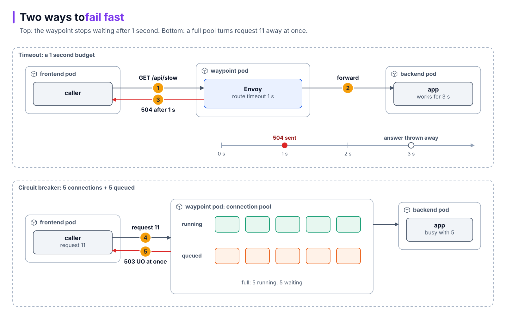

# Module 5: resilience

> New to a term here, like VirtualService or waypoint? The [glossary](../glossary.md) explains every Istio resource and term in this course.

**Before this module:** module 4.

**You need:** the lab running (`./scripts/start.sh` starts or repairs it).

Networks fail and services slow down, and when that happens you want the damage to stay small. This module adds four protections, timeouts, fault injection, circuit breaking and rate limiting, and you watch each one act in Grafana, in Jaeger and in the waypoint's access log.

## Concept: four tools for four failure modes

Each tool answers one kind of failure:

| Failure | Tool | Where it lives | What the caller sees |
|---|---|---|---|
| A call hangs | Timeout | HTTPRoute `timeouts.request` | `504` after the budget |
| You want to know if callers cope with failure | Fault injection | VirtualService `fault` | Delays and errors you chose |
| A slow backend drags everyone down | Circuit breaker | DestinationRule `connectionPool` | Immediate `503` once the pool is full |
| One client floods the service | Rate limit | the backend itself, in this lab | `429` over the limit |

The diagram walks through two of them: a timeout of 1 second on top, and the circuit breaker with a pool of 5 below.



## Why this way

**Why put these in the mesh, not in the code?** Without a mesh, every team writes timeouts and retries in its own language, with its own bugs and its own defaults. In the waypoint you configure them once, so they look the same for every service and show up in the same metrics.

**Why a timeout in the route, not in the client?** The waypoint is the one place that sees every caller, so a route timeout protects all of the backend's callers, even one that forgot to set its own.

**Why fail fast with a circuit breaker?** Without one, requests to a slow backend pile up in queues, and each waiting request holds a connection and memory in every hop in front of the backend until the whole chain slows down. A circuit breaker rejects the extra requests at once, which keeps the callers responsive and gives the backend room to recover. You will see this as the "UO" response flag, which means Envoy refused to send the request because the upstream pool overflowed.

**Why fault injection?** You need to know how callers behave when the backend is slow, and waiting for that to happen by itself makes a poor test plan. With fault injection the waypoint adds delays or errors on purpose, so you test the real code paths with real traffic and switch it off in seconds.

**Why is rate limiting in the app and not the waypoint?** Envoy has a local rate limiter, but Istio exposes it only through `EnvoyFilter`, which waypoints don't support in 1.24, and a global limiter needs a separate rate-limit service. So the lab puts a token bucket in the backend, set by `RATE_LIMIT_RPS`. A token bucket is a counter that refills at a fixed rate while each request spends one token, and it shows the behaviour with no extra component.

**Why does fault injection need a VirtualService?** Gateway API has no fault injection field, and Istio still supports its own API for features that the standard lacks. Istio defines no result when an HTTPRoute and a VirtualService both target the same Service, though, so you delete the route first.

## The bigger picture: how one slow service takes down ten

Failures in distributed systems rarely stay where they start. Picture the backend slowing from 50 ms to 5 seconds per request:

1. The frontend keeps sending at the same rate, so requests pile up.
2. Each waiting request holds a connection, a thread or a slice of memory in every hop in front of the backend.
3. The frontend runs out of those as well.
4. Users see the frontend fail, not just the backend.

Engineers call this a cascading failure, and it works like a traffic jam that spreads back from one blocked exit to the whole motorway.

Careless retries make it worse. If the gateway, the frontend and the waypoint each make up to 3 attempts, one click turns into as many as 27 requests at the backend, at the exact moment it struggles most, which engineers call a retry storm. The rule of thumb is to retry in one layer only, and only on errors where a second try makes sense, like a reset connection, so you never blindly retry a POST that creates an order.

Timeouts need the same care, because the outer layer has to wait longer than the inner one. If the frontend gives up after 1 second while the waypoint waits 3 seconds for the backend, the frontend has already shown the user an error while the backend keeps working on a request nobody wants. Think of it as a budget, where each layer spends part of the time its caller gave it.

Istio puts two different features under the name "circuit breaking", and people mix them up, because the first protects a service from too much traffic while the second protects callers from one bad pod.

Connection pool limits, set with `connectionPool` in a DestinationRule, cap how many connections and waiting requests go to a service, and above the limit Envoy rejects the request at once with the `UO` flag. The exercise below uses this one.

Outlier detection, set with `outlierDetection`, watches each backend pod separately. When a pod returns several 5xx errors in a row, Envoy takes it out of the load-balancing pool for a while, and each time Envoy ejects the same pod again, the break grows longer.

## Do it

Turn on the waypoint's access log for this module. It's off by default because it writes one line for every request:

```console
$ cat platform-engineering/manifests/06-waypoint-access-logs.yaml
# Turn on Envoy access logs for the waypoint only. Read them with:
#   kubectl -n shop logs deploy/waypoint -f
apiVersion: telemetry.istio.io/v1
kind: Telemetry
metadata:
  name: waypoint-access-logs
  namespace: shop
spec:
  targetRefs:
    - group: gateway.networking.k8s.io
      kind: Gateway
      name: waypoint
  accessLogging:
    - providers:
        - name: envoy

$ kubectl apply -f platform-engineering/manifests/06-waypoint-access-logs.yaml
telemetry.telemetry.istio.io/waypoint-access-logs created
```

**What you should see.** A `Telemetry` resource whose `targetRefs` points at the Gateway `waypoint` and names the provider `envoy`, then `telemetry.telemetry.istio.io/waypoint-access-logs created`. Only the waypoint changes, while the gateway and ztunnel keep their logging as it was.

Keep a terminal open on it:

```console
$ kubectl -n shop logs deploy/waypoint -f | grep -v "Envoy proxy"
2026-11-14T17:16:32.781303Z	info	FLAG: --concurrency="0"
2026-11-14T17:16:32.781312Z	info	FLAG: --domain="shop.svc.cluster.local"
2026-11-14T17:16:32.781314Z	info	FLAG: --help="false"
...
[2026-11-14T22:47:54.126Z] "GET /api/slow?ms=300 HTTP/1.1" 200 - via_upstream - "-" 0 66 310 310 "-" "node" "06bcf1b1-b855-9cd5-8e84-da37fb7f0341" "backend.shop.svc.cluster.local:8000" "envoy://connect_originate/10.42.0.73:8000" inbound-vip|8000|http|backend-v1.shop.svc.cluster.local envoy://internal_client_address/ 10.43.239.201:8000 10.42.0.42:49278 - shop.backend-route.0
[2026-11-14T22:47:54.468Z] "GET /api/slow?ms=3000 HTTP/1.1" 504 UT response_timeout - "-" 0 24 999 - "-" "node" "5464f3cc-901e-9bee-b927-44fb7afe26ba" "backend.shop.svc.cluster.local:8000" "envoy://connect_originate/10.42.0.75:8000" inbound-vip|8000|http|backend-v1.shop.svc.cluster.local envoy://internal_client_address/ 10.43.239.201:8000 10.42.0.42:49278 - shop.backend-route.0
[2026-11-14T22:48:11.714Z] "GET /api/orders HTTP/1.1" 200 DI via_upstream - "-" 0 286 519 16 "-" "node" "cc168176-7ba0-90ad-be36-5f66a3eb769d" "backend.shop.svc.cluster.local:8000" "envoy://connect_originate/10.42.0.73:8000" inbound-vip|8000|http/v1|backend.shop.svc.cluster.local envoy://internal_client_address/ 10.43.239.201:8000 10.42.0.42:49278 - orders-faults
...
[2026-11-14T22:48:12.273Z] "GET /api/orders HTTP/1.1" 503 DI,FI fault_filter_abort - "-" 0 18 501 - "-" "node" "4b24289a-56d6-9d40-ab6b-1e879c4e5d80" "backend.shop.svc.cluster.local:8000" "-" inbound-vip|8000|http/v1|backend.shop.svc.cluster.local - 10.43.239.201:8000 10.42.0.42:49278 - orders-faults
...
```

The command keeps following the log until you press Ctrl-C, and the lines above are an excerpt from steps 1 and 2.

**What you should see.** A few startup lines from the waypoint, then one line per request through it, starting with a timestamp in square brackets: `[2026-11-12T19:05:52.385Z] "GET /api/slow?ms=300 HTTP/1.1" 200 - via_upstream ...`. After the status code come the response flags and a short reason, where a flag of `-` means Envoy added nothing.

### 1. Timeout

```console
$ kubectl apply -f platform-engineering/manifests/05-timeout.yaml
httproute.gateway.networking.k8s.io/backend-route configured

$ curl -s -o /dev/null -w "%{http_code} in %{time_total}s\n" "http://localhost:8080/api/slow?ms=300"
200 in 0.335305s

$ curl -s -w " %{http_code} in %{time_total}s\n" "http://localhost:8080/api/slow?ms=3000"
upstream request timeout 504 in 1.011170s
```

**What you should see.** The 300 ms call fits in the 1 second budget, while the waypoint cuts off the 3 second call after one second, writes the body `upstream request timeout`, and the frontend passes the 504 on to you. The access log shows the reason in its fourth and fifth fields:

```text
"GET /api/slow?ms=3000 HTTP/1.1" 504 UT response_timeout
```

`UT` is Envoy's response flag for "upstream request timeout".

### 2. Fault injection

```console
$ kubectl -n shop delete httproute backend-route
httproute.gateway.networking.k8s.io "backend-route" deleted

$ kubectl apply -f manifests/scenarios/b-fault-injection.yaml
destinationrule.networking.istio.io/backend created
virtualservice.networking.istio.io/backend created

$ ./scripts/traffic-test.sh 200 10
Sending 200 requests to http://localhost:8080/api/orders with concurrency 10

Status codes
  503  15  (8%)
  200  185  (92%)

Backend versions
  v1  175  (88%)
  v2  10  (5%)
  unknown  15  (8%)

Average latency 518 ms, slowest 594 ms

$ ./scripts/traffic-test.sh 40 5 /api/version
Sending 40 requests to http://localhost:8080/api/version with concurrency 5

Status codes
  200  40  (100%)

Backend versions
  v1  37  (92%)
  v2  3  (8%)

Average latency 5 ms, slowest 9 ms
```

**What you should see.** For `/api/orders`, about 10% of requests return `503`, and the average latency sits just above 500 ms, because every request waits 500 ms and then one in ten gets a 503. The 503s show version `unknown`, because no backend answered them and so nobody set the `x-app-version` header. The VirtualService also splits traffic 90/10 between v1 and v2, so a few v2 answers appear.

`/api/version` returns 40 `200` with an average between 5 and 13 ms, because the fault rule matches only the `/api/orders` prefix.

In the access log, the response flags show what the waypoint did:

- `DI` (delay injected) appears on every request.
- `DI,FI` (delayed, then fault injected) appears on the 503s.

```text
"GET /api/orders HTTP/1.1" 200 DI ...
"GET /api/orders HTTP/1.1" 503 DI,FI ...
```

### Concept: what the connection pool numbers mean

The scenario file sets a few limits under `connectionPool`, and two of them decide how many requests the waypoint lets through at once:

| Field | Value | Meaning |
|---|---|---|
| `tcp.maxConnections` | 5 | the waypoint opens at most 5 connections to the host |
| `http.http1MaxPendingRequests` | 5 | at most 5 requests wait for a free connection |

The backend speaks HTTP/1.1, and Envoy sends one HTTP/1.1 request at a time on a connection, so at most 5 requests run and 5 wait, and request number 11 gets `503 UO` at once. It works like a café with 5 tables and room for 5 people at the door, where the eleventh guest leaves straight away. With 50 callers and a backend that takes 300 ms, you should therefore predict that most requests fail and only a small share fits through.

Three details catch people out.

First, the limits live inside each waypoint pod, because Envoy counts its own connections and knows nothing of other replicas. If you scale the waypoint to two pods, the backend sees up to twice the traffic, and step 4 shows the same weakness for rate limits.

Second, a DestinationRule applies to the host the route picked, not to the host the caller dialled. The baseline route sends traffic to `backend-v1` and `backend-v2`, so the scenario file repeats the same limits for `backend`, `backend-v1` and `backend-v2`, since a rule only for `backend` would never fire here.

Third, the breaker never "opens" for a while as in the classic pattern. Envoy checks the counters for every request, so the moment a slot frees up, the next request goes through.

### 3. Circuit breaking

First, run without a breaker to see the baseline:

```console
$ ./platform-engineering/reset.sh
Removing course rules from the shop namespace
Applying the baseline Istio config from manifests/istio
Turning off the backend experiment settings
Asking ArgoCD to sync istio-config from Git
Done. Baseline: 100% of backend traffic to v1, no faults, no extra rules.

$ ./scripts/traffic-test.sh 200 50 "/api/slow?ms=300"
Sending 200 requests to http://localhost:8080/api/slow?ms=300 with concurrency 50

Status codes
  200  200  (100%)

Backend versions
  v1  200  (100%)

Average latency 329 ms, slowest 456 ms
```

**What you should see.** All 200 return `200`, every one from v1, with an average latency above the 300 ms that the backend sleeps: 414 ms in one run and 329 ms in another, with the slowest between 456 and 704 ms. The extra time comes from the queue, because 50 requests at a time wait in front of the two v1 pods.

Now run with a pool of 5 connections and 5 queued requests:

```console
$ kubectl apply -f manifests/scenarios/c-circuit-breaker.yaml
destinationrule.networking.istio.io/backend created
destinationrule.networking.istio.io/backend-v1 created
destinationrule.networking.istio.io/backend-v2 created

$ ./scripts/traffic-test.sh 200 50 "/api/slow?ms=300"
Sending 200 requests to http://localhost:8080/api/slow?ms=300 with concurrency 50

Status codes
  503  180  (90%)
  200  20  (10%)

Backend versions
  v1  20  (10%)
  unknown  180  (90%)

Average latency 197 ms, slowest 2094 ms
```

**What you should see.** Most requests now return `503`, between 85% and 92% in the lab's runs, and the average latency drops, to 248 ms in one run and 197 ms in another, because a rejected request returns at once instead of waiting its turn. The access log shows `503 UO upstream_reset_before_response_started{overflow}` for each rejected request, while the few that fit into the pool, about 20 to 25 of the 200, return `200` from v1.

### 4. Rate limiting

```console
$ ./platform-engineering/reset.sh
Removing course rules from the shop namespace
Applying the baseline Istio config from manifests/istio
Turning off the backend experiment settings
Asking ArgoCD to sync istio-config from Git
Done. Baseline: 100% of backend traffic to v1, no faults, no extra rules.

$ kubectl -n shop set env deploy/backend-v1 deploy/backend-v2 RATE_LIMIT_RPS=20
deployment.apps/backend-v1 env updated
deployment.apps/backend-v2 env updated

$ kubectl -n shop rollout status deploy/backend-v1
Waiting for deployment "backend-v1" rollout to finish: 1 old replicas are pending termination...
Waiting for deployment "backend-v1" rollout to finish: 1 old replicas are pending termination...
deployment "backend-v1" successfully rolled out

$ ./scripts/traffic-test.sh 400 40
Sending 400 requests to http://localhost:8080/api/orders with concurrency 40

Status codes
  429  282  (70%)
  200  118  (30%)

Backend versions
  v1  400  (100%)

Average latency 179 ms, slowest 384 ms
```

**What you should see.** `env updated` for both Deployments and a rolling update of the v1 pods, and then most of the 400 requests return `429`: 318 `429` and 82 `200` in one run, and 282 `429` and 118 `200` in another. Each pod has its own bucket of 20 per second, so the total allowed rate grows with the number of pods. That's the main weakness of local rate limiting, and it's why production systems use a shared rate-limit service.

## Investigate

Run each step again with `./platform-engineering/load.sh 120 <path> 10` in a second terminal, so the graphs have a full minute of data.

1. In Grafana, open the dashboard "Shop mesh and traffic experiments". During fault injection, which panel shows the errors, and which shows the delay? Why does "Backend p95 latency measured in the app" not show the 500 ms?
2. In Grafana, open Explore with the Prometheus data source. Run this query during the circuit breaker step:

   ```promql
   sum by (response_code, response_flags) (rate(istio_requests_total{reporter="waypoint", destination_service_name=~"backend.*"}[1m]))
   ```

   Which `response_flags` value appears with the 503s? Compare it with the fault injection step.
3. In Jaeger, pick the service `shop-gateway-istio.shop-ingress` and the tag `http.status_code=504`. Open a timed-out trace. The waypoint's span lasts about 1 s, but the backend's `GET /api/slow` span lasts about 3 s. What does that tell you about what a timeout does and does not do? What goes wrong if the slow request is a `POST` that a client retried after the 504?
4. In Kiali, open the Traffic Graph with "Response Time" edge labels. During the circuit breaker step, which edge turns red?
5. During rate limiting, which component returned the 429, the waypoint or the backend? Prove it with the access log or Jaeger.

<details>
<summary>Answers</summary>

1. "Backend responses by status code" shows the errors, as a `503` line at about one tenth of the total.

   "Backend p95 latency at the waypoint" shows the delay, at 975 ms in the lab rather than 525 ms, because the histogram's buckets jump from 500 to 1000 ms and the p95 estimate lands near the top of that bucket.

   "Backend p95 latency measured in the app" stays at about 10 ms, because the waypoint holds each request for 500 ms before it forwards it, and the backend's own timer starts only when the request arrives.
2. The 503s carry `UO` (upstream overflow), on `response_code="503"`, and the lab saw `{response_code="503", response_flags="UO"}` next to `{response_code="200", response_flags="-"}`. During fault injection the 503s carry `DI,FI` instead and the 200s carry `DI`, so both steps produce the same status code for different causes, and the flag tells them apart.

   `load.sh` at 10 per second produces only a few overflows, because 10 requests of 300 ms rarely fill a pool of 5 plus 5, while a burst like `./scripts/traffic-test.sh 200 50 "/api/slow?ms=300"` fills it at once.
3. The lab's trace had three spans:
   - The gateway span lasted 1017 ms, with status 504.
   - The waypoint span lasted 1004 ms, with `response_flags` `UT`.
   - The backend's `GET /api/slow` span lasted 3008 ms, with status 200.

   A timeout stops the waiting, not the work, so the backend finished the job and answered while nobody listened. A `POST` that creates an order still writes its order after the 504, so if the client retries, a second order appears. Retry only requests that are safe to repeat, or give each request an idempotency key, a unique id that lets the server spot the duplicate.
4. The HTTP edge from `frontend` to the `backend` service node turns red, with 90% of its requests `503` with the flag `UO` in the lab, and its response time sits near 0 ms because the waypoint rejects at once.

   The edge from `shop-gateway-istio` to `frontend` turns red too, with 85% errors, because the frontend passes the 503 on. The edge from the `backend` service node to the `backend v1` pods stays clean, with only `200`, because the rejected requests never reached a pod.
5. The backend returned it. The waypoint's access log shows `"GET /api/orders HTTP/1.1" 429 - via_upstream`, with no response flag, and `via_upstream` means the answer came from the backend pod, unlike the `UO` and `UT` lines, where the waypoint itself answered. The 429 responses also carry `x-app-version: v1`, a header that only the app sets, and `./scripts/traffic-test.sh` counted all 400 answers as `v1`.

</details>

## Clean up

```console
$ ./platform-engineering/reset.sh
Removing course rules from the shop namespace
Applying the baseline Istio config from manifests/istio
Turning off the backend experiment settings
Asking ArgoCD to sync istio-config from Git
Done. Baseline: 100% of backend traffic to v1, no faults, no extra rules.
```
