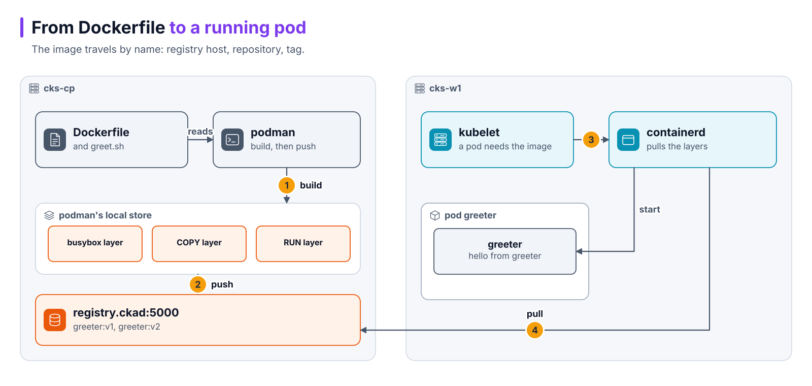
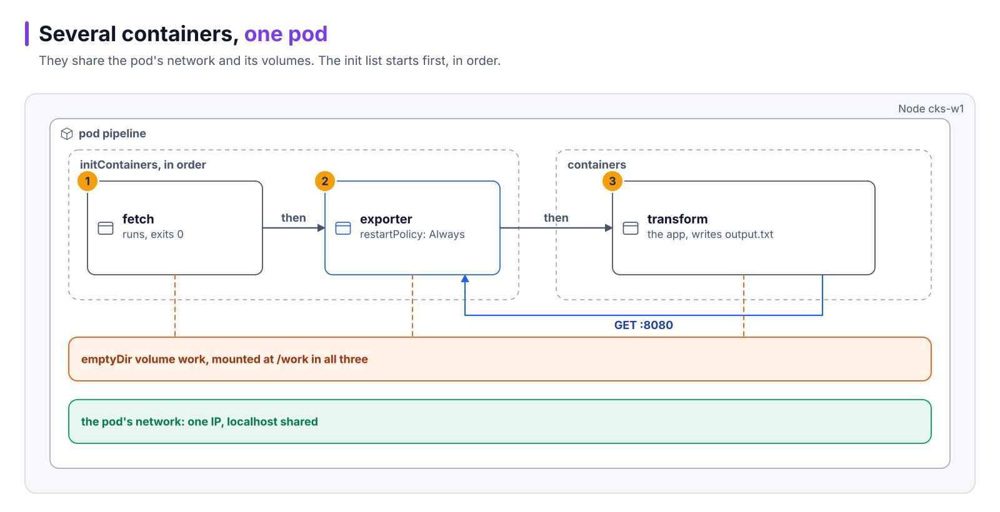

# Module 33: Building and running applications

> New to a term here, like init container or PersistentVolumeClaim? The [glossary](../glossary.md#applications-on-kubernetes) explains every term these modules use.

**Before this module:** the [practice cluster](../practice-cluster.md#the-application-extras) running, with the application extras from `./platform-engineering/practice/app-extras/extras.sh`, because tasks 1 and 2 build images with podman and push them to the local registry.

An application reaches Kubernetes in two pieces. The first piece is an [image](../glossary.md#image), a packed file system with everything the program needs, and the second is a workload object that tells the cluster how many copies of that image to run, on which nodes, and when they may stop. This module covers both pieces: how you build and change an image, which workload object fits which job, how several containers share one pod, and where a pod keeps data that must survive a restart. It has ten tasks and takes about 1 hour 30 minutes.

## The module in one table

Each task answers one design question, and the table maps the question to the tool that answers it:

| Question | Tool | Task |
|---|---|---|
| How does my code become something a node runs? | a Dockerfile, `podman build`, `podman push` | 1, 2 |
| What prepares a pod before the app starts? | an init container | 3, 10 |
| What runs next to the app for its whole life? | a native sidecar | 4, 10 |
| What runs to the end and then stops? | a Job, a CronJob | 5, 6 |
| What runs once on every node? | a DaemonSet | 7 |
| Where do files live that outlast a pod? | a PersistentVolume and a claim | 8 |
| What keeps a pod running when its node dies? | a Deployment instead of a bare pod | 9 |

## Concept: an image is a stack of layers

Take a small program, the greeter of task 1, which prints a greeting every five seconds. On your laptop it needs a shell, the script itself and one environment variable, and the node that runs it has none of those. Copying the files onto every node by hand breaks the moment a pod moves to another node, so the program has to travel together with everything it needs, as one object that any node fetches by name.

That object is an **image**. A build tool reads a recipe called a [Dockerfile](../glossary.md#dockerfile), runs its instructions one by one, and saves the file system changes of each instruction as a separate [layer](../glossary.md#layer), much like the pages of a flip book where each page only adds what changed. The greeter's Dockerfile has five instructions:

```dockerfile
FROM docker.io/library/busybox:1.36
COPY greet.sh /usr/local/bin/greet.sh
RUN chmod 755 /usr/local/bin/greet.sh
ENV GREETING=hello
CMD ["/usr/local/bin/greet.sh"]
```

`FROM` starts from the layers of an existing image, busybox here, so the greeter gets a shell without building one. `COPY` and `RUN` each add a layer with the changed files, while `ENV` and `CMD` change no files at all and only write settings into the image's configuration, which the container runtime reads when it starts a container. The table lists the instructions the exam uses:

| Instruction | What it does | Typical trap |
|---|---|---|
| `FROM image:tag` | starts from another image's layers | a tag like `latest` changes under you; pin it |
| `COPY src dest` | copies files from the build context into the image | `src` is relative to the context folder, not to the Dockerfile |
| `RUN command` | runs a command at build time and keeps the result as a layer | each `RUN` adds a layer, so chain related commands with `&&` |
| `ENV KEY=value` | sets a variable for every container from this image | a pod's `env` overrides it |
| `WORKDIR /path` | sets the folder later instructions and the container start in | |
| `USER 1000` | sets the user the container runs as | must come after the `RUN` steps that need root |
| `EXPOSE 8080` | documents a port | opens nothing; the Service decides what clients reach |
| `ENTRYPOINT [...]` | the program the container always runs | a pod's `command` replaces it |
| `CMD [...]` | default arguments, or the program when there is no `ENTRYPOINT` | a pod's `args` replaces it |

After the build, the image needs a name that tells a node where to fetch it. A full image name has three parts, and `registry.practice:5000/greeter:v1` shows all of them: the [registry](../glossary.md#registry) host `registry.practice:5000`, the repository `greeter`, and the [tag](../glossary.md#tag) `v1`. A name without a host, like `nginx:1.27-alpine`, points to Docker Hub, which is why the greeter's tag carries the local registry's address. Without that address, the push goes to Docker Hub and the node never finds the image in the local registry.



The figure follows the greeter through four steps, which tasks 1 and 2 run on the practice cluster:

1. `podman build -t registry.practice:5000/greeter:v1 .` reads the Dockerfile in the current folder, the build context, and writes the image into podman's local store on `practice-control-plane`.
2. `podman push registry.practice:5000/greeter:v1` uploads the layers and the manifest to the registry that the name points to.
3. A pod that names the image lands on `practice-worker`, because the control plane node keeps its taint, and the kubelet there asks containerd for the image.
4. containerd pulls the layers from the registry and starts the container from them.

[podman](../glossary.md#podman) and Docker accept the same commands and read the same Dockerfiles, so `docker build` and `docker push` work the same way on an exam host that has Docker instead. `podman save -o file.tar image` writes the image into a single archive file, which some exam tasks ask for when no registry exists, and `podman load -i file.tar` reads it back.

The practice registry speaks plain HTTP, and both podman and containerd refuse plain HTTP by default because an attacker on the network might swap the layers in transit. So the practice node image marks `registry.practice:5000` as insecure in `/etc/containers/registries.conf.d/50-practice.conf` for podman, and in `/etc/containerd/certs.d/registry.practice:5000/hosts.toml` for containerd. An exam host has the same kind of setting already in place, and a `http: server gave HTTP response to HTTPS client` error means the setting is missing.

## Concept: pick the workload that matches the job

A pod on its own runs until something stops it, and nothing brings it back when its node fails, because no controller watches a bare pod. Real applications need more than that: a web server must keep three copies alive, a nightly report must run once and then stop, and a log agent must run exactly once on every node. Each of these needs a different controller, which is a loop in the controller manager that compares the pods that exist with the pods that should exist and creates or deletes pods until both match.

So Kubernetes offers one workload object per kind of job, and each one hands a [pod template](../glossary.md#pod-template) to its controller:

| Object | Keeps | Use it for | Task |
|---|---|---|---|
| Deployment | N identical, interchangeable pods, replaced on updates | web servers, APIs, workers | 9 and module 34 |
| StatefulSet | N pods with fixed names and their own storage | databases, queues | [module 37, task 10](37-services-and-networking.md#task-10-a-statefulset-behind-a-headless-service) |
| DaemonSet | one pod on every node that matches | log and metrics agents, node tools | 7 |
| Job | pods until a number of them succeed | migrations, batch runs | 5 |
| CronJob | one Job per schedule tick | backups, reports, cleanups | 6 |

The template is the same pod spec in every row, which means a container you tested in a bare pod moves into any controller unchanged, and task 9 does exactly that with a pod that has no controller yet.

A [Job](../glossary.md#job) counts successful pods, not running ones. `completions: 6` means six pods must exit with code 0, and `parallelism: 3` means at most three run at the same time, so the Job of task 5 runs two waves of three. `backoffLimit` counts failed pods before the Job gives up, and `activeDeadlineSeconds` stops the whole Job after a time limit even when pods are still retrying. A Job's pods need `restartPolicy: Never` or `OnFailure`, because the default `Always` would restart a finished container forever and the Job would never complete.

A [CronJob](../glossary.md#cronjob) wraps a Job template in a schedule written in cron syntax, where `*/30 * * * *` means minute 0 and minute 30 of every hour. `concurrencyPolicy: Forbid` skips a run while the previous one still works, `successfulJobsHistoryLimit` and `failedJobsHistoryLimit` set how many finished Jobs stay for you to inspect, and `startingDeadlineSeconds` lets the controller skip a run that it missed by more than that many seconds, for example after the control plane was down. The exam often asks you to start a CronJob's work right now, and `kubectl create job NAME --from=cronjob/CRONJOB` creates a Job from the template without waiting for the schedule.

## Concept: several containers in one pod

Go back to the greeter and suppose its log should also reach a central log store. The greeter writes a file and knows nothing about log stores, and changing its code for every new log store makes no sense. A second program next to it solves this: it reads the file and sends the lines on, and the greeter keeps doing only its own job.

For that, both programs need to see the same files and, often, the same network. A pod gives exactly that. Every container in one pod shares the pod's network namespace, so they reach each other on `localhost`, and they share the pod's volumes, so a file one container writes into a shared [emptyDir](../glossary.md#emptydir) volume appears in the other at once. The kubelet also starts and stops them as one unit on one node.



A pod has two lists of containers, and the order in which they start follows from the list each container sits in:

1. The kubelet runs the [init containers](../glossary.md#init-container) one after another, and each must exit with code 0 before the next starts. An init container prepares something: it writes a config file, waits for a database, or fetches data.
2. An init container with `restartPolicy: Always` is a [native sidecar](../glossary.md#native-sidecar). It starts in its place in the init list, but the kubelet moves on as soon as it runs, keeps it running for the pod's whole life, and stops it only after the app containers.
3. The kubelet then starts every container of the `containers` list at the same time, and the pod is Ready when all of them, sidecars included, pass their readiness checks.

The native sidecar became stable in Kubernetes 1.33, and before it a sidecar was simply a second entry in `containers`. That older form still works, but it has two flaws that the native form fixes: the sidecar might start after the app and miss its first log lines, and a Job never completes while a sidecar in `containers` keeps running. A native sidecar starts before the app, and the kubelet stops it when the Job's main container exits, so the Job completes.

Three names describe what the second container does, and the exam uses them loosely:

| Pattern | The extra container | Example |
|---|---|---|
| sidecar | adds a feature next to the app | log shipper, proxy, file syncer |
| adapter | changes the app's output into a shape others expect | turns a log format into JSON, exposes metrics |
| ambassador | stands in front of an outside service for the app | the app talks to `localhost:6379`, the ambassador picks the real Redis |

Task 10 builds all three kinds of container into one pod: an init container that fetches data, a main container that transforms it, and a native sidecar that serves the result over HTTP.

## Concept: volumes that die with the pod, and volumes that outlive it

A container's own file system lives only as long as the container, so a restart after a crash wipes every file the app wrote. A volume solves that, and the pod spec declares it in two places: `spec.volumes` names the volume and its source, and each container's `volumeMounts` says where in its file system the volume appears.

An **emptyDir** volume starts empty when the pod lands on a node and lives exactly as long as the pod, which makes it the right choice for scratch space and for files that containers of one pod share. With `medium: Memory`, it lives in RAM, and `sizeLimit` caps it. The kubelet deletes an emptyDir together with its pod, so data that must outlive the pod needs a different kind of volume.

Durable storage comes as a [PersistentVolume](../glossary.md#persistentvolume), a piece of storage that the cluster knows about, such as a cloud disk, an NFS share, or here a folder on a node. A pod never names a PersistentVolume directly, because the developer who writes the pod spec rarely knows which disks exist. The pod names a [PersistentVolumeClaim](../glossary.md#persistentvolumeclaim) instead, which is a request for storage of a size, an [access mode](../glossary.md#access-mode) and a [StorageClass](../glossary.md#storageclass), much like a cloakroom ticket that names the size of coat hanger you need and not the hanger itself.

The control plane binds a claim to a volume that matches all three, and the claim then shows `Bound` with the volume's name. Cloud clusters create matching volumes on demand through a provisioner, but the practice cluster has none, which is also common in exam clusters, so you create the PersistentVolume yourself. The binding needs three things to agree:

1. The `storageClassName` of the claim and the volume must match exactly, and a claim without one gets the cluster's default class, which on a cluster without a default means no class.
2. The volume's capacity must be at least the claim's request, so a 1Gi volume serves a 500Mi claim, and the claim then reports the full 1Gi.
3. The volume must offer the access mode the claim asks for, such as `ReadWriteOnce`, which lets one node mount it for writing.

A `hostPath` volume points at a folder on whatever node runs the pod. Task 8 uses one for the PersistentVolume because the practice cluster has no shared storage, and the data then sits in `/var/lib/ckad-data` on `practice-worker`. If the pod moves to another node, it finds an empty folder there, which is why real clusters keep hostPath for node agents and practice.

## The bigger picture: images and templates as the contract

Every concept in this module draws the same line between the application and the platform. The image fixes what runs, the workload object fixes how it runs, and the volumes fix where its data lives. A developer owns the first and describes the other two in YAML, and the cluster carries out that description on whatever nodes exist. That split lets one platform team run hundreds of applications, because no application needs anything from a node beyond what its spec asks for.

The industry keeps moving work out of the app and into the pod around it. Sidecars ship logs, terminate TLS and fetch secrets, and the native sidecar made that pattern safe for Jobs too. Images get smaller and more fixed: a distroless image ships no shell at all, which is why [module 35](35-observing-and-debugging-applications.md#task-5-debug-a-container-that-has-no-shell) shows how to debug one from outside.

## Why this way

Init containers run one at a time, in order, because each step usually depends on the one before it, such as "wait for the database" before "run the schema migration". Running them in parallel would turn a simple list into a dependency graph.

A native sidecar lives in the init list because that list already has an order. Putting the sidecar there tells the kubelet to start it before the app, which plain `containers` never promised.

A pod names a claim rather than a volume because the two belong to different people. The developer asks for 500Mi of fast storage, and the cluster administrator decides which disk provides it, so the same pod spec works on every cluster that has a matching class.

## Task 1: Build an image and push it

**Time budget:** 6 minutes. **Host:** `practice-control-plane`.

```console
$ ./lab.sh task setup 33.1
== setup task 33.1
total 8
-rw-r--r-- 1 root root 163 Nov 20 10:33 Dockerfile
-rw-r--r-- 1 root root  76 Nov 20 10:33 greet.sh
```

> The folder `/opt/apps/1.1` holds a Dockerfile and the script it copies.
> 1. Build the image and tag it `registry.practice:5000/greeter:v1`, then push it to that registry.
> 2. Also save the image as an archive at `/opt/apps/1.1/greeter-v1.tar`.
> 3. Run a pod `greeter` in namespace `build` from the image in the registry.

<details>
<summary>Solution</summary>

Build from inside the folder, because the trailing `.` is the build context, the folder whose files `COPY` reads. The push sends only the layers the registry lacks, and `podman save` writes the same layers into one file:

```console
root@practice-control-plane:~# cd /opt/apps/1.1
root@practice-control-plane:~# podman build -t registry.practice:5000/greeter:v1 .
STEP 1/5: FROM docker.io/library/busybox:1.36
STEP 2/5: COPY greet.sh /usr/local/bin/greet.sh
--> 630a9caa26e1
STEP 3/5: RUN chmod 755 /usr/local/bin/greet.sh
--> 496f6a78e13a
STEP 4/5: ENV GREETING=hello
--> 8dc8dceb3ac5
STEP 5/5: CMD ["/usr/local/bin/greet.sh"]
COMMIT registry.practice:5000/greeter:v1
--> 85279e1b7dfa
Successfully tagged registry.practice:5000/greeter:v1
85279e1b7dfadd6fc4150f930aa5447608248fa1299441c04fa61c453e2c4e74
root@practice-control-plane:~# podman push registry.practice:5000/greeter:v1
Getting image source signatures
Copying blob sha256:0c7d3f7febe73e9e6e78d61e64d41d6e4905adf04dc687f36d2cbffa10f2d494
Copying blob sha256:6d0cc19a6875e48bdb50fd93fbd8c4ba85d1024d1a35552a1f61e1e286c39afd
Copying blob sha256:8228d4ae11676c066e7d2c5f58664c4e8709524ae1735b3420630a5884615057
Copying config sha256:85279e1b7dfadd6fc4150f930aa5447608248fa1299441c04fa61c453e2c4e74
Writing manifest to image destination
root@practice-control-plane:~# podman save -o greeter-v1.tar registry.practice:5000/greeter:v1
...
Writing manifest to image destination
root@practice-control-plane:~# k -n build run greeter --image=registry.practice:5000/greeter:v1
pod/greeter created
root@practice-control-plane:~# k -n build wait pod greeter --for=condition=Ready --timeout=90s
pod/greeter condition met
root@practice-control-plane:~# k -n build logs greeter
hello from greeter
```

Three blobs went up: busybox's own layer, and one layer each for `COPY` and `RUN`. The pod's hostname is its name, so the log line reads `hello from greeter`. `curl http://registry.practice:5000/v2/greeter/tags/list` lists the tags the registry now holds.

</details>

```console
$ ./lab.sh task check 33.1
== check task 33.1
  PASS  the registry holds greeter:v1
  PASS  /opt/apps/1.1/greeter-v1.tar is an image archive
  PASS  pod greeter in build runs registry.practice:5000/greeter:v1
  PASS  pod greeter logs 'hello from greeter'
== task 33.1: 4 passed, 0 failed
```

## Task 2: Change a Dockerfile and roll the new image out

**Time budget:** 7 minutes. **Host:** `practice-control-plane`.

```console
$ ./lab.sh task setup 33.2
== setup task 33.2
deployment.apps/report created
Waiting for deployment "report" rollout to finish: 0 of 1 updated replicas are available...
deployment "report" successfully rolled out
```

> Deployment `report` in namespace `build-report` runs `registry.practice:5000/report:v1`, built from `/opt/apps/1.2`, and logs `color=red user=0`.
> 1. Change the Dockerfile so the image sets `APP_COLOR=blue` and runs as user 1000.
> 2. Build it as `registry.practice:5000/report:v2`, push it, and keep `v1` in the registry.
> 3. Update the Deployment to `v2`.

<details>
<summary>Solution</summary>

Edit the Dockerfile with `vim`: change the `ENV` line and add `USER 1000` at the end, after the `COPY` that still needs root to write `/report.sh`. A new tag leaves the old one in the registry, which keeps `v1` available for a rollback:

```console
root@practice-control-plane:~# cd /opt/apps/1.2
root@practice-control-plane:~# cat Dockerfile
FROM docker.io/library/busybox:1.36
ENV APP_COLOR=blue
COPY report.sh /report.sh
CMD ["sh", "/report.sh"]
USER 1000
root@practice-control-plane:~# podman build -t registry.practice:5000/report:v2 .
...
Successfully tagged registry.practice:5000/report:v2
root@practice-control-plane:~# podman push registry.practice:5000/report:v2
Getting image source signatures
Copying blob sha256:15ca37bf94ec4a3c45141efc4ee06a6e692a03cbbe2a834f823766506fb5cbd9
Copying blob sha256:6d0cc19a6875e48bdb50fd93fbd8c4ba85d1024d1a35552a1f61e1e286c39afd
Copying config sha256:ab374148b77a3b9c5b7cf9c9280ee351c70d3b0f23ec00fe53481562658513a0
Writing manifest to image destination
root@practice-control-plane:~# k -n build-report set image deploy/report report=registry.practice:5000/report:v2
deployment.apps/report image updated
root@practice-control-plane:~# k -n build-report rollout status deploy report
Waiting for deployment "report" rollout to finish: 1 old replicas are pending termination...
deployment "report" successfully rolled out
root@practice-control-plane:~# k -n build-report get pods
NAME                      READY   STATUS        RESTARTS   AGE
report-5fc4c476bf-d6ggj   1/1     Terminating   0          63s
report-868b9774d8-k5srj   1/1     Running       0          0s
root@practice-control-plane:~# k -n build-report get pods
NAME                      READY   STATUS    RESTARTS   AGE
report-868b9774d8-k5srj   1/1     Running   0          31s
root@practice-control-plane:~# k -n build-report logs deploy/report
color=blue user=1000
```

`set image` takes the container's name, `report`, which `kubectl create deploy` derived from the image name. The old pod stayed in `Terminating` for 30 seconds in the test run, because `sh` runs as process 1 in the container and ignores the SIGTERM that asks it to stop, so the kubelet waited for the grace period and then killed it. While both pods exist, `k logs deploy/report` picks one of them, possibly the old one, so wait until only the new pod remains before you read the log.

</details>

```console
$ ./lab.sh task check 33.2
== check task 33.2
  PASS  Deployment report runs registry.practice:5000/report:v2
  PASS  the registry still holds report:v1 and now report:v2
  PASS  the new pods log color=blue user=1000
== task 33.2: 3 passed, 0 failed
```

## Task 3: An init container prepares the content

**Time budget:** 5 minutes. **Host:** `practice-control-plane`.

```console
$ ./lab.sh task setup 33.3
== setup task 33.3
apiVersion: v1
kind: Pod
metadata:
  name: web
  namespace: init-web
spec:
  containers:
  - name: nginx
    image: nginx:1.27-alpine
    ports:
    - containerPort: 80
```

> Extend `/opt/apps/1.3/web.yaml` and create the pod. An init container `prepare` (image `busybox:1.36`) writes the text `ready from init` into `index.html` on an emptyDir volume, and nginx serves that file as its start page from `/usr/share/nginx/html`.

<details>
<summary>Solution</summary>

The init container and nginx mount the same volume at different paths, so the file that `prepare` writes at `/work/index.html` shows up in nginx at `/usr/share/nginx/html/index.html`:

```yaml
spec:
  initContainers:
  - name: prepare
    image: busybox:1.36
    command: ["sh", "-c", "echo 'ready from init' > /work/index.html"]
    volumeMounts:
    - name: html
      mountPath: /work
  containers:
  - name: nginx
    image: nginx:1.27-alpine
    ports:
    - containerPort: 80
    volumeMounts:
    - name: html
      mountPath: /usr/share/nginx/html
  volumes:
  - name: html
    emptyDir: {}
```

```console
root@practice-control-plane:~# k apply -f /opt/apps/1.3/web.yaml
pod/web created
root@practice-control-plane:~# k -n init-web get pod web
NAME   READY   STATUS     RESTARTS   AGE
web    0/1     Init:0/1   0          0s
root@practice-control-plane:~# k -n init-web wait pod web --for=condition=Ready
pod/web condition met
root@practice-control-plane:~# k -n init-web exec web -c nginx -- wget -qO- http://localhost/
ready from init
```

`Init:0/1` means none of the one init container has finished yet. The mount over `/usr/share/nginx/html` hides the image's own start page, which is the point here.

</details>

```console
$ ./lab.sh task check 33.3
== check task 33.3
  PASS  pod web has an init container prepare
  PASS  pod web is Ready
  PASS  nginx serves 'ready from init'
== task 33.3: 3 passed, 0 failed
```

## Task 4: A native sidecar that ships the log

**Time budget:** 6 minutes. **Host:** `practice-control-plane`.

```console
$ ./lab.sh task setup 33.4
== setup task 33.4
NAME   READY   UP-TO-DATE   AVAILABLE   AGE
app    1/1     1            1           1s
```

> Deployment `app` in namespace `sidecar` writes order lines to `/var/log/app/app.log` on an emptyDir volume `logs`. Add a native sidecar container `shipper` (image `busybox:1.36`) that runs `tail -F /var/log/app/app.log`, so that `kubectl logs` on the shipper shows the orders.

<details>
<summary>Solution</summary>

A native sidecar is an init container with `restartPolicy: Always`. A patch file with only the new part keeps the edit small, and `kubectl patch` merges the `initContainers` list into the template:

```yaml
spec:
  template:
    spec:
      initContainers:
      - name: shipper
        image: busybox:1.36
        restartPolicy: Always
        command: ["sh", "-c", "tail -F /var/log/app/app.log"]
        volumeMounts:
        - name: logs
          mountPath: /var/log/app
```

```console
root@practice-control-plane:~# k -n sidecar patch deploy app --patch-file /opt/apps/1.4/patch.yaml
deployment.apps/app patched
root@practice-control-plane:~# k -n sidecar rollout status deploy app
Waiting for deployment "app" rollout to finish: 1 old replicas are pending termination...
deployment "app" successfully rolled out
root@practice-control-plane:~# k -n sidecar get pod -l app=app
NAME                   READY   STATUS        RESTARTS   AGE
app-55c75977f8-hdprh   1/1     Terminating   0          63s
app-59f7fcff86-gsnzd   2/2     Running       0          0s
root@practice-control-plane:~# k -n sidecar get pod -l app=app
NAME                   READY   STATUS    RESTARTS   AGE
app-59f7fcff86-gsnzd   2/2     Running   0          33s
root@practice-control-plane:~# k -n sidecar logs deploy/app -c shipper --tail=3
10:38:20 order 9 accepted
10:38:23 order 10 accepted
10:38:26 order 11 accepted
```

The new pod shows `2/2`, which counts the sidecar with the app. `tail -F`, with a capital F, keeps reading when the file appears late or gets replaced, while `tail -f` gives up on a file that does not exist yet. Without `restartPolicy: Always`, the kubelet would wait for `shipper` to exit before it starts `app`, and the pod would hang in `Init:0/1` forever.

</details>

```console
$ ./lab.sh task check 33.4
== check task 33.4
  PASS  the pod template has a native sidecar named shipper
  PASS  the Deployment is rolled out
  PASS  the shipper's log shows the orders
  PASS  container app still writes the log
== task 33.4: 4 passed, 0 failed
```

## Task 5: A Job with parallel completions

**Time budget:** 5 minutes. **Host:** `practice-control-plane`.

> In namespace `batch`, create a Job `checksum` with image `busybox:1.36` that runs `sh -c 'echo "checksum done on $(hostname)"; sleep 3'`. It must complete 6 times, run at most 3 pods at once, retry at most 3 failed pods, and stop after 120 seconds in total. Its pods carry the label `job-type=checksum`.

<details>
<summary>Solution</summary>

`kubectl create job` writes the skeleton with `$do`, and you add the four numbers and the label in `vim`:

```console
root@practice-control-plane:~# mkdir -p /opt/apps/1.5
root@practice-control-plane:~# k -n batch create job checksum --image=busybox:1.36 $do -- sh -c 'echo "checksum done on $(hostname)"; sleep 3' > /opt/apps/1.5/job.yaml
```

```yaml
spec:
  completions: 6
  parallelism: 3
  backoffLimit: 3
  activeDeadlineSeconds: 120
  template:
    metadata:
      labels:
        job-type: checksum
    spec:
      containers:
      - name: checksum
        image: busybox:1.36
        command: ["sh", "-c", "echo \"checksum done on $(hostname)\"; sleep 3"]
      restartPolicy: Never
```

```console
root@practice-control-plane:~# k apply -f /opt/apps/1.5/job.yaml
job.batch/checksum created
root@practice-control-plane:~# k -n batch get pods -l job-type=checksum
NAME             READY   STATUS              RESTARTS   AGE
checksum-28cw9   0/1     Pending             0          0s
checksum-8cwc7   0/1     ContainerCreating   0          0s
checksum-bt2f2   0/1     ContainerCreating   0          0s
root@practice-control-plane:~# k -n batch wait job checksum --for=condition=Complete --timeout=120s
job.batch/checksum condition met
root@practice-control-plane:~# k -n batch get job checksum
NAME       STATUS     COMPLETIONS   DURATION   AGE
checksum   Complete   6/6           12s        12s
```

Three pods started at once, as `parallelism` asked, and the six completions took 12 seconds in the test run: two waves of three pods, each sleeping 3 seconds plus the start-up time. `activeDeadlineSeconds` sits in the Job's spec, not in the pod template, because it limits the whole Job.

</details>

```console
$ ./lab.sh task check 33.5
== check task 33.5
  PASS  Job checksum: 6 completions, 3 at a time, backoffLimit 3, deadline 120s
  PASS  its pods carry the label job-type=checksum
  PASS  the Job completed 6 times
  PASS  a pod logged its checksum line
== task 33.5: 4 passed, 0 failed
```

## Task 6: A CronJob, and a run right now

**Time budget:** 6 minutes. **Host:** `practice-control-plane`.

> In namespace `batch-cron`, create a CronJob `cleanup` (image `busybox:1.36`, command `sh -c 'echo removed temporary files'`) that runs at minute 0 and 30 of every hour, never runs two Jobs at once, keeps 2 successful and 4 failed Jobs, and skips a run that starts more than 60 seconds late. Then start it once right away as a Job `cleanup-now`.

<details>
<summary>Solution</summary>

Generate the CronJob, then add the four fields at the top of its `spec`, next to `schedule`:

```console
root@practice-control-plane:~# mkdir -p /opt/apps/1.6
root@practice-control-plane:~# k -n batch-cron create cronjob cleanup --image=busybox:1.36 --schedule='*/30 * * * *' $do -- sh -c 'echo removed temporary files' > /opt/apps/1.6/cj.yaml
```

```yaml
spec:
  concurrencyPolicy: Forbid
  successfulJobsHistoryLimit: 2
  failedJobsHistoryLimit: 4
  startingDeadlineSeconds: 60
  schedule: '*/30 * * * *'
```

```console
root@practice-control-plane:~# k apply -f /opt/apps/1.6/cj.yaml
cronjob.batch/cleanup created
root@practice-control-plane:~# k -n batch-cron create job cleanup-now --from=cronjob/cleanup
job.batch/cleanup-now created
root@practice-control-plane:~# k -n batch-cron wait job cleanup-now --for=condition=Complete
job.batch/cleanup-now condition met
root@practice-control-plane:~# k -n batch-cron logs job/cleanup-now
removed temporary files
```

`--from=cronjob/cleanup` copies the Job template and records the CronJob as the Job's owner, so the check finds the link in `metadata.ownerReferences`. The four history and timing fields belong to the CronJob's own `spec`, not to `jobTemplate`, which is the most common place to put them wrong.

</details>

```console
$ ./lab.sh task check 33.6
== check task 33.6
  PASS  CronJob cleanup runs every 30 minutes and forbids overlaps
  PASS  it keeps 2 successful and 4 failed Jobs, and starts at most 60s late
  PASS  Job cleanup-now came from the CronJob and completed
  PASS  its pod logged 'removed temporary files'
== task 33.6: 4 passed, 0 failed
```

## Task 7: A DaemonSet on every node

**Time budget:** 5 minutes. **Host:** `practice-control-plane`.

> In namespace `agents`, create a DaemonSet `node-agent` (label `app=node-agent`, image `busybox:1.36`, command `sleep 1d`) whose container requests 10m CPU and 16Mi memory. It must run on both nodes, the control plane included.

<details>
<summary>Solution</summary>

`kubectl create` has no DaemonSet generator, so write the manifest, or generate a Deployment with `$do` and change its `kind`, then delete `replicas` and `strategy`. The control plane node carries a taint that keeps ordinary pods away, and a [toleration](../glossary.md#toleration) that matches it lets the DaemonSet's pod in:

```yaml
apiVersion: apps/v1
kind: DaemonSet
metadata:
  name: node-agent
  namespace: agents
spec:
  selector:
    matchLabels:
      app: node-agent
  template:
    metadata:
      labels:
        app: node-agent
    spec:
      tolerations:
      - key: node-role.kubernetes.io/control-plane
        operator: Exists
        effect: NoSchedule
      containers:
      - name: agent
        image: busybox:1.36
        command: ["sleep", "1d"]
        resources:
          requests:
            cpu: 10m
            memory: 16Mi
```

```console
root@practice-control-plane:~# k describe node practice-control-plane | grep Taints
Taints:             node-role.kubernetes.io/control-plane:NoSchedule
root@practice-control-plane:~# k apply -f /opt/apps/1.7/ds.yaml
daemonset.apps/node-agent created
root@practice-control-plane:~# k -n agents rollout status ds node-agent
Waiting for daemon set "node-agent" rollout to finish: 0 of 2 updated pods are available...
Waiting for daemon set "node-agent" rollout to finish: 1 of 2 updated pods are available...
daemon set "node-agent" successfully rolled out
root@practice-control-plane:~# k -n agents get pod -o wide
NAME               READY   STATUS    RESTARTS   AGE   IP               NODE     NOMINATED NODE   READINESS GATES
node-agent-pqcr8   1/1     Running   0          0s    10.244.143.5     practice-control-plane   <none>           <none>
node-agent-z52lp   1/1     Running   0          0s    10.244.135.103   practice-worker   <none>           <none>
```

Without the toleration, the DaemonSet would report 1 of 1 pods and skip `practice-control-plane` without any error, so always compare the pod count with the node count.

</details>

```console
$ ./lab.sh task check 33.7
== check task 33.7
  PASS  DaemonSet node-agent has a ready pod on both nodes
  PASS  one of its pods runs on practice-control-plane
  PASS  the container requests 10m CPU and 16Mi memory
== task 33.7: 3 passed, 0 failed
```

## Task 8: A PersistentVolume, a claim and a pod

**Time budget:** 7 minutes. **Host:** `practice-control-plane`.

> 1. Create a PersistentVolume `ckad-pv-data`: 1Gi, access mode `ReadWriteOnce`, StorageClass `manual`, hostPath `/var/lib/ckad-data`.
> 2. In namespace `storage`, create a PersistentVolumeClaim `data-claim` for 500Mi of class `manual`.
> 3. Create a pod `writer` (image `busybox:1.36`) that mounts the claim at `/data` and appends a line `visit <time>` to `/data/visits.log` every 5 seconds.

<details>
<summary>Solution</summary>

One file holds all three objects. The PersistentVolume has no namespace, because it belongs to the whole cluster, while the claim and the pod sit in `storage`:

```yaml
apiVersion: v1
kind: PersistentVolume
metadata:
  name: ckad-pv-data
spec:
  capacity:
    storage: 1Gi
  accessModes: ["ReadWriteOnce"]
  storageClassName: manual
  hostPath:
    path: /var/lib/ckad-data
    type: DirectoryOrCreate
---
apiVersion: v1
kind: PersistentVolumeClaim
metadata:
  name: data-claim
  namespace: storage
spec:
  accessModes: ["ReadWriteOnce"]
  storageClassName: manual
  resources:
    requests:
      storage: 500Mi
---
apiVersion: v1
kind: Pod
metadata:
  name: writer
  namespace: storage
spec:
  containers:
  - name: writer
    image: busybox:1.36
    command: ["sh", "-c", "while true; do echo visit $(date +%T) >> /data/visits.log; sleep 5; done"]
    volumeMounts:
    - name: data
      mountPath: /data
  volumes:
  - name: data
    persistentVolumeClaim:
      claimName: data-claim
```

```console
root@practice-control-plane:~# k apply -f /opt/apps/1.8/storage.yaml
persistentvolume/ckad-pv-data created
persistentvolumeclaim/data-claim created
pod/writer created
root@practice-control-plane:~# k -n storage get pvc data-claim
NAME         STATUS   VOLUME         CAPACITY   ACCESS MODES   STORAGECLASS   VOLUMEATTRIBUTESCLASS   AGE
data-claim   Bound    ckad-pv-data   1Gi        RWO            manual         <unset>                 0s
root@practice-control-plane:~# k -n storage get pod writer -o wide
NAME     READY   STATUS    RESTARTS   AGE   IP               NODE     NOMINATED NODE   READINESS GATES
writer   1/1     Running   0          0s    10.244.135.104   practice-worker   <none>           <none>
```

The claim reports 1Gi, the size of the volume it got, not the 500Mi it asked for. The pod runs on `practice-worker`, so the file sits on that node:

```console
root@practice-worker:~# cat /var/lib/ckad-data/visits.log
visit 10:40:29
visit 10:40:34
```

`type: DirectoryOrCreate` makes the kubelet create the folder when it is missing. A claim that stays `Pending` almost always has a class, size or access mode that no volume matches, and `k describe pvc` names the reason.

</details>

```console
$ ./lab.sh task check 33.8
== check task 33.8
  PASS  PersistentVolume ckad-pv-data: 1Gi, ReadWriteOnce, class manual, hostPath /var/lib/ckad-data
  PASS  PVC data-claim in storage is Bound to ckad-pv-data
  PASS  pod writer mounts the claim at /data and is Ready
  PASS  the file lands on practice-worker in /var/lib/ckad-data/visits.log
== task 33.8: 4 passed, 0 failed
```

## Task 9: From a bare pod to a Deployment

**Time budget:** 6 minutes. **Host:** `practice-control-plane`.

```console
$ ./lab.sh task setup 33.9
== setup task 33.9
pod/api condition met
NAME   READY   STATUS    RESTARTS   AGE   LABELS
api    1/1     Running   0          1s    app=api,tier=backend
```

> The pod `api` in namespace `legacy` has no controller. Replace it with a Deployment `api` that runs 3 copies of exactly the same container: the same labels, image, environment variables, port and resource requests. Delete the bare pod.

<details>
<summary>Solution</summary>

Save the pod's spec as a reference, generate a Deployment skeleton, and copy the container block from the first file into the second's template:

```console
root@practice-control-plane:~# mkdir -p /opt/apps/1.9
root@practice-control-plane:~# k -n legacy get pod api -o yaml > /opt/apps/1.9/pod.yaml
root@practice-control-plane:~# k -n legacy create deploy api --image=nginx:1.27-alpine --replicas=3 $do > /opt/apps/1.9/deploy.yaml
```

```yaml
spec:
  replicas: 3
  selector:
    matchLabels:
      app: api
  template:
    metadata:
      labels:
        app: api
        tier: backend
    spec:
      containers:
      - name: api
        image: nginx:1.27-alpine
        env:
        - name: MODE
          value: production
        - name: LOG_LEVEL
          value: warn
        ports:
        - containerPort: 80
        resources:
          requests:
            cpu: 50m
            memory: 32Mi
```

```console
root@practice-control-plane:~# k apply -f /opt/apps/1.9/deploy.yaml
deployment.apps/api created
root@practice-control-plane:~# k -n legacy delete pod api
pod "api" deleted from legacy namespace
root@practice-control-plane:~# k -n legacy rollout status deploy api
deployment "api" successfully rolled out
root@practice-control-plane:~# k -n legacy get pod --show-labels
NAME                   READY   STATUS    RESTARTS   AGE   LABELS
api-6c56c7b89c-9gvj8   1/1     Running   0          2s    app=api,pod-template-hash=6c56c7b89c,tier=backend
api-6c56c7b89c-c96b4   1/1     Running   0          2s    app=api,pod-template-hash=6c56c7b89c,tier=backend
api-6c56c7b89c-pb954   1/1     Running   0          2s    app=api,pod-template-hash=6c56c7b89c,tier=backend
```

Delete the bare pod only after the Deployment exists, but know that the Deployment never adopts it: a bare pod with matching labels has no owner reference, and the ReplicaSet counts only pods that also carry its `pod-template-hash`. Copy only the container, the labels and the pod-level settings from the pod's YAML, and leave out `status`, `nodeName`, `uid` and the token volume, which the cluster added.

</details>

```console
$ ./lab.sh task check 33.9
== check task 33.9
  PASS  Deployment api has 3 ready replicas
  PASS  its pods keep the labels, image, env and requests of the old pod
  PASS  the bare pod api is gone
== task 33.9: 3 passed, 0 failed
```

## Task 10: Init, sidecar and main container in one pod

**Time budget:** 10 minutes. **Host:** `practice-control-plane`.

> In namespace `etl`, create a pod `pipeline` with three containers, all `busybox:1.36`, sharing one emptyDir volume `work` mounted at `/work`:
> 1. An init container `fetch` writes three lines `alpha`, `beta` and `gamma` to `/work/input.txt`, then exits.
> 2. A native sidecar `exporter` serves `/work` over HTTP on port 8080 with `httpd -f -p 8080 -h /work`.
> 3. The main container `transform` writes `input.txt` in capitals to `/work/output.txt` every 10 seconds.
>
> `http://localhost:8080/output.txt`, fetched from inside the pod, must return the capitals.

<details>
<summary>Solution</summary>

The order of the init list matters here: `fetch` comes first, because it must finish before anything reads its file, and `exporter` second, because the kubelet only moves on to `transform` after the sidecar has started:

```yaml
apiVersion: v1
kind: Pod
metadata:
  name: pipeline
  namespace: etl
spec:
  initContainers:
  - name: fetch
    image: busybox:1.36
    command: ["sh", "-c", "printf 'alpha\\nbeta\\ngamma\\n' > /work/input.txt"]
    volumeMounts:
    - {name: work, mountPath: /work}
  - name: exporter
    image: busybox:1.36
    restartPolicy: Always
    command: ["httpd", "-f", "-p", "8080", "-h", "/work"]
    ports:
    - containerPort: 8080
    volumeMounts:
    - {name: work, mountPath: /work}
  containers:
  - name: transform
    image: busybox:1.36
    command: ["sh", "-c", "while true; do tr a-z A-Z < /work/input.txt > /work/output.txt; sleep 10; done"]
    volumeMounts:
    - {name: work, mountPath: /work}
  volumes:
  - name: work
    emptyDir: {}
```

```console
root@practice-control-plane:~# k apply -f /opt/apps/1.10/pipeline.yaml
pod/pipeline created
root@practice-control-plane:~# k -n etl wait pod pipeline --for=condition=Ready
pod/pipeline condition met
root@practice-control-plane:~# k -n etl get pod pipeline
NAME       READY   STATUS    RESTARTS   AGE
pipeline   2/2     Running   0          1s
root@practice-control-plane:~# k -n etl exec pipeline -c transform -- wget -qO- http://localhost:8080/output.txt
ALPHA
BETA
GAMMA
```

`READY 2/2` counts `exporter` and `transform`, and leaves out `fetch`, which has already exited. The `transform` container reaches the sidecar on `localhost`, because every container in a pod shares the pod's network. Inside double quotes in YAML, `\\n` becomes `\n`, which `printf` then turns into a new line.

</details>

```console
$ ./lab.sh task check 33.10
== check task 33.10
  PASS  pod pipeline: init container fetch runs once, exporter is a native sidecar
  PASS  the main container is transform, and one emptyDir volume work is shared by all three
  PASS  pod pipeline is Ready
  PASS  the exporter serves output.txt in capitals on port 8080
== task 33.10: 4 passed, 0 failed
```

## Clean up

`./platform-engineering/practice/app-extras/reset.sh` deletes every namespace the tasks created, the PersistentVolume `ckad-pv-data`, the images in podman's store and the registry's contents, and leaves the cluster as the CKS track expects it.
