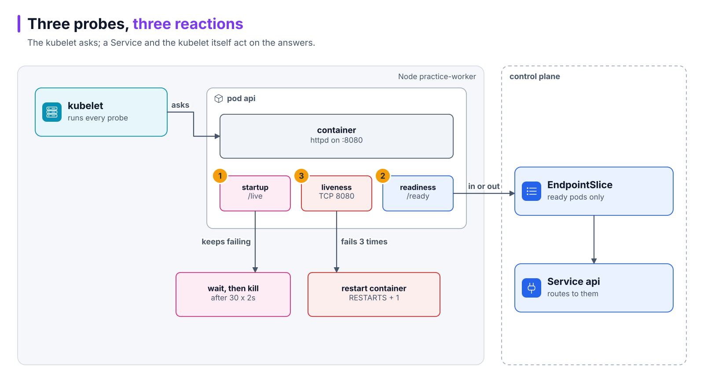

# Module 35: Observing and debugging applications

> New to a term here, like readiness probe or ephemeral container? The [glossary](../glossary.md#applications-on-kubernetes) explains every term these modules use.

**Before this module:** [module 33](33-building-and-running-applications.md) and [module 34](34-deploying-and-updating-applications.md), because the probes here decide when a rolling update moves on. Task 4 needs metrics-server, which its setup installs.

A running pod tells you very little by itself, because `Running` only means that a process exists, not that it answers requests or that it will still answer in five minutes. This module is about seeing inside an application and keeping it healthy: probes that let the kubelet test the app, logs and metrics that show what it does, debugging tools for containers that have no shell, and manifests that need updating when an API version disappears. It has eight tasks and takes about 1 hour 5 minutes.

## The module in one table

| Question | Tool | Task |
|---|---|---|
| When does a pod get traffic, and when does it get restarted? | readiness, liveness and startup probes | 1, 2 |
| What did a container print before it crashed? | `kubectl logs --previous` | 3 |
| Which pod uses the most CPU or memory? | `kubectl top` with metrics-server | 4 |
| How do I look inside a container without a shell? | `kubectl debug` with an ephemeral container | 5 |
| Why does a pod never start? | `kubectl describe`, `kubectl events` | 6, 8 |
| Which API version does a manifest need today? | `kubectl api-resources`, `kubectl explain` | 7 |

## Concept: three probes, three questions

Take the API server of task 1, a small web server on port 8080 behind a Service. The kubelet starts its container and sees the process running, but that tells it nothing about the server: it might still load its data, it might be stuck in a deadlock, or it might answer every request with an error. Sending users to it in any of those states loses requests, and leaving a deadlocked process alone keeps it broken forever.

So the kubelet asks the app directly, with a [probe](../glossary.md#probe): a small test it runs on a schedule, either an HTTP request (`httpGet`), a TCP connection (`tcpSocket`), a command inside the container (`exec`), or a gRPC health call. Each probe has one job, and the three jobs differ in what happens when the answer is no:

| Probe | The question | When it fails |
|---|---|---|
| [readiness](../glossary.md#readiness-probe) | should this pod get requests now? | the pod leaves the Service's endpoints; nothing restarts |
| [liveness](../glossary.md#liveness-probe) | is the process still healthy, or stuck for good? | the kubelet kills the container and starts it again |
| [startup](../glossary.md#startup-probe) | has a slow app finished starting? | the kubelet keeps waiting, and kills it after `failureThreshold × periodSeconds` |



The figure shows the order on one pod, which follows from the startup probe's job:

1. While a startup probe exists and hasn't succeeded yet, the kubelet runs no other probe, so a slow start never counts as a liveness failure.
2. After the startup probe succeeds once, the kubelet runs readiness and liveness on their own schedules for the rest of the container's life.
3. Each readiness answer adds the pod to the Service's [EndpointSlice](../glossary.md#endpointslice) or removes it, which is exactly the signal a rolling update in [module 34](34-deploying-and-updating-applications.md#concept-a-deployment-changes-versions-through-replicasets) waits for.
4. A run of liveness failures as long as `failureThreshold` makes the kubelet restart the container, and the `RESTARTS` column counts up.

Five numbers tune every probe: `initialDelaySeconds` before the first try, `periodSeconds` between tries, `timeoutSeconds` for one answer, `failureThreshold` failures in a row before the probe counts as failed, and `successThreshold` successes in a row before it counts as passed again, which must be 1 for liveness and startup. The defaults are 0, 10, 1, 3 and 1.

A liveness probe that checks the wrong thing turns a healthy app into a crash loop, which is the trap of task 2: a probe on the wrong port fails on a perfect server, and the kubelet restarts the server every few seconds. A liveness probe should therefore test only the process itself, never a database or another service behind it, because an outage of that dependency would then restart every pod at once and make the outage worse. Dependency checks belong in the readiness probe, which only takes the pod out of rotation.

## Concept: logs, events and metrics

A container's logs are whatever its process writes to standard output and standard error. The container runtime stores them in a file on the node, `/var/log/pods/NAMESPACE_POD_UID/CONTAINER/0.log`, and `kubectl logs` asks the kubelet to read that file through the API server, so you never log in to the node. The kubelet keeps the log of exactly one earlier run of each container, so the reason a crashed container died stays readable until the next crash, and which command shows it depends on the pod's state. While the pod waits to restart, with `STATUS` showing `Error` or `CrashLoopBackOff`, the crashed run still counts as the current container, so plain `kubectl logs` shows it and `--previous` fails with `unable to retrieve container logs`, which the test run hit. Once the container runs again, the crashed run becomes the previous one, and `--previous` shows it:

| Command | Shows |
|---|---|
| `k logs POD` | the current container's log; add `-c NAME` when the pod has several containers |
| `k logs POD --previous` | the log of the container's last run before the restart |
| `k logs deploy/NAME` | the log of one pod of the Deployment, picked by kubectl |
| `k logs -l app=x --prefix --tail=20` | the last 20 lines of every pod with that label, each with its pod name |
| `k logs POD -f --since=5m` | follows the log, starting 5 minutes back |

[Events](../glossary.md#event) tell the cluster's side of the story: the scheduler explains why a pod stays `Pending`, the kubelet reports image pulls, probe failures and kills, and controllers report what they refused to create. `kubectl describe` shows the events of one object at the end of its output, and `kubectl events --types=Warning` lists the warnings of a namespace. The API server keeps events for one hour, so an old failure has no event left.

Metrics answer a third question, how much CPU and memory each pod uses right now. The kubelet measures every container, and [metrics-server](../glossary.md#metrics-server) collects those numbers from every node every 15 seconds and serves them through the API, where `kubectl top pod` and `kubectl top node` read them. A new pod shows no numbers for its first minute, because metrics-server needs two samples to compute a rate. `--sort-by=cpu` or `--sort-by=memory` sorts the list, and `--containers` splits it per container.

## Concept: debugging a container from the outside

Modern images often ship without a shell, because every extra binary in an image adds size and something an attacker might use. A [distroless image](../glossary.md#distroless-image) holds only the application and its libraries, so `kubectl exec POD -- sh` fails with `executable file not found`, and the usual way into a container is gone.

`kubectl debug` adds a way back in without restarting the pod. It appends an [ephemeral container](../glossary.md#ephemeral-container), a temporary container with an image you choose, such as `busybox`, to the running pod. With `--target=app`, the new container joins the process namespace of the container `app`, so `ps` inside the debugger lists the app's processes, and `/proc/1/root` shows the app's file system. The pod keeps running the whole time, and the ephemeral container stays in its spec until the pod goes away, because a pod's container list never shrinks.

Two more forms of `kubectl debug` help in other situations. `kubectl debug POD -it --copy-to=POD-debug --container=app --image=busybox -- sh` makes a copy of the pod with a changed container, which helps when the original crashes too fast to inspect. `kubectl debug node/practice-worker -it --image=busybox` starts a pod on the node with the node's file system mounted at `/host`, which replaces an `ssh` to the node.

## Concept: API versions come and go

Every Kubernetes object has an API group and a version, such as `apps/v1` for a Deployment, and a version moves through stages: `v1alpha1` for experiments, `v1beta1` for features that may still change, and `v1` for stable ones. When a stable version exists, the beta version gets marked as deprecated and, a few releases later, removed. From that release on, the API server refuses every manifest that names it, with `no matches for kind "Deployment" in version "extensions/v1beta1"`.

So an old manifest needs a new `apiVersion`, and sometimes new fields too, because a version change may rename or move fields. Task 7 meets three examples, all real removals:

| Old | Removed in | New | What else changed |
|---|---|---|---|
| `extensions/v1beta1` Deployment | 1.16 | `apps/v1` | `spec.selector` is now required |
| `policy/v1beta1` PodDisruptionBudget | 1.25 | `policy/v1` | nothing for this manifest |
| `autoscaling/v2beta1` HorizontalPodAutoscaler | 1.25 | `autoscaling/v2` | `targetAverageUtilization: 70` became `target: {type: Utilization, averageUtilization: 70}` |

Three commands find the right version on any cluster, because they read the cluster's own API. `kubectl api-resources` lists every resource with its current group and version, `kubectl api-versions` lists every group and version the API server serves, and `kubectl explain hpa.spec.metrics.resource.target --api-version=autoscaling/v2` shows the fields of one version. The [deprecation guide](https://kubernetes.io/docs/reference/using-api/deprecation-guide/) on kubernetes.io lists each removal with its field changes.

The `kubectl convert` plugin rewrites a manifest from one version to another, but only between versions that its own code still knows. The 1.37 plugin knows none of the removed versions in the table, so on task 7's file it stops with `no kind "HorizontalPodAutoscaler" is registered for version "autoscaling/v2beta1"`. It helps with versions that the API server still serves after their deprecation, and for removed ones the manual edit with `kubectl explain` is the reliable path.

## The bigger picture: the cluster tests your app all day

Probes turn the kubelet into a tireless tester that asks every container the same questions every few seconds, and the rest of Kubernetes acts on its answers: Services route by readiness, Deployments pace updates by it, and the kubelet restarts what fails liveness. An application that answers those questions truthfully gets self-healing for free, and one that answers them carelessly gets restarted at the worst moment.

Logs, events and `kubectl top` are the built-in floor of observability, enough for the exam and for a first look. Production clusters collect the same signals centrally, with Prometheus for metrics, a log store such as Loki, and traces, which the course builds in [module 23](../2-intermediate/23-prometheus-and-alerting.md) and [module 25](../3-advanced/25-opentelemetry-and-tempo.md).

## Why this way

Readiness and liveness stay separate because the right reaction differs. A pod that is busy or waiting for a dependency should stop getting requests and come back on its own, while a pod that is stuck forever only recovers through a restart, and one probe has no way to express both.

`kubectl debug` adds a container rather than changing the image because the image in production should stay small and fixed, while the tools for a one-time investigation come along only when someone needs them.

Kubernetes removes old API versions instead of serving them forever because every served version needs code that converts it to the stored form, and that code would grow with every release.

## Task 1: Readiness, liveness and startup probes

**Time budget:** 6 minutes. **Host:** `practice-control-plane`.

```console
$ ./platform-engineering/task.sh setup 35.1
== setup task 35.1
Waiting for deployment "api" rollout to finish: 0 of 2 updated replicas are available...
Waiting for deployment "api" rollout to finish: 1 of 2 updated replicas are available...
deployment "api" successfully rolled out
```

> Deployment `api` in namespace `probes` serves files on port 8080. Give its container three probes:
> 1. a startup probe: HTTP GET `/live` on 8080, every 2 seconds, up to 30 failures;
> 2. a readiness probe: HTTP GET `/ready` on 8080, every 5 seconds;
> 3. a liveness probe: a TCP connection to 8080, every 10 seconds, 3 failures allowed.

<details>
<summary>Solution</summary>

`k explain deploy.spec.template.spec.containers.startupProbe` lists the fields if you forget them. A patch file with the container's name merges the probes into the existing container:

```yaml
spec:
  template:
    spec:
      containers:
      - name: busybox
        startupProbe:
          httpGet:
            path: /live
            port: 8080
          periodSeconds: 2
          failureThreshold: 30
        readinessProbe:
          httpGet:
            path: /ready
            port: 8080
          periodSeconds: 5
        livenessProbe:
          tcpSocket:
            port: 8080
          periodSeconds: 10
          failureThreshold: 3
```

```console
root@practice-control-plane:~# k -n probes patch deploy api --patch-file /opt/apps/3.1/probes.yaml
deployment.apps/api patched
root@practice-control-plane:~# k -n probes rollout status deploy api
...
deployment "api" successfully rolled out
root@practice-control-plane:~# k -n probes describe pod -l app=api | grep -E 'Liveness|Readiness|Startup' | sort -u
    Liveness:       tcp-socket :8080 delay=0s timeout=1s period=10s successThreshold=1 failureThreshold=3
    Readiness:      http-get http://:8080/ready delay=0s timeout=1s period=5s successThreshold=1 failureThreshold=3
    Startup:        http-get http://:8080/live delay=0s timeout=1s period=2s successThreshold=1 failureThreshold=30
```

`kubectl describe` prints every probe in one line with all five numbers, which makes it the quickest way to verify a probe. The startup probe gives the app up to 60 seconds to start, 30 tries 2 seconds apart, before the kubelet gives up and restarts it.

</details>

```console
$ ./platform-engineering/task.sh check 35.1
== check task 35.1
  PASS  container 1 has a readiness probe: GET /ready on 8080 every 5s
  PASS  a liveness probe: TCP 8080 every 10s, 3 failures allowed
  PASS  a startup probe: GET /live, up to 30 tries 2s apart
  PASS  both pods are ready
== task 35.1: 4 passed, 0 failed
```

## Task 2: Probes that kill a healthy app

**Time budget:** 6 minutes. **Host:** `practice-control-plane`.

```console
$ ./platform-engineering/task.sh setup 35.2
== setup task 35.2
NAME                    READY   STATUS    RESTARTS     AGE
shop-65d9d5cd87-9b46d   0/1     Running   2 (7s ago)   25s
shop-65d9d5cd87-jt2jc   0/1     Running   2 (7s ago)   25s
```

> The nginx pods of Deployment `shop` in namespace `probes-fix` restart again and again and never become ready, although nginx itself works. Fix the probes so the pods become ready and stop restarting. Keep both probes, and point both at nginx's port 80.

<details>
<summary>Solution</summary>

The warning events name both faults: the readiness probe asks for a page that doesn't exist, and the liveness probe calls a port where nothing listens:

```console
root@practice-control-plane:~# k -n probes-fix get pods
NAME                    READY   STATUS             RESTARTS      AGE
shop-65d9d5cd87-9b46d   0/1     Running            5 (57s ago)   2m15s
shop-65d9d5cd87-jt2jc   0/1     CrashLoopBackOff   5 (30s ago)   2m15s
root@practice-control-plane:~# k -n probes-fix events --types=Warning | tail -3
96s (x4 over 2m14s)     Warning   Unhealthy   Pod/shop-65d9d5cd87-9b46d   Readiness probe failed: Get "http://10.244.135.191:80/healthz": dial tcp 10.244.135.191:80: connect: connection refused
96s (x13 over 2m14s)    Warning   Unhealthy   Pod/shop-65d9d5cd87-9b46d   Readiness probe failed: HTTP probe failed with statuscode: 404
94s (x4 over 2m14s)     Warning   Unhealthy   Pod/shop-65d9d5cd87-jt2jc   Readiness probe failed: Get "http://10.244.135.143:80/healthz": dial tcp 10.244.135.143:80: connect: connection refused
```

`k -n probes-fix get deploy shop -o yaml` shows the liveness probe on port 8080, and the 404 above shows that `/healthz` doesn't exist in nginx. One JSON patch changes exactly those two fields:

```console
root@practice-control-plane:~# k -n probes-fix patch deploy shop --type=json -p '[{"op":"replace","path":"/spec/template/spec/containers/0/livenessProbe/httpGet/port","value":80},{"op":"replace","path":"/spec/template/spec/containers/0/readinessProbe/httpGet/path","value":"/"}]'
deployment.apps/shop patched
root@practice-control-plane:~# k -n probes-fix rollout status deploy shop
...
deployment "shop" successfully rolled out
root@practice-control-plane:~# k -n probes-fix get pods
NAME                    READY   STATUS    RESTARTS   AGE
shop-558bfcf96f-n9lzf   1/1     Running   0          5s
shop-558bfcf96f-v62b5   1/1     Running   0          3s
```

The `connection refused` lines come from the moments right after each restart, when nginx hadn't opened port 80 yet. The liveness probe killed each container after 3 plus 2 times 3 seconds, so the containers never lived long enough to pass a readiness check, and the growing wait between restarts turned that into `CrashLoopBackOff`.

</details>

```console
$ ./platform-engineering/task.sh check 35.2
== check task 35.2
  PASS  both pods of shop are ready
  PASS  no restart in the 20 seconds after the rollout
  PASS  both probes still exist and check port 80
== task 35.2: 3 passed, 0 failed
```

## Task 3: Logs of a container that crashed

**Time budget:** 5 minutes. **Host:** `practice-control-plane`.

```console
$ ./platform-engineering/task.sh setup 35.3
== setup task 35.3
NAME                       READY   STATUS   RESTARTS      AGE
billing-84d5744958-6blzl   0/1     Error    1 (18s ago)   31s
```

> The pod of Deployment `billing` in namespace `logs` keeps crashing.
> 1. Save the log of a run that crashed to `/opt/apps/3.3/crash.log`.
> 2. Fix the cause: the app expects `DB_URL=postgres://db.logs:5432/billing`.

<details>
<summary>Solution</summary>

The container runs for 12 seconds before it crashes, so it spends most of its time `Running`, and then `--previous` shows the crashed run:

```console
root@practice-control-plane:~# k -n logs get pods
NAME                       READY   STATUS    RESTARTS      AGE
billing-84d5744958-6blzl   1/1     Running   3 (27s ago)   79s
root@practice-control-plane:~# k -n logs logs deploy/billing --previous
starting billing
FATAL: environment variable DB_URL is not set
root@practice-control-plane:~# k -n logs logs deploy/billing --previous > /opt/apps/3.3/crash.log
root@practice-control-plane:~# k -n logs set env deploy/billing DB_URL=postgres://db.logs:5432/billing
deployment.apps/billing env updated
root@practice-control-plane:~# k -n logs rollout status deploy billing
...
deployment "billing" successfully rolled out
root@practice-control-plane:~# k -n logs logs deploy/billing
starting billing
connected to postgres://db.logs:5432/billing
```

In the test run's first attempt, the pod showed `Error` at that moment, and `--previous` failed with `unable to retrieve container logs`, because the crashed run was still the current container. Plain `k logs` then shows the crash, so read the `STATUS` column before you pick the command.

</details>

```console
$ ./platform-engineering/task.sh check 35.3
== check task 35.3
  PASS  /opt/apps/3.3/crash.log holds the crash message
  PASS  billing's pod is ready and logs 'connected to postgres://db.logs:5432/billing'
== task 35.3: 2 passed, 0 failed
```

## Task 4: Which pod uses the most CPU

**Time budget:** 3 minutes. **Host:** `practice-control-plane`.

```console
$ ./platform-engineering/task.sh setup 35.4
== setup task 35.4
NAME     READY   STATUS    RESTARTS   AGE
calc-a   1/1     Running   0          22s
calc-b   1/1     Running   0          22s
calc-c   1/1     Running   0          22s
```

> 1. Write a command into `/opt/apps/3.4/top.sh` that lists the pods of namespace `metrics-load` with their CPU use, busiest first.
> 2. Write the name of the pod that uses the most CPU into `/opt/apps/3.4/top-pod.txt`.

<details>
<summary>Solution</summary>

```console
root@practice-control-plane:~# echo 'kubectl -n metrics-load top pod --sort-by=cpu' > /opt/apps/3.4/top.sh
root@practice-control-plane:~# bash /opt/apps/3.4/top.sh
NAME     CPU(cores)   MEMORY(bytes)   
calc-b   150m         0Mi             
calc-c   40m          0Mi             
calc-a   1m           0Mi             
root@practice-control-plane:~# echo calc-b > /opt/apps/3.4/top-pod.txt
```

`calc-b` and `calc-c` both run an endless loop, and each uses exactly its CPU limit, 150m and 40m, because the kernel stops a container's processes once they reach the limit in each scheduling period. Write `kubectl` in full in a script, because the `k` alias exists only in interactive shells.

</details>

```console
$ ./platform-engineering/task.sh check 35.4
== check task 35.4
  PASS  /opt/apps/3.4/top-pod.txt names calc-b
  PASS  /opt/apps/3.4/top.sh lists the pods of metrics-load, busiest first
== task 35.4: 2 passed, 0 failed
```

## Task 5: Debug a container that has no shell

**Time budget:** 5 minutes. **Host:** `practice-control-plane`.

```console
$ ./platform-engineering/task.sh setup 35.5
== setup task 35.5
error: Internal error occurred: Internal error occurred: error executing command in container: failed to exec in container: failed to start exec "7f521802c9d96c0d7ec604ee860deaeb445631822dd6b7d845d33053a46a8f32": OCI runtime exec failed: exec failed: unable to start container process: exec: "sh": executable file not found in $PATH
```

> The container `app` of pod `vault` in namespace `debugging` has no shell. Without restarting the pod, attach an ephemeral container `debugger` with image `busybox:1.36` that sees `app`'s processes, and write the command line of `app`'s process into `/opt/apps/3.5/process.txt`.

<details>
<summary>Solution</summary>

Without `-it`, `kubectl debug` starts the debugger and returns at once, so give it a command that keeps it alive, then `exec` into it like into any container:

```console
root@practice-control-plane:~# k -n debugging debug vault --image=busybox:1.36 --target=app -c debugger -- sleep 1d
Targeting container "app". If you don't see processes from this container it may be because the container runtime doesn't support this feature.
root@practice-control-plane:~# k -n debugging wait pod vault --for=jsonpath='{.status.ephemeralContainerStatuses[0].state.running}' --timeout=60s
pod/vault condition met
root@practice-control-plane:~# k -n debugging exec vault -c debugger -- ps
PID   USER     TIME  COMMAND
    1 65535     0:00 /pause
   13 root      0:00 sleep 1d
   19 root      0:00 ps
root@practice-control-plane:~# k -n debugging exec vault -c debugger -- ps -o args | grep -v -E 'ps|sleep|COMMAND' > /opt/apps/3.5/process.txt
root@practice-control-plane:~# cat /opt/apps/3.5/process.txt
/pause
```

Process 1 belongs to `app` and runs as user 65535, while the debugger's own processes run as root. In the exam, `k debug vault -it --image=busybox:1.36 --target=app -- sh` opens an interactive shell in one step, and the same `ps` works there.

</details>

```console
$ ./platform-engineering/task.sh check 35.5
== check task 35.5
  PASS  pod vault has an ephemeral container debugger (busybox:1.36) that targets app
  PASS  /opt/apps/3.5/process.txt holds the command of app's process
  PASS  pod vault was not restarted or replaced
== task 35.5: 3 passed, 0 failed
```

## Task 6: Pods that stay Pending

**Time budget:** 6 minutes. **Host:** `practice-control-plane`.

```console
$ ./platform-engineering/task.sh setup 35.6
== setup task 35.6
NAME                      READY   STATUS    RESTARTS   AGE
report-5bc98b878c-c6d24   0/1     Pending   0          3s
report-5bc98b878c-dcxlw   0/1     Pending   0          3s
```

> The two pods of Deployment `report` in namespace `pending` never start. They are meant to run on nodes labelled `practice-disk=ssd`, which `practice-worker` is, and each needs 100m CPU and 64Mi memory. Make them run on `practice-worker`, and keep the nodeSelector.

<details>
<summary>Solution</summary>

The scheduler explains a `Pending` pod in a `FailedScheduling` event, with one reason per node:

```console
root@practice-control-plane:~# k -n pending events --types=Warning | tail -1
93s         Warning   FailedScheduling   Pod/report-5bc98b878c-dcxlw   0/2 nodes are available: 1 node(s) didn't match Pod's node affinity/selector, 1 node(s) had untolerated taint(s). preemption: 0/2 nodes are available: 2 Preemption is not helpful for scheduling.
root@practice-control-plane:~# k get nodes -L practice-disk
NAME     STATUS   ROLES           AGE   VERSION   CKAD-DISK
practice-control-plane   Ready    control-plane   50m   v1.37.1
practice-worker   Ready    <none>          50m   v1.37.1
root@practice-control-plane:~# k label node practice-worker practice-disk=ssd
node/practice-worker labeled
```

The label alone isn't enough, which `k -n pending describe pod` shows next: with the selector satisfied, the event changes to `1 Insufficient cpu`, because each pod asks for 40 whole CPUs. The scheduler names only the first filter that rejects each node, so a second fault appears only after the first one is gone:

```console
root@practice-control-plane:~# k -n pending set resources deploy report --requests=cpu=100m,memory=64Mi
deployment.apps/report resource requirements updated
root@practice-control-plane:~# k -n pending rollout status deploy report
...
deployment "report" successfully rolled out
root@practice-control-plane:~# k -n pending get pods -o wide
NAME                      READY   STATUS    RESTARTS   AGE   IP               NODE     NOMINATED NODE   READINESS GATES
report-57cbc8947d-qhbjv   1/1     Running   0          2s    10.244.135.168   practice-worker   <none>           <none>
report-57cbc8947d-vfc8x   1/1     Running   0          1s    10.244.135.169   practice-worker   <none>           <none>
```

`practice-control-plane` fails for a third reason, its taint, which is why the event counts `0/2` nodes. Another test run hit a fourth: `1 Too many pods`, after more than 100 task pods had piled up on `practice-worker` without a reset, because a node runs at most 110 pods by default.

</details>

```console
$ ./platform-engineering/task.sh check 35.6
== check task 35.6
  PASS  node practice-worker carries the label practice-disk=ssd
  PASS  the nodeSelector stays, and each pod requests 100m CPU
  PASS  both pods run on practice-worker
== task 35.6: 3 passed, 0 failed
```

## Task 7: Manifests written for APIs that no longer exist

**Time budget:** 8 minutes. **Host:** `practice-control-plane`.

```console
$ ./platform-engineering/task.sh setup 35.7
== setup task 35.7
no matches for kind "Deployment" in version "extensions/v1beta1"
no matches for kind "HorizontalPodAutoscaler" in version "autoscaling/v2beta1"
no matches for kind "PodDisruptionBudget" in version "policy/v1beta1"
```

> `/opt/apps/3.7/legacy.yaml` holds a Deployment, a PodDisruptionBudget and a HorizontalPodAutoscaler for namespace `upgrade`, written for API versions that Kubernetes 1.37 no longer serves. Write a version of the file for the current APIs to `/opt/apps/3.7/current.yaml`, keeping every setting, and apply it.

<details>
<summary>Solution</summary>

Look up the current versions, try the convert plugin, and read the HPA's new metric format with `explain`:

```console
root@practice-control-plane:~# k api-resources | grep -E '^(deployments|poddisruptionbudgets|horizontalpodautoscalers) '
deployments                         deploy       apps/v1                             true         Deployment
horizontalpodautoscalers            hpa          autoscaling/v2                      true         HorizontalPodAutoscaler
poddisruptionbudgets                pdb          policy/v1                           true         PodDisruptionBudget
root@practice-control-plane:~# k convert -f /opt/apps/3.7/legacy.yaml
error: unable to decode "/opt/apps/3.7/legacy.yaml": no kind "HorizontalPodAutoscaler" is registered for version "autoscaling/v2beta1" in scheme "pkg/api/legacyscheme/scheme.go:30"
root@practice-control-plane:~# k explain hpa.spec.metrics.resource.target --api-version=autoscaling/v2 | grep -E '^ +[a-zA-Z]+\s+<'
  averageUtilization	<integer>
  averageValue	<Quantity>
  type	<string> -required-
  value	<Quantity>
```

Copy the file and edit it in four places: `apps/v1` with a `selector` that matches the template's labels, `policy/v1`, `autoscaling/v2` with `apps/v1` in the `scaleTargetRef`, and the metric in its new form:

```yaml
apiVersion: apps/v1
kind: Deployment
...
spec:
  replicas: 2
  selector:
    matchLabels:
      app: catalog
---
apiVersion: policy/v1
kind: PodDisruptionBudget
...
---
apiVersion: autoscaling/v2
kind: HorizontalPodAutoscaler
...
spec:
  scaleTargetRef:
    apiVersion: apps/v1
    kind: Deployment
    name: catalog
  minReplicas: 2
  maxReplicas: 5
  metrics:
  - type: Resource
    resource:
      name: cpu
      target:
        type: Utilization
        averageUtilization: 70
```

```console
root@practice-control-plane:~# k apply -f /opt/apps/3.7/current.yaml
deployment.apps/catalog created
poddisruptionbudget.policy/catalog created
horizontalpodautoscaler.autoscaling/catalog created
root@practice-control-plane:~# k -n upgrade get deploy,pdb,hpa
NAME                      READY   UP-TO-DATE   AVAILABLE   AGE
deployment.apps/catalog   2/2     2            2           1s

NAME                                 MIN AVAILABLE   MAX UNAVAILABLE   ALLOWED DISRUPTIONS   AGE
poddisruptionbudget.policy/catalog   1               N/A               1                     1s

NAME                                          REFERENCE            TARGETS              MINPODS   MAXPODS   REPLICAS   AGE
horizontalpodautoscaler.autoscaling/catalog   Deployment/catalog   cpu: <unknown>/70%   2         5         2          1s
```

The HPA shows `<unknown>` until metrics-server has two samples of the new pods, which takes about a minute. The Deployment's `requests.cpu` matters here, because an HPA computes utilization as a share of the request, and a pod without a request has no utilization at all.

</details>

```console
$ ./platform-engineering/task.sh check 35.7
== check task 35.7
  PASS  /opt/apps/3.7/current.yaml uses apps/v1, policy/v1 and autoscaling/v2 only
  PASS  the file applies cleanly (server dry run)
  PASS  Deployment catalog runs 2 ready pods in upgrade
  PASS  the HPA targets Deployment catalog at 70% CPU, 2 to 5 replicas
  PASS  the PodDisruptionBudget keeps 1 pod of catalog
== task 35.7: 5 passed, 0 failed
```

## Task 8: A client that never reaches its backend

**Time budget:** 8 minutes. **Host:** `practice-control-plane`.

> In namespace `troubleshoot`, pod `client` gets no answer from `http://backend`. Make `wget -qO- http://backend` in `client` return `backend ok`, served by both pods of Deployment `backend`. Keep the Deployment's labels and keep a readiness probe on it.

<details>
<summary>Solution</summary>

Follow the request from the Service to the pods, and look at each link in turn. The EndpointSlice is empty, the pods are not ready, and the Service's selector and port need a look:

```console
root@practice-control-plane:~# k -n troubleshoot get svc,endpointslice
NAME              TYPE        CLUSTER-IP      EXTERNAL-IP   PORT(S)   AGE
service/backend   ClusterIP   10.96.173.114   <none>        80/TCP    3s

NAME                                           ADDRESSTYPE   PORTS     ENDPOINTS   AGE
endpointslice.discovery.k8s.io/backend-ht7hd   IPv4          <unset>   <unset>     3s
root@practice-control-plane:~# k -n troubleshoot get pods --show-labels
NAME                       READY   STATUS    RESTARTS   AGE   LABELS
backend-67c7db7dc7-2r2c9   0/1     Running   0          3s    app=backend,pod-template-hash=67c7db7dc7
backend-67c7db7dc7-d2t48   0/1     Running   0          3s    app=backend,pod-template-hash=67c7db7dc7
client                     1/1     Running   0          3s    <none>
root@practice-control-plane:~# k -n troubleshoot describe pod -l app=backend | grep Readiness | head -2
    Readiness:      http-get http://:8080/health delay=0s timeout=1s period=3s successThreshold=1 failureThreshold=3
    Readiness:      http-get http://:8080/health delay=0s timeout=1s period=3s successThreshold=1 failureThreshold=3
```

`k -n troubleshoot get svc backend -o yaml` shows the other two faults: the selector says `app: back-end` and the target port is 80, while the pods carry `app=backend` and listen on 8080. The readiness probe asks for `/health`, a file the server doesn't have. Fix all three:

```console
root@practice-control-plane:~# k -n troubleshoot patch svc backend -p '{"spec":{"selector":{"app":"backend"},"ports":[{"port":80,"targetPort":8080}]}}'
service/backend patched
root@practice-control-plane:~# k -n troubleshoot patch deploy backend --type=json -p '[{"op":"replace","path":"/spec/template/spec/containers/0/readinessProbe/httpGet/path","value":"/"}]'
deployment.apps/backend patched
root@practice-control-plane:~# k -n troubleshoot rollout status deploy backend
...
deployment "backend" successfully rolled out
root@practice-control-plane:~# k -n troubleshoot get endpointslice
NAME            ADDRESSTYPE   PORTS   ENDPOINTS                                                 AGE
backend-ht7hd   IPv4          8080    10.244.135.98,10.244.135.124,10.244.135.128 + 1 more...   4s
root@practice-control-plane:~# k -n troubleshoot exec client -- wget -qO- http://backend
backend ok
```

The slice listed four addresses for a moment, the old pods and the new ones, and it keeps only the ready ones as soon as the old pods stop. Each fault alone leaves the Service without a working endpoint, so the order in which you find them doesn't matter, as long as you check every link: selector, endpoints, readiness and port.

</details>

```console
$ ./platform-engineering/task.sh check 35.8
== check task 35.8
  PASS  client gets 'backend ok' from http://backend
  PASS  Service backend has 2 ready endpoints
  PASS  the Deployment keeps its labels and a readiness probe
== task 35.8: 3 passed, 0 failed
```

## Clean up

`./platform-engineering/practice/app-extras/reset.sh` deletes the task namespaces, removes the label `practice-disk` from `practice-worker`, and removes metrics-server again, which task 4 installed.
