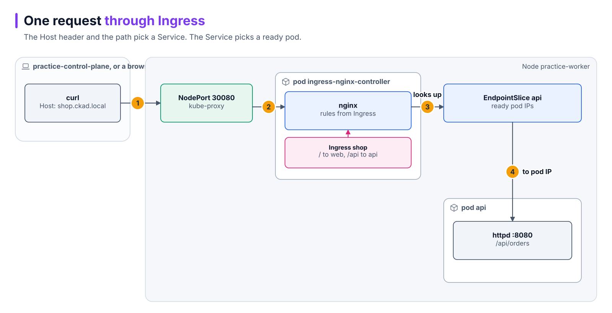
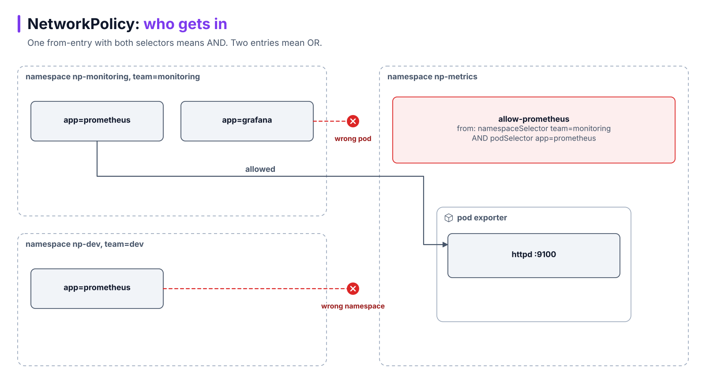

# Module 37: Services and networking

> New to a term here, like EndpointSlice or NetworkPolicy? The [glossary](../glossary.md#applications-on-kubernetes) explains every term these modules use.

**Before this module:** [module 35](35-observing-and-debugging-applications.md), whose readiness probes decide which pods a Service uses, and the [practice cluster](../practice-cluster.md#the-application-extras), which runs ingress-nginx on NodePort 30080 and Calico, so NetworkPolicies take effect. The course's [module 29](29-life-of-a-request.md) follows one request through kube-proxy in more depth.

Pods come and go, and each new pod gets a new IP address, so nothing should ever talk to a pod by its address. This module is about the stable names and addresses that sit in front of pods: Services inside the cluster, NodePorts and Ingress for traffic from outside, and NetworkPolicies that decide which pods may talk at all. It has ten tasks and takes about 1 hour 20 minutes.

## The module in one table

| Question | Tool | Task |
|---|---|---|
| How do pods reach a set of other pods by one name? | a ClusterIP Service | 1, 3 |
| How does traffic from outside the cluster get in? | a NodePort Service, an Ingress | 2, 4, 5 |
| How do I reach one particular pod of a set by name? | a headless Service with a StatefulSet | 10 |
| Which pods may talk to which? | NetworkPolicies | 6, 7, 8, 9 |

## Concept: a Service is a stable name in front of moving pods

Take the catalog of task 1, three pods that answer on port 8080 behind a client that needs the catalog. The client might pick a pod's IP address, but that address vanishes with the next restart or rollout, and the client would need to spread its requests over all three pods by itself. What the client needs is one name and one address that stay put while the pods behind them change.

A [Service](../glossary.md#service) provides both. It gets a virtual IP address, the ClusterIP, from the service network, and a DNS name in the cluster's DNS server, CoreDNS: `catalog.svc-basic.svc.cluster.local`, or `catalog` from inside the same namespace. Its `selector` names labels, and the control plane keeps a list of the ready pods that carry them in an [EndpointSlice](../glossary.md#endpointslice), updated whenever a pod starts, stops, or changes its readiness.

The virtual IP belongs to no network card. kube-proxy on every node reads the Service and its EndpointSlice and writes packet filter rules into the node's kernel, which rewrite a connection to the ClusterIP into a connection to one of the endpoints, picked at random. So the client connects to `catalog:80`, the kernel on the client's node changes the destination to, say, `10.244.135.159:8080`, and the pod answers. Two port fields describe that translation, and mixing them up is the most common Service bug:

| Field | Meaning | In task 1 |
|---|---|---|
| `port` | the port clients use on the Service's address | 80 |
| `targetPort` | the port the container listens on, as a number or the name of a container port | 8080 |
| `nodePort` | for type NodePort: the port on every node's address, 30000 to 32767 | (task 2: 30100) |

A Service that answers nothing almost always fails at one of three links, and checking them in order finds the fault fast. First, `kubectl get endpointslice -l kubernetes.io/service-name=NAME` shows whether any pod matched at all, and an empty list means the selector misses the pods' labels or no pod is ready. Second, the `PORTS` column of the slice must show the port the container listens on. Third, a `wget` from a pod in the same namespace tests the whole path. [Module 35's task 8](35-observing-and-debugging-applications.md#task-8-a-client-that-never-reaches-its-backend) breaks all three links at once.

A Service has a type, and each type adds one way in on top of the previous one:

| Type | Reachable from | How |
|---|---|---|
| `ClusterIP` | pods in the cluster | the virtual IP and the DNS name |
| `NodePort` | anything that reaches a node | every node forwards its `nodePort` to the Service |
| `LoadBalancer` | the internet | a cloud load balancer in front of the NodePorts |
| headless (`clusterIP: None`) | pods in the cluster | DNS returns the pod IPs themselves, one record per pod |

The headless Service needs a word more, because task 10 builds one. A database with two replicas needs each client to reach a specific replica, such as the primary, so a random pick behind one virtual IP doesn't help. A [StatefulSet](../glossary.md#statefulset) gives its pods fixed names, `db-0` and `db-1`, and with a headless Service named in its `serviceName`, CoreDNS also answers for `db-0.db.stateful.svc.cluster.local`, which always points at that one pod, even after it restarts with a new IP address.

## Concept: Ingress routes HTTP by host and path

A NodePort opens one port per Service on every node, which quickly becomes a long list of numbers that nobody remembers, and it knows nothing about HTTP: it has no way to send `/api` to one Service and `/` to another. Web traffic needs a single entry point that reads each request's host name and path and picks the Service from them.

That entry point is an [Ingress controller](../glossary.md#ingress-controller), a reverse proxy in a pod, here ingress-nginx, which itself sits behind a NodePort Service on port 30080. An [Ingress](../glossary.md#ingress) object holds the routing rules: for host `shop.ckad.local`, path `/api` goes to Service `api` on port 80, and everything else to Service `web`. The controller watches every Ingress whose `ingressClassName` names its class, and rewrites its own configuration from them.



The figure follows one request through four steps:

1. `curl -H 'Host: shop.ckad.local' http://NODE:30080/api/orders` reaches the node's NodePort.
2. kube-proxy forwards it to the ingress-nginx pod.
3. nginx matches the host and the path against the rules, picks Service `api`, and reads its EndpointSlice.
4. nginx sends the request straight to a pod's IP and port, without the Service's virtual IP in between.

Each path has a `pathType`, which decides how strictly nginx matches. `Prefix` matches the path and everything below it, split at slashes, so `/api` matches `/api/orders` but not `/apiv2`, while `Exact` matches only the exact path. `kubectl create ingress` writes `Exact` for a rule like `host/path=svc:80` and `Prefix` for `host/path*=svc:80`, which is the reason task 4's solution ends its paths with `*`.

Two settings break an Ingress quietly, without any error on `kubectl apply`. An `ingressClassName` that names no existing class means no controller picks the Ingress up, and a backend port that the Service doesn't have means nginx finds no endpoint and answers `503`. `kubectl describe ingress` shows the second fault, because a backend without endpoints shows empty parentheses. Task 5 has both. The Gateway API is the newer successor of Ingress, which the course uses in [module 11](../2-intermediate/11-edge-tls.md), but the CKAD 1.37 curriculum still asks for Ingress.

## Concept: NetworkPolicy, a firewall per pod

By default, every pod reaches every other pod in the cluster, in every namespace, which is convenient and risky: a compromised frontend pod reaches the database directly. A [NetworkPolicy](../glossary.md#networkpolicy) restricts that per pod, and the rules follow a few principles that explain every task here:

1. A policy's `podSelector` picks the pods it protects, in its own namespace. `podSelector: {}` picks every pod in the namespace.
2. As soon as any policy selects a pod for `Ingress`, that pod accepts only incoming traffic that some policy allows. The same goes for `Egress` and outgoing traffic. A pod that no policy selects keeps accepting everything.
3. Rules only allow. Policies add up, so a pod that two policies select accepts the traffic that either allows.
4. A connection needs permission at both ends: egress from the sender, if a policy restricts its egress, and ingress at the receiver, if one restricts its ingress.
5. The network plugin enforces the policies, Calico on the practice cluster. A plugin without policy support accepts the objects and ignores them.

A policy with a `podSelector` and `policyTypes: [Ingress]` but no `ingress` rules allows nothing in, which makes it a default deny for the pods it selects. Task 6 starts with such a policy for the whole namespace and then opens one path. An egress policy almost always needs DNS too, because pods look up a Service's name before they connect, so a rule for UDP and TCP port 53 belongs in every egress policy, which task 7 shows.

The `from` and `to` lists have one trap that the exam loves. Each entry in the list is one allowed peer, and the entries add up as OR. Inside one entry, a `namespaceSelector` and a `podSelector` together mean AND: a pod with these labels, in a namespace with those labels.

```yaml
ingress:
- from:
  - namespaceSelector:          # one entry: pods labelled app=prometheus
      matchLabels:              # in namespaces labelled team=monitoring
        team: monitoring
    podSelector:
      matchLabels:
        app: prometheus
```

Put a dash in front of `podSelector`, and the same lines become two entries: every pod in a monitoring namespace, or any pod labelled `app=prometheus` in the policy's own namespace. One character changes who gets in, which task 8 tests.



## The bigger picture: names, not addresses

Every object in this module replaces an address with a name or a label. A Service name replaces pod IPs, an Ingress host name replaces node ports, and a NetworkPolicy's label selector replaces the firewall rules that once listed IP ranges. That is what lets pods move between nodes and come back with new addresses, while the cluster's network keeps working.

Service meshes push the same idea one level further, which the course explores in depth: Istio identifies callers by their ServiceAccount rather than their labels, encrypts every connection, and routes by headers and weights. The Gateway API, Ingress's successor, splits the job between the platform team, which owns the gateway, and app teams, which own their routes.

## Why this way

A Service picks pods by label rather than by name because pods of a Deployment have generated names that change on every rollout, while their labels come from the template and stay the same.

kube-proxy translates addresses in the kernel instead of running a proxy process because the kernel does it without copying data through a program, and every node handles its own pods' connections, so there is no central proxy to overload.

NetworkPolicies only allow and never deny because allow-lists add up safely: a new policy never breaks traffic that another policy allows, so teams write policies for their own pods without reading everyone else's first.

## Task 1: A ClusterIP Service

**Time budget:** 3 minutes. **Host:** `cks-cp`.

```console
$ ./platform-engineering/task.sh setup 37.1
== setup task 37.1
NAME                      READY   UP-TO-DATE   AVAILABLE   AGE
deployment.apps/catalog   3/3     3            3           1s

NAME                           READY   STATUS    RESTARTS   AGE
pod/catalog-6fbcd6795d-jcvhd   1/1     Running   0          1s
pod/catalog-6fbcd6795d-sfv2k   1/1     Running   0          1s
pod/catalog-6fbcd6795d-wfj58   1/1     Running   0          1s
pod/client                     1/1     Running   0          1s
```

> In namespace `svc-basic`, expose Deployment `catalog`, whose pods listen on 8080, as a ClusterIP Service `catalog` on port 80. Pod `client` must reach it at `http://catalog.svc-basic.svc.cluster.local`.

<details>
<summary>Solution</summary>

`kubectl expose` copies the Deployment's selector into the Service, which saves typing and avoids a selector typo:

```console
root@cks-cp:~# k -n svc-basic expose deploy catalog --port=80 --target-port=8080
service/catalog exposed
root@cks-cp:~# k -n svc-basic get svc,endpointslice
NAME              TYPE        CLUSTER-IP     EXTERNAL-IP   PORT(S)   AGE
service/catalog   ClusterIP   10.97.72.222   <none>        80/TCP    0s

NAME                                           ADDRESSTYPE   PORTS   ENDPOINTS                                      AGE
endpointslice.discovery.k8s.io/catalog-wsnrm   IPv4          8080    10.244.135.159,10.244.135.161,10.244.135.160   0s
root@cks-cp:~# k -n svc-basic exec client -- wget -qO- http://catalog.svc-basic.svc.cluster.local
catalog
```

The Service shows port 80, and its EndpointSlice shows the pods' port 8080 with three addresses, one per ready pod.

</details>

```console
$ ./platform-engineering/task.sh check 37.1
== check task 37.1
  PASS  Service catalog is a ClusterIP on port 80 to target port 8080
  PASS  the Service has 3 endpoints
  PASS  client reaches http://catalog.svc-basic.svc.cluster.local
== task 37.1: 3 passed, 0 failed
```

## Task 2: A NodePort Service

**Time budget:** 4 minutes. **Host:** `cks-cp`.

```console
$ ./platform-engineering/task.sh setup 37.2
== setup task 37.2
Waiting for deployment "web" rollout to finish: 0 of 2 updated replicas are available...
Waiting for deployment "web" rollout to finish: 1 of 2 updated replicas are available...
deployment "web" successfully rolled out
```

> In namespace `svc-nodeport`, create a Service `web-np` of type NodePort that sends port 80 to the nginx pods of Deployment `web` and listens on port 30100 of every node.

<details>
<summary>Solution</summary>

`kubectl expose` has no flag for the node port, and `kubectl create service nodeport` has one but guesses the selector from the Service's name. So generate with `create service`, then fix the selector in the file:

```console
root@cks-cp:~# k -n svc-nodeport create service nodeport web-np --tcp=80:80 --node-port=30100 $do > /opt/ckad/5.2-svc.yaml
root@cks-cp:~# grep -A2 selector /opt/ckad/5.2-svc.yaml
  selector:
    app: web-np
  type: NodePort
```

Change `app: web-np` to `app: web` with `vim`, then apply:

```console
root@cks-cp:~# k apply -f /opt/ckad/5.2-svc.yaml
service/web-np created
root@cks-cp:~# k -n svc-nodeport get svc web-np
NAME     TYPE       CLUSTER-IP       EXTERNAL-IP   PORT(S)        AGE
web-np   NodePort   10.103.181.158   <none>        80:30100/TCP   0s
root@cks-cp:~# k -n svc-nodeport get endpointslice
NAME           ADDRESSTYPE   PORTS   ENDPOINTS                       AGE
web-np-tkbhx   IPv4          80      10.244.135.135,10.244.135.147   0s
root@cks-cp:~# curl -s http://$(k get node cks-w1 -o jsonpath='{.status.addresses[0].address}'):30100 | grep title
<title>Welcome to nginx!</title>
```

`80:30100/TCP` reads as Service port 80, node port 30100. The first `curl` in the test run, sent right after the apply, got no answer, because kube-proxy needs a moment to write the new rules; a second try a second later worked. `k expose deploy web --name=web-np --type=NodePort --port=80` followed by `k edit svc web-np` to set `nodePort` is the other common path.

</details>

```console
$ ./platform-engineering/task.sh check 37.2
== check task 37.2
  PASS  Service web-np is a NodePort on 30100, port 80
  PASS  nginx answers on cks-w1's address, port 30100
== task 37.2: 2 passed, 0 failed
```

## Task 3: One Service, two named ports

**Time budget:** 5 minutes. **Host:** `cks-cp`.

> Deployment `shop` in namespace `svc-ports` serves the shop on a container port named `http` (8080) and metrics on one named `metrics` (9090). Create a Service `shop` with a port `http` on 80 and a port `metrics` on 9090, both pointing at the container ports by name. Pod `client` must get the shop from `http://shop` and the metrics from `http://shop:9090`.

<details>
<summary>Solution</summary>

A Service with more than one port must name each port. A `targetPort` that names a container port keeps working when a new image moves the app to another number, as long as the port keeps its name:

```yaml
apiVersion: v1
kind: Service
metadata:
  name: shop
  namespace: svc-ports
spec:
  selector:
    app: shop
  ports:
  - name: http
    port: 80
    targetPort: http
  - name: metrics
    port: 9090
    targetPort: metrics
```

```console
root@cks-cp:~# k -n svc-ports get deploy shop -o jsonpath='{.spec.template.spec.containers[0].ports}{"\n"}'
[{"containerPort":8080,"name":"http","protocol":"TCP"},{"containerPort":9090,"name":"metrics","protocol":"TCP"}]
root@cks-cp:~# k apply -f /opt/ckad/5.3/svc.yaml
service/shop created
root@cks-cp:~# k -n svc-ports get endpointslice
NAME         ADDRESSTYPE   PORTS       ENDPOINTS                       AGE
shop-lbkpk   IPv4          8080,9090   10.244.135.165,10.244.135.166   0s
root@cks-cp:~# k -n svc-ports exec client -- wget -qO- http://shop
shop
root@cks-cp:~# k -n svc-ports exec client -- wget -qO- http://shop:9090
orders_total 42
```

The EndpointSlice resolved both names to numbers, `8080,9090`, which confirms the names match the container's ports.

</details>

```console
$ ./platform-engineering/task.sh check 37.3
== check task 37.3
  PASS  Service shop has port http 80 and port metrics 9090, both by the container's port names
  PASS  client gets 'shop' from http://shop
  PASS  client gets the metrics from http://shop:9090
== task 37.3: 3 passed, 0 failed
```

## Task 4: An Ingress with two paths

**Time budget:** 6 minutes. **Host:** `cks-cp`.

```console
$ ./platform-engineering/task.sh setup 37.4
== setup task 37.4
NAME    CONTROLLER             PARAMETERS   AGE
nginx   k8s.io/ingress-nginx   <none>       38m
NAME                       TYPE       CLUSTER-IP       EXTERNAL-IP   PORT(S)                      AGE
ingress-nginx-controller   NodePort   10.105.118.132   <none>        80:30080/TCP,443:30443/TCP   38m
```

> In namespace `ing-shop`, create an Ingress `shop` with class `nginx` for the host `shop.ckad.local`: requests below `/api` go to Service `api` on port 80, and all other requests to Service `web` on port 80. Test it through the ingress controller on NodePort 30080.

<details>
<summary>Solution</summary>

`kubectl create ingress` writes the rules in one line each, and the `*` at the end of a path makes it a `Prefix` match:

```console
root@cks-cp:~# k -n ing-shop create ingress shop --class=nginx --rule='shop.ckad.local/*=web:80' --rule='shop.ckad.local/api*=api:80'
ingress.networking.k8s.io/shop created
root@cks-cp:~# k -n ing-shop get ingress shop -o yaml | grep -A20 '^spec:'
spec:
  ingressClassName: nginx
  rules:
  - host: shop.ckad.local
    http:
      paths:
      - backend:
          service:
            name: web
            port:
              number: 80
        path: /
        pathType: Prefix
      - backend:
          service:
            name: api
            port:
              number: 80
        path: /api
        pathType: Prefix
status:
root@cks-cp:~# curl -s -H 'Host: shop.ckad.local' http://$(k get node cks-w1 -o jsonpath='{.status.addresses[0].address}'):30080/
web
root@cks-cp:~# curl -s -H 'Host: shop.ckad.local' http://$(k get node cks-w1 -o jsonpath='{.status.addresses[0].address}'):30080/api/orders
orders
```

nginx picks the longest matching prefix, so `/api/orders` goes to `api` although `/` matches it too. The `Host` header stands in for a DNS name that points at the node; `curl --resolve shop.ckad.local:30080:IP http://shop.ckad.local:30080/` does the same. Without the `*` on the first rule, `/` would be an `Exact` path, and `/index.html` would get a 404 from the controller.

</details>

```console
$ ./platform-engineering/task.sh check 37.4
== check task 37.4
  PASS  Ingress shop uses class nginx and host shop.ckad.local
  PASS  shop.ckad.local/ answers web
  PASS  shop.ckad.local/api/ answers api, /api/orders answers orders
  PASS  another host gets no answer from the shop
== task 37.4: 4 passed, 0 failed
```

## Task 5: Repair an Ingress for two hosts

**Time budget:** 6 minutes. **Host:** `cks-cp`.

```console
$ ./platform-engineering/task.sh setup 37.5
== setup task 37.5
NAME                              CLASS            HOSTS                             ADDRESS   PORTS   AGE
ingress.networking.k8s.io/sites   nginx-internal   blog.ckad.local,docs.ckad.local             80      1s

NAME           TYPE        CLUSTER-IP      EXTERNAL-IP   PORT(S)    AGE
service/blog   ClusterIP   10.109.234.35   <none>        80/TCP     1s
service/docs   ClusterIP   10.107.8.188    <none>        8000/TCP   1s
```

> In namespace `ing-hosts`, Ingress `sites` should send `blog.ckad.local` to Service `blog` and `docs.ckad.local` to Service `docs`, but neither host works through the ingress controller on port 30080. Fix the Ingress without changing the Services.

<details>
<summary>Solution</summary>

Compare the Ingress with what exists: the class it names, and the ports of the Services it points to:

```console
root@cks-cp:~# k get ingressclass
NAME    CONTROLLER             PARAMETERS   AGE
nginx   k8s.io/ingress-nginx   <none>       28m
root@cks-cp:~# k -n ing-hosts describe ingress sites | grep -A6 Rules
Rules:
  Host             Path  Backends
  ----             ----  --------
  blog.ckad.local  
                   /   blog:80 (10.244.135.170:8080)
  docs.ckad.local  
                   /   docs:http ()
```

The class `nginx-internal` doesn't exist, and `docs:http ()` shows a backend without endpoints, because Service `docs` names its port `web`, not `http`. One JSON patch fixes both:

```console
root@cks-cp:~# k -n ing-hosts patch ingress sites --type=json -p '[{"op":"replace","path":"/spec/ingressClassName","value":"nginx"},{"op":"replace","path":"/spec/rules/1/http/paths/0/backend/service/port","value":{"name":"web"}}]'
ingress.networking.k8s.io/sites patched
root@cks-cp:~# k -n ing-hosts describe ingress sites | grep -A6 Rules
Rules:
  Host             Path  Backends
  ----             ----  --------
  blog.ckad.local  
                   /   blog:80 (10.244.135.170:8080)
  docs.ckad.local  
                   /   docs:web (10.244.135.171:8080)
root@cks-cp:~# curl -s -H 'Host: docs.ckad.local' http://$(k get node cks-w1 -o jsonpath='{.status.addresses[0].address}'):30080/
docs
```

`port: {number: 8000}` would work as well, because the backend may name the Service's port by name or by number. ingress-nginx needed a few seconds to load the new rules in the test run, so retry a `curl` that fails right after the patch.

</details>

```console
$ ./platform-engineering/task.sh check 37.5
== check task 37.5
  PASS  blog.ckad.local answers blog
  PASS  docs.ckad.local answers docs
  PASS  both Services keep their ports
== task 37.5: 3 passed, 0 failed
```

## Task 6: Deny by default, then allow one path

**Time budget:** 6 minutes. **Host:** `cks-cp`.

```console
$ ./platform-engineering/task.sh setup 37.6
== setup task 37.6
NAME       READY   STATUS    RESTARTS   AGE   IP               NODE     NOMINATED NODE   READINESS GATES   LABELS
backend    1/1     Running   0          1s    10.244.135.173   cks-w1   <none>           <none>            app=backend
frontend   1/1     Running   0          1s    10.244.135.174   cks-w1   <none>           <none>            role=frontend
other      1/1     Running   0          1s    10.244.135.175   cks-w1   <none>           <none>            role=other
```

> In namespace `np-app`:
> 1. Create a NetworkPolicy `default-deny-ingress` that blocks all incoming traffic to every pod.
> 2. Create a second NetworkPolicy that lets pods labelled `role=frontend` reach pod `backend` on TCP port 8080, and nothing else reach it.

<details>
<summary>Solution</summary>

The kubernetes.io page on NetworkPolicies has both shapes as examples, so copy and adapt them:

```yaml
apiVersion: networking.k8s.io/v1
kind: NetworkPolicy
metadata:
  name: default-deny-ingress
  namespace: np-app
spec:
  podSelector: {}
  policyTypes:
  - Ingress
---
apiVersion: networking.k8s.io/v1
kind: NetworkPolicy
metadata:
  name: backend-allow-frontend
  namespace: np-app
spec:
  podSelector:
    matchLabels:
      app: backend
  policyTypes:
  - Ingress
  ingress:
  - from:
    - podSelector:
        matchLabels:
          role: frontend
    ports:
    - protocol: TCP
      port: 8080
```

```console
root@cks-cp:~# k apply -f /opt/ckad/5.6/netpol.yaml
networkpolicy.networking.k8s.io/default-deny-ingress created
networkpolicy.networking.k8s.io/backend-allow-frontend created
root@cks-cp:~# BACKEND=$(k -n np-app get pod backend -o jsonpath='{.status.podIP}')
root@cks-cp:~# k -n np-app exec frontend -- wget -qO- -T 3 http://$BACKEND:8080
backend
root@cks-cp:~# k -n np-app exec other -- wget -qO- -T 3 http://$BACKEND:8080
wget: download timed out
command terminated with exit code 1
```

A blocked connection times out rather than failing at once, because Calico drops the packets silently, so always give `wget` a short `-T` timeout when you test policies.

</details>

```console
$ ./platform-engineering/task.sh check 37.6
== check task 37.6
  PASS  NetworkPolicy default-deny-ingress selects every pod and allows no ingress
  PASS  frontend reaches backend on 8080
  PASS  other does not reach backend
  PASS  backend does not reach frontend (the default deny holds)
== task 37.6: 4 passed, 0 failed
```

## Task 7: Egress only to the database and DNS

**Time budget:** 6 minutes. **Host:** `cks-cp`.

> In namespace `np-egress`, pod `app` (label `app=app`) may open connections only to the pods labelled `app=db` on TCP port 5432, which it reaches through Service `db`, and to DNS. Create a NetworkPolicy `app-egress` for that. Everything else, such as `partner.np-egress-other` or the API server, must stay out of its reach.

<details>
<summary>Solution</summary>

The second egress rule has no `to`, so it allows port 53 to any destination, which covers CoreDNS wherever it runs:

```yaml
apiVersion: networking.k8s.io/v1
kind: NetworkPolicy
metadata:
  name: app-egress
  namespace: np-egress
spec:
  podSelector:
    matchLabels:
      app: app
  policyTypes:
  - Egress
  egress:
  - to:
    - podSelector:
        matchLabels:
          app: db
    ports:
    - protocol: TCP
      port: 5432
  - ports:
    - protocol: UDP
      port: 53
    - protocol: TCP
      port: 53
```

```console
root@cks-cp:~# k apply -f /opt/ckad/5.7/netpol.yaml
networkpolicy.networking.k8s.io/app-egress created
root@cks-cp:~# k -n np-egress exec app -- wget -qO- -T 3 http://db:5432
db
root@cks-cp:~# k -n np-egress exec app -- wget -qO- -T 3 http://partner.np-egress-other
wget: download timed out
command terminated with exit code 1
```

The rule names the pod's port, 5432, not a Service port, because the policy acts after kube-proxy has rewritten the Service address into the pod's address. Without the DNS rule, `http://db:5432` fails too, with `bad address 'db'`, since the name lookup itself is egress traffic.

</details>

```console
$ ./platform-engineering/task.sh check 37.7
== check task 37.7
  PASS  NetworkPolicy app-egress selects app=app and controls only egress
  PASS  app reaches the database by name: http://db:5432
  PASS  app does not reach partner.np-egress-other
  PASS  app does not reach the API server
== task 37.7: 4 passed, 0 failed
```

## Task 8: Traffic from one namespace, one kind of pod

**Time budget:** 6 minutes. **Host:** `cks-cp`.

```console
$ ./platform-engineering/task.sh setup 37.8
== setup task 37.8
NAME            STATUS   AGE   LABELS
np-dev          Active   2s    ckad=task,kubernetes.io/metadata.name=np-dev,team=dev
np-monitoring   Active   2s    ckad=task,kubernetes.io/metadata.name=np-monitoring,team=monitoring
```

> Pod `exporter` in namespace `np-metrics` serves metrics on port 9100. Create a NetworkPolicy `allow-prometheus` so that only pods labelled `app=prometheus` in namespaces labelled `team=monitoring` reach it. Grafana in `np-monitoring` and the prometheus pod in `np-dev` must not.

<details>
<summary>Solution</summary>

Both selectors go into one `from` entry, with a dash only before `namespaceSelector`, so they mean AND:

```yaml
spec:
  podSelector:
    matchLabels:
      app: exporter
  policyTypes:
  - Ingress
  ingress:
  - from:
    - namespaceSelector:
        matchLabels:
          team: monitoring
      podSelector:
        matchLabels:
          app: prometheus
    ports:
    - protocol: TCP
      port: 9100
```

```console
root@cks-cp:~# k apply -f /opt/ckad/5.8/netpol.yaml
networkpolicy.networking.k8s.io/allow-prometheus created
root@cks-cp:~# EXPORTER=$(k -n np-metrics get pod exporter -o jsonpath='{.status.podIP}')
root@cks-cp:~# k -n np-monitoring exec prometheus -- wget -qO- -T 3 http://$EXPORTER:9100
exporter
root@cks-cp:~# k -n np-monitoring exec grafana -- wget -qO- -T 3 http://$EXPORTER:9100
wget: download timed out
command terminated with exit code 1
root@cks-cp:~# k -n np-dev exec prometheus -- wget -qO- -T 3 http://$EXPORTER:9100
wget: download timed out
command terminated with exit code 1
```

With two entries instead, grafana would get in through the namespace entry, and so would every other pod in `np-monitoring`. Every namespace carries the label `kubernetes.io/metadata.name` with its own name, which selects one namespace by name when it has no other label.

</details>

```console
$ ./platform-engineering/task.sh check 37.8
== check task 37.8
  PASS  NetworkPolicy allow-prometheus exists in np-metrics
  PASS  prometheus in np-monitoring reaches the exporter
  PASS  grafana in np-monitoring does not
  PASS  prometheus in np-dev does not
== task 37.8: 4 passed, 0 failed
```

## Task 9: Fit a pod to policies you may not change

**Time budget:** 6 minutes. **Host:** `cks-cp`.

```console
$ ./platform-engineering/task.sh setup 37.9
== setup task 37.9
NAME               POD-SELECTOR           AGE
default-deny       <none>                 0s
payments-clients   role=payments-client   0s
payments-ingress   app=payments           0s
```

> Namespace `np-labels` has three NetworkPolicies that you must not change. Pod `checkout` needs to reach `http://payments`. Make that work by changing only `checkout`'s labels, and keep its label `app=checkout`.

<details>
<summary>Solution</summary>

Read what each policy wants from a client. The egress policy needs `role=payments-client` on the sender, and the ingress policy on `payments` needs both `role=payments-client` and `env=prod`:

```console
root@cks-cp:~# k -n np-labels exec checkout -- wget -qO- -T 3 http://payments
wget: download timed out
command terminated with exit code 1
root@cks-cp:~# k -n np-labels describe netpol payments-clients payments-ingress | grep -A2 -E 'PodSelector|From|To'
  PodSelector:     role=payments-client
  Not affecting ingress traffic
  Allowing egress traffic:
    To Port: 8080/TCP
    To:
      PodSelector: app=payments
  Policy Types: Egress

--
  PodSelector:     app=payments
  Allowing ingress traffic:
    To Port: 8080/TCP
    From:
      PodSelector: env=prod,role=payments-client
  Not affecting egress traffic
  Policy Types: Ingress
root@cks-cp:~# k -n np-labels label pod checkout role=payments-client env=prod
pod/checkout labeled
root@cks-cp:~# k -n np-labels exec checkout -- wget -qO- -T 3 http://payments
payments
```

The connection needs permission at both ends, which is why one label alone fails: `role=payments-client` opens the egress, and the ingress side also wants `env=prod`. The DNS lookup of `payments` works throughout, because `default-deny` allows port 53 for every pod.

</details>

```console
$ ./platform-engineering/task.sh check 37.9
== check task 37.9
  PASS  checkout reaches http://payments
  PASS  stranger still does not
  PASS  the three NetworkPolicies are unchanged
  PASS  checkout keeps its label app=checkout
== task 37.9: 4 passed, 0 failed
```

## Task 10: A StatefulSet behind a headless Service

**Time budget:** 7 minutes. **Host:** `cks-cp`.

> In namespace `stateful`, create a headless Service `db` on port 8080 and a StatefulSet `db` with 2 replicas (image `busybox:1.36`) that serve their own host name over HTTP on 8080, for example with `sh -c 'mkdir -p /www && hostname > /www/index.html && exec httpd -f -p 8080 -h /www'`. Pod `client` must reach each replica by its own name, `db-0.db` and `db-1.db`.

<details>
<summary>Solution</summary>

`clusterIP: None` makes the Service headless, and `serviceName: db` ties the StatefulSet to it, which gives each pod its DNS record:

```yaml
apiVersion: v1
kind: Service
metadata:
  name: db
  namespace: stateful
spec:
  clusterIP: None
  selector:
    app: db
  ports:
  - port: 8080
---
apiVersion: apps/v1
kind: StatefulSet
metadata:
  name: db
  namespace: stateful
spec:
  serviceName: db
  replicas: 2
  selector:
    matchLabels:
      app: db
  template:
    metadata:
      labels:
        app: db
    spec:
      containers:
      - name: db
        image: busybox:1.36
        command: ["sh", "-c", "mkdir -p /www && hostname > /www/index.html && exec httpd -f -p 8080 -h /www"]
        ports:
        - containerPort: 8080
```

```console
root@cks-cp:~# k apply -f /opt/ckad/5.10/db.yaml
service/db created
statefulset.apps/db created
root@cks-cp:~# k -n stateful rollout status sts db
Waiting for 2 pods to be ready...
Waiting for 1 pods to be ready...
partitioned roll out complete: 2 new pods have been updated...
root@cks-cp:~# k -n stateful exec client -- nslookup db.stateful.svc.cluster.local
Server:		10.96.0.10
Address:	10.96.0.10:53

Name:	db.stateful.svc.cluster.local
Address: 10.244.135.188
Name:	db.stateful.svc.cluster.local
Address: 10.244.135.189

root@cks-cp:~# k -n stateful exec client -- wget -qO- http://db-1.db:8080
db-1
```

The Service name returns both pod addresses instead of one virtual IP, which is what headless means. The StatefulSet starts `db-0` first and `db-1` only once `db-0` is ready, which the two waiting lines show; `podManagementPolicy: Parallel` starts them together.

</details>

```console
$ ./platform-engineering/task.sh check 37.10
== check task 37.10
  PASS  Service db is headless
  PASS  StatefulSet db has 2 ready pods and names db as its Service
  PASS  db-0.db and db-1.db each answer with their own name
== task 37.10: 3 passed, 0 failed
```

## Clean up

`./platform-engineering/practice/app-extras/reset.sh` deletes the namespaces with their Services, Ingresses and NetworkPolicies. The ingress controller and Calico stay, because the security modules use them too.
