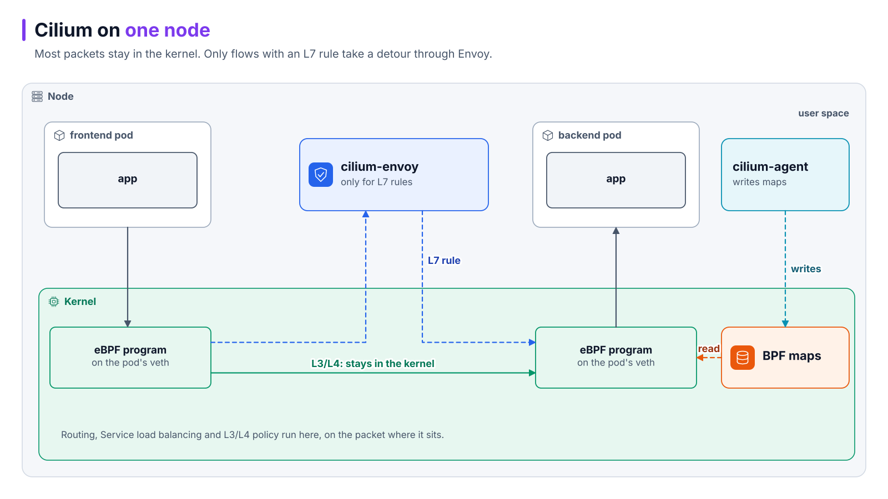
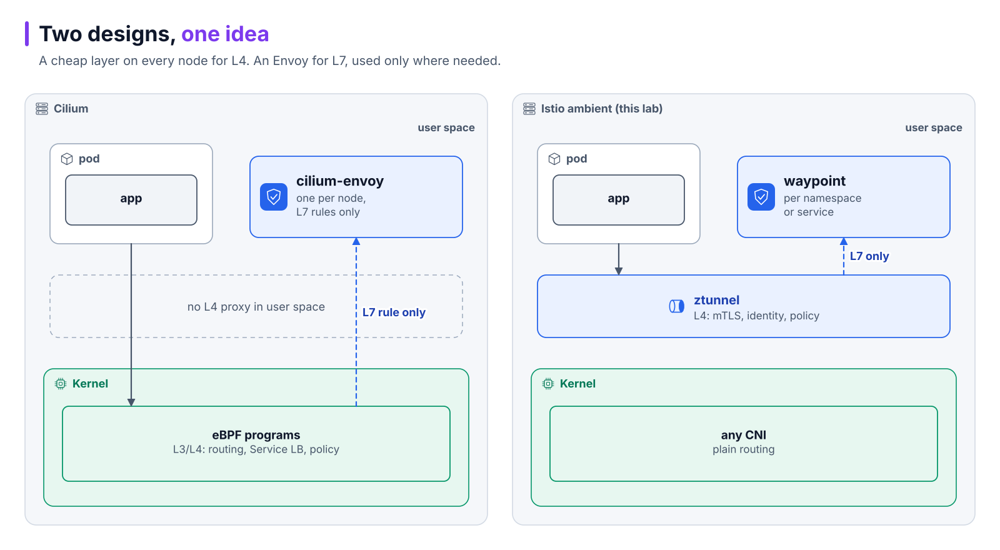

# Module 10: eBPF and Cilium, the other sidecarless design

> New to a term here, like VirtualService or waypoint? The [glossary](glossary.md) explains every Istio resource and term in this course.

**Before this module:** modules 1 and 7, for the comparison.

**You need:** nothing extra. This is a theory module, because Cilium needs its own cluster. The commands in "Look at your own lab" run on this lab.

You will read claims like this one:

> Tools built on eBPF, such as Cilium, dominate new deployments by handling networking, security policies and observability directly in the Linux kernel without sidecar proxies.

Part of it holds true, and this module sorts out which part by explaining three things:

- what eBPF is,
- what Cilium does with it,
- how that compares with the Istio ambient mesh you have used for nine modules.

Cilium doesn't run in this lab, but the "Look at your own lab" section still gives you commands that show the difference in your cluster.

Time: about 30 minutes.

## Concept: what eBPF is

Changing how the Linux kernel behaves normally means writing a kernel module or rebooting into a new kernel. eBPF avoids both, because it lets you add small pieces of your own code to the running kernel.

A bad program inside the kernel would crash the whole machine, so before a program runs, a part of the kernel called the **verifier** checks it. The verifier makes sure of two things:

- The program always finishes and never loops forever.
- The program touches only memory it has permission to touch.

If the program passes, the kernel compiles it to machine code.

A program does nothing until something triggers it, so you attach it to a **hook**, an event inside the kernel such as a network interface receiving a packet, a program opening a socket, or a system call. For networking, these hooks matter:

| Hook | Runs when | Used for |
|---|---|---|
| XDP | a packet reaches the network driver, before the kernel builds its packet structure | very fast drops, load balancing |
| tc (traffic control) | a packet enters or leaves an interface, such as a pod's veth | per-pod policy, NAT, routing |
| socket hooks | a program calls `connect()` or `sendmsg()` | rewriting a Service IP to a pod IP before any packet exists |

An eBPF program needs data to make decisions, such as which pods sit behind a Service, and it keeps that data in **BPF maps**. A BPF map is a key-value table inside the kernel that ordinary programs outside the kernel also read and write, so the two sides share data through it, like two people sharing a whiteboard. The Cilium agent, for example, writes "Service 10.43.191.63:8000 has these endpoints" into a map, and the eBPF program reads that entry for every connection.

## Concept: kernel space and user space

Linux splits a machine into two places, and crossing the boundary between them has a cost. Think of a bank, where the vault sits behind the counter and customers get money only by asking a clerk.

- **Kernel space** is the vault. It holds the network interfaces, the routing table and the packet filter, including the iptables rules that kube-proxy writes, which the kernel walks through for each new connection.
- **User space** is the customer side. It holds ordinary programs, such as your app, Envoy and ztunnel, which reach the network only by asking the kernel, through system calls on sockets.

This split explains why "in the kernel" sounds fast. When a user-space proxy handles a connection, three things happen:

1. The kernel receives the data and copies it up to the proxy.
2. The proxy decides what to do.
3. The proxy hands the data back down to the kernel on a second connection.

Each crossing costs a copy of the data and a context switch, the CPU's switch from one task to another. An eBPF program runs inside the kernel, on the packet where it already sits, so an L4 decision such as "allow this connection" needs no crossing.

The price of that speed is power. A kernel program must stay small and safe, so the verifier refuses anything complex, while a user-space proxy has no such limits: it parses HTTP, holds TLS sessions and keeps large tables, and a bug in it crashes only one process rather than the whole node. This trade-off decides which job lands in eBPF and which lands in Envoy for the rest of the module.

## Concept: what Cilium does with it

Cilium uses eBPF to run the network of a Kubernetes cluster. Its basic job is the Container Network Interface (CNI) plugin, the same job flannel does in this lab, which gives pods their IPs and connects them. On top of that, Cilium optionally takes over three other jobs, using three parts on each node:

- eBPF programs in the kernel: route packets, balance Services and apply L3/L4 policy.
- cilium-agent: writes the BPF maps that the programs read.
- cilium-envoy: handles only the flows that have an L7 rule.



| Job | Without Cilium | With Cilium |
|---|---|---|
| Pod networking | flannel (this lab) | eBPF on each pod's interface |
| Service load balancing | kube-proxy writes iptables rules | eBPF socket and tc programs read a BPF map. You run without kube-proxy. |
| L3/L4 policy | NetworkPolicy, enforced by the CNI | NetworkPolicy and CiliumNetworkPolicy, enforced in eBPF |
| L7 policy (HTTP methods and paths) | not possible with plain Kubernetes | an Envoy per node, not eBPF |
| Flow visibility | none built in | Hubble reads flow events from the eBPF programs |

## Why the quote is only partly right

**"Directly in the Linux kernel."** This holds for L3 and L4 but not for L7, because parsing HTTP, matching paths and retrying requests are too complex for the verifier's limits. So Cilium sends any flow that has an L7 rule to Envoy, the same proxy Istio uses, running once per node rather than as a sidecar, either inside the agent or as the `cilium-envoy` DaemonSet. The [Cilium L7 policy docs](https://docs.cilium.io/en/latest/security/policy/layer7/) describe this.

**"Without sidecar proxies."** True, but nothing special to eBPF, because Istio ambient, which this lab runs, has no sidecars either. As module 1 showed, one ztunnel per node handles L4 and a waypoint Envoy handles L7 only where you ask for it.

**"Dominate new deployments."** No published source supports this claim, and the cloud providers' own docs say otherwise:

- GKE Dataplane V2 builds on Cilium and is the default for new Autopilot clusters, not for Standard clusters ([GKE docs](https://cloud.google.com/kubernetes-engine/docs/concepts/dataplane-v2)).
- AKS Automatic uses Azure CNI powered by Cilium by default, while on AKS Standard it is opt-in ([Microsoft docs](https://learn.microsoft.com/en-us/azure/aks/azure-cni-powered-by-cilium)).
- EKS defaults to the Amazon VPC CNI.

A fair version of the claim reads like this: Cilium is the most widely used eBPF CNI, and the default data plane on some managed offerings.

## Why this way: the two designs share one idea

Put Cilium and Istio ambient side by side, and you see the same plan, because both split the work into two layers:

- a cheap layer on every node for L4,
- an Envoy for L7, used only where needed.

They differ in what the L4 layer is made of.



| | Cilium | Istio ambient |
|---|---|---|
| Is a CNI | yes, replaces flannel or Calico | no, runs on top of any CNI |
| L4 layer | eBPF programs in the kernel | ztunnel, a Rust proxy in user space |
| L7 layer | Envoy per node | Envoy waypoint per namespace or service |
| Encryption between pods | opt-in: WireGuard or IPsec, node to node | on by default: mTLS for every connection |
| Workload identity | a numeric security identity derived from pod labels | a SPIFFE ID with a certificate, derived from the service account |
| Policy written as | CiliumNetworkPolicy, by labels | AuthorizationPolicy, by service account identity |
| Traffic routing (canary, faults, retries) | limited, through Gateway API on its Envoy | full: HTTPRoute, VirtualService, DestinationRule |
| Flow view | Hubble CLI and UI | Kiali, plus Envoy metrics in Prometheus |

The identity row matters most, because it decides whether the receiver really knows who called, and the two designs answer that differently.

In Istio, the caller's name, the SPIFFE ID you saw in module 2, travels inside a certificate that the receiving side checks, so the receiver has proof of who called, even across clusters. It works like a passport with a stamp the receiver trusts.

In Cilium, an identity is a number that the Cilium agents agree on from pod labels. It works inside one cluster without certificates, but the packet carries no cryptographic proof of who sent it, so it works more like a name tag. Encryption helps only partly, because with WireGuard turned on the tunnel proves which node sent the packet, not which workload. Cilium offers mutual authentication with SPIRE certificates as an optional feature.

The routing row matters next. Weighted canaries, fault injection, timeouts and circuit breaking, which modules 4 and 5 covered, are the main reason people run a service mesh, and Cilium's service mesh features cover only part of that, through Gateway API.

## When people pick which

| Need | Usual choice |
|---|---|
| A fast CNI, kube-proxy replacement, network policy and flow logs | Cilium alone |
| mTLS with workload identity, L7 authorization, canaries and fault injection | a service mesh (Istio ambient or sidecar) |
| Both | Cilium as the CNI with Istio on top. Istio documents the settings Cilium needs for this ([Istio platform prerequisites](https://istio.io/latest/docs/ambient/install/platform-prerequisites/)). |

The third row is common in production, which shows why "Cilium or Istio" is often the wrong question: the two tools mostly do different jobs.

## Look at your own lab

These commands use `docker exec` into the k3d node container, which is safe and needs no extra rights.

**1. kube-proxy's iptables rules.** In your lab, kube-proxy implements Services with iptables, which Cilium would replace with a BPF map.

```console
$ docker exec k3d-k8s-lab-server-0 sh -c 'iptables-save | grep -c "^-A KUBE-SVC"'
89

$ docker exec k3d-k8s-lab-server-0 sh -c 'iptables-save | grep "^-A KUBE-SVC" | head -3'
-A KUBE-SVC-25JPQJRBQQAODVM3 ! -s 10.42.0.0/16 -d 10.43.62.182/32 -p tcp -m comment --comment "shop-ingress/shop-gateway-istio:status-port cluster IP" -m tcp --dport 15021 -j KUBE-MARK-MASQ
-A KUBE-SVC-25JPQJRBQQAODVM3 -m comment --comment "shop-ingress/shop-gateway-istio:status-port -> 10.42.0.172:15021" -j KUBE-SEP-UJEXWIBNEWKBROAO
-A KUBE-SVC-6HUQW3D3MMFEZMIW ! -s 10.42.0.0/16 -d 10.43.106.27/32 -p tcp -m comment --comment "shop/waypoint:mesh cluster IP" -m tcp --dport 15008 -j KUBE-MARK-MASQ
```

You should see several dozen rules, 77 when this module was written and 89 in a later run, including lines like `-A KUBE-SVC-... -d 10.43.x.x/32 ... --dport 8000 -j KUBE-SEP-...`. Each Service adds rules, and for each new connection the kernel walks through them in order, like reading a phone book page by page, while a BPF map works more like a direct lookup. On clusters with thousands of Services, removing that walk is one of Cilium's real advantages.

**2. No eBPF file system.** Cilium keeps its maps alive across agent restarts by saving them in a special `bpf` file system at `/sys/fs/bpf`, and your node has none mounted:

```console
$ docker exec k3d-k8s-lab-server-0 sh -c 'mount | grep " type bpf" || echo "no bpffs mounted"'
no bpffs mounted
```

This is one reason you don't simply add Cilium to this lab, because two things would have to change:

- You would create the cluster without flannel.
- Each node container would mount bpffs on every start.

**3. The kernel is new enough.** Cilium needs a recent kernel. Check yours:

```console
$ kubectl get nodes -o jsonpath='{.items[0].status.nodeInfo.kernelVersion}{"\n"}'
7.2.12-orbstack-00394-gbecdd6130068
```

OrbStack ships a 7.x kernel, far above Cilium's minimum, so the cluster setup blocks Cilium here, not the kernel.

**4. What the ambient L4 layer costs.** Compare with the sidecar numbers from module 7:

```console
$ kubectl top pods -n istio-system
NAME                     CPU(cores)   MEMORY(bytes)
istio-cni-node-m5l9p     1m           21Mi
istiod-5c5bf76f-gtmzl    2m           63Mi
kiali-67954d6c48-sr4qq   6m           35Mi
ztunnel-htqw5            5m           20Mi

$ kubectl top pods -n shop | grep waypoint
waypoint-b9b76876f-8wrwf      2m           31Mi
```

Module 7 measured 12 to 16 MiB for ztunnel, 29 to 37 MiB for the waypoint, and 35 to 39 MiB for each sidecar, while the run above, with load traffic flowing, showed 20 MiB for ztunnel and 31 MiB for the waypoint. Cilium's agent typically uses more memory than ztunnel, because it also does the work that flannel and kube-proxy do here, pod networking and Services.

## Investigate

1. A policy drops a packet from frontend to backend. Where would you see the drop with Cilium, and where with ambient?
2. Is traffic between pods encrypted by default with Cilium? With ambient?
3. The backend runs in one cluster and its caller in another. Which design lets the backend prove which workload called it?
4. What stops eBPF from parsing HTTP and matching `GET /api/orders`?
5. In this lab, which component does the job that Cilium's socket-level load balancing would do?

<details>
<summary>Answers</summary>

1. With Cilium, run `hubble observe --verdict DROPPED`, or open the Hubble UI, because the eBPF program that drops the packet also emits a flow event that Hubble shows. With ambient, look in the ztunnel log on the node with `kubectl -n istio-system logs ds/ztunnel`, where the caller's ztunnel logs `http status: 401 Unauthorized` and the receiving ztunnel logs `allow policies exist, but none allowed`. For an L7 denial you look in the waypoint access log instead, as in module 3.
2. With Cilium, no, because you must turn on WireGuard or IPsec. With ambient, yes, because every connection between enrolled pods uses mTLS through HBONE on port 15008.
3. Istio does, because the proof travels with the connection:
   1. The caller presents a certificate that holds its SPIFFE ID.
   2. The backend checks the certificate against the shared root CA.
   3. If the check passes, the backend knows which workload called.

   A Cilium identity is a number agreed inside a cluster, and the packet carries no proof of it. Cluster Mesh shares these numbers between clusters, and Cilium's optional mutual authentication feature built on SPIRE adds certificates, but it stays off by default.

   Neither design stops someone who has permission to create pods in a namespace, because with Cilium they copy the labels and with Istio they pick the service account, so Kubernetes RBAC guards both.
4. The verifier limits how big a program gets and how it loops, and a program sees single packets rather than the whole stream of bytes put back together. HTTP needs much more:
   - joining data that arrives across several packets,
   - parsing headers of varying length,
   - often, ending TLS to read the request at all.

   That's why both designs hand L7 to Envoy.
5. It depends on the caller. For pods outside the mesh, kube-proxy does it, through the iptables rules you counted in step 1. For ambient pods, ztunnel does it:
   1. istio-cni's redirect inside the pod sends the connection to ztunnel.
   2. This happens before the connection reaches the node's kube-proxy rules.
   3. ztunnel picks the endpoint from istiod's list.

   Module 29 shows both paths side by side.

</details>

## Going further

A hands-on version of this module would need its own cluster, built in three steps:

1. Build a second k3d cluster with flannel and network policy turned off, using `--flannel-backend=none` and `--disable-network-policy`.
2. Mount bpffs in the node containers.
3. Install Cilium 1.18, which supports Kubernetes 1.30 to 1.33 and so covers this lab's 1.31.

It would add about 1 to 1.4 GiB of memory, and nobody has tested whether Cilium runs inside k3d on OrbStack, so that work starts with a short trial.

Running Cilium under this lab's Istio ambient install makes a poor learning setup, because it has three costs:

- It needs a full rebuild.
- It needs extra Cilium settings, `cni.exclusive=false` and `socketLB.hostNamespaceOnly=true`.
- It puts a second layer that redirects traffic under every exercise in modules 0 to 9, so when something breaks, you have two layers to debug.

Reading:

- [Cilium: introduction and concepts](https://docs.cilium.io/en/stable/overview/intro/)
- [ebpf.io: what is eBPF](https://ebpf.io/what-is-ebpf/)
- [Istio ambient: platform prerequisites, Cilium section](https://istio.io/latest/docs/ambient/install/platform-prerequisites/)

## Clean up

Nothing to clean up, because this module changes nothing in the cluster.
