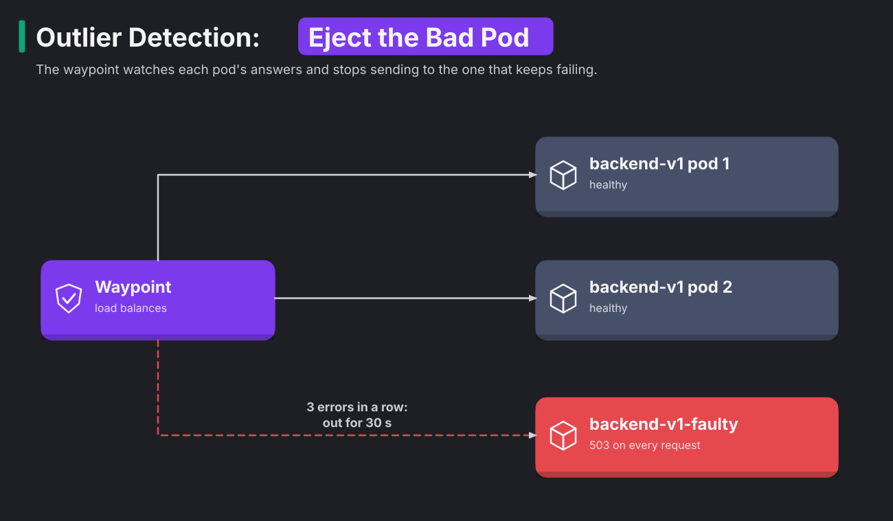

# Module 15: outlier detection, retries and failover

> New to a term here, like VirtualService or waypoint? The [glossary](glossary.md) explains every Istio resource and term in this course.

**Before this module:** modules 4 and 5.

**You need:** the lab running (`./scripts/start.sh` starts or repairs it).

Module 5 broke the whole backend at once with a delay, a fault and a full connection pool. Real outages often look different. Often only one pod out of three goes bad. Its disk fills up, a node problem leaves it with a broken config, or it leaks memory. The Service keeps sending that pod its share of traffic, so a third of your users see errors. This module adds a misbehaving pod, fixes the damage in two ways, and compares the two fixes.

Time: about 40 minutes.

## Concept: two different fixes

A bad pod causes two problems. The user who just hit it needs a second chance. The next users should stop hitting it at all. Istio has one tool for each problem.

**Retries** send a failed request again, hopefully to a different pod. The user never sees the first failure.

**Outlier detection** watches each pod's answers. When a pod fails several times in a row, the proxy takes it out of load balancing for a while, so nobody sends it requests at all.



The diagram shows outlier detection at work. The waypoint keeps sending requests to the two healthy pods. After 3 errors in a row, it stops sending requests to the faulty one.

The two tools sound alike, but they do different jobs. A retry hides one failure from one user. Outlier detection stops the failures from happening in the first place. Think of a restaurant with a sick cook. A retry sends the bad dish back for another cook to remake. Outlier detection sends the sick cook home for a while. The exercise puts numbers on that difference.

## Concept: the waypoint keeps the score, not Kubernetes

Kubernetes never learns that a pod is ejected. Only one proxy knows. Outlier detection runs inside a single Envoy proxy, and in this lab that proxy is the shop's waypoint. Ejection works in four steps:

1. The waypoint counts the answers from each `backend-v1` pod in its own memory.
2. A pod returns three 5xx errors in a row.
3. The waypoint marks that pod as ejected and stops picking it.
4. When the ejection time runs out, the waypoint tries the pod again.

Nothing outside the waypoint changes:

| Who | What it sees after the ejection |
|---|---|
| Kubernetes (`kubectl -n shop get endpointslices`) | three pods, all ready |
| istiod | three pods, and it keeps sending all three to the waypoint |
| The waypoint's Envoy | three pods, one of them marked as ejected, so it picks from two |

So no `kubectl` command shows an ejection. You see it only through its effects: the 503s stop, and the faulty pod's log goes quiet.

Each proxy also judges on its own:

- The lab's waypoint runs as one pod, so one set of three errors is enough.
- With two waypoint pods, each pod would need its own three errors.
- In sidecar mode, every client sidecar keeps a separate score. Some clients still call a pod that other clients already ejected.

An ejection always ends by itself, as step 4 says. Envoy tries the pod again whether it is fixed or not.

Retries only help when the second attempt reaches a different pod. Istio configures Envoy's retries to skip the pods that this request already tried. So after the faulty pod returns a 503, the second attempt almost always lands on a healthy pod.

## The bigger picture: failing gracefully

Large systems never run fully healthy. With hundreds of pods across dozens of nodes, something is always broken somewhere. The goal isn't zero failures. It's making sure a broken part doesn't turn into a broken product.

The industry calls this idea graceful degradation. It changes how you think about health checks. A Kubernetes readiness probe asks the pod "are you OK?", and a broken pod often answers "yes". Its `/readyz` endpoint works fine while every real request fails. Outlier detection asks a better question: "how are your real answers going?" It judges the pod by what users actually get. That's why big platforms rely on both checks:

- Readiness probes catch pods that are clearly dead.
- Outlier detection catches pods that are quietly wrong.

Retries come with a warning label. Module 5's "bigger picture" section explained three rules:

- Retry in one layer only.
- Cap the number of attempts.
- Only retry requests that are safe to repeat.

A GET is safe to repeat. A POST that charges a credit card twice isn't.

## Concept: failover between zones

Cloud regions consist of zones. A zone is a separate data centre a few kilometres from the others, with its own power and network. Kubernetes labels every node with its zone (`topology.kubernetes.io/zone`), and Istio reads that label. With a little configuration, a proxy prefers pods in its own zone, which is faster and cheaper. The proxy only sends traffic to another zone when the local pods fail:

```yaml
apiVersion: networking.istio.io/v1
kind: DestinationRule
metadata:
  name: backend-v1-locality
spec:
  host: backend-v1.shop.svc.cluster.local
  trafficPolicy:
    loadBalancer:
      localityLbSetting:
        enabled: true
        failover:
          - from: eu-west-1a
            to: eu-west-1b
    outlierDetection:          # required: it decides when local pods count as failed
      consecutive5xxErrors: 3
      interval: 5s
      baseEjectionTime: 30s
```

Notice the `outlierDetection` block. Failover depends on it, because Istio only moves traffic to another zone after outlier detection has ejected the local pods. So the ejection you learn in this module is the engine behind zone failover.

This lab runs on one node in one zone, so it has no other zone to fail over to. For that reason, the course doesn't run this example. The k3s operations module adds a second node. If you label the two nodes as different zones, the same rule applies.

## Why this way

**Why consecutive errors and not an error percentage?** Consecutive errors react fast and need no statistics. Three 5xx answers in a row from one pod rarely happen by chance. For pods that fail only some of the time, Envoy also supports percentage-based ejection (`failurePercentageThreshold`).

**Why does the ejection time grow?** A pod that comes back and fails again is probably still broken. Envoy multiplies `baseEjectionTime` by the number of times it ejected that pod, so a flapping pod spends less and less time hurting users.

**Why `maxEjectionPercent: 50`?** If every pod fails at once, the cause is probably shared, like a database outage. Ejecting all of them would leave no pod to serve even the requests that might succeed. The cap keeps at least half the pods in rotation.

**Why does the retry need a VirtualService?** The Gateway API version in this lab (v1.2) has no retry field on HTTPRoute in its standard channel. Istio's VirtualService has had retries since the start. As in module 5, delete the HTTPRoute for the same host first.

**Why `retryOn: 5xx,connect-failure,refused-stream`?** The list names the failures worth a second try:

- `5xx` is a server error.
- `connect-failure` is a connection that never opened.
- `refused-stream` is a stream the server refused.

The list leaves out timeouts on purpose. Otherwise a slow backend would receive every request three times.

## Do it

### 1. Add a faulty pod

```bash
kubectl apply -f platform-engineering/manifests/15-faulty-pod.yaml
kubectl -n shop get pods -l app=backend,version=v1
```

**What you should see.** Three `backend-v1` pods: the two usual ones and `backend-v1-faulty-...`. All three show `Running` and `1/1` Ready. Kubernetes thinks everything is fine.

Now send 90 requests and count the answers:

```bash
for i in $(seq 1 90); do curl -s -o /dev/null -w "%{http_code}\n" http://localhost:8080/api/orders; done | sort | uniq -c
```

**What you should see.** About 60 `200` and 30 `503`. One pod in three fails, so one request in three fails. In the test run for this module it was 34 out of 90.

### 2. Eject the bad pod

```bash
kubectl apply -f platform-engineering/manifests/15-outlier-detection.yaml
for i in $(seq 1 30); do curl -s -o /dev/null -w "%{http_code}\n" http://localhost:8080/api/orders; done | sort | uniq -c
for i in $(seq 1 90); do curl -s -o /dev/null -w "%{http_code}\n" http://localhost:8080/api/orders; done | sort | uniq -c
```

**What you should see.** The first 30 requests still show about three `503`. Those are the "3 errors in a row" that the rule waits for. The next 90 requests all return `200`. The waypoint stopped sending the faulty pod anything.

Wait 40 seconds and repeat the 90 requests. You'll see about three `503` again. Here is what happened:

1. The ejection time ran out.
2. The waypoint gave the pod another chance.
3. The pod failed three more times.
4. The waypoint ejected it again, for longer this time.

### 3. Retries instead

Remove the outlier detection and try retries on their own:

```bash
kubectl -n shop delete destinationrule backend-v1-outlier
kubectl -n shop delete httproute backend-route
kubectl apply -f platform-engineering/manifests/15-retries.yaml
calls() { kubectl -n shop logs deploy/backend-v1-faulty --since=30m | grep -c /api/orders; }
before=$(calls)
for i in $(seq 1 90); do curl -s -o /dev/null -w "%{http_code}\n" http://localhost:8080/api/orders; done | sort | uniq -c
echo "the faulty pod got $(( $(calls) - before )) of those requests"
```

**What you should see.** All 90 return `200`, so users notice nothing. But the faulty pod still got about 30 of those requests and failed every one. Each of those failures cost a wasted call, a retry, and extra latency for that user. Retries hid the problem. They didn't fix it.

### 4. Both together

```bash
kubectl apply -f platform-engineering/manifests/15-outlier-detection.yaml
before=$(calls)
for i in $(seq 1 90); do curl -s -o /dev/null -w "%{http_code}\n" http://localhost:8080/api/orders; done | sort | uniq -c
echo "the faulty pod got $(( $(calls) - before )) of those requests"
```

**What you should see.** All 90 requests return `200`. The faulty pod got about three requests, the ones it took to eject it. Retries covered those three, and outlier detection handled the rest. Production setups use this pairing.

| Setup | Failures users saw (of 90) | Requests the faulty pod still got |
|---|---|---|
| Nothing | about 30 | about 30 |
| Outlier detection only | about 3 at the start, then none | about 3 |
| Retries only | none | about 30 |
| Retries and outlier detection | none | about 3 |

## Investigate

1. The faulty pod shows `1/1 Ready` the whole time. Why doesn't Kubernetes take it out of the Service?
2. In step 2, why do exactly about three requests fail before the ejection, and not one?
3. Change `maxEjectionPercent` to `0` and repeat step 2. What happens, and why would anyone set it that way?
4. Your team adds retries everywhere: the gateway retries 2 times, the frontend 2 times, the waypoint 2 times. The backend goes down. How many requests reach it for each click?

<details>
<summary>Answers</summary>

1. Its readiness probe calls `/readyz`, and that path still works, because `ERROR_RATE` only breaks `/api/` paths. Kubernetes trusts the probe, so the pod stays in the Service's endpoints. Outlier detection judges the pod by its real answers instead. Outlier detection exists because of this gap between "the probe says fine" and "users say broken".
2. The rule sets `consecutive5xxErrors: 3`. Envoy ejects a pod once it has returned three 5xx answers in a row, and the third answer still reaches a user. A lower number would eject pods after a single unlucky error.
3. Envoy ejects nothing, and the 503 rate goes back to about one in three. In a test run, 25 of 90 requests failed with `0`, and none of 90 failed with `50`. With `0`, outlier detection still counts errors but never acts on them. Teams use this setting during a rollout. It lets them watch which pods outlier detection would eject, without the risk of an unexpected change.
4. Each layer makes up to 3 attempts (1 plus 2 retries). So 3 × 3 × 3 = 27 requests reach the backend for each click, at the moment the backend struggles most. This is called a retry storm. Retry in one layer only, usually the layer closest to the failing service. Here that layer is the waypoint.

</details>

## Clean up

```bash
./platform-engineering/reset.sh
```

This deletes the faulty pod, the VirtualService and the DestinationRule, and restores the HTTPRoute.
