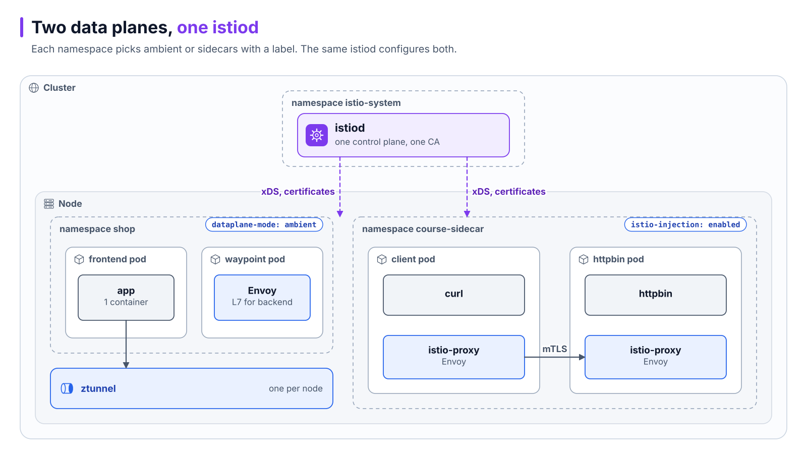
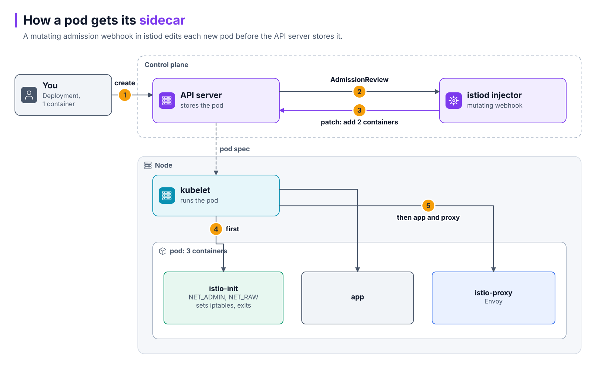
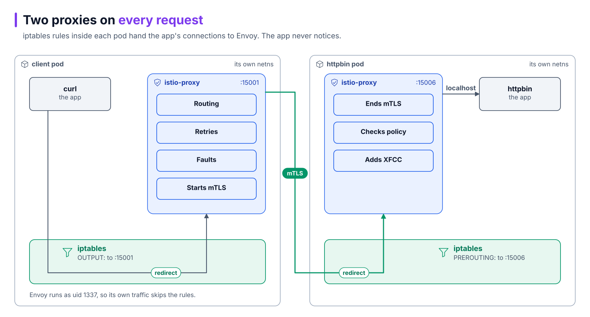

# Module 7: sidecar mode

> New to a term here, like VirtualService or waypoint? The [glossary](../glossary.md) explains every Istio resource and term in this course.

**Before this module:** modules 1 to 3.

**You need:** the lab running (`./lab.sh start` starts or repairs it), `istioctl`, and `./lab.sh ui` running in a spare terminal for Kiali (http://localhost:20001).

Most Istio installations in production still use sidecars, and most Istio documentation assumes them. This module runs sidecar mode next to ambient in the same cluster, with the same istiod, so you compare the two directly.

## Concept: both modes, one control plane

The lab installed Istio with the ambient profile, but istiod still contains the sidecar injector, so each namespace chooses its mode with a label:

| Label on the namespace | Mode |
|---|---|
| `istio.io/dataplane-mode: ambient` | ambient, ztunnel and optional waypoints |
| `istio-injection: enabled` | sidecar, an Envoy in every pod |
| neither | not in the mesh |



## Concept: how a sidecar gets into the pod

A one-container Deployment ends up with three containers per pod in five steps:

1. You create a Deployment with one container.
2. The API server sends each new pod to istiod's injector for review.
3. The injector adds an init container, `istio-init`, and a proxy container, `istio-proxy`.
4. The kubelet starts `istio-init`, which sets iptables rules and exits.
5. The kubelet starts the app and `istio-proxy`.



You never add the proxy container yourself, because Istio adds it at the moment Kubernetes creates the pod. It uses a mutating admission webhook, which you know from CKA: the API server sends each new pod spec to istiod first, istiod edits the spec in a labelled namespace to add the extra containers, and only then does the API server store the pod.

A common mistake follows from this. You label a namespace `istio-injection: enabled` and expect its running pods to join the mesh, but the webhook sees a pod only at the moment the API server creates it, so running pods keep their old spec until you replace them with `kubectl rollout restart`.

## Concept: two proxies on every request

The app in the pod has no idea a proxy exists, so it opens connections as usual while the pod quietly hands them to Envoy. It works like the mail room in an office building, where staff drop letters in the outbox and the mail room handles every letter, outgoing and incoming.

Before the app starts, the `istio-init` container writes iptables rules into the pod's own network stack. You know iptables rules from kube-proxy, but these live inside the pod rather than on the node, and they do two things:

- They send every outgoing TCP connection to Envoy on port 15001.
- They send every incoming TCP connection to Envoy on port 15006.

Envoy's own connections need an exception, because otherwise Envoy would catch its own traffic in an endless loop. Envoy runs as user ID 1337 and the rules skip traffic from that user, so Envoy's connections leave the pod directly.

As a result, a call from `client` to `httpbin` passes two Envoys, one in each pod:



The left Envoy works for the caller and the right one for the receiver, and that split explains most of this module:

- The client's sidecar applies retries and faults (steps 5 and 6).
- The server's sidecar decides about mTLS and tells the app who called (steps 3 and 4).
- Both sidecars report metrics, so you get two numbers for one request (Investigate question 3).

Ambient keeps the same two roles but moves them out of the pod. Two ztunnels, one on the caller's node and one on the receiver's node, share the basic connection work at L4, while the HTTP-level work at L7 moves to the waypoint, which acts for the receiver.

## Why this way, and why ambient exists

| | Sidecar | Ambient |
|---|---|---|
| Join the mesh | Restart every pod (the webhook only runs on create) | Label the namespace, no restart |
| Who applies routing rules | The **client's** sidecar | The **destination's** waypoint |
| Memory | One Envoy per pod | One ztunnel per node, one waypoint per namespace or service |
| Pod security | Init container needs `NET_ADMIN` and `NET_RAW` | Nothing extra in the pod |
| Upgrade Istio | Restart every pod to get the new proxy | Upgrade ztunnel and waypoints, pods untouched |
| Maturity | Since 2017, every feature | GA since Istio 1.24, some features still missing (for example `EnvoyFilter` on waypoints) |

**Why does the client apply the rules in sidecar mode?** The client's proxy already sits in the path, and each sidecar is a full Envoy that knows the whole mesh, so the client's sidecar picks the destination pod itself and saves a hop. The cost is that every sidecar holds config for every service, and every rule change must reach every pod.

**Why did ambient move L7 to the destination?** A waypoint holds config only for the services it fronts rather than for the whole mesh, so it stays small. The rules also guard the backend's own front door, which means a rule about "traffic to the backend" applies to every caller, even one outside the mesh, while in sidecar mode a caller without a sidecar skips the client-side rules completely.

**Why does `course-sidecar` not enforce Pod Security `baseline`?** Writing iptables rules inside the pod needs two Linux capabilities, `NET_ADMIN` and `NET_RAW`, which `baseline` forbids. Ambient needs neither, because the CNI agent sets up the redirection from outside the pod. Istio also offers a sidecar setup that uses its CNI plugin and drops the requirement, but the lab keeps the classic setup so you see it.

## The bigger picture: what living with sidecars feels like

On paper a sidecar is one more container, but in practice it brings a handful of everyday headaches, and those headaches pushed the Istio team towards ambient.

**Start order.** Kubernetes starts a pod's containers without waiting for each other, so if your app starts first and makes a network call before Envoy is ready, the call fails. Istio added a setting, `holdApplicationUntilProxyStarts`, that makes the app wait. Shutdown has the mirror problem, because Envoy sometimes stops before the app finishes its last requests.

**Jobs that never finish.** A Job completes when all its containers exit, but the sidecar keeps running after the app exits, so the Job hangs forever. For years people worked around it with scripts that called Envoy's `/quitquitquit` endpoint, until Kubernetes fixed it with native sidecars. A native sidecar is an init container with `restartPolicy: Always`, which Kubernetes starts before the app and stops after it, and the feature has been beta and on by default since Kubernetes 1.29.

**Upgrades.** A new Istio version brings a new Envoy, and the only way into a running pod is a restart, so in a big cluster every Istio upgrade turns into a rolling restart of every workload.

**Cost at scale.** Every sidecar reserves CPU and memory, and by default it also holds configuration for every service in the mesh and takes updates from istiod, so a thousand pods mean a thousand Envoys to feed.

Ambient swaps these problems for different ones. ztunnel runs once per node, so a ztunnel crash hits every mesh pod on that node at the same time, while a sidecar crash hits one pod, and a noisy workload shares ztunnel with its neighbours. Neither model wins everywhere, which is why Istio keeps both and why this lab runs them side by side.

## Do it

### 1. Create a sidecar namespace

```console
$ cat platform-engineering/manifests/07-sidecar-namespace.yaml
# A namespace that uses classic sidecar injection, next to the ambient "shop" namespace.
# It has no Pod Security "baseline" label: the injected istio-init container needs the
# NET_ADMIN and NET_RAW capabilities to set up traffic redirection, and baseline forbids them.
apiVersion: v1
kind: Namespace
metadata:
  name: course-sidecar
  labels:
    istio-injection: enabled
    app.kubernetes.io/part-of: istio-course

$ kubectl apply -f platform-engineering/manifests/07-sidecar-namespace.yaml -f platform-engineering/manifests/07-sidecar-apps.yaml \
  -f platform-engineering/manifests/07-sidecar-podmonitor.yaml
namespace/course-sidecar created
serviceaccount/httpbin created
serviceaccount/client created
deployment.apps/httpbin created
service/httpbin created
deployment.apps/client created
podmonitor.monitoring.coreos.com/sidecars created

$ kubectl -n course-sidecar rollout status deploy/httpbin
deployment "httpbin" successfully rolled out

$ kubectl -n course-sidecar get pods
NAME                      READY   STATUS    RESTARTS   AGE
client-588f9f56c-tpkqr    2/2     Running   0          8s
httpbin-fb884c77d-68bvw   2/2     Running   0          8s
```

**What you should see.** First the namespace with the label `istio-injection: enabled`, then `kubectl apply` printing `created` for the namespace, two service accounts, two Deployments, the Service and the PodMonitor. Both pods show `READY 2/2`, one container for the app and one for `istio-proxy`.

The PodMonitor asks Prometheus to scrape the sidecars, because by default the lab scrapes only the gateway, the waypoint and ztunnel, so without it no sidecar metric reaches Grafana or Kiali. Prometheus needs a few minutes to load it, which is why you apply it now, long before the questions at the end.

```console
$ kubectl -n course-sidecar get pod -l app=httpbin \
  -o jsonpath='{range .items[0].spec.initContainers[*]}init: {.name}{"\n"}{end}{range .items[0].spec.containers[*]}container: {.name}{"\n"}{end}'
init: istio-init
container: httpbin
container: istio-proxy
```

**What you should see.** The Deployment you applied has one container, and the injector added the other two when the API server created the pod. The `.items[0]` in the command matters, because `get pod -l` returns a list, even for one pod.

### 2. Look at the proxies

```console
$ istioctl proxy-status
NAME                                                 CLUSTER        ISTIOD                    VERSION     SUBSCRIBED TYPES
client-588f9f56c-tpkqr.course-sidecar                Kubernetes     istiod-5c5bf76f-gtmzl     1.24.2      4 (CDS,LDS,EDS,RDS)
httpbin-fb884c77d-68bvw.course-sidecar               Kubernetes     istiod-5c5bf76f-gtmzl     1.24.2      4 (CDS,LDS,EDS,RDS)
shop-gateway-istio-858774d7cd-fgdt5.shop-ingress     Kubernetes     istiod-5c5bf76f-gtmzl     1.24.2      4 (CDS,LDS,EDS,RDS)
waypoint-b9b76876f-hph5z.shop                        Kubernetes     istiod-5c5bf76f-gtmzl     1.24.2      4 (CDS,LDS,EDS,WDS)
ztunnel-htqw5.istio-system                           Kubernetes     istiod-5c5bf76f-gtmzl     1.24.2      2 (WADS,WDS)
```

**What you should see.** Five rows now, with the two sidecars next to the gateway, the waypoint and ztunnel. The column "SUBSCRIBED TYPES" lists the kinds of config each proxy receives from istiod, and a proxy that does more work needs more kinds:

- Sidecars and the gateway receive `CDS, LDS, EDS, RDS`, which are Envoy's clusters, listeners, endpoints and routes.
- The waypoint takes `WDS` instead of `RDS`, because it carries its routes inside its listeners and reads workload data like ztunnel does.
- ztunnel receives `WADS, WDS`, which stand for workloads and addresses, a much smaller protocol made for ztunnel.

```console
$ istioctl x describe pod $(kubectl -n course-sidecar get pod -l app=httpbin -o jsonpath='{.items[0].metadata.name}').course-sidecar
Pod: httpbin-fb884c77d-68bvw.course-sidecar
   Pod Revision: default
   Pod Ports: 8080 (httpbin), 15090 (istio-proxy)
--------------------
Service: httpbin.course-sidecar
   Port: http 8000/HTTP targets pod port 8080
--------------------
Effective PeerAuthentication:
   Workload mTLS mode: PERMISSIVE
Skipping Gateway information (no ingress gateway pods)
```

**What you should see.** The Service, the port and the effective mTLS mode, which reads `PERMISSIVE` because nothing in `course-sidecar` says otherwise yet. Envoy serves its metrics on port 15090 of `istio-proxy`, and the PodMonitor scrapes that port.

### 3. mTLS identity, seen by the app

```console
$ kubectl -n course-sidecar exec deploy/client -c curl -- curl -s http://httpbin:8000/headers
{
  "headers": {
    "Accept": [
      "*/*"
    ],
    "Host": [
      "httpbin:8000"
    ],
    "Traceparent": [
      "00-75e33a51754890802c65eb532b4e61f8-088487df8ec0f77c-01"
    ],
    "Tracestate": [
      ""
    ],
    "User-Agent": [
      "curl/8.11.1"
    ],
    "X-Envoy-Attempt-Count": [
      "1"
    ],
...
    "X-Request-Id": [
      "4fc70156-1a77-9ffc-a5d1-415016f939ca"
    ]
  }
}
```

**What you should see.** httpbin echoes the request headers it received, as JSON, and among them sits `X-Forwarded-Client-Cert`.

`URI=` names the caller and `By=` names the receiver. The server-side sidecar adds this header, so the app sees who called even though it never touched TLS. You also find `Traceparent` and `X-Envoy-Attempt-Count: 1`, which the sidecars added, not curl.

### 4. PERMISSIVE, then STRICT

```console
$ kubectl apply -f platform-engineering/manifests/02-outside-client.yaml
namespace/course-outside unchanged
deployment.apps/client unchanged

$ kubectl -n course-outside exec deploy/client -- curl -s -o /dev/null -w "%{http_code}\n" http://httpbin.course-sidecar:8000/status/200
200
```

**What you should see.** `200`, because PERMISSIVE, the default for sidecars, lets a plaintext client from outside the mesh in. If you kept `course-outside` from module 2, `kubectl apply` reports `unchanged`.

```console
$ kubectl apply -f platform-engineering/manifests/07-sidecar-strict-mtls.yaml
peerauthentication.security.istio.io/default created

$ kubectl -n course-outside exec deploy/client -- curl -s -m 5 -o /dev/null -w "%{http_code}\n" http://httpbin.course-sidecar:8000/status/200
000
command terminated with exit code 56

$ kubectl -n course-sidecar exec deploy/client -c curl -- curl -s -o /dev/null -w "%{http_code}\n" http://httpbin:8000/status/200
200
```

**What you should see.** `peerauthentication.security.istio.io/default created`, and then the outside client gets `000` with `command terminated with exit code 56`, because httpbin's sidecar reset the plaintext connection. The sidecar client still gets `200`, because its own sidecar speaks mTLS for it. Run step 2's `istioctl x describe` again, and it reports `Workload mTLS mode: STRICT`.

### 5. Retries, applied by the client's sidecar

`/unstable?failure_rate=0.5` fails half of the time.

```console
$ kubectl -n course-sidecar exec deploy/client -c curl -- sh -c 'ok=0; for i in $(seq 1 40); do c=$(curl -s -o /dev/null -w "%{http_code}" "http://httpbin:8000/unstable?failure_rate=0.5"); [ "$c" = 200 ] && ok=$((ok+1)); done; echo "$ok of 40"'
17 of 40

$ kubectl apply -f platform-engineering/manifests/07-sidecar-retries.yaml
virtualservice.networking.istio.io/httpbin created

# run the same loop again
$ kubectl -n course-sidecar exec deploy/client -c curl -- sh -c 'ok=0; for i in $(seq 1 40); do c=$(curl -s -o /dev/null -w "%{http_code}" "http://httpbin:8000/unstable?failure_rate=0.5"); [ "$c" = 200 ] && ok=$((ok+1)); done; echo "$ok of 40"'
38 of 40
```

**What you should see.** Without retries about half the requests succeed: `27 of 40`, `19 of 40` and `17 of 40` in three runs. With 3 retries almost all succeed, `38 of 40` and `39 of 40`, because each request now gets up to four tries and four failures in a row happen about one time in 16. The curl command did nothing different, so the client's sidecar did the retrying.

### 6. Fault injection on the client side

```console
$ kubectl apply -f platform-engineering/manifests/07-sidecar-fault.yaml
virtualservice.networking.istio.io/httpbin configured

$ kubectl -n course-sidecar exec deploy/client -c curl -- curl -s -o /dev/null -w "%{http_code} in %{time_total}s\n" http://httpbin:8000/status/200
200 in 2.004833s

$ kubectl -n course-sidecar delete virtualservice httpbin
virtualservice.networking.istio.io "httpbin" deleted
```

**What you should see.**

1. `virtualservice.networking.istio.io/httpbin configured`. The fault rule has the same name as the retry rule, so it replaces it.
2. `200 in 2.005436s` or close to it.
3. `deleted`.

httpbin answered at once, so the two seconds came from the client's own sidecar holding the request.

### 7. Compare the memory

```console
$ kubectl top pod -n course-sidecar --containers
POD                       NAME          CPU(cores)   MEMORY(bytes)
client-588f9f56c-tpkqr    curl          11m          0Mi
client-588f9f56c-tpkqr    istio-proxy   6m           35Mi
httpbin-fb884c77d-68bvw   httpbin       1m           5Mi
httpbin-fb884c77d-68bvw   istio-proxy   5m           38Mi

$ kubectl top pod -n istio-system | grep ztunnel
ztunnel-htqw5            5m           16Mi

$ kubectl top pod -n shop | grep waypoint
waypoint-b9b76876f-hph5z        2m           37Mi
```

**What you should see.** The lab measured 35 to 39 MiB per sidecar, 12 to 16 MiB for ztunnel, and 29 to 37 MiB for the waypoint. Each sidecar weighs about five times the app it serves, so two sidecars already cost more than ztunnel and the waypoint together, and the sidecar cost grows with every pod.

### 8. Cross-mode traffic

```console
$ kubectl -n course-sidecar exec deploy/client -c curl -- curl -s -o /dev/null -w "frontend %{http_code}\n" http://frontend.shop:3000/healthz
frontend 200

$ kubectl -n course-sidecar exec deploy/client -c curl -- curl -s -w " backend %{http_code}\n" http://backend.shop:8000/api/version
upstream connect error or disconnect/reset before headers. reset reason: connection termination backend 503
```

**What you should see.** The frontend answers `200`, because sidecars and ztunnel speak the same mTLS, but the backend refuses, because an ambient rule expects its traffic to pass through a waypoint. In order:

1. The client's sidecar sends traffic straight to a backend pod and skips the waypoint.
2. The L4 policy `backend-only-from-waypoint` admits only the waypoint.
3. So the backend's ztunnel closes the connection.
4. The client's sidecar turns the closed connection into a `503`.

ztunnel's log shows the rejection with these fields:

- `src.identity="spiffe://cluster.local/ns/course-sidecar/sa/client"`
- `dst.service="backend-v1.shop.svc.cluster.local"`
- `error="connection closed due to policy rejection: allow policies exist, but none allowed"`

Module 3 explains why that policy exists.

## Investigate

1. How does Kiali tell a sidecar workload from an ambient one? Open **Workloads** for `course-sidecar` and `shop`, then open `httpbin`, tab **Logs**. Which containers does it offer?
2. In Kiali **Traffic Graph** for `course-sidecar`, run step 5's loop again with the retry rule in place. How many errors does the edge from `client` to `httpbin` show, compared with what curl saw?
3. In Grafana Explore, run `sum by (reporter) (rate(istio_requests_total{destination_workload="httpbin"}[5m]))`. Sidecars report from both ends. Which `reporter` values appear?
4. Why does step 6's delay not appear in httpbin's own latency at all, while module 5's fault delay did appear at the waypoint?

<details>
<summary>Answers</summary>

1. Kiali looks at the pods. It finds an `istio-proxy` container in `httpbin` and `client`, so it marks them `istioSidecar: true`, while the shop's workloads have one container each in an ambient-mode namespace, so Kiali marks them `isAmbient: true`. Check it with `curl -s "http://localhost:20001/api/clusters/workloads?namespaces=course-sidecar,shop"`. The Logs tab for `httpbin` offers two containers, `httpbin` and `istio-proxy`, whereas for `frontend` in module 2 it offered one container plus the `ztunnel` checkbox.
2. The edge shows many more errors than curl saw. In the lab curl reported `38 of 40`, so two failures, while in the same two minutes the edge showed about 61% errors:
   - `500` with no flag on 57% of the requests.
   - `500` with `URX` on about 4%, where `URX` means the request ran out of retries.

   The sidecar at httpbin records every attempt, the failed ones included, and Kiali counts them all. The `URX` errors are the few requests where all four tries failed, so curl saw the error, which shows that retries hide failures from users but not from your metrics.
3. `source` and `destination`. `source` comes from the client's sidecar and counts what the caller finally got, while `destination` comes from httpbin's sidecar and counts every attempt that arrived. In the lab, after all of step 5:
   - `destination` held 161 `500` responses.
   - `source` held 34 plain `500` responses from the runs without retries, and 9 with `URX`.

   You see this only once Prometheus scrapes the sidecars, which the PodMonitor from step 1 sets up.
4. The client's sidecar applies the VirtualService, so it waits two seconds before it even sends the request, while httpbin's sidecar starts measuring when the request arrives. In the lab, `istio_request_duration_milliseconds` averaged about 2050 ms for `reporter="source"`, with flag `DI`, and about 2 ms for `reporter="destination"`. In module 5 the waypoint injected the delay and also reported the metric, so its latency included the wait.

</details>

[Module 30](../3-advanced/30-sidecar-in-depth.md) goes deeper into sidecars: which of istiod's four webhooks injects a pod, the iptables rules inside it, and how a Sidecar resource cuts each proxy's config.

## Clean up

```console
$ ./platform-engineering/reset.sh          # removes the VirtualService and PeerAuthentication
Removing course rules from the shop namespace
Applying the baseline Istio config from manifests/istio
Turning off the backend experiment settings
Asking ArgoCD to sync istio-config from Git
Done. Baseline: 100% of backend traffic to v1, no faults, no extra rules.

$ ./platform-engineering/reset.sh --all    # also deletes course-sidecar (with its PodMonitor) and course-outside
Removing course rules from the shop namespace
Applying the baseline Istio config from manifests/istio
Turning off the backend experiment settings
Removing the course namespaces and the course client
Asking ArgoCD to sync istio-config from Git
Done. Baseline: 100% of backend traffic to v1, no faults, no extra rules.
```
