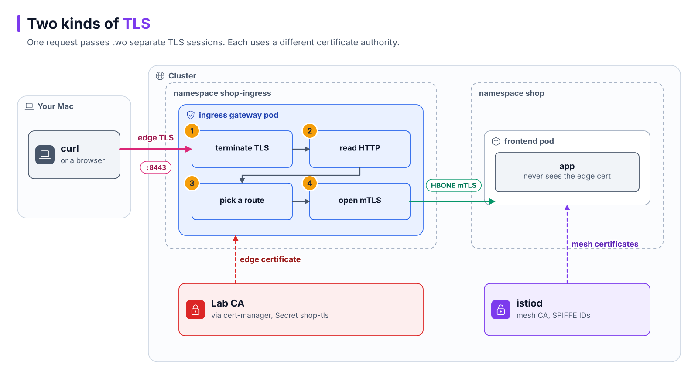
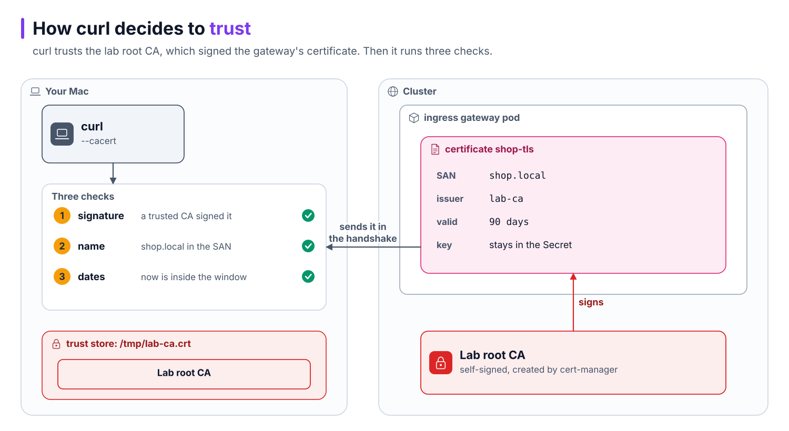
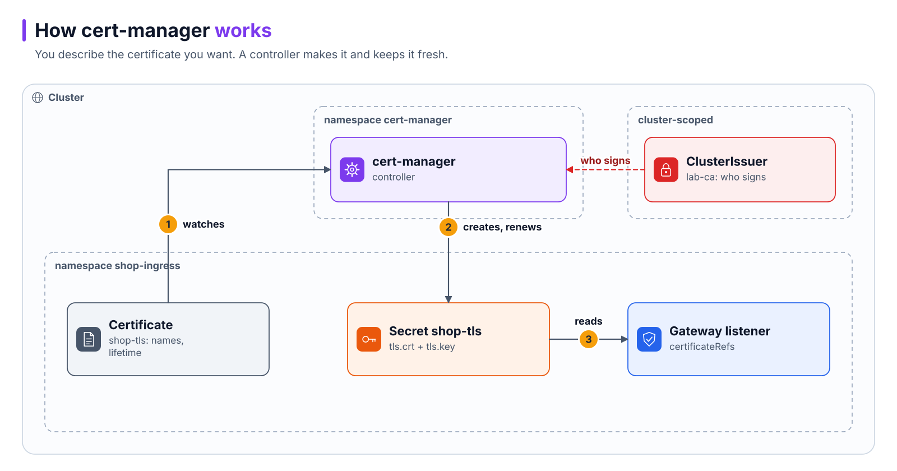

# Module 11: TLS at the edge

> New to a term here, like VirtualService or waypoint? The [glossary](../glossary.md) explains every Istio resource and term in this course.

**Before this module:** modules 1 to 4.

**You need:** the lab running (`./lab.sh start` starts or repairs it), and `openssl`, which ships with macOS.

So far the shop speaks plain HTTP on `localhost:8080`. Inside the mesh that's fine, because ztunnel wraps every hop in mTLS, but the first hop, from your browser to the ingress gateway, travels unencrypted, so anyone on the network path reads it. In this module you close that gap in three steps:

1. You give the gateway an HTTPS listener.
2. You let cert-manager issue and renew its certificate.
3. You send every HTTP visitor over to HTTPS.

Time: about 45 minutes.

## Concept: two kinds of TLS in one request

One request now passes through two separate TLS sessions, and each one uses a different certificate authority.



| | Edge TLS (this module) | Mesh mTLS (module 2) |
|---|---|---|
| Who connects | Any client, usually a browser | Only workloads inside the mesh |
| Who proves its identity | Only the server | Both sides |
| Who signs the certificate | A CA the client trusts: Let's Encrypt, a company CA, or here the lab CA | istiod, a CA only the mesh trusts |
| Name in the certificate | A DNS name, like `shop.local` | A SPIFFE ID, like `spiffe://cluster.local/ns/shop/sa/frontend` |
| Who manages it | You, with cert-manager | istiod, fully automatic |

The gateway sits between the two sessions, like a translator between two phone calls, and does four things in order:

1. It ends the browser's TLS session. The usual word for this is "terminates".
2. It reads the HTTP request.
3. It picks a route.
4. It opens a fresh mTLS connection into the mesh.

So the frontend never sees the edge certificate.

## Concept: how a client decides to trust a certificate

A certificate works like an ID card: it holds a public key, some names and some dates, and an issuer signs it. The private key never leaves the Secret, because the gateway sends only the certificate and proves during the handshake that it holds the matching private key. Before curl sends a single byte of HTTP, it runs three checks:

1. Signature. A CA in curl's trust store signed the certificate. curl and browsers ship a list of public CAs that leaves out the lab CA, which is why step 3 passes `--cacert /tmp/lab-ca.crt`.
2. Name. The host name in the URL appears in the certificate's Subject Alternative Name (SAN) list. Modern clients ignore the older Common Name field.
3. Dates. The current time lies between "not before" and "not after".



You rely on the same chain every day, because your kubeconfig holds `certificate-authority-data` and kubectl checks the API server's certificate against it, exactly the way curl checks the gateway here.

## Concept: how cert-manager works

cert-manager turns certificates into ordinary Kubernetes resources: you describe the certificate you want, and a controller makes it happen and keeps it fresh.



You write a Certificate, the controller reads it together with the ClusterIssuer, and the controller writes a Secret for the gateway. Three resources do the work:

- An **Issuer** or **ClusterIssuer** says who signs. In real life that's usually Let's Encrypt through the ACME protocol, or a company CA, but Let's Encrypt needs a public DNS name and a laptop lab has none, so the lab runs its own CA, `lab-ca`, backed by a self-signed root that cert-manager created during provisioning.
- A **Certificate** says what you want: DNS names, lifetime, when to renew, key type.
- A **Secret** of type `kubernetes.io/tls` holds the result, which cert-manager writes and the gateway reads.

You never touch the Secret yourself, because if you delete it, cert-manager simply issues a new one, as step 5 shows.

## The bigger picture: why certificates break production

Ask any operations team about their worst outages, and an expired certificate shows up on the list sooner or later. Whole mobile networks, cloud consoles and payment systems have gone down this way, and the pattern always looks the same:

1. Someone created the certificate by hand two years ago.
2. They set a reminder, then changed jobs.
3. Nobody owned the renewal.
4. One morning the certificate expired, and every client started refusing the connection.

The industry answer is short-lived certificates that renew automatically, so renewal happens often enough to become routine work for a machine. Let's Encrypt issues certificates for 90 days, and in 2025 the browser makers and certificate authorities voted to cut the maximum lifetime of public certificates step by step, down to 47 days by 2029. At that pace nobody renews by hand any more, which turns a tool like cert-manager from a nice extra into the only sane way.

That's also why this module's certificate lives for 90 days and renews 30 days early: you set the policy once, and from then on nobody thinks about it.

## Why this way

**Why end TLS at the gateway, and not pass it through to the frontend?** The gateway routes on the path, the host and the headers, and while the traffic stays encrypted it sees nothing but bytes. Istio supports passthrough with `mode: Passthrough`, for apps that must hold their own keys, but in that mode the gateway routes only by the server name and loses every HTTP feature.

**Why does the Secret live in `shop-ingress`?** By default a Gateway reads certificates only from its own namespace, which stops a team from pointing its gateway at another team's private key. To use a Secret from another namespace, the owner of that namespace allows it with a `ReferenceGrant`.

**Why does the gateway pick up a new certificate without a restart?** Envoy gets certificates from a live feed rather than from a file it reads once at start. That feed is SDS, the Secret Discovery Service, part of the same xDS protocol from module 1, and the update works like this:

1. istiod watches the Secret.
2. cert-manager rewrites the Secret.
3. istiod pushes the new certificate to Envoy.

Open connections keep their old session, while new connections get the new certificate.

**Why a 301 redirect and not just turning HTTP off?** People type `localhost:8080` or follow old links, and a redirect sends them to the right place instead of showing an error. Production sites also add HTTP Strict Transport Security (HSTS), a header that tells the browser to use HTTPS on its own next time.

## Do it

You need port 8443 on your machine. Clusters that `provision.sh` built after this module arrived publish it already. For an older cluster, add it once, and k3d rebuilds its load balancer while the cluster keeps running:

```console
$ docker port k3d-k8s-lab-serverlb | grep 8443 || k3d cluster edit k8s-lab --port-add 8443:8443@loadbalancer
8443/tcp -> 0.0.0.0:8443
8443/tcp -> [::]:8443
```

### 1. Meet the lab CA

```console
$ kubectl get clusterissuer
NAME         READY   AGE
lab-ca       True    34h
selfsigned   True    34h

$ kubectl -n cert-manager get certificate lab-root-ca
NAME          READY   SECRET        AGE
lab-root-ca   True    lab-root-ca   34h
```

**What you should see.** Two issuers, `selfsigned` and `lab-ca`, both `READY True`, and the root CA certificate also `READY True`. Save the root's public certificate, because curl needs it in a moment to trust the gateway:

```console
$ kubectl -n cert-manager get secret lab-root-ca -o jsonpath='{.data.ca\.crt}' | base64 -d > /tmp/lab-ca.crt
```

### 2. Ask for a certificate

```console
$ kubectl apply -f platform-engineering/manifests/11-certificate.yaml
certificate.cert-manager.io/shop-tls created

$ kubectl -n shop-ingress get certificate shop-tls -w      # wait for READY True, then Ctrl-C
NAME       READY   SECRET     AGE
shop-tls   True    shop-tls   8s

$ kubectl -n shop-ingress get secret shop-tls -o jsonpath='{.data.tls\.crt}' | base64 -d \
  | openssl x509 -noout -issuer -ext subjectAltName -dates
issuer=CN=k8s-lab root CA
X509v3 Subject Alternative Name: critical
    DNS:shop.local, DNS:localhost
notBefore=Nov 14 23:10:34 2026 GMT
notAfter=Feb 12 23:10:34 2027 GMT
```

The `-w` watch keeps running until you press Ctrl-C, and the transcript shows what it printed before that.

**What you should see.** The issuer `CN=k8s-lab root CA`, the names `shop.local` and `localhost`, and two dates 90 days apart. It took cert-manager a second or two.

### 3. Open an HTTPS listener

```console
$ kubectl apply -f platform-engineering/manifests/11-gateway-https.yaml
gateway.gateway.networking.k8s.io/shop-gateway configured

$ kubectl -n shop-ingress get gateway shop-gateway
NAME           CLASS   ADDRESS         PROGRAMMED   AGE
shop-gateway   istio   192.168.107.2   True         34h

$ curl --cacert /tmp/lab-ca.crt https://localhost:8443/api/version
{"version":"v1","pod":"backend-v1-54c86bf9b-xqdkd"}

$ curl https://localhost:8443/api/version
curl: (60) SSL certificate problem: unable to get local issuer certificate
More details here: https://curl.se/docs/sslcerts.html

curl failed to verify the legitimacy of the server and therefore could not
establish a secure connection to it. To learn more about this situation and
how to fix it, please visit the web page mentioned above.
```

**What you should see.** The first curl returns the version JSON, while the second fails with `SSL certificate problem: unable to get local issuer certificate`, because curl doesn't know the lab CA and so refuses the connection. Your browser behaves the same way and shows a warning page, which is TLS doing its job.

Now look at the handshake itself:

```console
$ openssl s_client -connect localhost:8443 -servername shop.local -CAfile /tmp/lab-ca.crt </dev/null 2>/dev/null \
  | grep -E "subject=|issuer=|Verify return code"
subject=
issuer=CN=k8s-lab root CA
Verify return code: 0 (ok)
```

One gateway serves many sites from one IP address, so it needs to know which site you want before it picks a certificate. The client tells it during the handshake, in a field called Server Name Indication (SNI), and `-servername` sets that field.

### 4. Send HTTP visitors to HTTPS

```console
$ kubectl apply -f platform-engineering/manifests/11-redirect.yaml
httproute.gateway.networking.k8s.io/frontend configured
httproute.gateway.networking.k8s.io/http-to-https created

$ curl -sI http://localhost:8080/api/orders | grep -iE "^HTTP|^location"
HTTP/1.1 301 Moved Permanently
location: https://localhost:8443/api/orders

$ curl -sL --cacert /tmp/lab-ca.crt -o /dev/null -w "%{http_code} %{url_effective}\n" http://localhost:8080/api/orders
200 https://localhost:8443/api/orders
```

**What you should see.** First `HTTP/1.1 301 Moved Permanently` with `location: https://localhost:8443/api/orders`, then `200` once curl follows the redirect. The redirect route answers on the `http` listener by itself, so the request never reaches the frontend.

### 5. Renew the certificate with no downtime

Note the certificate's serial number, then throw the Secret away and watch cert-manager replace it:

```console
$ serial() { openssl s_client -connect localhost:8443 -servername localhost </dev/null 2>/dev/null | openssl x509 -noout -serial; }
$ serial
serial=5F7648A9068121416D3586433BD4A45DC2F05A08

$ kubectl -n shop-ingress get pods          # note RESTARTS
NAME                                  READY   STATUS    RESTARTS   AGE
shop-gateway-istio-6cf8f9f67f-fwr6p   1/1     Running   0          16s

$ kubectl -n shop-ingress delete secret shop-tls
secret "shop-tls" deleted

$ sleep 5; serial
serial=39EA5C6429D081D3294F265385201B75D3C082ED

$ kubectl -n shop-ingress get pods          # RESTARTS has not changed
NAME                                  READY   STATUS    RESTARTS   AGE
shop-gateway-istio-6cf8f9f67f-fwr6p   1/1     Running   0          29s
```

**What you should see.** A new serial number within a few seconds, while the gateway pod stays untouched. A real renewal works the same way, because cert-manager writes a new Secret 30 days before expiry and SDS carries it into Envoy.

## Investigate

1. Which certificate does the frontend see when a request arrives through HTTPS?
2. Delete both the Certificate and the Secret (`kubectl -n shop-ingress delete certificate,secret shop-tls`). What does the Gateway report for the `https` listener, and what happens to `https://localhost:8443`? Re-apply step 2 afterwards.
3. In Grafana, open Explore with Prometheus and run `sum by (response_code, destination_service) (istio_requests_total{source_workload="shop-gateway-istio"})` after you call `http://localhost:8080` a few times. Wait 30 seconds for Prometheus to scrape. Do the 301 responses show up, and which service do they name?
4. Why does the certificate in step 2 list `localhost` as well as `shop.local`?

<details>
<summary>Answers</summary>

1. None of the edge certificates. The gateway ends the browser's TLS session and, towards the frontend, opens an HBONE mTLS connection with its own mesh identity, `spiffe://cluster.local/ns/shop-ingress/sa/shop-gateway-istio`. To check, send one HTTPS request and read the ztunnel log with `kubectl -n istio-system logs ds/ztunnel --since=1m | grep shop-gateway | grep frontend | tail -1`, where the `src.identity` field holds that SPIFFE ID.
2. The Secret no longer exists, so the listener's `ResolvedRefs` condition turns `False` with the reason `InvalidCertificateRef`, the gateway stops offering a certificate, and `curl` fails during the handshake. The `http` listener on 8080 keeps answering, with the redirect if you applied step 4, because one broken listener doesn't take down the others.
3. They do, but with `destination_service="unknown"`, because the gateway answered those requests itself and no backend took part, so the metric has no service to name. The 200s from HTTPS requests carry `destination_service="frontend.shop.svc.cluster.local"`. Remember that "unknown" label for real incidents, because a jump in `unknown` responses from a gateway often means one of two things:
   - A route matched nothing.
   - A redirect or a direct response answered instead of your service.
4. A certificate covers only the names listed in it, and curl and your browser connect to `localhost:8443`. Without `localhost` in the list the name check fails, even though the lab CA signed the certificate.

</details>

## Clean up

```console
$ ./platform-engineering/reset.sh
Removing course rules from the shop namespace
Applying the baseline Istio config from manifests/istio
Turning off the backend experiment settings
Asking ArgoCD to sync istio-config from Git
Done. Baseline: 100% of backend traffic to v1, no faults, no extra rules.
```

This removes the redirect, the HTTPS listener, the Certificate and its Secret, while the lab CA and cert-manager stay, because they belong to the lab.
