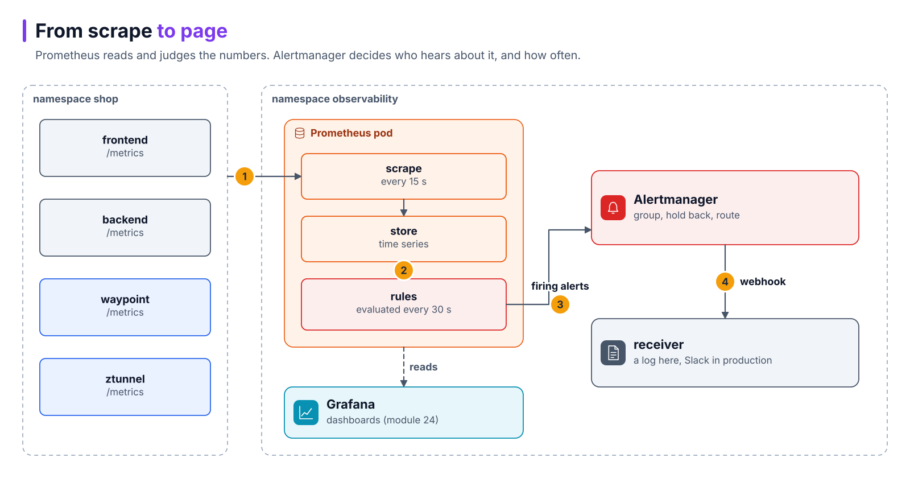

# Module 23: Prometheus and alerting

> New to a term here, like recording rule or burn rate? The [glossary](../glossary.md) explains every term in this course.

**Before this module:** module 0, and module 6 helps.

**You need:** the lab running (`./scripts/start.sh` starts or repairs it), and `./scripts/port-forward.sh` running in a spare terminal for Prometheus (http://localhost:9090) and Alertmanager (http://localhost:9093).

Module 6 used Prometheus to look at things, but in production teams use it to *wake people up* when something breaks, which takes a different skill in three parts:

1. You decide what counts as broken.
2. You write that decision as a query.
3. You send the alert to the person who fixes it.

This module starts with raw PromQL, the query language of Prometheus, and ends with a service-level objective (SLO), a target for how often the service works, plus an alert on how fast you're missing it. Google's SRE books describe this approach, and most SRE interviews ask about it. Then you break the backend, get paged, fix it, and watch the alert clear.

Time: about 60 minutes.

## Concept: from scrape to page



An alert travels from a pod to a person in four steps:

1. Prometheus reads the `/metrics` page of every pod and proxy every 15 seconds. Engineers call this read a **scrape**, and it works like a meter reading, where Prometheus writes down the current numbers.
2. Prometheus stores the numbers and evaluates its rules every 30 seconds.
3. Prometheus sends firing alerts to Alertmanager.
4. Alertmanager calls a receiver with a webhook. In production the receiver is Slack or PagerDuty, and here it's a log.

Grafana also reads from Prometheus, for dashboards (module 24).

The two alerting programs split the work: Prometheus only *decides* that something is wrong, while Alertmanager decides *who hears about it, and how often*, through three jobs:

- It groups ten alerts from one outage into one message.
- It holds back repeats of the same alert.
- It drops alerts during a planned silence.

## Concept: four things PromQL does

| You want | PromQL | Why |
|---|---|---|
| A counter's per-second speed | `rate(x_total[1m])` | Counters only go up. Their raw value means nothing. What matters is how fast they grow. |
| One number per group | `sum by (response_code) (...)` | Every distinct label set is its own series. `sum by` adds them up and keeps only the labels you name. |
| A percentile | `histogram_quantile(0.95, sum by (le) (rate(x_bucket[5m])))` | A histogram counts requests into buckets (`le` = "less than or equal"). The function estimates the value 95% of requests stay under. |
| A ratio | `sum(rate(errors[5m])) / sum(rate(all[5m]))` | Error rate in percent, the basis of most SLOs. |

## Concept: SLOs, error budgets and burn rate

An **SLO** sets a target for what users experience, such as "99% of backend requests succeed", and the missing 1% is the **error budget**, the amount you're *allowed* to fail. So a single error is no reason to panic, and teams have room to ship new code.

Think of the error budget as a monthly spending allowance, where **burn rate** says how fast you spend it. At a burn rate of 1 you use exactly the whole budget over the SLO period, while at 14.4 a 30-day budget lasts only about two days, so one hour at that rate spends 2% of a month's budget, which is the classic threshold for paging someone.

A query needs a threshold rather than a burn rate, so you multiply the burn rate by the error budget: 14.4 × 1% gives an error ratio of 14.4%, which is what the rules below compare against. With a 99.9% SLO, the same burn rate would page at 1.44%.

| Alert rule | What happens |
|---|---|
| Error ratio above 1%, right now | Pages on every blip. People learn to ignore it. |
| Error ratio over 5 min above 14.4% | Pages on real trouble, but keeps paging minutes after the fix, because the 5-minute window still remembers the errors. |
| Error ratio over 5 min **and** over 1 min above 14.4% | Pages on real trouble, and clears soon after the fix. The long window proves it's serious. The short window proves it's still happening. |

In production this fast-burn alert uses windows of 1 hour and 5 minutes, and teams add a slower alert that opens a ticket instead of paging, for example burn rate 6 over 6 hours. The lab shrinks the windows to 5 minutes and 1 minute, so you see the whole cycle in a few minutes.

## The bigger picture: alert on symptoms

Old monitoring alerted on causes, such as CPU above 90%, disk above 80% or a pod restart. Most of those alerts fire when users notice nothing, and many real outages trip none of them, so teams drowned in noise and missed the incidents that mattered.

The SRE approach alerts on **symptoms**, meaning what users feel, which are errors and slow responses, measured as close to the user as possible and compared with an SLO. Causes still belong on dashboards, where you look *after* the page.

In this lab the waypoint, the Istio proxy in front of the backend, measures that symptom, because its metric `istio_requests_total` counts every backend request with no extra code in the backend.

## Why this way

**Why recording rules for the error ratio?** A recording rule is a query that Prometheus runs on a schedule and saves as a new series. The alert, the dashboard in module 24 and anyone debugging all want the same ratio, so without a recording rule each of them computes it again from the raw data, while the rule computes it once every 30 seconds and stores it as a cheap new series, `shop:backend_error_ratio:rate5m`. The name follows the convention `level:metric:operation`.

**Why `for: 1m` on the alert?** The condition must hold for a minute before the alert fires, which filters out a single bad evaluation so one odd result doesn't wake anyone. The cost is a minute of delay, which the test run measured.

**Why an AlertmanagerConfig instead of editing Alertmanager's config file?** Alertmanager has one config file, so every team would have to edit that same file. The Prometheus operator avoids this by collecting every AlertmanagerConfig object and merging them into Alertmanager's configuration, so each team keeps its own route and receiver in its own namespace, next to its app.

By default the operator adds a namespace matcher to each route, which limits the route to alerts from its own namespace. The lab turns that off with `alertmanagerConfigMatcherStrategy: None`, which is why the route in `course-alerts` sees alerts about `shop`.

**Why does the waypoint measure the SLO and not the backend?** The waypoint sees every request to the backend, with the response code, and labels it with the caller's and the backend's identity, so you need no library and no code change, and every service in the mesh gets the same metric.

## Do it

### Concept: what Prometheus stores, and what `rate()` reads

Prometheus stores **time series**, which you think of as one line in a meter-reading log: one metric name plus one exact set of labels, holding samples that each pair a timestamp with a number, one per scrape. `istio_requests_total` with `response_code="200"` and the same metric with `response_code="503"` are two separate series, so changing any label value gives you a new series.

Prometheus keeps the newest samples, roughly the last two hours, in memory, in the **head block**, and later compacts them into blocks on disk. Every series in the head costs memory, whether anyone queries it or not, and step 6 counts them.

A query has two shapes:

| You write | You get | Name |
|---|---|---|
| `x_total` | the newest sample of each series, at one moment | instant vector |
| `x_total[1m]` | every sample of each series from the last minute | range vector |

`rate()` turns a counter into a speed. It takes a range vector, works out how much each counter grew from the first to the last sample, and divides that growth by the number of seconds. It also handles counter resets, because when a pod restarts its counter starts again at 0, and `rate()` treats that drop as a restart rather than negative traffic.

`rate()` needs at least two samples, so with this lab's 15-second scrape, `[1m]` holds about four samples, while `[15s]` often returns nothing. A common rule makes the range at least four times the scrape interval.

### 1. Read a counter

In Prometheus (http://localhost:9090), run:

```text
istio_requests_total{reporter="waypoint", destination_canonical_service="backend"}
```

**What you should see.** One line for each distinct label set, with the response code, the source workload, the destination workload and about 30 more labels. The value is a counter, the total number of requests since the waypoint started, like `1903`, which on its own tells you nothing.

### 2. Turn counters into answers

Start some traffic in a second terminal, `./platform-engineering/load.sh 300`, then run these one by one:

```text
rate(istio_requests_total{reporter="waypoint", destination_canonical_service="backend"}[1m])
sum by (response_code) (rate(istio_requests_total{reporter="waypoint", destination_canonical_service="backend"}[1m]))
histogram_quantile(0.95, sum by (le) (rate(istio_request_duration_milliseconds_bucket{reporter="waypoint", destination_canonical_service="backend"}[5m])))
```

**What you should see.** The first query gives requests per second for each series, about `4.9` for the `200` series with `load.sh` at 5 per second. The second collapses everything into one line per status code, and the third gives the backend's 95th-percentile latency in milliseconds, `18.5` in the test run.

### 3. Add the SLO rules and a receiver

```console
$ cat platform-engineering/manifests/23-shop-slo.yaml
# Module 23: an availability SLO for the backend, 99% of requests without a 5xx.
# The error budget is the other 1%. "Burn rate" is how fast you spend it:
# a burn rate of 1 uses exactly the whole budget over the SLO period, 14.4 uses it 14.4 times faster.
#
# Real SLOs use windows of 1 hour and 5 minutes for a fast burn. The lab shrinks them to
# 5 minutes and 1 minute so you see an alert within minutes instead of an hour.
apiVersion: monitoring.coreos.com/v1
kind: PrometheusRule
metadata:
  name: shop-slo
  namespace: course-alerts
spec:
  groups:
    - name: shop-slo-recording
      interval: 30s
      rules:
        # Recording rules: Prometheus computes these every 30 s and stores the result
        # as a new, cheap series. Dashboards and alerts read the result instead of
        # recomputing the full query every time.
        - record: shop:backend_error_ratio:rate1m
          expr: |
            sum(rate(istio_requests_total{reporter="waypoint", destination_service_namespace="shop", destination_canonical_service="backend", response_code=~"5.."}[1m]))
            /
            sum(rate(istio_requests_total{reporter="waypoint", destination_service_namespace="shop", destination_canonical_service="backend"}[1m]))
        - record: shop:backend_error_ratio:rate5m
          expr: |
            sum(rate(istio_requests_total{reporter="waypoint", destination_service_namespace="shop", destination_canonical_service="backend", response_code=~"5.."}[5m]))
            /
            sum(rate(istio_requests_total{reporter="waypoint", destination_service_namespace="shop", destination_canonical_service="backend"}[5m]))
    - name: shop-slo-alerts
      rules:
        - alert: ShopBackendErrorBudgetBurn
          # Burn rate 14.4 on a 1% budget means an error ratio above 14.4%. The long window
          # proves it's serious, the short one that it's still happening, so the alert
          # also clears within a minute or two of the fix.
          expr: |
            shop:backend_error_ratio:rate5m > (14.4 * 0.01)
            and
            shop:backend_error_ratio:rate1m > (14.4 * 0.01)
          for: 1m
          labels:
            severity: page
          annotations:
            summary: "The backend spends its 1% error budget too fast"
            description: "5xx ratio over 5m is {{ $value | humanizePercentage }}."

$ kubectl apply -f platform-engineering/manifests/23-alert-receiver.yaml -f platform-engineering/manifests/23-shop-slo.yaml
namespace/course-alerts created
deployment.apps/alert-receiver created
service/alert-receiver created
alertmanagerconfig.monitoring.coreos.com/shop-pager created
prometheusrule.monitoring.coreos.com/shop-slo created

$ kubectl -n course-alerts rollout status deploy/alert-receiver
deployment "alert-receiver" successfully rolled out
```

Then open http://localhost:9090/rules and http://localhost:9093/#/status.

**What you should see.** Within about 75 seconds Prometheus lists two groups, `shop-slo-recording` and `shop-slo-alerts`, and Alertmanager's config shows a new route, `course-alerts/shop-pager/pager`, which handles alerts with `severity="page"` next to the chart's default `null` receiver. In Prometheus, query `shop:backend_error_ratio:rate5m`, which returns `0`, since nothing fails yet.

### Concept: how a rule becomes a page

Every 30 seconds, Prometheus runs each rule's expression as an instant query, and the two kinds of rule use the result differently:

- A recording rule stores the result as a new sample of its own series.
- An alerting rule treats every series in the result as one alert, with that series' labels plus the labels the rule adds, such as `severity="page"`.

An empty result means no alert, which is why the alert expression holds comparisons like `> (14.4 * 0.01)`: when things are fine, the comparison removes the series and the result stays empty.

| Expression result | Held for the `for:` duration? | Alert state |
|---|---|---|
| empty | | inactive |
| one or more series | not yet | pending |
| one or more series | yes | firing, sent to Alertmanager |

While an alert fires, Prometheus keeps re-sending it to Alertmanager, and when the expression turns empty again, Prometheus sends the alert once more, marked as resolved, leaving Alertmanager to decide whether anyone hears about that.

Each link in the chain adds a delay:

1. The scrape takes up to 15 seconds.
2. The recording rule takes up to 30 seconds.
3. The alerting rule takes up to 30 seconds.
4. The `for: 1m` adds a full minute.

So expect `pending` about a minute after the fault, and `firing` a minute later.

### 4. Break it, get paged

Add module 15's faulty backend pod, which fails every request, and keep traffic flowing:

```console
$ kubectl apply -f platform-engineering/manifests/15-faulty-pod.yaml
deployment.apps/backend-v1-faulty created

$ ./platform-engineering/load.sh 600 &
Sending about 5 requests per second to http://localhost:8080/api/orders for 600s. Press Ctrl-C to stop.
```

Watch http://localhost:9090/alerts, and the receiver:

```console
$ kubectl -n course-alerts logs deploy/alert-receiver -f | grep -o '"status":"[a-z]*"\|"alertname":"[A-Za-z]*"'
"status":"firing"
"status":"firing"
"alertname":"ShopBackendErrorBudgetBurn"
"alertname":"ShopBackendErrorBudgetBurn"
"alertname":"ShopBackendErrorBudgetBurn"
"status":"resolved"
"status":"resolved"
"alertname":"ShopBackendErrorBudgetBurn"
"alertname":"ShopBackendErrorBudgetBurn"
"alertname":"ShopBackendErrorBudgetBurn"
```

The command keeps following the log until you press Ctrl-C, and the transcript shows what it printed through step 5, until the alert resolved.

**What you should see.** In the test run:

| Time after the fault | Alert state | 5m error ratio |
|---|---|---|
| 0 s | inactive | 0 |
| 61 s | **pending** | 32.6% |
| 121 s | **firing** | 31.9% |

One pod in three fails, so about a third of requests fail, which is 33 times the budget. The alert sat in `pending` for one minute because of `for: 1m` and then fired, and the receiver logged `"status":"firing"` with `"alertname":"ShopBackendErrorBudgetBurn"`, the message Slack or PagerDuty would get. In the run above, the first `firing` webhook arrived 130 seconds after the fault.

### 5. Fix it, and watch it clear

```console
$ kubectl delete -f platform-engineering/manifests/15-faulty-pod.yaml
deployment.apps "backend-v1-faulty" deleted
```

Keep the receiver's log open, and query `shop:backend_error_ratio:rate5m` in Prometheus every half minute.

**What you should see.** In the test run the alert cleared **60 seconds** after the fix, while the 5-minute ratio still read 26.5%, because the 1-minute window had dropped below the threshold and the `and` needs both windows above it. The 5-minute ratio alone took **201 seconds** to fall below 14.4%, so a single-window alert would have kept paging for more than three minutes after the problem was gone. The receiver then logged `"status":"resolved"`, because the route sets `sendResolved: true`, and in the run above that webhook arrived 116 seconds after the fix.

Stop the load with `kill %1`.

### 6. Count what you store

Run in Prometheus:

```text
count({__name__=~".+"})
topk(6, count by (__name__) ({__name__=~".+"}))
count(istio_request_duration_milliseconds_bucket)
```

**What you should see.** In the test run Prometheus held about 136,000 series in total, and the six biggest metrics all came from the Kubernetes API server and etcd: histograms with many buckets, repeated for many resource types. `apiserver_request_duration_seconds_bucket` alone had 21,600 series, while the whole shop's latency histogram had 240, so on a single-node lab the API server's own metrics make up most of what Prometheus stores.

Also query `istio_requests_total{destination_workload="backend-v1-faulty"}` right after step 5, and you find the faulty pod's series still there, because a series stays until Prometheus marks it stale, about 5 minutes after the last scrape that included it.

## Investigate

1. A deploy goes out every Tuesday at 10:00 and causes 30 seconds of errors. With `for: 1m`, does the alert fire? What would you change if the team wants to know about it anyway, but not at 3 a.m.?
2. Your SLO alert never fired in six months. Is that good news? How would you find out whether the alert works at all?
3. A developer adds a `user_id` label to a request counter. The service has 2 million users. What happens to Prometheus, and what should the label be instead?
4. During a planned database migration, you expect the backend's error rate to spike. How do you stop the page without deleting the rule?

<details>
<summary>Answers</summary>

1. Probably not, because the condition must hold for a full minute, and 30 seconds of errors lifts the 5-minute ratio only briefly. If the team wants to see it, add a slow-burn alert with `severity: ticket` over longer windows and route it to a ticket queue or a chat channel rather than a pager, so over a month the error budget shows the true cost of those Tuesday deploys.
2. Not necessarily, because a broken alert also stays silent. Test the alert path on purpose, the way step 4 did, in staging or during a game day. Also keep a "dead man's switch": the chart's `Watchdog` alert always fires, and an outside service pages you if it *stops* arriving, so you learn when Prometheus or Alertmanager dies. Finally, add `absent()` checks for the metrics your SLO depends on, so a renamed metric doesn't silently turn the ratio into nothing.
3. Every distinct label value creates a new series, multiplied by every other label, so two million users times the existing combinations means tens of millions of series, Prometheus runs out of memory, and queries slow to a crawl. Per-user detail belongs in logs and traces, which handle high cardinality, meaning many distinct values, while metrics take a label with a small, fixed set of values, like `plan="free"|"pro"`, or no label at all.
4. Create a **silence** in Alertmanager that matches `alertname=ShopBackendErrorBudgetBurn` for the migration window, at http://localhost:9093 with "New Silence", or with `amtool silence add`. Prometheus keeps evaluating the rule and the alert still fires, but Alertmanager drops the notifications until the silence ends, and afterwards the alert pages again by itself, which a disabled rule wouldn't do.

</details>

## Clean up

```console
$ ./platform-engineering/reset.sh
Removing course rules from the shop namespace
Applying the baseline Istio config from manifests/istio
Turning off the backend experiment settings
Asking ArgoCD to sync istio-config from Git
Done. Baseline: 100% of backend traffic to v1, no faults, no extra rules.
```

This deletes the `course-alerts` namespace, and with it the receiver, the AlertmanagerConfig and the SLO rules, plus module 15's faulty pod if it's still there. Alertmanager itself stays, because it's part of the lab now.
