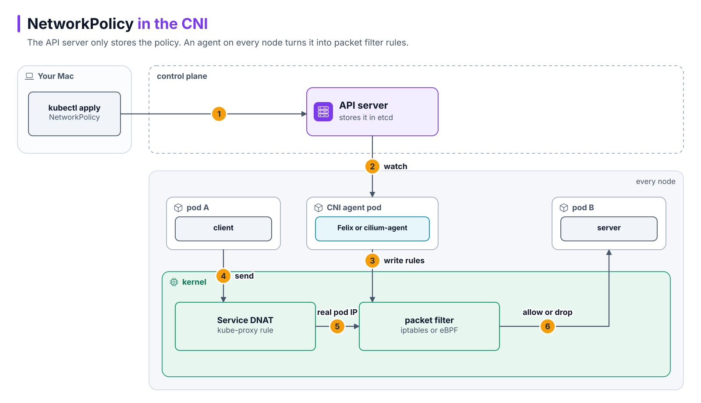
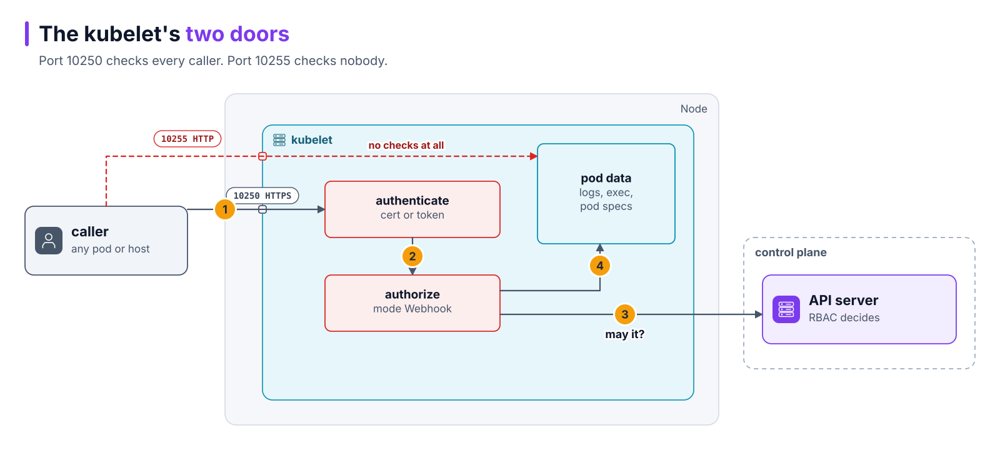

# Module 38: Setting up a secure cluster

> New to a term here, like CIS benchmark or ipBlock? The [glossary](../glossary.md#the-practice-cluster-and-the-security-modules) explains every term the security modules use.

**Before this module:** the [practice cluster](../practice-cluster.md) running. The course's [module 3](../1-foundations/03-authorization.md#concept-authorizationpolicy-compared-with-networkpolicy) compares NetworkPolicy with Istio's rules, and [module 11](11-edge-tls.md) explains certificates and trust. Read those first if NetworkPolicy or TLS feel shaky.

A fresh kubeadm cluster lets every pod reach every other pod, serves profiling data about its own internals, and runs whatever binaries somebody copies onto the nodes. This module closes those doors before the first workload arrives, so that a later mistake in one application stays inside that application. It has 10 tasks here and 3 Cilium tasks in module 44, and takes about 2 hours, theory included.

## The module in one table

The module covers five topics, and each task answers one concrete question about them:

| Question | Tool | Task |
|---|---|---|
| Which pods may talk to which? | NetworkPolicy | 1, 6, 7, 8 |
| Which pods may talk to which, on a Cilium cluster, down to the HTTP path? | CiliumNetworkPolicy | module 44, tasks 1 to 3 |
| May a pod reach the cloud's metadata service? | NetworkPolicy with `ipBlock` | 2 |
| Do the control plane flags follow the industry baseline? | kube-bench | 3 |
| Do the control plane and the kubelet speak only modern TLS? | `--tls-min-version`, `--tls-cipher-suites` | 12, 13 |
| Do the kubelet's own endpoints refuse strangers? | the kubelet config file | 13 |
| Does the Ingress serve real TLS? | Ingress with a `tls` section | 4 |
| Are the binaries on the node the ones Kubernetes released? | `sha512sum` | 5 |

Each section below follows the same path: the problem a default leaves open, then how the control works inside, then what it stops and where the exam tends to trip people.

## Concept: a flat network and the allow list that closes it

Start a pod in any namespace and it reaches the IP address of any other pod in the cluster, on any port, across namespaces and across nodes. Kubernetes connects pods this way on purpose, because an application then never needs to know which node its peer runs on, and networking stays simple for every team.

The price of that simplicity is a flat network. Picture an office building where every badge opens every door, so one stolen badge reaches the server room, the finance office and the CEO's desk. In a cluster, one compromised pod reaches the database, the API server, the node's own services and every other team's workloads. Security people call that next step **lateral movement**, which means an attacker who got into one place moves sideways to the next one.

A **NetworkPolicy** closes the flat network with an allow list for pod traffic. It selects pods by label and lists which peers may reach them, called ingress, and which peers they may reach, called egress. Three rules decide what a NetworkPolicy does, and almost every exam answer depends on them:

1. A pod that no policy selects accepts everything. Kubernetes isolates a pod only once a policy selects it.
2. Once a policy selects a pod for a direction (`Ingress` or `Egress`), that direction allows only what some policy lists.
3. Policies only add. Two policies that select the same pod allow the union of their lists, and no policy ever subtracts.

Those rules lead to a pattern with two layers. A **default-deny** policy selects every pod with `podSelector: {}` and lists nothing, so every direction it names becomes closed. Small policies then open single paths, much like a building where every door starts locked and each policy hands out one key.

Egress needs one extra path that people forget, which is DNS. A pod behind default-deny egress fails to resolve the name `api` long before it ever tries to connect to it, so the error looks like a name problem rather than a policy problem. That is why every egress allow list includes UDP and TCP port 53 to CoreDNS in `kube-system`.

**What this stops.** A default-deny policy turns one compromised pod into a dead end. The attacker holds a shell, but the database, the other namespaces and the cloud metadata service stay out of reach until somebody writes a policy that opens them.

### How a policy becomes a packet filter



The API server never looks at a single packet, because pod traffic goes straight from one pod to another through the node's kernel. It stores the NetworkPolicy object and nothing more, so the actual filtering happens on every node, in six steps:

1. You apply the policy with `kubectl`.
2. The API server stores it in etcd, and the **CNI plugin**'s agent on each node watches for it. The CNI plugin is the network component that gives each pod its address and connects it to the network.
3. The agent translates the policy into packet filter rules in the node's kernel.
4. A pod sends a packet, for example to a Service address.
5. kube-proxy's DNAT rule rewrites the Service address into a real pod address. DNAT (destination network address translation) means the kernel swaps the packet's destination on the way.
6. The packet filter compares the packet with its rules and allows or drops it.

The two CNI plugins in these modules build step 3 in different ways. **Calico** runs an agent called Felix on every node, and Felix writes iptables rules, or eBPF programs when Calico runs its eBPF data plane. **Cilium** compiles eBPF programs and attaches them to each pod's network interface. It also gives every set of pod labels a number called a security identity, so its programs compare short identities instead of long lists of IP addresses. The course's [module 10](../3-advanced/10-ebpf-and-cilium.md#concept-what-ebpf-is) explains eBPF itself.

A NetworkPolicy works only when the CNI plugin implements it. flannel on its own, for example, accepts the object and enforces nothing, and the API server stores the policy either way. So `kubectl get netpol` looks perfect while every packet still flows, which is why you always test a policy with real traffic.

**Exam traps.** Step 5 comes before step 6, and that order breaks a common policy. Calico checks a packet only after kube-proxy has translated the Service address into a pod or node address, so an `ipBlock` for the `kubernetes` Service, `10.96.0.1/32` port 443, never matches anything. The packet Calico sees goes to the API server's real address on port 6443. The test run measured it: with `10.96.0.1/32` the connection timed out, and with the control plane's address and port 6443 it worked. `k get endpointslice -l kubernetes.io/service-name=kubernetes` prints that real address, and task 6 needs it.

### Four NetworkPolicy details the exam likes

The three rules above cover most tasks, but four details decide the harder ones, and each of them has cost candidates points.

The first detail is **one rule or two**. A `from` or `to` list holds peers, and each list item is one peer. Inside one item, a `namespaceSelector` and a `podSelector` must both match, while in two separate items either one is enough. The whole difference is a single dash:

```yaml
  - from:
    - namespaceSelector: {matchLabels: {team: api}}   # one item: pods labelled app=api
      podSelector: {matchLabels: {app: api}}          #   in namespaces labelled team=api
  - from:
    - namespaceSelector: {matchLabels: {team: api}}   # two items: every pod in team=api namespaces,
    - podSelector: {matchLabels: {app: api}}          #   or app=api pods in this namespace
```

A `podSelector` without a `namespaceSelector` matches pods in the policy's own namespace only. Task 7 fixes a policy that has the dash in the wrong place, which is the most common way this detail shows up.

The second detail is **deny-all egress**. A policy with `policyTypes: [Egress]` and no `egress` list blocks every outgoing packet of the pods it selects, DNS included, so those pods fail with name errors instead of connection errors and the cause stays hidden.

The third detail is the **Service address**, which the previous section explained. Name the address the packet filter sees, which is the pod or node address, not the Service address the client dials.

The fourth detail is **port ranges**. `port: 7000` together with `endPort: 7100` opens every port from 7000 to 7100 in one entry. The range works only with a numeric `port` and never with a named port, and task 8 uses it.

## Concept: layer 3 and 4, and layer 7

Network people number the layers of a connection, and three of them matter here. Layer 3 is the IP address, layer 4 is the protocol and port such as TCP 80, and layer 7 is the application's own language, such as an HTTP method and path. A plain NetworkPolicy works at layers 3 and 4, so it says "pod A may reach pod B on TCP 80" and never reads what flows over that port.

That leaves a gap for any service with public and private endpoints on the same port. A frontend that needs `GET /public` on an API also gets `DELETE /admin`, because both requests travel over the same TCP connection. Closing that gap needs a component that reads HTTP and judges each request.

**Cilium** fills the gap with its own resource, the **CiliumNetworkPolicy** (short name `cnp`), and it enforces ordinary NetworkPolicies as well. The exam allows the Cilium docs, and its tasks expect three features that the Kubernetes NetworkPolicy lacks:

| Cilium feature | What it adds | Task |
|---|---|---|
| `toPorts.rules.http` | layer 7 rules: allow `GET /public/.*` and refuse everything else with `403` | 10 |
| `toEntities` | named groups of peers, such as `kube-apiserver`, `world` (everything outside the cluster), `host` or `cluster` | 11 |
| `ingressDeny`, `egressDeny` | rules that subtract. A deny wins over every allow | 11 |

A CiliumNetworkPolicy selects pods with `endpointSelector` instead of `podSelector`. Peers sit in `fromEndpoints` and `toEndpoints`, and a peer in another namespace carries the label `k8s:io.kubernetes.pod.namespace`. Once a policy selects a pod for a direction, that direction becomes an allow list, which is the same rule a NetworkPolicy follows.

The layer 7 rule needs an extra hop, because eBPF programs in the kernel handle layers 3 and 4 quickly but parsing HTTP is a job for a proxy. So Cilium sends the selected traffic through an Envoy proxy on the node, and Envoy reads each HTTP request and answers `403 Forbidden` itself when no rule matches. A connection refused at layer 4 times out instead, because the kernel simply drops the packets. That difference tells you which layer refused the request.

The practice cluster runs Calico, so the Cilium tasks run on the third practice machine, the [Lima VM](../kernel-and-host/README.md#the-lima-vm-on-a-mac) `cks-lima`. It holds a one-node kubeadm cluster with Cilium 1.20.4, and `./platform-engineering/practice/cluster/lima.sh shell` opens a root shell there.

**What this stops.** An HTTP rule stops a compromised frontend from calling admin endpoints on a service it legitimately talks to. An `egressDeny` to `world` stops a pod from sending stolen data to the internet, whatever allow rules other teams add later.

**Exam traps.** In the test run, a refused HTTP request printed `wget: server returned error: HTTP/1.1 403 Forbidden`, which is an answer from Envoy rather than from nginx. A pod with no layer 4 permission saw `wget: download timed out` instead. A deny rule wins over every allow, which is the opposite of a plain NetworkPolicy, where nothing subtracts.

## Concept: the metadata endpoint

Cloud virtual machines answer HTTP on `169.254.169.254`, an address called the **metadata service**. It hands out facts about the machine, such as its name and network, and often temporary cloud credentials for the machine's role. The address is link-local, which means it exists only on the machine's own network segment, and every process on the machine reaches it without a password.

Every pod on the node reaches it too, because pod traffic leaves through the node. That makes the address a favourite target for server-side request forgery, or SSRF, where an attacker tricks a web application into fetching a URL of the attacker's choice. When the application fetches `http://169.254.169.254/...`, it hands the node's cloud credentials to the attacker, who then leaves the cluster with them and acts on the cloud account directly.

An egress NetworkPolicy closes that path for pods. It allows `0.0.0.0/0` with an `except` list that names `169.254.169.254/32`, so all other traffic still flows and only the metadata address disappears. Clouds add their own fences as well. AWS's IMDSv2, for example, demands a session token from a PUT request first, and a hop limit sets how many network hops the answer with that token travels. AWS itself warns that a hop limit of 1 causes problems for containers, which is exactly the effect you want when pods have no business there.

Your Mac has no metadata service, so in this lab you build the policy and prove that all other traffic still flows.

**What this stops.** A pod with an SSRF bug or a stolen shell no longer turns into the node's cloud identity. That is often the difference between one compromised pod and a compromised cloud account.

## Concept: a checklist for the control plane

A fresh kubeadm cluster works, but a working cluster and a hardened one differ in dozens of small settings. Somebody has to decide which of the API server's hundred flags matter for security, and doing that from scratch on every cluster wastes time and misses things.

The **CIS Kubernetes Benchmark** makes that decision once for everybody. It is a checklist from the Center for Internet Security, a non-profit that writes hardening guides for operating systems and platforms, and it lists about 130 settings for the API server, etcd, the scheduler, the controller manager and the kubelet. Each item names a setting, the reason it matters, how to check it and how to fix it. Items marked automated have a check that a program runs, while items marked manual need a human to judge, such as "minimize access to Secrets".

**kube-bench** is a tool from Aqua Security that runs those checks on a node, in five steps:

1. It detects the Kubernetes version and picks the matching benchmark version.
2. It loads the checks for the target you name: `master` for the control plane components, `node` for the kubelet, `etcd`, and `policies`.
3. For each check, it runs an audit command on the node, such as `ps -ef | grep kube-apiserver` or `stat -c %a /var/lib/kubelet/config.yaml`.
4. It compares the output with the expected value, for example "the flag `--profiling` is set to `false`".
5. It prints `[PASS]`, `[FAIL]` or `[WARN]` per item, and a remediation for each failure.

On a fresh practice cluster, the test runs printed 37 to 39 passes, 10 to 12 failures and 11 warnings for the master target. Profiling failed on all three components. Profiling is a debug feature that serves `/debug/pprof` with details about the process's memory and threads, which helps an attacker study the process while production never needs it.

**What this stops.** The benchmark stops the slow drift where each cluster ends up with a slightly different and slightly weaker set of flags. It gives a security team one shared list to argue about, instead of a hundred opinions.

**Exam traps.** kube-bench reads the flags of the running processes, so a fix shows up only after the kubelet restarts the static pod, which is why the solution waits for the API server before it runs kube-bench again. A file permission check such as 4.1.9 reads the file on disk and passes at once. A later `kubeadm upgrade` rewrites the manifests and drops hand-added flags, which [module 39](39-hardening-access-to-the-api.md#task-4-upgrade-the-cluster-with-kubeadm) measured.

## Concept: TLS versions, cipher suites and downgrades

Every connection between Kubernetes components uses TLS, the protocol that encrypts traffic and proves the server's identity. TLS has changed a lot over two decades, and the old versions (SSL 3.0, TLS 1.0 and TLS 1.1) and some old algorithms have known weaknesses that attackers exploit with ready-made tools.

A TLS connection starts with a **handshake**, a short negotiation before any data flows:

1. The client sends a hello that lists the TLS versions and cipher suites it supports. A **cipher suite** is the set of algorithms that encrypts and signs the traffic.
2. The server picks the highest version and the best suite that both sides support.
3. The server sends its certificate, and both sides agree on fresh keys.
4. Everything after that travels encrypted.

Step 2 opens the door to a **downgrade attack**. An attacker in the middle of the network tampers with the hello or blocks the first attempts, so client and server settle on an old version or a weak suite, and the attacker then breaks that weak connection. TLS 1.3 carries a built-in signal that detects such tampering, but the signal helps only when both sides refuse the old versions in the first place. That is why the CIS benchmark asks every component to set a minimum version and a list of strong suites, because a server that never speaks TLS 1.0 never gets talked down to it.

Each component spells the setting differently, and the exam checks the exact spelling:

| Component | Where | Minimum version | Cipher suites |
|---|---|---|---|
| API server | flag in its static pod | `--tls-min-version=VersionTLS12` | `--tls-cipher-suites=TLS_ECDHE_RSA_WITH_AES_128_GCM_SHA256,...` |
| etcd | flag in its static pod | `--tls-min-version=TLS1.3` | `--cipher-suites=...` |
| kubelet | `/var/lib/kubelet/config.yaml` | `tlsMinVersion: VersionTLS13` | `tlsCipherSuites: [...]` |

TLS 1.3 has a fixed, short list of suites, so a cipher suite list only means something for TLS 1.2. kubeadm signs its certificates with RSA keys, which means you pick `ECDHE_RSA` suites, because a list of only `ECDHE_ECDSA` suites leaves the API server with no suite its own certificate supports.

`openssl s_client` tests a setting from the node. `-tls1_2` and `-tls1_1` force a version, and `-cipher` offers a single suite. The test run's check reads `Cipher is ...` from the output, which names the suite on success and says `(NONE)` on a refusal.

**What this stops.** A minimum version and a suite list stop downgrade attacks and stop clients from settling on a suite with a known break. They also keep old, unpatched tools away from the cluster entirely, which is usually a feature.

**Exam traps.** Before the fix, the test run's API server still accepted `ECDHE-RSA-CHACHA20-POLY1305`, a suite the task didn't list. OpenSSL names suites differently from Go, the language Kubernetes is written in, so `ECDHE-RSA-AES128-GCM-SHA256` in OpenSSL becomes `TLS_ECDHE_RSA_WITH_AES_128_GCM_SHA256` in a flag. Restarting the API server and etcd together took 2 minutes 24 seconds in the test run, so wait before you test.

## Concept: the kubelet's own API

Every kubelet runs an HTTPS API on port 10250, and the API server uses it for `kubectl logs`, `exec` and `port-forward`. The API answers requests such as "list the pods that run here" and "run this command in that container", so whoever talks to it freely owns every container on the node.



When the kubelet is set up right, a request to port 10250 passes four steps:

1. A caller connects to port 10250 over HTTPS.
2. The kubelet authenticates the caller: a client certificate signed by the cluster's certificate authority, or a bearer token that the kubelet checks with the API server.
3. The kubelet asks the API server whether this caller may do this action on this node, and the API server answers with an RBAC decision.
4. Only then does the kubelet hand out logs, run `exec` or list pods.

Three settings in the kubelet config file decide whether those steps happen. kubeadm sets all three correctly, and a careless edit undoes them:

1. `authentication.anonymous.enabled: false` turns away requests without a certificate or token. With it on, step 2 lets strangers through as `system:anonymous`.
2. `authorization.mode: Webhook` makes the kubelet ask the API server in step 3. `AlwaysAllow` skips step 3 and lets any authenticated caller do anything.
3. `readOnlyPort: 0` turns off the old **read-only port** 10255. That port speaks plain HTTP, checks nobody, and hands out pod specs to anybody, and pod specs often carry environment variables with passwords in them.

The kubelet reads the file only at start, so every change needs `systemctl restart kubelet`. Task 13 finds all three settings undone on `practice-worker`. In the test run, before the fix, an anonymous `curl` to `https://127.0.0.1:10250/pods` returned `200` with every pod on the node, and the read-only port answered `200` as well.

**What this stops.** These settings stop a pod on the node network, or a neighbour on the same network, from running commands in every container on the node. Without them, one reachable kubelet hands out a cluster-wide foothold.

**Exam traps.** `kubectl logs` keeps working after the fix, because the API server logs in to the kubelet with its own client certificate, and kubeadm grants that identity the `system:kubelet-api-admin` ClusterRole. In the test run, the kubelet answered again 2 seconds after the restart. Edit the config file rather than the systemd unit, because the file is what kubeadm manages.

## Concept: Ingress with TLS

Traffic from outside the cluster needs a front door that knows which host name and path lead to which Service. An **Ingress** holds those HTTP routing rules, and an Ingress controller, ingress-nginx in this lab, carries them out. Serving that traffic over TLS takes two objects:

1. A Secret of type `kubernetes.io/tls` that holds the certificate and its private key.
2. A `tls` section in the Ingress that names the host and that Secret.

When the Secret is missing or the names don't match, ingress-nginx keeps serving instead of failing. It presents its own "Kubernetes Ingress Controller Fake Certificate" and carries on, so the site looks up while every browser rejects it. The course's [module 11](11-edge-tls.md#concept-how-a-client-decides-to-trust-a-certificate) explains why a client refuses such a certificate.

**What this stops.** Real TLS at the edge stops anybody on the path between the user and the cluster from reading or changing the traffic, and the redirect from HTTP stops users from landing on the unencrypted port by accident.

**Exam traps.** A check that looks only at the HTTP status code misses the fake certificate, so look at the certificate's subject instead, which the test run printed as `subject=CN = shop.cks.local`. ingress-nginx redirects plain HTTP to HTTPS with `308` once TLS is set, so a `308` on port 80 is a good sign, not an error.

## Concept: trust the binaries you run

The kubelet, kubectl and kube-proxy are binaries that run with great power on every node. A kubelet from a random mirror, or one that somebody changed on the node after an intrusion, might carry a backdoor, and nothing in Kubernetes checks the binary it runs.

A **checksum** solves that by giving each file a fingerprint. A hash function such as SHA-512 reads every byte of the file and produces a fixed-length value, and changing a single byte changes that value completely. Kubernetes publishes a SHA-512 checksum next to every binary on `dl.k8s.io`, so checking a binary takes three steps:

1. Download the published checksum for the exact version, operating system and CPU architecture.
2. Compute the checksum of the file on the node with `sha512sum`.
3. Compare the two. Any difference means the file isn't the release.

A checksum proves that the file matches what the release page lists, but it says nothing about who wrote the release page. For that, Kubernetes also signs its release artifacts with cosign, the signing tool that [module 42](../3-advanced/42-supply-chain-security.md#concept-signatures) explains, and a signature ties the file to the Kubernetes release process itself.

**What this stops.** A checksum stops a tampered or corrupted binary from running unnoticed. In task 5, the setup appended three bytes to `kube-proxy`, and `sha512sum -c` reported `FAILED`.

**Exam traps.** The checksum file on `dl.k8s.io` holds only the hash, so add the file name before you run `sha512sum -c`. Pick the right architecture as well, because the practice cluster runs `linux/arm64` and an `amd64` checksum fails for every file.

## The bigger picture: a fresh cluster has wide doors

A kubeadm cluster arrives tuned to work, not to resist an attacker. Every control in this module closes one wide door that the defaults leave open:

1. The network door: every pod reaches every pod. NetworkPolicy closes it, and Cilium narrows it to single HTTP paths.
2. The cloud door: every pod reaches the metadata service. An egress `except` closes it.
3. The configuration door: flags drift from the baseline. kube-bench finds the drift.
4. The wire door: old TLS stays possible. A minimum version and a suite list close it.
5. The node door: the kubelet's API answers strangers. Three config lines close it.
6. The software door: nobody checks the binaries. A checksum closes it.

Real platform teams rarely make these changes by hand on each cluster, because hand edits drift. They bake the controls into the cluster's build instead: a Terraform module or a kubeadm config file with the hardened flags, a default-deny policy in every namespace template, and kube-bench as a scheduled job that alerts when a check flips to `FAIL`. The exam asks you to make each change by hand, because a person who knows the steps writes better automation later.

## Why this way

**Why allow lists and not deny lists?** A deny list names what is bad, and attackers invent new bad things every day, so the list is always one step behind. An allow list names what is needed, which changes rarely and fits on one page. Kubernetes NetworkPolicy has no deny rule at all, so the only way to use it is the safe way.

**Why does the CNI enforce policies, not the API server?** The API server never sees pod traffic, because packets go straight from one pod to another through the node's kernel. The only place that sees every packet is therefore the kernel of each node, and the CNI agent is the component that programs it.

**Why does the policy name the pod address and not the Service address?** kube-proxy translates the Service address before the packet filter looks at the packet. The filter judges the packet as it is at that moment, which is pod to pod.

**Why keep the kubelet API at all?** `kubectl logs`, `exec` and the API server's health checks depend on it, so turning it off breaks the cluster. Locking it down with authentication and webhook authorization keeps those features and closes the door to everyone else.

**Why check checksums when HTTPS already protects the download?** HTTPS protects the trip, not the source. A mirror that serves a backdoored file over perfect HTTPS still serves a backdoored file, and only the checksum compares the file with the official release.

## Task 1: Default-deny and one allowed path

**Time budget:** 7 minutes. **Host:** `practice-control-plane`.

Prepare the task from your Mac, which creates the namespace, the three pods and their Services:

```console
$ ./platform-engineering/task.sh setup 38.1
== setup task 38.1
pod/frontend created
pod/api created
service/api created
pod/db created
service/db created
pod/api condition met
pod/db condition met
pod/frontend condition met
```

> Namespace `team-app` runs three pods: `frontend` (label `app=frontend`), `api` (`app=api`, port 80) and `db` (`app=db`, port 80), each with a Service of the same name.
>
> 1. Create a NetworkPolicy `default-deny` that blocks all ingress and all egress for every pod in `team-app`.
> 2. Allow `frontend` to reach `api` on TCP port 80, and nothing else. `frontend` must still resolve Service names.
> 3. `db` must not reach `api`.

These commands show the pods, their labels and the policies, and they test a connection from one pod to another:

```console
root@practice-control-plane:~# k -n team-app get pods --show-labels
NAME       READY   STATUS    RESTARTS   AGE   LABELS
api        1/1     Running   0          1s    app=api
db         1/1     Running   0          1s    app=db
frontend   1/1     Running   0          1s    app=frontend
root@practice-control-plane:~# k -n kube-system get pods -l k8s-app=kube-dns --show-labels
NAME                       READY   STATUS    RESTARTS   AGE    LABELS
coredns-559f6c778d-658ss   1/1     Running   0          119s   k8s-app=kube-dns,pod-template-hash=559f6c778d
coredns-559f6c778d-vvm8z   1/1     Running   0          119s   k8s-app=kube-dns,pod-template-hash=559f6c778d
root@practice-control-plane:~# k explain networkpolicy.spec.egress.to
GROUP:      networking.k8s.io
KIND:       NetworkPolicy
VERSION:    v1

FIELD: to <[]NetworkPolicyPeer>


DESCRIPTION:
    to is a list of destinations for outgoing traffic of pods selected for this
    rule. Items in this list are combined using a logical OR operation. If this
    field is empty or missing, this rule matches all destinations (traffic not
    restricted by destination). If this field is present and contains at least
    one item, this rule allows traffic only if the traffic matches at least one
    item in the to list.
    NetworkPolicyPeer describes a peer to allow traffic to/from. Only certain
    combinations of fields are allowed
    
FIELDS:
  ipBlock	<IPBlock>
    ipBlock defines policy on a particular IPBlock. If this field is set then
    neither of the other fields can be.
...
root@practice-control-plane:~# k -n team-app exec frontend -- wget -qO- -T 3 http://api
<!DOCTYPE html>
<html>
<head>
<title>Welcome to nginx!</title>
...
```

<details>
<summary>Solution</summary>

The solution needs three policies: the deny itself, an ingress rule on `api`, and an egress rule on `frontend` that also opens DNS, because a pod that resolves no names reaches nothing.

```yaml
apiVersion: networking.k8s.io/v1
kind: NetworkPolicy
metadata:
  name: default-deny
  namespace: team-app
spec:
  podSelector: {}
  policyTypes: [Ingress, Egress]
---
apiVersion: networking.k8s.io/v1
kind: NetworkPolicy
metadata:
  name: allow-frontend-to-api
  namespace: team-app
spec:
  podSelector:
    matchLabels: {app: api}
  policyTypes: [Ingress]
  ingress:
  - from:
    - podSelector:
        matchLabels: {app: frontend}
    ports:
    - {protocol: TCP, port: 80}
---
apiVersion: networking.k8s.io/v1
kind: NetworkPolicy
metadata:
  name: frontend-egress
  namespace: team-app
spec:
  podSelector:
    matchLabels: {app: frontend}
  policyTypes: [Egress]
  egress:
  - to:
    - podSelector:
        matchLabels: {app: api}
    ports:
    - {protocol: TCP, port: 80}
  - to:
    - namespaceSelector:
        matchLabels: {kubernetes.io/metadata.name: kube-system}
      podSelector:
        matchLabels: {k8s-app: kube-dns}
    ports:
    - {protocol: UDP, port: 53}
    - {protocol: TCP, port: 53}
```

Save all three as `np.yaml` with `vim np.yaml` and apply them with `k apply -f np.yaml`.

Two details decide whether the policies work, and both come from the theory:

- The `namespaceSelector` and the `podSelector` of the DNS rule sit in **one** list item, so both must match, which selects CoreDNS pods in `kube-system`. As two separate items, with a dash before each, the rule would allow every pod in `kube-system` or any pod labelled `k8s-app=kube-dns` in `team-app`.
- The port is the pod's port, not the Service's, because Calico checks packets after kube-proxy has translated the Service address into a pod address. Here both happen to be 80.

</details>

Run the check from your Mac, which tests each allowed and refused path with real connections:

```console
$ ./platform-engineering/task.sh check 38.1
== check task 38.1
  PASS  NetworkPolicy default-deny selects every pod, Ingress and Egress
  PASS  frontend reaches api on port 80, by name
  PASS  frontend does not reach db
  PASS  db does not reach api
== task 38.1: 4 passed, 0 failed
```

In the test run, the check failed three of four items before the solution and passed all four after it.

## Task 2: Block the node metadata endpoint

**Time budget:** 4 minutes. **Host:** `practice-control-plane`.

```console
$ ./platform-engineering/task.sh setup 38.2
== setup task 38.2
pod/worker created
pod/worker condition met
```

> Pods in namespace `batch` must not reach the node metadata service at `169.254.169.254`. All other egress stays allowed. Create a NetworkPolicy named `deny-metadata`.

<details>
<summary>Solution</summary>

```yaml
apiVersion: networking.k8s.io/v1
kind: NetworkPolicy
metadata:
  name: deny-metadata
  namespace: batch
spec:
  podSelector: {}
  policyTypes: [Egress]
  egress:
  - to:
    - ipBlock:
        cidr: 0.0.0.0/0
        except: [169.254.169.254/32]
```

The policy selects every pod for egress, so egress becomes an allow list, and that list holds the whole IPv4 range minus one address. DNS keeps working, because CoreDNS's pod IP sits inside `0.0.0.0/0`.

</details>

```console
$ ./platform-engineering/task.sh check 38.2
== check task 38.2
  PASS  NetworkPolicy deny-metadata exists and selects every pod
  PASS  it allows 0.0.0.0/0 except 169.254.169.254/32
  PASS  the worker still resolves names and reaches the API server
== task 38.2: 3 passed, 0 failed
```

In the test run, the worker pod reached the API server's port both before and after the policy. The check reads the policy's structure for the block itself, because your Mac has no metadata service that would refuse the connection.

## Task 3: Fix CIS findings with kube-bench

**Time budget:** 8 minutes. **Host:** `practice-control-plane`.

```console
$ ./platform-engineering/task.sh setup 38.3     # seeds nothing: a fresh kubeadm cluster fails these checks already
== setup task 38.3
  nothing to seed: a fresh kubeadm cluster already fails these checks
```

> Run kube-bench against the control plane node `practice-control-plane` and fix these findings: 1.2.15, 1.3.2 and 1.4.1 (profiling on the API server, controller manager and scheduler), and 4.1.9 (the kubelet's config file permissions). The control plane must keep running.

Start by reading the report, which lists every check of the master target with its result and, for each failure, a remediation:

```console
root@practice-control-plane:~# kube-bench run --targets master | grep -E '^\[FAIL\]|checks (PASS|FAIL|WARN)'
[FAIL] 1.1.7 Ensure that the etcd pod specification file permissions are set to 600 or more restrictive (Automated)
[FAIL] 1.1.8 Ensure that the etcd pod specification file ownership is set to root:root (Automated)
[FAIL] 1.1.12 Ensure that the etcd data directory ownership is set to etcd:etcd (Automated)
[FAIL] 1.2.5 Ensure that the --kubelet-certificate-authority argument is set as appropriate (Automated)
[FAIL] 1.2.15 Ensure that the --profiling argument is set to false (Automated)
[FAIL] 1.2.16 Ensure that the --audit-log-path argument is set (Automated)
[FAIL] 1.2.17 Ensure that the --audit-log-maxage argument is set to 30 or as appropriate (Automated)
[FAIL] 1.2.18 Ensure that the --audit-log-maxbackup argument is set to 10 or as appropriate (Automated)
[FAIL] 1.2.19 Ensure that the --audit-log-maxsize argument is set to 100 or as appropriate (Automated)
[FAIL] 1.2.30 Ensure that the --service-account-extend-token-expiration parameter is set to false (Automated)
[FAIL] 1.3.2 Ensure that the --profiling argument is set to false (Automated)
[FAIL] 1.4.1 Ensure that the --profiling argument is set to false (Automated)
37 checks PASS
12 checks FAIL
11 checks WARN
37 checks PASS
12 checks FAIL
11 checks WARN
root@practice-control-plane:~# kube-bench run --targets master --check 1.2.15     # one check, with its remediation
[INFO] 1 Control Plane Security Configuration
[INFO] 1.2 API Server
[FAIL] 1.2.15 Ensure that the --profiling argument is set to false (Automated)

== Remediations master ==
1.2.15 Edit the API server pod specification file /etc/kubernetes/manifests/kube-apiserver.yaml
on the control plane node and set the below parameter.
--profiling=false
...
root@practice-control-plane:~# kube-bench run --targets node --check 4.1.9
[INFO] 4 Worker Node Security Configuration
[INFO] 4.1 Worker Node Configuration Files
[FAIL] 4.1.9 If the kubelet config.yaml configuration file is being used validate permissions set to 600 or more restrictive (Automated)

== Remediations node ==
4.1.9 Run the following command (using the config file location identified in the Audit step)
chmod 600 /var/lib/kubelet/config.yaml
...
```

On a fresh cluster, the test runs printed 37 to 39 passes, 10 to 12 failures and 11 warnings for the master target. The failures were profiling on all three components, four audit log flags, etcd's data directory owner, `--kubelet-certificate-authority` and `--service-account-extend-token-expiration`. Minutes after a reset, kube-bench also failed 1.1.7 and 1.1.8, the mode and owner of etcd's manifest, and both passed when it ran again later. Audit logging comes in [module 43](../3-advanced/43-runtime-security-and-auditing.md#task-1-turn-on-audit-logging).

<details>
<summary>Solution</summary>

Each profiling fix is one flag in a static pod manifest. Back the files up outside the manifests folder first, because the kubelet starts every file inside that folder, backups included:

```console
root@practice-control-plane:~# cp /etc/kubernetes/manifests/kube-{apiserver,controller-manager,scheduler}.yaml /root/
root@practice-control-plane:~# vim /etc/kubernetes/manifests/kube-apiserver.yaml
```

The transcript leaves out the editor session.

In each of the three files, add one line under the component's command:

```yaml
  - command:
    - kube-apiserver
    - --profiling=false
```

Then fix the permissions of the kubelet's config file and wait until the control plane runs again with the new flags:

```console
root@practice-control-plane:~# chmod 600 /var/lib/kubelet/config.yaml
root@practice-control-plane:~# watch crictl ps                                        # the three containers restart
CONTAINER           IMAGE               CREATED             STATE               NAME                      ATTEMPT             POD ID              POD                                       NAMESPACE
4f12f796cfbbe       98d6e75e244ec       21 seconds ago      Running             kube-apiserver            0                   8f4e3dee2d32d       kube-apiserver-practice-control-plane                     kube-system
c2af601e4936d       9b3e36c80c30c       47 seconds ago      Running             kube-controller-manager   0                   f4f4b91a0d99e       kube-controller-manager-practice-control-plane            kube-system
3a0934b56ea01       49e9d3ff0096f       48 seconds ago      Running             kube-scheduler            0                   4152f9479e584       kube-scheduler-practice-control-plane                     kube-system
...
root@practice-control-plane:~# k -n kube-system get pods -l tier=control-plane
NAME                             READY   STATUS    RESTARTS   AGE
etcd-practice-control-plane                      1/1     Running   4          3m20s
kube-apiserver-practice-control-plane            1/1     Running   0          21s
kube-controller-manager-practice-control-plane   1/1     Running   0          3m20s
kube-scheduler-practice-control-plane            1/1     Running   0          2s
root@practice-control-plane:~# kube-bench run --targets master,node --check 1.2.15,1.3.2,1.4.1,4.1.9
...
[PASS] 1.2.15 Ensure that the --profiling argument is set to false (Automated)
...
[PASS] 1.3.2 Ensure that the --profiling argument is set to false (Automated)
...
[PASS] 1.4.1 Ensure that the --profiling argument is set to false (Automated)
...
[PASS] 4.1.9 If the kubelet config.yaml configuration file is being used validate permissions set to 600 or more restrictive (Automated)
...
```

`watch` redraws its screen every 2 seconds until you press Ctrl-C, and the transcript shows one screen.

In the test run, the three pods came back in under a minute, and kube-bench then printed `[PASS]` for all four checks.

</details>

```console
$ ./platform-engineering/task.sh check 38.3
== check task 38.3
  PASS  kube-bench 1.2.15 passes
  PASS  kube-bench 1.3.2 passes
  PASS  kube-bench 1.4.1 passes
  PASS  kube-bench 4.1.9 passes
  PASS  every control plane pod runs
== task 38.3: 5 passed, 0 failed
```

## Task 4: An Ingress with TLS

**Time budget:** 6 minutes. **Host:** `practice-control-plane`.

```console
$ ./platform-engineering/task.sh setup 38.4
== setup task 38.4
deployment.apps/shop created
service/shop exposed
Waiting for deployment "shop" rollout to finish: 0 of 1 updated replicas are available...
deployment "shop" successfully rolled out
-rw-r--r-- 1 root root 1164 Nov 14 22:51 /root/cks/shop.crt
-rw------- 1 root root 1704 Nov 14 22:51 /root/cks/shop.key
```

> Namespace `web` runs Deployment `shop` behind Service `shop` on port 80. A certificate and key for `shop.cks.local` wait in `/root/cks/shop.crt` and `/root/cks/shop.key`.
>
> 1. Store them in a TLS Secret named `shop-tls` in `web`.
> 2. Create an Ingress `shop` with class `nginx` that serves `https://shop.cks.local/` from Service `shop` with that certificate.
> 3. Plain HTTP must redirect to HTTPS.

The ingress controller listens on NodePort 30443 for HTTPS and on 30080 for HTTP, on both nodes, so you test it from the node with those ports.

<details>
<summary>Solution</summary>

Two imperative commands create the Secret and the Ingress, so no YAML is needed:

```console
root@practice-control-plane:~# k -n web create secret tls shop-tls --cert=/root/cks/shop.crt --key=/root/cks/shop.key
secret/shop-tls created
root@practice-control-plane:~# k -n web create ingress shop --class=nginx --rule="shop.cks.local/*=shop:80,tls=shop-tls"
ingress.networking.k8s.io/shop created
```

The `tls=shop-tls` part of `--rule` writes the Ingress's `tls` section. ingress-nginx redirects HTTP to HTTPS by itself, with status 308, for every host that has TLS, so step 3 needs nothing extra.

Test it from the node. `--resolve` makes curl send the right host name to an IP address without touching DNS, which is how you reach a host name that no DNS server knows:

```console
root@practice-control-plane:~# curl -sk -o /dev/null -w '%{http_code}\n' --resolve shop.cks.local:30443:127.0.0.1 https://shop.cks.local:30443/
200
root@practice-control-plane:~# echo | openssl s_client -connect 127.0.0.1:30443 -servername shop.cks.local 2>/dev/null | openssl x509 -noout -subject
subject=CN = shop.cks.local
root@practice-control-plane:~# curl -s -o /dev/null -w '%{http_code}\n' --resolve shop.cks.local:30080:127.0.0.1 http://shop.cks.local:30080/
308
```

In the test run, these printed `200`, `subject=CN = shop.cks.local` and `308`. The controller reloaded nginx about 3 seconds after the Ingress appeared, so a test right after the create may still see the old configuration.

</details>

```console
$ ./platform-engineering/task.sh check 38.4
== check task 38.4
  PASS  Secret shop-tls has type kubernetes.io/tls
  PASS  HTTPS on shop.cks.local:30443 answers 200
  PASS  the certificate served is CN=shop.cks.local, not the controller's fake one
  PASS  plain HTTP redirects to HTTPS (308)
== task 38.4: 4 passed, 0 failed
```

## Task 5: Verify a platform binary

**Time budget:** 3 minutes. **Host:** `practice-control-plane`.

```console
$ ./platform-engineering/task.sh setup 38.5
== setup task 38.5
total 98120
-rwxr-xr-x 1 root root 57868450 Nov 14 22:51 kubectl
-rwxr-xr-x 1 root root 42598565 Nov 14 22:52 kube-proxy
```

> `/opt/security/bin` holds `kubectl` and `kube-proxy`, both claiming to be Kubernetes v1.37.1 for linux/arm64. Delete every binary that doesn't match the official release.

<details>
<summary>Solution</summary>

The checksum file on `dl.k8s.io` holds only the hash, so add the file name before you pass it to `sha512sum -c`:

```console
root@practice-control-plane:~# cd /opt/security/bin
root@practice-control-plane:/opt/security/bin# for b in kubectl kube-proxy; do
  echo "$(curl -fsSL https://dl.k8s.io/release/v1.37.1/bin/linux/arm64/$b.sha512) $b" | sha512sum -c || rm -f "$b"
done
kubectl: OK
kube-proxy: FAILED
sha512sum: WARNING: 1 computed checksum did NOT match
```

The setup had appended three bytes to `kube-proxy`, which changed its checksum completely. In the exam, the task often gives the expected hash in its text instead, and then you compare by eye: run `sha512sum kube-proxy` and look at the first and last few characters.

</details>

```console
$ ./platform-engineering/task.sh check 38.5
== check task 38.5
  PASS  the tampered kube-proxy is gone
  PASS  kubectl stays, and matches the official v1.37.1 sha512
== task 38.5: 2 passed, 0 failed
```

## Task 6: Egress to DNS and the API server only

**Time budget:** 7 minutes. **Host:** `practice-control-plane`.

```console
$ ./platform-engineering/task.sh setup 38.6
== setup task 38.6
pod/agent created
pod/web created
service/web created
pod/agent condition met
pod/web condition met
```

> Namespace `egress-lab` runs pod `agent` (label `app=agent`) and pod `web` (label `app=web`, with a Service `web`).
>
> 1. Create a NetworkPolicy `deny-all-egress` that blocks all egress for every pod in `egress-lab`.
> 2. Create a NetworkPolicy `agent-egress` so that `agent` resolves names through CoreDNS and connects to the Kubernetes API server, and nothing else.

<details>
<summary>Solution</summary>

Find the API server's real address first, because the theory showed that the Service address never matches:

```console
root@practice-control-plane:~# k get endpointslice -n default -l kubernetes.io/service-name=kubernetes
NAME         ADDRESSTYPE   PORTS   ENDPOINTS         AGE
kubernetes   IPv4          6443    192.168.117.2   4m26s
```

In the test run, that printed the control plane's address with port 6443, which goes into the policy:

```yaml
apiVersion: networking.k8s.io/v1
kind: NetworkPolicy
metadata:
  name: deny-all-egress
  namespace: egress-lab
spec:
  podSelector: {}
  policyTypes: [Egress]
---
apiVersion: networking.k8s.io/v1
kind: NetworkPolicy
metadata:
  name: agent-egress
  namespace: egress-lab
spec:
  podSelector:
    matchLabels: {app: agent}
  policyTypes: [Egress]
  egress:
  - to:
    - namespaceSelector:
        matchLabels: {kubernetes.io/metadata.name: kube-system}
      podSelector:
        matchLabels: {k8s-app: kube-dns}
    ports:
    - {protocol: UDP, port: 53}
    - {protocol: TCP, port: 53}
  - to:
    - ipBlock:
        cidr: <the address>/32
    ports:
    - {protocol: TCP, port: 6443}
```

Test from the pod, with one name lookup, one connection to the API server and one connection that the policy must refuse:

```console
root@practice-control-plane:~# k -n egress-lab exec agent -- nc -z -w 3 kubernetes.default.svc.cluster.local 443 && echo api ok
api ok
root@practice-control-plane:~# k -n egress-lab exec agent -- wget -qO- -T 3 http://web      # download timed out
wget: download timed out
command terminated with exit code 1
```

The `nc` goes to the Service's port 443 while the policy names port 6443, and both are right, because kube-proxy rewrites the packet to port 6443 before Calico looks at it. In the test run, the same policy with `cidr: 10.96.0.1/32` and port 443 left `nc` waiting until its timeout.

</details>

```console
$ ./platform-engineering/task.sh check 38.6
== check task 38.6
  PASS  NetworkPolicy deny-all-egress selects every pod for Egress and allows nothing
  PASS  agent resolves kubernetes.default
  PASS  agent reaches the API server through the kubernetes Service
  PASS  agent does not reach web
  PASS  web reaches nothing, not even the API server
== task 38.6: 5 passed, 0 failed
```

In the test run, the check failed three of five items before the solution and passed all five after it.

## Task 7: One rule or two

**Time budget:** 5 minutes. **Host:** `practice-control-plane`.

```console
$ ./platform-engineering/task.sh setup 38.7
== setup task 38.7
pod/db created
service/db created
pod/api created
pod/debug created
pod/api created
networkpolicy.networking.k8s.io/db-ingress created
  db-ingress is in place; debug in team-api reaches db: yes
```

> NetworkPolicy `db-ingress` in namespace `team-db` should let only pods labelled `app=api` in namespaces labelled `team=api` reach pod `db` on TCP port 80. Pod `debug` in `team-api` still gets in. Fix the policy and keep its name.

<details>
<summary>Solution</summary>

Read the policy and count the dashes under `from`, because each dash starts a separate peer:

```console
root@practice-control-plane:~# k -n team-db get netpol db-ingress -o yaml
apiVersion: networking.k8s.io/v1
kind: NetworkPolicy
metadata:
  annotations:
...
  creationTimestamp: "2026-11-14T22:52:15Z"
  generation: 1
  name: db-ingress
  namespace: team-db
  resourceVersion: "1415"
  uid: 20ccfe40-9c27-4be2-90e3-e8da848c4162
spec:
  ingress:
  - from:
    - namespaceSelector:
        matchLabels:
          team: api
    - podSelector:
        matchLabels:
          app: api
    ports:
    - port: 80
      protocol: TCP
  podSelector:
    matchLabels:
      app: db
  policyTypes:
  - Ingress
```

The `from` list has two items, so either selector lets a pod in, and `debug` lives in a `team=api` namespace. Merge them into one item with `k -n team-db edit netpol db-ingress`:

```yaml
  ingress:
  - from:
    - namespaceSelector:
        matchLabels: {team: api}
      podSelector:
        matchLabels: {app: api}
    ports:
    - {protocol: TCP, port: 80}
```

The only change is the dash before `podSelector`, which goes away. Then test both sides, the pod that must get in and the pod that must not:

```console
root@practice-control-plane:~# k -n team-api exec api -- wget -qO- -T 3 http://db.team-db | head -4
<!DOCTYPE html>
<html>
<head>
<title>Welcome to nginx!</title>
root@practice-control-plane:~# k -n team-api exec debug -- wget -qO- -T 3 http://db.team-db       # download timed out
wget: download timed out
command terminated with exit code 1
```

</details>

```console
$ ./platform-engineering/task.sh check 38.7
== check task 38.7
  PASS  NetworkPolicy db-ingress still exists
  PASS  api in team-api reaches db
  PASS  debug in team-api does not reach db
  PASS  api in team-web does not reach db
== task 38.7: 4 passed, 0 failed
```

In the test run, the setup printed `debug in team-api reaches db: yes`, and the check failed one item before the fix.

## Task 8: A port range

**Time budget:** 4 minutes. **Host:** `practice-control-plane`.

```console
$ ./platform-engineering/task.sh setup 38.8
== setup task 38.8
pod/server created
pod/client created
pod/client condition met
pod/server condition met
```

> Pod `server` in namespace `ports` listens on TCP ports 7000, 7050, 7100 and 8000. Create a NetworkPolicy `server-ports` so that `server` accepts TCP ports 7000 to 7100 from pods in its own namespace, and nothing else. Use one port entry for the whole range.

<details>
<summary>Solution</summary>

```yaml
apiVersion: networking.k8s.io/v1
kind: NetworkPolicy
metadata:
  name: server-ports
  namespace: ports
spec:
  podSelector:
    matchLabels: {app: server}
  policyTypes: [Ingress]
  ingress:
  - from:
    - podSelector: {}
    ports:
    - {protocol: TCP, port: 7000, endPort: 7100}
```

`podSelector: {}` inside `from` means every pod in the policy's namespace. Test with the pod's address, because `server` has no Service:

```console
root@practice-control-plane:~# IP=$(k -n ports get pod server -o jsonpath='{.status.podIP}')
root@practice-control-plane:~# k -n ports exec client -- wget -qO- -T 3 http://$IP:7050/       # ok
ok
root@practice-control-plane:~# k -n ports exec client -- wget -qO- -T 3 http://$IP:8000/       # download timed out
wget: download timed out
command terminated with exit code 1
```

</details>

```console
$ ./platform-engineering/task.sh check 38.8
== check task 38.8
  PASS  NetworkPolicy server-ports opens one port entry, 7000 to 7100 with endPort
  PASS  client reaches server on 7000, 7050 and 7100
  PASS  client does not reach server on 8000
== task 38.8: 3 passed, 0 failed
```

## Tasks 9 to 11: Cilium, on a VM

The three Cilium tasks need a cluster whose kernel belongs to one machine, because Cilium loads its programs into that kernel. They sit in [module 44](../kernel-and-host/44-kernel-and-host-security.md#task-1-a-ciliumnetworkpolicy-at-layers-3-and-4) as its tasks 1 to 3, next to the other tasks that run on a VM.

## Task 12: TLS versions and ciphers for the API server and etcd

**Time budget:** 8 minutes. **Host:** `practice-control-plane`.

```console
$ ./platform-engineering/task.sh setup 38.12
== setup task 38.12
/etc/kubernetes/manifests/kube-apiserver.yaml:    - --tls-cert-file=/etc/kubernetes/pki/apiserver.crt
/etc/kubernetes/manifests/kube-apiserver.yaml:    - --tls-private-key-file=/etc/kubernetes/pki/apiserver.key
New, TLSv1.2, Cipher is ECDHE-RSA-CHACHA20-POLY1305
```

The setup shows that the API server still accepts an old suite, which in the test run read `New, TLSv1.2, Cipher is ECDHE-RSA-CHACHA20-POLY1305`.

> 1. The API server accepts TLS 1.2 or newer, and on TLS 1.2 only the cipher suites `TLS_ECDHE_RSA_WITH_AES_128_GCM_SHA256` and `TLS_ECDHE_RSA_WITH_AES_256_GCM_SHA384`.
> 2. etcd accepts only TLS 1.3.
> 3. Both keep running.

<details>
<summary>Solution</summary>

Back up both manifests, then change etcd first. The API server is etcd's client and already speaks TLS 1.3, so it keeps working while etcd moves:

```console
root@practice-control-plane:~# cp /etc/kubernetes/manifests/{etcd,kube-apiserver}.yaml /root/
root@practice-control-plane:~# vim /etc/kubernetes/manifests/etcd.yaml
```

The transcript leaves out the editor session.

```yaml
  - command:
    - etcd
    - --tls-min-version=TLS1.3
```

Wait until `crictl ps --name etcd` shows a new container, then edit the API server in the same way:

```yaml
  - command:
    - kube-apiserver
    - --tls-min-version=VersionTLS12
    - --tls-cipher-suites=TLS_ECDHE_RSA_WITH_AES_128_GCM_SHA256,TLS_ECDHE_RSA_WITH_AES_256_GCM_SHA384
```

Test both from the node, with one refused version, one allowed suite and one refused suite:

```console
root@practice-control-plane:~# echo | openssl s_client -connect 127.0.0.1:6443 -tls1_2 -cipher ECDHE-RSA-CHACHA20-POLY1305 2>/dev/null | grep 'Cipher is'
New, (NONE), Cipher is (NONE)
root@practice-control-plane:~# echo | openssl s_client -connect 127.0.0.1:6443 -tls1_2 -cipher ECDHE-RSA-AES128-GCM-SHA256 2>/dev/null | grep 'Cipher is'
New, TLSv1.2, Cipher is ECDHE-RSA-AES128-GCM-SHA256
root@practice-control-plane:~# echo | openssl s_client -connect 127.0.0.1:2379 -tls1_2 2>/dev/null | grep 'Cipher is'
New, (NONE), Cipher is (NONE)
```

OpenSSL names the suites differently from Go, so `ECDHE-RSA-AES128-GCM-SHA256` is `TLS_ECDHE_RSA_WITH_AES_128_GCM_SHA256`. In the test run, the first and third commands printed `Cipher is (NONE)`, and the second printed `Cipher is ECDHE-RSA-AES128-GCM-SHA256`. Both restarts together took 2 minutes 24 seconds before the pods were Ready again.

</details>

```console
$ ./platform-engineering/task.sh check 38.12
== check task 38.12
  PASS  the API server sets --tls-min-version=VersionTLS12 and the two cipher suites
  PASS  the API server accepts ECDHE-RSA-AES128-GCM-SHA256 on TLS 1.2
  PASS  the API server refuses ECDHE-RSA-CHACHA20-POLY1305 on TLS 1.2
  PASS  etcd sets --tls-min-version=TLS1.3
  PASS  etcd refuses TLS 1.2 on 2379
  PASS  etcd accepts TLS 1.3 on 2379
  PASS  the API server and etcd pods are Ready
== task 38.12: 7 passed, 0 failed
```

## Task 13: Harden the kubelet

**Time budget:** 6 minutes. **Host:** `practice-worker`.

```console
$ ./platform-engineering/task.sh setup 38.13
== setup task 38.13
  read-only port /pods: 200
  anonymous /pods on 10250: 200
```

The setup prints what a stranger gets from the kubelet, which in the test run was `read-only port /pods: 200` and `anonymous /pods on 10250: 200`.

> Fix the kubelet on `practice-worker` through its config file:
>
> 1. Anonymous requests get refused.
> 2. The kubelet asks the API server whether a caller may do something.
> 3. The read-only port is off.
> 4. The kubelet accepts only TLS 1.3.
>
> `kubectl logs` must keep working for pods on `practice-worker`.

<details>
<summary>Solution</summary>

`systemctl cat kubelet` shows where the config file lives, `--config=/var/lib/kubelet/config.yaml`. Back it up and edit it:

```console
root@practice-worker:~# cp /var/lib/kubelet/config.yaml /root/
root@practice-worker:~# vim /var/lib/kubelet/config.yaml
```

The transcript leaves out the editor session.

```yaml
authentication:
  anonymous:
    enabled: false
...
authorization:
  mode: Webhook
...
readOnlyPort: 0
tlsMinVersion: VersionTLS13
```

Then restart the kubelet, because it reads the file only at start, and test again:

```console
root@practice-worker:~# systemctl restart kubelet
root@practice-worker:~# curl -s http://127.0.0.1:10255/pods; echo "rc=$?"                     # rc=7, connection refused
rc=7
root@practice-worker:~# curl -sk -o /dev/null -w '%{http_code}\n' https://127.0.0.1:10250/pods  # 401
401
```

`kubectl logs` keeps working because the API server logs in to the kubelet with a client certificate, and kubeadm granted that identity the `system:kubelet-api-admin` ClusterRole. With `mode: Webhook`, the kubelet asks the API server, and RBAC says yes. In the test run, the kubelet answered again 2 seconds after the restart.

</details>

```console
$ ./platform-engineering/task.sh check 38.13
== check task 38.13
  PASS  nothing answers on the read-only port 10255
  PASS  an anonymous request to the kubelet API gets 401
  PASS  the kubelet config sets authorization mode Webhook
  PASS  the kubelet refuses TLS 1.2
  PASS  practice-worker is Ready and kubectl logs still works for its pods
== task 38.13: 5 passed, 0 failed
```

## Clean up

Tasks 1, 2 and 4 to 8 leave only namespaces and files behind, while tasks 3 and 12 changed static pods and task 13 changed the kubelet on `practice-worker`. To start the next module from a fresh cluster, run the reset, which deletes both node containers and builds the cluster again from the cached node image:

```console
$ ./lab.sh practice reset
Deleting cluster "practice" ...
...
=== 1/6 node image practice-node:v1.37.1
...
=== 2/6 kind cluster practice: practice-control-plane and practice-worker
...
=== 3/6 Calico 3.32.3 (enforces NetworkPolicy)
...
=== 4/6 node services: gVisor and Falco on practice-worker, the image policy back end on practice-control-plane
...
=== 5/6 registry registry.practice:5000 (container practice-registry on the kind network)
...
=== 6/6 ingress-nginx 1.15.1 on NodePorts 30080 and 30443
...
=== ready
NAME                     STATUS   ROLES           AGE   VERSION   INTERNAL-IP     EXTERNAL-IP   OS-IMAGE                       KERNEL-VERSION                                CONTAINER-RUNTIME
practice-control-plane   Ready    control-plane   82s   v1.37.1   192.168.117.2   <none>        Debian GNU/Linux 13 (trixie)   7.2.12-orbstack-00394-gbecdd6130068 (arm64)   containerd://2.3.4
practice-worker          Ready    <none>          73s   v1.37.1   192.168.117.3   <none>        Debian GNU/Linux 13 (trixie)   7.2.12-orbstack-00394-gbecdd6130068 (arm64)   containerd://2.3.4
...
```
