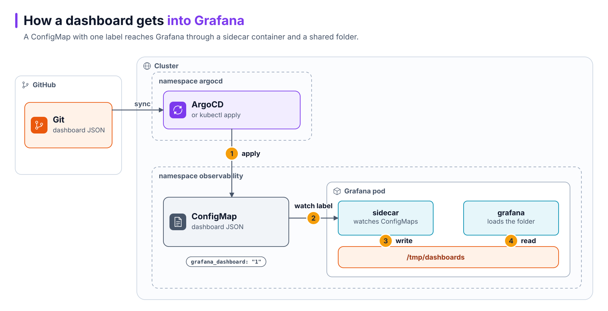

# Module 2.2: Grafana as code

> New to a term here, like provisioned dashboard or contact point? The [glossary](../glossary.md) explains every term in this course.

**Before this module:** [module 2.1](01-prometheus-and-alerting.md), for the SLO ideas.

**You need:** the lab running (`./lab.sh start` starts or repairs it), and `./lab.sh ui` running in a spare terminal for Grafana (http://localhost:3000, `admin` / `k8s-lab-admin`).

Most teams start with Grafana by clicking, adding a panel here and a dashboard there while Grafana saves them in its own database, and a year later three things have gone wrong:

- Nobody knows which of the 200 dashboards still work.
- A Grafana upgrade loses half of them.
- Every environment looks different.

This module does it the way platform teams do, with dashboards living as files in Git that reach the cluster like any other manifest. In this module you:

1. build an SLO dashboard with variables
2. find out why Grafana refuses to save it
3. compare Grafana's own alerting with Prometheus' alerting
4. follow one request from a trace to its log lines

Time: about 45 minutes.

## Concept: how a dashboard gets into Grafana



A dashboard file in Git reaches Grafana in four steps:

1. ArgoCD or kubectl applies a ConfigMap that holds the dashboard JSON and the label `grafana_dashboard: "1"`.
2. A sidecar, a small second container in the Grafana pod, watches every namespace for ConfigMaps with that label.
3. The sidecar writes the JSON from each ConfigMap into the folder `/tmp/dashboards`.
4. Grafana loads that folder, and Grafana calls dashboards that arrive this way **provisioned** dashboards.

Delete the ConfigMap, and the dashboard disappears. The lab's own "Shop mesh and traffic experiments" dashboard arrives this way, from `manifests/observability/grafana-dashboard.yaml` through ArgoCD.

## Concept: what a dashboard is made of

| Piece | What it does | In this module |
|---|---|---|
| **Panel** | One visualisation: a time series, a single big number (stat), a table, logs | availability, burn rate, requests per second, latency |
| **Query** | What the panel asks a data source, here PromQL | the error ratio from module 2.1 |
| **Variable** | A dropdown at the top. Panels use it as `$name`, so one dashboard serves many services | `$service` and `$window` |
| **Threshold** | Colours a value: green below a number, red above it | red below 99% availability, red above burn rate 14.4 |

A dashboard is only JSON, so exporting any dashboard from the UI (Share, Export) gives you the same format the ConfigMap holds.

## The bigger picture: two places to alert from

Grafana also sends alerts, so you have two places to alert from. Grafana's alerting engine queries data sources on a schedule, much like Prometheus evaluates rules, and sends notifications through **contact points**, which say where a message goes, like Alertmanager's receivers, while **notification policies** decide which alert goes to which contact point, like Alertmanager's routes.

| | Prometheus rules + Alertmanager (module 2.1) | Grafana-managed alerts |
|---|---|---|
| Where the rule runs | Inside Prometheus, next to the data | In Grafana, which queries the data source |
| Data sources | Prometheus only | Prometheus, Loki, SQL databases, cloud monitoring, anything Grafana reads |
| Keeps working when Grafana is down | yes | no |
| Lives as code | PrometheusRule resources | provisioning files or the provisioning API, Terraform |

Many teams split the work like this:

- Alert on metrics in Prometheus, where the rule runs next to the data and keeps working when Grafana breaks.
- Use Grafana alerting when the condition needs logs or a data source other than Prometheus.

Whichever you choose, check where the notification actually goes, and step 4 shows why.

## Why this way

**Why a ConfigMap instead of the Grafana API or Terraform?** In this lab everything else is a Kubernetes manifest that ArgoCD delivers, so dashboards follow the same path and people review them in the same pull requests. The Grafana Terraform provider and the Grafana Operator are the other common choices, and both keep dashboards in Git too.

**Why does Grafana refuse to save a provisioned dashboard?** Your change would not last, because the next sync would silently overwrite it with the file, so Grafana says no up front. To change the dashboard you edit the JSON in Git, and to experiment you use "Save as" to make a copy, then export it and put it in Git.

**Why variables for the service and the window?** Without them every service needs its own copy of the dashboard, and the copies drift apart. `$window` also lets you see the module 2.1 lesson for yourself, because the 1-minute burn rate reacts fast and noisily while the 30-minute burn rate reacts slowly.

**Why `or vector(0)` in the availability query?** Without it a healthy service looks like a dead one. With no 5xx responses at all, the error part of the query returns no data, so the whole division returns nothing and the panel shows "no traffic" while traffic flows fine, and `or vector(0)` turns "no errors" into a real zero.

## Do it

### 1. Look at the dashboard as code

```console
$ less platform-engineering/manifests/2.2-slo-dashboard.yaml
# Module 2.2: a dashboard as code. Grafana's sidecar loads every ConfigMap with the
# label grafana_dashboard=1, in any namespace, and removes the dashboard when the ConfigMap goes.
apiVersion: v1
kind: Namespace
metadata:
  name: course-dashboards
---
apiVersion: v1
kind: ConfigMap
metadata:
  name: shop-slo-dashboard
  namespace: course-dashboards
  labels:
    grafana_dashboard: "1"
data:
  shop-slo.json: |
    {
      "uid": "shop-slo",
      "title": "Shop SLO",
      "tags": [
...

$ kubectl apply -f platform-engineering/manifests/2.2-slo-dashboard.yaml
namespace/course-dashboards created
configmap/shop-slo-dashboard created
```

`less` opens the file in a pager, where you scroll with the arrow keys and press `q` to quit, and the transcript shows the first lines.

Open Grafana, Dashboards, and find **Shop SLO**.

**What you should see.** The ConfigMap holds the whole dashboard as JSON, with the two variables in the `templating` section and the panels with their queries and thresholds in the `panels` section. Grafana shows the dashboard within a few seconds, and in the test run the sidecar had loaded it before the next command ran. With no traffic, the stat panels read "no traffic".

### Concept: what happens when a panel draws

Grafana stores no metrics, so each time the dashboard loads or refreshes it works through these steps:

1. It fills the variable dropdowns. For `$service` it asks Prometheus for every value of one label, with `label_values(istio_requests_total{...}, destination_canonical_service)`, while `$window` is a fixed list, `1m,5m,30m`, so it needs no query.
2. It replaces `$service` and `$window` in each panel's PromQL with plain text, so `[$window]` becomes `[5m]` before Prometheus ever sees it.
3. It sends each panel's query to Prometheus, with the dashboard's time range and a step, the gap between two points on the graph.
4. It draws what comes back. A stat panel reduces each series to one number, here the last value (`lastNotNull`), and colours it with the thresholds, and when the query returns nothing, the panel shows its `noValue` text, "no traffic".

So switching `Window` only sends new queries, and nothing changes in Prometheus. When a panel looks wrong, open its Inspect menu and the Query view, which shows the query with the variables filled in, then copy it and run it in Prometheus, because the numbers there are the truth.

Grafana also offers a built-in variable, `$__rate_interval`, which picks a safe range for `rate()` from the scrape interval. This dashboard uses its own `$window` instead, so you choose the window and see the module 2.1 trade-off.

### 2. Feed it traffic, then break the backend

```console
$ ./platform-engineering/load.sh 300 &
Sending about 5 requests per second to http://localhost:8080/api/orders for 300s. Press Ctrl-C to stop.
```

Wait a minute, then look at the dashboard. Then:

```console
$ kubectl apply -f platform-engineering/manifests/3.13-faulty-pod.yaml
deployment.apps/backend-v1-faulty created
```

Switch `Window` between `1m`, `5m` and `30m` while the fault runs.

**What you should see.** While the backend stays healthy, the panels show:

- availability 100%, in green
- burn rate 0
- about 5 requests per second
- a p95 latency around 15 to 20 ms

With the faulty pod, the test run showed 89.7% availability and a burn rate of 10.3 over 5 minutes, still climbing, and the 503 responses appear as their own line in the status-code panel. The `1m` window jumps first, while `30m` barely moves. Remove the fault and keep the load running:

```console
$ kubectl delete -f platform-engineering/manifests/3.13-faulty-pod.yaml
deployment.apps "backend-v1-faulty" deleted
```

### 3. Try to change it in the UI

Edit any panel, change its title, and click Save.

**What you should see.** Grafana refuses with "Cannot save provisioned dashboard", and the API, which the module's check uses, gives the same answer. Use "Save as" if you'd like a copy to play with, but the copy lives only in Grafana's database, so nobody else gets it.

### 4. A Grafana-managed alert

```console
$ cat platform-engineering/manifests/2.2-grafana-rule.json
{
  "uid": "shop-burn-grafana",
  "title": "Shop backend burns its error budget (Grafana-managed)",
  "ruleGroup": "course",
  "folderUID": "course",
  "condition": "C",
  "for": "1m",
  "noDataState": "OK",
  "execErrState": "Error",
  "labels": {"severity": "page"},
  "annotations": {"summary": "Same condition as module 2.1, evaluated by Grafana"},
  "data": [
    {"refId": "A", "datasourceUid": "prometheus", "relativeTimeRange": {"from": 300, "to": 0},
     "model": {"refId": "A", "instant": true,
       "expr": "sum(rate(istio_requests_total{reporter=\"waypoint\", destination_canonical_service=\"backend\", response_code=~\"5..\"}[5m])) / sum(rate(istio_requests_total{reporter=\"waypoint\", destination_canonical_service=\"backend\"}[5m]))"}},
    {"refId": "C", "datasourceUid": "__expr__",
     "model": {"refId": "C", "type": "threshold", "expression": "A",
       "conditions": [{"evaluator": {"type": "gt", "params": [0.144]}}]}}
  ]
}

$ P=k8s-lab-admin
$ curl -s -u admin:$P -H 'Content-Type: application/json' -X POST localhost:3000/api/folders -d '{"uid":"course","title":"Course"}'
{"id":5,"uid":"course","orgId":0,"title":"Course","url":"/dashboards/f/course/course","hasAcl":false,"canSave":true,"canEdit":true,"canAdmin":true,"canDelete":true,"createdBy":"admin","created":"2026-11-15T10:46:01.405732036Z","updatedBy":"admin","updated":"2026-11-15T10:46:01.405732078Z","version":1}

$ curl -s -u admin:$P -H 'Content-Type: application/json' -X POST localhost:3000/api/v1/provisioning/alert-rules -d @platform-engineering/manifests/2.2-grafana-rule.json
{"id":1,"uid":"shop-burn-grafana","orgID":1,"folderUID":"course","ruleGroup":"course","title":"Shop backend burns its error budget (Grafana-managed)","condition":"C","data":[{"refId":"A","queryType":"","relativeTimeRange":{"from":300,"to":0},"datasourceUid":"prometheus","model":{"expr":"sum(rate(istio_requests_total{reporter=\"waypoint\", destination_canonical_service=\"backend\", response_code=~\"5..\"}[5m])) / sum(rate(istio_requests_total{reporter=\"waypoint\", destination_canonical_service=\"backend\"}[5m]))","instant":true,"intervalMs":1000,"maxDataPoints":43200,"refId":"A"}},{"refId":"C","queryType":"","relativeTimeRange":{"from":0,"to":0},"datasourceUid":"__expr__","model":{"conditions":[{"evaluator":{"params":[0.144],"type":"gt"}}],"expression":"A","intervalMs":1000,"maxDataPoints":43200,"refId":"C","type":"threshold"}}],"updated":"2026-11-15T10:46:01.455053289Z","noDataState":"OK","execErrState":"Error","for":"1m","annotations":{"summary":"Same condition as module 2.1, evaluated by Grafana"},"labels":{"severity":"page"},"provenance":"api","isPaused":false,"notification_settings":null,"record":null}
```

The rule has the same condition as module 2.1's, but with one 5-minute window only. Open Alerting, Alert rules in Grafana and watch it for a few minutes, then open Alerting, Contact points.

**What you should see.** Two problems. The first is a late alert: in the test run the faulty pod from step 2 had been gone for about four minutes when the rule appeared, yet the rule went `pending`, then `firing` 20 seconds later, and stayed firing for about three minutes, because the 5-minute window still held the old errors. It paged about a problem that was already fixed, which module 2.1's two-window rule doesn't do.

The second problem is that the alert reaches nobody. Contact points shows the default, `grafana-default-email`, which sends to `example@email.com`, while the lab has no mail server, so every minute Grafana's log says `Sending alerts to local notifier` and the alert goes nowhere. Out of the box, Grafana alerting looks like it works while reaching nobody.

### Concept: how the trace-to-logs links work

Step 5 jumps from a trace to the log lines of the same request, and back. Jaeger stores the traces and Loki stores the logs without knowing about each other, so Grafana builds both links from text templates in the data source settings, in `helm/kube-prometheus-stack-values.yaml`:

| Direction | Setting | What it does |
|---|---|---|
| trace to logs | `tracesToLogsV2` on the Jaeger data source | fills the span's trace id into the Loki query `{namespace="shop"} \|= "<trace id>"`, over the span's time plus and minus 5 minutes |
| logs to trace | `derivedFields` on the Loki data source | runs the regex `"trace_id":"(\w+)"` over each log line and turns the match into a link to the Jaeger data source |

Both links depend on one thing outside Grafana: the backend writes the current trace id into every log line it prints during a request, so an app that doesn't log its trace id gets a "Logs for this span" button that finds nothing.

### 5. From a trace to its logs

Follow these steps:

1. Send a request with `curl -s localhost:8080/api/orders`.
2. In Grafana, open Explore and pick the **Jaeger** data source.
3. Search for the service `backend`, and open the newest trace.
4. Click a `backend` span, then **Logs for this span**.

**What you should see.** Grafana switches to Loki with the query `{namespace="shop"} |= "<trace id>"` and shows the backend's log line for that request, with the same `trace_id` in its JSON. In a Loki result, the `trace_id` field has an **Open trace in Jaeger** link that goes back the other way.

These two links broke earlier in the course's life, because the data source settings had `${__trace.traceId}`, and Grafana's provisioning reads `${...}` as an environment variable, so it replaced the templates with empty strings. The fix in `helm/kube-prometheus-stack-values.yaml` writes `$${...}`, which provisioning turns into a literal `${...}`.

## Investigate

1. A teammate built a great dashboard by clicking in Grafana and asks you to "add it to Git". What are the steps, and what changes about how they work with it afterwards?
2. Your dashboard has a `$namespace` variable with 300 values, and it loads slowly. What makes it slow, and how would you fix it?
3. The team wants an alert when the backend logs more than 10 `ERROR` lines per minute. Prometheus rule or Grafana-managed rule, and why?
4. After step 4, how would you make sure Grafana's alerts actually reach the module 2.1 receiver?

<details>
<summary>Answers</summary>

1. Follow these steps:
   1. Export the dashboard as JSON with Share, Export. Turn "Export for sharing externally" off, so data source references stay as uids.
   2. Put the JSON in a ConfigMap with the `grafana_dashboard: "1"` label.
   3. Commit it, and let ArgoCD deliver it.
   4. Delete the clicked original, because two copies with the same title confuse everyone.

   From then on changes go through Git, so your teammate uses "Save as" for experiments, then exports and commits the result. Some teams keep a "scratch" folder in Grafana, where clicking is fine because nobody relies on anything in it.
2. Every variable value comes from a query, and with "repeat" or "All" the panels also run once per selected value. A variable query like `label_values(namespace)` looks at every metric, so it scans a lot of series. Three changes help:
   - Narrow the query to one metric and a filter, as `$service` does with `istio_requests_total{reporter="waypoint", ...}`.
   - Refresh the variable on dashboard load rather than on every time range change.
   - Avoid "All" on variables with many values.
3. A Grafana-managed rule, because the condition needs Loki and Prometheus doesn't read Loki. Use a query like `sum(count_over_time({namespace="shop", app="backend"} |= "ERROR" [1m]))` with a threshold of 10. Loki also has its own ruler, which evaluates LogQL rules and sends the alerts to Alertmanager, the same pattern as module 2.1, and that option keeps working when Grafana is down.
4. There are two options.
   - Add a contact point of type webhook that points at `http://alert-receiver.course-alerts.svc.cluster.local:8080/`, then route `severity=page` to it in the notification policy.
   - Send Grafana-managed alerts to the lab's Alertmanager, whose data source has a setting to receive Grafana's alerts, so module 2.1's routes handle both kinds in one place.

   Either way, test it the way module 2.1 did, by breaking something and waiting for the message.

</details>

## Clean up

```console
$ kill %1 2>/dev/null
$ ./platform-engineering/reset.sh
Removing course rules from the shop namespace
Applying the baseline Istio config from manifests/istio
Turning off the backend experiment settings
Asking ArgoCD to sync istio-config from Git
Done. Baseline: 100% of backend traffic to v1, no faults, no extra rules.
```

This deletes the `course-dashboards` namespace, and with it the dashboard, plus the Grafana-managed rule and the `Course` folder, which live only in Grafana's database.
