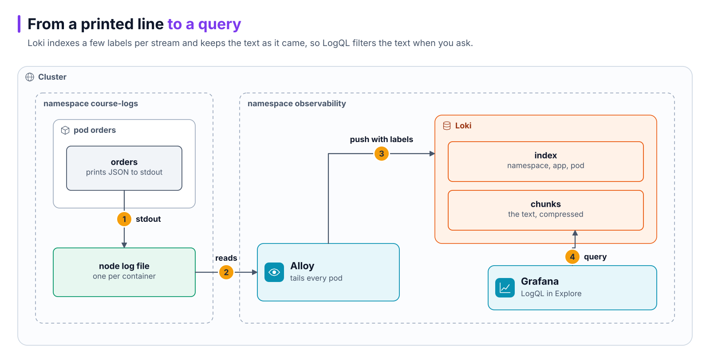

# Module 2.3: logs with Loki

> New to a term here, like LogQL or a log stream? The [glossary](../glossary.md) explains every term in this course.

**Before this module:** [module 2.1](01-prometheus-and-alerting.md), because LogQL borrows `rate()` and `sum by` from PromQL.

**You need:** the lab running (`./lab.sh start` starts or repairs it), and `./lab.sh ui` running in a spare terminal for Grafana (http://localhost:3000).

Metrics tell you that something fails, but the reason sits in the lines an app prints, such as the error message or the order id. `kubectl logs` shows those lines for one pod at a time and loses them when the pod goes, so a team keeps every pod's output in one store and searches it like a database. This module runs a plain app that writes one JSON line per order, follows a line from the pod into Loki, and then turns the text into numbers with LogQL. Time: about 30 minutes, and the app adds 16 MiB of memory.

## Concept: how a printed line reaches Grafana



An app in a container writes to stdout, and the container runtime saves those lines in a file on the node, one file per container. Alloy runs on every node and tails those files, much like `tail -f`, so it sends each new line to Loki together with a few labels that say where it came from: the namespace, the app, the pod and the container. The numbers in the picture follow that path.

Loki then stores the line in two parts, and that split explains how you query it. The labels go into a small index, while the text goes into compressed chunks that Loki never indexes. A full-text index like a search engine's would cost more than the logs themselves, so Loki keeps storage cheap and pays at query time instead: it uses the labels to find the right chunks, then reads and filters their text. Loki calls one set of labels with its lines a **stream**, so `{namespace="course-logs", app="orders"}` names one stream.

That split gives you the first rule of LogQL: start every query with labels to pick the streams, and only then filter the text. A label with many values, such as an order id, would create a stream per order and blow up the index, which is the same trap as a high-cardinality label in Prometheus.

## Concept: from text to numbers

Logs are text, but many questions want a number, such as how many orders failed in the last five minutes. LogQL answers in three moves, which work like a shell pipeline:

1. A **stream selector** in braces picks the streams by label.
2. **Filters** keep or drop lines. `|= "failed"` keeps lines that contain the text, and `| json` parses each JSON line, so its fields become labels you compare, such as `status >= 500`.
3. A **range function** turns the lines into a series. `count_over_time(...[5m])` counts lines per window, and `unwrap duration_ms` reads a field as a number, so `quantile_over_time` gives you percentiles from text.

The orders app writes lines like `{"level":"info","msg":"order placed","order":13,"status":200,"duration_ms":50}`, so every step of the pipeline has a field to work on.

## Why this way

**Why index only the labels?** A label index stays small and cheap, and most searches already know the namespace or app. The cost moves to query time, which is why a query that names no labels runs slowly.

**Why JSON lines?** A parser turns each field into a label in one step, while free text needs a regular expression for every question. Most teams ask their apps for structured logs for this reason.

**Why count from logs when Prometheus exists?** Counting from logs reads every line, so it runs slower and costs more at scale. You keep it for apps that have no metrics, and for questions that metrics leave open, like "which order ids failed?".

## Do it

### 1. Run a plain app that logs

```console
$ kubectl apply -f platform-engineering/manifests/2.3-plain-app.yaml
namespace/course-logs created
deployment.apps/orders created

$ kubectl -n course-logs logs deploy/orders --tail=3
{"level":"info","msg":"order placed","order":13,"status":200,"duration_ms":50}
{"level":"info","msg":"order placed","order":14,"status":200,"duration_ms":15}
{"level":"info","msg":"order placed","order":15,"status":200,"duration_ms":30}
```

**What you should see.** JSON lines with an order number that counts up. About one order in ten fails with `"level":"error"` and status `500`, and failures take longer, between 300 and 660 ms. The app runs outside the mesh, a busybox shell loop and nothing more, so everything below works for any app that prints to stdout.

### 2. Find the lines in Loki

Open Grafana, then **Explore**, pick the data source **Loki**, switch the editor to **Code**, and run:

```logql
{namespace="course-logs"}
```

**What you should see.** The same lines as `kubectl logs`, newest first, within a few seconds of the app printing them. Click a line to see its labels: `namespace`, `app`, `pod`, `container` and `service_name`, which Alloy added on the way in. None of the JSON fields appear as labels yet, because Loki stores the text as it came.

Now keep only the failures, first by text, then by a parsed field:

```logql
{namespace="course-logs"} |= "failed"
{namespace="course-logs"} | json | status >= 500 and duration_ms > 500
```

**What you should see.** The first query shows only `order failed` lines. The second parses each line and keeps the failures slower than 500 ms, for example `"order":40,"status":500,"duration_ms":620` in the test run. After `| json`, each field shows up as a label when you click a line.

### 3. Count and measure from text

Switch the query type to **Range** and run these one by one:

```logql
sum by (status) (count_over_time({namespace="course-logs"} | json [5m]))
sum by (level) (count_over_time({namespace="course-logs"} | json [5m]))
quantile_over_time(0.95, {namespace="course-logs"} | json | unwrap duration_ms [5m]) by (status)
```

**What you should see.** Graphs instead of lines. In the test run, the five minutes held 53 lines with status `200` and 6 with `500`, and the levels split the same way into `info` and `error`. The p95 duration came out near 50 ms for status `200` and 620 ms for `500`, so the percentile came from nothing but text. That is the same answer a latency histogram in Prometheus would give, built at query time from the lines.

### 4. Read a real app's logs as data

The shop's backend writes one JSON line per request too, and the lab ships a dashboard built entirely from LogQL. Send some traffic with errors in it, then open Grafana, Dashboards, **Shop logs**:

```console
$ for i in $(seq 1 30); do curl -s -o /dev/null localhost:8080/api/orders; curl -s -o /dev/null localhost:8080/api/nope; done
$ curl -s -o /dev/null "localhost:8080/api/slow?ms=400"
```

**What you should see.** Seven panels, all built from log lines, with the same moves as steps 2 and 3:

| Panel | LogQL behind it | What it teaches |
|---|---|---|
| Log lines per second, by app | `sum by (app) (rate({namespace="shop"}[1m]))` | `rate()` works on log streams too |
| Backend responses by status | `count_over_time({...app="backend"} \| json \| message="request handled" [1m])` by `status` | `\| json` turns each JSON field into a label you group by |
| Log lines by level | the same, by `level` | `INFO` from the backend, `error` from the frontend |
| Backend p95 duration per path | `quantile_over_time(0.95, ... \| unwrap duration_ms ...) by (path)` | percentiles from text |
| Top failing paths | `topk(10, ... \| json \| status >= 400 ...)` | `/api/nope` with `404` |
| Errors in shop | `{namespace="shop"} \| json \| level=~"(?i)error\|warning" or status >= 500` | raw lines, filtered |
| Live logs | `{namespace="shop", app=~"$app"} \|= "$search"` | pick apps at the top, type into **Search text**, like a `grep` across every pod |

In the test run, the p95 panel put `/api/slow` near 400 ms and `/api/nope` below 1 ms, and the top failing path was `/api/nope` with `404`. Each backend line also carries a `trace_id`, the id of the request's trace, which is how Grafana jumps from a trace to its log lines in [module 2.2](02-grafana-as-code.md#concept-how-the-trace-to-logs-links-work).

## Investigate

1. Run `{app="orders"}` without the namespace. Does it still find the lines? Why does a query with no label at all, `{} |= "failed"`, get refused?
2. Change the orders query to `| json | status >= 500` without `|= "failed"` first. Both return the same lines, so which one does less work, and why?
3. The `order` field counts up forever. Why would it be a bad idea to make Alloy turn it into a label?

<details>
<summary>Answers</summary>

1. Yes, because `app="orders"` alone picks the same stream, as no other namespace has an app with that name. Loki refuses an empty selector, because it would have to read every chunk in the store, so every query needs at least one label matcher that selects something.
2. `|= "failed"` first does less work. A plain text match is cheap, so it drops most lines before the JSON parser runs, while `| json` alone parses every line in the stream and then throws most of them away.
3. Every distinct label value starts a new stream, so a counting field turns one stream into one per order, and the index grows with every line until Loki slows down or refuses new streams. Fields like that stay in the text, where `| json` reads them at query time.

</details>

## Clean up

```console
$ ./platform-engineering/reset.sh
```

This deletes the `course-logs` namespace with the orders app. The lines it wrote stay in Loki until its retention removes them.
