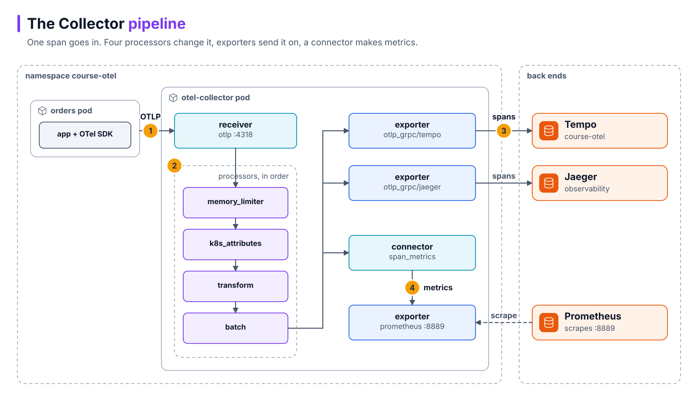

# Module 2.4: OpenTelemetry Collector and Grafana Tempo

> New to a term here, like span or OTLP? The [glossary](../glossary.md) explains every term in this course.

**Before this module:** module 1.1. Module 3.6 helps, because it explains traces and spans. No Istio needed: this module runs its own app outside the mesh.

**You need:** the lab running (`./lab.sh start` starts or repairs it), `helm`, internet access for the charts, about 250 MB of free memory, and `./lab.sh ui` running in a spare terminal for Grafana.

In the lab so far, every app sends its traces straight to Jaeger, which stops working well once you have 50 services, three tracing back ends, and a security team that wants every trace scrubbed of customer data. At that point you want one place in the middle that does four jobs:

1. It receives all telemetry from the apps.
2. It cleans the data.
3. It adds context, such as the name of the pod that sent it.
4. It sends the data wherever it needs to go.

The **OpenTelemetry Collector** is that place, and it has become the standard way to run telemetry in Kubernetes. In this module you install one, put **Grafana Tempo**, a database for traces, behind it, and query the traces with **TraceQL**, Tempo's query language.

Time: about 50 minutes. Adds about 250 MB of memory while it runs.

## Concept: the Collector pipeline

One span travels from the orders app to the back ends in four steps:

1. The orders app sends spans to the Collector's receiver, over OTLP on port 4318.
2. Four processors change the spans, one after the other.
3. Two exporters send the spans to Tempo and to Jaeger.
4. A connector turns the spans into metrics, and Prometheus scrapes them from port 8889.



Everything in the Collector is one of four kinds of component, and a **pipeline** is a chain of these components that the data flows through:

| Kind | Job | Here |
|---|---|---|
| Receiver | Takes data in | `otlp`: the OpenTelemetry protocol, on gRPC 4317 and HTTP 4318 |
| Processor | Changes data on the way | protect memory, add Kubernetes labels, fix the service name, batch |
| Exporter | Sends data out | to Tempo, to Jaeger, and a `/metrics` page for Prometheus |
| Connector | Ends one pipeline and starts another | `span_metrics`: reads traces, writes metrics |

The OpenTelemetry Protocol (**OTLP**) is the format every OpenTelemetry SDK, the library inside the app that creates spans, uses to send data. The app knows only "send OTLP to this address", so you swap or add back ends in the Collector without touching a single app.

## Concept: Tempo and TraceQL

Many trace stores build an index of every attribute, and that index takes a lot of storage. Tempo skips the index, writes traces to object storage, here a local folder, and scans them when you search, so it saves storage by doing the work at search time. You search with **TraceQL**, a query language that selects spans the way PromQL selects series:

| TraceQL | Finds |
|---|---|
| `{ resource.service.name = "orders" }` | every trace with a span from `orders` |
| `{ ... && span.http.status_code >= 500 }` | traces where a span failed |
| `{ ... && duration > 400ms }` | traces with a slow span |
| `{ resource.service.name = "orders" } >> { span.db.system = "redis" }` | `orders` spans that have a Redis span somewhere below them |

`resource.` attributes describe who sent the span, such as the service, pod or node, while `span.` attributes describe the operation, such as the HTTP status or the database statement.

## The bigger picture: why everyone moved to OpenTelemetry

A few years ago each tracing vendor shipped its own agent and library, so switching vendors meant changing every app. OpenTelemetry, a CNCF project, fixed that by giving the industry one set of SDKs, one protocol and one Collector, and since nearly every vendor and open-source back end now accepts OTLP, teams instrument their apps once and choose back ends freely.

The Collector then does platform work that used to live in each app:

- sampling, which keeps only some of the traces
- dropping sensitive attributes
- routing data by tenant
- turning traces into metrics

Grafana's open-source stack builds on OpenTelemetry, with one tool for each kind of data, all linked in Grafana:

- Tempo for traces
- Loki for logs
- Prometheus or Mimir for metrics
- Pyroscope for profiles (module 2.5)

Job adverts for platform and observability roles ask for OpenTelemetry more often each year.

## Why this way

**Why the Collector as a Deployment, not a DaemonSet?** A single "gateway" Deployment is the simplest setup and enough for one cluster. Large clusters often also run a Collector on every node with a DaemonSet, called "agent" mode, where each agent collects data from its own node and forwards it to the gateway Collectors, so it's the same component in two places.

**Why the contrib image?** The core Collector image has only the basic components, while `k8s_attributes`, `transform` and `span_metrics` live in the `contrib` build. Production teams often build their own image with exactly the components they use, which the OpenTelemetry Collector Builder does.

**Why `memory_limiter` first?** If a back end goes down, data piles up in the Collector, so the memory limiter starts refusing data before the pod runs out of memory, which lets the Collector survive an outage instead of crashing in the middle of it.

**Why rename the service in the Collector?** The orders app uses the shop's backend image, whose code hard-codes `service.name = "backend"` and ignores the usual `OTEL_SERVICE_NAME` setting. You'll meet apps like that everywhere, and fixing names in one central place beats chasing every team to change code, so here the Collector takes the name from the Kubernetes Deployment.

**Why keep sending to Jaeger too?** Moving between back ends is a migration, and with a Collector you run the old and new back ends side by side, compare them, and then switch off the old one, which is exactly how teams move from Jaeger to Tempo.

## Do it

### 1. Install Tempo

Install the back ends first, then the apps that send to them, because the order matters for speed. In the test run one app started before its Collector existed, so its exporter failed and then waited longer and longer between retries, taking about two and a half minutes to deliver its first trace, while in the right order the first trace was searchable 22 seconds after the app started.

```console
$ helm repo add grafana https://grafana.github.io/helm-charts && helm repo update grafana
"grafana" already exists with the same configuration, skipping
Hang tight while we grab the latest from your chart repositories...
...Successfully got an update from the "grafana" chart repository
Update Complete. ⎈Happy Helming!⎈

$ cat platform-engineering/manifests/2.4-tempo-values.yaml
# Grafana Tempo in single-binary mode: one pod that receives, stores and queries traces.
# Traces live on an emptyDir and expire after 6 hours. Fine for a lab, not for production.
tempo:
  retention: 6h
  reportingEnabled: false
  receivers:
    otlp:
      protocols:
        grpc:
          endpoint: 0.0.0.0:4317
        http:
          endpoint: 0.0.0.0:4318
  # 384Mi was too low: a structural TraceQL query (>>) got Tempo OOM-killed three times.
  # GOMEMLIMIT makes Go's garbage collector work harder before the container limit.
  extraEnv:
    - name: GOMEMLIMIT
      value: 600MiB
  resources:
    requests: {cpu: 20m, memory: 128Mi}
    limits: {memory: 768Mi}
persistence:
  enabled: false

$ helm install tempo grafana/tempo --version 1.24.4 -n course-otel --create-namespace \
  -f platform-engineering/manifests/2.4-tempo-values.yaml --wait
level=WARN msg="this chart is deprecated"
NAME: tempo
LAST DEPLOYED: Sun Nov 15 10:46:46 2026
NAMESPACE: course-otel
STATUS: deployed
REVISION: 1
DESCRIPTION: Install complete
TEST SUITE: None
```

**What you should see.** After about 50 seconds Helm prints `STATUS: deployed`, and a `tempo-0` pod runs, listening for OTLP on 4317 and 4318 and answering queries on 3200. Its memory limit is 768 MiB, because in the test run a limit of 384 MiB was too small and one structural query from step 5 got Tempo OOM-killed, that is, killed for running out of memory, three times in a row.

### 2. Install the Collector

```console
$ helm repo add open-telemetry https://open-telemetry.github.io/opentelemetry-helm-charts && helm repo update open-telemetry
"open-telemetry" already exists with the same configuration, skipping
Hang tight while we grab the latest from your chart repositories...
...Successfully got an update from the "open-telemetry" chart repository
Update Complete. ⎈Happy Helming!⎈

$ cat platform-engineering/manifests/2.4-collector-values.yaml
# The OpenTelemetry Collector as one Deployment ("gateway" mode).
# Pipeline: receive OTLP -> add Kubernetes labels -> fix the service name -> batch -> send to Tempo and Jaeger,
# and turn spans into request metrics that Prometheus scrapes.
mode: deployment
fullnameOverride: otel-collector
image:
  # The contrib build carries the span_metrics connector and the k8s_attributes processor.
  repository: otel/opentelemetry-collector-contrib
presets:
  # Adds the k8s_attributes processor and the RBAC it needs to read pod metadata.
  kubernetesAttributes:
    enabled: true
ports:
  spanmetrics:
    enabled: true
    containerPort: 8889
    servicePort: 8889
    protocol: TCP
resources:
  requests: {cpu: 20m, memory: 64Mi}
  limits: {memory: 256Mi}
config:
  receivers:
    otlp:
      protocols:
        grpc: {endpoint: "${env:MY_POD_IP}:4317"}
        http: {endpoint: "${env:MY_POD_IP}:4318"}
  processors:
    memory_limiter:
      check_interval: 5s
      limit_percentage: 80
      spike_limit_percentage: 25
    batch: {}
    # The app hard-codes service.name "backend" in its code. Fix it centrally: name each
    # service after its Kubernetes Deployment, which k8s_attributes added just before.
    transform/service_name:
      trace_statements:
        - context: resource
          statements:
            - set(attributes["service.name"], attributes["k8s.deployment.name"]) where attributes["k8s.deployment.name"] != nil
  connectors:
    span_metrics:
      histogram:
        explicit:
          buckets: [5ms, 25ms, 100ms, 250ms, 500ms, 1s, 2s]
      # This app's instrumentation uses the older attribute name http.status_code.
      # Newer semantic conventions call it http.response.status_code.
      dimensions:
        - name: http.status_code
  exporters:
    otlp_grpc/tempo:
      endpoint: tempo.course-otel.svc.cluster.local:4317
      tls: {insecure: true}
    otlp_grpc/jaeger:
      endpoint: jaeger-collector.observability.svc.cluster.local:4317
      tls: {insecure: true}
    prometheus:
      endpoint: "${env:MY_POD_IP}:8889"
  service:
    pipelines:
      traces:
        receivers: [otlp]
        processors: [memory_limiter, k8s_attributes, transform/service_name, batch]
        exporters: [otlp_grpc/tempo, otlp_grpc/jaeger, span_metrics]
      metrics:
        receivers: [span_metrics]
        processors: [batch]
        exporters: [prometheus]
      logs: null

$ helm install otel-collector open-telemetry/opentelemetry-collector --version 0.178.0 -n course-otel \
  -f platform-engineering/manifests/2.4-collector-values.yaml --wait
NAME: otel-collector
LAST DEPLOYED: Sun Nov 15 10:47:28 2026
NAMESPACE: course-otel
STATUS: deployed
REVISION: 1
DESCRIPTION: Install complete
TEST SUITE: None
NOTES:

$ kubectl -n course-otel logs deploy/otel-collector | grep "Everything is ready"
2026-11-15T10:47:29.800Z	info	service@v0.163.0/service.go:256	Everything is ready. Begin running and processing data.	{"resource": {"host.name": "k3d-k8s-lab-server-0", "k8s.namespace.name": "course-otel", "k8s.node.ip": "192.168.107.3", "k8s.node.name": "k3d-k8s-lab-server-0", "k8s.pod.ip": "10.42.0.221", "k8s.pod.name": "otel-collector-7f46d5755-nrklw", "service.instance.id": "3a567192-36ae-4f7d-9c8d-52333281d4bb", "service.name": "otelcol-contrib", "service.version": "0.163.2"}}

$ kubectl get clusterrole otel-collector
NAME             CREATED AT
otel-collector   2026-11-15T10:47:28Z
```

**What you should see.** The install takes seconds, and the log ends with `Everything is ready. Begin running and processing data.` Read the values file top to bottom: it defines the receivers, processors, connector and exporters from the diagram, and the two pipelines at the end wire them together. The `kubernetesAttributes` preset also created a **ClusterRole**, which lets the Collector read pod metadata in the whole cluster.

This chart version renamed some components. The older names `otlp`, `k8sattributes` and `spanmetrics` still install, but the chart prints `[DEPRECATION]` warnings and rewrites them, so the values file already uses the new names: `otlp_grpc`, `k8s_attributes`, `span_metrics`.

### 3. Deploy an app that sends traces to the Collector

```console
$ kubectl apply -f platform-engineering/manifests/2.4-orders-app.yaml
secret/redis-auth created
deployment.apps/redis created
service/redis created
deployment.apps/orders created
service/orders created
deployment.apps/traffic created

$ kubectl -n course-otel get pods
NAME                             READY   STATUS    RESTARTS   AGE
orders-8468957849-j9sjd          1/1     Running   0          8s
otel-collector-7f46d5755-nrklw   1/1     Running   0          10s
redis-6b994cfc5f-ndnnq           1/1     Running   0          8s
tempo-0                          1/1     Running   0          52s
traffic-54466f7f76-jcrz5         1/1     Running   0          8s

$ grep -B2 -A1 OTEL_EXPORTER platform-engineering/manifests/2.4-orders-app.yaml
            # The only tracing setting the app needs: where to send spans. Its code
            # hard-codes service.name "backend"; the Collector renames it to "orders".
            - {name: OTEL_EXPORTER_OTLP_ENDPOINT, value: "http://otel-collector.course-otel.svc.cluster.local:4318"}
            # 5% of /api/ requests fail with 503, so there are errors to find.
```

**What you should see.** Three new pods run next to Tempo and the Collector:

- `orders`, which uses the shop's backend image
- `redis`
- `traffic`, which sends a few requests every second

The app's only tracing setting is `OTEL_EXPORTER_OTLP_ENDPOINT`, the Collector's address.

### Concept: how the Collector knows which pod sent a span

A span leaves the app without any Kubernetes context, because the SDK adds only a few resource attributes, such as `service.name`. The `k8s_attributes` processor adds the rest, much like caller ID on a phone, which looks up who is on the other end of the connection, and it works in two halves:

1. In the background, the processor watches pods through the API server and keeps a table that maps each pod IP to the pod name, namespace, node, Deployment and image. This watch is why the chart created a ClusterRole.
2. For each incoming batch, the processor takes the source IP of the network connection, looks it up in the table, and adds the matching attributes.

Order in the pipeline matters. `memory_limiter` goes first, so it refuses data before anything else spends memory on it, and `k8s_attributes` must come before `batch`, because a batch mixes data from many connections and the source IP gets lost.

Bigger setups often make a related mistake, where a node agent forwards data to a gateway Collector that then sees only the agent's IP. In that setup the agent adds the attributes, or passes the pod IP along as an attribute.

### 4. See what the Collector added

```console
$ kubectl -n course-otel port-forward svc/tempo 3200:3200 >/dev/null 2>&1 &
$ sleep 30      # the first trace took 22 seconds in the test run
$ curl -s "localhost:3200/api/search/tag/service.name/values"; echo
{"tagValues":["orders"],"metrics":{"inspectedBytes":"54956"}}

$ curl -s "localhost:3200/api/search/tags?scope=resource"; echo
{"tagNames":["container.image.name","k8s.cluster.uid","k8s.container.name","k8s.deployment.name","k8s.namespace.name","k8s.node.name","k8s.pod.name","k8s.pod.start_time","k8s.pod.uid","k8s.replicaset.name","k8s.replicaset.uid","service.instance.id","service.name","service.namespace","service.version","telemetry.sdk.language","telemetry.sdk.name","telemetry.sdk.version"],"metrics":{"inspectedBytes":"56510"}}
```

**What you should see.** The service reads `orders`, not `backend`, because the `transform` processor renamed it. The resource attributes include `k8s.deployment.name`, `k8s.namespace.name`, `k8s.node.name`, `k8s.pod.name` and `container.image.name`, which the app never sent, because `k8s_attributes` looked up the sending pod by its IP and added them. Every trace now tells you exactly which pod, image and node produced it.

### Concept: how spans join into one trace

One request passes through several processes, each recording its own spans, and nobody sends a finished trace anywhere, so the back end needs a way to put the pieces back together. Every span carries three ids for this:

- the **trace id**, which all spans of one request share
- its own **span id**
- the **parent span id**, the id of the span that caused it

Each process sends its own spans, and the back end groups them by trace id and rebuilds the tree from the parent ids, like a family tree where each person names their parent.

The ids travel in two ways:

| Where | How the parent gets passed on |
|---|---|
| inside one process | The SDK keeps the current span in a context object. When `orders` calls Redis through an instrumented client, the Redis span takes the current span as its parent. |
| across the network | The SDK writes a W3C `traceparent` header into the outgoing request: `00-<trace id>-<parent span id>-<flags>`. The receiving service's SDK reads it and continues the same trace. |

Engineers call this passing along **context propagation**. If any hop drops the header, as a proxy that strips unknown headers or a service without instrumentation does, the trace splits into two unrelated traces. TraceQL's `>>` in step 5 works only because the parent ids are there, so it walks the tree from the `orders` span down to its Redis span.

### 5. Query with TraceQL

1. Open Grafana (http://localhost:3000) and go to Explore.
2. Pick the data source **Tempo**.
3. Switch the query type to **TraceQL**.
4. Run these queries one at a time:

```text
{ resource.service.name = "orders" && span.http.status_code >= 500 }
{ resource.service.name = "orders" && duration > 400ms }
{ resource.service.name = "orders" } >> { span.db.system = "redis" }
```

**What you should see.** The first query finds failed requests, because the app fails 5% of `/api/` requests on purpose. The second finds `GET /api/slow` traces, which took 450 to 600 ms in the test run, and the third finds `GET` and `POST /api/orders`, the requests that called Redis. Open one of them, and Grafana draws the span tree, while the button **Logs for this span** opens the matching lines in Loki, by trace id.

This app uses the older attribute name `http.status_code`, while newer OpenTelemetry semantic conventions call it `http.response.status_code`, so when a query finds nothing, check the attribute names on a real span first.

### 6. Metrics from spans

Prometheus scrapes the output of the `span_metrics` connector, guided by a PodMonitor that tells it which pods to scrape. Apply the PodMonitor and the Grafana data source if you haven't yet, then wait a few minutes, because a new PodMonitor reaches Prometheus through a Secret update, which took up to four minutes in the test runs.

```console
$ kubectl apply -f platform-engineering/manifests/2.4-collector-podmonitor.yaml -f platform-engineering/manifests/2.4-tempo-datasource.yaml
podmonitor.monitoring.coreos.com/otel-collector created
configmap/course-tempo-datasource created
```

In Grafana Explore, Prometheus:

```text
sum by (span_name, http_status_code) (rate(traces_span_metrics_calls_total{service_name="orders", span_kind="SPAN_KIND_SERVER"}[2m]))
histogram_quantile(0.95, sum by (le, span_name) (rate(traces_span_metrics_duration_milliseconds_bucket{service_name="orders", span_kind="SPAN_KIND_SERVER"}[5m])))
```

**What you should see.** Each endpoint gets about 1.2 requests per second with `200` or `201`, and about 5% of that with `503`: in the test run, `GET /api/orders` showed 1.15 per second `200` and 0.09 `503`, and the p95 for `GET /api/slow` sat around 860 ms. These are RED metrics, short for rate, errors and duration, and because the app exports no metrics of its own, the Collector built all of them from spans.

### 7. The same traces in Jaeger

Open Jaeger (http://localhost:16686) and pick the service `orders`.

**What you should see.** The same traces as in Tempo, because one Collector feeds two back ends while the app stays unchanged.

## Investigate

1. Your security team says traces must never contain the `db.statement` attribute, because it may hold customer data. Where do you remove it, and why there?
2. Tempo goes down for ten minutes. What happens to the traces the app sends during that time, in this setup?
3. You have 200 services and want only 10% of traces, but every trace with an error. Why is that hard to do in the app's SDK, and where would you do it?
4. Why does `span_metrics` give you request rates for `orders`, while Istio's `istio_requests_total` (module 3.6) doesn't know about `orders` at all?

<details>
<summary>Answers</summary>

1. Remove it in the Collector, before the exporters, with a processor such as `attributes`, with action `delete` on `db.statement`, or a `transform` statement. One change covers every app and every back end at once, so nobody depends on 200 teams remembering to configure their SDKs.
2. The `otlp_grpc/tempo` exporter keeps a queue in memory and retries, so a short outage loses nothing, while a long outage fills the queue and the Collector drops the oldest data. `memory_limiter` makes sure the Collector itself survives, and Jaeger still gets everything, because each exporter has its own queue. For outages measured in hours, teams add a persistent queue on disk.
3. The SDK decides at the start of a request, before it knows whether the request will fail, so to keep every error trace, something must decide at the end, with the whole trace in view. That's called **tail sampling**, and the Collector's `tail_sampling` processor does it. With several Collector pods all spans of one trace must reach the same pod, so teams usually put a `loadbalancing` exporter in front.
4. `orders` runs outside the mesh, so no Istio proxy sees its traffic, and Istio's metrics come from proxies, while span metrics come from the app's own instrumentation. The two complement each other, because the mesh covers every service without code, while the SDK sees inside the app, including the Redis calls.

</details>

## Clean up

```console
$ kill %1 2>/dev/null
$ ./platform-engineering/reset.sh
Removing course rules from the shop namespace
Applying the baseline Istio config from manifests/istio
Turning off the backend experiment settings
Asking ArgoCD to sync istio-config from Git
Done. Baseline: 100% of backend traffic to v1, no faults, no extra rules.
```

The reset does three things:

1. It uninstalls the Collector and Tempo with Helm, first, because the Collector's ClusterRole outlives its namespace.
2. It deletes the `course-otel` namespace.
3. It removes the Tempo data source from Grafana.

That last step is less simple than it sounds, because a provisioned data source is read-only and survives the deletion of its ConfigMap, so `reset.sh` first swaps in a file that tells Grafana to delete the data source.
