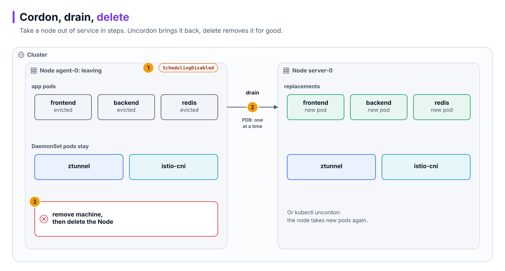

# Module 20: nodes, drains and cleanup

> New to a term here, like VirtualService or waypoint? The [glossary](glossary.md) explains every Istio resource and term in this course.

**Before this module:** module 0 only. This module covers plain Kubernetes operations. The mesh just keeps running underneath.

**You need:** the lab running (`./scripts/start.sh` starts or repairs it), and about 300 MB of free memory for the second node.

Day-to-day cluster work isn't glamorous: a node needs a kernel patch, a disk fills up, or a node dies and leaves its leftovers behind. This module walks through that work in four parts:

1. You add a second node to the lab.
2. You drain the node under live traffic.
3. You see how a PodDisruptionBudget protects you, and how it blocks you.
4. You clean up the things that pile up in every cluster: finished Jobs, old ReplicaSets and images.

Time: about 45 minutes. The second node uses about 300 MB of memory while it runs.

## Concept: cordon, drain, delete



Taking a node out of service goes through up to three steps, from left to right:

1. You cordon the node, which marks it unschedulable, so no new pods land there while nothing moves yet.
2. You drain the node. A drain cordons it, then *evicts* every pod, one by one, through the Eviction API, and the pods' controllers, such as Deployments and StatefulSets, create replacements on other nodes.
3. You remove the machine, then delete the Node object, because taking the machine away doesn't delete the Node object on its own.

DaemonSet pods stay on the node during a drain, and the `--ignore-daemonsets` flag says that you accept this. They have to stay, because ztunnel and istio-cni must run on every node. If you want the node back instead of removing it, `kubectl uncordon` makes it schedulable again.

## Concept: PodDisruptionBudgets

Without protection, a drain may evict every replica of an app at once and take the app down. A PodDisruptionBudget (PDB) prevents that by saying how many pods of an app must stay up, because an eviction is polite: before it removes a pod, Kubernetes checks every PDB that selects the pod. `minAvailable: 1` on a two-replica app means "keep at least one pod running", so the drain works like this:

1. The drain evicts one pod.
2. The drain waits until the replacement pod is ready.
3. The drain evicts the next pod.

A PDB covers only *voluntary* disruptions, such as drains, upgrades, or a cluster autoscaler that removes a node, because a node that crashes doesn't ask anyone.

Under the hood, the budget is a counter of pods you may take away right now. The disruption controller writes it as `status.disruptionsAllowed` on every PDB, equal to the healthy pods minus the pods the budget demands, and `kubectl get pdb` shows it as `ALLOWED DISRUPTIONS`. Each eviction goes through these steps:

1. `kubectl drain` asks the API server to evict a pod.
2. While the counter is 0, the API server refuses with `429 Too Many Requests`.
3. `kubectl drain` treats the refusal as "not yet" and waits 5 seconds.
4. `kubectl drain` asks again, until the eviction passes or `--timeout` runs out.

| Budget on the two `web` pods | Healthy pods | Allowed disruptions | The drain |
|---|---|---|---|
| `minAvailable: 1` | 2 | 1 | evicts one pod |
| `minAvailable: 1` | 1, the replacement isn't Ready yet | 0 | retries every 5 seconds |
| `minAvailable: 2` | 2 | 0 | retries until `--timeout`, and forever without it |

Many people believe that a PDB guards your pods against everything, but it guards only the Eviction API, so `kubectl delete pod`, a Deployment's own rolling update and a crashing node all ignore it.

## The bigger picture: what fills a cluster up

A cluster that runs for months collects leftovers, which cost disk space, memory in the API server, and your time when you search for the real problem:

| Leftover | Why it stays | The fix |
|---|---|---|
| Finished Jobs and their pods | Kubernetes keeps them so you still have the logs | `ttlSecondsAfterFinished` on the Job, or `successfulJobsHistoryLimit` on a CronJob |
| Old ReplicaSets | every Deployment change creates one, kept for `kubectl rollout undo` | `revisionHistoryLimit` (default 10) |
| Images on nodes | the kubelet keeps them for the next start | the kubelet deletes unused images when disk use passes 85% (`imageGCHighThresholdPercent`). `crictl rmi --prune` does it by hand |
| Failed and evicted pods | they stay for inspection | `kubectl delete pods -A --field-selector=status.phase=Failed` |
| Nodes that no longer exist | removing a machine doesn't remove its Node object | `kubectl delete node` |

Container logs live on the node too, and the kubelet rotates them at 10 MB per container by default and keeps 5 files.

## Why this way

**Why does the second node get the lab's images imported?** The lab builds `k8s-lab/backend`, `frontend` and `assistant` locally and imports them straight into each node, with no registry in between, so a new node starts without them and `k3d image import` copies them over. The same gap bites you in step 6, because pruning removes the images again and nothing brings them back.

**Why don't pods move back after an uncordon?** Kubernetes places pods only when they start and never moves running pods to balance load, so to spread them again you restart them (`kubectl rollout restart`) or use a tool like the descheduler.

**Why `whenUnsatisfiable: ScheduleAnyway` in the spread constraint?** `DoNotSchedule` would leave pods Pending whenever spreading isn't possible, for example with one node, while `ScheduleAnyway` treats spreading as a preference. Step 4 shows the cost, because sometimes both replicas end up on the same node.

**Why does the mesh need nothing special during a drain?** In ambient mode ztunnel runs on every node and the pods carry no proxy of their own, so when a pod moves, two things happen:

- istio-cni on the new node gives the pod its traffic rules.
- ztunnel on the old node keeps serving the pods that are still there.

Sidecar mode works too, but every moved pod starts a new Envoy.

## Do it

### 1. Add a node

```console
$ k3d node create agent --cluster k8s-lab --role agent --wait
INFO[0000] Adding 1 node(s) to the runtime local cluster 'k8s-lab'...
INFO[0000] Using the k3d-tools node to gather environment information
INFO[0000] Starting new tools node...
INFO[0000] Starting node 'k3d-k8s-lab-tools'
INFO[0000] HostIP: using network gateway 192.168.107.1 address
INFO[0000] Starting node 'k3d-agent-0'
INFO[0003] Successfully created 1 node(s)!

$ k3d image import k8s-lab/backend:1.0.3 k8s-lab/frontend:1.0.3 k8s-lab/assistant:1.1.0 -c k8s-lab
INFO[0000] Importing image(s) into cluster 'k8s-lab'
INFO[0000] Starting new tools node...
INFO[0000] Starting node 'k3d-k8s-lab-tools'
INFO[0000] Saving 3 image(s) from runtime...
INFO[0002] Importing images into nodes...
INFO[0002] Importing images from tarball '/k3d/images/k3d-k8s-lab-images-20261115110539.tar' into node 'k3d-k8s-lab-server-0'...
INFO[0002] Importing images from tarball '/k3d/images/k3d-k8s-lab-images-20261115110539.tar' into node 'k3d-agent-0'...
INFO[0007] Removing the tarball(s) from image volume...
INFO[0008] Removing k3d-tools node...
INFO[0008] Successfully imported image(s)
INFO[0008] Successfully imported 3 image(s) into 1 cluster(s)

$ kubectl get nodes
NAME                   STATUS   ROLES                  AGE   VERSION
k3d-agent-0            Ready    <none>                 9s    v1.31.5+k3s1
k3d-k8s-lab-server-0   Ready    control-plane,master   46h   v1.31.5+k3s1

$ kubectl -n istio-system get pods -o wide | grep -E "ztunnel|cni"
istio-cni-node-8fjgz     1/1     Running   0             9s    192.168.107.4   k3d-agent-0            <none>           <none>
istio-cni-node-m5l9p     1/1     Running   2 (63m ago)   46h   192.168.107.3   k3d-k8s-lab-server-0   <none>           <none>
ztunnel-g8xb7            1/1     Running   0             9s    10.42.1.3       k3d-agent-0            <none>           <none>
ztunnel-htqw5            1/1     Running   2 (63m ago)   46h   10.42.0.113     k3d-k8s-lab-server-0   <none>           <none>
```

**What you should see.** `k3d-agent-0` joins as `Ready` within seconds, and a second ztunnel pod and a second istio-cni pod start on it by themselves, because they're DaemonSets.

### 2. Deploy an app over both nodes

```console
$ kubectl apply -f platform-engineering/manifests/20-ops-app.yaml -f platform-engineering/manifests/03-course-client.yaml
namespace/course-ops created
deployment.apps/web created
service/web created
serviceaccount/course-client unchanged
deployment.apps/course-client unchanged

$ kubectl -n course-ops rollout status deploy/web
deployment "web" successfully rolled out

$ kubectl -n course-ops get pods -o wide
NAME                  READY   STATUS    RESTARTS   AGE   IP           NODE                   NOMINATED NODE   READINESS GATES
web-55b5479f8-2pgn7   1/1     Running   0          8s    10.42.0.28   k3d-k8s-lab-server-0   <none>           <none>
web-55b5479f8-xgmp8   1/1     Running   0          8s    10.42.1.4    k3d-agent-0            <none>           <none>

$ kubectl -n shop exec deploy/course-client -- sh -c 'for i in $(seq 1 20); do curl -s -o /dev/null -w "%{http_code}\n" http://web.course-ops:8000/status/200; done' | sort | uniq -c
  20 200

$ kubectl -n istio-system logs -l app=ztunnel --since=1m --prefix | grep 'dst.workload="web' | tail -2
[pod/ztunnel-g8xb7/istio-proxy] 2026-11-15T11:05:58.431546Z	info	access	connection complete	src.addr=10.42.0.153:51130 src.workload="course-client-595cccd86c-c7gmd" src.namespace="shop" src.identity="spiffe://cluster.local/ns/shop/sa/course-client" dst.addr=10.42.1.4:15008 dst.hbone_addr=10.42.1.4:8080 dst.service="web.course-ops.svc.cluster.local" dst.workload="web-55b5479f8-xgmp8" dst.namespace="course-ops" dst.identity="spiffe://cluster.local/ns/course-ops/sa/default" direction="inbound" bytes_sent=188 bytes_recv=93 duration="2ms"
[pod/ztunnel-g8xb7/istio-proxy] 2026-11-15T11:05:58.529252Z	info	access	connection complete	src.addr=10.42.0.153:51130 src.workload="course-client-595cccd86c-c7gmd" src.namespace="shop" src.identity="spiffe://cluster.local/ns/shop/sa/course-client" dst.addr=10.42.1.4:15008 dst.hbone_addr=10.42.1.4:8080 dst.service="web.course-ops.svc.cluster.local" dst.workload="web-55b5479f8-xgmp8" dst.namespace="course-ops" dst.identity="spiffe://cluster.local/ns/course-ops/sa/default" direction="inbound" bytes_sent=188 bytes_recv=93 duration="21ms"
```

**What you should see.** One `web` pod per node, 20 times `200`, and log lines from the ztunnel pods on both nodes, because traffic to the pod on `k3d-agent-0` arrives through the ztunnel on that node.

### 3. Drain under traffic

In a second terminal, send a request every 0.1 seconds and print anything that isn't a `200`:

```console
$ kubectl -n shop exec deploy/course-client -- sh -c 'while true; do c=$(curl -s -o /dev/null -m 3 -w "%{http_code}" http://web.course-ops:8000/status/200); [ "$c" = 200 ] || echo "$(date +%T) $c"; sleep 0.1; done'
11:06:08 000
```

The loop runs until you press Ctrl-C and prints only failed requests, and during the whole drain below it printed the single line above.

Back in the first terminal:

```console
$ kubectl apply -f platform-engineering/manifests/20-pdb.yaml
poddisruptionbudget.policy/web created

$ kubectl drain k3d-agent-0 --ignore-daemonsets --delete-emptydir-data
node/k3d-agent-0 cordoned
Warning: ignoring DaemonSet-managed Pods: istio-system/istio-cni-node-8fjgz, istio-system/ztunnel-g8xb7, kube-system/svclb-shop-gateway-istio-e733c05f-vnb4k
evicting pod course-ops/web-55b5479f8-xgmp8
pod/web-55b5479f8-xgmp8 evicted
node/k3d-agent-0 drained

$ kubectl -n course-ops get pods -o wide
NAME                  READY   STATUS    RESTARTS   AGE   IP           NODE                   NOMINATED NODE   READINESS GATES
web-55b5479f8-2pgn7   1/1     Running   0          21s   10.42.0.28   k3d-k8s-lab-server-0   <none>           <none>
web-55b5479f8-tlvgb   1/1     Running   0          1s    10.42.0.29   k3d-k8s-lab-server-0   <none>           <none>
```

**What you should see.** The drain evicts the `web` pod on the agent node in about two seconds, a replacement starts on the server node, and the second terminal prints little or nothing. In one test run 348 requests passed during the drain without a single failure, while in the run above one request got `000` at the moment the pod left.

### 4. Uncordon, and a budget that blocks you

```console
$ kubectl uncordon k3d-agent-0
node/k3d-agent-0 uncordoned

$ kubectl -n course-ops get pods -o wide            # both pods stay where they are
NAME                  READY   STATUS    RESTARTS   AGE   IP           NODE                   NOMINATED NODE   READINESS GATES
web-55b5479f8-2pgn7   1/1     Running   0          22s   10.42.0.28   k3d-k8s-lab-server-0   <none>           <none>
web-55b5479f8-tlvgb   1/1     Running   0          2s    10.42.0.29   k3d-k8s-lab-server-0   <none>           <none>

$ kubectl -n course-ops rollout restart deploy/web
deployment.apps/web restarted

$ kubectl -n course-ops rollout status deploy/web
deployment "web" successfully rolled out

$ kubectl -n course-ops get pods -o wide            # spread again, maybe both on one node
NAME                   READY   STATUS    RESTARTS   AGE   IP          NODE          NOMINATED NODE   READINESS GATES
web-5654b8f5d5-r6ws5   1/1     Running   0          8s    10.42.1.5   k3d-agent-0   <none>           <none>
web-5654b8f5d5-rbc9t   1/1     Running   0          7s    10.42.1.6   k3d-agent-0   <none>           <none>

$ kubectl apply -f platform-engineering/manifests/20-pdb-too-strict.yaml
poddisruptionbudget.policy/web configured

$ kubectl drain k3d-agent-0 --ignore-daemonsets --delete-emptydir-data --timeout=30s
node/k3d-agent-0 cordoned
Warning: ignoring DaemonSet-managed Pods: istio-system/istio-cni-node-8fjgz, istio-system/ztunnel-g8xb7, kube-system/svclb-shop-gateway-istio-e733c05f-vnb4k
evicting pod course-ops/web-5654b8f5d5-rbc9t
evicting pod course-ops/web-5654b8f5d5-r6ws5
error when evicting pods/"web-5654b8f5d5-r6ws5" -n "course-ops" (will retry after 5s): Cannot evict pod as it would violate the pod's disruption budget.
error when evicting pods/"web-5654b8f5d5-rbc9t" -n "course-ops" (will retry after 5s): Cannot evict pod as it would violate the pod's disruption budget.
evicting pod course-ops/web-5654b8f5d5-rbc9t
evicting pod course-ops/web-5654b8f5d5-r6ws5
...
error: unable to drain node "k3d-agent-0" due to error: [error when evicting pods/"web-5654b8f5d5-r6ws5" -n "course-ops": global timeout reached: 30s, error when evicting pods/"web-5654b8f5d5-rbc9t" -n "course-ops": global timeout reached: 30s], continuing command...
There are pending nodes to be drained:
 k3d-agent-0
error when evicting pods/"web-5654b8f5d5-r6ws5" -n "course-ops": global timeout reached: 30s
error when evicting pods/"web-5654b8f5d5-rbc9t" -n "course-ops": global timeout reached: 30s
```

**What you should see.** After the uncordon nothing moves, and after the restart the pods spread out again. In the test run both pods landed on the agent node, because during the rollout the old pods still counted and `ScheduleAnyway` let the scheduler break the spread.

Then the drain repeats `Cannot evict pod as it would violate the pod's disruption budget` until it gives up, leaving the node `SchedulingDisabled`. A PDB that demands every replica is a classic reason why node maintenance hangs for hours.

If no `web` pod sits on the agent node after the restart, the drain finishes at once, so restart again until a pod lands there.

Put the sensible budget back:

```console
$ kubectl apply -f platform-engineering/manifests/20-pdb.yaml
poddisruptionbudget.policy/web configured
```

### 5. Jobs and ReplicaSets that pile up

```console
$ kubectl apply -f platform-engineering/manifests/20-job-ttl.yaml
job.batch/nightly-report created

$ kubectl -n course-ops get jobs -w          # Complete, then gone after 30 s. Ctrl-C
NAME             STATUS     COMPLETIONS   DURATION   AGE
nightly-report   Complete   1/1           4s         8s
nightly-report   Complete   1/1           4s         34s
nightly-report   Complete   1/1           4s         34s

$ kubectl get rs -A | awk '$3==0' | wc -l     # ReplicaSets scaled to 0, kept for rollbacks
       9

$ kubectl get deploy -A -o custom-columns=NAME:.metadata.name,HISTORY:.spec.revisionHistoryLimit | head
NAME                                       HISTORY
argocd-applicationset-controller           3
argocd-redis                               3
argocd-repo-server                         3
argocd-server                              3
cert-manager                               10
cert-manager-cainjector                    10
cert-manager-webhook                       10
web                                        10
headlamp                                   10
```

The `-w` watch keeps running until you press Ctrl-C, and the transcript shows it until the Job was gone.

**What you should see.** The Job disappears 30 seconds after it finishes. Old ReplicaSets sit at 0 replicas, because most Deployments keep the default 10 old versions, so the count grows with every rollout: 9 on the freshly restarted lab above, dozens on a lab that has run for weeks.

### 6. Images on the node

```console
$ docker exec k3d-agent-0 crictl images
IMAGE                              TAG                 IMAGE ID            SIZE
docker.io/istio/install-cni        1.24.2-distroless   4afcfac315da2       39.7MB
docker.io/istio/ztunnel            1.24.2              3af94ab8fad8d       49.7MB
docker.io/k8s-lab/assistant        1.1.0               fbc1eaeb0083c       66.3MB
docker.io/k8s-lab/backend          1.0.3               54afe50f93cfe       63.1MB
docker.io/k8s-lab/frontend         1.0.3               1522fce472dd3       63.1MB
docker.io/mccutchen/go-httpbin     v2.15.0             6ff856710c2d2       15.8MB
docker.io/rancher/klipper-lb       v0.4.9              8e8709f8caae6       5.68MB
docker.io/rancher/mirrored-pause   3.6                 7d46a07936af9       253kB

$ docker exec k3d-agent-0 sh -c 'du -sh /var/lib/rancher/k3s/agent/containerd'
1.1G	/var/lib/rancher/k3s/agent/containerd

$ docker exec k3d-agent-0 crictl rmi --prune
Deleted: docker.io/k8s-lab/backend:1.0.3
Deleted: docker.io/k8s-lab/frontend:1.0.3
Deleted: docker.io/k8s-lab/assistant:1.1.0

$ docker exec k3d-agent-0 crictl images
IMAGE                              TAG                 IMAGE ID            SIZE
docker.io/istio/install-cni        1.24.2-distroless   4afcfac315da2       39.7MB
docker.io/istio/ztunnel            1.24.2              3af94ab8fad8d       49.7MB
docker.io/mccutchen/go-httpbin     v2.15.0             6ff856710c2d2       15.8MB
docker.io/rancher/klipper-lb       v0.4.9              8e8709f8caae6       5.68MB
docker.io/rancher/mirrored-pause   3.6                 7d46a07936af9       253kB
```

**What you should see.** In the test run, `crictl rmi --prune` cut the agent node from 1.1 GB to 459 MB, deleting `k8s-lab/frontend` and `k8s-lab/assistant`, and in the run above `k8s-lab/backend` too, because nothing on that node ran them. Those images came from `k3d image import` rather than a registry, so a frontend pod that now lands on this node fails with `ErrImageNeverPull` or `ImagePullBackOff`. Pruning is safe with a registry and risky without one.

### 7. Remove the node

```console
$ kubectl drain k3d-agent-0 --ignore-daemonsets --delete-emptydir-data
node/k3d-agent-0 already cordoned
Warning: ignoring DaemonSet-managed Pods: istio-system/istio-cni-node-8fjgz, istio-system/ztunnel-g8xb7, kube-system/svclb-shop-gateway-istio-e733c05f-vnb4k
evicting pod course-ops/web-5654b8f5d5-rbc9t
evicting pod course-ops/web-5654b8f5d5-r6ws5
error when evicting pods/"web-5654b8f5d5-rbc9t" -n "course-ops" (will retry after 5s): Cannot evict pod as it would violate the pod's disruption budget.
pod/web-5654b8f5d5-r6ws5 evicted
evicting pod course-ops/web-5654b8f5d5-rbc9t
pod/web-5654b8f5d5-rbc9t evicted
node/k3d-agent-0 drained

$ k3d node delete k3d-agent-0
INFO[0000] Successfully deleted 1 node(s)!

$ kubectl get nodes                  # still listed, soon NotReady
NAME                   STATUS                     ROLES                  AGE     VERSION
k3d-agent-0            Ready,SchedulingDisabled   <none>                 2m10s   v1.31.5+k3s1
k3d-k8s-lab-server-0   Ready                      control-plane,master   46h     v1.31.5+k3s1

$ kubectl delete node k3d-agent-0
node "k3d-agent-0" deleted

$ kubectl get nodes
NAME                   STATUS   ROLES                  AGE   VERSION
k3d-k8s-lab-server-0   Ready    control-plane,master   46h   v1.31.5+k3s1
```

**What you should see.** After `k3d node delete` the machine is gone, but Kubernetes keeps listing the node, which shows `NotReady` after about 40 seconds, and only `kubectl delete node` removes it. Cloud providers do this step for you through their cloud controller, while on bare metal and in k3d you do it yourself.

## Investigate

1. You drain a node that runs the only replica of a Deployment, with a PDB of `minAvailable: 1`. What happens?
2. Why does `kubectl drain` ignore DaemonSet pods instead of evicting them?
3. A node shows `DiskPressure`, and the kubelet starts evicting pods. What would you check first, in what order?
4. Your teammate sets `revisionHistoryLimit: 0` on every Deployment to keep things tidy. What do they lose?

<details>
<summary>Answers</summary>

1. The drain hangs, as in step 4, because evicting the only pod would break the budget, and the replacement starts only once the old pod goes. Scale to two replicas first, or the budget blocks every drain of that node. Many teams use `maxUnavailable: 1` instead of `minAvailable` to avoid this trap with single replicas.
2. A cordon doesn't stop DaemonSets, so the DaemonSet controller would put the evicted pods straight back on the same node. DaemonSet pods also tend to be node-level plumbing, like ztunnel, istio-cni and log shippers, which the node needs until the very end.
3. Check in this order:
   1. Run `kubectl describe node` to see the condition and the eviction events.
   2. On the node, check the container images (`crictl images`, then prune).
   3. Check the container logs (`/var/log/pods`).
   4. Check the emptyDir volumes of running pods.

   Images and logs are the usual suspects.
4. They lose `kubectl rollout undo`, because with no old ReplicaSets Kubernetes has nothing to roll back to. In a GitOps setup like this lab you'd roll back by reverting the commit instead, so some teams accept that trade.

</details>

## Clean up

```console
$ ./platform-engineering/reset.sh
Removing course rules from the shop namespace
Applying the baseline Istio config from manifests/istio
Turning off the backend experiment settings
Asking ArgoCD to sync istio-config from Git
Done. Baseline: 100% of backend traffic to v1, no faults, no extra rules.
```

This deletes the `course-ops` namespace and, if it still exists, drains and removes the agent node.
