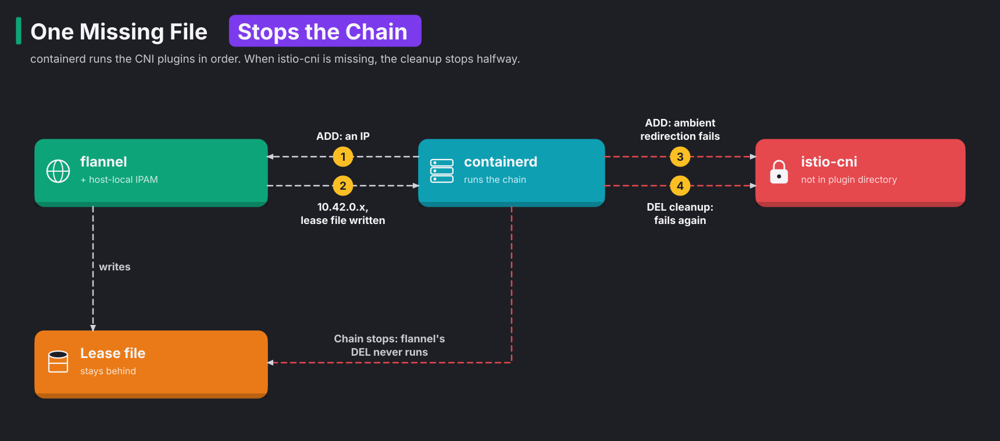

# Module 21: k3s certificates, backups and upgrades

> New to a term here, like VirtualService or waypoint? The [glossary](glossary.md) explains every Istio resource and term in this course.

**Before this module:** module 0, and module 20 helps. This module covers plain Kubernetes operations, except for one surprise in step 4.

**You need:** the lab running (`./scripts/start.sh` starts or repairs it), `openssl`, and internet access for the newer k3s image. Steps 2 and 4 restart k3s, and step 4 breaks the mesh on purpose until step 5 repairs it. Finish other modules' exercises first.

Three jobs keep a cluster alive for years instead of months:

- Renew certificates before they expire.
- Take backups, and restore one at least once to prove it works.
- Upgrade Kubernetes on time.

This module does all three on the lab's k3s. The upgrade is a patch release, the kind most people treat as harmless. Yet it takes the whole mesh down. Finding out why is the point of the exercise.

**The upgrade is one-way.** After step 4, the lab runs k3s v1.31.14. The rest of the course works on it. To return to the course version, rebuild: `./scripts/teardown.sh --yes && ./scripts/provision.sh`.

Time: about 60 minutes.

## Concept: where k3s keeps its state

k3s packs a whole Kubernetes control plane into one binary. On the lab's node, k3s keeps its state in these places:

| What | Where | Notes |
|---|---|---|
| Cluster state, every object | `/var/lib/rancher/k3s/server/db/state.db` | SQLite, the default for a single server |
| The server token | `/var/lib/rancher/k3s/server/token` | encrypts parts of the datastore. A backup is useless without it |
| Certificates and keys | `/var/lib/rancher/k3s/server/tls/` | client and server certificates, and the CAs that signed them |
| containerd's config | `/var/lib/rancher/k3s/agent/etc/containerd/config.toml` | k3s writes it on every start. You'll read it in step 4 |

The backup method depends on the datastore:

- With several servers, k3s switches to embedded etcd (`--cluster-init`). Then `k3s etcd-snapshot save` takes the backups.
- With SQLite, a backup is a copy of the `db` folder and the token, taken while k3s is stopped.

## Concept: certificates in k3s

| Certificate | Lifetime | Renewal |
|---|---|---|
| CAs (client CA, server CA) | 10 years | not automatic |
| Client and server certificates | 1 year | automatic: k3s renews any certificate within 120 days of expiry every time it starts |

So a k3s node that restarts at least once every eight months never sees an expired certificate. In other words, any restart in the last 120 days of a certificate's year renews it. A node that runs for a year without a restart does see one. Then kubelets lose contact with the API server, and `kubectl` gets `x509: certificate has expired`. As an early warning, k3s raises a Kubernetes Warning event, `CertificateExpirationWarning`, within 120 days of expiry.

`k3s certificate rotate` is a different tool. It replaces the keys, which you need after a key leaks. Step 2 shows what it changes and what it leaves alone.

## The bigger picture: why clusters fall behind

At the time of the test run for this module, the newest stable k3s was v1.37.2, while the lab ran v1.31. Each Kubernetes minor version gets patches for about 14 months. You may only move one minor version at a time. So a cluster six versions behind needs six upgrades in a row, each with its own deprecations.

Clusters fall behind through a loop:

1. Every upgrade carries risk, so teams postpone it.
2. The next upgrade gets bigger and riskier.
3. Teams postpone that one too, and the loop starts again.

The way out is the same as for Istio in module 14. Upgrade often, in small steps, with automation and a rehearsed rollback. In k3s and RKE2, the automation is the **system-upgrade-controller**. It works like this:

1. You write a `Plan` with a target version.
2. The controller cordons one node.
3. The controller upgrades that node, then moves on to the next one.

The upgrade in this module shows the other half of the job: knowing what depends on what. The lab's Istio 1.24 supports Kubernetes 1.28 to 1.31. So the lab may take any 1.31 patch, but not 1.32 until Istio moves first.

## Concept: how a pod gets its network, and how one missing file stops it

Step 4 breaks pod networking, so you'll need this picture first. A new pod has no network until a chain of small programs sets it up. These programs are the Container Network Interface (CNI) plugins. containerd runs the chain every time it creates a pod sandbox, the small container that holds the pod's network:

1. containerd reads the CNI config.
2. containerd runs each plugin in the config as a separate program, in order, from its plugin directory.
3. On the lab's node, flannel runs first and gives the pod an IP address.
4. istio-cni runs last and sets up ambient redirection.

Removing a sandbox runs the same chain backwards, with the command `DEL` instead of `ADD`. The diagram shows what happens when the istio-cni plugin file is missing:



Follow the diagram from top to bottom:

1. flannel's `ADD` succeeds. It hands the pod an address and writes a lease file for it.
2. istio-cni's `ADD` fails, because the plugin isn't in the directory.
3. containerd cleans up by running `DEL` backwards, and it fails again at istio-cni.
4. The chain stops there, so flannel's `DEL` never runs, and the lease stays.

That leftover lease matters. flannel's IP manager is called host-local IPAM (IP address management). It keeps one file per handed-out address, and the node's range holds 254 addresses. Think of a hotel with 254 rooms where guests check in but never check out: sooner or later, no rooms are left. So a missing plugin does two kinds of damage:

- No new pod starts.
- Every failed attempt keeps an address.

Pods that already run keep working, because CNI only runs when a sandbox starts or stops. In k3d, though, a k3s restart restarts the whole node container. So every pod on that node needs a new sandbox at once.

## Why this way

**Why stop k3s for a backup?** SQLite keeps recent changes in a write-ahead log (`state.db-wal`) next to the main file. If you copy the files while k3s writes to them, the log and the main file in your backup may not match. While k3s is stopped, the three files (`state.db`, `-wal`, `-shm`) form a consistent set. With etcd, `k3s etcd-snapshot save` takes a consistent snapshot while the cluster runs.

**Why does a restore rewind everything?** The datastore holds every object: Deployments, Secrets, ArgoCD's Applications, all of it. Restoring it puts the whole cluster back to the moment of the backup. Anything created afterwards disappears. That's why GitOps matters too. With this lab's config in Git, ArgoCD re-applies the desired state after a restore.

**Why does the upgrade run as a privileged Job?** The Job replaces the k3s binary on the node itself and restarts k3s. To do that, it mounts the node's file system and runs with host namespaces, so it needs those rights. In k3d, k3s is the container's main process. So when k3s restarts, Docker restarts the whole node container.

## Do it

### 1. Check the certificates

```bash
docker exec k3d-k8s-lab-server-0 k3s certificate check --output table
kubectl config view --raw -o jsonpath='{.users[?(@.name=="admin@k3d-k8s-lab")].user.client-certificate-data}' | base64 -d | openssl x509 -noout -subject -enddate
kubectl get events -A --field-selector reason=CertificateExpirationWarning
```

**What you should see.** You see a table of every certificate file with its subject and expiry date. Client and server certificates expire a year from the day the lab was built. The CAs expire in ten years. The columns differ between k3s versions. After the upgrade in step 4, the same command adds `RESIDUAL TIME` and `STATUS`. Your kubeconfig's admin certificate shows the same one-year date. You see no warning events yet.

### 2. Rotate them

```bash
key() { docker exec k3d-k8s-lab-server-0 cat /var/lib/rancher/k3s/server/tls/$1 | openssl x509 -noout -pubkey | openssl sha256; }
key client-admin.crt; key client-ca.crt
docker exec k3d-k8s-lab-server-0 k3s certificate rotate
docker restart k3d-k8s-lab-server-0
./scripts/start.sh
key client-admin.crt; key client-ca.crt
docker exec k3d-k8s-lab-server-0 k3s certificate check --output table | grep "system:admin"
kubectl get nodes
```

**What you should see.** Three things stand out:

- The admin certificate has a new key.
- The client CA keeps its old key.
- `kubectl` still works, because a trusted CA still signs your kubeconfig's certificate.

Look at the expiry date, though. In the test run, it didn't move. Rotation and renewal are different jobs. Rotation replaces keys. Renewal extends dates, and it happens at startup within 120 days of expiry. The old certificates sit in a backup folder, `/var/lib/rancher/k3s/server/tls-<timestamp>`.

### 3. Back up and restore the datastore

```bash
B=/tmp/k3s-backup; rm -rf $B; mkdir -p $B
kubectl -n default create configmap before-backup --from-literal=note="made before the backup"
k3d cluster stop k8s-lab
docker cp k3d-k8s-lab-server-0:/var/lib/rancher/k3s/server/db $B/
docker cp k3d-k8s-lab-server-0:/var/lib/rancher/k3s/server/token $B/token
ls -la $B/db
k3d cluster start k8s-lab && ./scripts/start.sh
```

Now change the cluster, as if something went wrong:

```bash
kubectl -n default create configmap after-backup --from-literal=note="made after the backup"
kubectl -n default delete configmap before-backup
```

Then restore the backup:

```bash
k3d cluster stop k8s-lab
docker cp $B/db/. k3d-k8s-lab-server-0:/var/lib/rancher/k3s/server/db/
docker cp $B/token k3d-k8s-lab-server-0:/var/lib/rancher/k3s/server/token
k3d cluster start k8s-lab && ./scripts/start.sh
kubectl -n default get configmaps | grep backup
```

**What you should see.** The backup folder holds `state.db` (about 70 MB in the test run) plus `state.db-wal` and `state.db-shm`. After the restore, `before-backup` is back and `after-backup` is gone. The cluster returned to the moment of the backup. Clean up with `kubectl -n default delete configmap before-backup`.

### 4. Upgrade k3s, and watch the mesh break

Keep the shop in view in a second terminal:

```bash
while true; do echo "$(date +%T) $(curl -s -o /dev/null -m 3 -w '%{http_code}' http://localhost:8080/api/orders)"; sleep 1; done
```

Install the system-upgrade-controller and give it a plan:

```bash
SUC=https://github.com/rancher/system-upgrade-controller/releases/download/v0.20.2
kubectl apply -f $SUC/crd.yaml -f $SUC/system-upgrade-controller.yaml
kubectl -n system-upgrade rollout status deploy/system-upgrade-controller
kubectl apply -f platform-engineering/manifests/21-upgrade-plan.yaml
kubectl -n system-upgrade get plans,jobs
kubectl get nodes -w            # watch the version change, then Ctrl-C
```

**What you should see.** A Job named `apply-server-plan-on-...` runs. Within about 20 seconds, the node reports `v1.31.14+k3s1`, and the plan shows `Complete`. The upgrade looks like a success.

Now look at the second terminal and at the pods:

```bash
kubectl get pods -A | grep -vE "Running|Completed"
docker logs --since 3m k3d-k8s-lab-server-0 2>&1 | grep -o 'failed (add): [^"]*' | sort | uniq -c
```

**What you should see.** The shop stops answering. Pods hang in `ContainerCreating` and `Terminating`. The node's log repeats two errors:

- `failed to find plugin "istio-cni"`
- a little later, `no IP addresses available in range set: 10.42.0.1-10.42.0.254`

### 5. Find out why, and repair it

Compare where containerd looks for CNI plugins with where Istio put its plugin:

```bash
docker exec k3d-k8s-lab-server-0 grep -n "bin_dir" /var/lib/rancher/k3s/agent/etc/containerd/config.toml
helm -n istio-system get values istio-cni -o json | grep -o '"cniBinDir":"[^"]*"'
```

**What you should see.** containerd now searches `/var/lib/rancher/k3s/data/cni`. The config writes this as `bin_dirs = [...]`, which is containerd 2's format. Istio's plugin still sits in `/bin`, where k3s 1.31.5 used to look. In other words, the patch release moved the plugin directory and left Istio's plugin behind. The damage then follows the chain from the concept section:

1. Every pod start and stop calls a plugin that isn't there.
2. Each half-finished attempt keeps an IP address.
3. Sooner or later, flannel runs out of all 254 addresses.

Repair it in three steps:

```bash
./scripts/provision.sh            # re-reads the plugin directory and moves istio-cni there
./platform-engineering/fix-ip-leases.sh         # frees the IPs that no pod holds
./scripts/start.sh                # recreates mesh pods that came up during the outage
```

**What you should see.** Each script shows its effect:

1. `provision.sh` reports `containerd searches /var/lib/rancher/k3s/data/cni for CNI plugins`.
2. The lease script frees the leaked addresses.
3. After `start.sh`, the shop answers `200` again.

In the test run, the lease count dropped to 35: exactly the addresses that running pods held.

## Investigate

1. Your production cluster upgrades with the same Plan. Which three things would have caught this outage before it reached users?
2. Why did the system-upgrade-controller report the upgrade as `Complete`, while every new pod failed?
3. A colleague wants to restore last night's datastore backup to undo one deleted Deployment. What's wrong with that plan?
4. Your nodes run for 14 months without a restart. What happens, and how do you find out in advance?

<details>
<summary>Answers</summary>

1. Three things would have caught it:
   - A staging cluster that takes every upgrade a week earlier, with the same Istio version.
   - The release notes of every patch in between. They list component updates such as containerd.
   - A check after each node's upgrade that a new pod on that node starts and serves traffic, before the plan moves to the next node. With `concurrency: 1`, a failed check stops the damage at one node.
2. The plan's job was to replace the k3s binary and get the node back to `Ready`. Both happened. Nothing in the plan checks the workloads. "Upgrade done" and "cluster healthy" are separate checks, and only the second one matters to users.
3. A datastore restore rewinds the whole cluster. Every change since the backup disappears, not just the deleted Deployment. To bring back one object, re-apply it from Git, which ArgoCD would do here on its own. Or restore the object with a tool that backs up individual objects, such as Velero.
4. The client and server certificates expire after 12 months, because k3s only renews them at startup. Kubelets lose contact with the API server, and `kubectl` fails with `x509: certificate has expired`. To find out in advance, use one of these:
   - Watch for `CertificateExpirationWarning` events.
   - Alert on certificate expiry from Prometheus.
   - Restart (or upgrade) each node more often than every eight months.

</details>

## Clean up

```bash
./platform-engineering/reset.sh
```

This removes the backup marker ConfigMaps. The k3s upgrade stays. To return to v1.31.5, rebuild the lab.
