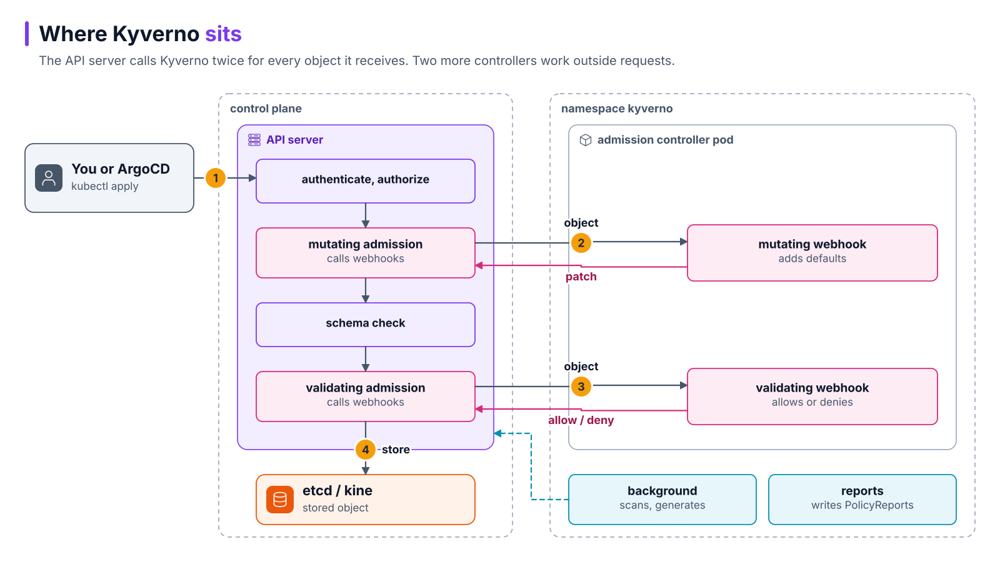

# Module 26: Kyverno, policy as code

> New to a term here, like admission webhook or PolicyException? The [glossary](glossary.md) explains every term in this course.

**Before this module:** module 0. No Istio needed: the policies only touch the module's own namespaces.

**You need:** the lab running (`./scripts/start.sh` starts or repairs it), `helm`, internet access for the Kyverno chart, and about 230 MB of free memory.

RBAC decides *who* may create a Deployment but says nothing about *what* the Deployment looks like, so a team might use an image tagged `latest`, set no memory limit, or run a container as root. In a bank, an auditor asks you to prove every day that every workload follows the rules, with every exception written down, and **Kyverno** does that inside Kubernetes through four jobs:

- It checks every object the API server receives.
- It fixes what teams forget.
- It creates the boilerplate every namespace needs.
- It reports on everything already running.

Time: about 50 minutes. Adds about 230 MB of memory while it runs.

## Concept: where Kyverno sits



One `kubectl apply` or ArgoCD sync passes Kyverno in four steps:

1. You or ArgoCD send an object to the API server.
2. The API server sends the object to Kyverno's mutating webhook, which adds defaults.
3. The API server sends the changed object to Kyverno's validating webhook, which allows or denies it.
4. The API server stores the allowed object.

An **admission webhook** is a call the API server makes to another program before it stores an object, and Kyverno registers itself as one and answers in milliseconds, much like a security check at an airport gate that every object passes before it boards.

Two more Kyverno parts, drawn with dotted lines, work outside of requests:

- The background controller scans objects that already run and creates generated objects.
- The reports controller writes the results into PolicyReports.

## Concept: four things a policy does

| Rule type | Does | In this module |
|---|---|---|
| **validate** | Allows or refuses an object. `Audit` only reports. `Enforce` refuses | memory limits (Audit), image tags (Enforce), owner label (CEL) |
| **mutate** | Changes the object on its way in | add a team label and a default memory limit |
| **generate** | Creates other objects when something appears | quota and default-deny NetworkPolicy for every tenant namespace |
| **verifyImages** | Checks image signatures | not used here, because it needs signed images |

You write policies as Kubernetes YAML patterns rather than code, so `image: "*:* & !*:latest"` means "has a tag, and the tag isn't latest".

You write a rule for Pods, but pods usually come from Deployments, Jobs and other controllers, so Kyverno's **autogen** feature copies the rule to Deployments, ReplicaSets, Jobs and CronJobs too, which makes the error show up when you apply the Deployment rather than later.

## The bigger picture: policy as code

Policies used to live in wiki pages and review checklists, while policy as code puts them in Git next to everything else and lets the cluster enforce them. This gives you three things:

- the same rule for every team
- a review for every policy change, like any other change
- reports that prove the rules hold

The two big tools are:

- **Kyverno**, a CNCF project with policies written in YAML
- **OPA Gatekeeper**, with policies written in the Rego language

Kubernetes itself now has **ValidatingAdmissionPolicy**, a built-in validation feature whose rules you write in CEL, the Common Expression Language, a small language for true-or-false checks. Kyverno 1.18 adds its own CEL-based policy types next to the classic `ClusterPolicy`, and you'll write one of each.

Regulated companies care because policies change what they tell an auditor: "we asked teams to set limits" becomes "the cluster refuses workloads without limits, here's the report, and here are the three written exceptions".

## Why this way

**Why Audit before Enforce?** Switching a rule straight to Enforce breaks every team that doesn't comply yet, often without anyone noticing, as step 3 shows. So roll out a rule in four steps:

1. Run the rule in Audit mode.
2. Read the reports.
3. Fix the workloads or grant exceptions.
4. Switch the rule to Enforce.

**Why only one namespace?** A typo in a policy that matches every namespace blocks the whole cluster, including Istio and ArgoCD, so limiting the policies to `course-policy` keeps the lab safe. In production, policies match broadly but exclude system namespaces, and Kyverno already excludes its own namespaces by default.

**Why are exceptions only allowed in the `kyverno` namespace?** If teams wrote exceptions in their own namespaces, every rule would have a self-service way out. Here only the platform team may write to `kyverno`, so only the platform team grants exceptions, and each exception is a reviewed object in Git.

**Why one replica?** It's a laptop. In production the admission controller runs three replicas, because if Kyverno goes down while its webhook says `failurePolicy: Fail`, the API server refuses changes everywhere, which the install warns about.

## Do it

### 1. Install Kyverno

```console
$ helm repo add kyverno https://kyverno.github.io/kyverno/ && helm repo update kyverno
"kyverno" already exists with the same configuration, skipping
Hang tight while we grab the latest from your chart repositories...
...Successfully got an update from the "kyverno" chart repository
Update Complete. ⎈Happy Helming!⎈

$ cat platform-engineering/manifests/26-kyverno-values.yaml
# Kyverno with one replica per controller, sized for a laptop.
# Production runs the admission controller with 3 replicas: if every replica is down,
# the API server can't call the webhook, and with failurePolicy Fail it rejects changes.
admissionController:
  replicas: 1
  container:
    resources:
      requests: {cpu: 50m, memory: 128Mi}
      limits: {memory: 384Mi}
backgroundController:
  resources:
    requests: {cpu: 20m, memory: 64Mi}
    limits: {memory: 256Mi}
cleanupController:
  resources:
    requests: {cpu: 10m, memory: 48Mi}
    limits: {memory: 128Mi}
reportsController:
  resources:
    requests: {cpu: 20m, memory: 64Mi}
    limits: {memory: 256Mi}
features:
  policyExceptions:
    # Off by default since Kyverno 1.13. Exceptions live only in kyverno's own namespace,
    # so teams can't grant themselves exceptions in their namespaces.
    enabled: true
    namespace: kyverno

$ helm install kyverno kyverno/kyverno --version 3.8.2 -n kyverno --create-namespace \
  -f platform-engineering/manifests/26-kyverno-values.yaml --wait
NAME: kyverno
LAST DEPLOYED: Sun Nov 15 10:52:59 2026
NAMESPACE: kyverno
STATUS: deployed
REVISION: 1
DESCRIPTION: Install complete
NOTES:
Chart version: 3.8.2
Kyverno version: v1.18.2

Thank you for installing kyverno! Your release is named kyverno.

The following components have been installed in your cluster:
- CRDs
- Admission controller
- Reports controller
- Cleanup controller
- Background controller


⚠️  WARNING: Setting the admission controller replica count below 2 means Kyverno is not running in high availability mode.


💡 Note: There is a trade-off when deciding which approach to take regarding Namespace exclusions. Please see the documentation at https://kyverno.io/docs/installation/#security-vs-operability to understand the risks.

$ kubectl -n kyverno get pods
NAME                                             READY   STATUS    RESTARTS   AGE
kyverno-admission-controller-76c47b4c98-rntvz    1/1     Running   0          8s
kyverno-background-controller-698b5ccfb5-6nm77   1/1     Running   0          8s
kyverno-cleanup-controller-7ff4d794b-spbpj       1/1     Running   0          8s
kyverno-reports-controller-7dc77d7579-q9rrx      1/1     Running   0          8s

$ kubectl get validatingwebhookconfigurations,mutatingwebhookconfigurations | grep kyverno
validatingwebhookconfiguration.admissionregistration.k8s.io/kyverno-cel-exception-validating-webhook-cfg    1          4s
validatingwebhookconfiguration.admissionregistration.k8s.io/kyverno-cleanup-validating-webhook-cfg          1          5s
validatingwebhookconfiguration.admissionregistration.k8s.io/kyverno-exception-validating-webhook-cfg        1          4s
validatingwebhookconfiguration.admissionregistration.k8s.io/kyverno-global-context-validating-webhook-cfg   1          4s
validatingwebhookconfiguration.admissionregistration.k8s.io/kyverno-policy-validating-webhook-cfg           1          4s
validatingwebhookconfiguration.admissionregistration.k8s.io/kyverno-resource-validating-webhook-cfg         0          4s
validatingwebhookconfiguration.admissionregistration.k8s.io/kyverno-ttl-validating-webhook-cfg              1          5s
mutatingwebhookconfiguration.admissionregistration.k8s.io/kyverno-policy-mutating-webhook-cfg     1          4s
mutatingwebhookconfiguration.admissionregistration.k8s.io/kyverno-resource-mutating-webhook-cfg   0          4s
mutatingwebhookconfiguration.admissionregistration.k8s.io/kyverno-verify-mutating-webhook-cfg     1          4s

$ kubectl get crd | grep kyverno
cleanuppolicies.kyverno.io                              2026-11-15T10:53:00Z
clustercleanuppolicies.kyverno.io                       2026-11-15T10:53:00Z
clusterephemeralreports.reports.kyverno.io              2026-11-15T10:53:00Z
clusterpolicies.kyverno.io                              2026-11-15T10:53:00Z
deletingpolicies.policies.kyverno.io                    2026-11-15T10:53:00Z
ephemeralreports.reports.kyverno.io                     2026-11-15T10:53:00Z
generatingpolicies.policies.kyverno.io                  2026-11-15T10:53:00Z
globalcontextentries.kyverno.io                         2026-11-15T10:53:00Z
imagevalidatingpolicies.policies.kyverno.io             2026-11-15T10:53:00Z
mutatingpolicies.policies.kyverno.io                    2026-11-15T10:53:00Z
namespaceddeletingpolicies.policies.kyverno.io          2026-11-15T10:53:00Z
namespacedgeneratingpolicies.policies.kyverno.io        2026-11-15T10:53:00Z
namespacedimagevalidatingpolicies.policies.kyverno.io   2026-11-15T10:53:00Z
namespacedmutatingpolicies.policies.kyverno.io          2026-11-15T10:53:00Z
namespacedvalidatingpolicies.policies.kyverno.io        2026-11-15T10:53:00Z
policies.kyverno.io                                     2026-11-15T10:53:00Z
policyexceptions.kyverno.io                             2026-11-15T10:53:00Z
policyexceptions.policies.kyverno.io                    2026-11-15T10:53:00Z
updaterequests.kyverno.io                               2026-11-15T10:53:00Z
validatingpolicies.policies.kyverno.io                  2026-11-15T10:53:00Z
```

**What you should see.** In the test runs the install took 9 to 21 seconds. An earlier run printed two warnings, and the run above printed only the first:

- One replica means no high availability.
- PolicyExceptions start switched off. The values file turns them on.

Four controllers run: admission, background, cleanup and reports. Kyverno created ten webhook configurations by itself, plus 20 CRDs, including the classic `clusterpolicies.kyverno.io` and the newer CEL types such as `validatingpolicies.policies.kyverno.io`.

### Concept: two paths to a verdict

Kyverno checks objects at two different moments, and each answers a different question:

| | Admission | Background scan |
|---|---|---|
| When | each create, update or delete request, before the API server stores the object | when a policy appears or changes, and again on a regular interval |
| What it sees | the one object in the request | every matching object already stored |
| With `Enforce` | refuses the request | refuses nothing, only reports |
| With `Audit` | allows it, records the result | reports |

Both paths end in the same place, because the reports controller collects the results into one PolicyReport per namespace. In step 2 the `legacy` app already runs before the policy exists, so its failures come from the background scan that starts when you apply the policy, which is why you wait before reading the reports.

Two consequences surprise people. First, `Enforce` never stops pods that already run, because it acts only on the next request.

Second, admission sees every object separately, including the objects that controllers create, so one Deployment turns into three separate requests through the webhooks:

1. You create the Deployment.
2. The Deployment controller creates a ReplicaSet.
3. The ReplicaSet controller creates the pods.

So when Kyverno refuses a pod, the refusal goes to the ReplicaSet controller rather than to you, and it shows up only as an event on the ReplicaSet, as step 3 shows.

### 2. Audit an app that breaks the rules

```console
$ kubectl apply -f platform-engineering/manifests/26-namespace.yaml -f platform-engineering/manifests/26-legacy-app.yaml
namespace/course-policy created
deployment.apps/legacy created

$ cat platform-engineering/manifests/26-require-limits.yaml
# Every container in course-policy needs a memory limit. Audit first: Kyverno reports
# violations in PolicyReports but blocks nothing. Switch failureAction to Enforce later.
apiVersion: kyverno.io/v1
kind: ClusterPolicy
metadata:
  name: require-memory-limits
  annotations:
    policies.kyverno.io/title: Require memory limits
    policies.kyverno.io/description: A container without a memory limit can take a whole node's memory.
spec:
  background: true
  rules:
    - name: memory-limit
      match:
        any:
          - resources:
              kinds: [Pod]
              namespaces: [course-policy]
      validate:
        failureAction: Audit
        message: "Every container needs resources.limits.memory."
        pattern:
          spec:
            containers:
              - resources:
                  limits:
                    memory: "?*"

$ kubectl apply -f platform-engineering/manifests/26-require-limits.yaml
clusterpolicy.kyverno.io/require-memory-limits created

$ kubectl get clusterpolicy
NAME                    ADMISSION   BACKGROUND   READY   AGE   MESSAGE
require-memory-limits   true        true         True    8s    Ready

$ kubectl get clusterpolicy require-memory-limits -o jsonpath='{.status.autogen.rules[*].name}{"\n"}'
autogen-memory-limit autogen-cronjob-memory-limit
```

Wait half a minute, then read the reports:

```console
$ kubectl -n course-policy get policyreport -o 'custom-columns=KIND:.scope.kind,NAME:.scope.name,PASS:.summary.pass,FAIL:.summary.fail'
KIND         NAME                      PASS   FAIL
Deployment   legacy                    0      1
Pod          legacy-85ddd5db97-dg6lp   0      1
ReplicaSet   legacy-85ddd5db97         0      1

$ kubectl -n course-policy get policyreport -o jsonpath='{range .items[*].results[?(@.result=="fail")]}{.policy}: {.message}{"\n"}{end}' | sort -u
require-memory-limits: validation error: Every container needs resources.limits.memory. rule autogen-memory-limit failed at path /spec/template/spec/containers/0/resources/limits/
require-memory-limits: validation error: Every container needs resources.limits.memory. rule memory-limit failed at path /spec/containers/0/resources/limits/
```

**What you should see.** The policy shows `READY True`, and autogen added `autogen-memory-limit` and `autogen-cronjob-memory-limit` next to the rule you wrote. The `legacy` app keeps running, because Audit blocks nothing, while the reports list the Deployment, its ReplicaSet and its Pod, each with one failure: `Every container needs resources.limits.memory.` That's the list you'd hand to an auditor, or to the teams.

### 3. Enforce, and see what breaks

```console
$ cat platform-engineering/manifests/26-disallow-latest.yaml
# Enforce: images need a real tag. "latest" changes under you, so two pods of the same
# Deployment may run different code, and a rollback rolls back to nothing in particular.
apiVersion: kyverno.io/v1
kind: ClusterPolicy
metadata:
  name: disallow-latest-tag
spec:
  background: true
  rules:
    - name: require-image-tag
      match:
        any:
          - resources:
              kinds: [Pod]
              namespaces: [course-policy]
      validate:
        failureAction: Enforce
        message: "Use a specific image tag, not latest or none."
        pattern:
          spec:
            containers:
              - image: "*:* & !*:latest"

$ kubectl apply -f platform-engineering/manifests/26-disallow-latest.yaml
clusterpolicy.kyverno.io/disallow-latest-tag created

$ kubectl -n course-policy run t1 --image=nginx:latest
Error from server: admission webhook "validate.kyverno.svc-fail" denied the request:

resource Pod/course-policy/t1 was blocked due to the following policies

disallow-latest-tag:
  require-image-tag: 'validation error: Use a specific image tag, not latest or none.
    rule require-image-tag failed at path /spec/containers/0/image/'

$ kubectl -n course-policy run t2 --image=nginx
Error from server: admission webhook "validate.kyverno.svc-fail" denied the request:

resource Pod/course-policy/t2 was blocked due to the following policies

disallow-latest-tag:
  require-image-tag: 'validation error: Use a specific image tag, not latest or none.
    rule require-image-tag failed at path /spec/containers/0/image/'

$ kubectl -n course-policy run t3 --image=nginx:1.27-alpine
pod/t3 created
```

**What you should see.** `t1` and `t2` get refused with `Use a specific image tag, not latest or none.`, while `t3` gets created. Now the legacy app, which uses `nginx:latest`:

```console
$ kubectl -n course-policy rollout restart deploy/legacy
deployment.apps/legacy restarted

$ kubectl -n course-policy get deploy,rs,pods
NAME                     READY   UP-TO-DATE   AVAILABLE   AGE
deployment.apps/legacy   1/1     0            1           73s

NAME                                DESIRED   CURRENT   READY   AGE
replicaset.apps/legacy-6cdcfd69ff   1         0         0       9s
replicaset.apps/legacy-85ddd5db97   1         1         1       73s

NAME                          READY   STATUS    RESTARTS   AGE
pod/legacy-85ddd5db97-dg6lp   1/1     Running   0          73s
pod/t3                        1/1     Running   0          9s

$ kubectl -n course-policy get events --field-selector reason=FailedCreate
LAST SEEN   TYPE      REASON         OBJECT                         MESSAGE
9s          Warning   FailedCreate   replicaset/legacy-6cdcfd69ff   Error creating: admission webhook "validate.kyverno.svc-fail" denied the request: ...
9s          Warning   FailedCreate   replicaset/legacy-6cdcfd69ff   Error creating: admission webhook "validate.kyverno.svc-fail" denied the request: ...
8s          Warning   FailedCreate   replicaset/legacy-6cdcfd69ff   Error creating: admission webhook "validate.kyverno.svc-fail" denied the request: ...
8s          Warning   FailedCreate   replicaset/legacy-6cdcfd69ff   Error creating: admission webhook "validate.kyverno.svc-fail" denied the request: ...
8s          Warning   FailedCreate   replicaset/legacy-6cdcfd69ff   Error creating: admission webhook "validate.kyverno.svc-fail" denied the request: ...
8s          Warning   FailedCreate   replicaset/legacy-6cdcfd69ff   Error creating: admission webhook "validate.kyverno.svc-fail" denied the request: ...
8s          Warning   FailedCreate   replicaset/legacy-6cdcfd69ff   Error creating: admission webhook "validate.kyverno.svc-fail" denied the request: ...
8s          Warning   FailedCreate   replicaset/legacy-6cdcfd69ff   Error creating: admission webhook "validate.kyverno.svc-fail" denied the request: ...
7s          Warning   FailedCreate   replicaset/legacy-6cdcfd69ff   Error creating: admission webhook "validate.kyverno.svc-fail" denied the request: ...
3s          Warning   FailedCreate   replicaset/legacy-6cdcfd69ff   (combined from similar events): Error creating: admission webhook "validate.kyverno.svc-fail" denied the request: ...
```

**What you should see.** `kubectl` says `deployment.apps/legacy restarted`, and nothing looks wrong, but three things show that the rollout hangs:

- The Deployment reads `UP-TO-DATE 0`.
- A new ReplicaSet sits at `CURRENT 0`.
- The events say `Error creating: admission webhook "validate.kyverno.svc-fail" denied the request`.

Three things happened in order:

1. Kyverno let the Deployment update through, because by default it allows updates to objects that already broke a rule, through the setting `allowExistingViolations`.
2. The Deployment controller created a new ReplicaSet.
3. Kyverno refused the new ReplicaSet's pod.

The rollout hangs while the old pod keeps serving, which is the classic way a new policy breaks a team's next deploy without anyone noticing, and the reason to audit first.

### 4. Grant a written exception

```console
$ cat platform-engineering/manifests/26-exception.yaml
# A documented exception: the legacy app may keep its latest tag for now.
# It lives in the kyverno namespace, where only the platform team may create exceptions.
apiVersion: kyverno.io/v2
kind: PolicyException
metadata:
  name: legacy-may-use-latest
  namespace: kyverno
spec:
  exceptions:
    - policyName: disallow-latest-tag
      ruleNames: [require-image-tag, autogen-require-image-tag]
  match:
    any:
      - resources:
          kinds: [Pod, Deployment, ReplicaSet]
          namespaces: [course-policy]
          names: ["legacy*"]

$ kubectl apply -f platform-engineering/manifests/26-exception.yaml
policyexception.kyverno.io/legacy-may-use-latest created

$ kubectl -n course-policy rollout status deploy/legacy
deployment "legacy" successfully rolled out

$ kubectl -n course-policy run other --image=nginx:latest
Error from server: admission webhook "validate.kyverno.svc-fail" denied the request:

resource Pod/course-policy/other was blocked due to the following policies

disallow-latest-tag:
  require-image-tag: 'validation error: Use a specific image tag, not latest or none.
    rule require-image-tag failed at path /spec/containers/0/image/'
```

**What you should see.** The stuck rollout finishes within seconds of the exception, while `other` still gets refused, because the exception names only the policy, the rules and the `legacy*` objects. In the reports, the image-tag check for `legacy` now shows as **skip** rather than pass, which keeps the exception visible.

Now try the shortcut a team might try, putting the same exception in `course-policy` for `other*`:

```console
$ sed 's/namespace: kyverno/namespace: course-policy/; s/name: legacy-may-use-latest/name: self-service/; s/"legacy\*"/"other*"/' \
  platform-engineering/manifests/26-exception.yaml | kubectl apply -f -
Warning: PolicyException resource namespace must match the defined namespace.
policyexception.kyverno.io/self-service created

$ kubectl -n course-policy run other --image=nginx:latest
Error from server: admission webhook "validate.kyverno.svc-fail" denied the request:

resource Pod/course-policy/other was blocked due to the following policies

disallow-latest-tag:
  require-image-tag: 'validation error: Use a specific image tag, not latest or none.
    rule require-image-tag failed at path /spec/containers/0/image/'

$ kubectl -n course-policy delete policyexception self-service
policyexception.kyverno.io "self-service" deleted
```

**What you should see.** A warning, `PolicyException resource namespace must match the defined namespace`. The object still gets created, but Kyverno ignores it, so `other` stays refused.

### 5. Fill in what teams forget

```console
$ cat platform-engineering/manifests/26-add-defaults.yaml
# Mutate: fill in what teams forget. The +( ) anchor means "add only if missing".
apiVersion: kyverno.io/v1
kind: ClusterPolicy
metadata:
  name: add-defaults
spec:
  rules:
    - name: team-label-and-limits
      match:
        any:
          - resources:
              kinds: [Pod]
              namespaces: [course-policy]
      mutate:
        patchStrategicMerge:
          metadata:
            labels:
              +(team): unassigned
          spec:
            containers:
              - (name): "*"
                resources:
                  limits:
                    +(memory): 128Mi

$ kubectl apply -f platform-engineering/manifests/26-add-defaults.yaml
clusterpolicy.kyverno.io/add-defaults created

$ kubectl -n course-policy run plain --image=nginx:1.27-alpine
pod/plain created

$ kubectl -n course-policy get pod plain -o jsonpath='{.metadata.labels}{"\n"}{.spec.containers[0].resources.limits}{"\n"}'
{"run":"plain","team":"unassigned"}
{"memory":"128Mi"}

$ kubectl -n course-policy run owned --image=nginx:1.27-alpine --labels=team=payments
pod/owned created

$ kubectl -n course-policy get pod owned -o jsonpath='{.metadata.labels}{"\n"}'
{"team":"payments"}
```

**What you should see.** `plain` got `"team":"unassigned"` and a memory limit of `128Mi` it never asked for, while `owned` keeps `"team":"payments"`, because the `+( )` anchor adds a value only when it's missing. Mutation runs before validation, so `plain` also passes the memory-limit rule from step 2.

### 6. Generate the boilerplate for every tenant

```console
$ cat platform-engineering/manifests/26-generate-tenant.yaml
# Generate: every namespace labelled tenant=true gets a quota and a default-deny
# NetworkPolicy the moment it's created. synchronize keeps them in place: delete one,
# and Kyverno puts it back.
apiVersion: kyverno.io/v1
kind: ClusterPolicy
metadata:
  name: tenant-baseline
spec:
  rules:
    - name: quota
      match:
        any:
          - resources:
              kinds: [Namespace]
              selector:
                matchLabels: {course-policy/tenant: "true"}
      generate:
        apiVersion: v1
        kind: ResourceQuota
        name: tenant-quota
        namespace: "{{ request.object.metadata.name }}"
        synchronize: true
        data:
          spec:
            hard:
              pods: "10"
              limits.memory: 2Gi
    - name: default-deny
      match:
        any:
          - resources:
              kinds: [Namespace]
              selector:
                matchLabels: {course-policy/tenant: "true"}
      generate:
        apiVersion: networking.k8s.io/v1
        kind: NetworkPolicy
        name: default-deny-ingress
        namespace: "{{ request.object.metadata.name }}"
        synchronize: true
        data:
          spec:
            podSelector: {}
            policyTypes: [Ingress]

$ kubectl apply -f platform-engineering/manifests/26-generate-tenant.yaml
clusterpolicy.kyverno.io/tenant-baseline created

$ kubectl create namespace course-tenant-a
namespace/course-tenant-a created

$ kubectl label namespace course-tenant-a course-policy/tenant=true
namespace/course-tenant-a labeled

$ kubectl -n course-tenant-a get resourcequota,networkpolicy
NAME                         AGE   REQUEST      LIMIT
resourcequota/tenant-quota   8s    pods: 0/10   limits.memory: 0/2Gi

NAME                                                   POD-SELECTOR   AGE
networkpolicy.networking.k8s.io/default-deny-ingress   <none>         8s

$ kubectl -n course-tenant-a get networkpolicy default-deny-ingress -o jsonpath='{.metadata.uid}{"\n"}'
5d529ffd-5fe2-4f5f-b57e-0460625bb8b7

$ kubectl -n course-tenant-a delete networkpolicy default-deny-ingress
networkpolicy.networking.k8s.io "default-deny-ingress" deleted

$ kubectl -n course-tenant-a get networkpolicy default-deny-ingress -o jsonpath='{.metadata.uid}{"\n"}'
2000d6c0-0fa3-4abe-8ab7-2ed1e9cfd871
```

**What you should see.** One second after the label, the namespace has two new objects:

- `tenant-quota`, which allows 10 pods and 2 GiB of memory limits
- `default-deny-ingress`

Delete the NetworkPolicy, and it comes back at once with a new uid, because `synchronize: true` makes Kyverno guard what it generated, and labels such as `app.kubernetes.io/managed-by: kyverno` show who owns it.

### 7. The CEL style

```console
$ cat platform-engineering/manifests/26-cel-policy.yaml
# The newer CEL style: a Kyverno ValidatingPolicy, close to Kubernetes' own
# ValidatingAdmissionPolicy. Deployments in course-policy need an owner label.
apiVersion: policies.kyverno.io/v1
kind: ValidatingPolicy
metadata:
  name: require-owner-label
spec:
  validationActions: [Deny]
  matchConstraints:
    resourceRules:
      - apiGroups: [apps]
        apiVersions: [v1]
        operations: [CREATE, UPDATE]
        resources: [deployments]
    namespaceSelector:
      matchLabels:
        kubernetes.io/metadata.name: course-policy
  validations:
    - expression: "has(object.metadata.labels) && 'owner' in object.metadata.labels"
      message: "Deployments in course-policy need an owner label."

$ kubectl apply -f platform-engineering/manifests/26-cel-policy.yaml
validatingpolicy.policies.kyverno.io/require-owner-label created

$ kubectl get validatingpolicy
NAME                  AGE   READY
require-owner-label   8s    true

$ kubectl -n course-policy create deployment no-owner --image=nginx:1.27-alpine
error: failed to create deployment: admission webhook "vpol.validate.kyverno.svc-fail" denied the request: Policy require-owner-label failed: Deployments in course-policy need an owner label.

$ kubectl -n course-policy create deployment with-owner --image=nginx:1.27-alpine --dry-run=client -o yaml \
  | kubectl label --local -f - owner=team-shop -o yaml | kubectl apply -f -
deployment.apps/with-owner created
```

**What you should see.** The webhook `vpol.validate.kyverno.svc-fail` refuses `no-owner` with `Deployments in course-policy need an owner label.`, while `with-owner` gets created. The rule is one CEL expression, `has(object.metadata.labels) && 'owner' in object.metadata.labels`, in the same language as Kubernetes' built-in ValidatingAdmissionPolicy. Compare it with the YAML pattern in step 3: patterns read like the object they check, while CEL reads like code and handles logic that patterns express only clumsily.

## Investigate

1. You switch a widely used policy from Audit to Enforce on Friday afternoon. On Monday, three teams report that their deploys "succeed" but nothing changes. What happened, and what should you have checked first?
2. Kyverno's admission controller crashes. What happens to `kubectl apply` in a namespace it covers, and why do production clusters run three replicas?
3. Why does the mutation policy run before the validation policies, and what does that mean for the memory-limit rule?
4. ArgoCD (module 22) deploys the `legacy` app from Git. After step 3, what does ArgoCD show for it, and where would you see the reason?

<details>
<summary>Answers</summary>

1. The policy refuses their pods, as in step 3: the Deployment update passes, but the new ReplicaSet fails to create pods, so the rollout hangs while the old pods keep serving. Before switching, you should have read the PolicyReports from the Audit phase, because every `fail` there becomes a broken deploy under Enforce. Fix those workloads or write exceptions first, and switch on a weekday morning.
2. With the default `failurePolicy: Fail`, the API server gets no answer from the webhook, so it refuses every request the webhook covers. That's why production runs the admission controller with three replicas and a PodDisruptionBudget, and why Kyverno excludes its own namespace and system namespaces from its webhooks, so that it always keeps the means to repair itself. Setting `failurePolicy: Ignore` keeps the cluster usable, but lets anything through while Kyverno is down.
3. The API server calls all mutating webhooks before any validating webhook, so validation always sees the final object. Step 5 adds a default memory limit, so a pod without a limit still passes `require-memory-limits`, which is often what you want, because mutation fixes the easy cases and validation catches the rest.
4. ArgoCD shows the app `Synced`, because the Deployment in the cluster matches Git, while its health shows `Progressing`, then `Degraded` once the progress deadline runs out, because no new pod ever starts. That's the same Synced-and-Degraded pair as in module 22, and the reason sits in the ReplicaSet's `FailedCreate` events and in Kyverno's PolicyReports, not in ArgoCD.

</details>

## Clean up

```console
$ ./platform-engineering/reset.sh
Removing course rules from the shop namespace
Applying the baseline Istio config from manifests/istio
Turning off the backend experiment settings
Asking ArgoCD to sync istio-config from Git
Done. Baseline: 100% of backend traffic to v1, no faults, no extra rules.
```

The reset works in this order:

1. It deletes the policies, so nothing blocks the clean-up.
2. It uninstalls Kyverno, whose chart hook removes the webhooks Kyverno created at runtime, and its CRDs.
3. It deletes the `kyverno`, `course-policy` and `course-tenant-a` namespaces.

In the test run, nothing Kyverno-related remained afterwards.
