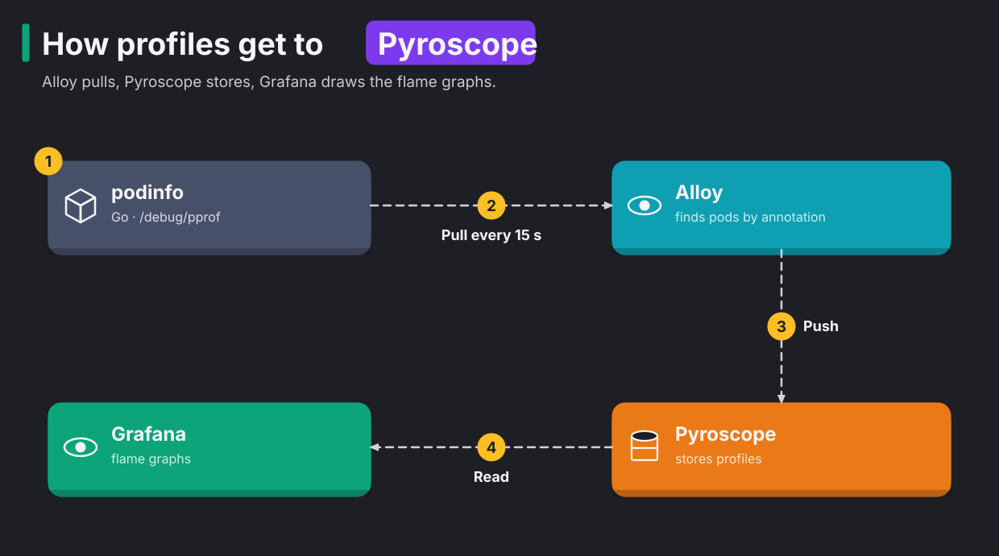
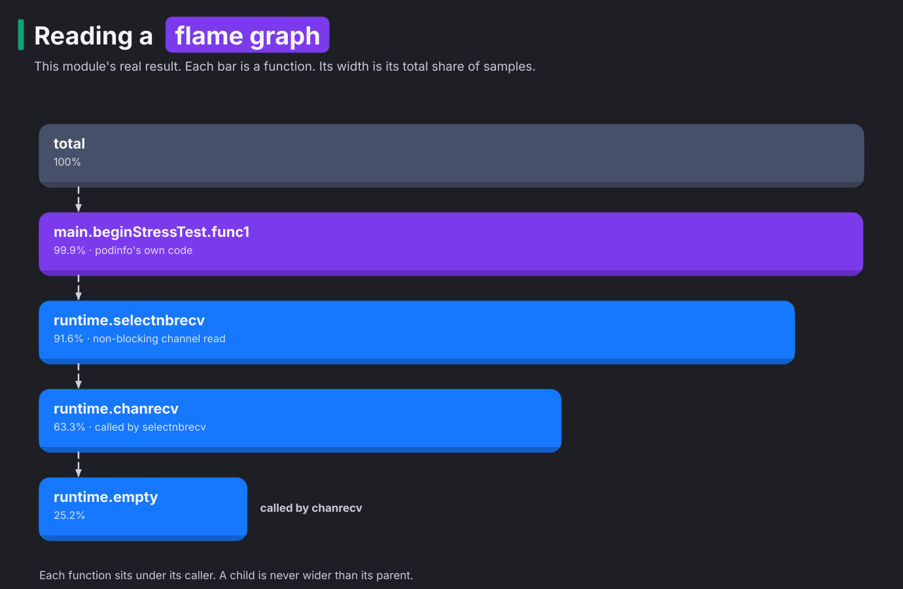

# Module 28: continuous profiling with Pyroscope

> New to a term here, like flame graph or pprof? The [glossary](glossary.md) explains every term in this course.

**Before this module:** module 0. Module 24 helps for Grafana. No Istio needed.

**You need:** the lab running (`./scripts/start.sh` starts or repairs it), `helm`, internet access for the chart, and about 350 MB of free memory.

Metrics tell you a service uses a whole CPU core. Traces tell you which request was slow. Neither tells you *which line of code* burns the CPU or fills the memory. A **profile** answers that question. A profile is a record of which functions used the CPU or the memory, and how much.

**Continuous profiling** collects profiles from every service, all the time. So you look at last Tuesday's 3 a.m. spike after the fact, instead of trying to reproduce it. People call profiles the fourth signal, next to metrics, logs and traces. In this module you install **Grafana Pyroscope**, a database for profiles. You opt a Go app into profiling with two annotations, and then you read the flame graphs.

Time: about 35 minutes. Adds about 350 MB of memory while it runs.

## Concept: how profiles get to Pyroscope



The diagram shows the path in four steps:

1. podinfo, a small Go app, offers its profiles on `/debug/pprof`.
2. Alloy pulls a profile from podinfo every 15 seconds.
3. Alloy pushes the profile to Pyroscope, which stores it.
4. Grafana reads the profiles from Pyroscope and draws flame graphs.

Go programs ship a profiler in the standard library, called **pprof**. pprof is an HTTP endpoint that answers two questions: "where did the CPU go in the last 15 seconds?" and "who allocated memory?".

The **Alloy** agent comes with the Pyroscope chart. It watches all pods. It pulls profiles from the pods that carry annotations such as `profiles.grafana.com/cpu.scrape: "true"`.

Some languages have no built-in endpoint. For them, you have two other ways:

- An SDK inside the app pushes profiles instead.
- An eBPF profiler samples every process on the node from the kernel, with no change to the app at all. eBPF is a Linux feature that runs small programs inside the kernel.

## Concept: reading a flame graph



A flame graph shows where a program spends its time. Each bar is a function. Its width is the share of samples where that function was on the call stack. Each function sits one level below the function that called it, and Grafana draws the root at the top. Two numbers matter:

| Number | Means | Use it for |
|---|---|---|
| **Self** | Samples where the CPU was *inside* this function | the hottest code in the narrow sense |
| **Total** | Samples where this function was anywhere on the stack | the code that *caused* the work |

The diagram is this module's real result. By self time, the top three were Go runtime functions, and they tell you nothing useful. By total time, one of podinfo's own functions owns 99.9%. Look for the widest bar that's *your* code.

## The bigger picture: why always on

Classic profiling is an incident tool. Someone connects a profiler to a production process, captures 30 seconds, and hopes the problem shows up in that window. Continuous profilers sample at a low rate all the time and keep the history. They typically cost 1 to 2% of CPU. Teams use them for three things:

- to cut cloud bills, by finding the function that wastes a third of the fleet's CPU
- to compare releases, by diffing two time ranges
- to explain spikes after the fact

The tools have settled on open formats. Pyroscope, now part of Grafana, stores pprof data, and OpenTelemetry added profiles as a signal. Grafana links all four signals. For example, it jumps from a slow span in Tempo to the profile of exactly that request. This works when the app sends span ids with its profiles.

## Why this way

**Why opt in with annotations?** Profiling adds work to each scrape, because the app must collect and serialize the profile. So the team that owns a service decides whether to opt in. The team adds the annotations in its own Deployment, and nobody edits central configuration. Step 5 shows the cost.

**Why podinfo with `--stress-cpu`?** A real app under real load spreads its CPU across many functions. podinfo's stress flag burns a core in one known function. So you check that the flame graph points at the right place before you trust it with an unknown problem.

**Why a CPU limit of 500m?** So you also see the limit in the numbers. podinfo wants a whole core and gets half.

## Do it

### 1. Install Pyroscope

```bash
helm repo add grafana https://grafana.github.io/helm-charts && helm repo update grafana
cat platform-engineering/manifests/28-pyroscope-values.yaml
helm install pyroscope grafana/pyroscope --version 2.4.2 -n course-profiling --create-namespace \
  -f platform-engineering/manifests/28-pyroscope-values.yaml --wait
kubectl -n course-profiling get pods
kubectl get clusterrole pyroscope-alloy
```

**What you should see.** In the test run, the install took 81 seconds. Two pods run:

- `pyroscope-0` stores and queries profiles.
- `pyroscope-alloy-0` is the agent.

 Alloy got a **ClusterRole**, because it watches pods in every namespace.

### 2. Opt an app in

```bash
cat platform-engineering/manifests/28-podinfo.yaml
kubectl apply -f platform-engineering/manifests/28-podinfo.yaml
kubectl -n course-profiling rollout status deploy/podinfo
kubectl -n course-profiling exec deploy/podinfo -- wget -qO- localhost:9898/debug/pprof/ | head -5
```

**What you should see.** You see an HTML page titled `/debug/pprof/`. This is Go's built-in profiler. It lists profiles such as `allocs`, `goroutine`, `heap` and `profile`. The Deployment's annotations tell Alloy three things:

- which profiles to fetch, here `cpu`, `memory` and `goroutine`
- which port to fetch them from, here `http`
- which service name to store them under

### Concept: how a sampling profiler counts

A profiler doesn't trace every function call, because that would slow the program down badly. Instead, it samples. Think of a photographer who takes a snapshot every 10 ms and counts what's in the pictures. Go's CPU profiler works in four steps:

1. Alloy calls `/debug/pprof/profile?seconds=N`.
2. Go turns on a timer that fires 100 times per second of CPU time, for N seconds.
3. On each tick, the runtime records the call stack of the code running at that moment.
4. Go returns all the stacks it collected, with a count for each distinct stack.

So every sample has a meaning you check by hand. One sample is 10 ms of CPU. A thread that waits on the network or sleeps uses no CPU, so it produces no CPU samples at all. Count the samples and multiply by 10 ms. The result is CPU-seconds, the number step 3 compares with `kubectl top`.

The flame graph then merges identical stacks. Two samples with the same chain `main → beginStressTest.func1 → selectnbrecv` add to the same bars. This has two consequences that often mislead people:

| Looks like | Actually means |
|---|---|
| the x-axis is time | It isn't. Left-to-right order says nothing about when code ran. Only the width counts. |
| a function missing from the graph never ran | It ran too briefly to land in a sample. At 100 samples per second, rare work stays invisible. |

Memory profiles sample too, but they count bytes instead of time. Go records the stack of roughly one allocation per 512 KiB allocated, and scales the counts up. So the shares in step 4 are estimates, which is why they move between test runs.

### 3. Find the hot code

```bash
kubectl apply -f platform-engineering/manifests/28-pyroscope-datasource.yaml
```

Wait a minute. Then follow these steps:

1. Open Grafana and go to Explore.
2. Pick the data source **Pyroscope**.
3. Pick the profile type `process_cpu - cpu` and the label `service_name = podinfo`.
4. Run the query.

**What you should see.** The flame graph has one wide bar near the top, `main.beginStressTest.func1`. In the test runs, it took 99% to 100% of total CPU. Next to the graph is a table. Switch it between **Self** and **Total**. By self time, `runtime.chanrecv`, `runtime.selectnbrecv` and `runtime.empty` lead. They lead because the stress loop spends its time inside Go's channel code. The service list also shows `course-profiling/alloy` and `course-profiling/pyroscope`, because both profile themselves.

Check it against `kubectl`:

```bash
kubectl top pod -n course-profiling -l app=podinfo
```

**What you should see.** `kubectl top` shows about `500m`, so podinfo runs at its CPU limit. In the test run, Pyroscope counted 132.5 CPU-seconds in five minutes. That's 0.44 of a core, which matches.

### 4. Who allocates memory

In the same Explore view, switch the profile type to `memory - alloc_space`.

**What you should see.** `main.beginStressTest` leads again, this time through `os.ReadFile`. The `--stress-memory` flag reads a file over and over. In the test runs, its share of all allocations was between 46% and 91%, depending on the time window. The share moves because something else allocates too. The next step shows what.

### 5. The cost of watching

Still on `alloc_space`, find `net/http.(*conn).serve` in the table and click it to focus the graph on it.

**What you should see.** In one test run, 36% of podinfo's allocations came from serving HTTP requests, yet podinfo gets almost no traffic. Most of those requests are Alloy fetching profiles every 15 seconds. In other words, the profile shows the profiler's own cost. On a busy service it's a small share, but it's never zero. That's the reason profiling is opt-in.

## Investigate

1. Your Python service has no pprof endpoint. What are your two options for profiling it in this setup, and what does each need?
2. A new release raises a service's CPU use by 30%. How would you find the responsible code with Pyroscope?
3. The flame graph's widest self-time bar is `runtime.mallocgc` (Go's memory allocator). What does that tell you, and where do you look next?
4. Why does `alloc_space` show a different picture from the pod's memory use in `kubectl top`?

<details>
<summary>Answers</summary>

1. You have two options.
   - Add the Pyroscope SDK to the app. The SDK pushes profiles to Pyroscope directly, so you need no annotations.
   - Run an eBPF profiler, Alloy's `pyroscope.ebpf` component, as a DaemonSet with privileged access to the node. It samples every process on the node from the kernel, with no code change. The cost is less detail for interpreted languages.
2. Compare two time ranges. Grafana's Pyroscope view has a diff mode. It colours functions by how much more or less CPU they used after the release. Also label profiles with the version, through an annotation or label that becomes a profile label. Then compare `version=old` with `version=new` directly.
3. The program spends its CPU allocating memory. So the real cause sits in whatever code allocates too much. Switch to `alloc_space` or `alloc_objects`. The widest bars there are the code that creates the garbage. Fewer allocations then also mean less garbage collection, so the fix helps twice.
4. `alloc_space` counts every byte ever allocated in the window. That includes memory the garbage collector freed a millisecond later. `kubectl top` shows what the container holds right now. So a function that allocates and frees a lot dominates `alloc_space` but barely moves `kubectl top`. To see what's held, use `inuse_space`.

</details>

## Clean up

```bash
./platform-engineering/reset.sh
```

The reset does three things:

1. It uninstalls Pyroscope first, because Alloy's ClusterRole outlives the namespace.
2. It deletes the `course-profiling` namespace.
3. It removes the Pyroscope data source from Grafana with a `deleteDatasources` file, as module 25 does for Tempo.
