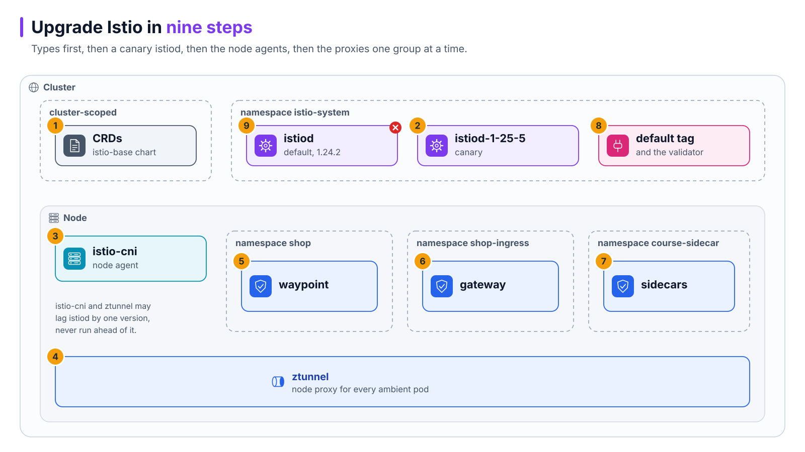
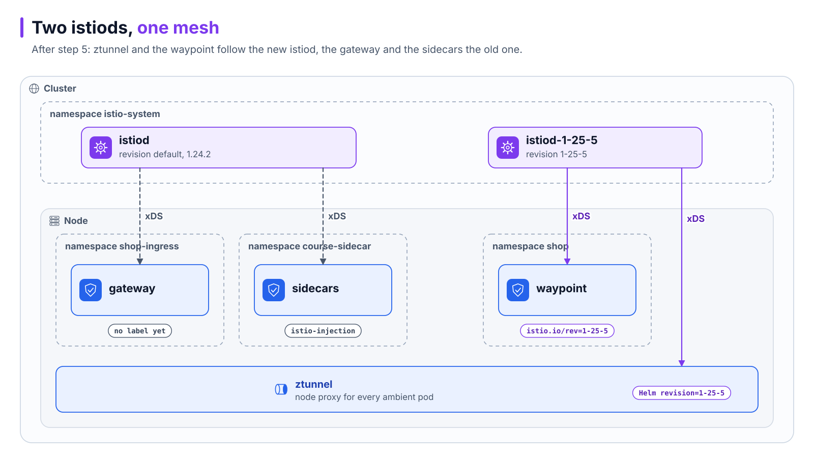

# Module 14: upgrading Istio

> New to a term here, like VirtualService or waypoint? The [glossary](../glossary.md) explains every Istio resource and term in this course.

**Before this module:** modules 1, 2 and 7.

**You need:** the lab running (`./lab.sh start` starts or repairs it), `istioctl`, `helm`, and internet access to download Istio 1.25.5. `./lab.sh ui` running in a spare terminal lets you watch the switch in Kiali.

Every Istio release gets security fixes for about six months and none after that, so a team that runs Istio upgrades it two or three times a year. In this module you upgrade the lab from Istio 1.24.2 to 1.25.5, following the steps Istio recommends for ambient mode, while a stream of requests checks that the shop keeps answering.

**This module is one-way.** Istio has no clean downgrade, so after this module your lab runs 1.25.5, and the rest of the course still works on it. To return to the course version, rebuild with `./lab.sh down --yes && ./lab.sh up`. `provision.sh` notices an upgraded mesh and leaves it alone, so it never mixes two versions.

Time: about 45 minutes.

## Concept: what has to move

You don't upgrade Istio with one command, because an Istio install consists of five pieces that each upgrade differently:

- CRDs, the Custom Resource Definitions: define the Istio resource types.
- istiod: the control plane that sends config to every proxy.
- istio-cni: the node agent that sets up traffic redirection.
- ztunnel: the node proxy for every ambient pod.
- Waypoints, gateways and sidecars: the Envoy proxies.

| Piece | What it is | How it upgrades |
|---|---|---|
| CRDs (`istio-base` chart) | The resource types: ServiceEntry, AuthorizationPolicy and so on | In place, first, because the new control plane needs the new types |
| istiod | The control plane | **Canary**: a second istiod with a revision name runs next to the old one |
| istio-cni | The node agent that sets up traffic redirection | In place only. Running pods keep working; new pods wait until the agent is back |
| ztunnel | The node proxy for every ambient pod | In place only. It restarts, and long-lived connections on the node reset |
| Waypoints, gateways, sidecars | Envoy proxies | Move one group at a time to the new istiod, by label |



The order of the steps follows one rule from Istio's version policy: istio-cni and ztunnel at version 1.x work with a control plane at 1.x or 1.x+1, but not the other way round. The node pieces may lag one version behind istiod but never run ahead of it, so the new control plane goes in before the node pieces.

## Concept: revisions and tags

During an upgrade two control planes run side by side, so each proxy needs a way to say which one it follows, and Istio solves this with revisions.

A **revision** is a name for one installed control plane, like `1-25-5`. The lab's original istiod has no name, so Istio calls it `default`. A proxy picks its control plane with the label `istio.io/rev`, and where that label lives depends on the proxy:

- For waypoints and gateways, it is the label on the Gateway resource.
- For sidecars, it is the label on the namespace. The old `istio-injection: enabled` label means "the default one".
- For ztunnel, it is the `revision` value of its Helm chart.

Relabelling hundreds of namespaces at every upgrade is slow work, and tags avoid it. A **tag** is a nickname that points at a revision, such as `default`, `stable` or `canary`, and it works like a shortcut on your desktop: you move the shortcut, and everything that uses it opens the new target. Large teams label their workloads with tags instead of revisions, so an upgrade means moving the tag, and every workload that uses it follows at once.

In this module you move single workloads with revision labels, because watching them move one by one teaches more, and at the end you point the `default` tag at the new revision.

## Concept: how a proxy finds its istiod

A label does nothing by itself, so some component has to read it and point the proxy at one istiod, and that component differs per proxy:

| Proxy | What reads the label | Result |
|---|---|---|
| Sidecar | The revision's own injection webhook, which matches namespaces labelled `istio.io/rev=1-25-5` | The injected `istio-proxy` connects to `istiod-1-25-5` |
| Waypoint, gateway | Each istiod, which only manages the Gateways whose `istio.io/rev` names its revision | That istiod writes the proxy's Deployment and points it at itself |
| ztunnel | Helm, when you install or upgrade the chart | The DaemonSet connects to `istiod-1-25-5` |

A tag uses the same trick one level up, because under the hood it is one more mutating webhook:

1. `istioctl` or the Helm chart creates a webhook named `istio-revision-tag-<tag>`.
2. The webhook matches pods labelled `istio.io/rev=<tag>`.
3. The webhook calls the revision behind the tag.

The `default` tag also matches `istio-injection: enabled`. Moving a tag rewrites that webhook, while running pods keep their proxy until they restart.

The diagram shows the lab after step 5, with some proxies already following the new istiod and the rest still following the old one:



A common misconception holds that the canary istiod receives a share of the traffic, like a canary Deployment does. No request ever passes through istiod, though, because the new control plane only sends configuration, and only to proxies that connect to it, so installing it in step 2 changes nothing for users.

## The bigger picture: why upgrades are scary, and how teams make them boring

Ask platform engineers what they dread, and "upgrading the mesh" comes up fast. The mesh sits in every request path, so a bad upgrade breaks every service at the same moment rather than one.

Teams therefore build five habits that make upgrades dull:

1. Teams move one minor version at a time. An in-place upgrade goes one minor version per step, for example 1.24 to 1.25, while a canary upgrade with revisions may jump two, for example 1.24 to 1.26, but no further. A team that falls behind faces several upgrades in a row, which makes falling behind the real risk.
2. Teams read the release notes first. Every release lists "upgrade notes", such as changed defaults and removed features, and ten minutes of reading beats an hour of debugging.
3. Teams canary the control plane, then move the least important workloads first, so if the new istiod misbehaves, only a test namespace notices.
4. Teams watch real signals. They keep a steady stream of requests running, watch dashboards with error rates, and agree on a clear rule, like "more than 1% errors, roll back".
5. Teams make rollback a label change. As long as the old istiod runs, moving a workload back takes one `kubectl label`.

The node pieces stay the hard part, because ztunnel and istio-cni have no canary, so production teams often upgrade them together with the nodes themselves:

1. The team adds a new node pool with the new version.
2. The team drains the old nodes.
3. Kubernetes moves the workloads to the new nodes.

This lab has one node, so you watch the in-place path instead.

## Why this way

**Why does the new istiod need a different name?** Two control planes run side by side for a while, and each needs its own Deployment, Service and webhooks, so the revision name keeps them apart as `istiod` and `istiod-1-25-5`.

**Why does ztunnel get `--set revision`?** The setting tells ztunnel to fetch config and certificates from `istiod-1-25-5`. Without it ztunnel keeps talking to the Service called `istiod`, which disappears with the old control plane, so ztunnel would lose its config source.

**Why do sidecars need a restart, but waypoints don't?** The sidecar sits inside your pod, added by the injector when Kubernetes created the pod, so only a new pod gets the new proxy. Istio creates waypoint and gateway Deployments itself, so when you relabel the Gateway, Istio rolls its Deployment for you.

**Why touch the base chart a second time in step 8?** Istio checks every Istio resource you create, so a typo fails at `kubectl apply` time, and the base chart owns the webhook that does this check, `istiod-default-validator`. The webhook points at the Service of the `default` revision, `istiod`, so if you delete the old control plane without moving the webhook, every `kubectl apply` of an Istio resource fails with `service "istiod" not found`. That happened during the test run for this module, and setting `defaultRevision` moves the webhook first.

## Do it

Start with a lab on the course version of Istio, where `istioctl version` shows 1.24.2 for the control plane. Keep one terminal for commands, and open a second one for the traffic.

Here is the whole upgrade at a glance, in the same order as the first diagram:

1. You upgrade the CRDs in place.
2. You install the new istiod next to the old one.
3. You upgrade istio-cni in place.
4. You upgrade ztunnel in place.
5. You move the waypoint, the gateway and the sidecars to the new istiod, one group at a time.
6. You point the `default` tag and the validator at the new istiod.
7. You remove the old istiod.

The Istio team recommends an optional extra step: run the **new** version's precheck first, by downloading `istioctl` 1.25.5 from the [Istio releases page](https://github.com/istio/istio/releases/tag/1.25.5) and running `istioctl x precheck`. The lab's automated test skips this step, because it doesn't download binaries.

### 0. Start the traffic and a sidecar workload

In the second terminal, send a request every 0.1 seconds and print anything that isn't a `200`:

```console
$ while true; do c=$(curl -s -o /dev/null -m 3 -w '%{http_code}' http://localhost:8080/api/orders); [ "$c" = 200 ] || echo "$(date +%T) $c"; sleep 0.1; done
11:14:49 000
11:14:49 000
11:14:50 000
11:14:50 000
...
11:14:53 000
11:14:53 000
```

The loop runs until you press Ctrl-C and prints only failed requests. The transcript shows what it printed during the whole upgrade: 27 lines of `000`, all within four seconds while the gateway moved in step 6.

Back in the first terminal, make sure module 7's sidecar namespace exists, so you upgrade a sidecar too:

```console
$ kubectl apply -f platform-engineering/manifests/07-sidecar-namespace.yaml -f platform-engineering/manifests/07-sidecar-apps.yaml
namespace/course-sidecar created
serviceaccount/httpbin created
serviceaccount/client created
deployment.apps/httpbin created
service/httpbin created
deployment.apps/client created

$ helm repo update istio
Hang tight while we grab the latest from your chart repositories...
...Successfully got an update from the "istio" chart repository
Update Complete. ⎈Happy Helming!⎈

$ helm -n istio-system list
NAME      	NAMESPACE   	REVISION	UPDATED                             	STATUS  	CHART         	APP VERSION
istio-base	istio-system	1       	2026-11-15 11:11:18.064196 +0000 UTC	deployed	base-1.24.2   	1.24.2
istio-cni 	istio-system	1       	2026-11-15 11:11:24.918523 +0000 UTC	deployed	cni-1.24.2    	1.24.2
istiod    	istio-system	1       	2026-11-15 11:11:18.778544 +0000 UTC	deployed	istiod-1.24.2 	1.24.2
ztunnel   	istio-system	1       	2026-11-15 11:11:32.905379 +0000 UTC	deployed	ztunnel-1.24.2	1.24.2
```

**What you should see.** Four releases, `istio-base`, `istiod`, `istio-cni` and `ztunnel`, all on 1.24.2.

### 1. Upgrade the CRDs

```console
$ helm upgrade istio-base istio/base -n istio-system --version 1.25.5 \
  -f helm/istio-base-values.yaml --force-conflicts --wait
Release "istio-base" has been upgraded. Happy Helming!
NAME: istio-base
LAST DEPLOYED: Sun Nov 15 11:13:58 2026
NAMESPACE: istio-system
STATUS: deployed
REVISION: 2
DESCRIPTION: Upgrade complete
TEST SUITE: None
...
```

### 2. Install the new control plane as a canary

```console
$ helm install istiod-1-25-5 istio/istiod -n istio-system --version 1.25.5 \
  --set revision=1-25-5 --set profile=ambient --set global.platform=k3s \
  -f helm/istiod-values.yaml --wait
NAME: istiod-1-25-5
LAST DEPLOYED: Sun Nov 15 11:13:59 2026
NAMESPACE: istio-system
STATUS: deployed
REVISION: 1
DESCRIPTION: Install complete
TEST SUITE: None
NOTES:
...

$ kubectl -n istio-system get deploy -l app=istiod -L istio.io/rev
NAME            READY   UP-TO-DATE   AVAILABLE   AGE     REV
istiod          1/1     1            1           2m46s   default
istiod-1-25-5   1/1     1            1           4s      1-25-5

$ istioctl proxy-status
NAME                                                 CLUSTER        ISTIOD                    VERSION     SUBSCRIBED TYPES
client-588f9f56c-j2p7b.course-sidecar                Kubernetes     istiod-5c5bf76f-7c8wc     1.24.2      4 (CDS,LDS,EDS,RDS)
httpbin-fb884c77d-fj6zz.course-sidecar               Kubernetes     istiod-5c5bf76f-7c8wc     1.24.2      4 (CDS,LDS,EDS,RDS)
shop-gateway-istio-858774d7cd-4j2bb.shop-ingress     Kubernetes     istiod-5c5bf76f-7c8wc     1.24.2      4 (CDS,LDS,EDS,RDS)
waypoint-b9b76876f-979z8.shop                        Kubernetes     istiod-5c5bf76f-7c8wc     1.24.2      4 (CDS,LDS,EDS,WDS)
ztunnel-sc9gw.istio-system                           Kubernetes     istiod-5c5bf76f-7c8wc     1.24.2      2 (WADS,WDS)
```

**What you should see.** Two istiod Deployments, `default` and `1-25-5`. `proxy-status` asks the default control plane, and it still lists the waypoint, the gateway, ztunnel and the sidecars, because nothing moved yet, so the second terminal stays quiet.

### 3. Upgrade istio-cni in place

```console
$ BIN=$(helm -n istio-system get values istio-cni -o json | python3 -c 'import json,sys; print(json.load(sys.stdin)["cni"]["cniBinDir"])')
$ helm upgrade istio-cni istio/cni -n istio-system --version 1.25.5 \
  -f helm/istio-cni-values.yaml --set global.platform=k3s --set cni.cniBinDir="$BIN" \
  --force-conflicts --wait
I1115 11:14:05.161558   79247 warnings.go:107] "Warning: spec.template.metadata.annotations[container.apparmor.security.beta.kubernetes.io/install-cni]: deprecated since v1.30; use the \"appArmorProfile\" field instead"
Release "istio-cni" has been upgraded. Happy Helming!
NAME: istio-cni
LAST DEPLOYED: Sun Nov 15 11:14:04 2026
NAMESPACE: istio-system
STATUS: deployed
REVISION: 2
DESCRIPTION: Upgrade complete
TEST SUITE: None
...
```

The first line reuses the plugin directory that `provision.sh` detected on your node.

### 4. Upgrade ztunnel in place

```console
$ helm upgrade ztunnel istio/ztunnel -n istio-system --version 1.25.5 \
  -f helm/ztunnel-values.yaml --set revision=1-25-5 --force-conflicts --wait
Release "ztunnel" has been upgraded. Happy Helming!
NAME: ztunnel
LAST DEPLOYED: Sun Nov 15 11:14:10 2026
NAMESPACE: istio-system
STATUS: deployed
REVISION: 2
DESCRIPTION: Upgrade complete
TEST SUITE: None
...

$ istioctl proxy-status --revision 1-25-5
NAME                           CLUSTER        ISTIOD                             VERSION     SUBSCRIBED TYPES
ztunnel-gvwj2.istio-system     Kubernetes     istiod-1-25-5-5f55c969bc-8bdcf     1.25.5      2 (WADS,WDS)
```

**What you should see.** ztunnel now reports to `istiod-1-25-5` with version 1.25.5. In the test run for this module the second terminal stayed silent, because every request opens a short new connection and the restart took well under a second, while long-lived connections, such as a database pool or a WebSocket, would have reset.

### 5. Move the waypoint

```console
$ kubectl -n shop label gateway waypoint istio.io/rev=1-25-5
gateway.gateway.networking.k8s.io/waypoint labeled

$ kubectl -n shop rollout status deploy/waypoint
deployment "waypoint" successfully rolled out

$ istioctl proxy-status --revision 1-25-5
NAME                               CLUSTER        ISTIOD                             VERSION     SUBSCRIBED TYPES
waypoint-6685b8ddd4-xlhv6.shop     Kubernetes     istiod-1-25-5-5f55c969bc-8bdcf     1.25.5      4 (CDS,LDS,EDS,WDS)
ztunnel-gvwj2.istio-system         Kubernetes     istiod-1-25-5-5f55c969bc-8bdcf     1.25.5      2 (WADS,WDS)
```

**What you should see.** The waypoint now shows up under the new revision with version 1.25.5, because Istio rolled its Deployment the moment the label changed.

### 6. Move the ingress gateway

```console
$ kubectl -n shop-ingress label gateway shop-gateway istio.io/rev=1-25-5
gateway.gateway.networking.k8s.io/shop-gateway labeled

$ kubectl -n shop-ingress rollout status deploy/shop-gateway-istio
deployment "shop-gateway-istio" successfully rolled out
```

**What you should see.** This time the second terminal prints a burst of `000` lines, two to four seconds' worth. In the test runs for this module, 17 out of 1,563 requests failed here in one run and 27 in another, and nowhere else. The gateway runs a single replica, so for a moment the load balancer had no ready pod to send new connections to, which is why production gateways run at least two replicas with a PodDisruptionBudget.

### 7. Move the sidecars

```console
$ kubectl label ns course-sidecar istio-injection- istio.io/rev=1-25-5
namespace/course-sidecar unlabeled

$ kubectl -n course-sidecar get pods -o jsonpath='{range .items[*]}{.metadata.name} {.spec.containers[1].image}{"\n"}{end}'
client-588f9f56c-j2p7b docker.io/istio/proxyv2:1.24.2-distroless
httpbin-fb884c77d-fj6zz docker.io/istio/proxyv2:1.24.2-distroless

$ kubectl -n course-sidecar rollout restart deploy
deployment.apps/client restarted
deployment.apps/httpbin restarted

$ kubectl -n course-sidecar rollout status deploy/client
deployment "client" successfully rolled out

$ kubectl -n course-sidecar get pods -o jsonpath='{range .items[*]}{.metadata.name} {.spec.containers[1].image}{"\n"}{end}'
client-588f9f56c-j2p7b docker.io/istio/proxyv2:1.24.2-distroless
client-686495b75f-t8wgr docker.io/istio/proxyv2:1.25.5-distroless
httpbin-7b4756dc58-9rgnl docker.io/istio/proxyv2:1.25.5-distroless

$ istioctl proxy-status
NAME     CLUSTER     ISTIOD     VERSION     SUBSCRIBED TYPES
```

**What you should see.** The label alone changes nothing, so the pods keep `proxyv2:1.24.2` until the restart gives them `proxyv2:1.25.5`. Give the old pods a few seconds to go, and then `istioctl proxy-status`, which asks the old control plane, lists nothing at all.

### 8. Point the defaults at the new control plane

```console
$ helm template istiod istio/istiod --version 1.25.5 -s templates/revision-tags.yaml \
  --set revisionTags="{default}" --set revision=1-25-5 -n istio-system | kubectl apply -f -
mutatingwebhookconfiguration.admissionregistration.k8s.io/istio-revision-tag-default created

$ helm upgrade istio-base istio/base -n istio-system --version 1.25.5 \
  -f helm/istio-base-values.yaml --set defaultRevision=1-25-5 --force-conflicts --wait
Release "istio-base" has been upgraded. Happy Helming!
NAME: istio-base
LAST DEPLOYED: Sun Nov 15 11:15:48 2026
NAMESPACE: istio-system
STATUS: deployed
REVISION: 3
DESCRIPTION: Upgrade complete
TEST SUITE: None
...

$ kubectl get validatingwebhookconfiguration istiod-default-validator -o jsonpath='{.webhooks[0].clientConfig.service.name}{"\n"}'
istiod-1-25-5
```

**What you should see.** `istiod-1-25-5`. The two commands do different jobs:

- The first command creates the `default` tag, so anything without a revision label now lands on 1.25.5, for example a new namespace with `istio-injection: enabled`, or a new Gateway.
- The second command moves the validating webhook.

### 9. Remove the old control plane

```console
$ helm -n istio-system delete istiod
release "istiod" uninstalled

$ kubectl -n istio-system get deploy -l app=istiod
NAME            READY   UP-TO-DATE   AVAILABLE   AGE
istiod-1-25-5   1/1     1            1           109s

$ kubectl apply --dry-run=server -f platform-engineering/manifests/12-serviceentry.yaml
serviceentry.networking.istio.io/httpbin-org created (server dry run)
destinationrule.networking.istio.io/httpbin-org-tls created (server dry run)
```

**What you should see.** Only `istiod-1-25-5` remains, and the dry run succeeds, so Istio still validates new resources. Stop the traffic loop with Ctrl-C, because the upgrade is done.

## Investigate

1. Before step 9, how would you roll the waypoint back to 1.24?
2. Why did the ingress gateway lose requests in step 6, while the waypoint, also a single replica, lost none in step 5?
3. Open Kiali's Mesh page (http://localhost:20001, menu Mesh). Which control plane does it show now, and how did Kiali find it without any change to its settings?
4. Your company runs 400 namespaces with sidecars. Step 7 asked you to relabel and restart one. What would you do instead?

<details>
<summary>Answers</summary>

1. Relabel it with `kubectl -n shop label gateway waypoint istio.io/rev=default --overwrite`, and Istio rolls the waypoint back onto the old control plane. That works only while the old istiod still runs, which is why step 9 comes last, after you've watched the new version for a while.
2. The two proxies sit behind different components, which notice a new pod at different speeds.
   - The waypoint sits behind ztunnel, which knows the moment a new waypoint pod turns ready and moves traffic over inside the mesh.
   - The ingress gateway sits behind the node's load balancer, k3s's ServiceLB, and then k3d's proxy on your Mac, which catch up a little later.

   Requests that arrived in that gap failed, while with two gateway replicas one keeps serving as the other restarts.
3. Kiali shows one control plane, `istiod-1-25-5`. Kiali finds control planes by their labels and also reads the mesh config, where `discoveryAddress` now says `istiod-1-25-5.istio-system.svc:15012`. During the switch itself, Kiali's log shows a few errors, `Failed to call Istiod endpoint /debug/syncz`, while proxies move between control planes, and they stop once the old istiod is gone. Tools around the mesh, such as Kiali, dashboards and alert rules, belong on the upgrade checklist, so check each one after the switch.
4. Use a tag. Label all 400 namespaces `istio.io/rev=stable` once, ahead of time, with `stable` pointing at the current revision, and an upgrade then takes three steps:
   1. You install the canary istiod.
   2. You move `stable` to the canary with one command.
   3. You restart workloads in waves, the least important first.

</details>

The lab installs Istio with Helm. [Module 32](32-installing-istio.md) installs it the other way, with `istioctl install`, profiles and an IstioOperator file, on a throwaway cluster.

## Clean up

Nothing to clean up, because the upgrade stays. To return to Istio 1.24.2 for the rest of the course, rebuild the lab:

```console
$ ./lab.sh down --yes && ./lab.sh up
INFO[0000] Deleting cluster 'k8s-lab'
INFO[0002] Deleting cluster network 'k3d-k8s-lab'
INFO[0002] Deleting 1 attached volumes...
INFO[0002] Removing cluster details from default kubeconfig...
INFO[0002] Removing standalone kubeconfig file (if there is one)...
INFO[0002] Successfully deleted cluster k8s-lab!
...
Cluster ports
  ingress gateway 8080, frontend 3000, backend 8000, redis 6379,
  HBONE tunnel 15008, ztunnel metrics 15020, istiod xDS 15012, istiod metrics 15014

Next steps
  ./lab.sh test                                 send 100 requests and print the version split
  kubectl apply -f manifests/scenarios/a-canary-httproute.yaml
  README.md is the guide: everyday commands, the course, and help when something breaks
```
