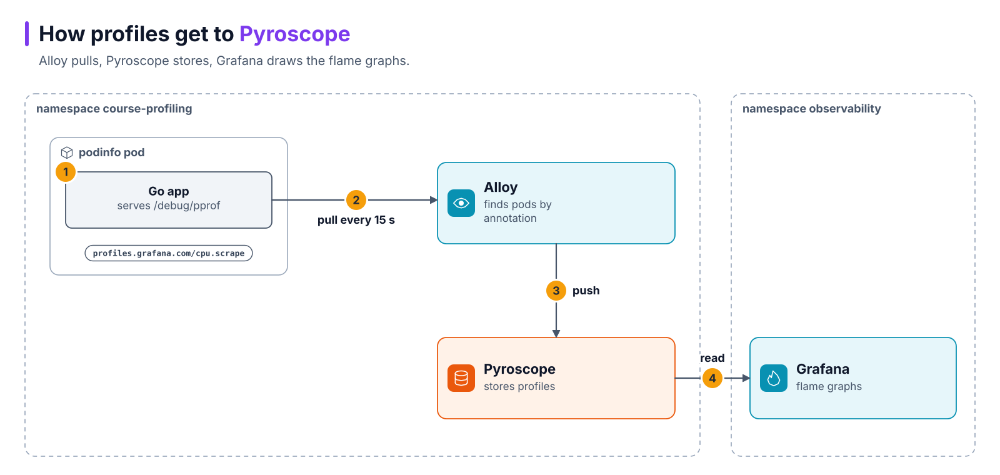
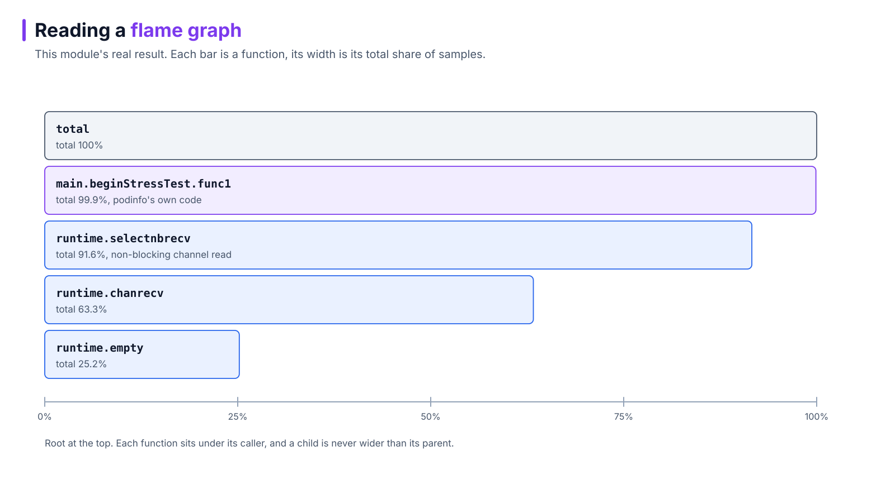

# Module 28: continuous profiling with Pyroscope

> New to a term here, like flame graph or pprof? The [glossary](../glossary.md) explains every term in this course.

**Before this module:** module 0. Module 24 helps for Grafana. No Istio needed.

**You need:** the lab running (`./lab.sh start` starts or repairs it), `helm`, internet access for the chart, and about 350 MB of free memory.

Metrics tell you a service uses a whole CPU core, and traces tell you which request was slow, but neither tells you *which line of code* burns the CPU or fills the memory. A **profile** answers that question, because it records which functions used the CPU or the memory, and how much.

**Continuous profiling** collects profiles from every service all the time, so you look at last Tuesday's 3 a.m. spike after the fact instead of trying to reproduce it, which is why people call profiles the fourth signal, next to metrics, logs and traces. In this module you install **Grafana Pyroscope**, a database for profiles, opt a Go app into profiling with two annotations, and read the flame graphs.

Time: about 35 minutes. Adds about 350 MB of memory while it runs.

## Concept: how profiles get to Pyroscope



A profile travels in four steps:

1. podinfo, a small Go app, offers its profiles on `/debug/pprof`.
2. Alloy pulls a profile from podinfo every 15 seconds.
3. Alloy pushes the profile to Pyroscope, which stores it.
4. Grafana reads the profiles from Pyroscope and draws flame graphs.

Go programs ship a profiler in the standard library, called **pprof**, an HTTP endpoint that answers two questions: "where did the CPU go in the last 15 seconds?" and "who allocated memory?". The **Alloy** agent that comes with the Pyroscope chart watches all pods and pulls profiles from the ones that carry annotations such as `profiles.grafana.com/cpu.scrape: "true"`.

Some languages have no built-in endpoint, and for them you have two other ways:

- An SDK inside the app pushes profiles instead.
- An eBPF profiler samples every process on the node from the kernel, with no change to the app at all, using eBPF, a Linux feature that runs small programs inside the kernel.

## Concept: reading a flame graph



A flame graph shows where a program spends its time. Each bar is a function whose width is the share of samples where that function was on the call stack, and each function sits one level below the function that called it, with Grafana drawing the root at the top. Two numbers matter:

| Number | Means | Use it for |
|---|---|---|
| **Self** | Samples where the CPU was *inside* this function | the hottest code in the narrow sense |
| **Total** | Samples where this function was anywhere on the stack | the code that *caused* the work |

The diagram shows this module's real result. By self time the top three were Go runtime functions, which tell you nothing useful, while by total time one of podinfo's own functions owns 99.9%, so look for the widest bar that's *your* code.

## The bigger picture: why always on

Classic profiling is an incident tool, where someone connects a profiler to a production process, captures 30 seconds, and hopes the problem shows up in that window. Continuous profilers sample at a low rate all the time and keep the history, typically for 1 to 2% of CPU, and teams use them for three things:

- to cut cloud bills, by finding the function that wastes a third of the fleet's CPU
- to compare releases, by diffing two time ranges
- to explain spikes after the fact

The tools have settled on open formats: Pyroscope, now part of Grafana, stores pprof data, and OpenTelemetry added profiles as a signal. Grafana links all four signals, so it jumps from a slow span in Tempo to the profile of exactly that request, as long as the app sends span ids with its profiles.

## Why this way

**Why opt in with annotations?** Profiling adds work to each scrape, because the app must collect and serialize the profile, so the team that owns a service decides whether to opt in by adding the annotations in its own Deployment, and nobody edits central configuration. Step 5 shows the cost.

**Why podinfo with `--stress-cpu`?** A real app under real load spreads its CPU across many functions, while podinfo's stress flag burns a core in one known function, so you check that the flame graph points at the right place before you trust it with an unknown problem.

**Why a CPU limit of 500m?** So you also see the limit in the numbers, because podinfo wants a whole core and gets half.

## Do it

### 1. Install Pyroscope

```console
$ helm repo add grafana https://grafana.github.io/helm-charts && helm repo update grafana
"grafana" already exists with the same configuration, skipping
Hang tight while we grab the latest from your chart repositories...
...Successfully got an update from the "grafana" chart repository
Update Complete. ⎈Happy Helming!⎈

$ cat platform-engineering/manifests/28-pyroscope-values.yaml
# Pyroscope in single-binary mode, plus the chart's Alloy agent, which discovers pods
# with profiles.grafana.com/* annotations and pulls their pprof profiles.
pyroscope:
  replicaCount: 1
  resources:
    requests: {cpu: 50m, memory: 128Mi}
    limits: {memory: 512Mi}
alloy:
  controller:
    replicas: 1
  alloy:
    resources:
      requests: {cpu: 20m, memory: 64Mi}
      limits: {memory: 256Mi}

$ helm install pyroscope grafana/pyroscope --version 2.4.2 -n course-profiling --create-namespace \
  -f platform-engineering/manifests/28-pyroscope-values.yaml --wait
NAME: pyroscope
LAST DEPLOYED: Sun Nov 15 11:03:11 2026
NAMESPACE: course-profiling
STATUS: deployed
REVISION: 1
DESCRIPTION: Install complete
TEST SUITE: None
NOTES:
Thanks for deploying Grafana Pyroscope.
...

$ kubectl -n course-profiling get pods
NAME                READY   STATUS    RESTARTS   AGE
pyroscope-0         1/1     Running   0          60s
pyroscope-alloy-0   2/2     Running   0          60s

$ kubectl get clusterrole pyroscope-alloy
NAME              CREATED AT
pyroscope-alloy   2026-11-15T11:03:11Z
```

**What you should see.** In the test runs the install took 61 to 81 seconds, and two pods run:

- `pyroscope-0` stores and queries profiles.
- `pyroscope-alloy-0` is the agent.

Alloy got a **ClusterRole**, because it watches pods in every namespace.

### 2. Opt an app in

```console
$ cat platform-engineering/manifests/28-podinfo.yaml
# Module 28: a Go app with pprof built in. --stress-cpu burns one CPU core on purpose,
# so the flame graph has a clear culprit. The annotations opt the pod into profiling.
apiVersion: apps/v1
kind: Deployment
metadata:
  name: podinfo
  namespace: course-profiling
spec:
  replicas: 1
  selector:
    matchLabels: {app: podinfo}
  template:
    metadata:
      labels: {app: podinfo}
      annotations:
        profiles.grafana.com/cpu.scrape: "true"
        profiles.grafana.com/cpu.port_name: http
        profiles.grafana.com/memory.scrape: "true"
        profiles.grafana.com/memory.port_name: http
        profiles.grafana.com/goroutine.scrape: "true"
        profiles.grafana.com/goroutine.port_name: http
        profiles.grafana.com/service_name: podinfo
    spec:
      containers:
        - name: podinfo
          image: ghcr.io/stefanprodan/podinfo:6.7.1
          command: ["./podinfo", "--port=9898", "--stress-cpu=1", "--stress-memory=32"]
          ports:
            - {name: http, containerPort: 9898}
          resources:
            requests: {cpu: 50m, memory: 64Mi}
            limits: {cpu: 500m, memory: 128Mi}

$ kubectl apply -f platform-engineering/manifests/28-podinfo.yaml
deployment.apps/podinfo created

$ kubectl -n course-profiling rollout status deploy/podinfo
deployment "podinfo" successfully rolled out

$ kubectl -n course-profiling exec deploy/podinfo -- wget -qO- localhost:9898/debug/pprof/ | head -5
<html>
<head>
<title>/debug/pprof/</title>
<style>
.profile-name{
```

**What you should see.** An HTML page titled `/debug/pprof/`, Go's built-in profiler, listing profiles such as `allocs`, `goroutine`, `heap` and `profile`. The Deployment's annotations tell Alloy three things:

- which profiles to fetch, here `cpu`, `memory` and `goroutine`
- which port to fetch them from, here `http`
- which service name to store them under

### Concept: how a sampling profiler counts

A profiler doesn't trace every function call, because that would slow the program down badly, so it samples instead, like a photographer who takes a snapshot every 10 ms and counts what's in the pictures. Go's CPU profiler works in four steps:

1. Alloy calls `/debug/pprof/profile?seconds=N`.
2. Go turns on a timer that fires 100 times per second of CPU time, for N seconds.
3. On each tick, the runtime records the call stack of the code running at that moment.
4. Go returns all the stacks it collected, with a count for each distinct stack.

So every sample has a meaning you check by hand: one sample is 10 ms of CPU, and a thread that waits on the network or sleeps uses no CPU, so it produces no CPU samples at all. Count the samples and multiply by 10 ms, and you get CPU-seconds, the number step 3 compares with `kubectl top`.

The flame graph then merges identical stacks, so two samples with the same chain `main → beginStressTest.func1 → selectnbrecv` add to the same bars, which has two consequences that often mislead people:

| Looks like | Actually means |
|---|---|
| the x-axis is time | It isn't. Left-to-right order says nothing about when code ran. Only the width counts. |
| a function missing from the graph never ran | It ran too briefly to land in a sample. At 100 samples per second, rare work stays invisible. |

Memory profiles sample too, but they count bytes instead of time: Go records the stack of roughly one allocation per 512 KiB allocated and scales the counts up, so the shares in step 4 are estimates, which is why they move between test runs.

### 3. Find the hot code

```console
$ kubectl apply -f platform-engineering/manifests/28-pyroscope-datasource.yaml
configmap/course-pyroscope-datasource created
```

Wait a minute, then follow these steps:

1. Open Grafana and go to Explore.
2. Pick the data source **Pyroscope**.
3. Pick the profile type `process_cpu - cpu` and the label `service_name = podinfo`.
4. Run the query.

**What you should see.** The flame graph has one wide bar near the top, `main.beginStressTest.func1`, which took 99% to 100% of total CPU in the test runs. Switch the table next to the graph between **Self** and **Total**, and by self time `runtime.chanrecv`, `runtime.selectnbrecv` and `runtime.empty` lead, because the stress loop spends its time inside Go's channel code. The service list also shows `course-profiling/alloy` and `course-profiling/pyroscope`, because both profile themselves.

Check it against `kubectl`:

```console
$ kubectl top pod -n course-profiling -l app=podinfo
NAME                       CPU(cores)   MEMORY(bytes)
podinfo-6d594b4575-flxj8   501m         43Mi
```

**What you should see.** `kubectl top` shows about `500m`, so podinfo runs at its CPU limit. In the test run Pyroscope counted 132.5 CPU-seconds in five minutes, which is 0.44 of a core and matches.

### 4. Who allocates memory

In the same Explore view, switch the profile type to `memory - alloc_space`.

**What you should see.** `main.beginStressTest` leads again, this time through `os.ReadFile`, because the `--stress-memory` flag reads a file over and over. In the test runs its share of all allocations was between 46% and 91%, depending on the time window, and the share moves because something else allocates too, which the next step shows.

### 5. The cost of watching

Still on `alloc_space`, find `net/http.(*conn).serve` in the table and click it to focus the graph on it.

**What you should see.** In one test run, 36% of podinfo's allocations came from serving HTTP requests, although podinfo gets almost no traffic, because most of those requests are Alloy fetching profiles every 15 seconds. The profile shows the profiler's own cost, a small share on a busy service but never zero, which is why profiling is opt-in.

## Investigate

1. Your Python service has no pprof endpoint. What are your two options for profiling it in this setup, and what does each need?
2. A new release raises a service's CPU use by 30%. How would you find the responsible code with Pyroscope?
3. The flame graph's widest self-time bar is `runtime.mallocgc` (Go's memory allocator). What does that tell you, and where do you look next?
4. Why does `alloc_space` show a different picture from the pod's memory use in `kubectl top`?

<details>
<summary>Answers</summary>

1. You have two options.
   - Add the Pyroscope SDK to the app, which pushes profiles to Pyroscope directly, so you need no annotations.
   - Run an eBPF profiler, Alloy's `pyroscope.ebpf` component, as a DaemonSet with privileged access to the node, which samples every process on the node from the kernel with no code change, at the cost of less detail for interpreted languages.
2. Compare two time ranges with the diff mode in Grafana's Pyroscope view, which colours functions by how much more or less CPU they used after the release. Also label profiles with the version, through an annotation or label that becomes a profile label, so you compare `version=old` with `version=new` directly.
3. The program spends its CPU allocating memory, so the real cause sits in whatever code allocates too much. Switch to `alloc_space` or `alloc_objects`, where the widest bars are the code that creates the garbage, and since fewer allocations also mean less garbage collection, the fix helps twice.
4. `alloc_space` counts every byte ever allocated in the window, including memory the garbage collector freed a millisecond later, while `kubectl top` shows what the container holds right now. So a function that allocates and frees a lot dominates `alloc_space` but barely moves `kubectl top`, and to see what's held, you use `inuse_space`.

</details>

## Clean up

```console
$ ./platform-engineering/reset.sh
Removing course rules from the shop namespace
Applying the baseline Istio config from manifests/istio
Turning off the backend experiment settings
Asking ArgoCD to sync istio-config from Git
Done. Baseline: 100% of backend traffic to v1, no faults, no extra rules.
```

The reset does three things:

1. It uninstalls Pyroscope first, because Alloy's ClusterRole outlives the namespace.
2. It deletes the `course-profiling` namespace.
3. It removes the Pyroscope data source from Grafana with a `deleteDatasources` file, as module 25 does for Tempo.
