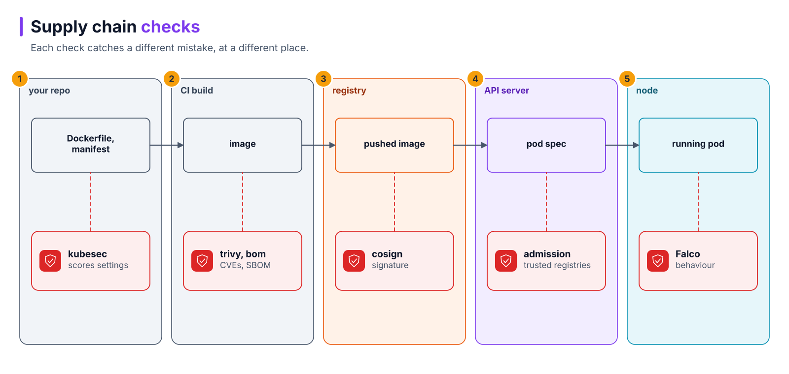
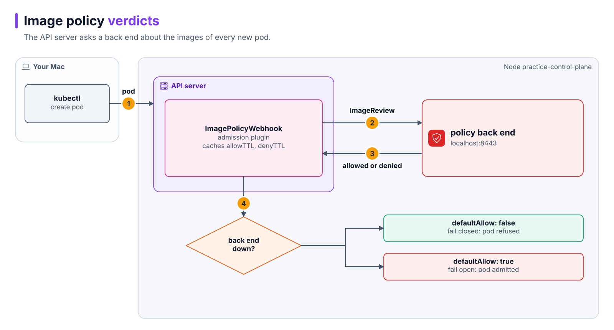

# Module 42: Supply chain security

> New to a term here, like SBOM or ImagePolicyWebhook? The [glossary](../glossary.md#the-practice-cluster-and-the-security-modules) explains every term the security modules use.

**Before this module:** the [practice cluster](../practice-cluster.md) running. The course's [module 26](../2-intermediate/26-kyverno-policy-as-code.md) explains admission webhooks, which task 5 configures by hand.

Most of the code in a container image came from someone else: a base image, system packages and language libraries. A vulnerable or poisoned piece anywhere in that chain ends up running in your cluster with your permissions, so this module checks the chain at each step, from the Dockerfile to the API server's front door. It has ten tasks and takes about 1 hour 40 minutes.

## The module in one table

Each task checks the chain at one point, from the image's contents to what the cluster agrees to run:

| Question | Tool | Task |
|---|---|---|
| Does the image carry more than the app needs? | a smaller base image, a non-root `USER` | 1 |
| Which images hold known vulnerabilities? | trivy | 2, 9 |
| What exactly is inside an image? | an SBOM from bom or trivy | 3, 10 |
| Does the manifest ask for dangerous settings? | kubesec | 4 |
| Does the cluster run only images from trusted registries? | ImagePolicyWebhook | 5, 6, 7 |
| Does the cluster run exactly the build you checked? | an image digest | 8 |

## Concept: the supply chain, from source to running pod

Your own code is often the smallest part of a container image, because the base image, system packages, language libraries and build tools all came from someone else. A **software supply chain** is everything that touches the code on its way from a developer's editor to a running pod, and a vulnerable or poisoned piece anywhere in that chain runs in your cluster with your permissions.

Attackers know this, and breaking into one popular library or one build system reaches thousands of victims at once, which is far cheaper than attacking each victim separately. Defenders answer with a check at each step of the chain.



An image travels through five places before it runs, and each place has its own check:

1. The Dockerfile and the Kubernetes manifest. A small base image and a non-root user shrink what an attacker finds. **kubesec** reads the manifest and scores its security settings.
2. The build. **trivy** lists known vulnerabilities in the image, and an **SBOM** lists everything inside it.
3. The registry. A signature, made with a tool such as cosign, proves who built the image.
4. The API server. An admission check refuses images from registries you don't trust.
5. The node. Falco watches what the container does, which is [module 43](43-runtime-security-and-auditing.md#task-2-catch-a-shell-with-falco).

No single check is enough, because each one has a blind spot. trivy knows only vulnerabilities somebody already found, a signature proves where an image came from but not that it is safe, and the admission check is the only one the cluster enforces by itself. Food safety works the same way: the farm, the factory, the truck and the shop each check something different, and a scandal usually means one of them skipped its check.

## Concept: image layers and small images

A container image is a stack of **layers**. Each Dockerfile instruction that changes files, such as `RUN apt-get install` or `COPY`, adds one layer, which is a tar archive of the files it added or changed. At run time, the container runtime stacks the layers into one file system with a thin writable layer on top, and two images that share a base share its layers, which saves disk and download time.

Layers explain two facts that matter for security:

1. Everything in every layer ships with the image. A file that a later layer deletes still sits in the earlier layer, and anybody who pulls the image extracts it. A password copied in and deleted two lines later is still in the image.
2. Every package in any layer counts. Scanners read the package lists of the whole stack, and so do attackers.

Every package is code an attacker might use: `curl` and `wget` download tools, a shell runs commands, and a package manager installs more. Each package also brings its own CVEs, so a smaller image means fewer findings and fewer emergency rebuilds. The test run built the same three-line Python app twice to show the difference:

| Base | Extra packages | Runs as | Size |
|---|---|---|---|
| `ubuntu:latest` | python3, curl, wget, netcat, vim | root | 425 MB |
| `python:3.13-alpine` | none | `nobody` (65534) | 74.4 MB |

Three habits get you most of the way to a small image:

1. Pin the base image to a tag or digest, because `latest` changes under you.
2. Pick a minimal variant: `-alpine`, `-slim`, or a **distroless** image. A distroless image holds the app's runtime and its libraries, and no shell, no package manager and no tools.
3. End with a `USER` that isn't root.

A **multi-stage build** helps with the second habit. The first stage has compilers and build tools, and the last stage copies only the finished program into a minimal base, so the build tools never ship.

**What this stops.** A small image stops an attacker who gets in from finding download tools, a shell or a package manager, and it removes most of the CVE findings that come with packages the app never uses.

**Exam traps.** Alpine still ships `wget` and `apk` through BusyBox, which the test run confirmed, so only a distroless image removes those. The exam also tends to want several fixes in one Dockerfile: the pinned base, the removed packages and the `USER` line.

## Concept: vulnerability scanning

Every week, researchers find security bugs in widely used packages, and each one gets a public record called a **CVE** (Common Vulnerabilities and Exposures entry), with an ID such as `CVE-2024-6387` and a severity. The severity usually comes from a CVSS score, a number from 0 to 10, grouped into `LOW`, `MEDIUM`, `HIGH` and `CRITICAL`.

**trivy** is a scanner from Aqua Security that matches an image's packages against those records, in four steps:

1. It downloads its vulnerability database the first time it runs, which took about 30 seconds in the test run. The database merges advisories from Linux distributions, from language ecosystems and from the national CVE database.
2. It unpacks the image and reads the package lists inside: the operating system packages and the language libraries.
3. It compares each package version with the database.
4. It prints each finding with its severity, the installed version, and the fixed version when one exists.

The last column matters most. A **fixable** finding has a newer package version that closes the bug, so a rebuild removes it, while an **unfixable** finding has no fix yet, which leaves you to accept it, change the base image or drop the package. `--ignore-unfixed` hides the second kind, which suits a CI gate that must not fail on something nobody repairs. The test run scanned the images this track uses:

| Image | CRITICAL findings in the test run |
|---|---|
| `nginx:1.19.0` | 44 |
| `redis:6.0.5` | 22 |
| `nginx:1.27-alpine` | 3 |
| `busybox:1.36` | 0 |
| `registry.k8s.io/pause:3.10` | 0 |

**What this stops.** Scanning stops images with known, published bugs from reaching production unnoticed, and attackers read the same CVE lists.

**Exam traps.** The numbers grow over time without any change to the image, because researchers keep finding bugs in old code. An exam task usually says "delete the pods whose image has CRITICAL vulnerabilities", so scan each distinct image once rather than each pod, and use `--severity CRITICAL` to keep the output short. `trivy image` prints nothing for a target without findings, so an empty `Total` line means clean.

## Concept: tags move, digests don't

A tag such as `nginx:1.27-alpine` is a name that the image's owner moves to a new build whenever they like, so two nodes that pull the same tag a week apart may run different code. A **digest** is the SHA-256 checksum of the image's manifest, written `nginx@sha256:6564...`, and changing one byte of the image changes it. An image named by digest therefore always means exactly one build, and a registry that got broken into has no way to swap it silently.

The digest of the image a pod runs sits in the pod's status, in `containerStatuses[].imageID`, and `crictl inspecti <image>` on the node shows it as `repoDigests`. Task 8 pins a Deployment to one.

**What this stops.** A digest stops a moved tag, or a tampered registry, from changing what runs in the cluster. It also makes the scan meaningful, because a digest proves that what runs is what trivy saw, which a tag never proves.

**Exam traps.** With both a tag and a digest in the image name, the runtime ignores the tag, so in task 8 both `nginx@sha256:...` and `nginx:1.27-alpine@sha256:...` worked.

## Concept: SBOMs, the list of ingredients

A scan answers "what is wrong today", but not "where do we use library X", which is the first question on the day a big new CVE lands. Rescanning every image in every registry to answer it takes hours.

An **SBOM** (software bill of materials) answers that question in seconds, because it is a machine-readable list of every package in an image, with versions and licenses. It works like the list of ingredients on food packaging, so when a new CVE arrives, a team with SBOMs searches files instead of rescanning images. Two formats dominate:

1. **SPDX**, from the Linux Foundation, also an ISO standard.
2. **CycloneDX**, from OWASP, built for security use.

The exam allows the docs of **bom**, a Kubernetes SIG tool that writes SPDX. trivy writes both formats, and it also scans an SBOM file directly with `trivy sbom`.

**What this stops.** An SBOM stops the slow, blind search on the day of a new CVE, and it documents what you shipped, which customers and regulators increasingly ask for.

**Exam traps.** Tools count differently. In task 3, bom listed 266 packages and trivy 172 components for the same image, because bom also lists every Go module inside the Kubernetes binaries. In task 10, scanning three SBOM files took under a second each and needed no registry, and `app-2.cdx.json` showed `Total: 44 (CRITICAL: 44)`.

## Concept: static analysis of manifests

**Static analysis** reads a file without running it, and kubesec applies it to Kubernetes manifests. It gives points for good settings, such as `readOnlyRootFilesystem` or resource limits, and marks dangerous ones such as `privileged` or `hostPID` as critical. KubeLinter works the same way with a different rule set, and tools such as hadolint do the same for Dockerfiles.

Static analysis runs earliest in the chain, in the editor or the pull request, where a fix costs a minute. The same mistake found by admission costs a failed deployment, and found by Falco it costs an incident.

**What this stops.** Static analysis stops dangerous settings from leaving the developer's machine, before any cluster sees them.

**Exam traps.** A pod with any critical finding fails, whatever its points. In task 4, the setup's manifest scored `-39` with `Privileged` and `HostPID`, and the fixed one scored 10.

## Concept: admission, the cluster's front door

Every check so far runs outside the cluster, in CI, on a laptop or in a registry, and the cluster trusts none of them by default. A developer who skips CI, or an attacker with `create pods` rights, deploys whatever image they like. Admission control, the step of [module 39's request chain](../2-intermediate/39-hardening-access-to-the-api.md#concept-one-request-six-steps) that reads the object, is the only check the cluster enforces on itself.

### Allowing only approved registries

Two ways to restrict images come up in the exam:

1. **ImagePolicyWebhook**, a built-in admission plugin. For every new pod, the API server POSTs an `ImageReview` with the image names to an outside service, and that service answers allowed or denied.
2. A policy engine such as Kyverno, or a ValidatingAdmissionPolicy, which the course's [module 26](../2-intermediate/26-kyverno-policy-as-code.md) covers. These read the whole pod and express rules such as "images only from `registry.example.com`" as cluster objects.



The ImagePolicyWebhook flow has four steps:

1. A client creates a pod.
2. At admission, the API server sends an `ImageReview` with the pod's images to the back end.
3. The back end answers with a verdict: allowed, or denied with a reason. The API server caches the answer for `allowTTL` or `denyTTL` seconds.
4. If the back end doesn't answer, `defaultAllow` decides.

ImagePolicyWebhook needs three files, and the exam usually hands you the last two half-filled:

1. The API server flags `--enable-admission-plugins=...,ImagePolicyWebhook` and `--admission-control-config-file=<file>`.
2. The admission configuration, an `AdmissionConfiguration` that points to a kubeconfig and sets the TTLs, the retry backoff and `defaultAllow`.
3. That kubeconfig, whose `cluster.server` is the webhook's URL and whose `certificate-authority` checks the webhook's certificate.

### Fail closed or fail open

Every admission webhook faces the same question: what happens when the back end doesn't answer? **Fail closed** means refusing everything until the check works again, and **fail open** means letting everything through. `defaultAllow: false` fails closed, and `defaultAllow: true` fails open.

Failing closed is the safe choice for a security rule, which is why the webhook needs high availability in production. The test run stopped the back end with `defaultAllow: false`, and every new pod failed with `Post "https://localhost:8443/review?timeout=30s": dial tcp [::1]:8443: connect: connection refused`. Failing open keeps deployments flowing during an outage, but it quietly switches the rule off.

When the webhook goes wrong, the symptoms depend on which file is wrong, and each row below has a different first move:

| Fault | What you see |
|---|---|
| a path in the admission configuration or the API server flag that doesn't exist, or isn't mounted | the API server exits at start; `crictl logs` names the file |
| the webhook kubeconfig's `certificate-authority` doesn't sign the back end's certificate | the API server runs, and every new pod fails with an `x509` error, because the call fails and `defaultAllow: false` refuses |
| the back end is down, with `defaultAllow: true` | everything works, including images the policy forbids. Nobody notices |

The practice cluster runs a small back end on `practice-control-plane` at `https://localhost:8443/review`, from `platform-engineering/practice/cluster/image-policy/`. It allows images from the prefixes in `/etc/image-policy/allowed-registries`, refuses `latest` and untagged images, and logs each verdict to `journalctl -u image-policy`.

**What this stops.** An admission rule stops images from unknown registries, and `latest` tags, from running in the cluster, whoever deploys them and whatever CI they skipped.

**Exam traps.** The last row of the fault table is the dangerous one, and task 7 sets it up, because a webhook that fails open looks healthy until somebody checks it with an image it should refuse. In the test run, `quay.io/evil/miner:1` got `pod/probe created` while the back end was down. A missing volume mount is the most common reason the API server doesn't come back, and the test run's log said `couldn't init admission plugin "ImagePolicyWebhook": stat /etc/kubernetes/policy-webhook/kubeconfig.yaml: no such file or directory`.

## Concept: signatures

A registry rule says where an image comes from, but not who built it. An attacker who steals a CI token pushes a poisoned image to your own trusted registry, and the rule lets it in.

A **signature** closes that gap by tying an image digest to the key or identity that built it. Signing works in three steps:

1. The build system signs the image's digest with a private key, after the scans pass.
2. The signature goes to the registry, stored next to the image.
3. At admission, a policy checks the signature with the matching public key, and refuses images without a valid one.

**cosign**, from the Sigstore project, does steps 1 and 2. It signs with a key pair (`cosign sign --key cosign.key <image>@<digest>`, then `cosign verify --key cosign.pub <image>`) or without a stored key. Keyless signing uses a short-lived certificate tied to an identity, such as the CI system's login, and writes the signature to a public transparency log, an append-only record that anybody checks later. Kubernetes signs its own release binaries this way, and Kyverno's `verifyImages` rule or the Sigstore policy controller does step 3.

Sign the digest, not the tag, because a tag moves, so a signature on a tag says nothing about the build that runs tomorrow.

The practice cluster doesn't run a signing flow, because that needs a registry you push to, so learn the commands and their order for the exam.

**What this stops.** A signature check stops images that your build system never produced, even when they sit in your own registry under a familiar name.

## The bigger picture: trust nothing you didn't check

The supply chain controls answer three different questions. kubesec, small images and scanning ask "is this image any good?", signatures and digests ask "is this the image we checked?", and admission asks "is the cluster willing to run it?". Each question needs its own tool, because each one fails in its own way.

The industry calls the goal **provenance**, a verifiable record of where every artifact came from and what happened to it on the way. Frameworks such as SLSA describe levels of that, from "a script runs the build" up to "the build runs on a hardened service that signs a record of every input". Real platform teams usually wire it like this: CI builds from a minimal base, scans, writes an SBOM, signs the digest and pushes, and a policy engine in every cluster then admits only signed images from the company registry, pinned by digest. Scans keep running on the registry after release, because new CVEs appear for old images every week.

## Why this way

**Why scan at build time and at run time?** A build-time scan sees the image once, but the CVE database changes every day, so the same image gets new findings after it shipped. Task 9 scans what the cluster runs today for exactly that reason.

**Why does admission call a webhook instead of reading a list?** Image rules change often and differ per company, covering registries, tags, signatures and scan results. A webhook keeps that logic outside the API server, where a team updates it without restarting the control plane.

**Why fail closed?** A security rule that switches itself off during an outage protects nothing during the outage, which is exactly when attackers like to act. Failing closed turns a broken check into a visible problem that somebody fixes.

**Why digests when signatures exist?** A signature check runs at admission, and the digest makes sure the node then pulls the exact build that passed, rather than whatever the tag points to by the time the pull happens.

## Task 1: Shrink a Dockerfile

**Time budget:** 4 minutes. **Host:** `practice-control-plane`.

```console
$ ./lab.sh task setup 42.1
== setup task 42.1
FROM ubuntu:latest
RUN apt-get update && apt-get install -y python3 curl wget netcat-openbsd vim
COPY app.py /app/app.py
USER root
CMD ["python3", "/app/app.py"]
```

> Fix `/root/cks/app/Dockerfile`:
>
> 1. Use `python:3.13-alpine` as the base image.
> 2. Install nothing besides what the base image brings.
> 3. Run the app as user `65534`, not root.
>
> Don't build the image.

<details>
<summary>Solution</summary>

```dockerfile
FROM python:3.13-alpine
COPY app.py /app/app.py
USER 65534
CMD ["python3", "/app/app.py"]
```

The alpine image already has `python3`, so the `RUN` line goes, and the `USER root` line goes too, replaced by `USER 65534`. Exam tasks often hide a second `USER root` lower in the file, and the last one wins, so read to the end.

</details>

```console
$ ./lab.sh task check 42.1
== check task 42.1
  PASS  the base image has an explicit tag, not latest
  PASS  the base image is a slim, alpine or distroless variant
  PASS  no RUN line installs curl, wget, netcat or vim
  PASS  the last USER is neither root nor 0
== task 42.1: 4 passed, 0 failed
```

## Task 2: Find and remove vulnerable images

**Time budget:** 6 minutes. **Host:** `practice-control-plane`.

```console
$ ./lab.sh task setup 42.2
== setup task 42.2
pod/web created
pod/cache created
pod/tools created
pod/cache condition met
pod/tools condition met
pod/web condition met
```

> Namespace `scan` runs three pods. Use trivy to find the pods whose image has at least one CRITICAL vulnerability, and delete those pods. Leave the others running.

<details>
<summary>Solution</summary>

List the images first, then scan each one:

```console
root@practice-control-plane:~# k -n scan get pods -o custom-columns=POD:.metadata.name,IMAGE:.spec.containers[0].image
POD     IMAGE
cache   redis:6.0.5
tools   busybox:1.36
web     nginx:1.19.0
root@practice-control-plane:~# trivy image --severity CRITICAL --quiet nginx:1.19.0 | grep Total
Total: 44 (CRITICAL: 44)
root@practice-control-plane:~# trivy image --severity CRITICAL --quiet redis:6.0.5 | grep Total
Total: 17 (CRITICAL: 17)
Total: 5 (CRITICAL: 5)
root@practice-control-plane:~# trivy image --severity CRITICAL --quiet busybox:1.36 | grep Total
root@practice-control-plane:~# k -n scan delete pod web cache
pod "web" deleted from scan namespace
pod "cache" deleted from scan namespace
```

`--quiet` hides the progress bars, and the `Total` line gives the count per target. In the test run, trivy reported 44 CRITICAL findings for `nginx:1.19.0`, 22 for `redis:6.0.5` and none for `busybox:1.36`.

</details>

```console
$ ./lab.sh task check 42.2
== check task 42.2
  PASS  pod web (nginx:1.19.0, CRITICAL findings) is gone
  PASS  pod cache (redis:6.0.5, CRITICAL findings) is gone
  PASS  pod tools (busybox:1.36, no CRITICAL findings) still runs
== task 42.2: 3 passed, 0 failed
```

## Task 3: Write an SBOM

**Time budget:** 5 minutes. **Host:** `practice-control-plane`.

```console
$ ./lab.sh task setup 42.3
== setup task 42.3
  /root/cks is ready
```

> For the image `registry.k8s.io/kube-proxy:v1.37.1`:
>
> 1. Write an SPDX JSON SBOM with bom to `/root/cks/kube-proxy.spdx.json`.
> 2. Write a CycloneDX SBOM with trivy to `/root/cks/kube-proxy.cdx.json`.
> 3. Write the version of the package `iptables`, as the SPDX SBOM lists it, to `/root/cks/iptables-version.txt`.

<details>
<summary>Solution</summary>

```console
root@practice-control-plane:~# cd /root/cks
root@practice-control-plane:~/cks# bom generate --image registry.k8s.io/kube-proxy:v1.37.1 --format json --output kube-proxy.spdx.json
level=info msg="bom v0.8.0: Generating SPDX Bill of Materials"
level=info msg="Package SPDXRef-Package-registry.k8s.io-kube-proxy-v1.37.1 has 4 relationships defined"
...
root@practice-control-plane:~/cks# trivy image --format cyclonedx --output kube-proxy.cdx.json registry.k8s.io/kube-proxy:v1.37.1
2026-11-15T15:05:20Z	INFO	"--format cyclonedx" disables security scanning. Specify "--scanners vuln" explicitly if you want to include vulnerabilities in the "cyclonedx" report.
2026-11-15T15:05:21Z	INFO	Detected OS	family="debian" version="12.15"
2026-11-15T15:05:21Z	INFO	Number of language-specific files	num=3
...
root@practice-control-plane:~/cks# grep -A3 '"name": "iptables"' kube-proxy.spdx.json | grep -m1 versionInfo
      "versionInfo": "1.8.9-2",
root@practice-control-plane:~/cks# echo 1.8.9-2 > iptables-version.txt
```

bom 0.8.0 writes JSON by default, and `--format tag-value` gives the older text format. Older bom versions defaulted to tag-value, so pass `--format json` anyway. In the test run, bom took 4 seconds and listed 266 packages, trivy listed 172 components, and `iptables` had version `1.8.9-2`. The two tools count differently, because bom also lists every Go module inside the Kubernetes binaries.

An SBOM is also something trivy scans later, without the image, with `trivy sbom kube-proxy.cdx.json`.

</details>

```console
$ ./lab.sh task check 42.3
== check task 42.3
  PASS  /root/cks/kube-proxy.spdx.json is SPDX JSON for kube-proxy v1.37.1
  PASS  /root/cks/kube-proxy.cdx.json is a CycloneDX SBOM
  PASS  /root/cks/iptables-version.txt holds the iptables version from the SBOM
== task 42.3: 3 passed, 0 failed
```

## Task 4: Static analysis with kubesec

**Time budget:** 6 minutes. **Host:** `practice-control-plane`.

```console
$ ./lab.sh task setup 42.4
== setup task 42.4
score -39 critical ['Privileged', 'HostPID']
```

The setup prints kubesec's verdict on the manifest, which in the test run was `score -39 critical ['Privileged', 'HostPID']`.

> Fix `/root/cks/report.yaml` so that kubesec reports no critical issue and a score of 8 or more. Then create the pod. It must run.

<details>
<summary>Solution</summary>

```console
root@practice-control-plane:~# kubesec scan /root/cks/report.yaml | less
[
  {
    "object": "Pod/report.reports",
    "valid": true,
    "fileName": "/root/cks/report.yaml",
    "message": "Failed with a score of -39 points",
    "score": -39,
    "scoring": {
      "critical": [
        {
          "id": "Privileged",
          "selector": "containers[] .securityContext .privileged == true",
          "reason": "Privileged containers can allow almost completely unrestricted host access",
          "points": -30
        },
        {
          "id": "HostPID",
          "selector": ".spec .hostPID == true",
          "reason": "Sharing the host's PID namespace allows visibility of processes on the host, potentially leaking information such as environment variables and configuration",
          "points": -9
        }
      ],
      "advise": [
        {
          "id": "ApparmorAny",
...
```

The transcript ran the scan without `less`, which pages long output, and shows its first lines.

The `advise` list names the settings that give points. Remove `hostPID` and `privileged`, then add enough of the advice to reach a positive score:

```yaml
apiVersion: v1
kind: Pod
metadata:
  name: report
  namespace: reports
spec:
  automountServiceAccountToken: false
  securityContext:
    runAsNonRoot: true
    runAsUser: 1000
    runAsGroup: 1000
    seccompProfile: {type: RuntimeDefault}
  containers:
  - name: report
    image: busybox:1.36
    command: [sleep, 1d]
    securityContext:
      allowPrivilegeEscalation: false
      readOnlyRootFilesystem: true
      capabilities: {drop: [ALL]}
    resources:
      requests: {cpu: 10m, memory: 16Mi}
      limits: {cpu: 100m, memory: 32Mi}
```

```console
root@practice-control-plane:~# kubesec scan /root/cks/report.yaml | grep -E '"score"|"message"'
    "message": "Passed with a score of 10 points",
    "score": 10,
root@practice-control-plane:~# k apply -f /root/cks/report.yaml
pod/report unchanged
```

In the test run, the score went from -39 to 10. The `sleep` command writes nothing, so `readOnlyRootFilesystem` doesn't get in its way.

</details>

```console
$ ./lab.sh task check 42.4
== check task 42.4
  PASS  kubesec finds no critical issue and scores 8 or more
  PASS  pod report runs in namespace reports
  PASS  the running pod has no hostPID and is not privileged
== task 42.4: 3 passed, 0 failed
```

## Task 5: Allow only approved registries

**Time budget:** 10 minutes. **Host:** `practice-control-plane`.

```console
$ ./lab.sh task setup 42.5
== setup task 42.5
active
registry.k8s.io/
docker.io/library/
quay.io/calico/
ca.crt
kubeconfig.yaml
```

> An image policy back end runs at `https://localhost:8443/review`. The kubeconfig to reach it is `/etc/kubernetes/policy-webhook/kubeconfig.yaml`.
>
> 1. Write an admission configuration at `/etc/kubernetes/admission/admission-config.yaml` for the ImagePolicyWebhook plugin, with that kubeconfig, TTLs of 50 seconds, a retry backoff of 500 ms, and pods refused when the back end doesn't answer.
> 2. Enable the plugin in the API server.
> 3. Prove that the API server refuses `nginx:latest`.

<details>
<summary>Solution</summary>

The admission configuration comes from the "Using admission controllers" page of the Kubernetes docs:

```yaml
apiVersion: apiserver.config.k8s.io/v1
kind: AdmissionConfiguration
plugins:
- name: ImagePolicyWebhook
  configuration:
    imagePolicy:
      kubeConfigFile: /etc/kubernetes/policy-webhook/kubeconfig.yaml
      allowTTL: 50
      denyTTL: 50
      retryBackoff: 500
      defaultAllow: false
```

In the API server manifest, after a backup, turn the plugin on and point it at the file:

```yaml
    - --enable-admission-plugins=NodeRestriction,ImagePolicyWebhook
    - --admission-control-config-file=/etc/kubernetes/admission/admission-config.yaml
```

The API server reads two folders it doesn't mount yet, `/etc/kubernetes/admission` and `/etc/kubernetes/policy-webhook`, so add a `volumeMount` and a `hostPath` volume for each, as in [module 39, task 3](../2-intermediate/39-hardening-access-to-the-api.md#task-3-restrict-anonymous-access-to-the-api). Forgetting one is the most common reason the API server doesn't come back. The test run left out the `policy-webhook` mount, and `crictl logs` on the exited container said `couldn't init admission plugin "ImagePolicyWebhook": stat /etc/kubernetes/policy-webhook/kubeconfig.yaml: no such file or directory`.

When the API server answers again, test one image the policy must refuse and one it must allow:

```console
root@practice-control-plane:~# k run t1 --image=nginx:latest --dry-run=server
Error from server (Forbidden): pods "t1" is forbidden: image policy webhook backend denied one or more images: image docker.io/library/nginx:latest has no tag or uses latest
root@practice-control-plane:~# k run t2 --image=busybox:1.36 --dry-run=server -- sleep 1
pod/t2 created (server dry run)
root@practice-control-plane:~# journalctl -u image-policy -n 5
Nov 15 15:04:40 practice-control-plane systemd[1]: image-policy.service: Deactivated successfully.
Nov 15 15:04:40 practice-control-plane systemd[1]: Stopped image-policy.service - ImagePolicyWebhook back end for the CKS practice cluster.
Nov 15 15:04:40 practice-control-plane systemd[1]: Started image-policy.service - ImagePolicyWebhook back end for the CKS practice cluster.
Nov 15 15:06:08 practice-control-plane python3[32970]: DENY  ['nginx:latest'] image docker.io/library/nginx:latest has no tag or uses latest
Nov 15 15:06:09 practice-control-plane python3[32970]: ALLOW ['busybox:1.36']
```

In the test run, the first command failed with `image policy webhook backend denied one or more images: image docker.io/library/nginx:latest has no tag or uses latest`, and the second printed `pod/t2 created (server dry run)`. The back end expands short names the way container runtimes do, so `busybox:1.36` counts as `docker.io/library/busybox:1.36`.

</details>

```console
$ ./lab.sh task check 42.5
== check task 42.5
  PASS  the API server enables ImagePolicyWebhook
  PASS  the admission configuration sets defaultAllow: false
  PASS  a pod with busybox:1.36 is admitted
  PASS  a pod with nginx:latest is refused
  PASS  a pod from quay.io/evil is refused
== task 42.5: 5 passed, 0 failed
```

## Task 6: The webhook's files are wrong

**Time budget:** 8 minutes. **Host:** `practice-control-plane`.

```console
$ ./lab.sh task setup 42.6
== setup task 42.6
  the API server restarted with the changed files at 15:06:39
```

> Somebody changed the ImagePolicyWebhook configuration, and the API server doesn't come back. Repair it. The plugin stays enabled, pods stay refused when the back end doesn't answer, and the back end at `https://localhost:8443/review` decides again which images run. Its CA certificate is `/etc/kubernetes/policy-webhook/ca.crt`.

<details>
<summary>Solution</summary>

`kubectl` fails while the API server is down, so read the API server's last words on the node:

```console
root@practice-control-plane:~# crictl ps -a --name kube-apiserver
CONTAINER           IMAGE               CREATED             STATE               NAME                ATTEMPT             POD ID              POD                     NAMESPACE
7cf2701fac743       98d6e75e244ec       8 seconds ago       Exited              kube-apiserver      2                   deb178f6957eb       kube-apiserver-practice-control-plane   kube-system
root@practice-control-plane:~# crictl logs <id of the newest exited container>
...
E1115 15:06:51.929151       1 run.go:72] "command failed" err="failed to apply admission: couldn't init admission plugin \"ImagePolicyWebhook\": stat /etc/kubernetes/webhook/kubeconfig.yaml: no such file or directory"
```

The transcript ran `crictl logs` with the ID of the newest exited container.

`ls /etc/kubernetes/policy-webhook/` shows the real name of the kubeconfig, so fix `kubeConfigFile` in `/etc/kubernetes/admission/admission-config.yaml`. The API server then starts, but every new pod fails with a second error:

```
Error from server (Forbidden): pods "x509" is forbidden: Post "https://localhost:8443/review?timeout=30s": tls: failed to verify certificate: x509: certificate signed by unknown authority
```

The kubeconfig's `certificate-authority` points to the cluster's CA, `/etc/kubernetes/pki/ca.crt`, which never signed the back end's certificate, so set it to `/etc/kubernetes/policy-webhook/ca.crt`. The API server reads the kubeconfig only at start, and the manifest didn't change, so restart it the way [module 41, task 5](41-hardening-workloads.md#task-5-rotate-the-encryption-key) does, by moving the manifest out of the folder and back. Then test:

```console
root@practice-control-plane:~# k run t --image=quay.io/evil/miner:1 --dry-run=server
Error from server (Forbidden): pods "t" is forbidden: image policy webhook backend denied one or more images: image quay.io/evil/miner:1 is not from an allowed registry
```

In the test run, that printed `image policy webhook backend denied one or more images: image quay.io/evil/miner:1 is not from an allowed registry`, which shows that the refusal now comes from the back end's policy and not from a broken connection.

</details>

```console
$ ./lab.sh task check 42.6
== check task 42.6
  PASS  the API server answers
  PASS  ImagePolicyWebhook stays enabled, with defaultAllow: false
  PASS  a pod with busybox:1.36 is admitted
  PASS  a pod from quay.io/evil is refused by the back end
== task 42.6: 4 passed, 0 failed
```

## Task 7: The back end is down and nobody noticed

**Time budget:** 6 minutes. **Host:** `practice-control-plane`.

```console
$ ./lab.sh task setup 42.7
== setup task 42.7
  quay.io/evil/miner:1 today: pod/probe created (server dry run)
```

The setup shows the hole, which in the test run read `quay.io/evil/miner:1 today: pod/probe created (server dry run)`.

> The cluster admits images from any registry again. Make the API server refuse new pods whenever the image policy back end doesn't answer. Then bring the back end back, so that it starts at boot too, and approved images run again.

<details>
<summary>Solution</summary>

Two things are wrong, and both have to change, because fixing either one alone leaves the cluster broken in a different way:

```console
root@practice-control-plane:~# grep defaultAllow /etc/kubernetes/admission/admission-config.yaml     # defaultAllow: true
      defaultAllow: true
root@practice-control-plane:~# systemctl status image-policy                                         # inactive, disabled
○ image-policy.service - ImagePolicyWebhook back end for the CKS practice cluster
     Loaded: loaded (/etc/systemd/system/image-policy.service; disabled; preset: enabled)
    Drop-In: /run/systemd/system/service.d
             └─zzz-lxc-service.conf
     Active: inactive (dead)
...
root@practice-control-plane:~# journalctl -u image-policy -n 2
Nov 15 15:08:45 practice-control-plane systemd[1]: image-policy.service: Deactivated successfully.
Nov 15 15:08:45 practice-control-plane systemd[1]: Stopped image-policy.service - ImagePolicyWebhook back end for the CKS practice cluster.
```

```console
root@practice-control-plane:~# sed -i 's/defaultAllow: true/defaultAllow: false/' /etc/kubernetes/admission/admission-config.yaml
root@practice-control-plane:~# systemctl enable --now image-policy
Created symlink /etc/systemd/system/multi-user.target.wants/image-policy.service → /etc/systemd/system/image-policy.service.
```

Restart the API server by moving its manifest out and back, as in task 6, and test both sides:

```console
root@practice-control-plane:~# k run ok --image=busybox:1.36 --dry-run=server -- sleep 1         # created
pod/ok created (server dry run)
root@practice-control-plane:~# k run bad --image=quay.io/evil/miner:1 --dry-run=server           # denied
Error from server (Forbidden): pods "bad" is forbidden: image policy webhook backend denied one or more images: image quay.io/evil/miner:1 is not from an allowed registry
```

`enable --now` does both halves, because `--now` starts the service and `enable` makes it start at boot. Fix only `defaultAllow`, and the cluster refuses every new pod, approved or not, until somebody starts the back end. In the test run, the fix took 36 seconds, most of it the API server restart.

</details>

```console
$ ./lab.sh task check 42.7
== check task 42.7
  PASS  the admission configuration sets defaultAllow: false
  PASS  the image-policy service runs and starts at boot
  PASS  a pod with busybox:1.36 is admitted
  PASS  a pod from quay.io/evil is refused
== task 42.7: 4 passed, 0 failed
```

## Task 8: Pin an image by digest

**Time budget:** 4 minutes. **Host:** `practice-control-plane`.

```console
$ ./lab.sh task setup 42.8
== setup task 42.8
deployment.apps/web created
Waiting for deployment "web" rollout to finish: 0 of 1 updated replicas are available...
deployment "web" successfully rolled out
```

> Deployment `web` in namespace `pinned` runs `nginx:1.27-alpine`. Change it to name the exact image it runs now by its digest, so that a moved tag never changes what runs.

<details>
<summary>Solution</summary>

Read the digest from the running pod, then set it on the Deployment:

```console
root@practice-control-plane:~# k -n pinned get pod -l app=web -o jsonpath='{.items[0].status.containerStatuses[0].imageID}'; echo
docker.io/library/nginx@sha256:65645c7bb6a0661892a8b03b89d0743208a18dd2f3f17a54ef4b76fb8e2f2a10
root@practice-control-plane:~# k -n pinned set image deploy/web nginx=nginx@sha256:<the digest>
deployment.apps/web image updated
root@practice-control-plane:~# k -n pinned rollout status deploy web
Waiting for deployment "web" rollout to finish: 1 old replicas are pending termination...
Waiting for deployment "web" rollout to finish: 1 old replicas are pending termination...
deployment "web" successfully rolled out
```

The transcript ran the second command with the digest that the first command printed.

In the test run, the imageID was `docker.io/library/nginx@sha256:65645c7bb6a0661892a8b03b89d0743208a18dd2f3f17a54ef4b76fb8e2f2a10`. `nginx` in `set image` is the container's name, which `kubectl create deployment` took from the image. Both `nginx@sha256:...` and `nginx:1.27-alpine@sha256:...` work, because with both a tag and a digest the runtime ignores the tag.

</details>

```console
$ ./lab.sh task check 42.8
== check task 42.8
  PASS  Deployment web names its image by a sha256 digest
  PASS  the digest is the one nginx:1.27-alpine had on the node
  PASS  the Deployment has a ready pod
== task 42.8: 3 passed, 0 failed
```

## Task 9: Scan what the cluster runs

**Time budget:** 7 minutes. **Host:** `practice-control-plane`.

```console
$ ./lab.sh task setup 42.9
== setup task 42.9
deployment.apps/web created
deployment.apps/tools created
deployment.apps/cache created
deployment.apps/pause created
```

> Namespaces `prod-a` and `prod-b` run four Deployments. Find every image among them that has at least one CRITICAL vulnerability, and write those image names, one per line, to `/root/cks/critical-images.txt`. Scale the Deployments that use them to 0 replicas. Leave the others alone.

<details>
<summary>Solution</summary>

List the images per Deployment, then scan each distinct image once:

```console
root@practice-control-plane:~# k get deploy -n prod-a -o custom-columns=NAME:.metadata.name,IMAGE:.spec.template.spec.containers[*].image
NAME    IMAGE
tools   busybox:1.36
web     nginx:1.19.0
root@practice-control-plane:~# k get deploy -n prod-b -o custom-columns=NAME:.metadata.name,IMAGE:.spec.template.spec.containers[*].image
NAME    IMAGE
cache   redis:6.0.5
pause   registry.k8s.io/pause:3.10
root@practice-control-plane:~# for img in nginx:1.19.0 busybox:1.36 redis:6.0.5 registry.k8s.io/pause:3.10; do
  echo "$img $(trivy image --quiet --severity CRITICAL $img | grep -m1 Total)"
done
nginx:1.19.0 Total: 44 (CRITICAL: 44)
busybox:1.36 
redis:6.0.5 Total: 17 (CRITICAL: 17)
registry.k8s.io/pause:3.10 
root@practice-control-plane:~# printf 'nginx:1.19.0\nredis:6.0.5\n' > /root/cks/critical-images.txt
root@practice-control-plane:~# k -n prod-a scale deploy web --replicas=0
deployment.apps/web scaled
root@practice-control-plane:~# k -n prod-b scale deploy cache --replicas=0
deployment.apps/cache scaled
```

In the test run, trivy found 44 CRITICAL findings in `nginx:1.19.0`, 22 in `redis:6.0.5`, and none in `busybox:1.36` or `pause:3.10`. The check runs trivy itself, so it still agrees with you when the database grows. `trivy image` prints nothing for a target without findings, which is why the `Total` line stays empty for the clean images.

</details>

```console
$ ./lab.sh task check 42.9
== check task 42.9
  PASS  /root/cks/critical-images.txt lists exactly the images with CRITICAL findings
  PASS  the Deployments running those images are scaled to 0
  PASS  the Deployments with clean images keep their replica
== task 42.9: 3 passed, 0 failed
```

## Task 10: Which SBOM carries the risk?

**Time budget:** 4 minutes. **Host:** `practice-control-plane`.

```console
$ ./lab.sh task setup 42.10
== setup task 42.10
app-1.cdx.json
app-2.cdx.json
app-3.cdx.json
```

> `/root/cks/sboms/` holds three CycloneDX SBOMs from the build system. Without pulling any image, find the SBOMs that list a package with at least one CRITICAL vulnerability. Write their file names, one per line, to `/root/cks/risky-sboms.txt`.

<details>
<summary>Solution</summary>

`trivy sbom` reads the package list from the file and checks it against the database, with no image to pull:

```console
root@practice-control-plane:~# cd /root/cks/sboms
root@practice-control-plane:~/cks/sboms# for f in app-*.cdx.json; do echo "$f: $(trivy sbom --quiet --severity CRITICAL $f | grep -m1 Total)"; done
app-1.cdx.json: 
app-2.cdx.json: Total: 44 (CRITICAL: 44)
app-3.cdx.json: 
root@practice-control-plane:~/cks/sboms# echo app-2.cdx.json > /root/cks/risky-sboms.txt
```

In the test run, `app-2.cdx.json` showed `Total: 44 (CRITICAL: 44)`, and the other two printed nothing. That is the point of an SBOM, because the scan took under a second per file and needed no registry. `--exit-code 1` makes trivy fail when it finds something, which suits a loop or a CI step.

</details>

```console
$ ./lab.sh task check 42.10
== check task 42.10
  PASS  /root/cks/risky-sboms.txt names exactly the SBOMs with CRITICAL findings
== task 42.10: 1 passed, 0 failed
```

## Clean up

Tasks 5 to 7 leave the webhook on, so every later pod passes through it. Tasks 6 and 7 start from task 5's result and apply its solution when the webhook is off. Run `./lab.sh practice reset` before the next domain.
