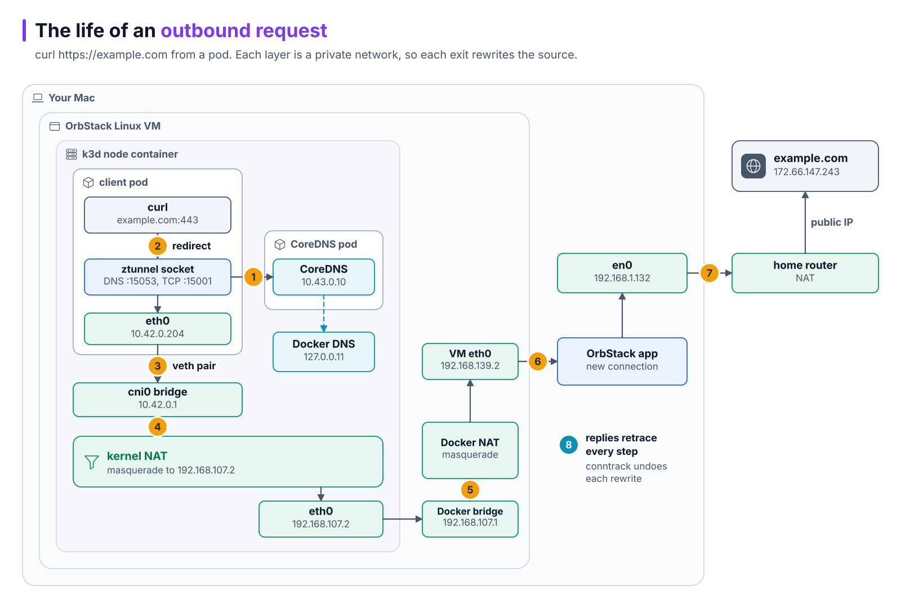
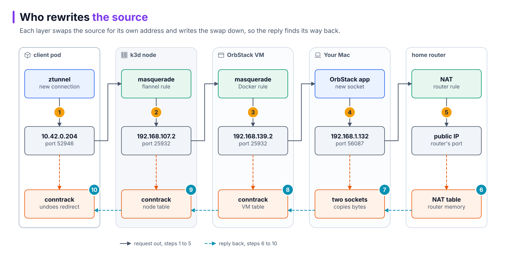
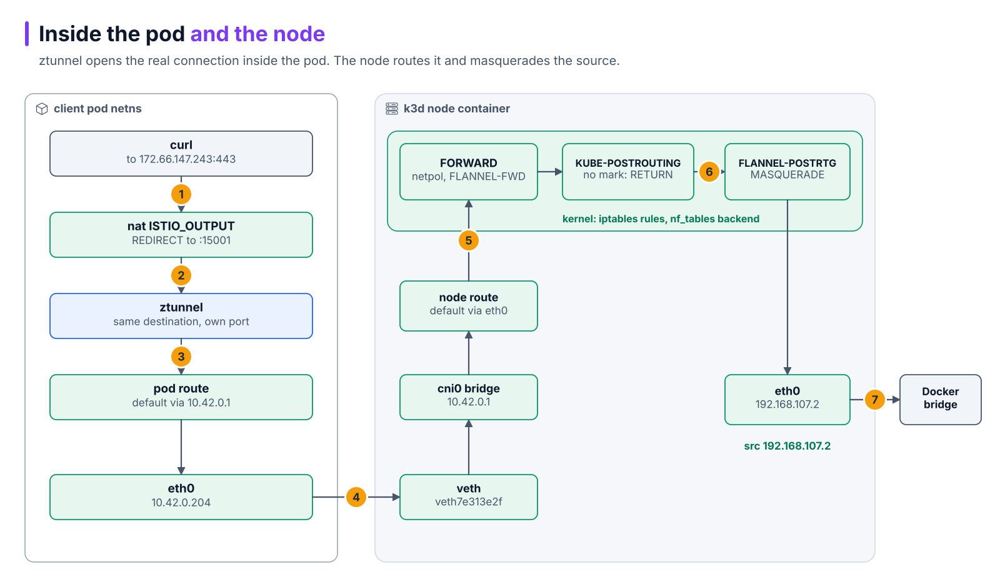
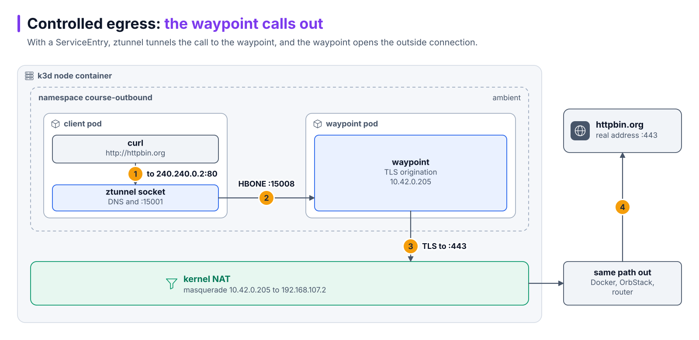

# Module 45: the life of an outbound request

> New to a term here, like masquerade, conntrack or veth pair? The [glossary](../glossary.md) explains every term in this course.

**Before this module:** [module 29](../1-foundations/29-life-of-a-request.md), which follows a request into the cluster, and modules 1 and 2 for ambient mode and ztunnel. Step 9 builds on [module 12](../2-intermediate/12-egress.md). The lab's Istio is all you need, and nothing here changes it.

**You need:** the lab running (`./lab.sh start` starts or repairs it), internet access, and the `docker` command on your Mac. Docker pulls the small `alpine:3.20` image once, for the packet captures.

Module 29 followed a request from your Mac into a pod. This module turns around and follows a pod's call out to the internet, which every real app makes: a payment API, a package mirror, a weather service. The call works, and that hides how much happens on the way, because the pod's address, `10.42.0.204` in the test run, means nothing outside the node. Before the packet reaches the internet, four different layers rewrite its source address, and each one keeps a note so the reply finds its way back.

You need this picture the day egress breaks. A partner's firewall allows only your office's address and refuses the cluster, or a NetworkPolicy blocks a call and the error looks like a TLS failure, or two layers disagree about a port. In each case the fix starts with finding the address the outside world saw and the layer that changed it, and this module shows both for your lab, with a capture at every layer.

You follow one `curl https://example.com` from a pod, in eight steps that the diagram numbers:

1. The pod looks up `example.com`, and the question travels through ztunnel, CoreDNS and Docker's DNS server to your Mac.
2. An iptables rule inside the pod hands curl's connection to ztunnel, which opens its own connection to the same address.
3. The packet leaves the pod's `eth0`, crosses the veth pair and lands on the node's `cni0` bridge.
4. The node's kernel masquerades the source, so `10.42.0.204` becomes the node's address, `192.168.107.2`.
5. In OrbStack's Linux VM, Docker masquerades again, to the VM's address `192.168.139.2`.
6. The OrbStack app on your Mac opens a fresh connection from your Mac's address, `192.168.1.132` in the test run.
7. Your home router rewrites the source one last time, to your public IP.
8. The reply retraces every step, because each layer's notes tell it how to undo its own rewrite.

Time: about 60 minutes. Adds one small curl pod, about 16 MiB, and in step 9 a waypoint that reserves 128 MiB.



The diagram also exists in [Excalidraw format](../../docs/diagrams/chapters/45-outbound-overview.excalidraw), and `docs/diagrams/chapters/make-45.py` draws all four diagrams of this module.

**Your values will differ.** Pod IPs, ports, interface names and the address of example.com come from one test run, and they change with every pod, every connection and every rebuild. The commands look values up instead of hard-coding them. The layer addresses, `192.168.107.x` for the Docker network and `192.168.139.x` for the OrbStack VM, depend on your OrbStack and Docker setup, so read yours from the output.

## Concept: why every layer rewrites the source

Each layer of the lab is a private network that knows only its own neighbours, much like the floors of an office building where every floor has its own internal phone extensions. The pod network `10.42.0.0/16` exists only inside the node container, because flannel created it there. The Docker network `192.168.107.0/24` exists only inside OrbStack's VM, and the link between the VM and your Mac, `192.168.139.0/24`, exists only between those two. Your home network knows your Mac as `192.168.1.132`, and only your router holds an address that the rest of the internet routes to.

So when the packet leaves a layer with a source address from that layer, the next layer has no route back to it. A server on the internet that received a packet from `10.42.0.204` would send its reply into the void, because thousands of private networks use that same address. Each exit therefore swaps the source for its own outside address, a rewrite engineers call masquerade, so the reply comes back to the one machine that knows where the packet started.

The swap only works if the machine remembers it. Linux keeps conntrack, a table of every connection with its original and rewritten addresses, like a mailroom's logbook that records which internal desk sent each outgoing letter. When the reply arrives addressed to the node, the kernel looks up the connection, swaps the destination back to the pod's address, and forwards it inward. Every layer with a Linux kernel keeps its own table, so the reply unwinds the rewrites one layer at a time, in the reverse order.



On the way out, read the diagram top to bottom in each column, then across:

1. In the pod, ztunnel opens the outside connection from the pod's address with a port of its own, `10.42.0.204:52946`.
2. The node masquerades it to `192.168.107.2` and, because the rule asks for random ports, picks a new port, `25932`.
3. The OrbStack VM masquerades it to `192.168.139.2` and keeps the port.
4. The OrbStack app on your Mac opens a second connection of its own, from `192.168.1.132:56087`.
5. Your router rewrites it to your public IP.

On the way back, along the bottom row:

6. The router's NAT table sends the reply to `192.168.1.132:56087`.
7. The OrbStack app copies the bytes into the VM side of its pair of connections, addressed to `192.168.139.2:25932`.
8. The VM's conntrack swaps the destination back to `192.168.107.2:25932`.
9. The node's conntrack swaps it back to `10.42.0.204:52946`.
10. Inside the pod, conntrack hands the bytes to curl as if `example.com` itself had answered.

Here is the whole trip in one table, with the addresses from one held connection in the test run:

| Where the packet is | Source address | Who sets it | How |
|---|---|---|---|
| curl's socket in the pod | `10.42.0.204:52940` | the app | the kernel picks a free port |
| pod `eth0`, veth, `cni0` | `10.42.0.204:52946` | ztunnel | a second connection inside the pod |
| node `eth0` | `192.168.107.2:25932` | the node's kernel | flannel's `MASQUERADE --random-fully` |
| OrbStack VM `eth0` | `192.168.139.2:25932` | the VM's kernel | Docker's `MASQUERADE`, port kept |
| your Mac's `en0` | `192.168.1.132:56087` | the OrbStack app | a new connection from macOS |
| the internet | your public IP | your router | the router's NAT |

Two rows stand out, because they open new connections instead of rewriting packets. ztunnel and the OrbStack app both work as proxies: they accept a connection on one side and open a fresh one on the other, so the original port never travels further. The other three layers rewrite the packets that pass through and leave everything else untouched.

## Concept: inside the pod and the node

Module 29 showed that istio-cni writes redirect rules into each ambient pod's network namespace. For an outbound call this has a surprising effect: the connection curl opens never leaves the pod. The kernel catches it before it reaches `eth0` and hands it to ztunnel's socket on port 15001, which listens inside the same pod. ztunnel reads the original destination from the redirected connection, finds no Service or ServiceEntry for `172.66.147.243`, and opens a plain TCP connection to that address itself. This is passthrough: no tunnel, no identity check, only a log line.



The diagram follows the packet in seven steps:

1. curl opens a connection to `172.66.147.243:443`.
2. The `nat` rule `ISTIO_OUTPUT` redirects it to `127.0.0.1:15001`, ztunnel's outbound socket.
3. ztunnel opens a second connection to the same address and marks it `0x539`, so the redirect rule lets it pass.
4. The pod's default route sends the packet out of `eth0`, across the veth pair to the node.
5. The node's bridge `cni0` hands it to the kernel, whose routing table chooses `eth0`, and the `FORWARD` chain lets it through.
6. In `POSTROUTING`, kube-proxy's chain returns because nothing marked the packet, and flannel's chain masquerades it.
7. The packet leaves the node's `eth0` with the source `192.168.107.2`, towards Docker's bridge.

Two details in steps 5 and 6 decide what happens to your traffic. The `FORWARD` chain is where k3s's NetworkPolicy controller, kube-router, drops packets that a policy forbids, so module 12's lock-down stops the packet here, after ztunnel already accepted the connection inside the pod. And the masquerade comes from flannel, not from kube-proxy, because kube-proxy only masquerades traffic that it marked itself while sending it to a Service. A call to an outside address touches no Service, so flannel's rule, "anything from the pod network to anywhere outside it", does the work.

The rules on the node and in the pod look like classic iptables, and the `iptables` command prints them that way, but both sides run iptables 1.8.9 with the `nf_tables` backend. The kernel stores the rules as nftables, and `nft list ruleset` shows the same chains with a warning that iptables manages them, which means you read and change them with `iptables`, as this module does.

## Concept: default egress and controlled egress

By default, as module 12 showed, the mesh lets any pod reach any address on the internet. ztunnel passes the connection through and records only the address and the port, because it has no name to match the address against. The lab's mesh config sets no `outboundTrafficPolicy`, and that setting with its `REGISTRY_ONLY` value applies to sidecars in any case, not to ztunnel, so in ambient mode the real lock is a NetworkPolicy, enforced in the node's `FORWARD` chain.

Controlled egress changes who opens the outside connection. With a ServiceEntry for `httpbin.org` that points at a waypoint, ztunnel answers the pod's DNS question with a virtual address from `240.240.0.0/16`, recognises that address when curl connects, and sends the bytes through an HBONE tunnel to the waypoint pod. The waypoint then opens the TLS connection to the real `httpbin.org` from its own pod address, so the node's conntrack shows the waypoint's IP, not the client's, as the source that it masquerades.



1. curl connects to the virtual address `240.240.0.2:80`, which ztunnel's DNS gave it.
2. ztunnel sends the bytes through an HBONE tunnel to the waypoint on port 15008.
3. The waypoint opens TLS to the real address on port 443, and the node masquerades the waypoint's IP.
4. From there the packet takes the same path out as before: Docker, OrbStack, the router.

So the NAT path stays the same and only its starting point moves. That matters for firewalls and audits, because every controlled call now leaves from one known workload that applies the mesh's rules, which is the idea behind an egress gateway. An egress gateway is the same pattern with a dedicated Envoy deployment, often on dedicated nodes with fixed addresses, so a partner's firewall allows a short, stable list of source IPs. The lab uses a waypoint for this, which module 12 explains, and has no separate egress gateway.

## The bigger picture: NAT in real clusters

Every cluster on the internet has some version of this stack, because pod networks almost always use private addresses. What changes between platforms is how many layers rewrite the source and where.

On a cloud VM cluster the layers shrink. On Amazon EKS with the VPC CNI, pods get addresses from the VPC itself, and the node still masquerades traffic for the internet to its own primary address by default, before a NAT gateway rewrites it once more to a public IP. Google Kubernetes Engine uses a node agent, ip-masq-agent, that decides which destinations get masqueraded. In both cases the outside world sees the address of a NAT gateway, which is why teams that must give a partner a fixed source address buy static IPs for that gateway or run an egress gateway with its own addresses.

Your lab adds two layers that clouds don't have, the Docker network and OrbStack, because the node runs as a container inside a VM on your Mac. That's why the same `curl` passes through four rewrites here and two in a typical cloud cluster, and why tools that run on a cloud node, like `conntrack` and `tcpdump`, need a `docker exec` or a debug container here first.

The direction of travel is towards fewer rewrites. IPv6 gives every pod a globally unique address and removes the need for NAT at the node, and CNIs such as Cilium and Calico offer egress gateway features that pin chosen workloads to fixed source addresses without a proxy. Either way, the question this module trains stays the same: which address leaves the last layer, and who keeps the note to undo it.

## Why this way

**Why does the node masquerade instead of routing pod addresses outward?** The network outside the node doesn't know `10.42.0.0/16`. The Docker network, the VM and your router have no route to it, so a reply addressed to a pod IP would go nowhere. Masquerading to the node's address costs one conntrack entry per connection and works on any network, which is why flannel does it by default.

**Why does flannel's rule masquerade, and not kube-proxy's?** kube-proxy's `KUBE-POSTROUTING` chain masquerades only packets that carry its mark `0x4000`, which it sets for Service traffic that needs it, such as traffic from outside the cluster to a NodePort. A direct call to an internet address never touches a Service, so the mark stays unset, the chain returns, and flannel's chain, written for exactly this case, matches next.

**Why `--random-fully`?** Without it, the kernel tries to keep the original source port, and two pods that pick the same port at the same moment race for one conntrack entry, which drops one connection's first packet. Random ports make that race practically impossible. In the test run the node turned port `52946` into `25932`, while Docker's rule in the VM, without the flag, kept `25932` unchanged.

**Why does ztunnel open a second connection instead of forwarding the packet?** ztunnel works at the connection level, so it has to own both ends of the connection to apply policy, count bytes and, for mesh destinations, wrap the stream in HBONE. For an unknown destination it applies nothing, but the redirect rule has no way to know that in advance, so every outbound TCP connection passes through ztunnel.

**Why does OrbStack open a new connection instead of doing NAT?** OrbStack's VM has no network card of its own on your home network. Its traffic reaches macOS through a virtual link, and the OrbStack app re-creates each connection with an ordinary macOS socket, so your Mac's firewall, VPN and DNS settings apply to the VM's traffic exactly as to any app on your Mac.

## Do it

The commands use the node container's name and two small helpers. `pidof_ctr` finds the process ID of a container on the node, which `nsenter` needs to enter a pod's network namespace, and `hold` keeps one connection to example.com open for 20 seconds, long enough to read it at every layer.

```console
$ N=k3d-k8s-lab-server-0
$ pidof_ctr() { docker exec $N crictl inspect --output go-template --template '{{.info.pid}}' "$(docker exec $N crictl ps --label io.kubernetes.pod.namespace=$1 --name $2 -q | head -1)"; }
```

### 1. Start a client in its own ambient namespace

```console
$ kubectl apply -f platform-engineering/manifests/45-outbound-client.yaml
namespace/course-outbound created
deployment.apps/client created

$ kubectl -n course-outbound rollout status deploy/client
deployment "client" successfully rolled out

$ kubectl -n course-outbound get pod -l app=client -o wide
NAME                      READY   STATUS    RESTARTS   AGE   IP            NODE                   NOMINATED NODE   READINESS GATES
client-79578b497d-jmm4q   1/1     Running   0          4s    10.42.0.204   k3d-k8s-lab-server-0   <none>           <none>

$ PODIP=$(kubectl -n course-outbound get pod -l app=client -o jsonpath='{.items[0].status.podIP}')
$ kubectl -n course-outbound exec deploy/client -- curl -sv -o /dev/null https://example.com 2>&1 | grep -E "Trying|Immediate|Connected|< HTTP"
*   Trying [2606:4700:10::6814:179a]:443...
* Immediate connect fail for 2606:4700:10::6814:179a: Network unreachable
*   Trying [2606:4700:10::ac42:93f3]:443...
* Immediate connect fail for 2606:4700:10::ac42:93f3: Network unreachable
*   Trying 104.20.23.154:443...
* Connected to example.com (104.20.23.154) port 443
< HTTP/2 200
```

**What you should see.** The namespace carries the label `istio.io/dataplane-mode: ambient`, so the pod joins the mesh as it starts, and in the test run it got `10.42.0.204`.

The call returns `HTTP/2 200`, but curl first tries two IPv6 addresses and gives up on each at once with `Network unreachable`. DNS returned both IPv4 and IPv6 answers, and the pod has no IPv6 address or route, so the kernel refuses the IPv6 attempts before any packet leaves and curl falls back to IPv4. The rest of this module uses `curl -4` or a fixed address to skip that detour.

### 2. DNS: how the pod finds example.com

Before any packet heads for example.com, the pod needs its address, and the question travels further than you might expect.

```console
$ kubectl -n course-outbound exec deploy/client -- cat /etc/resolv.conf
search course-outbound.svc.cluster.local svc.cluster.local cluster.local
nameserver 10.43.0.10
options ndots:5

$ kubectl -n course-outbound exec deploy/client -- nslookup -type=a example.com
Server:		10.43.0.10
Address:	10.43.0.10:53

Non-authoritative answer:
Name:	example.com
Address: 172.66.147.243
Name:	example.com
Address: 104.20.23.154

$ kubectl -n kube-system get configmap coredns -o jsonpath='{.data.Corefile}' | grep forward
    forward . /etc/resolv.conf

$ docker exec $N cat /proc/$(pidof_ctr kube-system coredns)/root/etc/resolv.conf
nameserver 192.168.107.1
options ndots:0

$ docker exec $N iptables -t nat -S DOCKER_OUTPUT
-N DOCKER_OUTPUT
-A DOCKER_OUTPUT -d 192.168.107.1/32 -p tcp -m tcp --dport 53 -j DNAT --to-destination 127.0.0.11:34781
-A DOCKER_OUTPUT -d 192.168.107.1/32 -p udp -m udp --dport 53 -j DNAT --to-destination 127.0.0.11:33270

$ docker exec $N conntrack -L -p udp --dport 53 -s $PODIP 2>/dev/null | tail -1
udp      17 29 src=10.42.0.204 dst=10.43.0.10 sport=59509 dport=53 src=10.42.0.113 dst=10.42.0.204 sport=53 dport=59509 mark=0 use=1

$ docker exec $N conntrack -L -p udp --dport 53 -d 192.168.107.1 2>/dev/null | tail -1
udp      17 29 src=10.42.0.113 dst=192.168.107.1 sport=44055 dport=53 src=127.0.0.11 dst=10.42.0.113 sport=33270 dport=44055 mark=0 use=1

$ docker exec $N grep ExtServers /etc/resolv.conf
# ExtServers: [host(0.250.250.200)]
```

**What you should see.** The answer passes through four DNS servers, and each command shows one link of the chain.

First, the pod asks `10.43.0.10`, the cluster DNS Service. In an ambient pod with DNS capture on, the query first meets istio-cni's rule `REDIRECT --to-ports 15053`, so ztunnel answers names it knows, such as Services and ServiceEntries, and forwards the rest to CoreDNS from inside the pod. The first conntrack line shows that forward: `src=10.42.0.204 dst=10.43.0.10`, rewritten by kube-proxy's DNAT to the CoreDNS pod `10.42.0.113`.

Second, CoreDNS knows nothing about `example.com`, so its `forward . /etc/resolv.conf` sends the question to the server in its own `resolv.conf`, `192.168.107.1`. CoreDNS uses the node's DNS settings rather than the cluster's, because its pod runs with `dnsPolicy: Default`, which avoids CoreDNS asking itself in a loop.

Third, `192.168.107.1` is the Docker network's gateway, and the node container's `DOCKER_OUTPUT` chain DNATs port 53 on that address to `127.0.0.11:33270`, Docker's embedded DNS server, which runs inside the node container's network namespace. The second conntrack line shows exactly that swap.

Fourth, Docker's DNS server asks `0.250.250.200`, OrbStack's DNS server, which resolves the name through macOS. So a pod's lookup of an internet name ends with the same resolver your browser uses, which is why a VPN's DNS settings on your Mac affect your pods too.

### 3. Inside the pod: the redirect and ztunnel's second connection

```console
$ PID=$(pidof_ctr course-outbound curl)
$ docker exec $N nsenter -t $PID -n iptables -t nat -S ISTIO_OUTPUT
-N ISTIO_OUTPUT
-A ISTIO_OUTPUT -d 169.254.7.127/32 -p tcp -m tcp -j ACCEPT
-A ISTIO_OUTPUT ! -o lo -p udp -m mark ! --mark 0x539/0xfff -m udp --dport 53 -j REDIRECT --to-ports 15053
-A ISTIO_OUTPUT ! -d 127.0.0.1/32 -p tcp -m tcp --dport 53 -m mark ! --mark 0x539/0xfff -j REDIRECT --to-ports 15053
-A ISTIO_OUTPUT -p tcp -m mark --mark 0x111/0xfff -j ACCEPT
-A ISTIO_OUTPUT ! -d 127.0.0.1/32 -o lo -j ACCEPT
-A ISTIO_OUTPUT ! -d 127.0.0.1/32 -p tcp -m mark ! --mark 0x539/0xfff -j REDIRECT --to-ports 15001

$ IP4=$(kubectl -n course-outbound exec deploy/client -- nslookup -type=a example.com | awk '/^Address: / {print $2}' | tail -1)
$ hold() { sleep 20 | kubectl -n course-outbound exec -i deploy/client -- curl -s telnet://$IP4:443 >/dev/null 2>&1 & }
$ hold; sleep 4
$ docker exec $N nsenter -t $PID -n conntrack -L -p tcp --dport 443 2>/dev/null | grep ESTABLISHED
tcp      6 431996 ESTABLISHED src=10.42.0.204 dst=172.66.147.243 sport=52940 dport=443 src=127.0.0.1 dst=10.42.0.204 sport=15001 dport=52940 [ASSURED] mark=273 use=1
tcp      6 431996 ESTABLISHED src=10.42.0.204 dst=172.66.147.243 sport=52946 dport=443 src=172.66.147.243 dst=10.42.0.204 sport=443 dport=52946 [ASSURED] mark=0 use=1

$ kubectl -n istio-system logs ds/ztunnel --since=1m | grep course-outbound | grep "dst.addr=$IP4" | tail -1
2026-11-20T22:50:15.731004Z	info	access	connection complete	src.addr=10.42.0.204:52940 src.workload="client-79578b497d-jmm4q" src.namespace="course-outbound" dst.addr=172.66.147.243:443 direction="outbound" bytes_sent=0 bytes_recv=0 duration="19817ms"
```

`IP4` holds one IPv4 address of example.com, which the later steps reuse. CoreDNS's `loadbalance` plugin shuffles the order of the answers, so `IP4` gets either address, and in the test run it was `172.66.147.243`. The `hold` helper pipes 20 seconds of silence into curl's `telnet://` mode, which opens a plain TCP connection and keeps it open while its input stays open. ztunnel writes its log line only when the connection closes, so the log appears after the 20 seconds.

**What you should see.** The `nsenter` command runs `iptables` inside the pod's network namespace, where istio-cni wrote `ISTIO_OUTPUT`, and the last rule catches every outgoing TCP connection that lacks ztunnel's mark `0x539` and redirects it to port 15001.

The pod's own conntrack table then shows two connections to `172.66.147.243:443` for one curl:

1. Port `52940` is curl's connection. Its reply half reads `src=127.0.0.1 ... sport=15001`, which means the redirect sent it to ztunnel's socket, and conntrack will make ztunnel's answers look as if they came from example.com.
2. Port `52946` is ztunnel's own connection to the real server, with an ordinary reply half. Only this one leaves the pod.

ztunnel's log line names curl's port, `src.addr=10.42.0.204:52940`, and the destination by IP only, with no identity and no service name, which is passthrough in one line. In the test run both connections used the pod's address `10.42.0.204` as their source, because ztunnel's socket lives inside the pod's network namespace.

### 4. The veth pair, the bridge and the node's routes

```console
$ kubectl -n course-outbound exec deploy/client -- ip route
default via 10.42.0.1 dev eth0
10.42.0.0/24 dev eth0 scope link  src 10.42.0.204
10.42.0.0/16 via 10.42.0.1 dev eth0

$ IDX=$(kubectl -n course-outbound exec deploy/client -- cat /sys/class/net/eth0/iflink)
$ docker exec $N ip -o link show | grep "^$IDX:" | cut -d' ' -f1-9
108: veth7e313e2f@if3: <BROADCAST,MULTICAST,UP,LOWER_UP> mtu 1450 qdisc noqueue master cni0

$ docker exec $N ip route
default via 192.168.107.1 dev eth0
10.42.0.0/24 dev cni0 proto kernel scope link src 10.42.0.1
192.168.107.0/24 dev eth0 proto kernel scope link src 192.168.107.2
```

**What you should see.** Three hops, each a different kind of virtual interface.

1. Inside the pod, the default route sends everything outside the pod network to `10.42.0.1`, the address of the bridge on the node.
2. The pod's `eth0` is one end of a veth pair, and the file `iflink` holds the interface number of the other end, 108 in the test run. On the node, interface 108 is `veth7e313e2f`, and `master cni0` says it plugs into the bridge, like a cable into a switch.
3. On the node, `10.42.0.0/24 dev cni0` keeps pod traffic on the bridge, and `default via 192.168.107.1 dev eth0` sends everything else out of the node container's `eth0`, towards Docker's bridge in the VM.

The pod's MTU is 1450 and the node's `eth0` uses 1500, because flannel leaves room for its VXLAN header on multi-node clusters, as module 29 explained.

### 5. The node's NAT: who masquerades

```console
$ docker exec $N iptables -t nat -S POSTROUTING
-P POSTROUTING ACCEPT
-A POSTROUTING -m comment --comment "CNI portfwd requiring masquerade" -j CNI-HOSTPORT-MASQ
-A POSTROUTING -m comment --comment "kubernetes postrouting rules" -j KUBE-POSTROUTING
-A POSTROUTING -d 192.168.107.1/32 -j DOCKER_POSTROUTING
-A POSTROUTING -m comment --comment "flanneld masq" -j FLANNEL-POSTRTG
-A POSTROUTING -j ISTIO_POSTRT

$ docker exec $N iptables -t nat -S KUBE-POSTROUTING
-N KUBE-POSTROUTING
-A KUBE-POSTROUTING -m mark ! --mark 0x4000/0x4000 -j RETURN
-A KUBE-POSTROUTING -j MARK --set-xmark 0x4000/0x0
-A KUBE-POSTROUTING -m comment --comment "kubernetes service traffic requiring SNAT" -j MASQUERADE --random-fully

$ docker exec $N iptables -t nat -S FLANNEL-POSTRTG
-N FLANNEL-POSTRTG
-A FLANNEL-POSTRTG -m mark --mark 0x4000/0x4000 -m comment --comment "flanneld masq" -j RETURN
-A FLANNEL-POSTRTG -s 10.42.0.0/24 -d 10.42.0.0/16 -m comment --comment "flanneld masq" -j RETURN
-A FLANNEL-POSTRTG -s 10.42.0.0/16 -d 10.42.0.0/24 -m comment --comment "flanneld masq" -j RETURN
-A FLANNEL-POSTRTG ! -s 10.42.0.0/16 -d 10.42.0.0/24 -m comment --comment "flanneld masq" -j RETURN
-A FLANNEL-POSTRTG -s 10.42.0.0/16 ! -d 224.0.0.0/4 -m comment --comment "flanneld masq" -j MASQUERADE --random-fully
-A FLANNEL-POSTRTG ! -s 10.42.0.0/16 -d 10.42.0.0/16 -m comment --comment "flanneld masq" -j MASQUERADE --random-fully

$ docker exec $N iptables -t nat -L FLANNEL-POSTRTG -v -n -x | grep '!224.0.0.0/4'
     269    16140 MASQUERADE  0    --  *      *       10.42.0.0/16        !224.0.0.0/4          /* flanneld masq */ random-fully
$ kubectl -n course-outbound exec deploy/client -- curl -4 -s -o /dev/null -w "%{http_code}\n" https://example.com
200
$ docker exec $N iptables -t nat -L FLANNEL-POSTRTG -v -n -x | grep '!224.0.0.0/4'
     270    16200 MASQUERADE  0    --  *      *       10.42.0.0/16        !224.0.0.0/4          /* flanneld masq */ random-fully

$ docker exec $N conntrack -L -p tcp --dport 443 -s $PODIP 2>/dev/null | tail -1
tcp      6 9 CLOSE src=10.42.0.204 dst=172.66.147.243 sport=45730 dport=443 src=172.66.147.243 dst=192.168.107.2 sport=443 dport=12893 [ASSURED] mark=0 use=1
```

**What you should see.** The kernel walks `POSTROUTING` from top to bottom as the packet leaves, and the first matching rule wins.

1. `CNI-HOSTPORT-MASQ` and `KUBE-POSTROUTING` look for marks that only host ports and Services set. The outbound packet carries neither, so `KUBE-POSTROUTING` returns at its first rule.
2. `DOCKER_POSTROUTING` handles only traffic to `192.168.107.1`, the DNS case from step 2.
3. `FLANNEL-POSTRTG` first returns for traffic that stays inside the pod network, then reaches `-s 10.42.0.0/16 ! -d 224.0.0.0/4 -j MASQUERADE --random-fully`: anything from a pod to anything outside the pod network, except multicast, leaves with the node's address.

The counters prove it, and they count connections rather than packets: the `nat` table sees only the first packet of each connection, because conntrack handles the rest. One curl raised the count from 269 to 270, and 60 more bytes is the size of one TCP SYN. The other 269 came from the lab's own outbound calls, such as ArgoCD fetching its Git repository.

The conntrack line shows the rewrite in both directions. The original half, `src=10.42.0.204 ... sport=45730`, is what left the pod, and the reply half, `dst=192.168.107.2 ... dport=12893`, is what the internet answers to, with a random new port because of `--random-fully`.

### 6. Watch the rewrite with tcpdump

The node image has no `tcpdump`, and installing tools on a node is a bad habit, so you run a throwaway debug container that shares the node container's network namespace instead. It sees every interface the node sees, and disappears when it ends.

```console
$ docker run --rm --net container:$N --cap-add NET_ADMIN --cap-add NET_RAW alpine:3.20 \
    sh -c "apk add -q tcpdump && tcpdump -tnni any -c 6 'host $IP4 and tcp[tcpflags] & tcp-syn != 0' 2>/dev/null | cut -d, -f1" &
$ sleep 8; kubectl -n course-outbound exec deploy/client -- curl -4 -s -o /dev/null --resolve example.com:443:$IP4 https://example.com; wait
veth7e313e2f P   IP 10.42.0.204.39264 > 172.66.147.243.443: Flags [S]
cni0  In  IP 10.42.0.204.39264 > 172.66.147.243.443: Flags [S]
eth0  Out IP 192.168.107.2.21360 > 172.66.147.243.443: Flags [S]
eth0  In  IP 172.66.147.243.443 > 192.168.107.2.21360: Flags [S.]
cni0  Out IP 172.66.147.243.443 > 10.42.0.204.39264: Flags [S.]
veth7e313e2f Out IP 172.66.147.243.443 > 10.42.0.204.39264: Flags [S.]
```

`--resolve` pins curl to the address the filter watches, and the filter keeps only the first two packets of the TCP handshake, the SYN and the SYN-ACK, so six lines tell the whole story.

**What you should see.** The same SYN on three interfaces, and the SYN-ACK on the same three in reverse.

1. `veth7e313e2f P` is the node's end of the pod's veth pair, and the SYN still carries `10.42.0.204.39264`, ztunnel's connection.
2. `cni0 In` shows the bridge receiving it, unchanged.
3. `eth0 Out` shows it leaving the node as `192.168.107.2.21360`: flannel's masquerade, with a new port.
4. The SYN-ACK comes back to `192.168.107.2.21360` on `eth0`, and by the time it reaches `cni0` it already reads `10.42.0.204.39264` again, because conntrack undid the rewrite between the two interfaces.

That reversal, visible within a few microseconds in the capture, is the whole return path in miniature, and every layer below repeats it.

### 7. Out of the node: Docker's bridge and NAT in the OrbStack VM

The node is a container, so its `eth0` connects to a Linux bridge in the VM where Docker runs. A container with `--net host` joins that VM's own network namespace, which is how you look at the next layer.

```console
$ BR=br-$(docker network inspect k3d-k8s-lab -f '{{.Id}}' | cut -c1-12)
$ docker run --rm --net host alpine:3.20 ip -4 -o addr show | grep -E " eth0 | $BR " | awk '{print $2, $4}'
eth0 192.168.139.2/24
br-3daa69f8963f 192.168.107.1/24

$ docker run --rm --net host alpine:3.20 ip route | grep -E "^default|$BR"
default via 192.168.139.1 dev eth0
192.168.107.0/24 dev br-3daa69f8963f scope link  src 192.168.107.1

$ docker run --rm --net host --cap-add NET_ADMIN alpine:3.20 sh -c 'apk add -q iptables && iptables -t nat -L POSTROUTING -v -n' | grep -E "pkts|192.168.107"
 pkts bytes target     prot opt in     out     source               destination
 1855  111K MASQUERADE  0    --  *      !br-3daa69f8963f  192.168.107.0/24     0.0.0.0/0

$ docker run --rm --net host --cap-add NET_ADMIN --cap-add NET_RAW alpine:3.20 \
    sh -c "apk add -q tcpdump && tcpdump -tnni any -c 6 'host $IP4 and tcp[tcpflags] & tcp-syn != 0' 2>/dev/null | cut -d, -f1" &
$ sleep 8; kubectl -n course-outbound exec deploy/client -- curl -4 -s -o /dev/null --resolve example.com:443:$IP4 https://example.com; wait
veth22ae743 P   IP 192.168.107.2.7921 > 172.66.147.243.443: Flags [S]
br-3daa69f8963f In  IP 192.168.107.2.7921 > 172.66.147.243.443: Flags [S]
eth0  Out IP 192.168.139.2.7921 > 172.66.147.243.443: Flags [S]
eth0  In  IP 172.66.147.243.443 > 192.168.139.2.7921: Flags [S.]
br-3daa69f8963f Out IP 172.66.147.243.443 > 192.168.107.2.7921: Flags [S.]
veth22ae743 Out IP 172.66.147.243.443 > 192.168.107.2.7921: Flags [S.]
```

**What you should see.** The same structure as the node, one level out.

1. Docker names each network's bridge after the first 12 characters of the network ID, so the `k3d-k8s-lab` network becomes `br-3daa69f8963f` in the test run, holding `192.168.107.1`, the address the node uses as its default gateway.
2. The node container's `eth0` is one end of another veth pair, `veth22ae743` here, plugged into that bridge.
3. Docker's rule `MASQUERADE` for `192.168.107.0/24` leaving through any interface except the bridge rewrites the source to the VM's `eth0` address, `192.168.139.2`.
4. The VM's default route sends the packet to `192.168.139.1`, OrbStack's gateway to your Mac.

Unlike flannel's rule, Docker's has no `--random-fully`, so the port `7921` survives unchanged, and the SYN-ACK shows the VM's conntrack undoing the swap between `eth0` and the bridge, exactly as the node did.

### 8. OrbStack and your Mac

```console
$ hold; sleep 4
$ lsof -nP -iTCP@$IP4:443 -sTCP:ESTABLISHED | awk '{print $1, $9, $10}'
COMMAND NAME
OrbStack 192.168.1.132:56087->172.66.147.243:443 (ESTABLISHED)

$ route -n get default | grep -E "gateway|interface"
    gateway: 192.168.1.1
  interface: en0

$ kubectl -n course-outbound exec deploy/client -- curl -s https://httpbin.org/ip | sed -E 's/[0-9]+\.[0-9]+\.[0-9]+\.[0-9]+/<your public IP>/'
{
  "origin": "<your public IP>"
}
```

The `sed` hides your public address in the output, so you share it with nobody by accident when you copy this into a ticket.

**What you should see.** On your Mac, the connection to example.com belongs to the `OrbStack` process, from your Mac's own address `192.168.1.132` and port `56087`. That port matches nothing you saw in the VM, because OrbStack doesn't forward the VM's packets: it accepts the VM's connection on its side of the virtual link and opens a new one through macOS, much like ztunnel did inside the pod.

From there the packet leaves through `en0`, your Wi-Fi or Ethernet interface, to your router at `192.168.1.1`, which applies the last rewrite to your public address. httpbin reports exactly that address as the `origin`, the source it saw: not the pod, not the node, not your Mac, only the router. Your router's NAT table is the one layer you don't inspect from here.

### 9. Controlled egress through a waypoint

Now give the mesh a name for one outside host and see what moves. The manifest creates a waypoint for the namespace, a ServiceEntry for `httpbin.org` that points at it, and the DestinationRule that makes the waypoint open TLS, as in module 12.

```console
$ kubectl apply -f platform-engineering/manifests/45-egress-waypoint.yaml
gateway.gateway.networking.k8s.io/waypoint created
serviceentry.networking.istio.io/httpbin-org created
destinationrule.networking.istio.io/httpbin-org-tls created

$ kubectl -n course-outbound rollout status deploy/waypoint
deployment "waypoint" successfully rolled out

$ kubectl -n course-outbound exec deploy/client -- nslookup -type=a httpbin.org | tail -2
Address: 240.240.0.2

$ kubectl -n course-outbound exec deploy/client -- curl -s http://httpbin.org/get | grep '"url"'
  "url": "https://httpbin.org/get"

$ kubectl -n istio-system logs ds/ztunnel --since=1m | grep course-outbound | grep httpbin | tail -1 \
  | grep -oE '(src.addr|dst.addr|dst.hbone_addr|dst.workload)=[^ ]+'
src.addr=10.42.0.204:56888
dst.addr=10.42.0.205:15008
dst.hbone_addr=240.240.0.2:80
dst.workload="waypoint-68fbbcd65d-b5kmh"

$ WP=$(kubectl -n course-outbound get pod -l gateway.networking.k8s.io/gateway-name=waypoint -o jsonpath='{.items[0].status.podIP}')
$ docker exec $N conntrack -L -p tcp --dport 443 -s $WP 2>/dev/null
tcp      6 86397 ESTABLISHED src=10.42.0.205 dst=44.209.237.184 sport=48416 dport=443 src=44.209.237.184 dst=192.168.107.2 sport=443 dport=40185 [ASSURED] mark=0 use=1
```

**What you should see.** The start of the path changes, and everything after the node stays the same.

1. DNS inside the pod now answers `240.240.0.2`, a virtual address istiod gave the ServiceEntry, so curl connects to an address no machine owns.
2. ztunnel recognises it and sends the bytes as HBONE to the waypoint pod, `dst.addr=10.42.0.205:15008`, with the original target carried inside as `dst.hbone_addr=240.240.0.2:80`.
3. The waypoint opens TLS to a real address of httpbin.org, and httpbin reports `https://httpbin.org/get`, although curl asked for `http://`.
4. The node's conntrack shows the outside connection with `src=10.42.0.205`, the waypoint, masqueraded to `192.168.107.2` like before.

The client's own address never appears in a connection to httpbin.org: `conntrack -L -s $PODIP -d 44.209.237.184` lists no entries, because the client only talks to the waypoint, inside the pod network. This is the point of controlled egress, one known workload makes every call to the outside host, and module 12's NetworkPolicy then closes every other way out.

### 10. The way back

You already watched the return path in steps 6 and 7, so this step puts it in order. A reply from example.com unwinds the rewrites in reverse, and no layer makes a new decision on the way back, because each one only looks up its notes:

1. Your router finds its NAT entry and sends the reply to `192.168.1.132`.
2. The OrbStack app receives it on its macOS socket and writes the bytes into its connection with the VM, addressed to `192.168.139.2`.
3. The VM's conntrack turns `192.168.139.2` back into `192.168.107.2` and forwards the packet over the bridge to the node container.
4. The node's conntrack turns `192.168.107.2:21360` back into `10.42.0.204:39264`, and the bridge delivers the packet down the veth pair.
5. In the pod, the reply reaches ztunnel's socket, ztunnel copies the bytes into curl's connection, and the pod's conntrack makes them appear to come from `172.66.147.243:443`.

This is also why a NAT layer that restarts or forgets its table breaks every open connection through it at once: the notes are gone, so replies arrive for connections nobody remembers.

## Investigate

1. In step 5 the node changed the source port, while in step 7 the VM kept it. Name the two rules responsible, and explain why the node's choice is safer when many pods make calls at the same moment.
2. Module 12 locks the course client in with a NetworkPolicy. A locked-in pod runs `curl -m 8 https://example.com` and fails at once with a TLS connect error or `Connection reset by peer`, instead of waiting 8 seconds. Follow the packet with this module's map: where does it stop, and which component sends the reset?
3. A partner asks for the source IP of your cluster's calls so they allow it in their firewall. Which address from this module's table do you give them, and what changes on a cloud cluster?
4. In step 9 the node's conntrack showed the waypoint's IP as the source. What would a partner's firewall see for that call, and what would it see for a call from a pod with no ServiceEntry?

<details>
<summary>Answers</summary>

1. The node's rule is flannel's `MASQUERADE --random-fully` in `FLANNEL-POSTRTG`, and the VM's rule is Docker's plain `MASQUERADE` in its `POSTROUTING` chain. Without random ports, the kernel tries to keep each connection's original source port, and when two pods on the node pick the same port towards the same server at the same moment, both connections want the same conntrack entry and one of them loses its first packet. With `--random-fully` the kernel picks a random free port for every new connection, so that race practically disappears. The VM sees only one source per k3d node, the node's address with its already random port, so keeping the port there causes no conflict.
2. The packet never leaves the node. curl's connection goes to ztunnel inside the pod, which accepts it at once, so curl sees a working TCP connection. ztunnel then opens its own connection to example.com, the packet leaves the pod through the veth pair, and the node's `FORWARD` chain drops it in kube-router's NetworkPolicy rules. ztunnel's connection attempt fails, so ztunnel resets curl's connection, which curl reports as `Connection reset by peer` or a TLS connect error, depending on how far it got.
3. Give them your public IP, the address in the last row, because that's the only address that reaches them. Every address above it is private and rewritten before the packet leaves your home. On a cloud cluster the last row is the cloud's NAT gateway, so you give the partner that gateway's static public IP, or the fixed addresses of an egress gateway if only some workloads should reach the partner.
4. Both calls look the same to the partner: your public IP, because the router's NAT is the last rewrite on both paths. The difference lives inside your cluster. With the ServiceEntry, every call to httpbin.org leaves from the waypoint, so the waypoint's rules, metrics and logs cover it, and a NetworkPolicy allows exactly that path. Without one, each pod leaves from its own address, and only an IP-level log in ztunnel records the call.

</details>

## Clean up

```console
$ ./platform-engineering/reset.sh
Removing course rules from the shop namespace
Applying the baseline Istio config from manifests/istio
Turning off the backend experiment settings
Asking ArgoCD to sync istio-config from Git
Done. Baseline: 100% of backend traffic to v1, no faults, no extra rules.
```

This deletes the `course-outbound` namespace, and with it the client, the waypoint, the ServiceEntry and the DestinationRule. The debug containers removed themselves when they ended, and only the `alpine:3.20` image stays in Docker, which `docker image rm alpine:3.20` removes.
