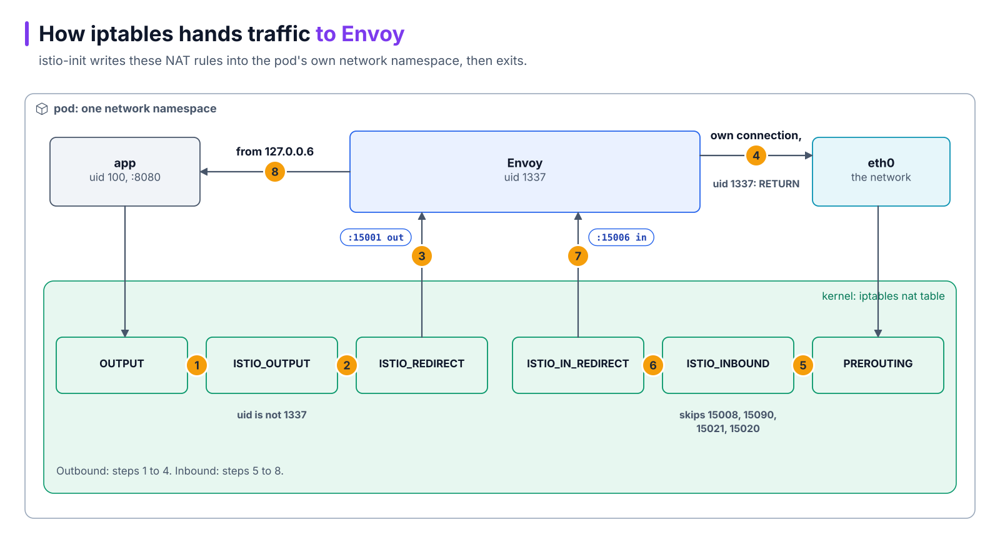
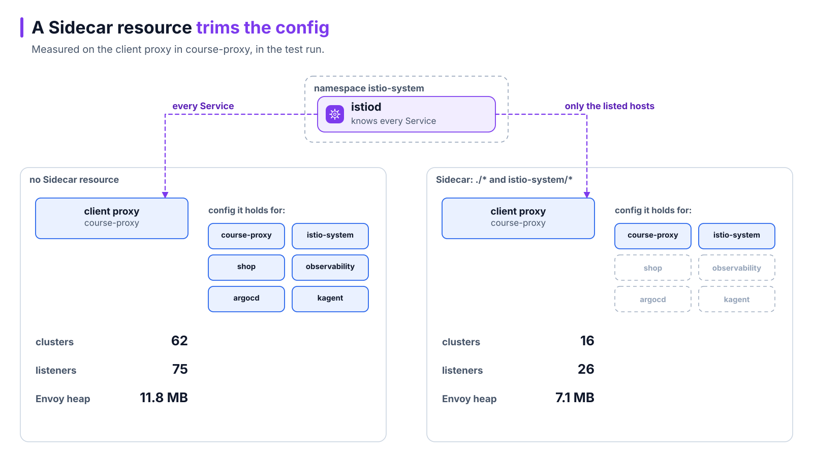

# Module 30: sidecar mode in depth

> New to a term here, like Sidecar resource or PassthroughCluster? The [glossary](glossary.md) explains every term in this course.

**Before this module:** modules 1, 2 and 7. Module 29 helps with the iptables part.

**You need:** the lab running (`./scripts/start.sh` starts or repairs it), `istioctl`, and Docker access to the lab node (`docker exec k3d-k8s-lab-server-0 ...`), as in module 29.

Module 7 showed that a sidecar appears in your pod and carries its traffic. This module opens the box. A team that runs sidecars in production meets four puzzles sooner or later. A pod comes up without a sidecar. One connection skips the mesh. Every proxy uses 40 MiB while its app uses 5. And somebody asks whether ambient would cost less. You work through each one on the lab, with numbers.

The module works through four topics in order:

1. How the injector decides which pods get a sidecar.
2. How a few iptables rules hand every connection to Envoy.
3. How the Sidecar resource cuts the config each proxy receives.
4. What sidecars cost next to ambient, measured on the same node.

Time: about 50 minutes. Adds about 150 MiB while it runs: two pods with sidecars in `course-proxy`, two ambient pods in `course-ambient`.

## Concept: four webhooks decide who gets a sidecar

A mutating admission webhook is a call the API server makes before it stores an object, so an outside service edits the object first. Module 7 showed that istiod's injector works this way. The surprise is that istiod registers not one webhook but four. Each one has its own selectors, and the API server calls istiod only if one of them matches the new pod.

The selectors look at labels in two places. A namespace selector reads the labels on the pod's namespace. An object selector reads the labels on the pod itself. Both must match for a webhook to fire. Here are the four, as the lab registers them:

| Webhook | Namespace must have | Pod must have |
|---|---|---|
| `namespace.sidecar-injector` | `istio-injection=enabled` | no `sidecar.istio.io/inject=false` label |
| `rev.namespace.sidecar-injector` | `istio.io/rev=default`, and no `istio-injection` label | no `sidecar.istio.io/inject=false` label |
| `object.sidecar-injector` | neither label | `sidecar.istio.io/inject=true`, and no `istio.io/rev` |
| `rev.object.sidecar-injector` | neither label | `istio.io/rev=default` |

Three rules follow from the table, and step 3 tests each one:

1. `istio-injection` wins over `istio.io/rev`. Even `istio-injection=disabled` blocks the revision webhook, because that webhook demands that the label is absent.
2. A pod label `sidecar.istio.io/inject=false` stops the webhook from firing at all. The API server never even calls istiod.
3. A pod in an unlabelled namespace still gets a sidecar if the pod itself asks with `sidecar.istio.io/inject=true`.

The same key also exists as an annotation, `sidecar.istio.io/inject: "false"`. Webhook selectors only read labels, so the annotation works one level later. The API server calls istiod, and istiod reads the annotation and declines. The result looks the same, but tools that only read the selectors get it wrong, as step 3 shows.

None of this touches running pods. A webhook runs once, when the API server creates the pod. That's why labelling a namespace changes nothing until you restart its pods.

## Concept: iptables hands every connection to Envoy

The app in a sidecar pod has no idea Envoy exists. It opens a connection to `httpbin:8000`, and the connection ends up in Envoy anyway. A few NAT rules in the pod's own network namespace do the trick. NAT here means rewriting a connection's destination address or port as it passes through the kernel.

The `istio-init` container writes those rules before any other container starts. Then it exits. Its arguments say exactly what to write:

| Flag | Value in the lab | Meaning |
|---|---|---|
| `-p` | `15001` | port of Envoy's outbound listener |
| `-z` | `15006` | port of Envoy's inbound listener |
| `-u` | `1337` | user ID whose traffic stays untouched, Envoy's own |
| `-m` | `REDIRECT` | rewrite the destination port, keep the IP |
| `-i` | `*` | capture outbound traffic to every IP range |
| `-b` | `*` | capture inbound traffic on every port |
| `-d` | `15090,15021,15020` | inbound ports to skip: metrics and health checks |



The diagram follows both directions through the chains. An outgoing connection takes four steps:

1. The app's connection enters the `OUTPUT` chain, which jumps to `ISTIO_OUTPUT`.
2. `ISTIO_OUTPUT` sees a connection from a user other than 1337, so it jumps to `ISTIO_REDIRECT`.
3. `ISTIO_REDIRECT` rewrites the destination port to 15001, where Envoy listens.
4. Envoy opens its own connection to the real destination. That connection comes from user 1337, so `ISTIO_OUTPUT` returns it untouched, and it leaves the pod.

Step 4 is the trick that prevents an endless loop. Without the exception for user 1337, Envoy's own connection would land back in Envoy. Incoming traffic works the same way in steps 5 to 8. `PREROUTING` jumps to `ISTIO_INBOUND`, which skips a few ports and sends everything else to Envoy on 15006. Envoy then calls the app over localhost from the address `127.0.0.6`, a special source that the rules also leave alone.

This setup has a cost. Writing NAT rules needs the Linux capabilities `NET_ADMIN` and `NET_RAW`, so every app pod carries a privileged init container. Istio's CNI plugin removes that cost. The CNI plugin runs on each node and writes the same rules from outside the pod, while the pod's sandbox starts. The pod then gets a small `istio-validation` init container that only checks the rules and needs no extra capabilities. The lab's sidecars still use `istio-init`, because the lab installs istiod with Helm and leaves its `pilot.cni.enabled` value off. Module 32 shows the other case.

## Concept: every proxy hears about every Service

By default, istiod sends each sidecar the config for every Service in the mesh. That's the safe choice, because istiod doesn't know which Services an app will call. The client sidecar in this module never calls Kiali, Grafana or the shop. It still holds a cluster, a route and endpoints for each one.

On a lab with 36 Services, that waste stays small. In a cluster with 5,000 Services and 2,000 sidecars, it hurts in three ways:

1. Every sidecar holds megabytes of config it never uses, so each one needs more memory.
2. Every change to any Service triggers a push to all 2,000 sidecars.
3. istiod spends its CPU building config nobody reads.

The Sidecar resource fixes this. The Sidecar resource tells istiod which hosts a group of sidecars may reach, so istiod sends them only that part of the mesh. A Sidecar named `default` with no `workloadSelector` covers the whole namespace. Its `egress.hosts` field lists patterns in the form `namespace/host`. `./*` means every Service in the same namespace, and `istio-system/*` keeps the control plane reachable.



The same resource sets an outbound policy. With `outboundTrafficPolicy.mode: REGISTRY_ONLY`, the proxy refuses any destination it doesn't know. The default, `ALLOW_ANY`, passes unknown destinations through untouched. Envoy names those two destinations `BlackHoleCluster` and `PassthroughCluster`. You meet both in step 7.

## The bigger picture: from sidecar sprawl to scoped config

Large sidecar meshes ran into the config problem early. Teams at Airbnb, eBay and others reported sidecars that each held hundreds of megabytes and istiod pushes that took minutes. The fix became a standard piece of advice: put a default Sidecar resource in every namespace, and widen it only where an app really calls out.

That advice has a weak spot. Someone has to keep the host lists current. When an app starts calling a new Service and nobody updates its Sidecar, the call quietly falls back to `PassthroughCluster`. The call loses mTLS, routing rules and metrics without any error. Step 6 shows that failure.

Ambient mode attacks the same problem from another side. ztunnel holds only the workloads of its own node and a compact address list. A waypoint holds config only for the Services that use it. So nobody writes Sidecar resources in ambient mode, and Istio has no ambient equivalent of the resource. Recent Istio versions also added a discovery selector setting in istiod's mesh config, so istiod ignores whole namespaces it never needs. Both point the same way: the control plane should send each proxy as little as possible.

## Why this way

**Why does the injector use a webhook rather than a controller that patches pods later?** A running pod keeps the containers it started with. Kubernetes doesn't let anyone add a container to a running pod. So the only moment to add the sidecar is before the API server stores the pod.

**Why REDIRECT and not routing tricks?** REDIRECT keeps the original destination address in the kernel's connection table. Envoy reads it back with the `SO_ORIGINAL_DST` socket option, so it learns where the app wanted to go. That's how one listener on 15001 serves every destination.

**Why a user ID to skip Envoy's own traffic?** The kernel knows which user owns each socket, and checking it costs nothing. Envoy runs as user 1337 and the app never does, so the user ID marks Envoy's traffic without any change to the app.

**Why set proxy resources with annotations, not on the Deployment?** The `istio-proxy` container doesn't exist in your Deployment. The injector creates it, so it also chooses its resources. The annotations are your way to pass a value to the injector.

## Do it

### 1. Look at the four webhooks

```console
$ kubectl get mutatingwebhookconfiguration istio-sidecar-injector \
  -o jsonpath='{range .webhooks[*]}{.name}{"\n  ns:  "}{.namespaceSelector.matchExpressions}{"\n  pod: "}{.objectSelector.matchExpressions}{"\n"}{end}'
rev.namespace.sidecar-injector.istio.io
  ns:  [{"key":"istio.io/rev","operator":"In","values":["default"]},{"key":"istio-injection","operator":"DoesNotExist"}]
  pod: [{"key":"sidecar.istio.io/inject","operator":"NotIn","values":["false"]}]
rev.object.sidecar-injector.istio.io
  ns:  [{"key":"istio.io/rev","operator":"DoesNotExist"},{"key":"istio-injection","operator":"DoesNotExist"}]
  pod: [{"key":"sidecar.istio.io/inject","operator":"NotIn","values":["false"]},{"key":"istio.io/rev","operator":"In","values":["default"]}]
namespace.sidecar-injector.istio.io
  ns:  [{"key":"istio-injection","operator":"In","values":["enabled"]}]
  pod: [{"key":"sidecar.istio.io/inject","operator":"NotIn","values":["false"]}]
object.sidecar-injector.istio.io
  ns:  [{"key":"istio-injection","operator":"DoesNotExist"},{"key":"istio.io/rev","operator":"DoesNotExist"}]
  pod: [{"key":"sidecar.istio.io/inject","operator":"In","values":["true"]},{"key":"istio.io/rev","operator":"DoesNotExist"}]
```

**What you should see.** Four webhooks, each with a namespace selector and a pod selector.

The four match the table in the first concept section. All four point at the same istiod Service. They differ only in who they catch.

### 2. Label a namespace, then restart its pods

```console
$ kubectl apply -f platform-engineering/manifests/30-apps.yaml
namespace/course-proxy created
serviceaccount/httpbin created
serviceaccount/client created
deployment.apps/httpbin created
service/httpbin created
deployment.apps/client created

$ kubectl -n course-proxy rollout status deploy/client
deployment "client" successfully rolled out

$ kubectl label namespace course-proxy istio-injection=enabled
namespace/course-proxy labeled

$ kubectl -n course-proxy get pods
NAME                      READY   STATUS    RESTARTS   AGE
client-57854fb759-7wzht   1/1     Running   0          17s
httpbin-fb884c77d-tq667   1/1     Running   0          17s

$ istioctl x check-inject -n course-proxy deploy/httpbin
WEBHOOK                 REVISION  INJECTED      REASON
istio-sidecar-injector  default   ✔             Namespace label istio-injection=enabled matches
```

**What you should see.** The pods show `1/1` both before and after the label.

`check-inject` says the next pod will get a sidecar, and why.

The label only affects pods created from now on. Restart the Deployments:

```console
$ kubectl -n course-proxy rollout restart deploy
deployment.apps/client restarted
deployment.apps/httpbin restarted

$ kubectl -n course-proxy rollout status deploy/client
deployment "client" successfully rolled out

$ kubectl -n course-proxy get pods
NAME                       READY   STATUS    RESTARTS   AGE
client-5d5c9576c7-ngbkf    2/2     Running   0          23s
httpbin-69c6848488-qqptt   2/2     Running   0          23s

$ kubectl -n course-proxy get pod -l app=client -o jsonpath='{.items[0].metadata.annotations.sidecar\.istio\.io/status}{"\n"}'
{"initContainers":["istio-init"],"containers":["istio-proxy"],"volumes":["workload-socket","credential-socket","workload-certs","istio-envoy","istio-data","istio-podinfo","istio-token","istiod-ca-cert"],"imagePullSecrets":null,"revision":"default"}
```

**What you should see.** New pods with `2/2`. The annotation `sidecar.istio.io/status` is the injector's receipt. It lists what it added: `"initContainers":["istio-init"],"containers":["istio-proxy"]`, eight volumes, and `"revision":"default"`.

### 3. Test each injection rule

Each pod below tests one row of the webhook table. Run them in order, because the namespace labels change in between:

```console
$ kubectl -n course-proxy run opt-out-label --image=curlimages/curl:8.11.1 \
  --labels=sidecar.istio.io/inject=false --command -- sleep infinity
pod/opt-out-label created

$ kubectl -n course-proxy run opt-out-annotation --image=curlimages/curl:8.11.1 \
  --annotations=sidecar.istio.io/inject=false --command -- sleep infinity
pod/opt-out-annotation created

$ kubectl label namespace course-proxy istio-injection-
namespace/course-proxy unlabeled

$ kubectl label namespace course-proxy istio.io/rev=default
namespace/course-proxy labeled

$ kubectl -n course-proxy run by-revision --image=curlimages/curl:8.11.1 --command -- sleep infinity
pod/by-revision created

$ kubectl label namespace course-proxy istio-injection=disabled
namespace/course-proxy labeled

$ kubectl -n course-proxy run disabled-wins --image=curlimages/curl:8.11.1 --command -- sleep infinity
pod/disabled-wins created

$ kubectl label namespace course-proxy istio.io/rev- istio-injection-
namespace/course-proxy unlabeled

$ kubectl -n course-proxy run no-label --image=curlimages/curl:8.11.1 --command -- sleep infinity
pod/no-label created

$ kubectl -n course-proxy run opt-in --image=curlimages/curl:8.11.1 \
  --labels=sidecar.istio.io/inject=true --command -- sleep infinity
pod/opt-in created

$ kubectl label namespace course-proxy istio-injection=enabled
namespace/course-proxy labeled

$ kubectl -n course-proxy get pod opt-out-label opt-out-annotation by-revision disabled-wins no-label opt-in \
  -o custom-columns='NAME:.metadata.name,CONTAINERS:.spec.containers[*].name'
NAME                 CONTAINERS
opt-out-label        opt-out-label
opt-out-annotation   opt-out-annotation
by-revision          by-revision,istio-proxy
disabled-wins        disabled-wins
no-label             no-label
opt-in               opt-in,istio-proxy
```

**What you should see.** Each line matches a rule from the concept section:

1. The label and the annotation both keep the sidecar out.
2. `istio.io/rev=default` injects on its own.
3. `istio-injection=disabled` beats the revision label.
4. A pod in an unlabelled namespace gets a sidecar only when it asks for one.

Now ask `check-inject` about the two opt-out pods:

```console
$ istioctl x check-inject -n course-proxy opt-out-label
WEBHOOK                 REVISION  INJECTED      REASON
istio-sidecar-injector  default   ✘             Pod has sidecar.istio.io/inject=false label, preventing injection

$ istioctl x check-inject -n course-proxy opt-out-annotation
WEBHOOK                 REVISION  INJECTED      REASON
istio-sidecar-injector  default   ✔             Namespace label istio-injection=enabled matches

$ kubectl -n course-proxy delete pod opt-out-label opt-out-annotation by-revision disabled-wins no-label opt-in --wait=false
pod "opt-out-label" deleted
pod "opt-out-annotation" deleted
pod "by-revision" deleted
pod "disabled-wins" deleted
pod "no-label" deleted
pod "opt-in" deleted
```

**What you should see.** The label case shows `✘` with `Pod has sidecar.istio.io/inject=false label, preventing injection`. The annotation case shows `✔` with `Namespace label istio-injection=enabled matches`, although that pod has no sidecar. `check-inject` reads only the webhook selectors, and the annotation lives one level deeper, inside istiod. Prefer the label: the API server then skips the webhook call entirely, and tools report the truth.

### 4. Read the iptables rules inside the pod

```console
$ kubectl -n course-proxy get pod -l app=client -o jsonpath='{.items[0].spec.initContainers[0].args}{"\n"}'
["istio-iptables","-p","15001","-z","15006","-u","1337","-m","REDIRECT","-i","*","-x","","-b","*","-d","15090,15021,15020","--log_output_level=default:info"]

$ NODE=k3d-k8s-lab-server-0
$ POD=$(kubectl -n course-proxy get pod -l app=client -o jsonpath='{.items[0].metadata.name}')
$ CID=$(docker exec $NODE crictl ps --name curl --label io.kubernetes.pod.name=$POD -q)
$ PID=$(docker exec $NODE crictl inspect --output go-template --template '{{.info.pid}}' $CID)
$ docker exec $NODE nsenter -t $PID -n iptables-save -t nat | tail -2
# Warning: iptables-legacy tables present, use iptables-legacy-save to see them
COMMIT
# Completed on Sat Nov 14 23:23:18 2026

$ docker exec $NODE nsenter -t $PID -n iptables-legacy-save -t nat | grep -E '^-A'
-A PREROUTING -p tcp -j ISTIO_INBOUND
-A OUTPUT -p tcp -j ISTIO_OUTPUT
-A ISTIO_INBOUND -p tcp -m tcp --dport 15008 -j RETURN
-A ISTIO_INBOUND -p tcp -m tcp --dport 15090 -j RETURN
-A ISTIO_INBOUND -p tcp -m tcp --dport 15021 -j RETURN
-A ISTIO_INBOUND -p tcp -m tcp --dport 15020 -j RETURN
-A ISTIO_INBOUND -p tcp -j ISTIO_IN_REDIRECT
-A ISTIO_IN_REDIRECT -p tcp -j REDIRECT --to-ports 15006
-A ISTIO_OUTPUT -s 127.0.0.6/32 -o lo -j RETURN
-A ISTIO_OUTPUT ! -d 127.0.0.1/32 -o lo -p tcp -m tcp ! --dport 15008 -m owner --uid-owner 1337 -j ISTIO_IN_REDIRECT
-A ISTIO_OUTPUT -o lo -m owner ! --uid-owner 1337 -j RETURN
-A ISTIO_OUTPUT -m owner --uid-owner 1337 -j RETURN
-A ISTIO_OUTPUT ! -d 127.0.0.1/32 -o lo -p tcp -m tcp ! --dport 15008 -m owner --gid-owner 1337 -j ISTIO_IN_REDIRECT
-A ISTIO_OUTPUT -o lo -m owner ! --gid-owner 1337 -j RETURN
-A ISTIO_OUTPUT -m owner --gid-owner 1337 -j RETURN
-A ISTIO_OUTPUT -d 127.0.0.1/32 -j RETURN
-A ISTIO_OUTPUT -j ISTIO_REDIRECT
-A ISTIO_REDIRECT -p tcp -j REDIRECT --to-ports 15001
```

The middle lines find the app container's process ID, the same way module 29 did. `nsenter -n` then runs iptables inside that process's network namespace.

**What you should see.** First the arguments from the concept table.

Then a surprise. `iptables-save` shows an empty NAT table and a warning: `iptables-legacy tables present, use iptables-legacy-save to see them`. Linux has two iptables back ends, the older legacy one and the newer nftables one. `istio-init` in Istio 1.24 picked legacy, while the node's own tools default to nftables. So the rules exist, but in the other back end. `iptables-legacy-save` shows them, as the last command above prints.

Read it in the diagram's order:

1. Inbound: ports 15008, 15090, 15021 and 15020 return early. Port 15008 is HBONE, the others are Envoy's metrics and health ports from the `-d` flag. Everything else goes to 15006.
2. Outbound: connections from `127.0.0.6` return, because they are Envoy calling the app.
3. Connections owned by user 1337 return, so Envoy's own traffic leaves the pod. The same rules repeat for group 1337.
4. Connections to `127.0.0.1` return, so the app talks to itself freely.
5. Everything left goes to `ISTIO_REDIRECT`, port 15001.

### 5. Let one port skip the sidecar

Some traffic shouldn't pass through Envoy. A database driver with its own TLS is a common example. The annotation `traffic.sidecar.istio.io/excludeOutboundPorts` tells `istio-init` to leave those ports alone. First check what httpbin sees today, then add the annotation:

```console
$ kubectl -n course-proxy exec deploy/client -c curl -- curl -s http://httpbin:8000/headers | grep -oE '"(X-Forwarded-Client-Cert|X-Envoy-Attempt-Count)"'
"X-Envoy-Attempt-Count"
"X-Forwarded-Client-Cert"

$ cat platform-engineering/manifests/30-exclude-port.yaml
# Module 30: a patch for the client Deployment. It tells istio-init to leave outgoing
# connections to port 8000 alone, so they skip the client's own Envoy. Apply it with
#   kubectl -n course-proxy patch deploy client --patch-file platform-engineering/manifests/30-exclude-port.yaml
spec:
  template:
    metadata:
      annotations:
        traffic.sidecar.istio.io/excludeOutboundPorts: "8000"

$ kubectl -n course-proxy patch deploy client --patch-file platform-engineering/manifests/30-exclude-port.yaml
deployment.apps/client patched

$ kubectl -n course-proxy rollout status deploy/client
deployment "client" successfully rolled out

$ kubectl -n course-proxy get pod -l app=client -o jsonpath='{.items[*].spec.initContainers[0].args}{"\n"}'
["istio-iptables","-p","15001","-z","15006","-u","1337","-m","REDIRECT","-i","*","-x","","-b","*","-d","15090,15021,15020","-o","8000","--log_output_level=default:info"]

$ kubectl -n course-proxy exec deploy/client -c curl -- curl -s http://httpbin:8000/headers | grep -oE '"(X-Forwarded-Client-Cert|X-Envoy-Attempt-Count|Traceparent)"'
"Traceparent"
```

**What you should see.** Before the patch, httpbin sees `X-Envoy-Attempt-Count` and `X-Forwarded-Client-Cert`, the headers the client's Envoy adds. After the patch, the new pod's `istio-init` carries one extra pair of arguments, `"-o","8000"`. The same request now arrives with only `Traceparent`.

The connection skipped the client's Envoy, so no mTLS and no client identity reached httpbin. The request still passed httpbin's own Envoy on the way in, which added the trace header. httpbin accepts plain text because its mTLS mode is PERMISSIVE. Under STRICT, this call would fail.

Undo the patch:

```console
$ kubectl -n course-proxy rollout undo deploy/client
deployment.apps/client rolled back

$ kubectl -n course-proxy rollout status deploy/client
Waiting for deployment "client" rollout to finish: 1 old replicas are pending termination...
Waiting for deployment "client" rollout to finish: 1 old replicas are pending termination...
deployment "client" successfully rolled out
```

### 6. Measure the config, then cut it with a Sidecar resource

Wait until `kubectl -n course-proxy get pods` shows one client pod, then count what the client's Envoy holds:

```console
$ for t in cluster listener route endpoint; do printf "%-9s" $t; istioctl proxy-config $t deploy/client -n course-proxy | tail -n +2 | wc -l; done
cluster        61
listener       75
route          45
endpoint       51

$ kubectl -n course-proxy exec deploy/client -c istio-proxy -- pilot-agent request GET config_dump | wc -c
  718023

$ kubectl -n course-proxy exec deploy/client -c istio-proxy -- pilot-agent request GET memory | grep allocated
 "allocated": "11477520",
```

`pilot-agent request` asks Envoy's admin port from inside the pod. `config_dump` is Envoy's whole running config, and `memory` reports its heap.

**What you should see.** The counts above, from this run.

That's 61 clusters and 718 KB of config for a client that calls one Service. An earlier run counted 62 clusters and 725 KB. Now apply the Sidecar resource and count again:

```console
$ cat platform-engineering/manifests/30-sidecar-scope.yaml
# Module 30: limit what every sidecar in course-proxy hears about.
# A Sidecar named "default" with no workloadSelector applies to the whole namespace.
# egress.hosts lists "namespace/host" patterns: "./*" means every Service in this
# namespace, "istio-system/*" keeps istiod reachable. Everything else drops out of the
# proxies' config, which shrinks it and the memory it needs.
apiVersion: networking.istio.io/v1
kind: Sidecar
metadata:
  name: default
  namespace: course-proxy
spec:
  egress:
    - hosts:
        - "./*"
        - "istio-system/*"

$ kubectl apply -f platform-engineering/manifests/30-sidecar-scope.yaml
sidecar.networking.istio.io/default created

$ for t in cluster listener route endpoint; do printf "%-9s" $t; istioctl proxy-config $t deploy/client -n course-proxy | tail -n +2 | wc -l; done
cluster        16
listener       26
route          11
endpoint       12

$ kubectl -n course-proxy exec deploy/client -c istio-proxy -- pilot-agent request GET config_dump | wc -c
  453599

$ istioctl proxy-config cluster deploy/client -n course-proxy --direction outbound
SERVICE FQDN                               PORT      SUBSET     DIRECTION     TYPE     DESTINATION RULE
httpbin.course-proxy.svc.cluster.local     8000      -          outbound      EDS
istiod.istio-system.svc.cluster.local      443       -          outbound      EDS
istiod.istio-system.svc.cluster.local      15010     -          outbound      EDS
istiod.istio-system.svc.cluster.local      15012     -          outbound      EDS
istiod.istio-system.svc.cluster.local      15014     -          outbound      EDS
kiali.istio-system.svc.cluster.local       9090      -          outbound      EDS
kiali.istio-system.svc.cluster.local       20001     -          outbound      EDS
```

**What you should see.** Within seconds, and without a restart, the counts drop to the ones above.

The outbound clusters shrink to httpbin, istiod and Kiali, which also lives in `istio-system`. The config dump drops by about a third, not more, because the inbound listener on 15006 and Envoy's bootstrap stay the same size whatever the Sidecar says.

Envoy rarely hands memory back, so the heap only shows the saving in a fresh pod. Restart the client, wait a minute, and measure again:

```console
$ kubectl -n course-proxy rollout restart deploy/client
deployment.apps/client restarted

$ kubectl -n course-proxy rollout status deploy/client
deployment "client" successfully rolled out

$ kubectl -n course-proxy exec deploy/client -c istio-proxy -- pilot-agent request GET memory | grep allocated
 "allocated": "6983624",
```

**What you should see.** `"allocated": "6983624"` in this run and `"7107016"` in an earlier one, so about 7 MB against 11.5 to 11.8 MB before. That's about 40% less Envoy heap on a small lab. `kubectl top` showed the whole `istio-proxy` container at 29 MiB with the Sidecar and 35 MiB without.

Now the catch. Call a Service outside the list:

```console
$ kubectl -n course-proxy exec deploy/client -c curl -- curl -s -m 5 -o /dev/null -w "headlamp %{http_code}\n" http://headlamp.headlamp/
headlamp 200

$ kubectl -n course-proxy exec deploy/client -c curl -- curl -s -m 5 -o /dev/null -w "frontend %{http_code}\n" http://frontend.shop:3000/healthz
frontend 000
command terminated with exit code 52
```

**What you should see.** `headlamp 200`, then `frontend 000` with `command terminated with exit code 52`, an empty reply. Both calls left through `PassthroughCluster`, as plain TCP with no mTLS. Headlamp sits outside the mesh and doesn't care. The frontend lives in the ambient `shop` namespace, where a STRICT PeerAuthentication refuses plain text. Before the Sidecar, the client's Envoy knew the frontend and spoke mTLS to it. Now it knows nothing about it and passes the bytes through blind.

### 7. Block unknown destinations

```console
$ diff platform-engineering/manifests/30-sidecar-scope.yaml platform-engineering/manifests/30-sidecar-registry-only.yaml
1,5c1,3
< # Module 30: limit what every sidecar in course-proxy hears about.
< # A Sidecar named "default" with no workloadSelector applies to the whole namespace.
< # egress.hosts lists "namespace/host" patterns: "./*" means every Service in this
< # namespace, "istio-system/*" keeps istiod reachable. Everything else drops out of the
< # proxies' config, which shrinks it and the memory it needs.
---
> # Module 30: the same Sidecar as 30-sidecar-scope.yaml, plus an outbound policy.
> # REGISTRY_ONLY sends any destination the proxy doesn't know to BlackHoleCluster,
> # so a pod in course-proxy reaches only the hosts listed under egress.
15a14,15
>   outboundTrafficPolicy:
>     mode: REGISTRY_ONLY

$ kubectl apply -f platform-engineering/manifests/30-sidecar-registry-only.yaml
sidecar.networking.istio.io/default configured

$ kubectl -n course-proxy exec deploy/client -c curl -- curl -s -m 5 -o /dev/null -w "headlamp %{http_code}\n" http://headlamp.headlamp/
headlamp 000
command terminated with exit code 56

$ kubectl -n course-proxy exec deploy/client -c curl -- curl -s -o /dev/null -w "httpbin %{http_code}\n" http://httpbin:8000/status/200
httpbin 200
```

**What you should see.** `headlamp 000` with `command terminated with exit code 56`, a reset connection, and `httpbin 200`. The unknown destination now goes to `BlackHoleCluster`, which drops it. Port 80 on Headlamp isn't a port Envoy knows as HTTP for this pod, so Envoy treats the call as TCP and resets it instead of answering with an HTTP error. Module 32 sets the same policy mesh-wide, in istiod's config.

### 8. Set the sidecar's own resources

```console
$ kubectl -n course-proxy get pod -l app=httpbin -o jsonpath='{.items[0].spec.containers[?(@.name=="istio-proxy")].resources}{"\n"}'
{"limits":{"cpu":"2","memory":"1Gi"},"requests":{"cpu":"100m","memory":"128Mi"}}

$ cat platform-engineering/manifests/30-proxy-resources.yaml
# Module 30: a patch for the httpbin Deployment. The annotations sit on the pod
# template, because the injector reads them from each new pod. Apply it with
#   kubectl -n course-proxy patch deploy httpbin --patch-file platform-engineering/manifests/30-proxy-resources.yaml
spec:
  template:
    metadata:
      annotations:
        sidecar.istio.io/proxyCPU: "50m"
        sidecar.istio.io/proxyMemory: "64Mi"
        sidecar.istio.io/proxyCPULimit: "200m"
        sidecar.istio.io/proxyMemoryLimit: "128Mi"

$ kubectl -n course-proxy patch deploy httpbin --patch-file platform-engineering/manifests/30-proxy-resources.yaml
deployment.apps/httpbin patched

$ kubectl -n course-proxy rollout status deploy/httpbin
deployment "httpbin" successfully rolled out

$ kubectl -n course-proxy get pod -l app=httpbin -o jsonpath='{.items[0].spec.containers[?(@.name=="istio-proxy")].resources}{"\n"}'
{"limits":{"cpu":"200m","memory":"128Mi"},"requests":{"cpu":"50m","memory":"64Mi"}}
```

**What you should see.** The lab's default first.

Then, once the old pod is gone, the new pod's values appear in the last line.

The default request of 128 MiB is about four times what the proxy really uses here. On a node with 50 sidecar pods, those requests reserve over 6 GiB that the scheduler never hands to anyone else. The limit matters too. If you set the memory limit below what the proxy needs for its config, the kernel kills Envoy, and the pod drops every connection. Step 6's numbers tell you where that floor sits.

### 9. Compare with ambient on the same node

Deploy the same two apps in an ambient namespace:

```console
$ kubectl apply -f platform-engineering/manifests/30-ambient-apps.yaml
namespace/course-ambient created
serviceaccount/httpbin created
serviceaccount/client created
deployment.apps/httpbin created
service/httpbin created
deployment.apps/client created

$ kubectl -n course-ambient rollout status deploy/client
deployment "client" successfully rolled out

$ kubectl -n course-ambient rollout status deploy/httpbin
deployment "httpbin" successfully rolled out
```

Then measure latency. The function below sends 300 requests from each client over one kept-alive connection, and prints the median (p50) and the 95th percentile (p95):

```console
$ latency() {
  kubectl -n "$1" exec deploy/client -c curl -- sh -c 'curl -s -w "%{time_total}\n" $(for i in $(seq 1 300); do printf -- "-o /dev/null http://httpbin:8000/get "; done) | sort -n | awk "{a[NR]=\$1} END {printf \"p50 %.2f ms, p95 %.2f ms\n\", a[int(NR*0.5)]*1000, a[int(NR*0.95)]*1000}"'
}
$ latency course-proxy
p50 0.27 ms, p95 0.42 ms

$ latency course-ambient
p50 0.12 ms, p95 0.28 ms

$ kubectl label namespace course-ambient istio.io/dataplane-mode-
namespace/course-ambient unlabeled

$ latency course-ambient
p50 0.09 ms, p95 0.30 ms

$ kubectl label namespace course-ambient istio.io/dataplane-mode=ambient
namespace/course-ambient labeled
```

The middle lines take `course-ambient` out of the mesh for one measurement, so you get a baseline without any proxy. In ambient mode, that takes a label and no restart.

**What you should see.** The test runs for this module gave these ranges. The transcript above is one of those runs.

| Path | p50 | p95 |
|---|---|---|
| sidecar to sidecar, two Envoys | 0.22 to 0.28 ms | 0.35 to 0.45 ms |
| ambient, ztunnel only | 0.07 to 0.12 ms | 0.13 to 0.30 ms |
| no mesh | 0.05 to 0.09 ms | 0.19 to 0.30 ms |

On a kept-alive connection, ambient adds almost nothing, because ztunnel only moves bytes through a tunnel it already opened. Two Envoys add about 0.2 ms, because each one parses and rebuilds every HTTP request. The absolute numbers stay tiny on one node. The difference grows with request size, with CPU limits, and with L7 features like retries. Ambient with a waypoint adds one Envoy back, so it lands between the two.

Now the memory:

```console
$ kubectl top pod -n course-proxy --containers
POD                       NAME          CPU(cores)   MEMORY(bytes)
client-7c4c4dd89b-lkmfz   curl          0m           0Mi
client-7c4c4dd89b-lkmfz   istio-proxy   3m           30Mi
httpbin-8669c4f84-cr4xn   httpbin       1m           2Mi
httpbin-8669c4f84-cr4xn   istio-proxy   5m           28Mi

$ kubectl top pod -n course-ambient --containers
POD                       NAME      CPU(cores)   MEMORY(bytes)
client-57854fb759-jm222   curl      3m           0Mi
httpbin-fb884c77d-48ftg   httpbin   2m           3Mi

$ kubectl top pod -n istio-system | grep ztunnel
ztunnel-htqw5            5m           22Mi
```

**What you should see.** In the test run, each `istio-proxy` used 27 to 38 MiB, depending on the Sidecar resource and the time since start. The ambient pods had no proxy at all: `curl` used 0 to 2 MiB and `httpbin` 3 to 7 MiB. ztunnel used 17 to 22 MiB for every ambient pod on the node together. So the sidecar cost grows with every pod, while ztunnel's cost grows with every node.

## Investigate

1. A colleague labels a namespace `istio.io/rev=default` but keeps an old `istio-injection=disabled` label "just in case". New pods get no sidecar. Which webhook would have fired, and which selector stopped it?
2. In step 6, the Sidecar shrank listeners from 75 to 26. Which kind of listener disappeared? Compare `istioctl proxy-config listener deploy/client -n course-proxy` with the Sidecar applied and after `kubectl -n course-proxy delete sidecar default`.
3. Step 5 excluded port 8000 on the client. Which annotation would make httpbin's sidecar ignore incoming traffic on port 8080 instead, and what would httpbin's access log then miss?
4. Your team runs 300 sidecar pods and wants to cut proxy memory. List three things from this module, in the order you'd try them.

<details>
<summary>Answers</summary>

1. `rev.namespace.sidecar-injector` would have fired for `istio.io/rev=default`. Its namespace selector also demands `istio-injection` DoesNotExist, and the namespace has that label, so the webhook skips the pod. `namespace.sidecar-injector` doesn't match either, because it wants the value `enabled`. Step 3's `disabled-wins` pod showed the same thing.
2. Outbound listeners for other namespaces' Services. Envoy builds them in two shapes. An HTTP port gets one shared listener on `0.0.0.0`, such as `0.0.0.0 3000` for the shop's frontend and `0.0.0.0 80` for Headlamp. A TCP port gets one listener per Service IP, such as `10.43.100.21 6379` for the shop's Redis and `10.43.0.10 53` for kube-dns. With the Sidecar, only the ports of httpbin and the `istio-system` Services remain (8000, 9090, 15010, 15012, 15014, 20001 and 443), plus the fixed ones: 15001, 15006, 15008, 15021 and 15090.
3. `traffic.sidecar.istio.io/excludeInboundPorts: "8080"` on httpbin's pod template. Incoming connections to 8080 then skip `ISTIO_IN_REDIRECT` and reach the app directly. httpbin's Envoy would log nothing for them, record no metrics with `reporter="destination"`, and enforce no AuthorizationPolicy or STRICT mTLS on that port. The client's sidecar still sends mTLS, which the app doesn't understand, so the call breaks. In the test run, every call got `503` with `TLS_error ... WRONG_VERSION_NUMBER`. That's why inbound exclusions suit only ports that never carry mesh traffic, such as a metrics port scraped from outside.
4. First, a default Sidecar resource per namespace with `./*` and `istio-system/*`, widened per app as needed. It cuts config for every proxy at once, and step 6 measured 40% less heap. Second, lower requests with `sidecar.istio.io/proxyMemory` and `proxyCPU`, based on measured use plus headroom, which frees scheduler capacity. Third, move namespaces that need only mTLS and L4 policy to ambient, where the per-pod cost drops to zero. Watch for `PassthroughCluster` in access logs after the first change, because a missing host fails quietly.

</details>

## Clean up

```console
$ ./platform-engineering/reset.sh
Removing course rules from the shop namespace
Applying the baseline Istio config from manifests/istio
Turning off the backend experiment settings
Asking ArgoCD to sync istio-config from Git
Done. Baseline: 100% of backend traffic to v1, no faults, no extra rules.
```

This deletes the `course-proxy` and `course-ambient` namespaces, with the Sidecar resource and the patched Deployments inside them.
