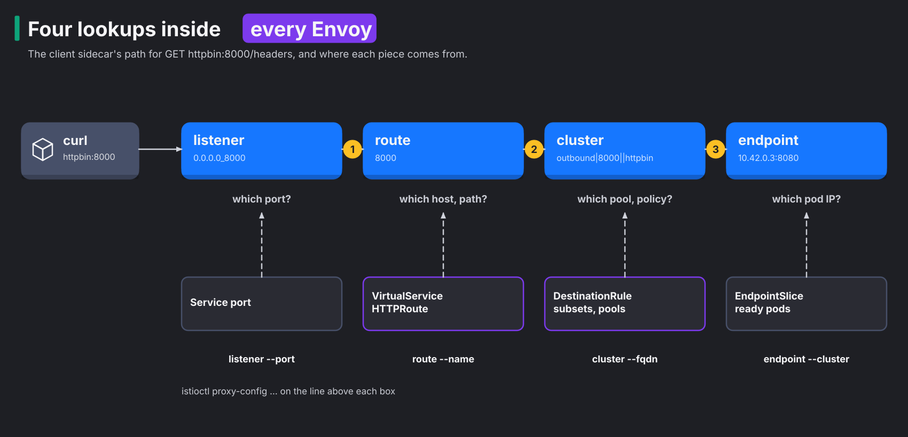
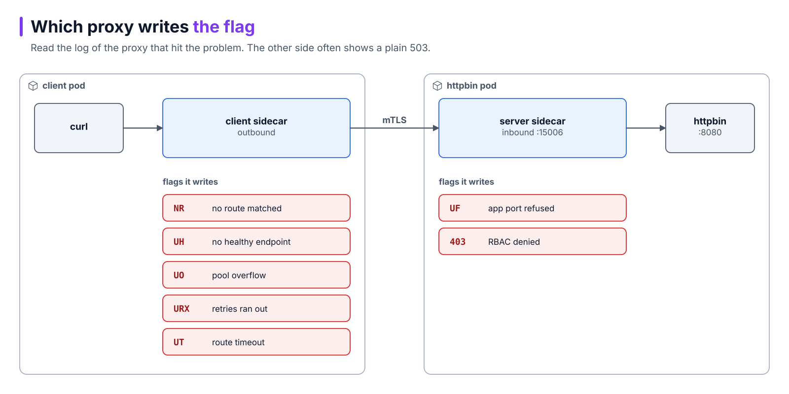

# Module 31: debugging Envoy with istioctl

> New to a term here, like listener, cluster or response flag? The [glossary](glossary.md) explains every term in this course.

**Before this module:** modules 5, 7 and 16. Module 30 helps.

**You need:** the lab running (`./scripts/start.sh` starts or repairs it), `istioctl`, and Docker access to the lab node for step 5.

A request fails with `503` while the app's own log shows nothing, which is the most common Istio support question. The answer almost always sits inside an Envoy, as a route that never matched, a cluster with no endpoints or a pool that overflowed, and because Envoy records every one of those decisions, `istioctl` reads them out. This module teaches you to read them in a fixed order, then makes you fix four broken setups without being told the cause, in four parts:

1. The Envoy model: four lookups per request, and which Istio resource feeds each one.
2. Sync and config: `proxy-status`, `proxy-config`, `analyze` and `x describe`.
3. Response flags: you cause `UH`, `UF`, `URX`, `NR`, `UO` and `NC` on purpose and read each one.
4. Break and fix: four faults, found with the tools alone.

Time: about 60 minutes. Adds about 80 MiB: two pods with sidecars in `course-debug`.

## Concept: four lookups inside every Envoy

Envoy knows nothing about Services, VirtualServices or DestinationRules, because istiod translates those into four kinds of Envoy objects, which Envoy looks up in order for every request:

1. A listener is a socket plus filters. It answers "which port did the request arrive on, and how do I read it?"
2. A route is a table of rules for HTTP. It answers "which host and path is this, and where should it go?"
3. A cluster is a named pool of upstream servers with its own policy. It answers "how do I talk to that pool: load balancing, connection limits, TLS?"
4. An endpoint is one member of a cluster, a pod IP and port. It answers "which pod gets this request?"

Think of a hotel switchboard, where the listener is the phone line the call came in on, the route is the operator's list of names, the cluster is the department, and the endpoint is the person who picks up.



Each lookup gets its data from a different source:

| Envoy object | Built from | `istioctl proxy-config` command |
|---|---|---|
| Listener | Service ports (one per port) | `listener --port 8000` |
| Route | Service hosts, plus VirtualService or HTTPRoute rules | `route --name 8000` |
| Cluster | Service, plus DestinationRule policy and subsets | `cluster --fqdn <host>` |
| Endpoint | EndpointSlice: ready pod IPs | `endpoint --cluster "<cluster name>"` |
| Secret | istiod's CA, the workload certificate | `secret` |

Cluster names follow one pattern, `outbound|8000|v1|httpbin.course-debug.svc.cluster.local`, whose four fields are direction, port, subset and host, where an empty subset means "all pods of the Service".

So debugging becomes a chain of four questions, and you stop at the first broken link. If the listener exists but the route doesn't name your host, the VirtualService never applied, and if the route points at a cluster that has no endpoints, the subset labels match no pod.

## Concept: the control plane's view and the proxy's view

The four lookups describe what one proxy holds, so before you trust them, check that the proxy holds the latest version. istiod sends config over xDS, and each proxy answers with an ACK, a receipt that says "applied", so `istioctl proxy-status` compares what istiod sent with what each proxy acknowledged, giving each kind of config one state:

| State | Meaning |
|---|---|
| `SYNCED` | The proxy acknowledged the latest config istiod sent |
| `STALE` | istiod sent new config and the proxy hasn't acknowledged it yet |
| `NOT SENT` | istiod has nothing of this kind for the proxy |

A proxy stays STALE when it's overloaded, frozen, or rejecting the config, and a rejected config also shows up as a warning in istiod's log and in the proxy's log. Step 5 freezes an Envoy to see STALE for real.

Two more tools look at your resources rather than at a proxy. `istioctl analyze` reads the Istio resources in the cluster, or in a file before you apply it, and reports known mistakes with a code such as `IST0101`, while `istioctl x describe pod` starts from one pod and lists every Service, DestinationRule, VirtualService and PeerAuthentication that affects it.

## Concept: response flags say who answered

An access log line from a sidecar looks like this:

```text
[2026-11-14T15:44:24.504Z] "GET /status/200 HTTP/1.1" 503 UH no_healthy_upstream - "-" 0 19 0 - "-" "curl/8.11.1" "283bd303-..." "httpbin:8000" "-" outbound|8000||httpbin.course-debug.svc.cluster.local - 10.43.78.39:8000 10.42.0.2:51610 - default
```

The three fields after the status code carry the diagnosis. `UH` is the response flag, a short code Envoy writes when Envoy itself caused or shaped the response, and `no_healthy_upstream` is the response code detail, a longer reason, while `via_upstream` in that spot would mean the app sent the response and Envoy passed it on. The field `outbound|8000||httpbin...` names the cluster, and the `"-"` before it means Envoy never picked an upstream host.



The key skill is knowing which proxy to ask. A request passes two Envoys in sidecar mode, and a flag appears in the log of the proxy that hit the problem, while the other proxy often shows a plain `503` with no flag at all. Step 6 shows this for `UF`, where the client's log says nothing useful and the server's log names the cause.

## The bigger picture: debugging a mesh is debugging config

Before service meshes, a `503` meant a broken app or a broken load balancer, while in a mesh most `503`s come from config, such as a typo in a subset label, a route that matches the wrong path or a pool limit someone copied from a blog. The proxy behaves exactly as told, so mesh debugging is mostly reading config and comparing it with intent.

That's why istioctl grew from an installer into a debugging kit. `proxy-config` started as a thin wrapper around Envoy's admin API (`/config_dump`, `/clusters`, `/logging`), `analyze` encodes years of support tickets as rules, and Kiali shows the same analyzers in its UI. Ambient mode keeps the same tools for waypoints, because a waypoint is an Envoy too, while ztunnel gets its own `istioctl ztunnel-config`.

The order matters more than the tools. Teams that debug fast follow one routine, reading the flag, checking sync, walking the four lookups and then reading the resources, while teams that debug slowly start by reading YAML.

## Why this way

**Why does a VirtualService change a route and not a cluster?** A VirtualService decides where a request goes, which is a routing decision, while the destination's own behaviour, such as pools and TLS, belongs to the destination, so it lives in the DestinationRule and lands on the cluster, mirroring module 16.

**Why does the client's sidecar answer `503 UH` itself?** In sidecar mode the client's Envoy picks the endpoint, so when the cluster has no healthy endpoints there's nobody to forward to, and Envoy writes the answer itself without the request ever leaving the client pod.

**Why freeze Envoy to see STALE?** A healthy proxy acknowledges in milliseconds, so STALE barely exists on a quiet lab. Stopping the process with `SIGSTOP` holds the proxy still while istiod pushes, which is what an overloaded proxy looks like.

**Why change log levels at runtime instead of restarting with debug on?** A restart throws away the broken state you want to look at, while Envoy's admin API changes levels on a running process, and `--reset` sets them back without a restart.

## Do it

### 1. Deploy the apps and check sync

```console
$ kubectl apply -f platform-engineering/manifests/31-apps.yaml -f platform-engineering/manifests/31-access-logs.yaml
namespace/course-debug created
serviceaccount/httpbin created
serviceaccount/client created
deployment.apps/httpbin created
service/httpbin created
deployment.apps/client created
telemetry.telemetry.istio.io/access-logs created

$ kubectl -n course-debug rollout status deploy/client
deployment "client" successfully rolled out

$ istioctl proxy-status -n course-debug
NAME                                     CLUSTER        ISTIOD                    VERSION     SUBSCRIBED TYPES
client-57854fb759-pdgsx.course-debug     Kubernetes     istiod-5c5bf76f-gtmzl     1.24.2      4 (CDS,LDS,EDS,RDS)
httpbin-fb884c77d-pnnfq.course-debug     Kubernetes     istiod-5c5bf76f-gtmzl     1.24.2      4 (CDS,LDS,EDS,RDS)
```

The Telemetry resource in `31-access-logs.yaml` turns on access logs for every sidecar in the namespace.

**What you should see.** One row per sidecar, both on 1.24.2.

Older guides show columns named `CDS`, `LDS`, `EDS` and `RDS` with `SYNCED` in each, but the istioctl 1.32 client that module 0 installed moved those states into the JSON output. Print them like this:

```console
$ istioctl proxy-status -o json | python3 -c 'import json,sys
for r in json.load(sys.stdin)["resources"]:
  if r["node"]["id"].endswith(".course-debug"):
    print(r["node"]["id"], *[c["typeUrl"].split(".")[-1] + "=" + c.get("configStatus", "?") for c in r["genericXdsConfigs"]])'
client-57854fb759-pdgsx.course-debug Cluster=SYNCED ClusterLoadAssignment=SYNCED Listener=SYNCED RouteConfiguration=SYNCED
httpbin-fb884c77d-pnnfq.course-debug Cluster=SYNCED ClusterLoadAssignment=SYNCED Listener=SYNCED RouteConfiguration=SYNCED
```

**What you should see.** `ClusterLoadAssignment` is Envoy's name for endpoints. For one proxy, `istioctl proxy-status deploy/client -n course-debug` compares istiod's copy with the proxy's copy line by line and prints `Clusters Match`, `Listeners Match` and `Routes Match`.

### 2. Walk the four lookups on the client

```console
$ istioctl proxy-config listener deploy/client -n course-debug --port 8000
ADDRESSES PORT MATCH                                DESTINATION
0.0.0.0   8000 Trans: raw_buffer; App: http/1.1,h2c Route: 8000
0.0.0.0   8000 ALL                                  PassthroughCluster

$ istioctl proxy-config route deploy/client -n course-debug --name 8000
NAME     VHOST NAME                                      DOMAINS                                       MATCH     VIRTUAL SERVICE
8000     backend-v1.shop.svc.cluster.local:8000          backend-v1.shop, 10.43.22.204                 /*
8000     backend-v2.shop.svc.cluster.local:8000          backend-v2.shop, 10.43.198.219                /*
8000     backend.shop.svc.cluster.local:8000             backend.shop, 10.43.239.201                   /*        backend-route-0-istio-autogenerated-k8s-gateway.shop
8000     httpbin.course-debug.svc.cluster.local:8000     httpbin, httpbin.course-debug + 1 more...     /*

$ istioctl proxy-config cluster deploy/client -n course-debug --fqdn httpbin.course-debug.svc.cluster.local
SERVICE FQDN                               PORT     SUBSET     DIRECTION     TYPE     DESTINATION RULE
httpbin.course-debug.svc.cluster.local     8000     -          outbound      EDS

$ istioctl proxy-config endpoint deploy/client -n course-debug --cluster "outbound|8000||httpbin.course-debug.svc.cluster.local"
ENDPOINT            STATUS      OUTLIER CHECK     CLUSTER
10.42.0.56:8080     HEALTHY     OK                outbound|8000||httpbin.course-debug.svc.cluster.local
```

**What you should see.** Four short tables, one per lookup, which you follow from top to bottom:

1. The listener on port 8000 reads plain HTTP and hands it to route table `8000`. Anything that isn't HTTP falls to `PassthroughCluster`.
2. Route table `8000` holds one virtual host per Service on port 8000 in the whole mesh. The httpbin host has no VirtualService yet, while the shop's backend shows its HTTPRoute, translated by istiod.
3. The cluster uses EDS, so istiod sends its endpoints separately. No DestinationRule applies.
4. One endpoint, the httpbin pod's IP on its target port 8080, `HEALTHY`.

Now the other side, where the server's sidecar receives on its inbound listener:

```console
$ istioctl proxy-config listener deploy/httpbin -n course-debug --port 15006 | grep 8080
0.0.0.0   15006 Trans: tls; App: istio,istio-peer-exchange,istio-http/1.0,istio-http/1.1,istio-h2; Addr: *:8080 Cluster: inbound|8080||
0.0.0.0   15006 Trans: raw_buffer; Addr: *:8080                                                                 Cluster: inbound|8080||

$ istioctl proxy-config cluster deploy/httpbin -n course-debug --direction inbound
SERVICE FQDN     PORT     SUBSET     DIRECTION     TYPE             DESTINATION RULE
                 8080     -          inbound       ORIGINAL_DST
```

**What you should see.** Two filter chains on 15006 for port 8080, one for mTLS (`Trans: tls; App: istio,...`) and one for plain text (`Trans: raw_buffer`), and both lead to cluster `inbound|8080||`, which sends the request to the app on localhost.

### 3. Look at the certificate and at the waypoint

```console
$ istioctl proxy-config secret deploy/client -n course-debug
RESOURCE NAME     TYPE           STATUS     VALID CERT     SERIAL NUMBER                        NOT AFTER                NOT BEFORE
default           Cert Chain     ACTIVE     true           2d26072efd0b4b53526e8970f30380db     2026-11-15T23:28:59Z     2026-11-14T23:26:59Z
ROOTCA            CA             ACTIVE     true           b1d9074685f90f0b29a27c6e0edc1a1a     2036-11-10T12:26:51Z     2026-11-13T12:26:51Z

$ istioctl proxy-config listener deploy/waypoint -n shop
ADDRESSES PORT  MATCH DESTINATION
          0     ALL   Cluster: inbound-vip|8000|http|backend-v2.shop.svc.cluster.local
          0     ALL   Cluster: inbound-vip|8000|http|backend-v1.shop.svc.cluster.local
          0     ALL   Cluster: inbound-vip|8000|http|backend-v1.shop.svc.cluster.local
          0     ALL   Cluster: encap
          0     ALL   Cluster: encap
          0     ALL   Cluster: connect_originate
0.0.0.0   15008 ALL   Inline Route:
0.0.0.0   15021 ALL   Inline Route: /healthz/ready*
0.0.0.0   15090 ALL   Inline Route: /stats/prometheus*

$ istioctl proxy-config cluster deploy/waypoint -n shop | grep -E "FQDN|backend"
SERVICE FQDN                                         PORT     SUBSET     DIRECTION       TYPE             DESTINATION RULE
backend-v1.shop.svc.cluster.local                    8000     http       inbound-vip     EDS
backend-v2.shop.svc.cluster.local                    8000     http       inbound-vip     EDS
backend.shop.svc.cluster.local                       8000     http       inbound-vip     EDS
```

**What you should see.** The client holds two secrets: `default`, the workload certificate, valid for 24 hours, and `ROOTCA`, the root it trusts, valid for 10 years. A `VALID CERT` of `false`, or a `NOT AFTER` in the past, explains mTLS failures at once.

The waypoint looks different, because its listeners have no port numbers, only `Cluster: inbound-vip|8000|http|backend-v1.shop.svc.cluster.local` and a few `encap` and `connect_originate` entries. A waypoint receives everything through one HBONE port, 15008, and sorts requests internally by the Service's virtual IP, and its clusters say `inbound-vip` instead of `outbound`, because the waypoint acts for the destination. The same four lookups still apply, and only the names change.

### 4. Find mistakes with analyze and describe

```console
$ cat platform-engineering/manifests/31-broken.yaml
# Module 31: three mistakes in one file, for istioctl analyze to find.
#   1. The VirtualService routes to subset v2, which the DestinationRule never defines.
#   2. A second VirtualService claims the same host, so the two conflict.
#   3. Subset v3 selects pods with version=v3, and no such pod exists.
apiVersion: networking.istio.io/v1
kind: DestinationRule
metadata:
  name: httpbin
  namespace: course-debug
spec:
  host: httpbin
  subsets:
    - name: v1
      labels:
        version: v1
    - name: v3
      labels:
        version: v3
---
apiVersion: networking.istio.io/v1
kind: VirtualService
metadata:
  name: httpbin
  namespace: course-debug
spec:
  hosts:
    - httpbin
  http:
    - route:
        - destination:
            host: httpbin
            subset: v2
---
apiVersion: networking.istio.io/v1
kind: VirtualService
metadata:
  name: httpbin-copy
  namespace: course-debug
spec:
  hosts:
    - httpbin.course-debug.svc.cluster.local
  http:
    - route:
        - destination:
            host: httpbin
            subset: v1

$ kubectl apply -f platform-engineering/manifests/31-broken.yaml
destinationrule.networking.istio.io/httpbin created
virtualservice.networking.istio.io/httpbin created
virtualservice.networking.istio.io/httpbin-copy created

$ istioctl analyze -n course-debug
Error [IST0101] (VirtualService course-debug/httpbin) Referenced host+subset in destinationrule not found: "httpbin+v2"
Error [IST0109] (VirtualService course-debug/httpbin-copy) The VirtualServices course-debug/httpbin,course-debug/httpbin-copy associated with mesh gateway define the same host */httpbin.course-debug.svc.cluster.local which can lead to undefined behavior. This can be fixed by merging the conflicting VirtualServices into a single resource.
Error [IST0109] (VirtualService course-debug/httpbin) The VirtualServices course-debug/httpbin,course-debug/httpbin-copy associated with mesh gateway define the same host */httpbin.course-debug.svc.cluster.local which can lead to undefined behavior. This can be fixed by merging the conflicting VirtualServices into a single resource.
Error [IST0173] (DestinationRule course-debug/httpbin) The Subset v3 defined in the DestinationRule does not select any pods. Which may lead to 503 UH (NoHealthyUpstream).
Error: Analyzers found issues when analyzing namespace: course-debug.
See https://istio.io/v1.32/docs/reference/config/analysis for more information about causes and resolutions.
```

**What you should see.** Three kinds of problems, all errors.

`analyze` exits with code 79 when it finds errors, so a CI pipeline stops on them. To check a file before it reaches the cluster, pass the file: `istioctl analyze -n course-debug platform-engineering/manifests/31-broken.yaml` merges it with what the cluster already holds.

Now see what the broken config does to a request, and what `describe` says:

```console
$ kubectl -n course-debug exec deploy/client -c curl -- curl -s -w " %{http_code}\n" http://httpbin:8000/status/200
 503

$ kubectl -n course-debug logs deploy/client -c istio-proxy --tail=1
[2026-11-14T23:29:16.183Z] "GET /status/200 HTTP/1.1" 503 NC cluster_not_found - "-" 0 0 0 - "-" "curl/8.11.1" "8c328fda-aa14-9789-80e5-09de0afe0070" "httpbin:8000" "-" - - 10.43.140.145:8000 10.42.0.57:55236 - -

$ istioctl x describe pod $(kubectl -n course-debug get pod -l app=httpbin -o jsonpath='{.items[0].metadata.name}') -n course-debug
Pod: httpbin-fb884c77d-pnnfq
   Pod Revision: default
   Pod Ports: 8080 (httpbin), 15090 (istio-proxy)
--------------------
Service: httpbin
   Port: http 8000/HTTP targets pod port 8080
DestinationRule: httpbin for "httpbin"
   Matching subsets: v1
      (Non-matching subsets v3)
   No Traffic Policy
VirtualService: httpbin
   WARNING: No destinations match pod subsets (checked 1 HTTP routes)
      Warning: Route to UNKNOWN subset v2; check DestinationRule httpbin
--------------------
Effective PeerAuthentication:
   Workload mTLS mode: PERMISSIVE
Skipping Gateway information (no ingress gateway pods)
```

**What you should see.** ` 503` and a log line with `503 NC cluster_not_found`. `NC` means "no cluster", because the route points at `outbound|8000|v2|...`, which doesn't exist, since no subset `v2` exists. Of the two competing VirtualServices the older one won, and `describe` names the problem from the pod's point of view.

Remove the broken config:

```console
$ kubectl -n course-debug delete virtualservice,destinationrule --all
virtualservice.networking.istio.io "httpbin" deleted
virtualservice.networking.istio.io "httpbin-copy" deleted
destinationrule.networking.istio.io "httpbin" deleted
```

### 5. Catch a proxy STALE

Freeze the client's Envoy with `SIGSTOP`, push new config, and look:

```console
$ NODE=k3d-k8s-lab-server-0
$ POD=$(kubectl -n course-debug get pod -l app=client -o jsonpath='{.items[0].metadata.name}')
$ CID=$(docker exec $NODE crictl ps --name istio-proxy --label io.kubernetes.pod.name=$POD -q)
$ PID=$(docker exec $NODE crictl inspect --output go-template --template '{{.info.pid}}' $CID)
$ ENVOY=$(docker exec $NODE sh -c "cat /proc/$PID/task/*/children" | awk '{print $1}')
$ docker exec $NODE cat /proc/$ENVOY/comm
envoy

$ docker exec $NODE kill -STOP $ENVOY
$ kubectl apply -f platform-engineering/manifests/31-status-only.yaml
virtualservice.networking.istio.io/httpbin created
```

The first process in `istio-proxy` is pilot-agent and its child process is Envoy, so the `children` file gives Envoy's process ID, and the `comm` line prints `envoy` to prove it.

Wait about five seconds, then run the JSON command from step 1 again:

```console
$ istioctl proxy-status -o json | python3 -c 'import json,sys
for r in json.load(sys.stdin)["resources"]:
  if r["node"]["id"].endswith(".course-debug"):
    print(r["node"]["id"], *[c["typeUrl"].split(".")[-1] + "=" + c.get("configStatus", "?") for c in r["genericXdsConfigs"]])'
httpbin-fb884c77d-pnnfq.course-debug Cluster=SYNCED ClusterLoadAssignment=SYNCED Listener=SYNCED RouteConfiguration=SYNCED
client-57854fb759-pdgsx.course-debug Cluster=STALE ClusterLoadAssignment=SYNCED Listener=STALE RouteConfiguration=STALE
```

**What you should see.** istiod pushed the VirtualService to both proxies, and httpbin acknowledged while the frozen client didn't, so three kinds show STALE. `istioctl proxy-config` on the client now times out, because the admin API is frozen too. Wake Envoy up:

```console
$ docker exec $NODE kill -CONT $ENVOY
```

Run the JSON command once more, and both proxies show SYNCED within a second or two. A proxy that stays STALE for minutes is the real alarm, so check its CPU limit and its log.

### 6. Read the response flags, one by one

The VirtualService from step 5 is still in place, matching only paths under `/status`, with two retries on 5xx. Send four requests:

```console
$ kubectl -n course-debug exec deploy/client -c curl -- curl -s -o /dev/null -w "%{http_code}\n" http://httpbin:8000/status/503
503

$ kubectl -n course-debug exec deploy/client -c curl -- curl -s -o /dev/null -w "%{http_code}\n" http://httpbin:8000/headers
404

$ kubectl -n course-debug logs deploy/client -c istio-proxy --tail=2
[2026-11-14T23:29:42.631Z] "GET /status/503 HTTP/1.1" 503 URX via_upstream - "-" 0 0 28 28 "-" "curl/8.11.1" "d94fb9f5-39c6-93e5-bf0c-4c89f3117eeb" "httpbin:8000" "10.42.0.56:8080" outbound|8000||httpbin.course-debug.svc.cluster.local 10.42.0.57:38540 10.43.140.145:8000 10.42.0.57:51162 - -
[2026-11-14T23:29:42.723Z] "GET /headers HTTP/1.1" 404 NR route_not_found - "-" 0 0 0 - "-" "curl/8.11.1" "a781965b-42d2-94cb-bacb-9cc148411aaf" "httpbin:8000" "-" - - 10.43.140.145:8000 10.42.0.57:51166 - -

$ kubectl -n course-debug logs deploy/httpbin -c istio-proxy --tail=3 | grep -c "status/503"
3
```

**What you should see.** `503` then `404`, and two log lines.

1. `URX` means the retry limit ran out, and httpbin's own log counts `3` requests for `/status/503`: the first try plus two retries.
2. `NR` means no route matched, so Envoy answered `404` itself, and httpbin never saw the request.

Now remove the VirtualService and take every pod away:

```console
$ kubectl -n course-debug delete virtualservice httpbin
virtualservice.networking.istio.io "httpbin" deleted

$ kubectl -n course-debug scale deploy httpbin --replicas=0
deployment.apps/httpbin scaled

$ kubectl -n course-debug wait --for=delete pod -l app=httpbin --timeout=60s
$ kubectl -n course-debug exec deploy/client -c curl -- curl -s -w " %{http_code}\n" http://httpbin:8000/status/200
no healthy upstream 503

$ kubectl -n course-debug logs deploy/client -c istio-proxy --tail=1
[2026-11-14T23:30:07.117Z] "GET /status/200 HTTP/1.1" 503 UH no_healthy_upstream - "-" 0 19 0 - "-" "curl/8.11.1" "9d6eda93-a656-92bb-a2a9-b3ecb69c24df" "httpbin:8000" "-" outbound|8000||httpbin.course-debug.svc.cluster.local - 10.43.140.145:8000 10.42.0.57:60340 - default

$ kubectl -n course-debug scale deploy httpbin --replicas=1
deployment.apps/httpbin scaled

$ kubectl -n course-debug rollout status deploy/httpbin
deployment "httpbin" successfully rolled out
```

**What you should see.** `no healthy upstream 503`, and `503 UH no_healthy_upstream` with `"-"` as the upstream host, because the cluster exists but holds no endpoints.

Next, a pod that exists but refuses connections, by pointing the Service at a port nobody listens on:

```console
$ kubectl -n course-debug patch svc httpbin --type json -p '[{"op":"replace","path":"/spec/ports/0/targetPort","value":9999}]'
service/httpbin patched

$ kubectl -n course-debug exec deploy/client -c curl -- curl -s -w " %{http_code}\n" http://httpbin:8000/status/200
upstream connect error or disconnect/reset before headers. retried and the latest reset reason: remote connection failure, transport failure reason: delayed connect error: Connection refused 503

$ kubectl -n course-debug logs deploy/client -c istio-proxy --tail=1
[2026-11-14T23:30:27.448Z] "GET /status/200 HTTP/1.1" 503 - via_upstream - "-" 0 190 34 33 "-" "curl/8.11.1" "524b91db-43e4-9922-8c4d-9ccba2b0bf4e" "httpbin:8000" "10.42.0.58:9999" outbound|8000||httpbin.course-debug.svc.cluster.local 10.42.0.57:54338 10.43.140.145:8000 10.42.0.57:40072 - default

$ kubectl -n course-debug logs deploy/httpbin -c istio-proxy --tail=1
[2026-11-14T23:30:27.451Z] "GET /status/200 HTTP/1.1" 503 URX,UF upstream_reset_before_response_started{remote_connection_failure|delayed_connect_error:_Connection_refused} - "delayed_connect_error:_Connection_refused" 0 190 29 - "-" "curl/8.11.1" "524b91db-43e4-9922-8c4d-9ccba2b0bf4e" "httpbin:8000" "10.42.0.58:9999" inbound|9999|| - 10.42.0.58:9999 10.42.0.57:54338 outbound_.8000_._.httpbin.course-debug.svc.cluster.local default

$ kubectl -n course-debug patch svc httpbin --type json -p '[{"op":"replace","path":"/spec/ports/0/targetPort","value":"http"}]'
service/httpbin patched
```

**What you should see.** The body says `upstream connect error or disconnect/reset before headers. retried and the latest reset reason: remote connection failure, transport failure reason: delayed connect error: Connection refused 503`. Now compare the two logs.

The client's log shows `-`, no flag, because from its side the server's Envoy sent a normal `503`. The server's sidecar holds the truth, `UF`, upstream connection failure, when it tried the app on port 9999, and it also retried once on its own, hence `URX`, which is why the flag diagram marks `UF` on the server side.

Last, overflow a connection pool:

```console
$ cat platform-engineering/manifests/31-tight-pool.yaml
# Module 31: a connection pool of one connection and one waiting request.
# Ten requests at once overflow it, and the client's sidecar answers 503 UO itself.
apiVersion: networking.istio.io/v1
kind: DestinationRule
metadata:
  name: httpbin
  namespace: course-debug
spec:
  host: httpbin
  trafficPolicy:
    connectionPool:
      tcp:
        maxConnections: 1
      http:
        http1MaxPendingRequests: 1
        http2MaxRequests: 1
        maxRequestsPerConnection: 1

$ kubectl apply -f platform-engineering/manifests/31-tight-pool.yaml
destinationrule.networking.istio.io/httpbin created

$ kubectl -n course-debug exec deploy/client -c curl -- sh -c 'for i in $(seq 1 10); do curl -s -o /dev/null -w "%{http_code}\n" http://httpbin:8000/delay/1 & done; wait' | sort | uniq -c
   2 200
   8 503

$ kubectl -n course-debug logs deploy/client -c istio-proxy --tail=10 | grep -m1 UO
[2026-11-14T23:30:51.887Z] "GET /delay/1 HTTP/1.1" 503 UO upstream_reset_before_response_started{overflow} - "-" 0 81 0 - "-" "curl/8.11.1" "955e3967-1481-9709-a8a8-048aaa4635c8" "httpbin:8000" "-" outbound|8000||httpbin.course-debug.svc.cluster.local - 10.43.140.145:8000 10.42.0.57:60920 - default

$ kubectl -n course-debug delete destinationrule httpbin
destinationrule.networking.istio.io "httpbin" deleted
```

**What you should see.** `2 200` and `8 503`, and a line with `503 UO upstream_reset_before_response_started{overflow}`. The pool allows one connection and one waiting request, so the other eight requests overflowed, and the client's Envoy rejected them at once, without touching httpbin, which is module 5's circuit breaker seen from the log.

One more flag needs no setup. An app that answers `503` by itself produces `503 - via_upstream`, with no flag and `via_upstream` as the detail, a combination that means "the app said so", so you debug the app, not the mesh.

### 7. Turn up Envoy's logging, then turn it down

Access logs show one line per request, and when that's not enough, Envoy's own debug log shows each decision, which you change on the running proxy:

```console
$ istioctl proxy-config log deploy/client -n course-debug | head -4
client-57854fb759-pdgsx.course-debug:
active loggers:
  admin: warning
  alternate_protocols_cache: warning

$ istioctl proxy-config log deploy/client -n course-debug --level router:debug
client-57854fb759-pdgsx.course-debug:
active loggers:
  admin: warning
  alternate_protocols_cache: warning
  aws: warning
  assert: warning
  backtrace: warning
  basic_auth: warning
  cache_filter: warning
  client: warning
  config: warning
  connection: warning
  conn_handler: warning
  compression: warning
  credential_injector: warning
  decompression: warning
  dns: warning
  dubbo: warning
  envoy_bug: warning
  ext_authz: warning
...
  udp: warning
  wasm: warning
  websocket: warning
  golang: warning
  stats_sinks: warning

$ kubectl -n course-debug exec deploy/client -c curl -- curl -s -o /dev/null http://httpbin:8000/status/200
$ kubectl -n course-debug logs deploy/client -c istio-proxy --since=10s | grep "debug.*router" | head -3
2026-11-14T23:31:06.537114Z	debug	envoy router external/envoy/source/common/router/router.cc:527	[Tags: "ConnectionId":"50","StreamId":"3948033477778310680"] cluster 'outbound|8000||httpbin.course-debug.svc.cluster.local' match for URL '/status/200'	thread=21
2026-11-14T23:31:06.537682Z	debug	envoy router external/envoy/source/common/router/router.cc:756	[Tags: "ConnectionId":"50","StreamId":"3948033477778310680"] router decoding headers:
2026-11-14T23:31:06.540563Z	debug	envoy router external/envoy/source/common/router/upstream_request.cc:593	[Tags: "ConnectionId":"50","StreamId":"3948033477778310680"] pool ready	thread=21

$ istioctl proxy-config log deploy/client -n course-debug --reset | grep router
  router: warning
```

**What you should see.** Most loggers start at `warning`, and after the change `router: debug` shows, while the proxy's log gains lines like the three above.

The router logger shows the route match and the chosen cluster for each request, the same chain as step 2, live. `--reset` sets every logger back to `warning`, and you should reset them when you're done, because debug logs on a busy proxy cost real CPU. Other useful loggers are `connection` for TCP and TLS problems, `rbac` for authorization decisions, and `upstream` for endpoint selection.

## Investigate

Each question is a broken setup. Apply the file without reading it, find the cause with `istioctl` and the access logs, then check your answer. Remove each break before the next with `kubectl -n course-debug delete virtualservice,destinationrule,sidecar,authorizationpolicy --all`.

1. `kubectl apply -f platform-engineering/manifests/31-break-1.yaml`. Every request to httpbin now fails with `503`. Find out why.
2. `kubectl apply -f platform-engineering/manifests/31-break-2.yaml`. Requests still return `200`, but httpbin no longer sees `X-Forwarded-Client-Cert`. Find out why.
3. `kubectl apply -f platform-engineering/manifests/31-break-3.yaml`. `/status/200` works, but `/delay/1` fails. Find the setting and its value.
4. `kubectl apply -f platform-engineering/manifests/31-break-4.yaml`. `/get` works, `/anything/order` gets `403`. Find which resource refuses it, and from which log.

<details>
<summary>Answers</summary>

1. The client's log shows `503 UH no_healthy_upstream` on cluster `outbound|8000|v1|httpbin.course-debug.svc.cluster.local`, and `istioctl proxy-config endpoint deploy/client -n course-debug --cluster "outbound|8000|v1|httpbin.course-debug.svc.cluster.local"` prints an empty table, because the subset cluster exists but has no endpoints. `istioctl analyze -n course-debug` reports `IST0173 ... The Subset v1 defined in the DestinationRule does not select any pods`, and `istioctl x describe pod` says `WARNING POD DOES NOT MATCH ANY SUBSETS`. The DestinationRule selects `version: V1` with a capital V while the pod carries `version: v1`, and labels compare case-sensitively.
2. The client's log shows `"- - -" 0 - - - ... PassthroughCluster`, a TCP line with no HTTP and no route, and `istioctl proxy-config cluster deploy/client -n course-debug --fqdn httpbin.course-debug.svc.cluster.local` prints nothing, so the client's Envoy no longer knows httpbin. The culprit is a Sidecar resource whose `egress.hosts` lists only `istio-system/*` and forgot `./*`. The call still works because the outbound policy is `ALLOW_ANY` and httpbin's sidecar accepts plain text in PERMISSIVE mode, while `istioctl analyze` reports no issues at all. This break is the dangerous kind, because nothing fails and mTLS silently disappears.
3. The client's log shows `504 UT response_timeout` after exactly 500 ms. `istioctl proxy-config route deploy/client -n course-debug --name 8000 -o json | grep '"timeout": "0.500s"'` finds the route's timeout, and `istioctl x describe pod` names the VirtualService `httpbin`, which sets `timeout: 500ms` while `/delay/1` takes a second. `analyze` reports nothing, because a short timeout isn't a mistake in itself.
4. The client's log shows `403 - via_upstream`, so the client's Envoy only passed on someone else's answer, while httpbin's sidecar log shows `403 - rbac_access_denied_matched_policy[ns[course-debug]-policy[block-anything]-rule[0]]`, which names the policy and the rule. `istioctl x authz check deploy/httpbin -n course-debug` lists `DENY block-anything.course-debug 1`. `kubectl apply` already warned about it, and `istioctl analyze` repeats the warning as `IST0133`, because a DENY rule with only HTTP fields also blocks every TCP port in its scope.

</details>

## Clean up

```console
$ ./platform-engineering/reset.sh
Removing course rules from the shop namespace
Applying the baseline Istio config from manifests/istio
Turning off the backend experiment settings
Asking ArgoCD to sync istio-config from Git
Done. Baseline: 100% of backend traffic to v1, no faults, no extra rules.
```

This deletes the `course-debug` namespace with its access log setting, the routes, the break files you applied and the two pods.
